# 8. 边值问题

在本章中，我们将讨论使用 MATLAB 内置求解器求解常微分方程 (ODE) 边值问题 (BVP) 的基本步骤。BVP 与初值问题 (IVP) 的唯一区别在于，BVP 中给定的微分方程在两个边界条件（即初始条件和结束条件）下有效。BVP 可以用以下表达式表示：
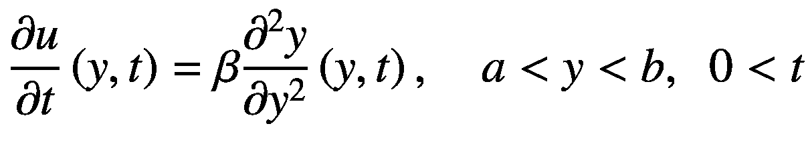 (8-1)

BVP 中有三种主要类型（外加另一种类型）的边界条件 (BC)，如下所列：
- 狄利克雷边界条件：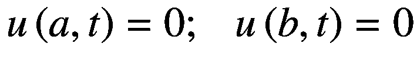 (8-2)
- 诺伊曼边界条件：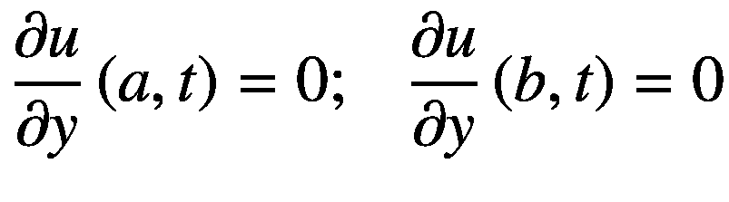 (8-3)
- 罗宾或混合边界条件：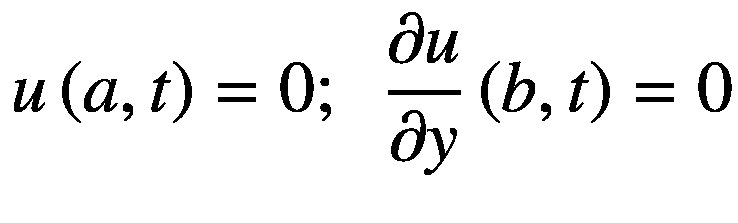 (8-4) 或 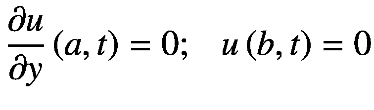 (8-5)
- 周期边界条件：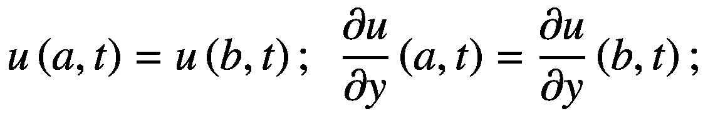 (8-6)

大多数 BVP 是二阶问题；因此，我们着重求解或模拟定义如下的二阶 BVP 方程：
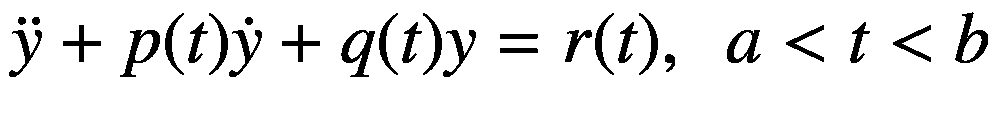 (8-7)
其中，令 *Ι* = (*a*, *b*) ⊆ ℝ 为一个区间，并令 *p*, *q*, *r* : (*a*, *b*) → ℝ 为连续函数。

BVP 中的常微分方程可能有一个解、几个解或无限多个解，具体取决于边界条件（边界值和边界类型）。例如，考虑如下所示的二阶微分方程：
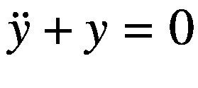 (8-8)
以下是该方程的三个案例：
- **案例 #1：** 方程 (8-8) 在边界条件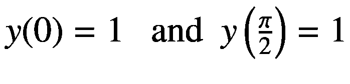下，有唯一解 `y(t) = sin(t) + cos(t)`。
- **案例 #2：** 方程 (8-8) 在边界条件 `y(0) = 1` 和 `y(π) = 1`下无解。
- **案例 #3：** 方程 (8-8) 在边界条件 `y(0) = 1` 和 `y(2π) = 1`下有无穷多解。

类似地，如果需要，我们也可以利用其他边界条件生成更多其他案例。

**对于案例 #1。** 在条件下，我们假设方程 (8-8) 的通解为 `y(t) = C[1] * sin(t) + C[2] * cos(t)`。可以通过以下表达式并将边界条件应用于问题的通解来求出 `C[1]` 和 `C[2]`：

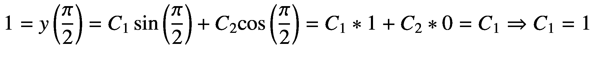
现在，解如下所示：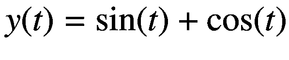

**对于案例 #2。** 在 `y(0) = 1` 和 `y(π) = 1`条件下，我们假设方程 (8-8) 的通解为 `y(t) = C[1] * sin(t) + C[2] * cos(t)`。可以通过以下表达式并将边界条件应用于问题的通解来求出 `C[1]` 和 `C[2]`：

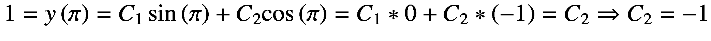
对于 `a = 0`，`C[2] = 1`；而对于 `b = π`，`C[2] = -1`。这相互矛盾，意味着对于这些边界条件，没有解。

**对于案例 #3。** 在 `y(0) = 1` 和 `y(2π) = 1`条件下，我们假设方程 (8-8) 的通解为 `y(t) = C[1] * sin(t) + C[2] * cos(t)`。可以通过以下表达式并将边界条件应用于问题的通解来求出 `C[1]` 和 `C[2]`：
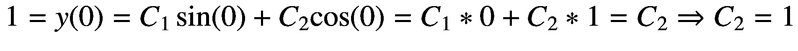
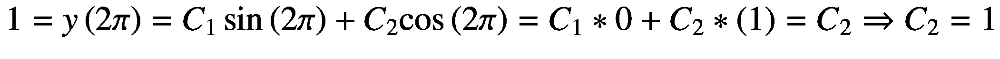
`C[1]` 可以是任意数值，这意味着对于给定的边界条件，该问题具有无限多个解，形式为 `y(t) = C[1] * sin(t) + cos(t)`，其中 `C[1] ⊆ ∀`。

让我们探索 MATLAB 工具和函数，以及 Symbolic Math Toolbox 的 MuPAD 笔记，来求解几个不同的 BVP。以下 MATLAB 内置函数用于求解 BVP：`bvpinit`、`bvp4c`、`bvp5c`、`bc`、`odeset` 和 `deval`。在 Symbolic Math Toolbox 中，使用命令 `ode::solve` 来计算给定问题的解析解。

现在，让我们考虑几个不同的 BVP 二阶常微分方程，以找到数值解，并使用 MATLAB 和 Symbolic Math Toolbox 对其进行仿真。

在 MATLAB 中计算 BVP 的数值解时，有一些通用的“必须遵循”步骤。
-   **步骤 #0.** 通过一阶微分方程组重写给定的高阶微分方程。此步骤与 IVP 中的步骤类似。
-   **步骤 #1.** 通过内联函数或函数句柄（`@`）或函数文件（m 文件）定义给定的问题微分方程。
-   **步骤 #2.** 通过匿名函数（函数句柄，`@`）或单独的函数文件（m 文件）或嵌套函数定义边界条件的残差。
-   **步骤 #3.** 定义模拟范围/空间（例如，时间空间）。
-   **步骤 #4.** 使用 `bvpinit()` 对解的结构进行猜测。请注意，初始猜测可以是常数值，也可以是针对特定（常数）值计算的函数。
-   **步骤 #5.** 使用 `bvp4c()` 或 `bvp5c()` 获取解。
-   **步骤 #6.** 使用 `deval()` 计算数值解。

让我们考虑几个不同的问题，以展示如何根据先前用于求解 BVP 的步骤过程来使用 MATLAB 工具。

## 狄利克雷边界条件问题

### 示例 1

示例如下：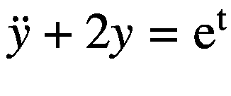，其中 `y = [y[0] y[end]]`
这里 `y[0] = y(0) = 0` 和 `y[end] = y(π) = 1` 是狄利克雷边界条件。

给定问题 `f(t, y)` 的解仅在 `t ∈ [0, π]` 范围内及边界之外有效。`f(t, y)` 的有效性并不重要。

我们首先需要将其重写为两个一阶常微分方程：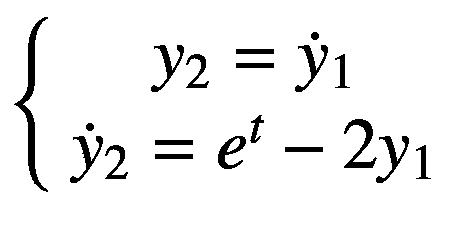。

这类似于求解二阶常微分方程的初值问题方法。现在我们编写一个 m 文件来计算其数值解。以下是计算给定微分方程数值解的脚本（`BVP_EX1.m`）。练习的计算解如图 8-1 所示。

# 边值问题数值求解示例

```matlab
clc; clearvars
```

## 示例 1

**问题描述**：求解 $y'' + 2y = e^t$，边界条件为 $y(0)=0, y(\pi)=1$。

我们需要将给定的问题方程重写为一组一阶常微分方程，类似于二阶初值问题。重写为：
$$ \frac{dy}{dt} = [y_2, e^t - 2y_1] $$

这可以通过函数文件或匿名函数定义。

**通过匿名函数定义：**

```matlab
dy=@(t, y)([y(2); exp(t)-2*y(1)]);
```

**通过匿名函数定义边界条件的残差（狄利克雷边界条件）：**

```matlab
Res=@(yl, yr)([yl(1), yr(1)-1]);
```

**创建模拟的时间空间：**

```matlab
t = linspace(0, pi, 40);
```

**创建初始猜测结构**：在 `[0,pi]` 内均匀分布的 40 个点，以及常量值 $y_1=0$ 和 $y_2=1$ 的猜测：

```matlab
SOLin1 = bvpinit(t,[0 1]);
```

**另一个初始猜测**：$y_1=2$ 和 $y_2=1$

```matlab
SOLin2 = bvpinit(t,[2 1]);
```

**获取问题的数值解：**

```matlab
SOL1 = bvp4c(dy, Res, SOLin1);
SOL2 = bvp4c(dy, Res, SOLin2);

y1 = deval(SOL1,t);
y2 = deval(SOL2,t);

figure
plot(t, y1(1,1:end), 'ro-', t, y2(1, :),'bx-', 'linewidth', 1.5),
grid minor;
legend('\it 猜测 #1: y_1=1  & y_2=0 ',...
'\it 猜测 #2: y_1=2  & y_2=1', 'location', 'SouthWest')
xlabel( '\it t, 时间')
ylabel( '\it y(t) 解值')
axis tight
syms y t d dt e
EQN = d²*y/dt²+2*y==e^t;
title('\it 边值问题解: $\frac{d²y}{dt²}+2y=e^t$' , 'Interpreter',  'latex')
```

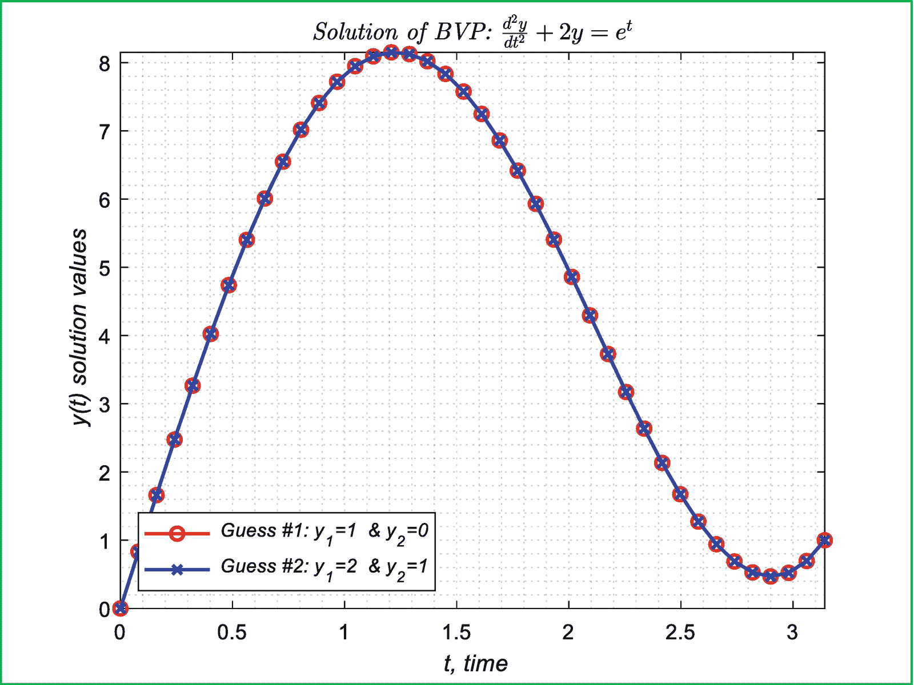

**图 8-1** 二阶边值问题的模拟结果：$\ddot{y}+2y={e}^t$

解决此练习的另一种方法是使用符号数学工具箱，该工具箱可以用两行命令（在 MuPAD 笔记中）计算问题的解析解，语法如下：

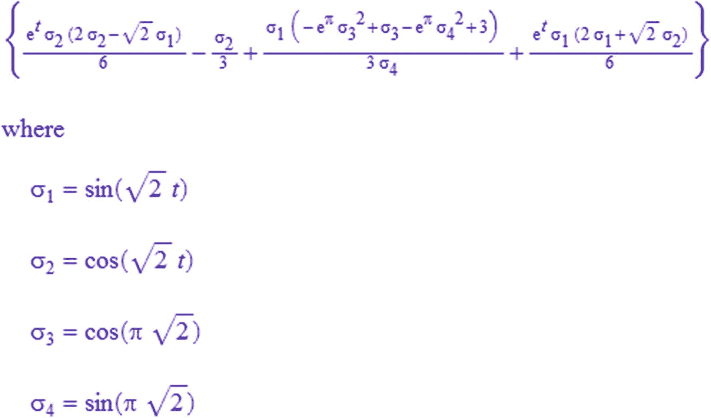

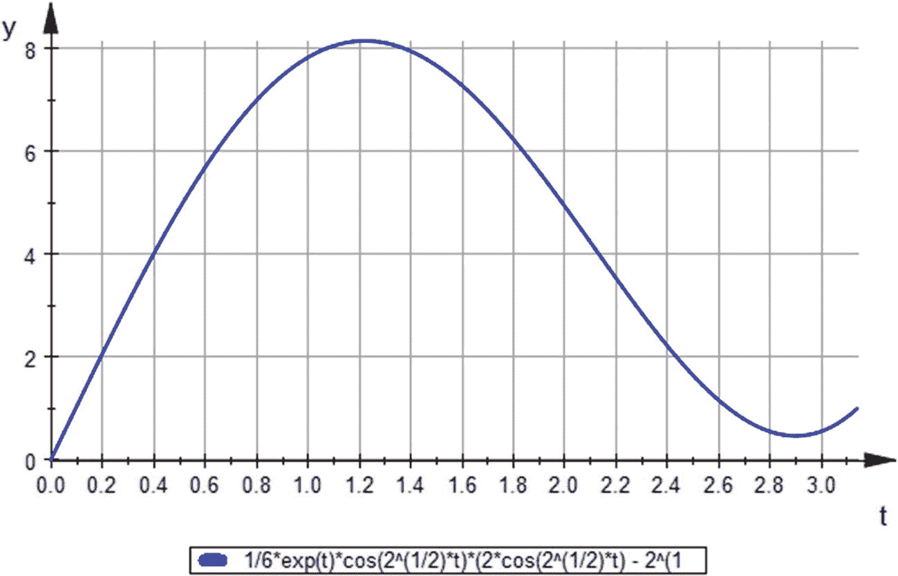

```mu
 Sol1:=ode::solve({u"(t)=exp(t)-2*u(t),
 u(0) = 0, u(PI) = 1}, u(t));
```

```mu
[ plot(Sol1, t=0..PI, #G, #L)
```

使用两个彼此值较为接近的不同数值初始猜测对此边值问题进行数值模拟，结果表明，对于此类边值问题，数值初始猜测对给定问题的最终数值解没有任何影响。此练习也可用 `[10⁷, −10⁷]` 或 `[−10⁷, 10⁷]` 的第二个初始猜测进行测试，并且之前图中显示的结果将以相同方式重复。然而，这些数值初始猜测不能取无穷大（`∞`）的值。如果初始猜测值设置为 `inf`，则求解器 `bvp4c` 将无法解决问题，因为问题的雅可比矩阵存在奇异性问题。

使用符号数学工具箱（MuPAD 笔记）评估解析解具有简单的语法。然而，并非所有边值问题都能用符号数学工具箱的命令和函数求解。这与初值问题的情况类似。

## 示例 2

这是另一个狄利克雷边界条件问题：${t}²\ddot{y}-5t\dot{y}+8y=0,y(1)=0,y(2)=24$。我们将给定的问题重写为两个一阶常微分方程：

$$ \left\{\begin{array}{c}{y}_2={\dot{y}}_1\\ {}{\dot{y}}_2=\frac{5t{y}_2-8{y}_1}{t²}\end{array}\right. $$

现在，我们通过脚本函数文件中的一个名为 `dy` 的嵌套函数来实现上述方程组，该文件命名为 `BVP_EX2.m`。请注意，此问题通过使用函数文件实现，并且定义边界条件和初始猜测结构的几个嵌套函数已嵌入该函数文件中。模拟结果如图 8-2 所示。

```matlab
function BVP_EX2

% BVP_EX2.m 求解给定的边值问题：t²*y"-5t*y'+8y=0, y(1)=0, y(2)=24

t = linspace(1, 2, 30);

% 创建一个猜测结构，包含在边界条件范围内的
% 时间网格和一个猜测函数 (Gsol1)：
SOLin1 = bvpinit(t,@Gsol1);

% 另一个初始猜测（使用函数）Gsol2
SOLin2 = bvpinit(t,@Gsol2);

% 另一个初始猜测（使用数值）y1=0 和 y2=24
SOLin3 = bvpinit(t,[0,24]);

% 获取问题的数值解：
SOL1 = bvp4c(@dy,@Res,SOLin1);
SOL2 = bvp4c(@dy,@Res,SOLin2);
SOL3 = bvp4c(@dy,@Res,SOLin3);

y1 = deval(SOL1,t);
y2 = deval(SOL2,t);
y3 = deval(SOL3,t);

figure
plot(t, y1(1,1:end), 'ro-', t, y2(1, :), 'bx-',...
t, y3(1,:),'kd:','linewidth', 1.5), grid on
legend('\it 猜测 #1: 多项式', '\it 猜测 #2: cos&sin 函数 ',...
'\it 猜测 #3: 数值', 'location', 'SouthEast')
title('\it 边值问题解:  $\frac{d²y}{dt²}*t²-5t*\frac{dy}{dt}+8y=0$', 'Interpreter', 'latex')
xlabel '\it t',
ylabel '\it y(t) 解值'

function Ft1=Gsol1(t,~)
% 第一个猜测解函数：
Ft1=([8*t.²-8*t, 16*t-8]);
end

function Ft2=Gsol2(t,~)
% 第二个猜测解函数：
Ft2=([cos(t), -sin(t)]);
end

function f=dy(t,y)
% 给定问题的公式表示：
f=[y(2), (5*t.*y(2)-8*y(1))./t.²];
end

function F=Res(yl,yr)
% 现在，我们将边界条件的残差定义为一个嵌套函数。
F=[yl(1), yr(1)-24];
end

end
```

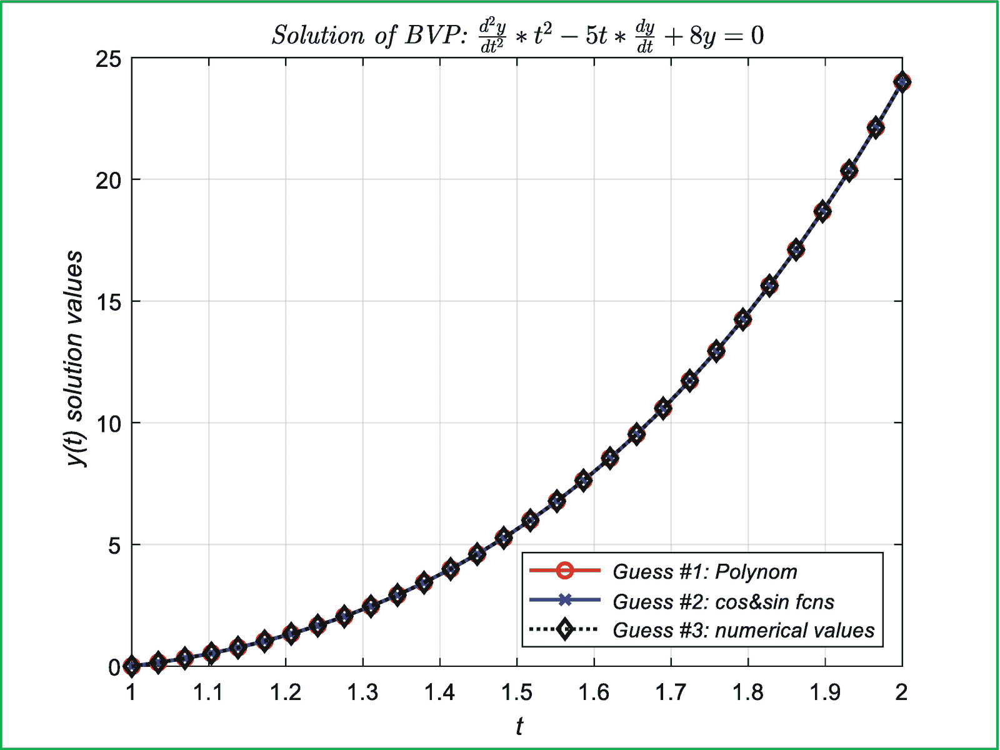

**图 8-2** 问题的模拟：${t}²\ddot{y}-5t\dot{y}+8y=0$

MuPAD 笔记中符号数学工具箱的求解命令如下：

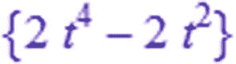

```mu
 Sol1:=ode::solve({u"(t) =(5*t*u'(t)-8*u(t))/t²,
 u(1) = 0, u(2) = 24}, u(t));
```

```mu
[ plot(Sol1, t=1..2, #G, #L, #3D)
```


对于此具有狄利克雷边界条件的二阶非线性边值问题（示例 2）的数值解，我们进行了三种不同的猜测（`BVP_EX2.m`），具体而言，多项式（二次和线性方程）、正弦和余弦函数以及数值猜测，所有这些都得到了良好收敛的解。此外，在本示例中，我们还探索了使用嵌套函数和函数文件来加速模拟过程的方法。此外，我们使用符号数学工具箱以更简单的方式用两行命令计算了此练习的解析解，并绘制了数值。

# 罗宾边界条件问题

罗宾边界条件是混合边界条件。

## 示例 3

在本例中，我们考察两个具有相同微分方程但使用不同边界条件（罗宾边界条件和狄利克雷边界条件）的边值问题，以进行比较。文中比较了这两个边值问题的两种不同边界条件。

*   **问题 1:** `\ddot{y}+2y=0\ \mathrm{with}\ BCs:y(0)=1,\dot{y}\left(\pi \right)=0` （罗宾边界条件或混合边界条件）
*   **问题 2:** `\ddot{y}+2y=0\ \mathrm{with}\ BCs:y(0)=1,y\left(\pi \right)=0` （狄利克雷边界条件）

注意，这两个问题的唯一区别在于它们的边界条件。

首先，我们将给定的问题方程重写为一阶常微分方程组：`\left\{\begin{array}{c}{y}_2={\dot{y}}_1\\ {}{\dot{y}}_2=-2{y}_1\end{array}\right.`

现在，我们使用以下脚本（`BVP_EX3.m`）模拟该问题，该脚本包含两部分；第 1 部分求解问题 1（使用狄利克雷边界条件），第 2 部分求解问题 2（罗宾边界条件或混合边界条件）。除了边界条件残差的定义方式不同外，求解这两个问题的方法类似。

```matlab
% BVP_EX3.m

% 问题 1\. 给定: y"+2y=0

% 第 1 部分. 边界条件: y(0)=1, dy(pi)=0\. 罗宾边界条件.

clearvars; clc; close all

dy=@(t, y)([y(2), -2*y(1)]);

% 定义边界条件的残差:

Res=@(yl, yr)([yl(1)-1, yr(2)]);

% 创建猜测结构:

SOLin1 = bvpinit(linspace(0,pi,40),[1 0]);

% 另一个初始猜测:

SOLin2 = bvpinit(linspace(0,pi,40),[2 1]);

% 获取问题的解:

SOL1 = bvp4c(dy,Res,SOLin1);

SOL2 = bvp4c(dy,Res,SOLin2);

t = linspace(0,pi, 40);

y1 = deval(SOL1,t);

y2 = deval(SOL2,t);

plot(t, y1(1,1:end), 'mp', t, y2(1, :),'k-', 'linewidth', 2.0),

grid on; axis tight; hold on

% 第 2 部分. 问题 2\. y"+2y=0, 边界条件: y(0)=1, y(pi)=0\. 狄利克雷边界条件

%{

将给定的问题方程重写为一阶常微分方程组:

dydt=[y2, 2*y1];

使用匿名函数定义 dydt:

%}

dy=@(t,y)([y(2), -2*y(1)]);

% 定义边界条件的残差:

Res=@(yl, yr)([yl(1)-1, yr(1)]);

%{

创建一个猜测结构，包含一个初始网格

（由 [0,pi]（边界条件范围内）中 40 个（可选）等间距点组成）

以及一个常数值猜测 y1=1 和 y2=0，如下所示:

%}

SOLin1 = bvpinit(linspace(0,pi,40),[1 0]);

% 取另一个初始猜测: y1=2 和 y2=1

SOLin2 = bvpinit(linspace(0,pi,40),[2 1]);

% 获取问题的解:

SOL1 = bvp4c(dy,Res,SOLin1);

SOL2 = bvp4c(dy,Res,SOLin2);

t  = linspace(0,pi, 40);

y1 = deval(SOL1,t);

y2 = deval(SOL2,t);

plot(t, y1(1,1:end), 'bo', t, y2(1, :), 'r', 'linewidth',2)

legend('\it 问题 1: 猜测 #1 [y1=1 & y2=0] ',...

'\it 问题 1: 猜测 #2 [y1=2 & y2=1]', ...

'\it 问题 2: 猜测 #1 [y1=1 & y2=0] ', ...

'\it 问题 2: 猜测 #2 [y1=2  & y2=1]', ...

'location', 'southwest')

xlabel '\it t', ylabel '\it y(t) 解值'

title('BVP 的解: $\frac{d²y}{dt²}+2y=0$', 'interpreter', 'latex')

gtext('问题 1: y(0)=1, y(\pi)=0')

gtext('问题 2: ; y(0)=1,dy(\pi)=0')

hold off
```

图 8-3 显示了该脚本的仿真结果。本练习清晰地展示了边界条件对边值问题最终解的影响程度。

**图 8-3：** 采用两种不同边界条件（罗宾边界条件（问题 1）和狄利克雷边界条件（问题 2））对 `\ddot{y}+2y=0` 进行的仿真。

另一种解法可以通过 MuPAD 注释中的符号数学工具箱计算得出。

```mupad
[ SOL1:=ode::solve({y"(t) =-2*y(t),y(0) = 1, y'(PI) = 0}, y(t));
```

```mupad
[ plot(SOL1, t=0..PI, #G, #L)
```

```mupad
[ SOL2:=ode::solve({y"(t) =-2*y(t), y(0) = 1, y(PI) = 0}, y(t));
```

```mupad
[  plot(SOL2, t=0..PI, #G, #L)
```

```mupad
[ plot(SOL1,SOL2, t=0..PI, #G, #L)
```

本练习的仿真结果表明，两种不同的边界值猜测如何产生收敛良好的解。在此示例中，与之前的示例（示例 1）一样，可以在很大范围内测试边界值的数值猜测，例如 `[−10⁸, 10¹⁰]` 或反之。

# 斯图姆-刘维尔边值问题

在科学计算和工程研究中，有许多具有广泛应用的边值问题。其中一类边值问题是斯图姆-刘维尔边值问题，以两位法国数学家雅克·斯图姆和约瑟夫·刘维尔的名字命名。斯图姆-刘维尔边值问题 [1] 具有广泛的应用领域，例如：

*   非均匀杆中的热传导
*   量子力学中的一维薛定谔方程
*   非均匀杆和弦的振动
*   散射理论中的希尔方程
*   球体的振荡与勒让德方程
*   圆柱体和球体的热力学

## 示例 4

以下是具有常系数值的 Sturm-Liouville 边值问题的一个示例：

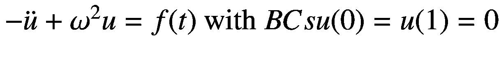 （周期边界条件）

让我们考虑以下情况：*ω* = 0、3、7、13 和 *f*(*t*) = *sinh*(*t*)。

现在，我们将 Sturm-Liouville 方程重写为我们所考虑的情况。

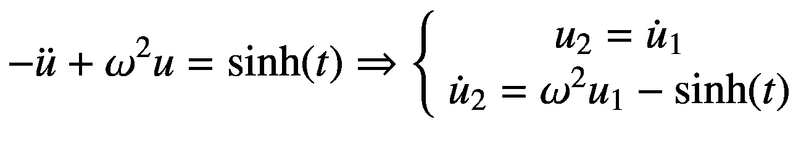

在 MATLAB 的 `bvpinit` 中，有一个选项可以包含参数，我们可以利用该选项来包含 *ω* 的值用于仿真，并编写 `BVP_EX4.m`。仿真结果如图 8-4 所示。

```matlab
clc; clearvars; close all

% BVP_EX4.m

% Sturm_Liouville_bvp. Given: -u"+w²*u=sinh(t)

% periodic boundary conditions: u(0)=u(1)=0

%  ----------------------------------------------------------

% Define residues of BCs via a function handle

Res=@(yl,yr)([yl(1) yr(1)]);

% 1st guess solution function defined with function handle:
```

```markdown
`Gsol`=`@(t)([sin(-0.540302305868140*t),cos(t)-0.540302305868140])`

`close all; clc`

`omega=[0, 3, 5, 7, 13]`;

`t = linspace(0, 1, 500)`;

% A guess structure consisting of time mesh within [0, 1]
% in the range of BCs and a guess function (`Gsol`):
`SOLin1 = bvpinit(linspace(0,1, 10),Gsol)`;

% Another numeric value based initial guess `y1=0` and `y2=0`
`SOLin2 = bvpinit(linspace(0,1, 10),[0,0])`;

% Plotting options:
`Labelit = { }`;

`Colorit1 = 'krgbm'`;

`Colorit2 = 'krgbm'`;

`Lineit1  = '---:--:---:'`;

`Lineit2  = '---:--:---:'`;

for ii=1:numel(omega)
    Styleit1=[Colorit1(ii), Lineit1(ii)];
    Styleit2=[Colorit2(ii), Lineit2(ii)];

    % Given problem formulation:
    dy=@(t,y)([y(2), omega(ii)²*y(1)-sinh(t)]);

    %Obtain the solutions of the problem for two initial guesses:
    SOL1 = bvp4c(dy,Res,SOLin1);
    SOL2 = bvp4c(dy,Res,SOLin2);

    % Compute numeric solutions of the problem within time-space:
    y1 = deval(SOL1,t);
    y2 = deval(SOL2,t);

    subplot(211)
    plot(t, y1(1,1:end), Styleit1, 'linewidth', 1.5), grid on
    hold on
    Labelit{ii}=['\omega = ' num2str(omega(ii))];
    legend(Labelit{:})
    title('Sturm Liouville BVP: $\frac{-d²u}{dt²}+\omega²*u=sinh(t)$', 'interpreter', 'latex')
    ylabel('\it y(t) solution values')

    subplot(212)
    plot(t,y2(1, :), Styleit2, 'linewidth', 1.5), grid on
    hold on
    Labelit{ii}=['\omega = ' num2str(omega(ii))];
    legend(Labelit{:})
    xlabel '\it t'
    ylabel('\it y(t) solution values')
end

`gtext('Guess 1: sin&cos fcns', 'background', 'y')`
`gtext('Guess 2: Numerical guess values', 'background', 'y')`
hold off

```

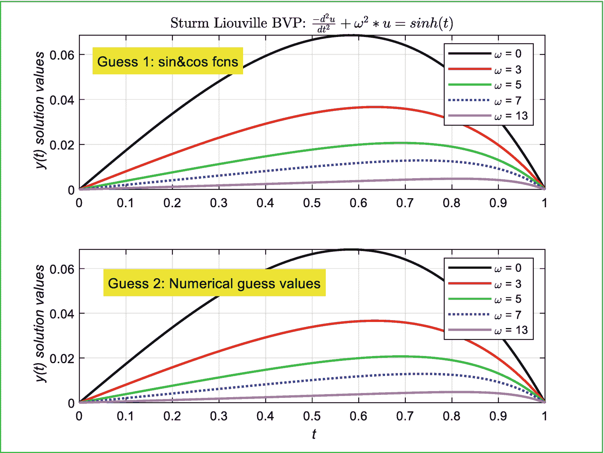

**图 8-4** *ω* = 0、3、5、7、13 时 Sturm-Liouville 边值问题的仿真。

Sturm-Liouville 边值问题的另一种解法在 MuPAD 笔记（`BVP_EX4_MuPAD.mn`）的符号数学工具箱脚本中获得。


```
[ Omega:=([0, 3, 5, 7, 13]);
```

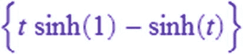

```
[ Sol1:=ode::solve({u"(t)=Omega[1]²*u(t)-sinh(t),
u(0) = 0, u(1) = 0}, u(t));
```

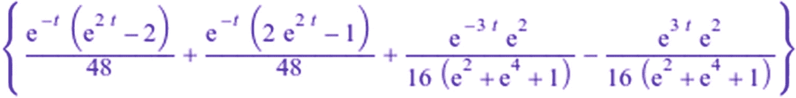

```
[ Sol2:=ode::solve({u"(t)=Omega[2]²*u(t)-sinh(t),
u(0) = 0, u(1) = 0}, u(t));
```

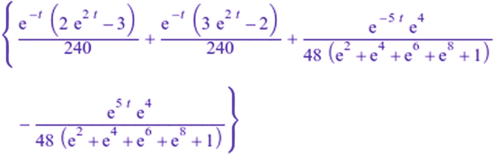

```
[ Sol3:=ode::solve({u"(t)=Omega[3]²*u(t)-sinh(t),
u(0) = 0, u(1) = 0}, u(t));
```

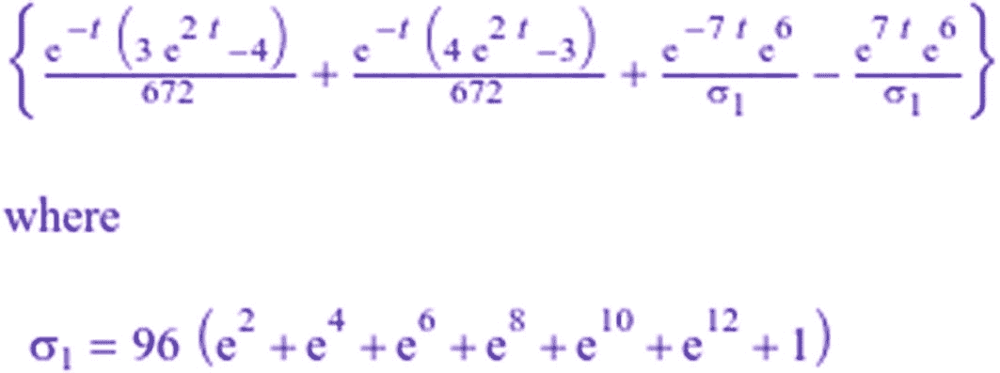

```
[ Sol4:=ode::solve({u"(t)=Omega[4]²*u(t)-sinh(t),
u(0) = 0, u(1) = 0}, u(t));
```

```
[ Sol5:=ode::solve({u"(t)=Omega[5]²*u(t)-sinh(t),
u(0) = 0, u(1) = 0}, u(t));
```

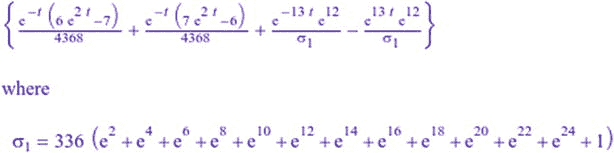

```
 plot(Sol1, Sol2, Sol3, Sol4, Sol5, t=0..1, #G, #L)
```

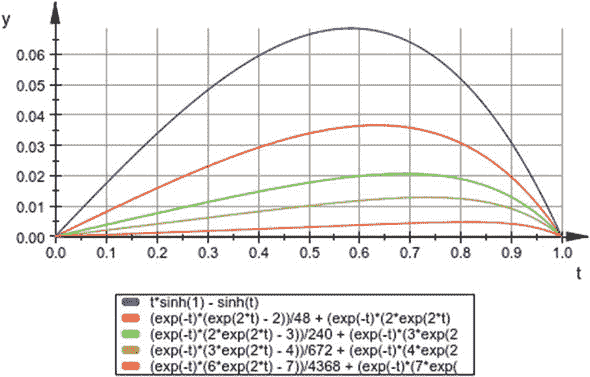
```

# An alternative and more compact solution:

```
for omega in [0, 3, 5, 7, 13] do
    Sol:=ode::solve({u"(t) =omega²*u(t)-sinh(t),
                      u(0) = 0, u(1) = 0}, u(t));
    plot(hold(Sol, t=0..1, #G, #L));
end_for
```

# Results are not displayed.

从 MuPAD 笔记`BVP_EX4_MuPAD.mn`的解析解仿真结果和`BVP_EX4.m`针对不同`ω`值获得的数值解（图 8-6）来看，所有解都吻合得很好。此外，随着`ω`的增加，解`y(t)`的幅度成比例减小。仿真结果表明，初始猜测函数（例如正弦函数和余弦函数）与数值猜测值完美收敛。

## 刚性边值问题

存在许多与常微分方程初值问题相似的刚性边值问题，并且已经开发出了一些方法和技巧来解决此类问题。在本节中，我们将看一个刚性边值问题的示例。高效地求解这些问题通常是一项挑战。让我们考虑下一个示例。

## 示例 5

以下是一个刚性边值问题示例：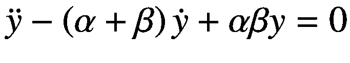，边界条件为`y(0)` = `y(1)` = 1，且`α` = 100，`β` = −100。

该问题[2]具有很强的刚性，其解取决于`α`、`β`的值。与之前解决的问题类似，通过将给定的二阶方程转换为两个一阶微分方程来求解。这需要引入新变量，然后将新导出的方程组实现到名为`BVP_EX5.m`的脚本中。仿真结果如图 8-5 和图 8-6 所示。

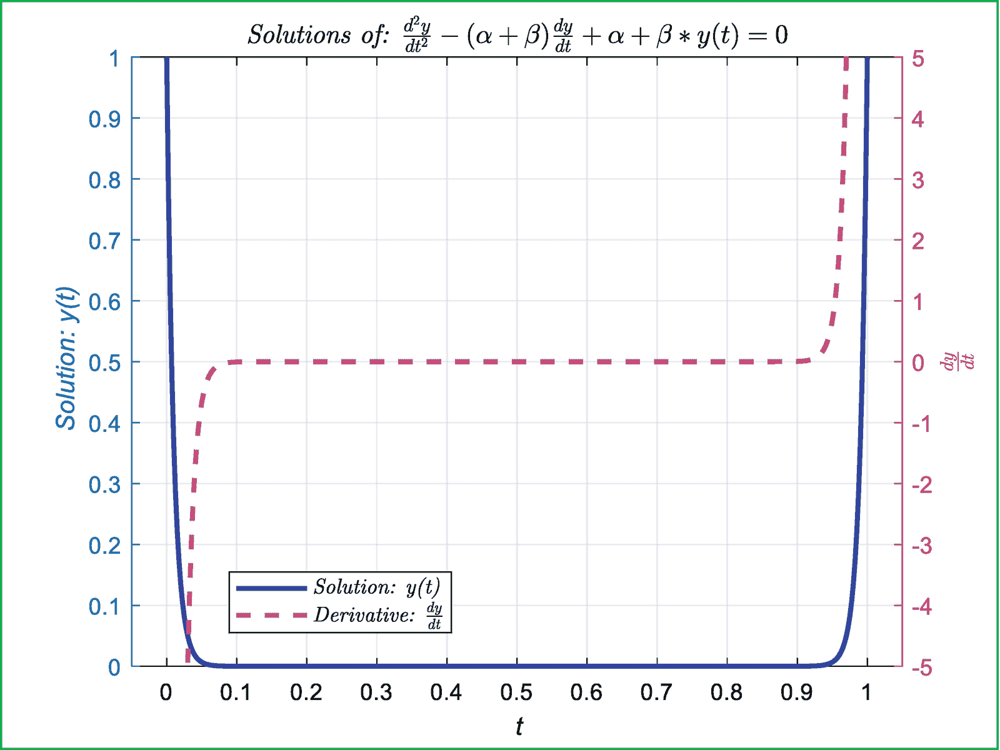

**图 8-6** 方程在边界条件：`y(0)` = `y(1)` = 1 且`α` = 100，`β` = −100 下的仿真结果

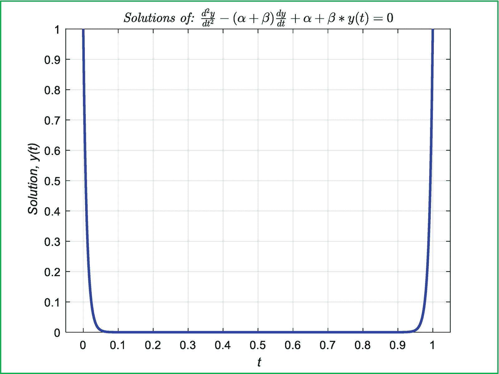

**图 8-5** 方程在边界条件：`y(0)` = `y(1)` = 1 且`α` = 100，`β` = −100 下的仿真结果

```matlab
function BVP_EX5

Solutions_initial = bvpinit(0:.0025:1,[10 10]);

tol=1e-16; % 容差

OPT = bvpset('stats','on','abstol',tol,'reltol',tol,'Nmax',1000);

solutions_final=bvp4c(@ODE_fun1,@BC_fun1,Solutions_initial, OPT);

x = 0:.0025:1; y = deval(solutions_final, x);

close all

figure(1), plot(x, y(1,:), 'b', 'linewidth', 2);

title('\it Solutions of: $\frac{d²y}{dt²}-(\alpha+\beta)\frac{dy}{dt}+\alpha+\beta*y(t)=0$', 'interpreter', 'latex'); grid on

xlabel('\it t')

ylabel('\it Solution, y(t)'),

xlim([-.05 1.05])

figure(2)

yyaxis left

plot(x, y(1,:),'b', 'linewidth', 2)

title('\it Solutions of: $\frac{d²y}{dt²}-(\alpha+\beta)\frac{dy}{dt}+\alpha+\beta*y(t)=0$', 'interpreter', 'latex'); grid on

grid on

ylabel('\it Solution: y(t)')

xlabel('\it t')

yyaxis right

plot(x,y(2,:),'m--','linewidth', 2)

ylabel('\it $\frac{dy}{dt}$', 'Interpreter', 'latex')

axis([-0.05 1.05 -5  5]), grid on

legend('\it Solution: y(t)', '\it Derivative: $\frac{dy}{dt}$', 'Interpreter', 'latex', 'location', 'southwest');

function dydx = ODE_fun1(~,y)

alpha=100; beta=-100;

dydx = [ y(2),     (alpha+beta)*y(2)-alpha*beta*y(1)];

end

function res = BC_fun1(y1,yend)

res = [ 1-y1(1) ,   1-yend(1)];

end

end
```

另一种解决方案是使用 MuPAD 笔记中的符号数学工具箱命令来解析求解该问题。以下是名为`BVP_EX5_MuPAD.mn`的求解脚本：

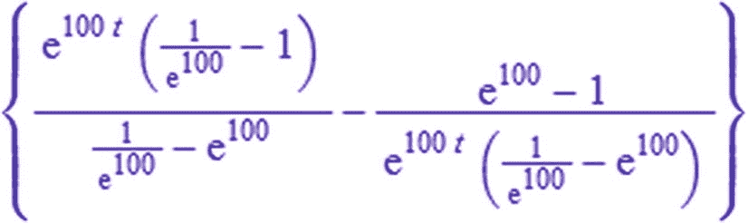

# BVP_EX5_MuPAD.mn

`A:=100; B:=-100;`

```
[ Sol:=ode::solve({y"(t) =-(A*B)*y(t)+(A+B)* y'(t),
y(0) = 1, y(1) = 1}, y(t))
```

```
[ plot(Sol, t = 0..1, #G, #L, #3D)
```

 至此，边值问题求解练习结束。需要指出的是，边值问题的求解搜索过程必须从仔细研究问题开始，以确定边界条件的类型以及给定问题的刚性。在 MATLAB 环境中求解边值问题的一般流程包含六个步骤，如前所述。如果计算给定边值问题的解析解是可行的，那么首先应尝试的方法是使用符号数学工具箱和/或 MuPAD 笔记。

## 练习

以下是供自行练习的一些习题。

### 练习 1

使用 ODE 求解器数值求解以下边值问题，并使用 MuPAD 进行解析求解：$$ {x}²\ddot{y}-5x\dot{y}+8y=0 $$，边界条件为`y(1) = 0`和`y(2) = 24`。

### 练习 2

在 MATLAB 中数值求解给定的二阶 ODE 边值问题：$$ \ddot{y}+9y=0 $$，边界条件为`y(0) = 0`和`y(\frac{\pi}{2}) = 6`。绘制该边值问题的数值解。在 MuPAD 笔记中计算该练习的解析解，并绘制计算得到的解析解。

### 练习 3

在 MATLAB 中数值求解给定的二阶 ODE 边值问题：$$ \ddot{y}+9y=0 $$，边界条件为`y'(0)=0`和`y'(\frac{\pi}{2})=6`。绘制计算出的数值解。在 MuPAD 笔记中评估该练习的解析解，并绘制计算得到的解析解。

### 练习 4

在 MATLAB 中数值求解给定的二阶 ODE 边值问题：$$ {x}²\ddot{y}-5x\dot{y}+8y=0 $$，边界条件为`y(1) = 0`和`y'(2)=24`。绘制该问题的数值解。在 MuPAD 笔记中计算该练习的解析解，并绘制找到的解析解。

### 练习 5

在 MATLAB 中数值求解给定的二阶 ODE 边值问题：$$ \ddot{y}+y=0 $$，边界条件为`y(0) = y(2π) = 0.5`和`y'(0) = y'(2π) = 1`。绘制该问题的数值解。在 MuPAD 笔记中计算该练习的解析解，并绘制找到的解析解。

### 练习 6

在 MATLAB 中数值求解给定的二阶 ODE 边值问题：$$ \ddot{y}+40y=\cos \left(2\mathrm{t}\right) $$，边界条件为`y(0) = 0`，`y(π) = 0`。绘制该问题的数值解。是否可以在 MuPAD 笔记中计算该边值问题的解析解？

### 练习 7

求解给定的边值问题：$$ \ddot{y}+40y=\cos \left(2\mathrm{t}\right) $$，边界条件为`y'(0)=0, y'(π)=0`。绘制该问题的数值解。将练习 6 和练习 7 的数值解绘制在同一图区并进行比较。

### 练习 8

在 MATLAB 中数值求解给定的边值问题：$$ {x}²\ddot{y}-2\mathrm{x}\dot{\mathrm{y}}+1000y=0 $$，边界条件为`y(1) = 0`，`y(e) = 0`。绘制该问题的数值解。在 MuPAD 笔记中评估该练习的解析解，并绘制找到的解析解表达式。

### 练习 9

在 MATLAB 中数值求解给定的两个边值问题：1) $$ {x}²\ddot{y}+6\mathrm{x}\dot{\mathrm{y}}+200y=0 $$，边界条件为`y(1)=0, y'(\sqrt{e})=0`；2) $$ {x}²\ddot{y}+6\mathrm{x}\dot{\mathrm{y}}+200y=0 $$，边界条件为`y(1)=0, y(\sqrt{e})=0`。

绘制这两个边值问题的数值解并比较计算出的解。在 MuPAD 笔记中评估这两个边值问题的解析解，并绘制找到的解析解。

### 练习 10

在 MATLAB 中数值求解给定的边值问题：`d²f/dt² + 2 df/dt + 40f = 0`，其中`f(0) = -0.5`，`f(0.5) = π`。绘制该问题的数值解图。

### 练习 11

在 MATLAB 中数值求解给定的边值问题：`d[(1+t²) dy/dt]/dt + 4y = 0`，其中`y(-1) = 0`，`y(1) = 0`。绘制该问题的数值解图。在 MuPAD 笔记中计算其解析解，并绘制所找到的解析解图。

### 练习 12

在 MATLAB 中数值求解给定的边值问题：`d²x/dt² + 2x = -1 + |1-2t|`，其中`x(0) = 0`，`dx(1) = 0`。绘制该问题的数值解图。

### 练习 13

在 MATLAB 中数值求解下一个边值问题：`y'' + π²y = π²t`，其中`y(0) = 1`，`y(1) = 0`。将计算得到的数值解与其解析解`y = c[1] sin(πt) + cos(πt) + t`进行比较。在 MuPAD 笔记中计算其解析解，并构建所找到解析解的三维图。

