# 拉普拉斯变换

常系数线性常微分方程的解可以通过拉普拉斯变换来求解。拉普拉斯变换在解微分方程时最重要的特性之一在于，变换后的方程是一个代数方程，该代数方程将用于定义给定微分方程的解。通常，应用拉普拉斯变换求解微分方程的过程可表述如下。

假设给定的 `y^(n)(x) = f(t)` 是 *n* 阶导数。`y^(n)(x)` 的拉普拉斯变换如下：

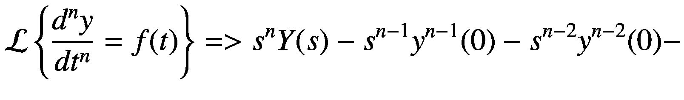
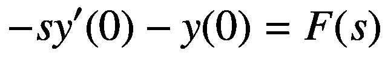
(1-6)

或如下：

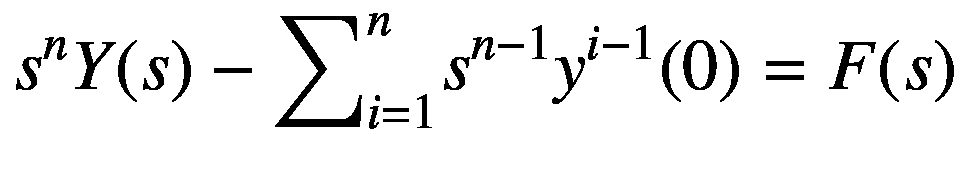
(1-7)

在方程 (1.6) 或 (1.7) 中，如果我们代入 `t` = 0 时的初始条件常数，即 `y(0) = a[0]; y'(0) = a[1]; y''(0) = a[2]; …; y^(n - 2)(0) = a[n - 2]; y^(n - 1)(0) = a[n - 1]`。

现在，我们可以将方程 (1-6 或 1-7) 中的表达式重写如下：

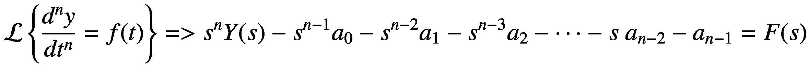
(1-8)

随后，我们首先求解 `Y(s)`，对 `Y(s)` 进行逆拉普拉斯变换，从而得到 *n* 阶微分方程的解 `y(t)`。

应用拉普拉斯变换和逆拉普拉斯变换求解常系数微分方程的一般步骤如下：

1. 对给定方程的两边同时进行拉普拉斯变换。
2. 用 `F(s)` 及其他未知量表示并求解 `Y(s)`。
3. 对求解出的表达式进行逆拉普拉斯变换，得到问题的最终解。

请注意，在第 3 步中，我们还应将第 2 步得到的表达式分解为部分分式，以便使用逆拉普拉斯变换对应表。拉普拉斯变换和逆拉普拉斯变换的示意图见图 1-6。

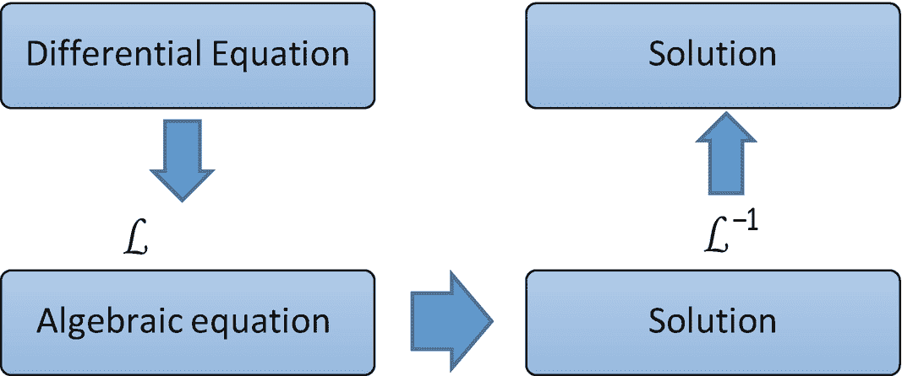
**图 1-6** 使用拉普拉斯变换及其逆变换求解常微分方程的流程图

## 示例 14

考虑一个如下的二阶非齐次微分方程：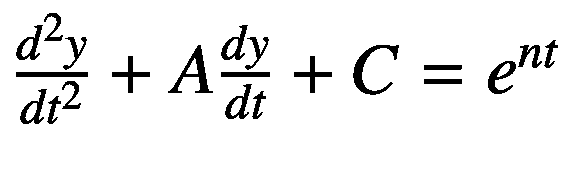 `dy(0) = k`, `y(0) = m`。

现在，依据拉普拉斯和逆变换流程图中描述的步骤，我们可以分步明确写出该问题的拉普拉斯变换。

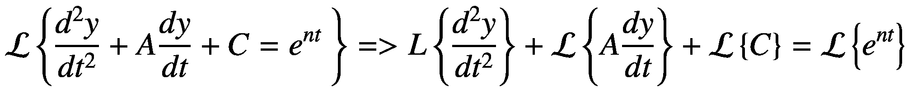
(1-9)

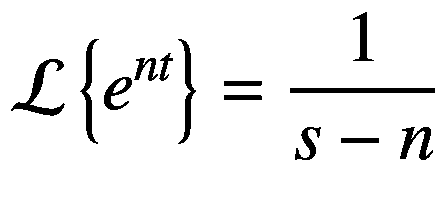
(1-10)

因此，

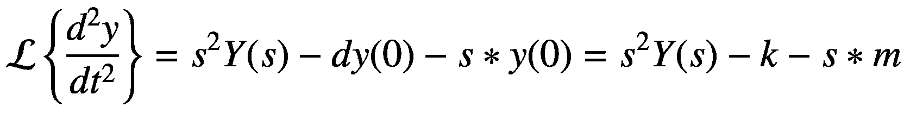
(1-11)

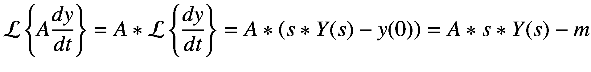
(1-12)

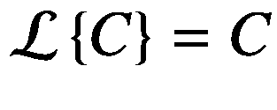
(1-13)

现在，将方程 (1-10)、(1-11)、(1-12) 和 (1-13) 代回方程 (1-9)，我们得到下一个表达式：

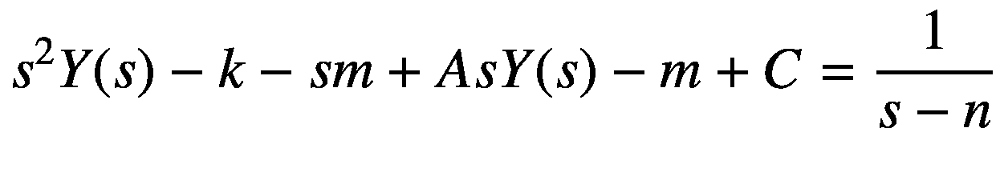
(1-14)

我们求解方程 (1-14) 中的 `Y(s)` 并确定如下结果：

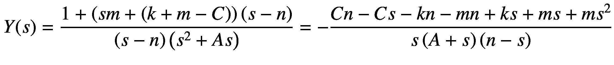
(1-15)

根据方程 (1-15) 中 `Y(s)` 的表达式，我们分解部分分式，然后对方程两边进行逆拉普拉斯变换，得到如下方程 (1-16) 所示的解，即给定微分方程的解 `y(t)`：

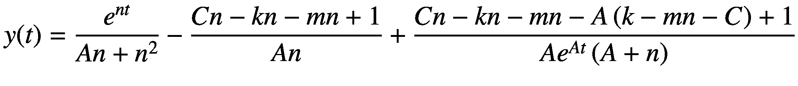
(1-16)

符号数学工具箱的内置函数 `laplace()` 用于计算任何代数表达式或微分方程的拉普拉斯变换，而符号数学工具箱的 `ilaplace()` 函数用于计算已求得的拉普拉斯变换后 *s* 域表达式的逆变换。这两个函数通过自动分解部分分式过程来处理所有变换，并计算给定常微分方程问题的解析解。

### laplace/ilaplace

`laplace`/`ilaplace` 基于拉普拉斯和逆拉普拉斯变换，是符号数学工具箱的内置函数工具。`laplace`/`ilaplace` 的一般语法如下：

```
F=laplace(f)
F=laplace(f, t)
F=laplace(f, var1, var2)
```

以及

```
f=ilaplace(F)
f=ilaplace(F, s)
f=ilaplace(F, var1, var2)
```

## 示例 15

给定 `x(t) = sin(2t)`，使用以下命令语法计算 `x(t)` 的拉普拉斯变换：

```
>> syms t
>> xt=sin(2*t); Xs=laplace(xt)
Xs =
2/(s² + 4)
```

## 示例 16

给定 `y(t) = sin(Kt)`，我们得到如下结果：

```
>> syms t K
>> yt=sin(K*t); Ys=laplace(yt)
Ys =
K/(K² + s²)
```

## 示例 17

给定 `y(x) = ax³ + b`，我们得到如下结果：

```
>> syms x a b
>> yx=a*x³+b; Ys=laplace(yx)
Ys =
(6*a)/s⁴ + b/s
```

或者，我们可以在 `t` 变量域中获得结果，而不是 `s` 域。

```
>> yx=a*x³+b; Yt=laplace(yx, x, t)
Yt =
(6*a)/t⁴ + b/t
```

`ilaplace()`函数的语法和实现与`laplace`完全相同。让我们看几个常微分方程练习，以演示如何使用`laplace`和`ilaplace`，并将它们求得的解与`dsolve()`得到的解进行比较。

### 示例 18

给定方程`\dot{y}+2y=0,y(0)=0.5`，我们使用`laplace/ilaplace`和`dsolve()`来求解。以下脚本（`Laplace_vs_Dsolve_old_MATLAB_ex18.m`）即为求解方法。请注意，此脚本仅适用于 MATLAB 2017a 或更早版本。

```matlab
% Laplace_vs_Dsolve_old_MATLAB_ex18.m
clearvars; clc; close all
% Step #1. Define symbolic variables' names
syms t s Y
ODE1='D(y)(t)=-2*y(t)';
% Step #2. Laplace Transforms
LT_A=laplace(ODE1, t, s);
% Step #3. Substitute ICs and initiate an unknown Y
LT_A=subs(LT_A,{'laplace(y(t),t, s)','y(0)'},{Y,0.5});
% Step #4. Solve for Y (unknown)
Y=solve(LT_A, Y);
display('Laplace Transforms of the given ODE with ICs'); disp(Y)
% Step #5. Evaluate Inverse Laplace Transform
Solution_Laplace=ilaplace(Y);
display('Solution found using Laplace Transforms: ')
pretty(Solution_Laplace)
% Step #6. Compute numerical values and plot them
t=0:.01:2.5; LTsol=eval(vectorize(Solution_Laplace));
figure, semilogx(t, LTsol, 'ro-')
xlabel('t'), ylabel('solution values')
title('laplace/ilaplace vs dsolve ')
grid on; hold on
% Compare with dsolve solution method
Y_d=dsolve('Dy=-2*y', 'y(0)=0.5'); display('Solution with dsolve')
pretty(Y_d); Y_sol=eval(vectorize(Y_d));
plot(t,Y_sol, 'b-', 'linewidth', 2), grid minor
legend('laplace+ilaplace', 'dsolve'), hold off; axis tight
```

这是该脚本的另一个版本（`Laplace_vs_Dsolve_new_MATLAB_ex18.m`），适用于更新版本的 MATLAB（从 MATLAB 2018b 开始）。

```matlab
% Laplace_vs_Dsolve_New_MATLAB_ex18.m
clearvars; clc; close all
% Step #1. Define symbolic variables' names
syms t s Y y(t) Dy(t)
assume([t, Y]>0);
Dy=diff(y,t);
ODE1=Dy==-2*y(t);
% Step #2. Laplace Transform
LT_A=laplace(ODE1, t, s);
% Step #3. Substitute the arbitrary unknown Y and IC(s)
LT_A=subs(LT_A,laplace(y,t, s),Y);
LT_A=subs(LT_A, y(0), 0.5);
% Step #4. Solve for the arbitrary unknown Y
Y=solve(LT_A, Y);
disp('Laplace Transforms of the given ODE with ICs'); disp(Y)
% Step #5. Evaluate the Inverse Laplace Transform
Solution_Laplace=ilaplace(Y);
disp('Solution found using Laplace Transforms: ')
pretty(Solution_Laplace)
% Step #6. Compute numerical values and plot them
t=0:.01:2.5; LTsol=eval(vectorize(Solution_Laplace));
figure, semilogx(t, LTsol, 'ro-')
xlabel('t'), ylabel('solution values')
title('laplace/ilaplace vs. dsolve ')
grid on; hold on
% Compare with dsolve solution method
IC=y(0)==0.5;
Y_d=dsolve(ODE1, IC);
disp('Solution with dsolve')
pretty(Y_d); Y_sol=eval(vectorize(Y_d));
plot(t,Y_sol, 'b-', 'linewidth', 2), grid minor
legend('laplace+ilaplace', 'dsolve')
hold off; axis tight
```

两个版本的脚本会产生相同的输出。执行脚本（`Laplace_vs_Dsolve_old_MATLAB_ex18.m` 或 `ODE_Laplace_New_MATLAB_vers.m`）后，将得到以下输出：

```
Warning: Solutions are valid under the following conditions: -2 < s. To include parameters and conditions in the solution, specify the 'ReturnConditions' value as 'true'.
Laplace Transforms of the given ODE with ICs
1/(2*s + 4)
Solution found using Laplace Transforms:
exp(-2 t)

Solution with dsolve
exp(-2 t)
```

图 1-7 展示了绘制出的解，并清晰地显示了使用`laplace/ilaplace`和`dsolve()`找到的解完美吻合。

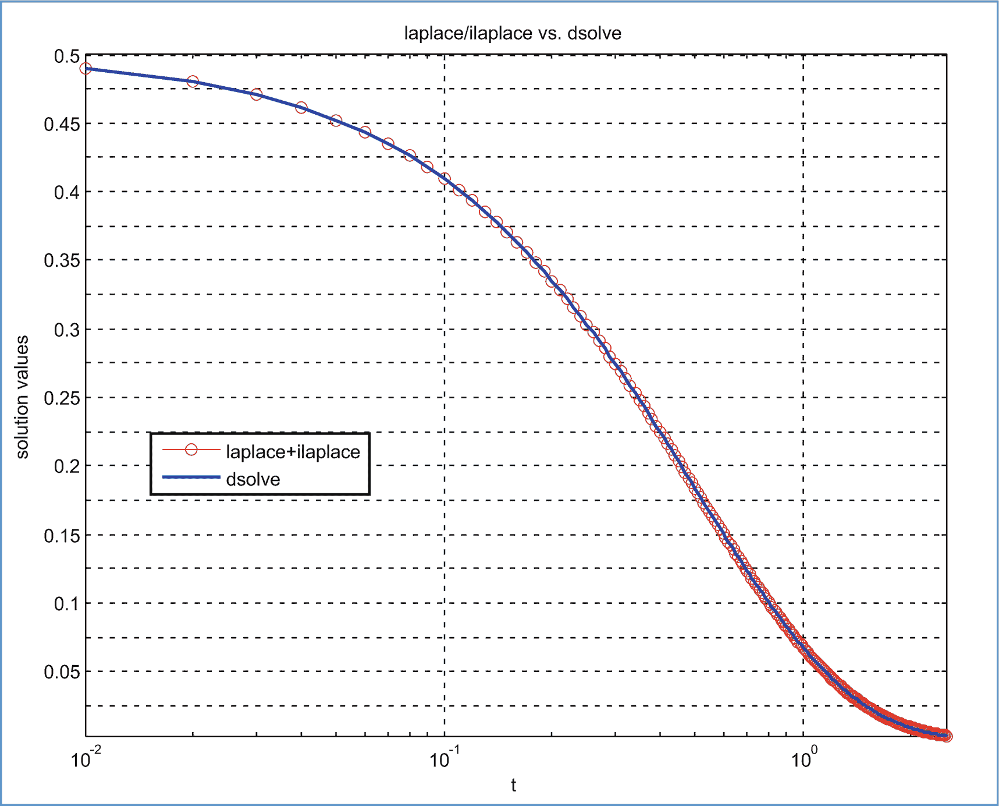

图 1-7

*问题* `\dot{y}+2y=0,y(0)=0.5` *使用* `laplace/ilaplace`、`dsolve()` *求解*

注意
Symbolic Math Toolbox 中有一些命令语法（函数）不具有前向兼容性，例如在求解 ODE 时使用的`laplace`/`ilaplace`和`subs`。这种前向不兼容问题在示例 4 和示例 5 中已得到演示。

### 示例 19

给定方程`\ddot{y}+\dot{y}=\sin t,y(0)=1,\text{and }\dot{y}(0)=2`，以下脚本（`Laplace_vs_Dsolve_old_MATLAB_ex19.m`）是使用`laplace`、`ilaplace`和`dsolve()`求解这个二阶非齐次 ODE 的解法：

# 拉普拉斯变换与 `dsolve` 函数求解常微分方程：MATLAB 实现示例

本文展示了如何使用 MATLAB 的 Symbolic Math Toolbox 通过拉普拉斯变换和 `dsolve` 函数求解同一个常微分方程，并比较两者的结果。

## 旧版 MATLAB 脚本（适用于 2018a 之前版本）

脚本 `Laplace_vs_Dsolve_old_MATLAB_ex19.m` 的实现如下：

```matlab
% Laplace_vs_Dsolve_old_MATLAB_ex19.m
% %%   LAPLACE TRANSFORMS
% Given: y"+y'=sin(t) with ICs: [1, 2] for y(0) & y'(0).
clearvars, clc, close all
syms t s Y
% Define the given ODE equation
ODE2nd='D(D(y))(t)+D(y)(t)-sin(t)';
% Step 1. Laplace Transforms
LT_A=laplace(ODE2nd, t, s);
% Step 2. Substitute ICs and initiate an unknown Y
LT_A=subs(LT_A,{'laplace(y(t),t, s)','y(0)','D(y)(0)'},{Y,1,2});
% Step 3.  Solve for Y unknown
Y=solve(LT_A, Y);
disp('Laplace Transforms of the given ODE with ICs'); disp(Y)
Solution_Laplace=ilaplace(Y);
disp('Solution found using ilaplace/laplace: ')
pretty(Solution_Laplace); t=0:.01:13;
LTsol=eval(vectorize(Solution_Laplace));
figure, plot(t, LTsol, 'ro-');
xlabel('\it t'),
ylabel('\it Solution y(t)')
ylabel('\it Solution y(t)')
title('\it laplace/ilaplace vs. dsolve Solutions: $$ \frac{d²y}{dt²}+\frac{dy}{dt}=sin(t)$$', 'interpreter', 'latex');
hold on
% dsolve solution method
Y=dsolve('D2y+Dy=sin(t)', 'y(0)=1, Dy(0)=2', 't');
disp('Solution with dsolve:  ');
pretty(Y); Y_sol=eval(vectorize(Y));
plot(t,Y_sol, 'b-', 'linewidth', 2); grid minor
legend('laplace+ilaplace', 'dsolve', 'location', 'southeast'); hold off
```

在命令窗口中显示的计算出的解析解如下（见图 1-8）：

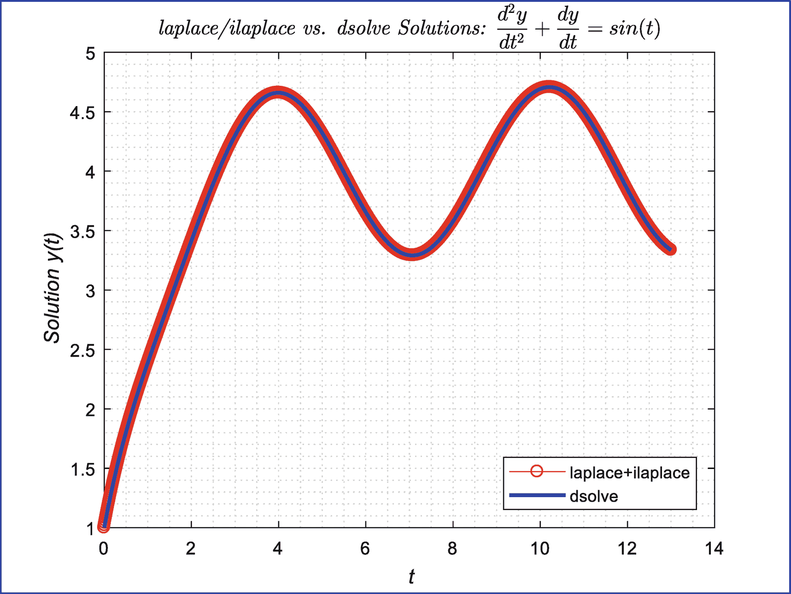

图 1-8 `\ddot{y}+\dot{y}=\sin(t),y(0)=1,\dot{y}(0)=2` 的数值解

```
Laplace Transforms of the given ODE with ICs
(s + 1/(s² + 1) + 3)/(s² + s)
Solution found using Laplace Transforms:
cos(t)   sin(t)   5 exp(-t)
4 - ------ - ------ - ---------
2        2          2
Solution with dsolve:
cos(t)   sin(t)   5 exp(-t)
4 - ------ - ------ - ---------
2        2          2
```

请注意，前面的脚本 `Laplace_vs_Dsolve_old_MATLAB_ex19.m` 适用于旧版本的 MATLAB，并且在 MATLAB 2018a 之后的版本中将无法运行。以下脚本 `Laplace_vs_Dsolve_New_MATLAB_ex19.m` 会产生相同的输出。

## 新版 MATLAB 脚本（适用于 2018a 及之后版本）

```matlab
% Laplace_vs_Dsolve_New_MATLAB_ex19.m
% %%   拉普拉斯变换
% 已知：y"+y'=sin(t)，初始条件：y(0)=1，y'(0)=2。
clearvars, clc, close all
% 步骤 1. 定义符号变量名称
syms t s Y y(t) Dy(t)
Dy=diff(y, t);
D2y=diff(y, t, 2);
% 定义给定的常微分方程
Equation=D2y+Dy==sin(t);
% 步骤 2. 拉普拉斯变换
LT_A=laplace(Equation, t, s);
% 步骤 3. 代入未知变量 Y 与初始条件
LT_A=subs(LT_A,laplace(y(t),t, s),Y);
LT_A=subs(LT_A,y(0),1);                             % 初始条件：y(0)=1
LT_A=subs(LT_A,subs(diff(y(t), t), t, 0), 2);   % 初始条件：dy(0)=2
% 步骤 4. 求解未知变量 Y
Y=solve(LT_A, Y);
disp('含初始条件的给定常微分方程的拉普拉斯变换结果：'); disp(Y)
% 步骤 5. 计算拉普拉斯逆变换
Solution_Laplace=ilaplace(Y);
disp('使用拉普拉斯变换求得的解：')
pretty(Solution_Laplace); t=0:.01:13;
LTsol=eval(vectorize(Solution_Laplace));
figure, plot(t, LTsol, 'ro-'); xlabel('\it t'),
ylabel('\it 解 y(t)')
title('\it laplace/ilaplace 与 dsolve 解法对比：$$ \frac{d²y}{dt²}+\frac{dy}{dt}=sin(t)$$', 'interpreter', 'latex');
hold on
% dsolve 解法
syms t y(t)
Dy=diff(y, t);
D2y=diff(y, t, 2);
% 定义给定的常微分方程
Equation=D2y+Dy==sin(t);
% 定义初始条件
ICs = [y(0)==1, Dy(0)==2];
Y=dsolve(Equation, ICs);
disp('使用 dsolve 求得的解：');
pretty(Y);
t=0:.01:13;
Y_sol=eval(vectorize(Y));
plot(t,Y_sol, 'b-', 'linewidth', 2); grid minor
legend('\it laplace+ilaplace', '\it dsolve', 'location', 'southeast') hold off
```

从图 1-8 所展示的图形可以清晰地看出，通过拉普拉斯变换的 `laplace()`/`ilaplace()` 函数以及 `dsolve()` 函数求得的解完美吻合。这是因为两个函数都能正确计算解析解。

> **注意**
> 在使用 Symbolic MATH Toolbox 函数（`ilaplace()`/`laplace()`、`dsolve()`）求解常微分方程时，建议先引入所有符号变量，然后设定关于自变量的任何假设（例如 `t`、`Y`）。此外，一个良好的习惯是先指定关于自变量的所有导数，再指定微分方程。示例如下：

```matlab
syms t s Y y(t) Dy(t)
Dy=diff(y, t);                    % 一阶导数
D2y=diff(y, t, 2);                % 二阶导数
assume([t, Y]>0);                 % 假设条件
Equation=D2y==sin(t)-5*Dy-2*y;    % 常微分方程表达式
```

> **注意**
> 在使用 Symbolic MATH Toolbox 的 `ilaplace`/`laplace` 函数时，如何调用给定的常微分方程表达式（即自变量 `t` 和未知变量 `Y`）是可选的。

并非所有非齐次常微分方程（尤其是非线性类型）都能通过 Symbolic MATH Toolbox 的 `dsolve()` 和 `ilaplace`/`laplace` 函数明确地计算出解析解。

## 示例 20

给定一个二阶非齐次非线性常微分方程 `2\ddot{y}+3{\dot{y}}³-\left|y\right|\cos(t)=2`，其中 `y(0)=0` 且 `\dot{y}(0)=0`。以下是使用拉普拉斯变换与逆拉普拉斯变换的求解脚本 `Laplace_vs_Dsolve_Ex20.m`：

## 示例 20

下面是一个演示使用 `laplace()`/`ilaplace()` 与 `dsolve()` 求解同一个非线性常微分方程（ODE）的 MATLAB 脚本（`Laplace_vs_Dsolve_Ex20.m`）。

```matlab
% Laplace_vs_Dsolve_Ex20.m
clearvars, clc, close all
% 步骤 1. 引入符号变量
syms t s Y y(t) Dy(t)
assume([t Y]>0);
Dy = diff(y, t);
D2y = diff(y, t, 2);
% 定义方程
Equation = 2*D2y + 3*Dy^3 == cos(100*t)*abs(y(t)) - 2;
% 步骤 2. 拉普拉斯变换
LT_Y = laplace(Equation, t, s);
% 步骤 3. 代入未知变量 Y 与初始条件
LT_Y = subs(LT_Y, laplace(y(t), t, s), Y);
LT_Y = subs(LT_Y, y(0), 1);
LT_Y = subs(LT_Y, subs(diff(y(t), t), t, 0), 0);
% 步骤 4. 求解未知变量 Y
Y = solve(LT_Y, Y);
% 步骤 5. 计算拉普拉斯逆变换
disp('含初始条件的给定常微分方程的拉普拉斯变换结果：'); disp(Y)
Solution_Laplace = ilaplace(Y);
disp('使用拉普拉斯变换求得的解：')
pretty(Solution_Laplace)
%  使用 dsolve() 求解：
syms t y(t) Dy(t)
Dy = diff(y, t);
D2y = diff(y, t, 2);
% 定义方程
Equation = 2*D2y + 3*Dy^3 == cos(100*t)*abs(y(t)) - 2;
ICs = [y(0)==0, Dy(0)==0];
Solution = dsolve(Equation, ICs);
pretty(Solution)
```

该脚本（`Laplace_vs_Dsolve_Ex20.m`）在命令窗口产生如下输出（示例 20 的解表达式）：

```
含初始条件的给定常微分方程的拉普拉斯变换结果：
(4 + s*laplace(abs(y(t)), t, s - 100*i) + s*laplace(abs(y(t)), t, s + 100*i) - 6*s*laplace(D(y)(t)³, t, s))/(4*s³)
使用拉普拉斯变换求得的解：
/                3              \
| laplace(D(y)(t) , t, s)       |
3 ilaplace| -----------------------, s, t |
2             |            2                  |
t              \           s                   /
-- - ------------------------------------------- +
2                         2
/ laplace(|y(t)|, t, s - 100 i)       \
ilaplace| -----------------------------, s, t |
|               2                     |
\              s                      /
----------------------------------------------- +

/ laplace(|y(t)|, t, s + 100 i)       \
ilaplace| -----------------------------, s, t |
|               2                     |
\              s                      /
```

警告：无法找到显式解。

该输出意味着利用 `laplace()`/`ilaplace()` 和 `dsolve()` 函数工具均未能显式计算得到解析解。

## 示例 21

给定一个二阶非齐次常微分方程 `2\ddot{y}+3\dot{y}-2y=g(t)`，初始条件为 `y(0)=0` 和 `\dot{y}(0)=0`，其中 `g(t)` 是一个不连续的强迫函数，定义如下：

```
g(t)=u_2(t)-u_{10}(t)={
5,            2<=t<10,
0,   0<=t<2 and t>=10.
```

给定方程的拉普拉斯变换如下：

```
L{2\ddot{y}+3\dot{y}-2y}=L{u_2(t)-u_{10}(t)}
```

```
2s²Y(s)-2s*y(0)-2*\dot{y}(0)+3sY(s)-y(0)-2Y(s)=5(e^{-2s}-e^{-10s})/s
```

```
Y(s)=5(e^{-2s}-e^{-10s})/(s(2s²+3s-2))
```

请注意，`e^(-2s)` 和 `e^(-10s)` 在系统输出信号中被解释为时间延迟；换句话说，-2 和 -10 分别表示 2 秒和 10 秒的时间延迟。5 是赫维赛德（阶跃）函数的幅值。

公式 `Y(s)` 是微分方程在 `s` 域中的解，但我们需要时域中的解，因此需要计算其逆拉普拉斯变换，例如 `L^{-1}{Y(s)}=y(t)`。通过使用 `ilaplace()`，我们创建了以下简短脚本（`iLaplace_Ex21.m`），用于求解给定问题并计算其解析解和数值解：

```matlab
% iLaplace_Ex21.m
syms t s
% 求解带有不连续强迫函数的二阶非齐次常微分方程
F = 5*(exp(-2*s)-exp(-10*s))/s; % 强迫函数
Y = 2*s^2+s+2;                  % 常微分方程
TF = F/Y;                       % 方程
TFt = ilaplace(TF);             % 逆拉普拉斯变换
pretty(TFt);                    % 显示
Sol = vectorize(TFt);           % 向量化
t = linspace(0, 20, 400);       % t 空间（自变量）
S = eval(Sol);                  % 计算数值解
plot(t, S, 'b-', 'linewidth', 2);
grid minor
title('\it 求解: $$ 2*\frac{d²y}{dt²}+3*\frac{dy}{dt}-2*y=g(t) $$', 'interpreter', 'latex')
Str='\it g(t) 是不连续的强迫函数';
text(7.5, 3.75, Str, 'backgroundcolor', [1 1 1]);
grid on, xlabel('\it t ')
ylabel('\it 解, y(t) '), shg
```

执行脚本 `iLaplace_Ex21.m` 后，我们得到如图 1-9 所示的解曲线图，同时在命令窗口中显示了解的表达形式。

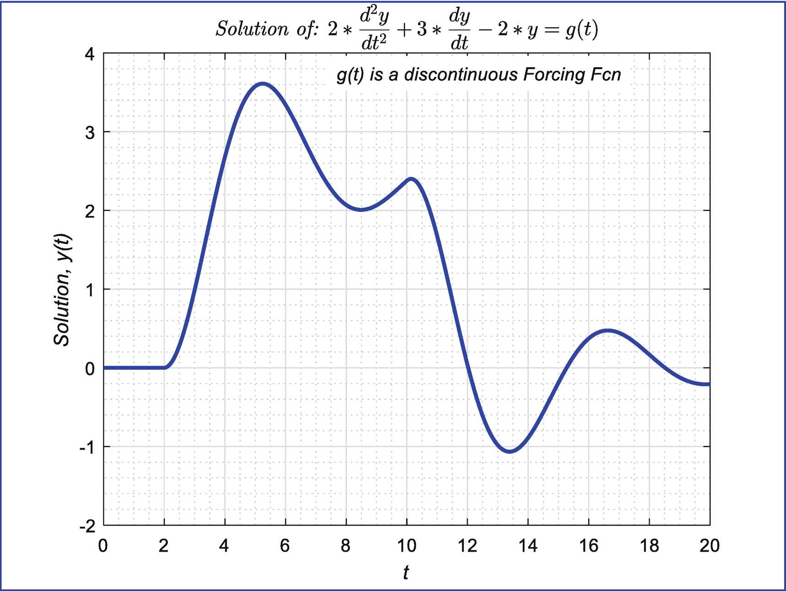

**图 1-9** 承受不连续强迫函数的二阶非齐次常微分方程仿真

```
>> pretty(TFt)
/                /             1/2         \       \
|    /       t \ |           15    sin(#1) |       |
| exp| 5/2 - - | | cos(#1) + ------------- |       |
|    \       4 / \                15       /       |
5 heaviside(t - 10) | ------------------------------------------ - 1/2 | -
\                     2                            /
/                /             1/2         \       \
|    /       t \ |           15    sin(#2) |       |
| exp| 1/2 - - | | cos(#2) + ------------- |       |
|    \       4 / \                15       /       |
5 heaviside(t - 2) | ------------------------------------------ - 1/2 |
\                     2                            /
其中
1/2
15    (t - 10)
#1 == --------------

1/2
15    (t - 2)
#2 == -------------
```

从前面的练习中可以看出，使用拉普拉斯变换（`laplace()/ilaplace()`）计算受外部强迫函数（可能不连续）作用的非齐次常微分方程的解析解相对简单快捷。这类练习常见于控制工程环境中。此外，请注意，在求解常微分方程时，拉普拉斯变换和逆拉普拉斯变换（`laplace()/ilaplace()`）的实现非常直接。使用它们求得的常微分方程解与使用 `dsolve()` 求得的解完全匹配。如前所述，许多常微分方程无法使用 `laplace()/ilaplace()` 和 `dsolve()` 函数解析求解。因此，数值方法是唯一的选择。