## 9. 弹簧-质量-阻尼系统

本章介绍了如何在 MATLAB 和 Simulink 环境中构建弹簧-质量-阻尼系统仿真模型的几个关键方面和方法。推导了单自由度、两自由度、三自由度弹簧-质量-阻尼系统的运动方程，并基于推导的数学表达式构建了 `MATLAB/Simulink` 模型。研究了弹簧-质量-阻尼系统的自由运动和受迫运动，并考虑了其线性和非线性行为。所开发的单自由度、两自由度和三自由度系统仿真模型可应用于多自由度系统。

### 单自由度系统

#### 情况 1：自由振动（运动）

考虑一个非线性类型的单自由度弹簧-质量-阻尼系统，其数学表达式为`M·u'' + C·|u'|·u' + K·u = 0`，`u(0) = 0`，`u'(0) = 1`，其中`M`是质量，`C`是阻尼，`K`是系统的刚度。注意，该系统方程是一个二阶齐次常微分方程，且没有施加外力。系统根据其初始条件进行振荡。换句话说，其响应取决于初始位移和速度值。

同样，在求解常微分方程的初值问题时，构建给定问题仿真模型的第一步是重写其运动方程。

`u'' = -(C·|u'|·u' + K·u(t)) / M` (9-1)

如书中第一部分所述，通过引入一个新变量，可以将公式 `(9-1)` 所示的二阶常微分方程表示为以下两个微分方程，以便数值求解二阶常微分方程。

`u1' = u2`  
`u2' = -(C·|u2|·u2 + K·u1) / M` (9-2)

如果系统的质量远小于其刚度和阻尼，则给定的系统模型将属于刚性常微分方程类型，例如：`M = 1 kg`，`C = 1001 N·s/m`，`K = 1000 N/m`。

让我们基于公式 `(9-2)` 所示的第一个常微分方程组，在函数文件 (`SMDode.m`) 中编写一个包含三个输入参数 (`M`, `C`, `K`) 的脚本。由于给定问题是刚性常微分方程类型，我们使用 ODE 求解器`ode15s`。注意，我们还在公式 `(9-2)` 中将给定系统的雅可比矩阵作为嵌套函数`function dfdu = Jacobian(t, u)`引入。公式 `(9-2)` 所示的表达式编码在嵌套函数`function dudt = f(t, u)`中。定义雅可比矩阵可以加快 `MATLAB` ODE 求解器的仿真过程。

```matlab
```

# function SMDode(Mass, Damping, Stiffness)

## 系统描述与参数

`SMDode.m` 用于分析弹簧-质量-阻尼系统的行为。

给定质量、阻尼和刚度值。

**注意：** 输入参数数据的顺序很重要。

系统的阻尼器具有非线性特性，表示为 `D*|u'|*u'`，例如 `abs(速度)*速度`。

采用求解器 `ode15s`；然而，其他求解器，即 `ODE15S`、`ODE23S`、`ODE23T`、`ODE23TB`，也可使用。

## 函数主体

```matlab
if nargin < 1
    %  参数的一些默认值：质量、阻尼和刚度
    %  以防用户未指定
    Mass = 1;          % [kg]
    Damping=1001;      % [Ns/m]
    Stiffness=1000;    % [N/m]
end

tspan = [0; min(20,5*(Damping/Mass))]; % 若干个周期
u0 = [0; 1];                           % 初始条件

% ODESETs 的选项可以关闭
options = odeset('Jacobian',@Jacobian);
% [t,u] = ode15s(@f,tspan,u0,[]); % 不使用选项
[t,u] = ode15s(@f,tspan,u0,options);

figure;
plot(t,u(:,1),'r-', t, u(:,2), 'b-.', 'MarkerSize', 5,...
    'LineWidth', 1.5);
title(['\it 弹簧-质量-阻尼系统：',...
    'M = ' num2str(Mass), '[kg]' '; D = ' num2str(Damping),...
    '[Ns/m]', '; S = ' num2str(Stiffness), '[N/m]']);
xlabel('时间 t')
grid on
axis tight
axis([tspan(1) tspan(end) -0.1 0.1]); % 设置坐标轴范围
hold on

Acceleration=-(Damping/Mass)*abs(u(:,2)).*u(:,2)-...
    (Stiffness/Mass)*u(:,1);
plot(t, Acceleration,'k--', 'MarkerSize', 3, 'LineWidth', 1);

legend('位移', '速度', '加速度');
ylabel('位移、速度、加速度')
hold off; xlim([0, 3])

% -----------------------------------------------------------
% 嵌套函数：质量、阻尼和刚度由外部函数提供。
%------------------------------------------------------------
function dudt = f(t, u)
    % 导数函数。质量、阻尼和刚度由外部函数提供
    % 或采用默认值（示例值）
    dudt = [            u(2);
        -(Damping/Mass)*abs(u(2))*u(2)-(Stiffness/Mass)*u(1) ];
end

% -----------------------------------------------------------
function dfdu = Jacobian(t, u)
    % 雅可比矩阵函数。质量、阻尼和刚度由
    % 主函数提供，若无输入则采用默认值。
    dfdu = [         0,                  1;
        -(Stiffness/Mass),  -(Damping/Mass)*abs(u(2))-...
        (Damping/Mass)*u(2)*sign(u(2)) ];
end %
% -----------------------------------------------------------
end  % SMDode.m
```

从图 9-1 绘制的仿真结果中可以清楚地看出，该系统是过阻尼的。在研究弹簧-质量-阻尼系统时，不仅要研究整体系统行为，还要研究其固有频率、阻尼水平（轻阻尼、欠阻尼和过阻尼情况）以及系统参数变化的影响，这些都很重要。所有这些研究都可以额外引入到系统的仿真模型中。

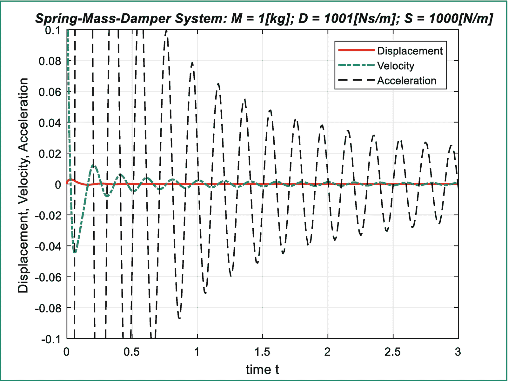

图 9-1 弹簧-质量-阻尼系统仿真

让我们重新考虑单自由度 SMD 系统之前的那个问题，以研究其在系统为线性，即不存在 $\left|\dot{u}\right|$ 的情况下的自由运动：$M\ddot{u}+C\dot{u}+ Ku=0$。通过除以 `M`（质量），可以将其重写，如下所示：

$$ \ddot{u}+\frac{C}{M}\dot{u}+\frac{K}{M}u=0 $$

(9-3)

在这个新的公式中，可以引入以下替换：

$$ \frac{K}{M}={\omega}_n²;\frac{C}{M}=2\zeta {\omega}_n $$

(9-4)

其中 `ω_n` 是系统的固有频率，`ζ` 是阻尼比。

问题公式可以再次重写如下：

$$ \ddot{u}+2\zeta {\omega}_n\dot{u}+{\omega}_n²u=0 $$

(9-5)

该方程具有以下形式的通解：

$$ u(t)=A{e}^{r_1t}+B{e}^{r_2t} $$

(9-6)

其中未知系数 `A` 和 `B` 根据初始条件 ($u(0)={u}_0,\dot{u}(0)={\dot{u}}_0$) 使用以下通用方程计算得出：

$$ A=\frac{u_0{r}_2-{\dot{u}}_0}{r_2-{r}_1} $$

(9-7)

$$ B=\frac{{\dot{u}}_0-{u}_0{r}_1}{r_2-{r}_1} $$

(9-8)

将通解代入给定的问题公式方程 (9-5) 中，我们得到以下特征方程：

$$ {r}²+2\zeta {\omega}_n\ r+{\omega}_n²=0 $$

(9-9)

该二次特征方程的根（根 `r1` 和 `r2`）如下：

$$ {r}_{1,\kern0.5em 2}=\Big(-2\zeta {\omega}_n\pm \left.\sqrt{{\left(2\zeta {\omega}_n\right)}²-4{\omega}_n²}\right)/4{\omega}_n² $$

(9-10)

根（`r1` 和 `r2`）取决于参数，即 `ω_n` 和 `ζ`。让我们看看四种情况 [1, 2] 来计算它们。

### 案例一：无阻尼
`ζ` = 0。问题公式如下：

$$ \ddot{u}+{\omega}_n²\ u=0 $$, $$ u(0)={u}_0,\kern0.5em \dot{u}(0)={\dot{u}}_0 $$ (9-11)

方程 (9-11) 中微分方程的解是 `r1` = `i ω_n`; `r2` = − `i ω_n`，并且真实系统情况的解适用于：`M` > 0 且 `K` > 0。

解如下：

$$ u(t)={u}_0\cos \left(\ {\omega}_nt\right)+\frac{{\dot{u}}_0}{\ {\omega}_n}\sin \left(\ {\omega}_nt\right) $$

(9-12)

注意，这个解是通过一些替换得到的，例如我们在前面章节中使用过的欧拉公式（`e^(iθ) = cos θ + i sin θ`）以及前面方程 (9-6) 中所示的通解公式。

解的另一形式如下：

$$ u(t)=\left(\sqrt{u_0²+\frac{{\dot{u}}_0²}{\omega_n²}}\right)\sin \left({\omega}_nt+\varphi \right) $$

(9-13)

$$ \varphi ={\tan}^{-1}\left(\frac{\omega_n{u}_0}{{\dot{u}}_0}\right) $$

(9-14)

其中 `φ` 是相移角。注意，方程 (9-12) 和 (9-13) 中显示的两种解的形式是等价的，并且可以相互推导。

### 案例二：欠阻尼
0 < `c²` < 4 `MK` 或 0 < `ζ` < 1。方程 (9-6) 中通解的根如下：

$$ {r}_1=\left[-\zeta +i\sqrt{\left(1-{\zeta}²\right)}\right]{\omega}_n $$

(9-15)

$$ {r}_2=\left[-\zeta -i\sqrt{\left(1-{\zeta}²\right)}\right]{\omega}_n $$ (9-16)

存在阻尼，系统的有阻尼固有频率将为：

$$ {\omega}_d={\omega}_n\sqrt{\left(1-{\zeta}²\right)} $$

(9-17)

因此，解如下：

$$ u(t)={e}^{-\zeta {\omega}_nt}\ \left({u}_o\cos \left({\omega}_dt\right)+\frac{u_0\zeta {\omega}_n+{\dot{u}}_0}{\omega_d}\sin \left({\omega}_dt\right)\right)\kern5em \left(9-18\right) $$

(9-18)

### 案例三：过阻尼
`ζ` > 1 (`c²` > 4`MK`)。式 (9-6) 所示通解方程的根如下：

$$ {r}_1=\left[-\zeta -\sqrt{\left({\zeta}²-1\right)}\right]{\omega}_n $$

(9-19)

$$ {r}_2=\left[-\zeta +\sqrt{\left({\zeta}²-1\right)}\right]{\omega}_n $$

(9-20)

式 (9-6) 所示通解方程的系数如下：

$$ A={u}_0\left[\frac{\zeta }{2\sqrt{\zeta²-1}}\right]-\frac{{\dot{u}}_0}{2{\omega}_n\sqrt{\zeta²-1}} $$

(9-21)

$$ B={u}_0\left[\frac{\zeta }{2\sqrt{\zeta²-1}}\right]+\frac{{\dot{u}}_0}{2{\omega}_n\sqrt{\zeta²-1}} $$

(9-22)

最终，解方程如下：

$$ u(t)=A{e}^{r_1t}+B{e}^{r_2t}=\left[{u}_0\left[\frac{\zeta }{2\sqrt{\zeta²-1}}\right]+\frac{{\dot{u}}_0}{2{\omega}_n\sqrt{\zeta²-1}}\right]{e}^{\left[-\zeta -\sqrt{\left({\zeta}²-1\right)}\right]{\omega}_n}+\left[-{u}_0\left[\frac{\zeta }{2\sqrt{\zeta²-1}}\right]+\frac{{\dot{u}}_0}{2{\omega}_n\sqrt{\zeta²-1}}\right]{e}^{\left[-\zeta +\sqrt{\left({\zeta}²-1\right)}\right]{\omega}_n} $$

(9-23)

### 案例四：临界阻尼
`ζ` = 1 (临界阻尼)，`c²` = 4`MK`。式 (9-6) 所示通解方程的根如下：

$$ {r}_1={r}_2=-{\omega}_n $$

(9-24)

式 (9-6) 所示通解方程的系数如下：

$$ A={u}_0,B={\dot{u}}_0+{\omega}_n{u}_0 $$

(9-25)

解方程由两个线性无关的解组成。

$$ u(t)=\left(A+ Bt\right){e}^{-{\omega}_nt} $$

(9-26)

此处我们跳过了推导四种案例场景解的一些细节。关于从式 (9-7) 到 (9-26) 所示推导公式的一些必要细节，可参见文献 [3]。

前几种案例场景的完整仿真模型可以使用嵌套函数进行编程。`Out=SMDsysSim(M, D, S, ICs, t)` 嵌入在 m 文件 `SMDsysSIM_compare.m` 中，该函数基于五个输入参数（即 `M`、`D`、`S`、`ICs`、`t`）模拟所有四种场景。这些输入参数分别是：质量 (`M`)、阻尼 (`D`)、刚度 (`S`)、初始条件 (`ICs`) 和时间向量 (`t`)。

# 四个场景的仿真与相图分析

```matlab
clearvars; close all

% 场景 I - IV 的输入数据。

M1=1; D1=0; S1=25;   % 场景 I. 无阻尼

M2=1; D2=2; S2=25;   % 场景 II. 欠阻尼

M3=1; D3=13; S3=25;  % 场景 III. 过阻尼

M4=1; D4=10; S4=25;  % 场景 IV. 临界阻尼

ICs=[0.1, 0]; t=0:.05:5;

% 位移：

ut1=SMDsysSim(M1, D1, S1, ICs, t);

ut2=SMDsysSim(M2, D2, S2, ICs, t);

ut3=SMDsysSim(M3, D3, S3, ICs, t);

ut4=SMDsysSim(M4, D4, S4, ICs, t);

% 速度：

dut1=diff(ut1);

dut2=diff(ut2);

dut3=diff(ut3);

dut4=diff(ut4);

figure(1)

plot(t, ut1, 'b-',  'linewidth', 1.5), hold on

plot(t, ut2, 'r-.', 'linewidth', 1.5)

plot(t, ut3, 'k:',  'linewidth', 2)

plot(t, ut4, 'g--', 'linewidth', 1.5)

xlabel('时间, [s]'); ylabel('系统响应, [m]'), grid on,

title('1-DOF 弹簧-质量-阻尼系统仿真 - 4 种场景'),

legend('无阻尼: \zeta=0',' 欠阻尼: 0<\zeta<1','过阻尼: \zeta>1','临界阻尼: \zeta=1'), hold off

figure(2)

plot(ut1(2:end), dut1, 'b-',  'linewidth', 1.5),

hold on

plot(ut2(2:end), dut2, 'r-.','linewidth', 1.5)

plot(ut3(2:end), dut3, 'k:', 'linewidth', 2)

plot(ut4(2:end), dut4, 'g--',  'linewidth', 1.5)

xlabel('时间, [s]');

ylabel('系统响应, [m]')

grid on, title('相图：位移 vs. 速度')

legend('无阻尼: \zeta=0',' 欠阻尼: 0<\zeta<1','过阻尼: \zeta>1','临界阻尼: \zeta=1')

xlim([-.1 .1]), ylim([-.025 .025]), axis square

hold off; shg

function Out=SMDsysSim(M, D, S, ICs, t)

% 帮助。1-DOF SMD 系统的仿真模型。

omegaN = sqrt(S/M);

ksi = 0.5*(D/M)*(1/omegaN);

u0=ICs(1);

du0=ICs(2);

if ksi==0               % 场景 I. 无阻尼

Out=u0*cos(omegaN*t)+(du0/omegaN)*sin(omegaN*t);

elseif ksi>0 && ksi<1    % 场景 II. 欠阻尼

Out=(u0*cos(omegaN*sqrt(1-ksi²)*t)+(du0+ksi*omegaN*u0)/(omegaN*sqrt(1-ksi²))*sin(omegaN*sqrt(1-ksi²)*t)).*exp(-ksi*omegaN*t);

elseif ksi>1            % 场景 III. 过阻尼

r1=(-ksi-sqrt(ksi²-1))*omegaN;

r2=(-ksi+sqrt(ksi²-1))*omegaN;

A=(-du0+(-ksi+(sqrt(ksi²-1)))*u0*omegaN)/(2*omegaN*sqrt(ksi²-1));

B=(du0+(ksi+(sqrt(ksi²-1)))*u0*omegaN)/(2*omegaN*sqrt(ksi²-1));

Out=(A*exp(r1*t)+B*exp(r2*t));

else  %ksi==1          % 场景 IV. 临界阻尼

r1=-omegaN;

A=u0;

B=du0+omegaN*u0;

Out=(A+B*t).*exp(r1*t);

end

end
```

该仿真模型的仿真结果展示了阻尼比 *ζ*（图 9-2 和图 9-3）对系统行为的影响。例如，当 *ζ* 小于临界阻尼值（欠阻尼情况）时，会导致系统响应衰减（阻尼），但衰减率将呈指数形式，具体取决于 *ζ* 的值。如果不存在阻尼，则系统响应会以其固有频率 *ω*[*n*] 振动。相反，在过阻尼和临界阻尼情况下，系统响应不会振荡。

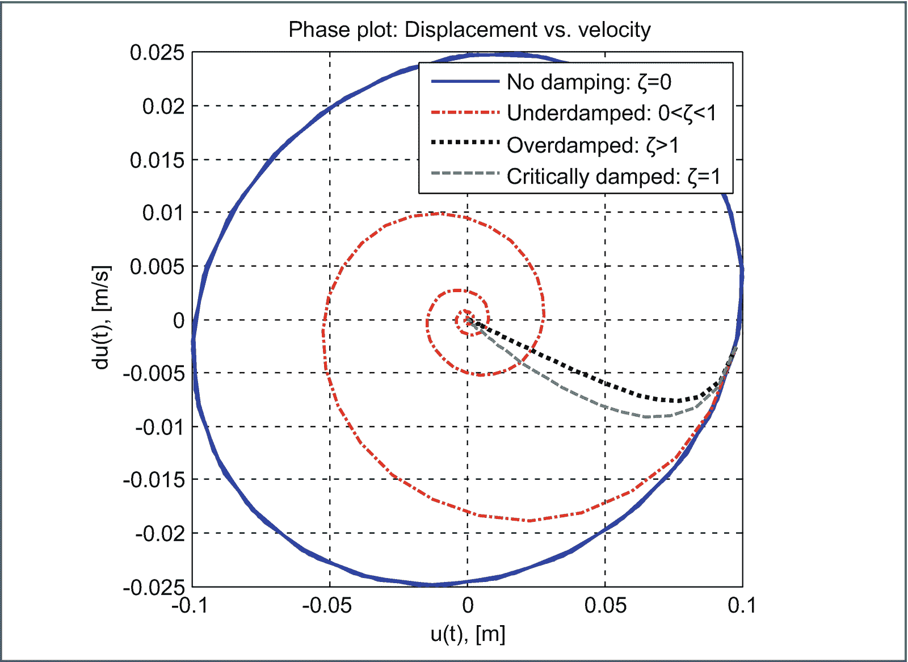

**图 9-3** – 单自由度弹簧-质量-阻尼系统四种场景的相图

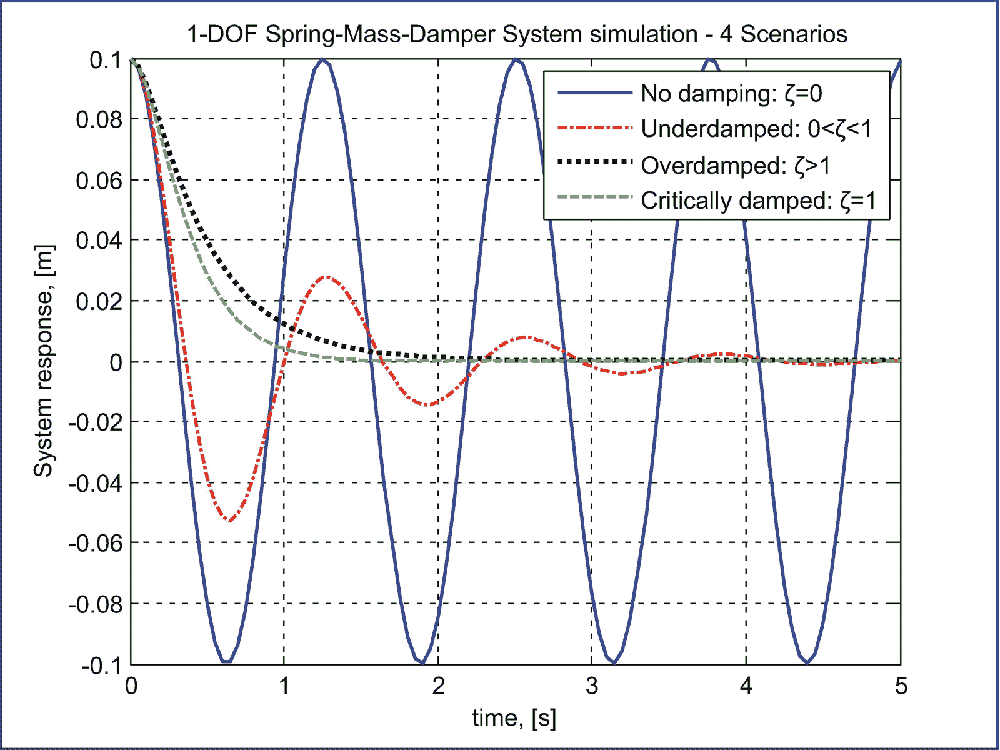

**图 9-2** – 四种不同场景下单自由度弹簧-质量-阻尼系统的仿真

此外，我们可以研究初始条件对系统响应 `u(t)` 的影响，以了解系统需要多长时间才能完全停止。现在，通过修改之前的脚本 `SMDsysSIM_compare.m`，我们可以编写另一个仿真模型 `SMDsysSIM_compare_ICs.m`，该模型模拟三种场景：欠阻尼、临界阻尼和过阻尼，并采用三种不同的初始条件。

## 初始条件影响的研究

```matlab
%% 研究初始条件的影响

clearvars; close all

% 输入数据：

M=1; D=5; S=25; t=0:.05:2.5;

% 三种不同情况下的初始条件：

ICs1=[0.1, 0];

ICs2=[0.1, 1];

ICs3=[0.1, -1];

% 位移：

ut1=SMDsysSim(M, D, S, ICs1, t);

ut2=SMDsysSim(M, D, S, ICs2, t);

ut3=SMDsysSim(M, D, S, ICs3, t);

figure, subplot(311)

plot(t, ut1, 'b-', 'linewidth', 1.5), hold on

plot(t, ut2, 'r--', 'linewidth', 2),

plot(t, ut3, 'k:', 'linewidth', 2), grid on

legend('u_0=0.1, du_0=0','u_0=0.1, du_0=1','u_0= 0.1, du_0= -1')

ylabel(' u(t), [m]')

gtext({' \zeta 1'}, 'fontsize', 13), hold off, axis tight

function Out=SMDsysSim(M, D, S, ICs, t)

% 帮助：单自由度 SMD 系统的仿真模型。

% Out=SMDsysSim(M, D, S, ICs, t)

omegaN = sqrt(S/M);

ksi = 0.5*(D/M)*(1/omegaN);

u0=ICs(1);

du0=ICs(2);

if ksi==0               % 场景 I: 无阻尼

Out=u0*cos(omegaN*t)+(du0/omegaN)*sin(omegaN*t);

elseif ksi>0 && ksi<1    % 场景 II: 欠阻尼

Out=(u0*cos(omegaN*sqrt(1-ksi²)*t)+(du0+ksi*omegaN*u0)/(omegaN*sqrt(1-ksi²))*sin(omegaN*sqrt(1-ksi²)*t)).*exp(-ksi*omegaN*t);

elseif ksi>1            % 场景 III: 过阻尼

r1=(-ksi-sqrt(ksi²-1))*omegaN;

r2=(-ksi+sqrt(ksi²-1))*omegaN;

A=(-du0+(-ksi+(sqrt(ksi²-1)))*u0*omegaN)/(2*omegaN*sqrt(ksi²-1));

B=(du0+(ksi+(sqrt(ksi²-1)))*u0*omegaN)/(2*omegaN*sqrt(ksi²-1));

Out=(A*exp(r1*t)+B*exp(r2*t));

else  %ksi==1          % 场景 IV: 临界阻尼

r1=-omegaN;

A=u0;

B=du0+omegaN*u0;

Out=(A+B*t).*exp(r1*t);

end

end
```

```
如图 9-4 所示，针对三个不同`ζ`值的仿真结果表明，如果系统中存在显著阻尼，则系统的自由运动会随时间衰减。然而，自由运动的整个衰减（消亡）时间取决于初始条件，即初始激励值（系统的位移和速度）。先前讨论的针对单自由度系统自由振动（运动）的仿真模型方法，经过一些调整后，也可应用于多自由度（线性）系统的自由振动仿真。

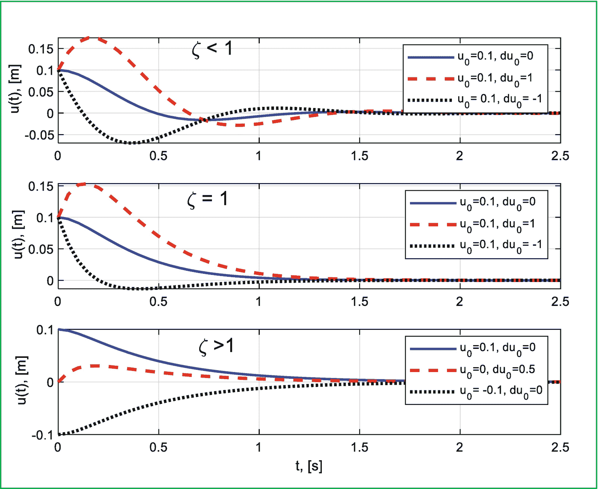

**图 9-4** 研究系统初始条件对其响应的影响

## 案例 2：受迫振动（运动）

现在我们考虑单自由度 SMD 系统受到如图 9-5 所示的矩形周期性波力激励的情况。

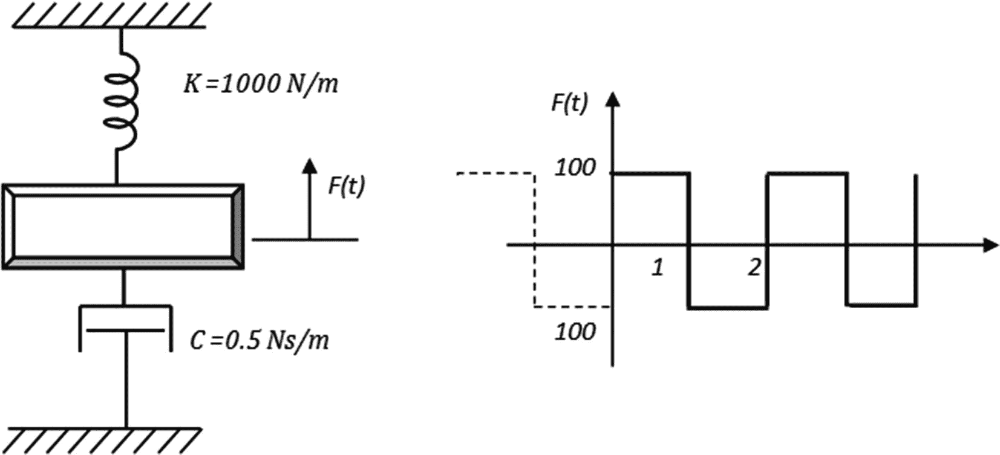

**图 9-5** 受周期性波力激励的弹簧-质量-阻尼系统

系统的运动方程如下：

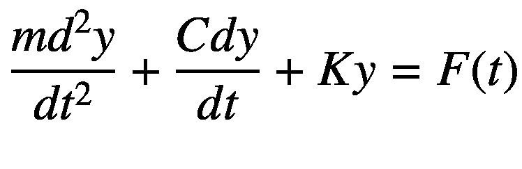

(9-27)

其中，外力`F(t)`是一个周期性波函数，可通过如下傅里叶级数近似表示：

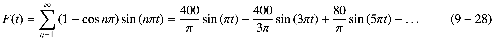

(9-28)

现在，方程(9-27)中系统模型的最终公式如下：

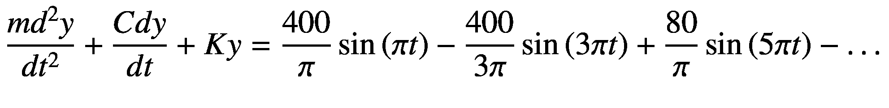

(9-29)

**第一个仿真模型。** 使用方程(9-29)，我们创建一个包含 MATLAB 脚本的仿真模型。方程(9-28)中的周期性波函数公式可以表示为名为`func_pulse(t, n)`的函数。

```
function F=func_pulse(t, n)

%帮助：t 为时间向量。n 为脉冲逼近中的项数。

F(1,:)=(200/pi)*(1-cos(pi))*sin(pi*t);

for ii=2:n

F(:,:)=F(:,:)+(200/(ii*pi))*(1-cos(ii*pi))*sin(ii*pi*t);

end
```

我们将二阶常微分方程（即方程(9-29)的左侧部分）通过匿名函数句柄`DDx`表示，并将力函数`func_pulse(t, n)`嵌入一个名为`Sim_func_pulse.m`的 m 文件中，并使用`ode45`求解器。这将模拟系统行为并绘制仿真结果。注意，在此仿真模型中，采用了零初始条件。模型的仿真结果如图 9-6 和图 9-7 所示。

```
% F = func_pulse(t, n) 生成周期性矩形脉冲。
% DDx = @(t, x) 匿名函数句柄。
clearvars; close all

M = 10; C = 0.5; K = 1000; % 系统参数
t=0:pi/1000:13;          % 时间
n=113;                   % 傅里叶级数的项数
ICs=[0,0];               % 初始条件

F=func_pulse(t, n);      % 傅里叶级数值

% 系统模型方程由两个一阶常微分方程表示
DDx=@(t,x)([x(2); (1/10)*(func_pulse(t,n)-C*x(2)-K*x(1))]);

opts_ODE=odeset('RelTol', 1e-6, 'AbsTol', 1e-8);
[time, Xt]=ode45(DDx, t, ICs, opts_ODE);

subplot(211)
yyaxis left
plot(t, F, 'k-');
ylabel('输入 F(t), [N]')
yyaxis right
plot(t, Xt(:,1), 'r--')
ylabel('输出 x(t), [m]')
legend('F(t) 输入', 'x(t) 输出'), grid on
title(['\it 受周期性脉冲力激励的 ',...
'SMD 系统'])
axis tight

subplot(212)
yyaxis left
plot(t,Xt(:,1),'k-')
ylabel('位移 x(t), [m]')
yyaxis right
plot(t, Xt(:,2),'b-.','linewidth', 1.5)
legend('x(t)','dx(t)')
ylabel('速度 dx(t), [m/s]')
xlabel('时间 [秒]'), grid on, axis tight

figure
plot(Xt(:,1), Xt(:,2)),
xlabel('x(t)'), ylabel('dx(t)')
title('相图；x 与 dx'), grid on
axis square

function F=func_pulse(t,n)
%帮助：t 为时间向量。n 为脉冲逼近中的项数。
F(1,:)=(200/pi)*(1-cos(pi))*sin(pi*t);
for ii=2:n
F(:,:)=F(:,:)+(200/(ii*pi))*(1-cos(ii*pi))*sin(ii*pi*t);
end
end
```

现在，我们采用 Simulink 建模方法来模拟系统行为。

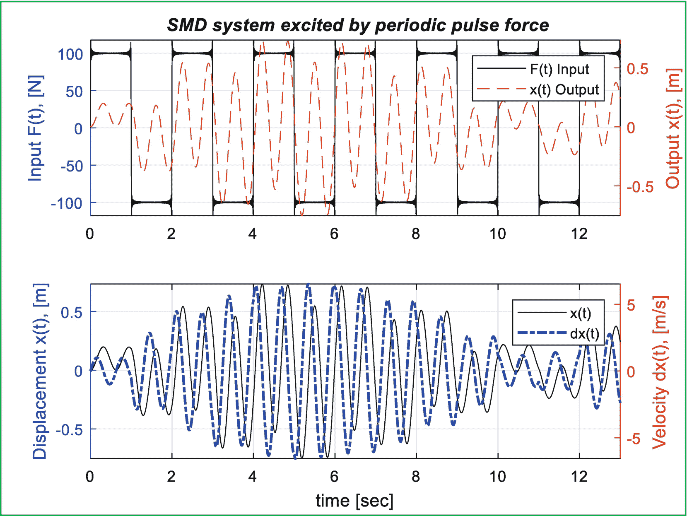

**图 9-6** 受周期性脉冲力激励的弹簧-质量-阻尼系统仿真

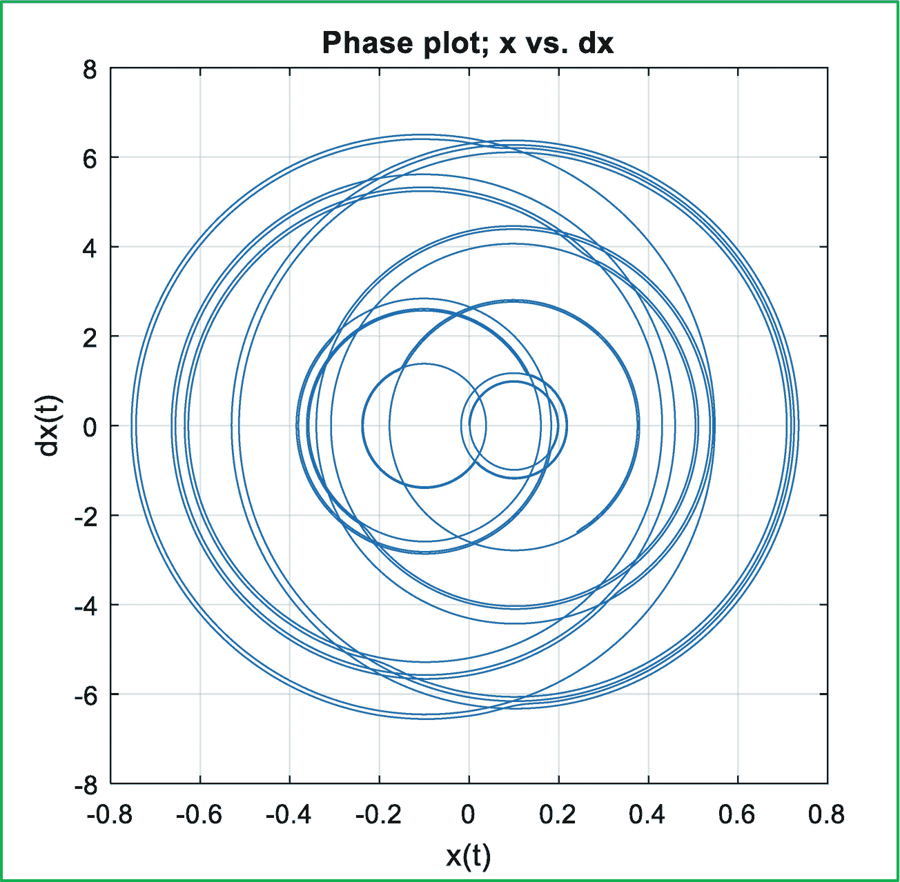

**图 9-7** 相图：受周期矩形波力激励的弹簧-质量-阻尼系统的位移与速度关系

第二个仿真模型在 Simulink 中构建。在 Simulink 中，有若干模块可用于生成周期脉冲信号（关于如何构建 Simulink 模型的更多细节，请参见[4]）。这些模块包括信号发生器、脉冲发生器、阶跃函数序列、信号构建器以及重复序列。`Pulses__Input.mdl`（如图 9-8 所示）是受外力（即重复脉冲）作用的弹簧-质量-阻尼系统的最终模型。

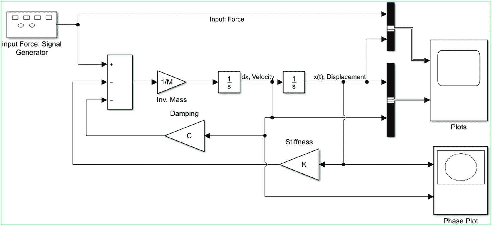

**图 9-8** 受脉冲外力作用的弹簧-质量系统的 Simulink 模型 (`Pulses__Input.mdl`)

图 9-8 所示 Simulink 模型 (`Pulses__Input.mdl`) 的仿真结果（输入信号与系统响应、Plots–Scope 模块中的位移与速度、Phase Plot 模块中的位移与速度）与来自 m 文件 `Sim_func_pulse.m` 的图 9-6 和图 9-7 中的结果高度吻合。从名为 [Plots] 的 Scope 模块和名为 [Phase Plot] 的 XY Scope 模块获得的仿真结果在此未显示。如图 [Phase Plot] 所示，XY Scope 模块的 x-y 轴范围设置为 `[-0.8 0.8 -8 8]`。请注意，[Signal Generator] 模块的参数如下：

*   输出各种波形：`Y(t) = Amp*Waveform(Freq, t)`
*   波形：方波
*   时间 (t)：使用仿真时间
*   幅值：-100
*   频率：0.5
*   单位：赫兹

模型 (`Pulses__Input.mdl`) 中其他增益参数 `M`、`C` 和 `K` 的值分别为 10、0.5 和 1000。
```

# 单自由度弹簧-质量-阻尼系统的强迫振动分析

## 控制方程与通解

让我们考虑另一个案例：一个单自由度弹簧-质量-阻尼系统在 `F(t) = F[0] cos (ωt)` 作用下的正弦周期强迫运动。

方程 (9-27)，即 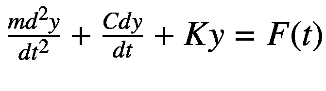，其通解如下所示：

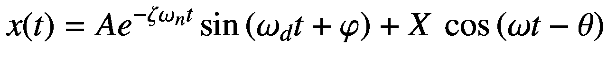

(9-30)

其中 `ω` 是作用力的频率，`φ` 是相移。常数 `A` 和 `X` 由初始条件计算得出 [1, 2, 3]。

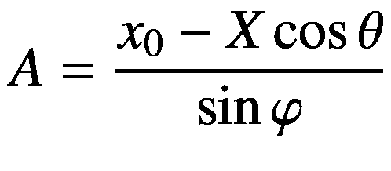

(9-31)

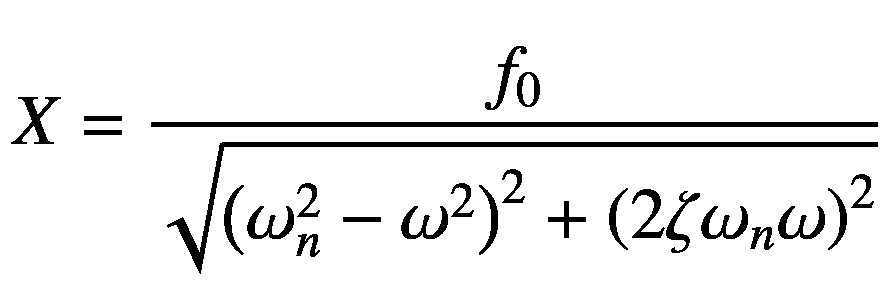

(9-32)

式中 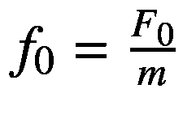 是归一化的力幅值。相位 `θ` 由以下公式计算得出：

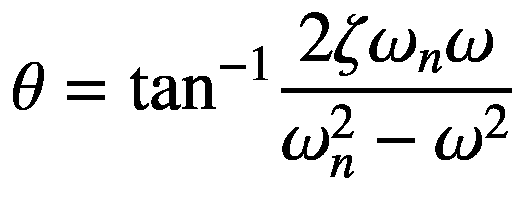

(9-33)

## 幅值与相位的归一化表达式

上述关于幅值 `X` 和相位 `θ` 的公式在一般实践中具有非常重要的意义。瞬态响应 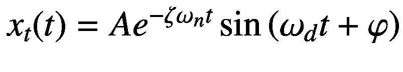 作为通解的一部分，其幅值相对较小，对响应的影响远小于稳态响应幅值。因此，在实践中，我们主要处理解的稳态响应部分，即 `x(t) = X cos (ωt − θ)`。

根据 `X` 和 `θ` 的公式，通过提取 `ω²` 因子，将幅值除以 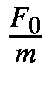 或 `f[0]`，并代入 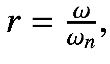，可以得到系统响应归一化幅值和相位的以下表达式：

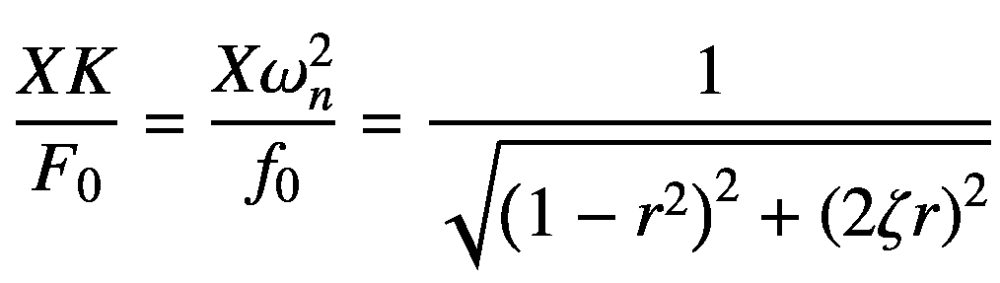

(9-34)

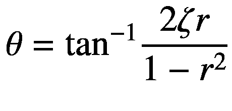

(9-35)

## 数值仿真与分析

这些公式通过以下脚本 (`zeta_1DOF_SMD.m`) 进行仿真：

```matlab
function zeta_1DOF_SMD(M, zeta, S, omega)
% 帮助。研究阻尼比 (zeta) 对幅值变化的影响
% M - 系统质量
% zeta - 阻尼比
% S - 系统刚度
% omega - 频率
if nargin.xsh+od+*^v';
for m=1:length(zeta)
Stylo    = [Colorit(m) Lineit(m) Markit(m)];
Labelit{m} = ['\zeta= ' num2str(zeta(m))];
semilogy(r, Mag(m,:), Stylo, 'linewidth', 1.5), hold on
end
legend(Labelit{:}); axis tight; grid on; ylim([0, 5])
title('\zeta influence on Response Amplitude change')
xlabel('r = \omega/\omega_n'), ylabel('\it Normalized Amplitude'),
hold off
figure
for m=1:length(zeta)
Stylo    = [Colorit(m) Lineit(m) Markit(m)];
Labelit{m} = ['\zeta= ' num2str(zeta(m))];
plot(r, Theta(m,:), Stylo, 'linewidth', 1.5)
hold on
end
legend(Labelit{:}, 'location', 'northwest')
axis tight, grid on;
axis([0, 2 -.2 3.35])
title('\zeta  effects on Phase changes')
xlabel('r = \omega/\omega_n ')
ylabel('Phase, \theta(r)')
```

再次强调，在我们对阻尼比 (`ζ`) 与归一化系统幅值（图 9-9）及相移（图 9-10）的仿真研究中，我们可以得出结论：当系统固有频率等于周期激励力的激励频率时，会出现共振峰值，这与理论评估预期一致，并且系统行为将变得不可控。为避免这种情况，我们需要施加阻尼。请注意，在脚本中，使用了 `atan2` 函数来计算相位角 `θ(r)` 的值，因为该函数可在 [0, `π`] 范围内计算 `θ(r)` 的值，而 `tan` 函数在 ![$$ \left[-\frac{\pi }{2},\frac{\pi }{2}\right] $$](images/490522_1_En_9_Chapter/490522_1_En_9_Chapter_TeX_IEq15.png) 范围内计算，在这种情况下不适用。

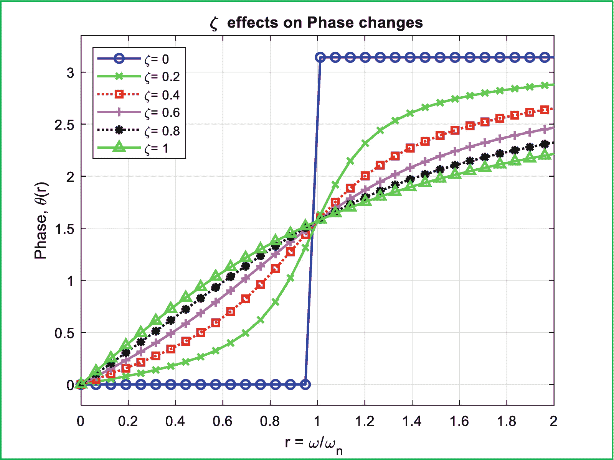

**图 9-10**
阻尼比 (`ζ`) 对系统相位 `θ` 变化的影响

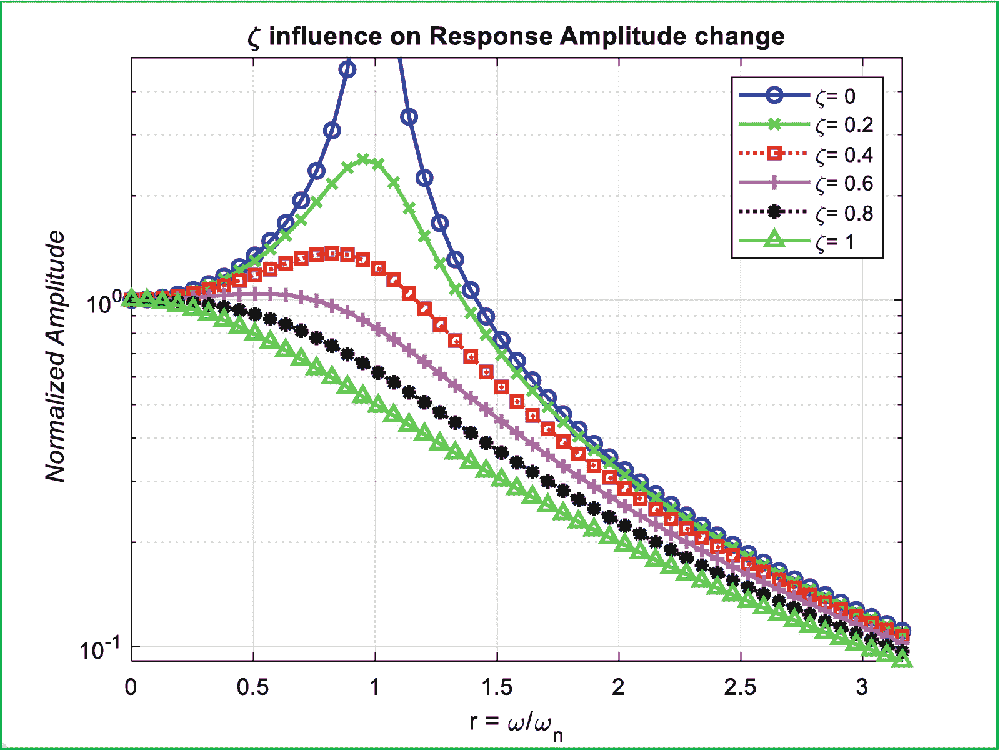

**图 9-9**
阻尼比 (`ζ`) 对归一化系统响应幅值的影响

# 二自由度系统

许多机械系统的运动都是通过将其建模为 SMD（弹簧-质量-阻尼）系统来研究的。让我们考虑图 9-11 所示的受外力的二自由度 SMD 系统。请注意，质量块 1 和质量块 2 下的摩擦力被视为线性的。
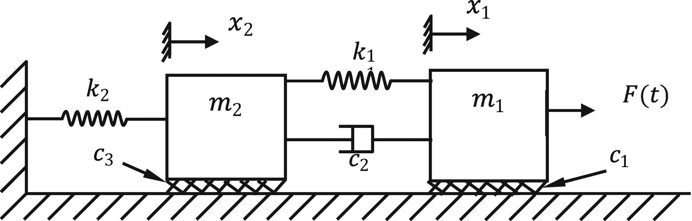
图 9-11 受外部脉冲力 `F(t)` 作用的双质量弹簧-质量-阻尼系统

在我们开始推导系统方程之前，图 9-12 展示了所给系统的另一种等效物理模型，该模型通过将作用于质量块 1 和 2 下的摩擦阻尼替换为施加在每个质量块上的阻尼器来实现。
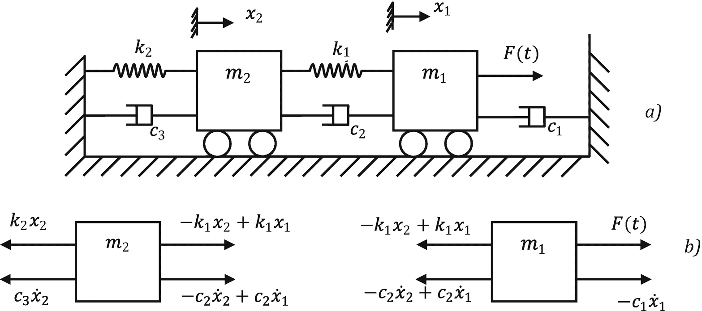
图 9-12 a) 系统的另一种物理模型；b) 质量块 1、2 的受力图

利用系统的受力图，并对每个质量块上的作用力应用达朗贝尔原理，我们可以写出系统的运动方程。

对于质量块 1：
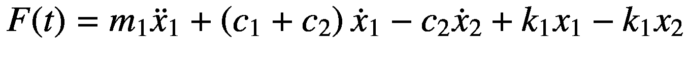
(9-36)

对于质量块 2：
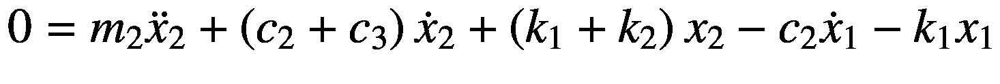
(9-37)

请注意，`m[1]`、`m[2]`、`c[1]`、`c[2]`、`c[3]`、`k[1]`、`k[2]` 分别是质量、阻尼和刚度的系统参数。`x[1]` 和 `x[2]` 分别是质量块 1 和 2 的位移，并且 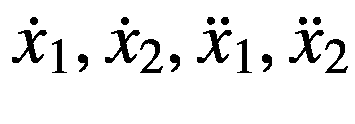 分别是质量块 1 和质量块 2 的速度和加速度。

通过引入新的状态变量，我们将方程 (9-36) 和 (9-37) 重写为一阶常微分方程组。为避免混淆，将变量重命名为 `x[1] = y[1]` 和 `x[2] = y[2]`。
![$$ \left\{\begin{array}{c}{\dot{x}}_1={y}_2\\ {}\begin{array}{c}{\dot{y}}_2=\frac{1}{m_1}\left[F(t)-\left({c}_1+{c}_2\right){y}_2+{c}_2{y}_4-{k}_1{y}_1+{k}_1{y}_3\right]\\ {}{\dot{x}}_2={y}_4\\ {}{\dot{y}}_4=\frac{1}{m_2}\left[{c}_2{y}_2-\left({c}_2+{c}_3\right){y}_4+{k}_1{y}_1-\left({k}_1+{k}_2\right){y}_3\right]\end{array}\end{array}\right. $$](images/490522_1_En_9_Chapter/490522_1_En_9_Chapter_TeX_Equ34.png)
(9-38)

基于方程(9-38)中定义的系统模型，针对施加外力 `F(t) = F[0] sin (10t)` 的情况，我们编写了名为 `SMsysSIM.m` 和 `two_DOF_sys_sim_ALL.m` 的 MATLAB 模型，并构建了一个名为 `Two_DOF_SMsys.mdl` 的 Simulink 模型。

```
function SMsysSIM(t, ICs)
% SMsysSIM.m
% t 是时间；ICs 是初始条件。
if nargin<1
% 如果未提供输入参数和初始条件，则
t=[0,5]; ICs=[1; 1.5; -1; 1];
OPTs=odeset('OutputFcn', @odeplot,'reltol', 1e-4,'abstol',1e-6);
ode45(@SMsys1,t, ICs, OPTs)
else
Opts=odeset('OutputFcn', @odeplot,'reltol', 1e-4,'abstol',1e-6);
ode45(@SMsys1,t, ICs, Opts)
end
function DX=SMsys1(t, y)
k1=90; k2=85; c1=2; c2=1; c3=3; m1=5; m2=3; F0=3.3;
Dx(1)= y(2);
Dx(2)=(1/m1)*(F0*sin(10*t)-(c1+c2)*y(2)+c2*y(4)-k1*y(1)+k1*y(3));
Dx(3)= y(4);
Dx(4)= (1/m2)*(c2*y(2)-(c2+c3)*y(4)+k1*y(1)-(k1+k2)*y(3));
DX=[Dx(1); Dx(2); Dx(3); Dx(4)];
end
end
```

此函数文件 (`SMsysSIM.m`) 计算质量块 1 和 2 的位移和速度值，并在不包含图形属性（如图标题、图例等）的单个图中进行绘制。

接下来的 m 文件 (`two_DOF_sys_sim_ALL.m`) 使用 ODE 求解器（`ode23`、`ode23s`、`ode23tb` 和 `ode113`）和 Simulink 模型 (`Two_DOF_SMsys.mdl`) 计算质量块 1 和 2 的位移和速度值，并分别绘制带有所有图形属性的图形，如图 9-14、图 9-15 和图 9-16 所示。

```
% two_DOF_sys_sim_ALL.m
clearvars; close all
ICs=[1; 1.5; -1; 1];
k1=90; k2=85; c1=2; c2=1; c3=3; m1=5; m2=3; F0=3.3;
F=@(t, y)[y(2);(1/m1)*(F0*sin(10*t)-(c1+c2)*y(2)+c2*y(4)- ...
k1*y(1)+k1*y(3)); y(4); ...
(1/m2)*(c2*y(2)-(c2+c3)*y(4)+k1*y(1)-(k1+k2)*y(3))];
t=0:.005:5;
Opts=odeset('OutputFcn',@odeplot,'reltol', 1e-4, 'abstol', 1e-6);
ode45(F, t, ICs, Opts)
xlabel('\it time'), ylabel('x_1, dx_1, x_2,  dx_2'), grid on
legend('x_1(t)', 'dx_1(t)', 'x_2(t)', 'dx_2(t)')
title('Simulation of 2-DOF system')
%% Testing different solvers with different ODE settings
% ODE45 with fixed time step of 0.005
ts=0:.005:5; % fixed time step of 0.005
[t1, y1]=ode45(F, ts, ICs, []);
%% ODE23tb with variable time step
t=[0, 5];
[t2, y2]=ode23tb(F, t, ICs, []);
%% ODE23 calls an embedded function SMsys. A fixed time step of 0.005
[t3, y3]=ode23(@SMsys, ts, ICs);
%% ODE113 with the varying step size and function handle
[t4, y4]=ode113(@(t, y)[y(2); (1/m1)*(F0*sin(10*t)- ...
(c1+c2)*y(2)+c2*y(4)-k1*y(1)+k1*y(3)); y(4);
(1/m2)*(c2*y(2)-(c2+c3)*y(4)+k1*y(1)-(k1+k2)*y(3))],t, ICs);
%% SIMULINK model: Two_DOF_SMsys.slx with ODE23S & rel. error tol. 1e-6
OPTs=simset('reltol', 1e-6, 'solver', 'ode23s');
XOUT=sim('Two_DOF_SMsys', t, OPTs); % Simulates model: Two_DOF_SMsys.slx
figure('name', 'Displacement: x1')
plot(t1,y1(:,1), 'b-o'), hold on
plot(t2,y2(:,1), 'r--s')
plot(t3,y3(:,1), 'm-.x'),
plot(t4,y4(:,1), 'g:+')
plot(XOUT.tout, XOUT.yout{1}.Values.Data, 'k-'), grid on
legend('ode45','ode23tb','ode23',...
'ode113','Simulink(ode23s ~var)')
title('Displacement of body mass: m_1')
xlabel('time, [sec]'), ylabel('x_1(t)')
figure('name', 'Displacement: x2')
plot(t1,y1(:,3), 'b-o'), hold on
plot(t2,y2(:,3), 'r--s')
plot(t3,y3(:,3), 'm-.x'),
plot(t4,y4(:,3), 'g:+')
plot(XOUT.tout, XOUT.yout{2}.Values.Data, 'k-'), grid on
legend('ode45','ode23tb','ode23',...
'ode113','Simulink(ode23s ~var)')
title('Displacement of body mass: m_2')
xlabel('time, [sec]'), ylabel('x_2(t)')
% Function called by ODE23TB
function DX=SMsys(t,y)
k1=90; k2=85; c1=2; c2=1; c3=3; m1=5; m2=3; F0=3.3;
Dx(1)= y(2);
Dx(2)=(1/m1)*(F0*sin(10*t)-(c1+c2)*y(2)+c2*y(4)-k1*y(1)+k1*y(3));
Dx(3)= y(4);
Dx(4)= (1/m2)*(c2*y(2)-(c2+c3)*y(4)+k1*y(1)-(k1+k2)*y(3));
DX=[Dx(1); Dx(2); Dx(3); Dx(4)];
end
```

请注意，Simulink 模型 (`Two_DOF_SMsys.mdl`) 从名为 `two_DOF_sys_sim_ALL.m` 的仿真 m 文件中获取所有参数（`m1`, `m2`, `k1`, `k2`, `c1`, `c2`, `c3`, `F0`）值和初始条件值（在积分器块中定义，变量名为 `ICs(1)`, `ICs(2)`, `ICs(3)`, `ICs(4)`）。请注意，输入图（Simulink 模型 `Two_DOF_SMsys.mdl` 中的正弦波）的幅值设置为 `F0`，频率（弧度/秒）设置为 `10`。

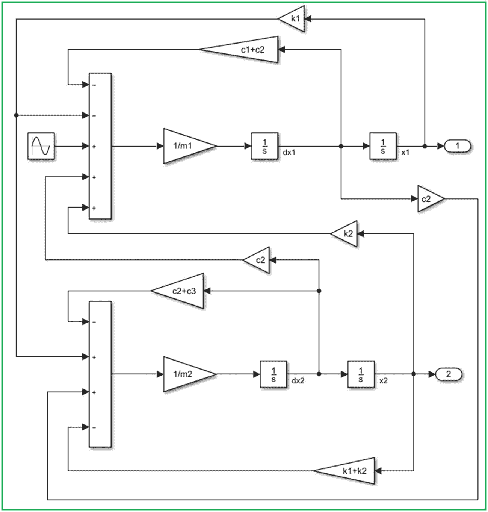

`图 9-13`

Simulink 模型，`Two_DOF_SMsys.slx`

我们运行模型 `two_DOF_sys_sim_ALL.m`，它会自动调用/仿真 Simulink 模型 (`Two_DOF_SMsys.mdl`) 和函数文件。随后，我们得到显示仿真结果的下图（图 9-14、图 9-15 和图 9-16）。

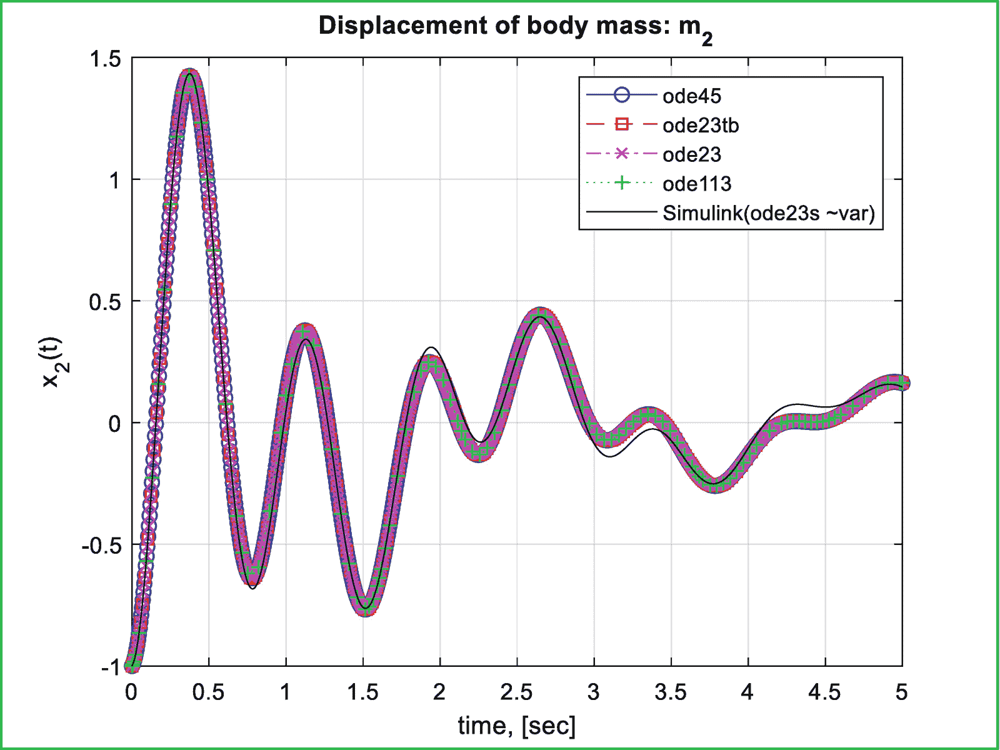

`图 9-16`

使用 MATLAB/Simulink 的不同 ODE 求解器计算得到的质量块 2 的位移

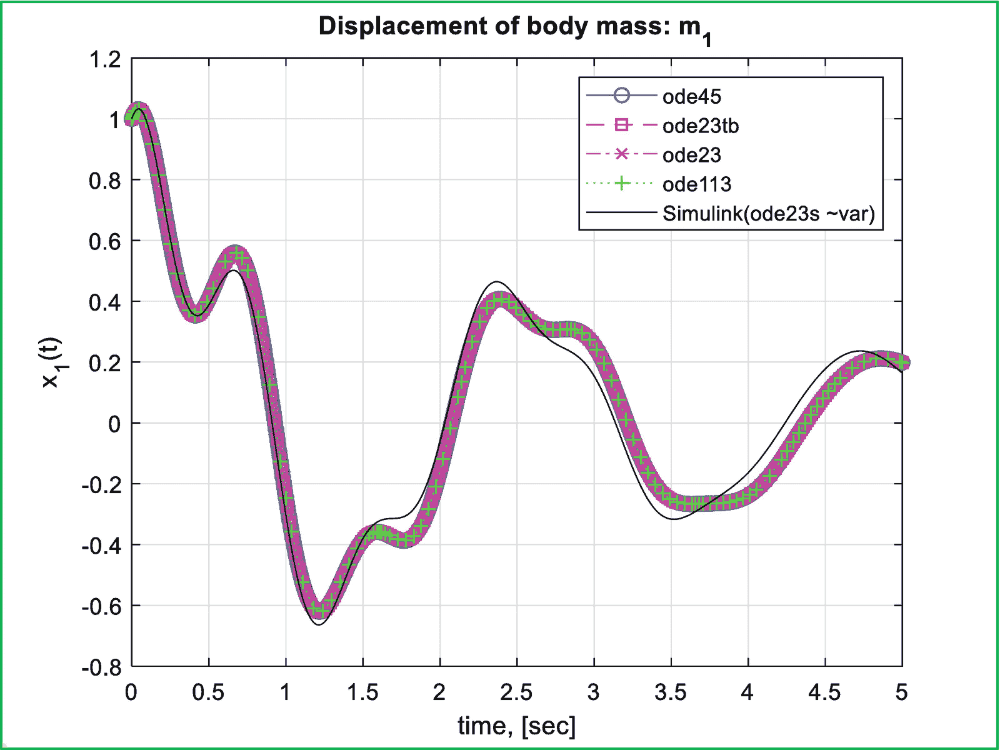

`图 9-15`

使用 MATLAB/Simulink 的不同 ODE 求解器计算得到的物体 1 的位移

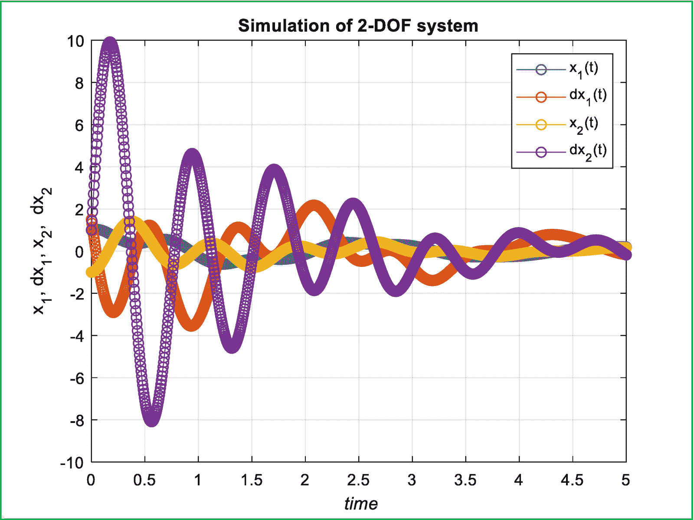

`图 9-14`

物体 1 和物体 2 的位移与速度

图 9-14 和 9-15 中的仿真结果表明，所有使用的 ODE 求解器（`ode23`、`ode23tb`、`ode23s`、`ode45`、`ode113`）都得到了良好收敛的解。

## 三自由度系统

让我们考虑图 9-17 中所示的三自由度弹簧-质量-阻尼器系统，该系统有三个通过弹簧和阻尼器相互连接的质量块。它类似于之前的二自由度系统。我们将推导系统的运动方程并构建仿真模型。

根据其自由体受力图（图 9-17），系统的运动方程可以用公式 (9-39) 所示的二阶微分方程组表示：

公式 (9-39) 可以改写如下：

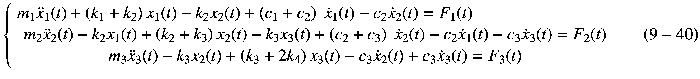

请注意，`m_1`、`m_2`、`m_3`、`c_1`、`c_2`、`c_3`、`k_1`、`k_2` 和 `k_3` 分别是系统的质量、阻尼和刚度参数。`x_1`、`x_2` 和 `x_3` 分别是物体 1、2、3 的位移。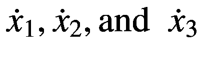 是速度，而  分别是物体 1、2、3 的加速度。`F_1(t)`、`F_2(t)` 和 `F_3(t)` 分别是施加在物体 1、2、3 上的外部作用力。

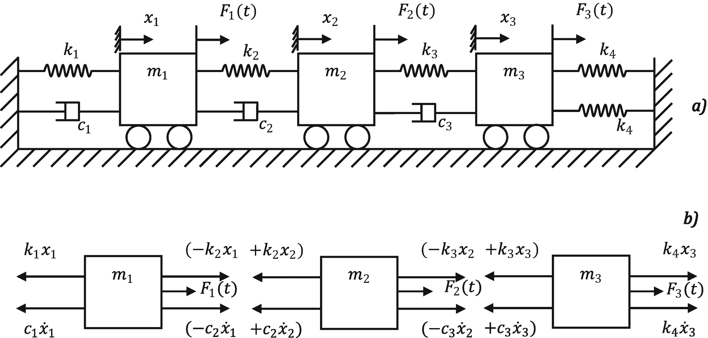

**图 9-17** 三自由度系统：a) 系统的物理模型，三个质量块在无摩擦的平面上滚动；b) 系统的自由体受力图

请注意，公式 (9-39) 和公式 (9-40) 中的系统方程是二阶 ODE，它们是线性且时不变的。它们通过 `x_1(t)`、`x_2(t)` 和 `x_3(t)` 的坐标系进行耦合。因此，这些方程必须同时求解。对于数值仿真，系统参数采用以下数值：`m_1 = 2.5 [kg]`；`m_2 = 2.0 [kg]`；`m_3 = 3.0 [kg]`；`k_1=25 [N/m]; k_2=5 [N/m]; k_3=k_4=30 [N/m]`；`c_1=2.5 [Ns/m]; c_2=0.5 [Ns/m]; c_3=3.5 [Ns/m]`。

我们分别在强迫运动和自由运动的情况下对该系统进行仿真。

- **强迫运动**（振动）情况，初始条件为零：
  例如：`F_1(t) = 20 sin (120*t)`；`F_2(t) = 0`；`F_3(t) = 20Φ(t − t_0)`；
  请注意，`F_3(t)` 是一个在 `t_0 = 0` 时施加的 Heaviside 阶跃函数 `Φ(t − t_0)`。

- **自由运动**（振动）情况。未施加外部作用力：`F_1(t) = F_2(t) = F_3(t) = 0`；仅在物体 1 上施加了一个初始（激励）位移：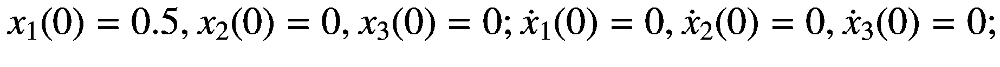。

请注意，在编写仿真模型之前，我们通过一阶 ODE 来重写公式 (9-39) 中的系统方程。该系统具有三个二阶（加速度）变量，即 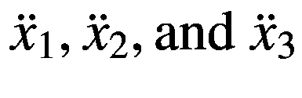，这些变量将被新变量替换，即 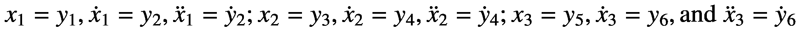。使用这些新变量，我们可以写出如下一阶耦合 ODE 方程组。

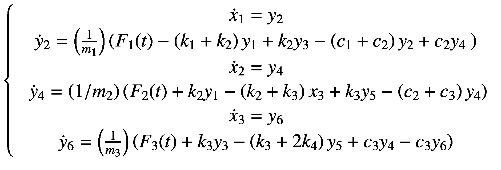

基于公式 (9-41) 中的方程，我们使用 `ode45` 求解器编写了一个名为 `three_MASS.m` 的函数文件。请注意，该函数文件包含一个名为 `third_DOF(t, y)` 的嵌套函数，用于定义公式 (9-41) 中给出的系统方程。系统参数值和外部作用力也在此嵌套函数内定义。Heaviside 阶跃函数通过 `MATLAB` 的内置函数 `step()` 表示。

## 三自由度耦合系统仿真

```matlab
% three_MASS.m
% 说明：高度耦合三自由度系统的仿真。
clearvars; clc
t=0:.01:120;  % 仿真时间跨度
IC=[0;0;0;0;0;0];           % 案例 #1
% IC=[0.5; 0; 0; 0; 0; 0];  % 案例 #2
F1=20*sin(120*t);F2=0; t0=0; F3=20*stepfun(t,t0); % 案例 #1
% F1=0; F2=F1; F3=F1;                             % 案例 #2
k1=25; k2=5; k3=30; k4=k3; c1=2.5; c2=.5; c3=3.5;
m1=2.5; m2=2; m3=3;
[t, xyz]=ode45(@third_DOF, t, IC, []);
% SIMULINK 模型：ThreeDOFsys.slx，使用 ODE113 求解器，相对误差容限 1e-6
OPTs=simset('reltol', 1e-6, 'solver', 'ode113');
[tt, YY, X123]=sim('ThreeDOFsys', [0, 20], OPTs);% 运行：ThreeDOFsys.slx
figure('name', 'Matlab vs. Simulink')
plot(t(1:2000),xyz(1:2000,1),'bo',t(1:2000),xyz(1:2000,3), ...
'rx', t(1:2000), xyz(1:2000,5), 'ks', ...
tt(1:5000),X123(1:5000,1),'r-',tt(1:5000),X123(1:5000,2), ...
'b--', tt(1:5000), X123(1:5000,3), 'g-.','linewidth',1.5)
legend('质量 1: x_1(t) (Matlab)','质量 2: x_2(t) (Matlab)', ...
'质量 3: x_3(t) (Matlab)', ...
'质量 1: x_1(t) (Simulink)', '质量 2: x_2(t) (Simulink)', ...
'质量 3: x_3(t) (Simulink)')
title('\it 三自由度 SMD（耦合）系统')
xlabel('\it 时间, [秒]')
ylabel('\it 位移, x_1(t), x_2(t), x_3(t)'), grid on
figure('name', '动画')
for k=1:t(end)-20
% 注意：为提高可视化效果，x1、x2、x3 的位移幅度放大了 10 倍
plot(-20,0,'*', 20,0, '*', -10+10*xyz(k+20,1), 0, 'r-o',...
-5+10*xyz(k+20,3),0,'g-o',...
10+10*xyz(k+20,5),0,'b-o','markersize', 35, ...
'markerfacecolor', 'c');
grid on; Motion(k)=getframe;
end
movie(Motion)
function  dx = third_DOF(t, y)
% 说明：三自由度系统
k1=25; k2=5; k3=30; k4=k3; c1=2.5; c2=.5; c3=3.5;
m1=2.5; m2=2; m3=3;
F1=20*sin(120*t);F2=0; t0=0; F3=20*stepfun(t,t0);     % 案例 #1
% F1=0; F2=0; F3=0;                                   % 案例 #2
dx=zeros(6,1);
dx(1)=y(2);
dx(2)=(1/m1)*(F1-(k1+k2)*y(1)+k2*y(3)-(c1+c2)*y(2)+c2*y(4));
dx(3)=y(4);
dx(4)=(1/m2)*(F2+k2*y(1)-(k2+k3)*y(3)+k3*y(5)-...
(c2+c3)*y(4)+c2*y(2)+c3*y(6));
dx(5)=y(6);
dx(6)=(1/m3)*(F3+k3*y(3)-(k3+2*k4)*y(5)+c3*y(4)-c3*y(6));
end
```

该仿真模型包含了受迫运动（案例 #1）和自由运动（案例 #2）的输入，例如针对受迫和自由运动情况分别施加的输入力以及非零初始条件（针对质量 1）。

此外，模型还包含了调用并执行系统 `Simulink` 模型的命令，如图 9-18 所示。需要注意的是，`Simulink` 模型 `ThreeDOFsys.slx` 会接收所有参数的数值，而初始条件则通过仿真函数文件 `three_MASS.m` 在积分器模块内部设置。`Simulink` 模型的外部力幅值通过依次选择“模型属性” ➤ “回调” ➤ “初始化函数” 来设定。

* `F1 = 30; F2=0; F3=30;` % 用于案例 #1
* `F1 = 0; F2=0; F3=0;` % 用于案例 #2

请注意，在 `Simulink` 模型 `ThreeDOFsys.slx` 中，`正弦波`模块用于产生作用于质量 1 的输入力信号 `F1(t)`，其参数设置如下：`幅值 =1`、`频率=120`、`相位=0`、`偏置 =0`、`采样时间=0`。其输出公式为：`O(t) = 幅值 * sin (频率 * t + 相位) + 偏置`。输入力信号为 `F1(t) = O(t) * F1`，其中 `F1` 是常数增益值。作用于质量 3 的力为常数值，等于 `F3`。作用于质量 2 的力为 0。因此，`F2 = 0`，在模型中忽略不计。

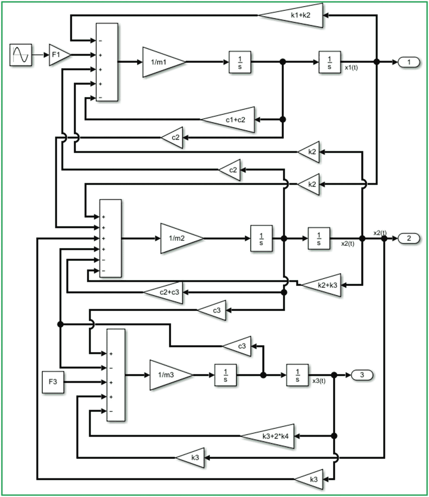

**图 9-18**

三自由度系统的 `Simulink` 模型 (`ThreeDOFsys.slx`)

### 受迫运动情况

在这种情况下，我们采用全部为零的初始条件和两个非零的外部施加力：

```matlab
IC=[0;0;0;0;0;0];                                 % 案例 #1
F1=20*sin(120*t);F2=0; t0=0; F3=20*stepfun(t,t0); % 案例 #1
```

通过仿真调用并执行 `Simulink` 模型 (`ThreeDOFsys.slx`) 的 `MATLAB` 脚本 (`three_MASS.m`)，我们得到了如图 9-19 所示的仿真结果，以及一个（此处未展示的）展示三个质量块相对运动的动画图。

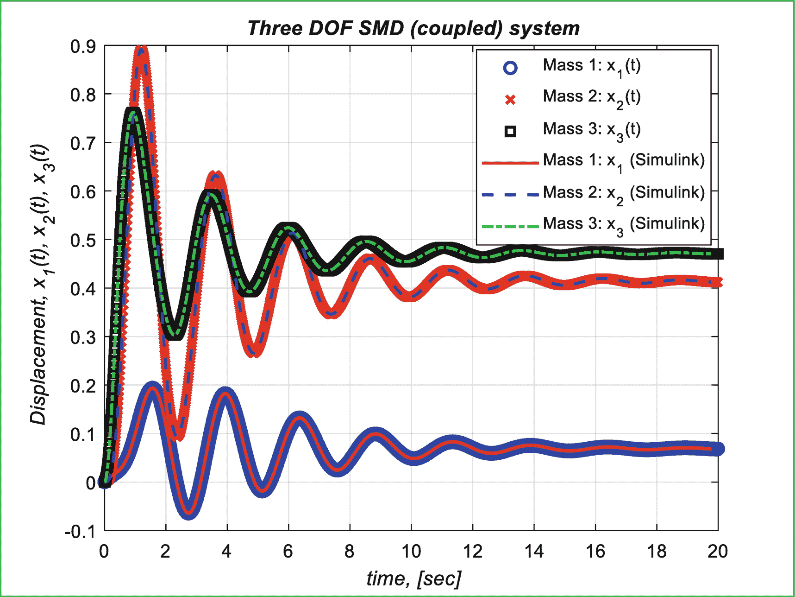

**图 9-19**

三自由度耦合系统受迫振动的仿真结果

图 9-19 中的仿真结果表明，`MATLAB` 模型的结果与 `Simulink` 模型的结果相匹配。

### 自由运动情况

在这种情况下，我们采用全部为零的初始条件和两个非零的外部施加力。

```matlab
IC=[0.5;0;0;0;0;0];    % 案例 #2
F1=0; F2=0; F3=0;      % 案例 #2
```

案例 #2（自由运动，如图 9-20 所示）的仿真结果显示，质量 1 上的微小初始位移（非零）也会引起其他两个质量块产生位移。尽管使用了不同的求解器和步长，由 `MATLAB` 和 `Simulink` 模型计算出的结果依然完美地吻合。

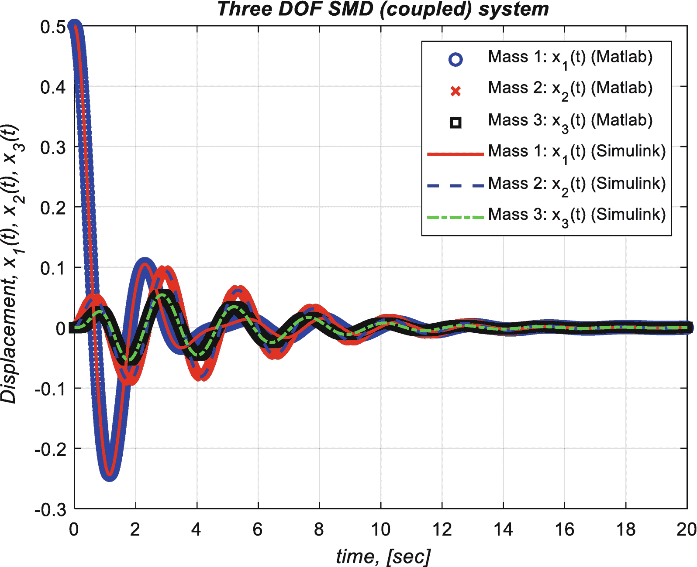

**图 9-20**

三自由度 SMD 系统自由运动的仿真结果

# `n`自由度系统的矩阵方法

当给定的 `n` 自由度系统为线性时，存在另一种更高效的方法，即矩阵方法，用于构建此类系统的仿真模型。让我们考虑一个阻尼线性 `n` 自由度弹簧-质量-阻尼系统的受迫响应。此类系统最通用的表述形式如下：

![$$ \left[M\right]\ddot{x}+\left[C\right]\dot{x}+\left[K\right]x=\left[B\right]F(t) $$](images/490522_1_En_9_Chapter/490522_1_En_9_Chapter_TeX_Equ36.png)

(9-42)

初始条件为 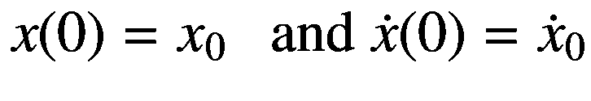，其中 `[M]`、`[C]`、`[K]` 分别是质量矩阵、阻尼矩阵和刚度矩阵，`[B]` 是施加力 `F(t)` 的列力矩阵。通过将方程 (9-1) 两边除以 `[M]` 或乘以 `M^{-1}` 并引入新变量，二阶常微分方程被转换为一阶常微分方程。引入新变量，例如对于一个二阶系统，将是 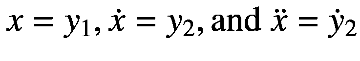。通过这些代换，得到由两个微分方程组成的下一个系统。

![$$ \left\{\begin{array}{c}{\dot{y}}_1={y}_2\\ {}{\dot{y}}_2=\left[{M}^{-1}\right]\left[B\right]F(t)-\left[{M}^{-1}\right]\left[K\right]{y}_1-\left[{M}^{-1}\right]\left[C\right]{y}_2\end{array}\right. $$](images/490522_1_En_9_Chapter/490522_1_En_9_Chapter_TeX_Equ37.png)

(9-43)

初始条件为 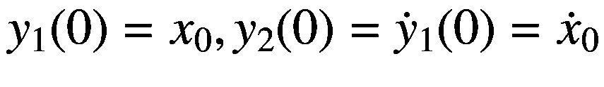。方程 (9-43) 中的公式可以用以下更明确的形式写出：

![$$ \dot{y}=\left[\begin{array}{c}{\dot{y}}_1\\ {}{\dot{y}}_2\end{array}\right]=\left[\begin{array}{c}\left[0\right]{y}_1+\left[I\right]{y}_2\\ {}\left[{M}^{-1}\right]\left[B\right]F(t)-\left[{M}^{-1}\right]\left[K\right]{y}_1-\left[{M}^{-1}\right]\left[C\right]{y}_2\end{array}\right] $$](images/490522_1_En_9_Chapter/490522_1_En_9_Chapter_TeX_IEq27.png)

![$$ \left[\begin{array}{c}\left[0\right]\\ {}\left[{M}^{-1}\right]\left[B\right]F(t)\end{array}\right]+\left[\begin{array}{c}\left[0\right]{y}_1+\left[I\right]{y}_2\\ {}-\left[{M}^{-1}\right]\left[K\right]{y}_1-\left[{M}^{-1}\right]\left[C\right]{y}_2\end{array}\right] $$](images/490522_1_En_9_Chapter/490522_1_En_9_Chapter_TeX_Equ38.png)

(9-44)

这可以表示为更通用的形式：

![$$ \dot{y}(t)=f(t)+\left[A\right]y(t) $$](images/490522_1_En_9_Chapter/490522_1_En_9_Chapter_TeX_Equ39.png)

(9-45)

其中 `A` 是由以下方程定义的状态矩阵：

![$$ A=\left[\begin{array}{cc}0&amp; I\\ {}-\left[{M}^{-1}\right]\left[K\right]&amp; -\left[{M}^{-1}\right]\left[C\right]\end{array}\right] $$](images/490522_1_En_9_Chapter/490522_1_En_9_Chapter_TeX_Equ40.png)

(9-46)

此外，我们可以写出以下内容：

![$$ y(t)=\left[\begin{array}{c}{y}_1(t)\\ {}{y}_2(t)\end{array}\right],f(t)=\left[\begin{array}{c}0\\ {}{M}^{-1} BF(t)\end{array}\right],{y}_0=\left[\begin{array}{c}{y}_1(0)\\ {}{y}_2(0)\end{array}\right]=\left[\begin{array}{c}{x}_0\\ {}{\dot{x}}_0\end{array}\right] $$](images/490522_1_En_9_Chapter/490522_1_En_9_Chapter_TeX_Equ41.png)

(9-47)

总结一下，在计算出矩阵 `A` 和力向量 `f(t)` 之后，如果给定的系统受到外力作用，我们可以对方程 ![$$ \dot{y}(t)=f(t)+\left[A\right]y(t) $$](images/490522_1_En_9_Chapter/490522_1_En_9_Chapter_TeX_IEq28.png) 进行数值求解。

`示例。` 让我们考虑先前研究过的三自由度弹簧-质量-阻尼系统。

![$$ \left[M\right]=\left[\begin{array}{ccc}2.5&amp; 0&amp; 0\\ {}0&amp; 2&amp; 0\\ {}0&amp; 0&amp; 3\end{array}\right] $$](images/490522_1_En_9_Chapter/490522_1_En_9_Chapter_TeX_IEq29.png), ![$$ \left[C\right]=\left[\begin{array}{ccc}{c}_1+{c}_2&amp; -{c}_2&amp; 0\\ {}-{c}_2&amp; {c}_2+{c}_3&amp; -{c}_3\\ {}0&amp; -{c}_3&amp; {c}_3\end{array}\right]=\left[\begin{array}{ccc}3&amp; -0.5&amp; 0\\ {}-0.5&amp; 4&amp; -3.5\\ {}0&amp; -3.5&amp; 3.5\end{array}\right] $$](images/490522_1_En_9_Chapter/490522_1_En_9_Chapter_TeX_IEq30.png), ![$$ \left[K\right]=\left[\begin{array}{ccc}{k}_1+{k}_2&amp; -{k}_2&amp; 0\\ {}-{k}_2&amp; {k}_2+{k}_3&amp; -{k}_3\\ {}0&amp; -{k}_3&amp; {k}_3+2{k}_4\end{array}\right]=\left[\begin{array}{ccc}30&amp; -5&amp; 0\\ {}-5&amp; 35&amp; -30\\ {}0&amp; -30&amp; 90\end{array}\right] $$](images/490522_1_En_9_Chapter/490522_1_En_9_Chapter_TeX_IEq31.png)

同样，我们考虑两种情况：受迫运动和自由运动。

`受迫运动（振动）情况。` 在此情况下，初始条件为零，外力施加于质量块 2，而质量块 1 和 3 自由：

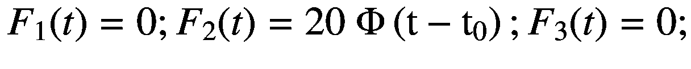

注意 `F_2(t)` 是幅度为 20 的赫维赛德阶跃函数 `Φ(t - t_0)`，作用于 `t_0 = 0`。

我们编写该问题的仿真模型脚本 `MASS3.m`，其中包含一个嵌套函数 `DOF3(t, x)`。

function MASS3
% HELP. 三自由度系统仿真。
t=0:.01:120;          % 仿真时间跨度
IC=[0;0;0;0;0;0];    % 情况 #1. 受迫运动
% IC=[0.5;0;0;0;0;0]; % 初始条件
[t, x123]=ode45(@DOF3, t, IC, []);
figure('name', '矩阵方法')
H=plot(t, x123(:,1), t, x123(:,3), t, x123(:,5));
H(1).Color = [1 0 0];
H(2).Color = [0 1 0];
H(3).Color = [0 0 1];
H(1).LineStyle = '-';
H(2).LineStyle = '-.';
H(3).LineStyle = '--';
H(1).LineWidth = 1.5;
H(2).LineWidth = 2.0;
H(3).LineWidth = 2.0;
legend('质量块 1: x_1(t)', '质量块 2: x_2(t)', '质量块 3: x_3(t)')
ylabel('\it x_1(t), x_2(t), x_3(t)')
xlabel('\it time')
title('\it 受迫运动：位移'), grid on
% title('\it 自由运动：位移'), grid on
xlim([0, 20])
figure(2)
G=plot(t, x123(:,2), t, x123(:,4), t, x123(:,6));
G(1).Color = [1 0 0];
G(2).Color = [0 1 0];
G(3).Color = [0 0 1];
G(1).LineStyle = '-';
G(2).LineStyle = '-.';
G(3).LineStyle = '--';
G(1).LineWidth = 1.5;
G(2).LineWidth = 2.0;
G(3).LineWidth = 2.0;
legend('质量块 1: dx_1(t)', '质量块 2: dx_2(t)', '质量块 3: dx_3(t)')
title('\it 受迫运动：速度'), grid on
% title('\it 自由运动：速度'), grid on
xlabel('\it time'), ylabel('\it dx_1, dx_2, dx_3')
xlim([0, 20])
function  dx = DOF3(t, x)
% HELP: 三自由度系统仿真
k1=25; k2=5; k3=30; k4=k3; c1=2.5; c2=.5; c3=3.5;
m1=2.5; m2=2; m3=3; M=[m1 0 0; 0 m2 0; 0 0 m3];
K=[k1+k2, -k2, 0; -k2, k2+k3, -k3; 0, -k3, k3+2*k4];
C=[c1+c2, -c2, 0; -c2, c2+c3, -c3; 0, -c3, c3];
% 情况 1: 施加外力
F1= 0; t0=0; F2=20*stepfun(t,t0); F3=0;
% 情况 2: 自由振动（无外力施加）
% F1=0;F2=0;F3=0;
B=[F1;F2;F3]; A=[zeros(3) eye(3); -inv(M)*K, -inv(M)*C];
f=(M\eye(3))*B; dx=A*x+[0;0;0;f];
end
end

注意，对于大型系统，矩阵求逆计算函数计算成本很高。因此，使用反斜杠（`\`）运算符代替`inv()`，因为它在计算上比矩阵求逆方法更高效、更精确。例如，`M\eye(3)`等价于`inv(M)`，但比`inv(M)`更精确、更高效。

通过执行模型`MASS3.m`，我们获得了受迫运动的仿真结果，如图9-21和图9-22所示。

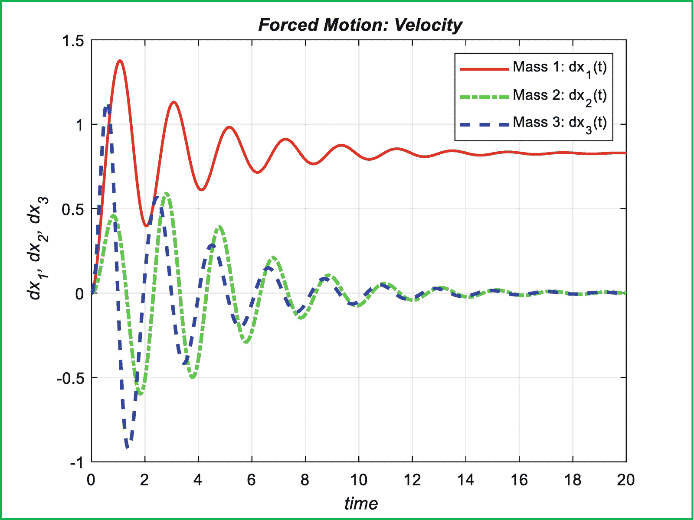

图9-22 三自由度弹簧-质量-阻尼系统受迫运动的仿真结果

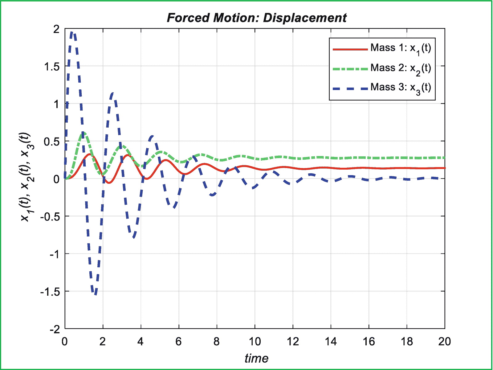

图9-21 三自由度弹簧-质量-阻尼系统受迫运动的仿真结果

自由运动（振动）情况。最初，仅对质量块2施加一个微小位移，另外两个质量块的初始条件均为零：`$$ {x}_1(0)=0.5,{x}_2(0)=0,{x}_3(0)=0;{\dot{x}}_1(0)=0,{\dot{x}}_2(0)=0,{\dot{x}}_3(0)=0, $$`(img/490522_1_En_9_Chapter_TeX_IEq32.png)`F1(t) = F2(t) = F3(t) = 0`。仿真结果如图9-23和图9-24所示。

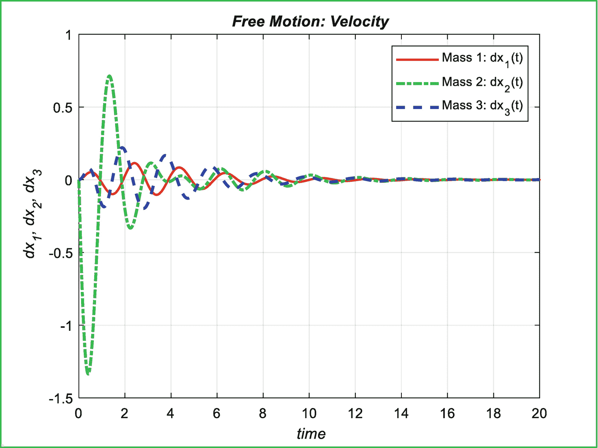

图9-24 自由运动：速度


图9-23 自由运动：位移

所开发的、包含自由运动和受迫运动的三自由度弹簧-质量-阻尼仿真模型，只需对系统参数进行少量调整，即可应用于`n`自由度系统。矩阵法相对简单且计算效率高。

