# 后向欧拉法

后向欧拉法是一种一阶隐式方法。该方法可用方程（2-3）所示的表达式表示。

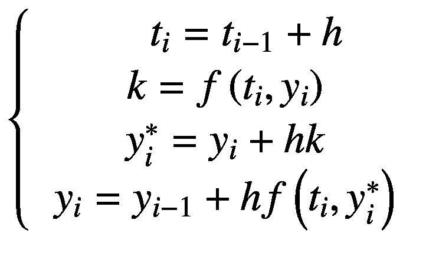

(2-3)

其中 `i` = 1, 2, 3, …, `N`。

在方程（2-3）的公式中，唯一棘手的问题是如何计算 `y_i^{\ast }`。有多种计算方法，其中一种是用前向欧拉法来预测 `y_i^{\ast }`，如方程（2-3）所示，然后根据方程（2-3）的公式重新计算 `y[i]` 来对其进行校正。另一种求 `y_i^{\ast }` 的方法是使用牛顿-拉夫逊法，或基于给定的初值问题方程使用代数公式。前面描述的后向欧拉法可以通过以下算法在数值搜索求解中实现：

步骤 1. 定义 `f(t, y)`。

步骤 2. 输入初始条件：`t[0]` 和 `y[0]`。

步骤 3. 输入步长 `h` 和步数 `N`。

步骤 4. 输出 `t[0]` 和 `y[0]`。

步骤 5. 对于从 1 到 `N` 的 `i`，执行步骤 6 和步骤 7。

步骤 6.

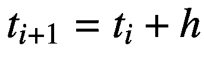

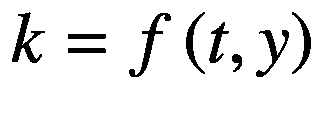

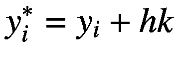

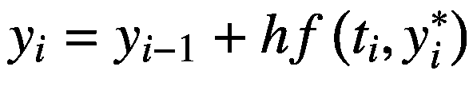

步骤 7. 输出 `t` 和 `y`。

步骤 8. 结束。

在后向欧拉法中，由于 `y_i^{\ast }` 的公式隐含表达，步骤 6 显得复杂；因此，这种方法不易理解，有时用户可能会觉得难以实现。这一步可以用以下表达式更清晰地解释：

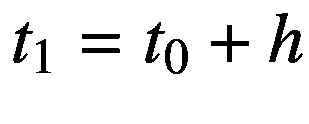

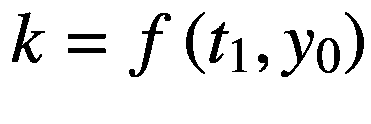

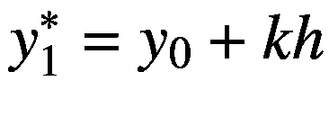

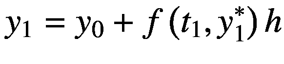

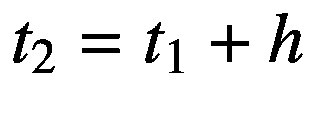

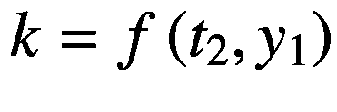

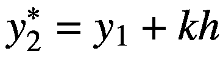

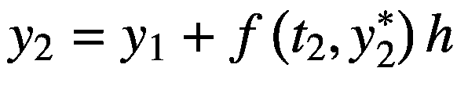

因此，

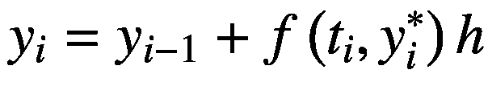

其中 `i` = 1, 2, 3, …, `N`。

如果我们引入等间距步长 `h` = `t[1]` − `t[0]` = `t[2]` − `t[1]` = …，那么 `y[i + 1]` = `y[i]` + `f[i]` * `h`，其中 `i` = 1, 2, 3, …, `N`。

## 示例 2

示例问题如下：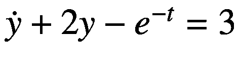 `y(0) = 1`。让我们针对 `t` = 0...10，时间步长 `h` = 0.05 来计算该问题的数值解。首先，重写给定的问题方程：

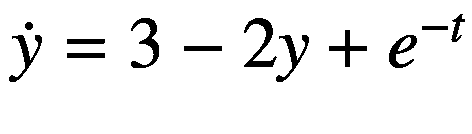

这也可以写成：`f(t, y) = 3 - 2y + e^{-t}`。

现在，基于我们已推导的内容，我们编写脚本 (`Example2.m`) 的第 3 部分来获得该问题的完整数值解，如下所示：

```matlab
%% Example2.m: 欧拉后向法（一阶隐式）
% 第 3 部分
f=zeros(1,steps);             % 内存分配
T=zeros(1, steps);            % 内存分配
yNEW=zeros(1,steps+1);        % 内存分配
y3=[y0, zeros(1,steps-1)];    % 内存分配
for ii=1:steps
T(ii+1)=T(ii)+h;
f(ii)=3-2*y3(ii)+exp(-T(ii));
yNEW(ii)=y3(ii)+h*f(ii);
f(ii+1)=3-2*yNEW(ii)+exp(-T(ii+1));
y3(ii+1)=y3(ii)+f(ii+1)*h;
end
plot(T, y3, 'm-.','linewidth', 1.5),grid on
title('\it 欧拉法求解结果: $$ \frac{dy}{dt}+2*y-e^{-t}=3, y(0)=1 $$', 'interpreter', 'latex')
legend('\it 欧拉前向法 ', '\it 改进欧拉法', '\it 欧拉后向法')
xlabel '\it t'; ylabel('\it 解, y(t)'), shg
```

从图 2-1 所示的绘制结果可以看出，前向法、改进法（休恩法）和后向法（隐式法）这三种解法产生了明显不同的解。在这些方法中，后向欧拉法得到的结果最精确，但由于需要额外计算 `y_i^{\ast }`，其计算时间成本最高。

 `y(0) = 1`) 的仿真结果](img/490522_1_En_2_Fig1_HTML.png)

后向欧拉法在示例 , `y(0) = 1` 中再次得到演示。该问题可以重新表述如下：

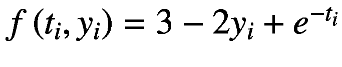 对于 `i` = 1, 2, 3, …, `N`

因此，后向欧拉法可以用更清晰的索引表示如下：

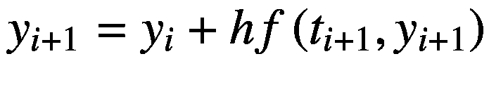

此外，针对给定的问题，可以将其重写如下：

$$ {y}_{i+1}={y}_i+ hf\left({t}_{i+1},{y}_{i+1}\right)={y}_i+h\left(3-2{y}_{i+1}+{e}^{-{t}_{i+1}}\right) $$

$$ {y}_{i+1}={y}_i+h\left(3-2{y}_{i+1}+{e}^{-{t}_{i+1}}\right)\overset{得到}{\to }{y}_{i+1}=\frac{y_i+h\left(3+{e}^{-{t}_{i+1}}\right)}{1+2h} $$

现在，公式 $$ {y}_{i+1}=\frac{y_i+h\left(3+{e}^{-{t}_{i+1}}\right)}{1+2h} $$ 是显式的，可以对 `i` = 1, 2, 3, …, `N` 求解，其中 `t[1]` = `t[0]` = 0 且 `y[1]` = `y` (`t[0]`) = 1，并通过 `Example2.m` 的第 4 部分实现，如下所示：

```matlab
%% 欧拉后向法（另一种方法）。Example2.m
% 第 4 部分
% 内存分配以加速计算
T=zeros(1, steps);          % 内存分配
y4=[y0, zeros(1,steps-1)];  % 内存分配
for ii=1:steps
T(ii+1)=T(ii)+h;
y4(ii+1)=(y4(ii)+h*(3+exp(-T(ii+1))))/(1+2*h);
end
```