# 10. 机电系统与机械系统

本章涵盖机电系统和机械系统。我们以具有输入电压和柔性负载的直流电机、麦克声、电机-泵-齿轮箱以及双摆为例，讨论如何构建机电系统和机械系统的仿真模型。通过在 MATLAB 和 Simulink 环境中开发和仿真模型，我们展示机电系统和机械系统的线性和非线性行为。

## 直流电机建模

直流电机是电子设备以及各类大型和小型机器中应用最广泛的电机，用于从电源产生扭矩。图 10-1 展示了具有输入电压和输出扭矩的直流电机简化物理模型。

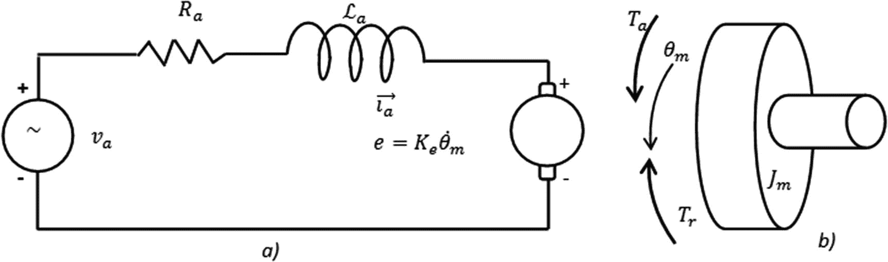

**图 10-1** 直流电机：a) 电枢电路；b) 转子受力图

我们可以假设转子具有惯量 `Jm` 和粘性摩擦常数 `c`。转子盘的受力图显示了正方向。存在两个扭矩：施加扭矩 `Ta = ia * Kt` 和阻力扭矩 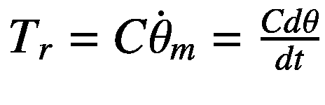。阻力扭矩的方向与施加扭矩 (`Ta`) 相反。根据受力图应用牛顿定律，我们得到方程 (10-1) 所示的微分方程。

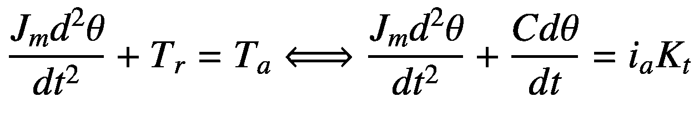

(10-1)

其中 `Kt` 是扭矩常数，`θm` 是电机轴的角位移，`ia` 是流经电枢的电流。根据电路，使用基尔霍夫定律，得到电路电压的另一个微分方程，如方程 (10-2) 所示。该方程考虑了反电动势 (EMF) 电压，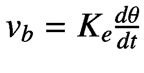。

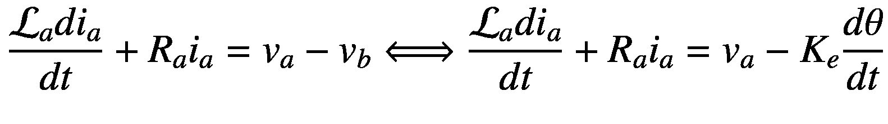

(10-2)

其中 `La` 是电路电感，`Ra` 是电路电阻，`Ke` 是反电动势常数，`va` 是电路电压。方程 (10-1) 和 (10-2) 中的两个微分方程可以通过拉普拉斯变换重写为 `s` 域，并考虑零初始条件。

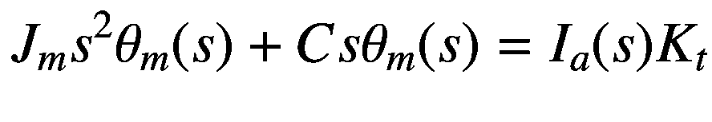

(10-3)

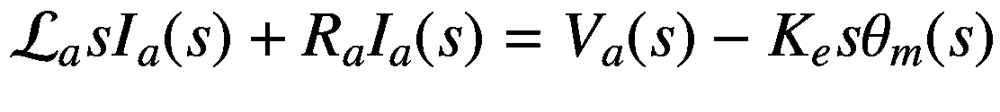

(10-4)

通过从方程 (10-4) 中定义 `Ia(s)` 并将其代入方程 (10-3)，得到以下表达式：

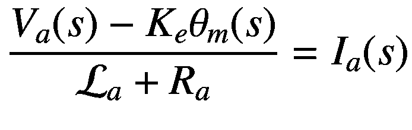

(10-5)

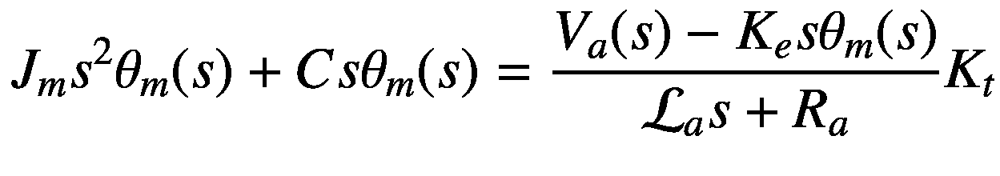

(10-6)

![$$ \left[{J}_m{s}²+ Cs+\frac{s{K}_t{K}_e}{{\mathcal{L}}_as+{R}_a}\right]{\theta}_m(s)=\frac{V_a(s){K}_t}{{\mathcal{L}}_as+{R}_a} $$](images/490522_1_En_10_Chapter/490522_1_En_10_Chapter_TeX_Equ7.png)

(10-7)

根据方程 (10-7) 中的表达式，可以由此计算出传递函数，即输出 `θm(s)` 除以输入 `Va(s)`：

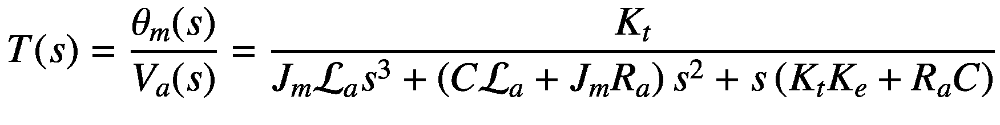

(10-8)

该传递函数的另一种形式是角速度 `ω(s)` 除以输入电压 `Va(s)`。

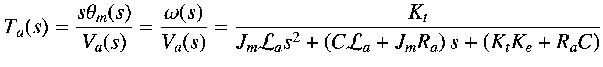

（10-9）

利用公式 (10-8) 和 (10-9) 所示的传递函数表达式，我们可以构建直流电机的 Simulink 模型 `DC_motor.slx`（见图 10-2）。

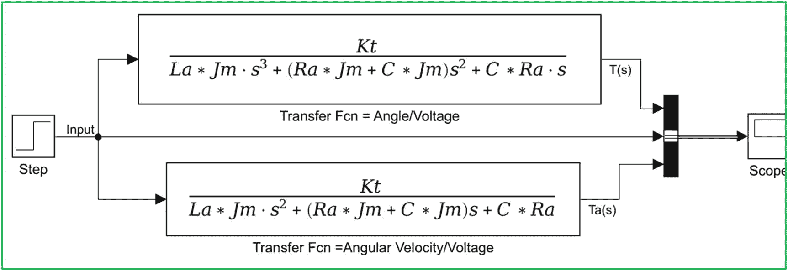

**图 10-2** 直流电机的 Simulink 模型 `DC_motor.slx`

请注意，模型的所有参数均通过选择模型属性 `DC_motor` ➤ 回调函数 ➤ `InitFcn` 来定义。

- `Jm=0.01;` % [kgm²]
- `C=0.1;` % [Nms]
- `Ke=0.01;` % [Nm/A]
- `Kt=1;` % [Nm/A]
- `Ra=1.25;` % [Ohm]
- `La=0.5;` % [H]

输入信号是一个阶跃函数，代表在阶跃时间为一秒时施加的 12V 恒定电压。模型的仿真结果如图 10-3 所示，该结果取自模型 `DC_motor.slx` 的 `Scope` 模块。

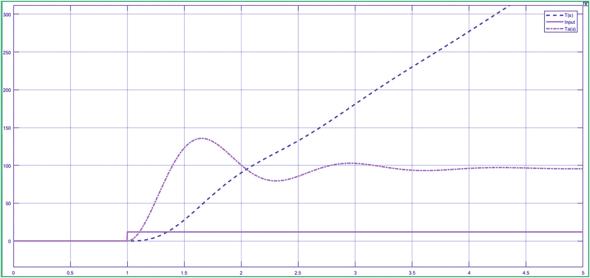

**图 10-3** 直流电机 Simulink 模型 `DC_motor.slx` 的仿真结果

另一种直流电机的替代仿真模型是基于四阶/五阶龙格-库塔法的 MATLAB 脚本。模型 `DC_Motor_SIM.m` 如下所示：

# 直流电机仿真

```matlab
function DC_Motor_SIM
h=0.001;             % 时间步长
t=0:h:5;             % 仿真时间
theta0 = [0, 0];     % 初始条件
ia0    = 0;          % 初始条件
u=[theta0, ia0];
for m=1:length(t)-1
k1(m,:)=DC_Motor(t(m), u(m,:));
k2(m,:)=DC_Motor(t(m), u(m,:)+h*k1(m,:)./2);
k3(m,:)=DC_Motor(t(m), u(m,:)+h*k2(m,:)./2);
k4(m,:)=DC_Motor(t(m), u(m,:)+h*k3(m,:));
u(m+1,:)=u(m,:)+h*(k1(m,:)+2*k2(m,:)+2*k3(m,:)+k4(m,:))./6;
end
close all
figure(1)
plot(t,u(:,1),'b',t,u(:,2),'r--',t,u(:,3),'k:','linewidth', 1.5)
title('\it 直流电机仿真 (输入 V_a = 12 [V])')
xlabel('\it 时间, t [s]'), ylabel('\it \theta_i(t), i_a(t)')
legend('\theta_m(t)','\omega(t)','i_a(t)', 'location', 'northwest')
grid on
ylim([0, 320])
function dudx=DC_Motor(t, u)
% DC_Motor(u) 是一个嵌套函数。
% 本仿真中使用的参数为：
Jm=0.01;    % [kgm²]
C=0.1;      % [Nms]
Ke=0.01;    % [Nm/A]
Kt=1;       % [Nm/A]
Ra=1.25;    % [Ohm]
La=0.5;     % [H]
Va=12*stepfun(t, 1);   % [V]
dudx=zeros(1,3);
dudx(1)=u(2);
dudx(2)=(1/Jm)*(u(3)*Kt-C*u(2));
dudx(3)=(1/La)*(Va-Ke*u(2)-Ra*u(3));
return
```

图 10-4 显示了 MATLAB 模型 `DC_Motor_SIM.m` 的仿真结果。

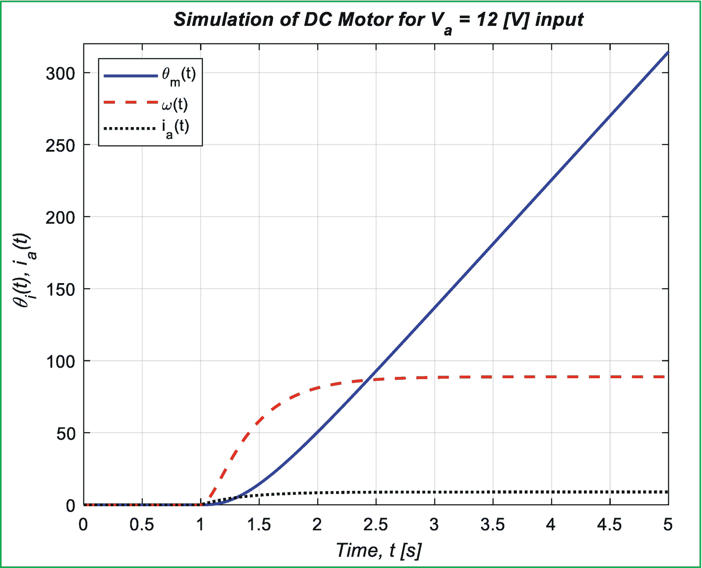

**图 10-4** 通过脚本实现的龙格-库塔法进行的直流电机仿真

## 对带有柔性负载的直流电机进行建模

图 10-5 展示了一个带有柔性负载的直流电机物理模型；它由电气和机械部件组成，例如电压源、电感、电阻、旋转轴和负载盘。此练习与前一个类似，但有一个区别，即在本例中施加了一个柔性负载。

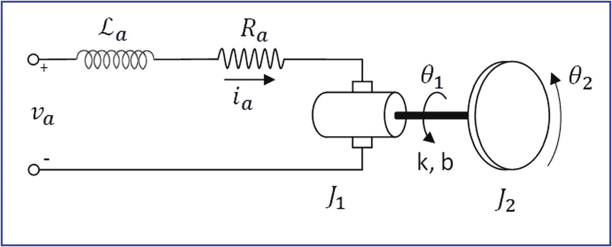

**图 10-5** 带有柔性负载的直流电机

对于图 10-5 所示的机电系统（本练习取自 [1]），可以推导出以下运动微分方程和系统组件的关系式：

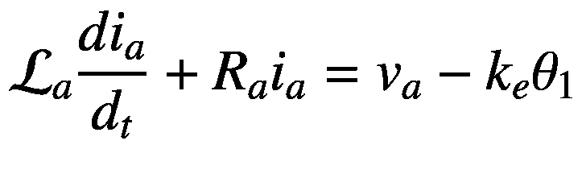

（10-10）

此外，电机的机电转矩（`τm`）和柔性轴的转矩（`τf`）可通过以下公式得出：

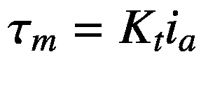

（10-11）

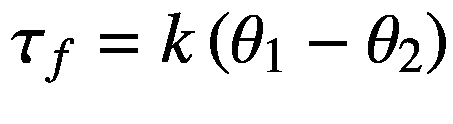

（10-12）

现在，可以通过应用牛顿第二定律来写出另一个运动转矩平衡方程，该定律指出，物体的质量代表了施加的力与由此产生的加速度之间的比例关系。将此定律应用于旋转物体表明，每个物体都具有与施加的转矩和由此产生的角加速度相关的对应转动惯量（例如，`τ = J * ω_dot`）。换句话说，旋转质量等效地由转动惯量来表示。

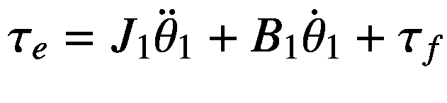

（10-13）

类似地，柔性轴的转矩方程可以写成如下形式：

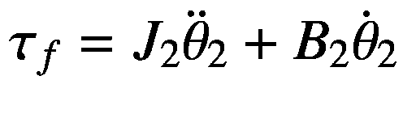

（10-14）

将公式 (10-12) 中的 `τf` 代入公式 (10-14)，我们得到系统柔性轴部分的另一个运动微分方程。

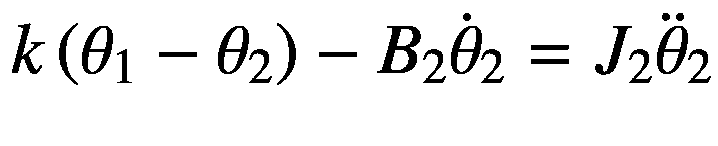

（10-15）

最后，通过设置 `τe = τm` 并将公式 (10-12) 中的 `τf` 代入，我们推导出第三个微分方程，以构建系统的完整模型。

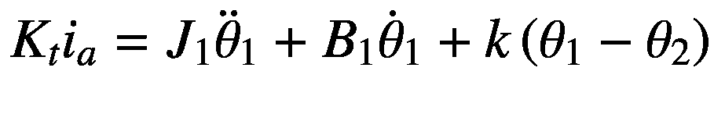

（10-16）

现在，利用这三个微分方程，具体来说是公式 (10-10)、公式 (10-15) 和公式 (10-16)，在 Simulink 中建立了系统的仿真模型（图 10-6）。

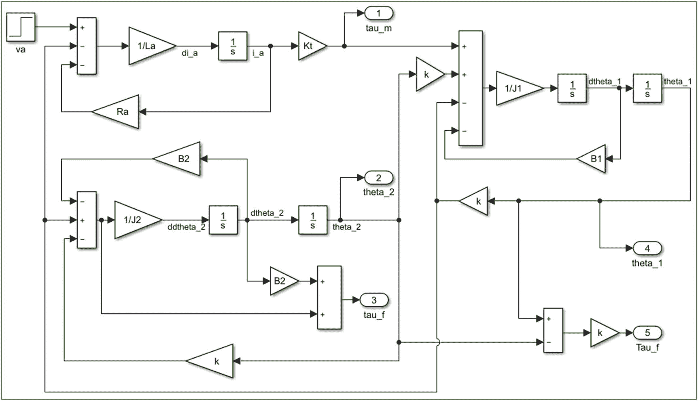

**图 10-6** 带有柔性负载的直流电机系统的 Simulink 模型 `DC_Motor_w_Load.slx`

请注意，在图 10-6 所示的带弹性负载直流电机系统的 Simulink 模型（`DC_Motor_w_Load.slx`）中，信号名称（`di_a` 和 `i_a`）代表 `di[a]` 和 `i[a]`，而 `dtheta_1`、`theta_1`、`ddtheta_2`、`dtheta_2` 和 `theta_2` 代表 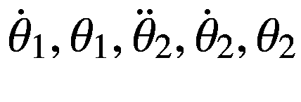。这些信号名称是通过信号的右键选项（信号属性）添加的。此外，名为 `tau_m`、`theta_2`、`tau_f`（以及 `Tau_f`）和 `theta_1` 的输出模块分别代表 `τ[m]`、`θ[2]`、`τ[f]` 和 `θ[1]`。请注意，两个输出模块 `tau_f` 和 `Tau_f` 的数值结果基于公式(10-14)和公式(10-12)给出的表达式。

对于模型的仿真，以下是 A-max 32 型有刷直流电机的数据：

- 输入：阶跃时间为 1 秒时施加的 `v[a]` = 12 [V] 的阶跃函数

- 电阻：`R[a]` = 7.17 [Ω]

- 弹簧常数：![$$ k=0.01\ \left[\frac{\mathrm{N}}{\mathrm{m}}\right] $$](images/490522_1_En_10_Chapter/490522_1_En_10_Chapter_TeX_IEq6.png)

- 粘性阻尼：`B[1]` = 7.05 ∗ 10^(-5)[N m sec]

- 转子惯量：`J[1]` = 4.14 ∗ 10^(-5)[kg ∗ m²]

- 负载惯量：`J[2]` = 2.12 ∗ 10^(-3)[kg ∗ m²]

- 粘性摩擦：`B[2]` = 3 ∗ 10^(-5)[N m sec]

- 电机电气常数：`k[e]` = 0.29 [V ∗ s]

- 扭矩常数：![$$ {K}_t=4.6\ast {10}^{-4}\left[\mathrm{N}\ast \frac{\mathrm{m}}{\mathrm{A}}\right] $$](images/490522_1_En_10_Chapter/490522_1_En_10_Chapter_TeX_IEq7.png)

- 电枢电感：![$$ {\mathcal{L}}_a=9.53\ast {10}^{-4}\left[H\right] $$](images/490522_1_En_10_Chapter/490522_1_En_10_Chapter_TeX_IEq8.png)

请注意，这些输入变量可以通过 MATLAB 工作区定义，或者（更推荐）通过模型设置（`Ctrl+E`） ➤  ➤ `Callbacks` ➤ `InitFcn`：模型初始化函数进行定义。后一种方式更可取，因为我们分配的所有输入变量都将附加到模型中。

- 电机扭矩：`τ[m]` = ?

- 弹性轴扭矩：`τ[f]` = ?

- 输出（电机轴角位移）：`θ[1]` = ?

- 输出（负载盘角位移）：`θ[2]` = ?

计算得到的输出（`τ[m]`、`τ[f]`、`θ[1]`、`θ[2]`）分别从输出模块的端口号 1、3、5、4 和 2 获取。仿真结果图通过以下脚本（`Sim_DC_Motor_w_Load.m`）获得：

```matlab
clc; close all
figure('name', 'Torque plot')
subplot(211)
plot(out.yout{1}.Values, 'k-'), grid on
ylabel('\it Torque, \tau_m, [Nm]')
title('\it Motor torque, \tau_m')
subplot(212)
plot(out.yout{3}.Values, 'b--x'), grid on
hold on
plot(out.yout{5}.Values, 'k-'),
ylabel('\it Torque, \tau_f, [Nm]')
legend('\tau_f from Eqn. (14)', '\tau_f from Eqn. (12)')
title('\it Torque on the flexible shaft, \tau_f'), hold on
hold off
xlim([0, 13])
figure('name', 'Angular displacement')
subplot(211)
plot(out.yout{4}.Values, 'k-'), grid on
ylabel('\it  \theta_1')
title('\it Angular displacement of the motor shaft, \theta_1')
subplot(212)
plot(out.yout{2}.Values, 'b-'), grid on
ylabel('\it \theta_2')
title('\it Angular displacement of the flexible shaft, \theta_2')
```

总之，我们在模型（图 10-6）的仿真结果（图 10-7 和图 10-8）中证明，弹性负载轴的扭矩值存在不稳定区域。这是由于轴的弹性特性所致。

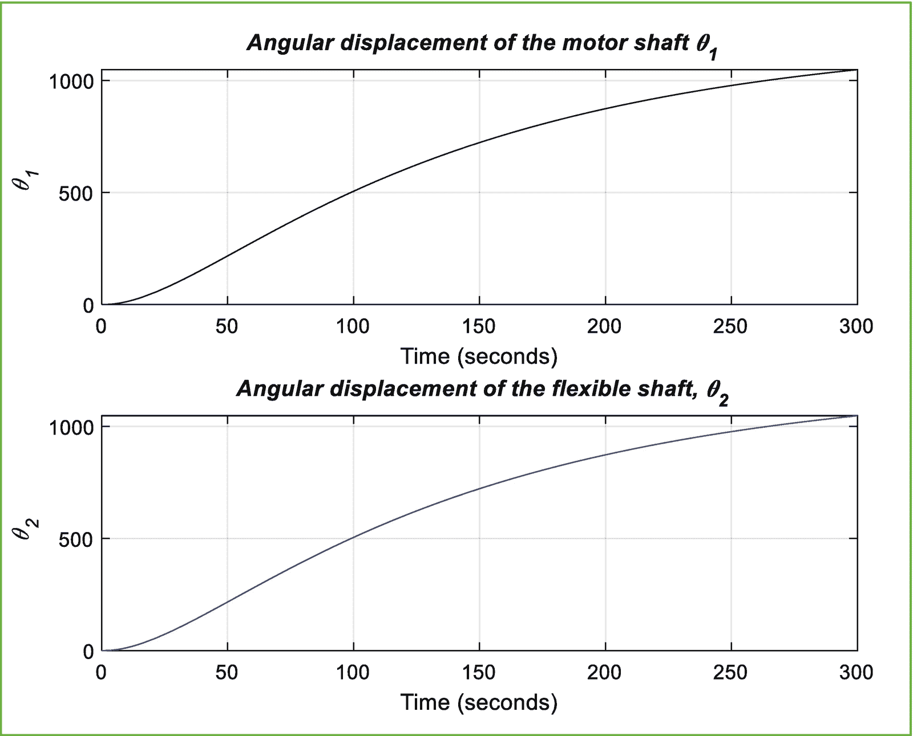

图 10-8：电机扭矩（`τ[e]`）和弹性负载轴扭矩（`τ[f]`）

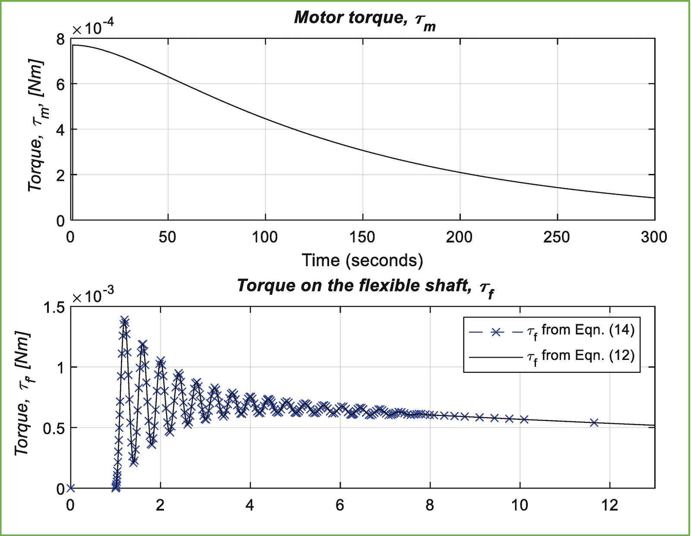

图 10-7：电机轴角速度（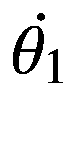）和弹性负载轴角速度（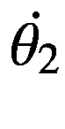）

在 Simulink 中采用带弹性负载的直流电机仿真模型（图 10-6）是开发仿真模型的众多可行方法之一。该 Simulink 模型（图 10-6）可以通过使用各种模块进行简化和优化，以提高可读性。此外，也可以通过编写脚本开发类似的仿真模型。

# 麦克风建模

麦克风的简化物理模型（图 10-9）由电气和机械组件构成。其电气组件包括：刚性固定于麦克风框架上的电容器极板（a）、电荷源（`v`）、电阻（`R`）和电感（`L`）。模型的机械部件为质量为`m`的可动板（振膜（`b`）），该板通过一组刚度常数为`K`的弹簧和阻尼常数为`D`的阻尼器连接至框架。声波穿过拾音口并对可动板（振膜（`b`））施加一个力`Fs(t)`。

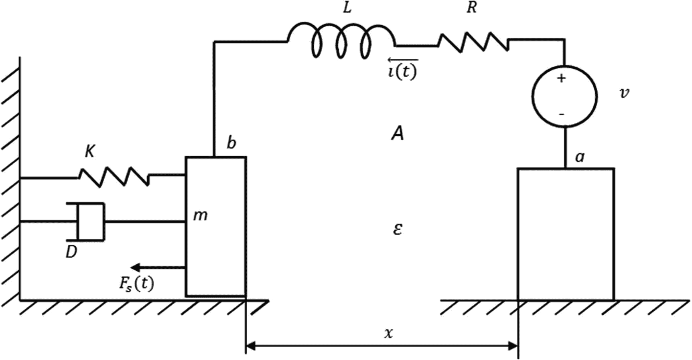

**图 10-9** 麦克风简化物理模型

电容`C`是极板间距离`x`的函数，即`C(x) = εA / x`，其中`ε`是极板间材料的介电常数（空气在 20°C 时的介电常数为 1.0059，`A`是极板的表面积）。电荷`q`与极板间电压`v`的关系由公式`q = C(x)v`确定。电场继而会对可动板（`b`）产生如下阻碍其运动的力`Fe`：`Fe = q² / (2εA)`。力`Fe`等效于由磁通密度（`B`）和线圈长度（`l`）感应产生的力（`F = Blv`），因此我们用`F = Blv`替代`Fe`。描述该系统运行的微分方程包含两部分，一部分是机械部分，另一部分是电气部分。

以下是机械部分：

```
Fs(t) = mẍ + Dẋ + Kx(t) + F
```

(10-17)

`Fs(t)` 是运动空气对可动板（`b`）（振膜）施加的力。`m` 是可动板（`b`）（振膜）的质量。`D` 是摩擦或阻尼常数。`K` 是可动板（`b`）（振膜）的刚度或弹簧常数。`x(t)` 是可动板（`b`）（振膜）的位移。`ẋ = dx/dt` 是可动板（`b`）（振膜）的速度。`ẍ = d²x/dt²` 是可动板（`b`）（振膜）的加速度。`F = Blv` 是由磁通和线圈电流感应产生的力。`v` 是电路中的电压。

以下是电压形式的电气部分：

```
Fv = Ri + L(di/dt)
```

(10-18)

`R` 是线圈的电阻，单位为欧姆。`i` 是线圈中的电流。`L` 是电感，`L di/dt` 是线圈两端的电压。`Fv = Bl(dx/dt)` 是由磁通密度（`B`）乘以线圈长度（`l`）产生的电压。数值仿真时，我们采用以下数值：

`v = 4.8 × 10⁻³ [V]`；`i[0] = 3 mA = 3 × 10⁻³ [A]`；`m = 50 g = 50 × 10⁻³ [kg]`；`K = 0.1 [N/m]`；`D = 3 × 10⁻⁵ [N·m·sec]`；`Bl = 0.5`；`R = 5 [Ω]`；`L = 45 [H]`；`Fs = 10⁻⁴ [N]`

最后，汇总系统（麦克风）机械部分和电气部分的前两个方程，推导出以下方程组：

```
{
  Fs(t) = m(d²x/dt²) + D(dx/dt) + Kx(t) + Blv
  (Bl)(dx/dt) = Ri + L(di/dt)
}
```

(10-19)

也可重写如下：

```
{
  d²x/dt² = (1/m)[Fs(t) - D(dx/dt) - Kx(t) - Blv]
  di/dt = (1/L)[(Bl)(dx/dt) - Ri]
}
```

(10-20)

通过将`Fs(t)`作为激励力信号（视为输入信号）来建立系统的仿真模型。

图 10-10 展示了 Simulink 中的仿真模型（`Microphone_Model.mdl`）。以下是显示其仿真结果的脚本（`Sim_Microphone_Model.m`）：

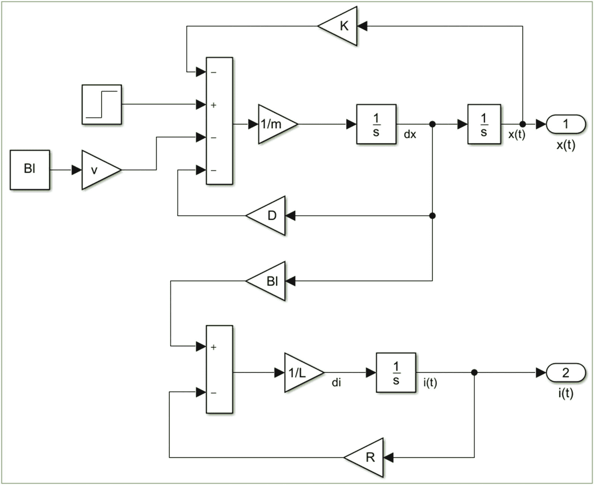

**图 10-10** 麦克风的 Simulink 模型（`Microphone_Model.slx`）

```
clc; close all; clearsk
out=sim('Microphone_Model');
figure('name', 'Microphone')
yyaxis left
plot(out.yout{1}.Values, 'b--')
ylabel('\it 位移，[mm]')
yyaxis right
plot(out.yout{2}.Values, 'k-')
xlabel('\it 时间，[s]')
ylabel('\it i(t)，[mA]')
legend('位移', '电流', 'location', 'southeast')
title('麦克风仿真')
```

从图 10-11 所示的仿真模型结果可以清晰地看出，当系统受到阶跃参考信号（如阶跃 4.8 [mV]输入电压）激励时，麦克风振膜（可动部分）的运动是周期性的，且系统中电气元件中的电流也是周期性的。

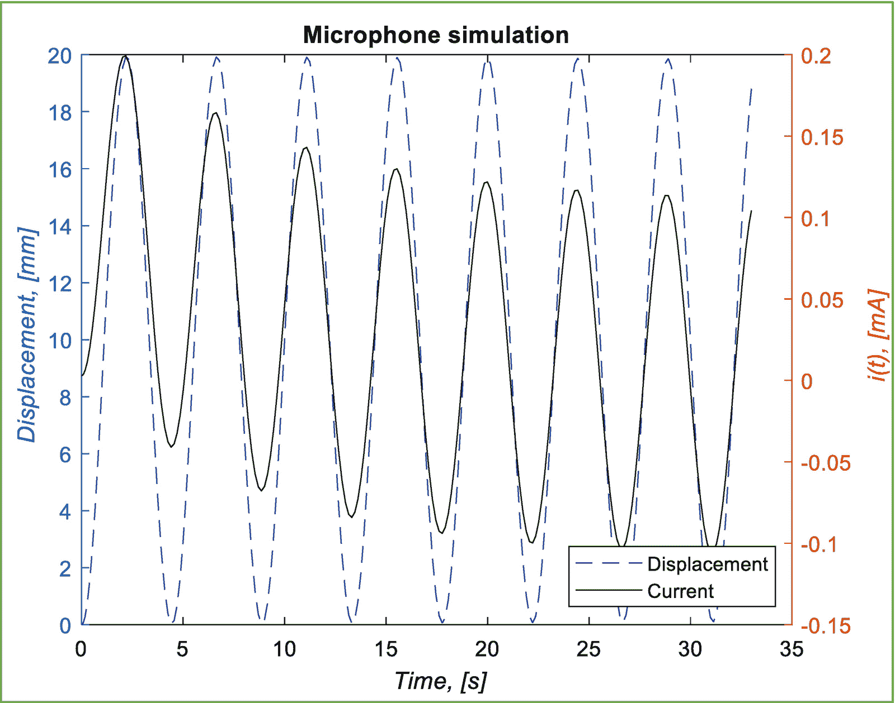

**图 10-11** 麦克风振膜的仿真

# 建模电机-泵-齿轮箱系统

## 系统描述与参数

一个电机通过图 10-12 所示的齿轮箱驱动一台泵。转子具有转动惯量（`J[1] = 1.5 kgm²`，`J[2] = 0.5 kgm²`，`J[3] = 1.0 kgm²`，`J[4] = 2.0 kgm²`），连接轴具有扭转刚度（`k1=1200 Nm/rad`，`k2=2000 Nm/rad`）。

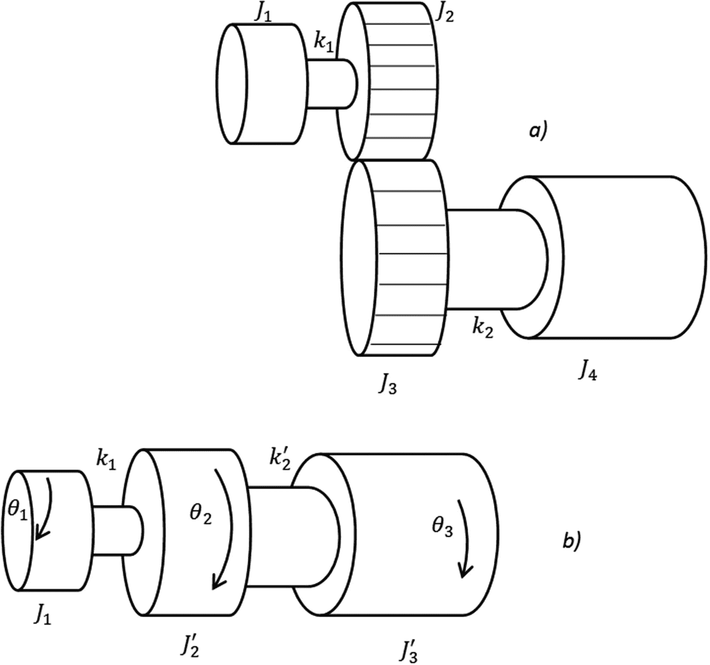

## 运动方程与受力图

质量块 2 和 3 的运动方程如下：
```
J₂' * θ̈₂ = k₁ * (θ₁ - θ₂) + k₂' * (θ₃ - θ₂)
J₃' * θ̈₃ = k₂' * (θ₂ - θ₃)
```
其中 `k₂' = n² * k₂ = 4 * k₂ = 8000 Nm/rad`，`J₂' = J₂ + J₃ * n² = J₂ + J₃ * 4 = 4.5 kgm²`，`J₃' = n² * J₄ = 4 * J₄ = 2.0 kgm²`；并且 `θ₁`、`θ₂` 和 `θ₃` 分别是质量块 1、质量块 2 和质量块 3 的角位移。

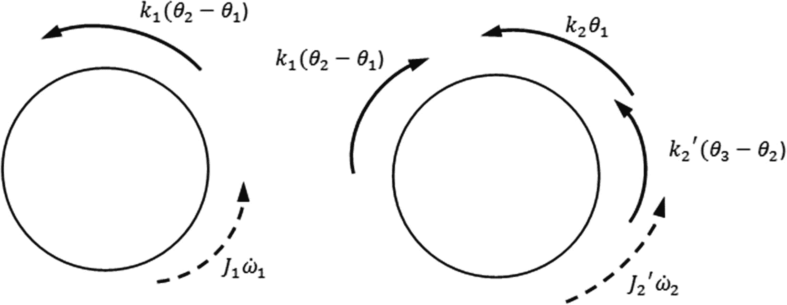

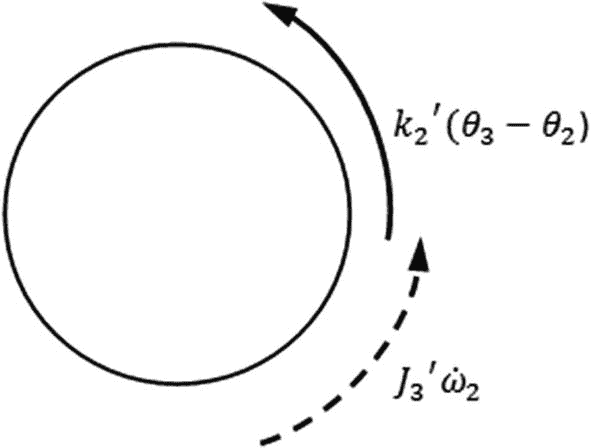

## Simulink 模型与仿真设置

通过仿真模型求解微分方程组 (10-22)。
```
θ̈₁ = (k₁ / J₁) * (θ₂ - θ₁)
θ̈₂ = (1 / J₂') * [ k₁ * (θ₁ - θ₂) + k₂' * (θ₃ - θ₂) ]
θ̈₃ = (k₂' / J₃') * (θ₂ - θ₃)
```

利用方程 (10-22)，我们构建了如图 10-15 所示的 Simulink 模型 `Motor_Pump_model.mdl`。注意，在该模型中，`k₂'` 用 `k2p` 表示，`J₂'` 用 `J2p` 表示，`J₃'` 用 `J3p` 表示。


在定义了刚度参数、转动惯量数值以及模型中积分器模块的内部初始条件 (`θ₁(0)=0.005; θ₂(0)=θ₃(0)=0; θ̇₁(0)=θ̇₂(0)=θ̇₃(0)=0`) 之后，我们执行 Simulink 模型。为了使仿真结果更平滑，我们对相对误差容限和绝对误差容限分别设置了严格的限值，即 `RelTol` = `10^(−6)` 和 `AbsTol` = `10^(−9)`。

## 仿真脚本与结果分析

脚本 `Sim_Motor_Pump.m` 执行 Simulink 模型 `Motor_Pump_model.slx` 并绘制结果。
```matlab
clc; close all; clearvars
out=sim('Motor_Pump');
figure('name', 'Motor Pump')
yyaxis left
plot(out.yout{1}.Values, 'b--'), hold on
plot(out.yout{3}.Values, 'k-')
ylabel('\it Angular Displacement \theta_1, \theta_3, [rad]')
yyaxis right
plot(out.yout{5}.Values, 'r-.'), grid on
xlabel('\it Time, [s]')
ylabel('\it Angular Displacement \theta_2,  [rad]')
legend('\theta_1', '\theta_3', '\theta_1','location', 'southeast')
title('\it Motor Pump simulation')
xlim([0, 1.5])
%% Phase plots
theta1 = out.yout{1}.Values.Data;
dtheta1 = out.yout{2}.Values.Data;
theta2 = out.yout{3}.Values.Data;
dtheta2 = out.yout{4}.Values.Data;
theta3 = out.yout{5}.Values.Data;
dtheta3 = out.yout{6}.Values.Data;
figure('name', 'Motor Pump - Phase plot 1')
plot(theta1, dtheta1, 'b--'), grid on
ylabel('\it \omega_1')
title('Phase plot')
xlabel('\theta_1')
axis square
figure('name', 'Motor Pump - Phase plot 2')
plot(theta2, dtheta2, 'k-', theta3, dtheta3, 'r-.')
title('Phase plot')
xlabel(' \theta_2, \theta_3')
ylabel('\it \omega_2, \omega_3')
legend('\theta_2 vs. \omega_2', '\theta_3 vs. \omega_3', 'location', 'southeast')
axis square
grid on
```

仿真结果以时间与 `θ₁`、`θ₂`、`θ₃` 的关系图形式展示（如图 10-16，未提供），以及以相图形式展示（如图 10-17 和图 10-18）。


# 电机-泵模型仿真

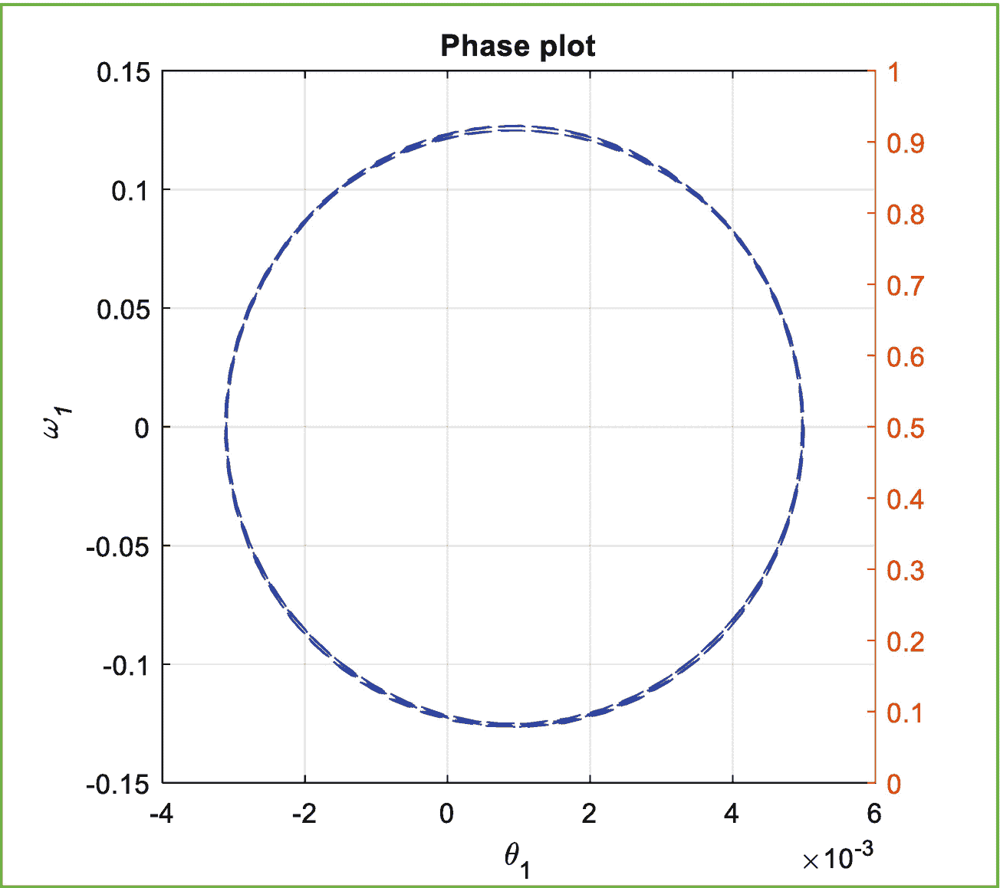

图 10-17 相图：`θ_i` 与 `ω_i` 的关系

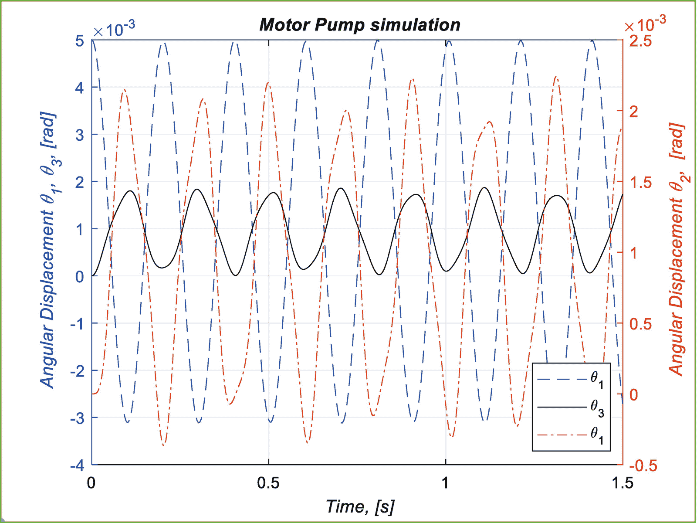

图 10-16 时间与三个质量块角位移的关系

为了简化 `MATLAB` 脚本编写过程，将方程(10-22)所示的微分方程组改写成矩阵形式。

![$$ \left\{\begin{array}{c}{\ddot{\theta}}_1\\ {}{\ddot{\theta}}_2\\ {}{\ddot{\theta}}_2\end{array}\right\}=\left[\begin{array}{ccc}-\frac{k_1}{J_1}& \frac{k_1}{J_1}& 0\\ {}\frac{k_1}{J_2^{\prime }}& -\left(\frac{k_1}{J_2^{\prime }}+\frac{k_2^{\prime }}{J_2^{\prime }}\right)& \frac{k_2^{\prime }}{J_2^{\prime }}\\ {}0& \frac{k_2^{\prime }}{J_2^{\prime }}& -\frac{k_2^{\prime }}{J_2^{\prime }}\end{array}\right]\left\{\begin{array}{c}{\theta}_1\\ {}{\theta}_2\\ {}{\theta}_3\end{array}\right\} $$](images/490522_1_En_10_Chapter/490522_1_En_10_Chapter_TeX_Equ23.png)
(10-23)

## 第二个仿真模型

下一个模型是一个名为 `Motor_Pump_Model_2.m` 的脚本，它嵌入了方程(10-23)中的系统模型，并使用求解器 `ode113` 计算问题的数值解。

```matlab
% Motor_Pump_Model_2.m
K1=1200;              % [牛米/弧度]
K2prime=8000;         % [牛米/弧度]
J1=1.5;               % [千克平方米]
J2prime=4.5;          % [千克平方米]
J3prime=2.0;          % [千克平方米]
t=[0, 1.5];           % 仿真时间
theta0=[.005; 0; 0];  % 初始条件
dtheta0=[0; 0; 0];    % 初始条件
KJ=[-K1/J1, K1/J1, 0;
K1/J2prime, -(K1/J2prime+K2prime/J2prime), K2prime/J2prime;
0, K2prime/J3prime, -K2prime/J3prime;];
A=[zeros(3), eye(3); KJ, zeros(3)]; Fun=@(t, theta)(A*theta);
opts=odeset('reltol', 1e-6, 'abstol', 1e-9);
[time, THETA]=ode113(Fun, t, [theta0; dtheta0], opts);
figure; plot(time, THETA(:,1), 'b',time, THETA(:,2), 'm--', ...
time, THETA(:,3), 'k:', 'linewidth', 1.5)
legend('\it \theta_1(t)','\theta_2(t)','\theta_3(t)', 'location', 'southeast'), grid on
title('电机-泵模型仿真 MATLAB'), xlabel('t, 时间'),
ylabel('\it \theta_1(t), \theta_2(t), \theta_3(t) ')
figure; plot(THETA(:,1), THETA(:,4), 'b',...
THETA(:,2), THETA(:,5), 'm--', THETA(:,3),...
THETA(:,6), 'k:', 'linewidth', 1.5)
legend('\it \omega_1(t)','\omega_2(t)','\omega_3(t)', 'location', 'southeast')
title('电机-泵模型仿真 MATLAB')
xlabel('\it \theta_1(t), \theta_2(t), \theta_3(t)')
ylabel('\it \omega_1(t), \omega_2(t), \omega_3(t)'), axis square
grid on
```

请注意，在此上下文中未显示第二次仿真方法（使用 `ode113`）的结果。

## 第三种仿真方案

该建模问题的下一个示例使用龙格-库塔方法，并通过名为 `Motor_Pump_Demo.m` 的函数文件实现，如下所示：

```matlab
function Motor_Pump_Demo
h=0.01;                  % 时间步长
t=0:h:1.5;               % 仿真时间
theta0  = [0.005, 0, 0]; % 初始条件
dtheta0 = [0, 0, 0];     % 初始条件
u=[theta0, dtheta0];     % 整体初始条件
for m=1:length(t)-1
k1(m,:)=Motor_pump_shaft(u(m,:));
k2(m,:)=Motor_pump_shaft(u(m,:)+h*k1(m,:)./2);
k3(m,:)=Motor_pump_shaft(u(m,:)+h*k2(m,:)./2);
k4(m,:)=Motor_pump_shaft(u(m,:)+h*k3(m,:));
u(m+1,:)=u(m,:)+h*(k1(m,:)+2*k2(m,:)+2*k3(m,:)+k4(m,:))./6;
end
close all; figure(1)
plot(t,u(:,1),'b',t,u(:,3),'k:',t,u(:,5),'m-.','linewidth', 1.5)
title('惯性质量的角位移')
xlabel('时间, t'),
ylabel('\theta_1(t), \theta_2(t), \theta_3(t)')
legend('\theta_1(t)','\theta_2(t)','\theta_3(t)','location', 'southeast'), grid on
figure(2)
plot(t,u(:,2),'b',t,u(:,4),'k:',t,u(:,6),'m-.','linewidth', 1.5)
title('惯性质量的角速度')
xlabel('时间, t'), ylabel('\omega_1(t), \omega_2(t), \omega_3(t)')
legend('\omega_1(t)','\omega_2(t)','\omega_3(t)','location', 'southeast'), grid on
figure(3); plot(u(:,1), u(:,2), 'b', u(:,3), u(:,4), 'm--',...
u(:,5), u(:,6), 'k:', 'linewidth', 1.5),
axis square, axis tight; title('惯性质量的相图')
xlabel('\theta_1(t), \theta_2(t), \theta_3(t)')
ylabel('\it \omega_1(t), \omega_2(t), \omega_3(t)')
legend('\omega_1(t)','\omega_2(t)','\omega_3(t)','location', 'southeast')
function dudx=Motor_pump_shaft(u)
K1=1200;       % [牛米/弧度]
K2prime=8000;  % [牛米/弧度]
J1=1.5;        % [千克平方米]
J2prime=4.5;   % [千克平方米]
J3prime=2.0;   % [千克平方米]
dudx=zeros(1,6);
dudx(1)=u(2);
dudx(2)=(-K1/J1)*u(1)+(K1/J1)*u(3);
dudx(3)=u(4);
dudx(4)=(K1/J2prime)*u(1)-(K1/J2prime+K2prime/J2prime)*u(3)+...
(K2prime/J2prime)*u(5);
dudx(5)=u(6);
dudx(6)=(K2prime/J3prime)*u(3)-(K2prime/J3prime)*u(5);
return
```

系统的所有三种仿真模型都能生成相同的角位移、速度及相图结果。如前所述，数值解的精度取决于所用求解器的步长。

# 双摆建模

摆广泛应用于机械装置和机构中，例如内燃机、机械臂和操纵器。基于图 10-19 所示的双摆，我们可以通过应用拉格朗日方程来推导每个质量的动能和势能方程。注意，该系统由 `θ[1]` 和 `theta[2]` 定义了两个自由度。假设杆件无质量，质量集中于质点。关节无摩擦。

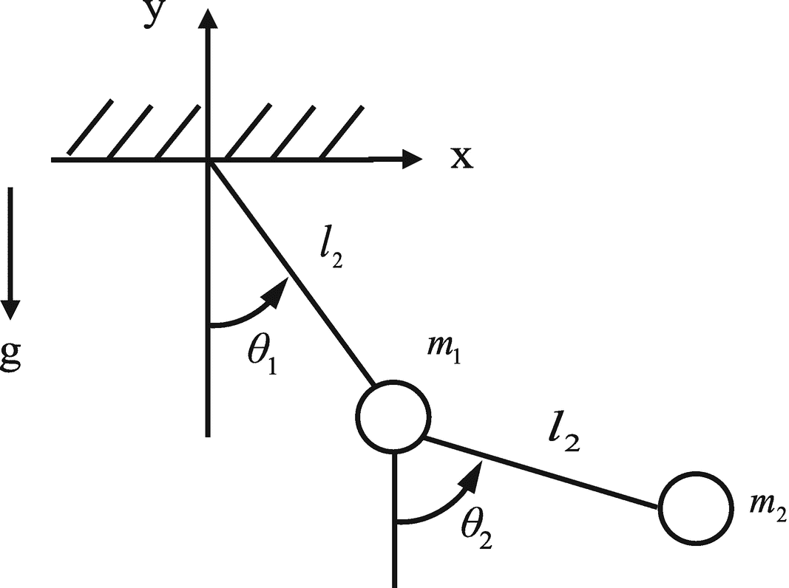

图 10-19 双摆的物理模型

## 物理模型与运动方程

质量 `m[1]` 和 `m[2]` 的双摆运动方程通过以下公式推导得出：


(10-24)


(10-25)

这两个方程可通过将第一个方程除以 `l[1]`，第二个方程除以 `l[2]` 进行简化。

![$$ \left\{\begin{array}{c}\left({m}_1+{m}_2\right){l}_1{\ddot{\theta}}_1-{m}_2{l}_2\sin \left({\theta}_2-{\theta}_1\right)\left({\dot{\theta}}_2-{\dot{\theta}}_1\right){\dot{\theta}}_2+{m}_2{l}_2\cos \left({\theta}_2-{\theta}_1\right){\ddot{\theta}}_2+\left({m}_1+{m}_2\right)g\sin \left({\theta}_1\right)=0\\ {}-{m}_2{l}_1\sin \left({\theta}_2-{\theta}_1\right)\left({\dot{\theta}}_2-{\dot{\theta}}_1\right){\dot{\theta}}_1+{m}_2{l}_1\cos \left({\theta}_2-{\theta}_1\right){\ddot{\theta}}_1+{m}_2{l}_2{\ddot{\theta}}_2+{m}_2g\sin \left({\theta}_2\right)=0\ \end{array}\right. $$](img/490522_1_En_10_Chapter_TeX_Equa.png)

(10-26)

如公式 (10-26) 所示的方程组描述了双摆的运动。

## 数值仿真与Simulink模型

对于数值仿真，采用以下数值：![$$ {m}_1=10\ \left[ kg\right];{m}_2={m}_1;{l}_1=5\ \left[m\right];\mathrm{and}\ {l}_2={l}_1.\mathrm{The}\ \mathrm{following}\ \mathrm{are}\ \mathrm{the}\ \mathrm{initial}\ \mathrm{conditions}:{\uptheta}_1(0)=-0.5;{\uptheta}_2(0)=-1;{\dot{\uptheta}}_1(0)=1;{\dot{\uptheta}}_2(0)=2\. $$](images/490522_1_En_10_Chapter/490522_1_En_10_Chapter_TeX_IEq26.png)

基于双摆的运动方程组，我们可以开发 Simulink 模型 `DOUBLE_pendulum.slx`（图 10-20）。

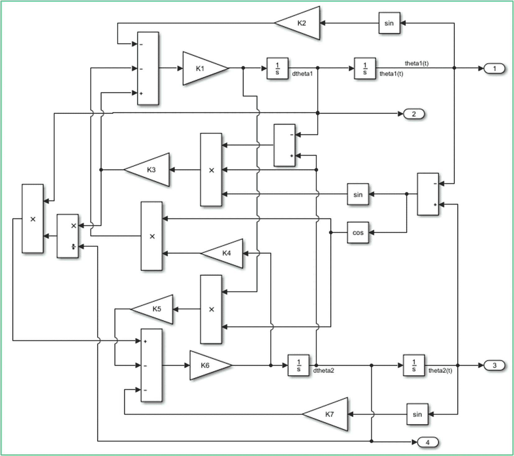

图 10-20 双摆的 Simulink 模型

注意，在图 10-20 所示的模型中，所有初始条件均通过 `[Integrator]`（`[Integrator]`、`[Integrator2]`、`[Integrator3]`、`[Integrator4]`）模块按照 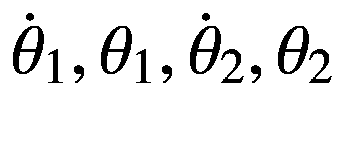 的顺序设置。此外，为了简化模型，`[Gain]` 模块被合并为 `K[1]`、`K[2]`、…、`K[7]`，其值在模型 `DOUBLE_pendulum.slx` 的模型属性中定义。注意我们通过 `[Out]` 模块的通道获得的仿真结果（图 10-21）。

## M文件脚本

调用并执行该 Simulink 模型的 M 文件名为 `Sim_DOUBLE_Pendulum.m`，如下所示：

```matlab
clc; close all; clears
out=sim('DOUBLE_pendulum');
figure('name', 'Double Pendulum Sim');
subplot(211)
plot(out.yout{1}.Values, 'b-', 'linewidth', 1.5), hold on
plot(out.yout{3}.Values, 'r-.', 'linewidth', 1.5)
title('角位移')
xlabel('时间, [s]')
ylabel('\theta_1, \theta_2')
legend('\theta_1', '\theta_2'); grid on
subplot(212)
plot(out.yout{2}.Values, 'b-', 'linewidth', 1.5), hold on
plot(out.yout{4}.Values, 'r-.', 'linewidth', 1.5)
title('角速度')
xlabel('时间, [s]')
ylabel('d\theta_1, d\theta_2')
legend('d\theta_1', 'd\theta_2'); grid on; shg
```

## Simulink配置

注意，在 Simulink 模型 `DOUBLE_Pendulum.slx` 的配置参数  中，位于“保存到工作区或文件”选项卡下：。

我们已经从 `[保存选项]`  中的 `[将数据点限制为最后:]` 1000 的复选框中移除了勾选。此外，我们在变量名（默认名称）`out` 下勾选了 ，并选择格式类型为数据集：。

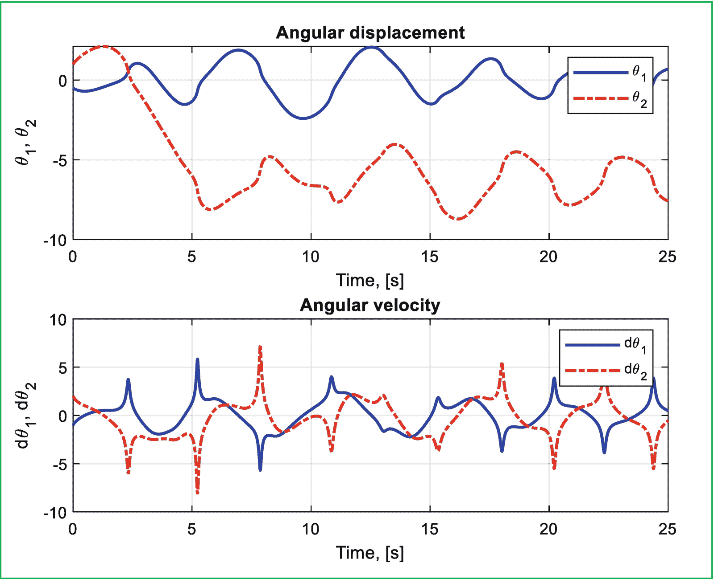

图 10-21

# 来自 Simulink 模型 `DOUBLE_pendulum.slx` 的仿真结果

## 一种替代仿真模型

该问题的另一种方法可以通过求解器 `ode15i` 开发，该求解器用于隐式定义的微分方程。以下是一个名为 `DOUBLE_Pedulum_Model_2.m` 的脚本，用于仿真双摆模型的运动。该脚本的仿真结果如图 10-22 和图 10-23 所示。

```matlab
%%  ODE15i 隐式 ODE 求解器
% 帮助: 此脚本仿真双摆模型
% theta1(0)=-0.5; dtheta1(0)= -1
% theta2(0)= 1; dtheta2(0) = 2.
L1= 5; L2 = L1;        % 米
g = 9.81;              % 米/秒²
m1=10;                 % 千克
m2=10;                 % 千克
M=m1+m2;
test=@(t, theta, dtheta)([-dtheta(1)+theta(2);
M*L1*dtheta(2)+m2*L2*cos(theta(3)-theta(1))*dtheta(4)-...
m2*L2*(theta(4)*(theta(4)-theta(2)))*sin(theta(3)-...
theta(1))+M*g*sin(theta(1));
-dtheta(3)+theta(4);
m2*L2*dtheta(4)+m2*L1*cos(theta(3)-theta(1))*dtheta(2)-...
m2*L1*(theta(2)*(theta(4)-theta(2)))*sin(theta(3)- ...
theta(1))+m2*g*sin(theta(3))]);
% theta10=-.5; dtheta10=-1; theta20=1; dtheta20=2;
tspan=[0:pi/30:5*pi];  % 使用固定时间步长的仿真时间
the0=[-.5, -1, 1, 2];
dthe0=[0; 0; 0; 0];    % dtheta0 由 theta0 确定
theF0=[1 1 1 1]; dtheF0=[];
[the0, dthe0]=decic(test, 0, the0,theF0, dthe0, dtheF0);
[time, theta]=ode15i(test, tspan, the0, dthe0);
figure('name', '双摆 1')
plot(time, theta(:,1), 'b-', time, theta(:,2), 'k-.', 'linewidth', 1.5), hold on
plot(time, theta(:,3),'r--',time,theta(:,4), 'm:', 'linewidth', 2)
legend('\theta_1(t)','d\theta_1(t)','\theta_2(t)','d\theta_2(t)', 'location', 'southeast')
title('使用 ODE15i 求解的双摆问题')
xlabel('时间'), ylabel('\theta(t)'), grid on
figure('name', '双摆 2'), yyaxis left
plot(theta(:,1), theta(:,2),'b-', 'linewidth', 1.5)
ylabel('d\theta_1'), yyaxis right
plot(theta(:,3), theta(:,4), 'm-.', 'linewidth', 1.5)
legend('\theta_1 vs. d\theta_1','\theta_2 vs. d\theta_2(t)', 'location', 'southeast')
title('双摆问题的相图')
xlabel('\theta_1, \theta_2'), ylabel('d\theta_2'),
axis tight; grid on; shg
```

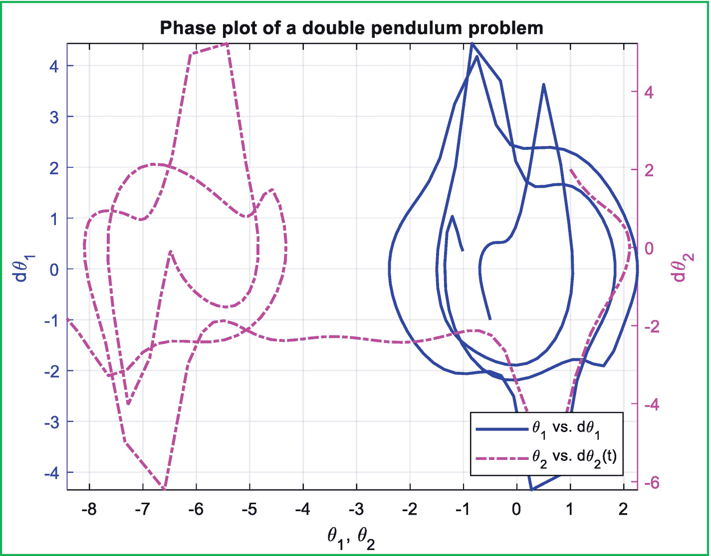

图 10-23

使用基于 `ode15i` 的模型仿真双摆问题

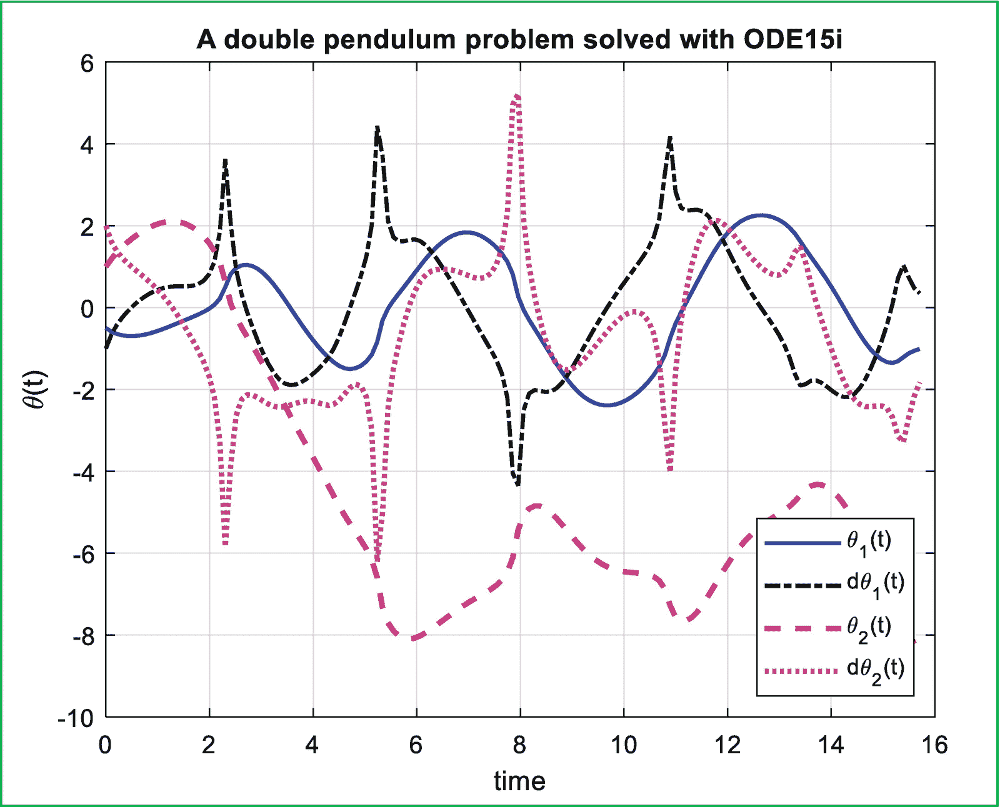

图 10-22

使用基于 `ode15i` 的模型仿真双摆问题

从 Simulink 模型 (`DOUBLE_pendulum.slx`) 和基于 `ode15i` 的 `DOUBLE_Pedulum_model_2.m` 模型的仿真结果可以看出，两种方法产生的结果几乎相同。差异是由于 `ode15i` 和 Simulink 模型中求解器步长的不同造成的。这些仿真模型基于双摆的非线性数学模型。就双摆两个杆的角位移 `θ[1]` 和 `θ[2]` 以及速度 `dθ[1]` 和 `dθ[2]` 而言，系统的行为是非线性的（图 10-21、10-22 和 10-23）。

## 双摆的线性化模型

对于两个质量的小幅度振荡，我们可以通过取 `sin θ ≈ θ` 和 `cos θ ≈ 1` 来近似公式 (10-24)、公式 (10-25) 和公式 (10-26) 中的系统公式并对其进行线性化。此外，我们从公式中忽略了一阶导数项 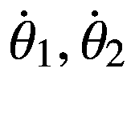 (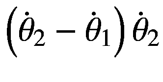)。

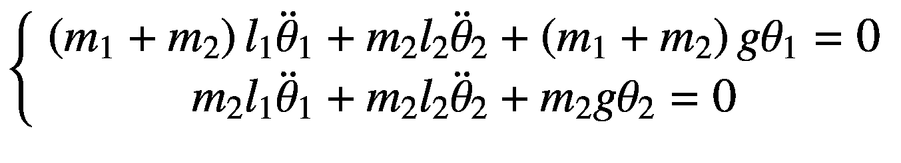

(10-27)

注意，公式 (10-27) 中的摆的线性化模型是一个齐次二阶常微分方程。该模型通过一个名为 `Double_Pendulum_Linear.slx` 的 Simulink 模型实现，如图 10-24 所示，其仿真结果如图 10-25 和 10-26 所示。

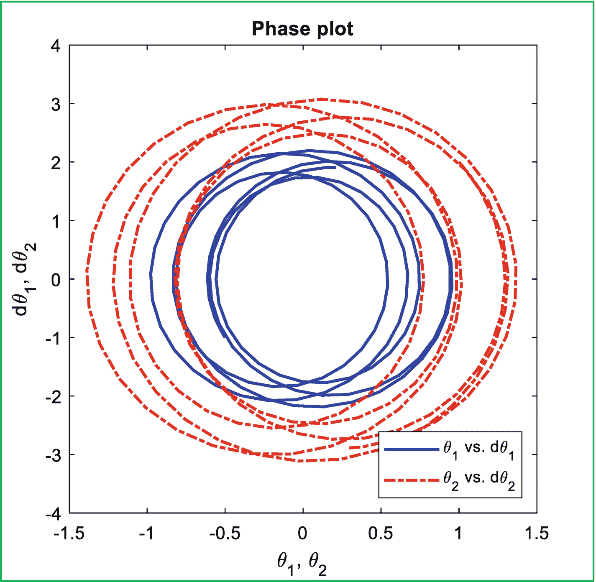

图 10-26

小幅度振荡双摆的相图

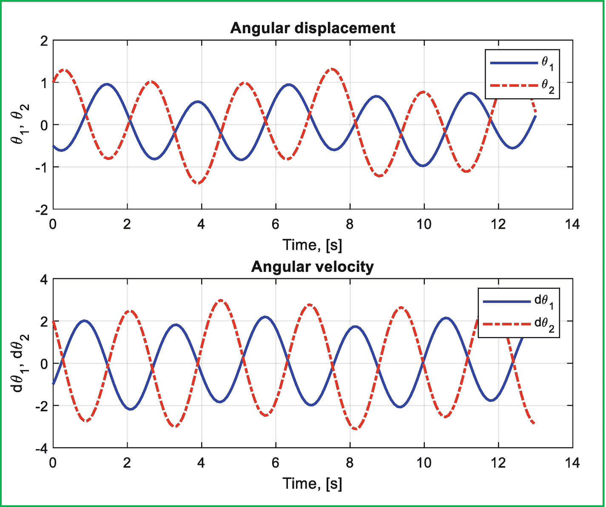

图 10-25

小幅度振荡双摆的仿真结果

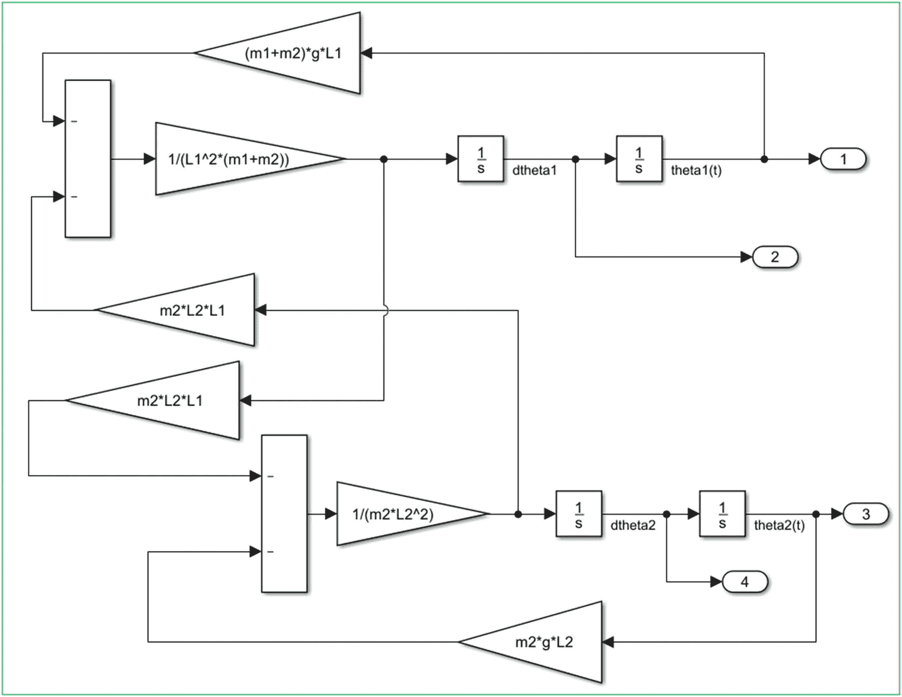

图 10-24

用于模拟小幅度振荡的双摆线性化模型

以下是运行该 Simulink 模型并绘制结果的 M 文件 (`Sim_Double_Pendulum_Linear.m`)：

## 双摆线性化模型仿真（第一部分）

```matlab
clc; close all; clears
out=sim('Double_Pendulum_Linear');
figure('name', '双摆仿真');
subplot(211)
plot(out.yout{1}.Values, 'b-', 'linewidth', 1.5), hold on
plot(out.yout{3}.Values, 'r-.', 'linewidth', 1.5)
title('角位移')
xlabel('时间, [s]')
ylabel('\theta_1, \theta_2')
legend('\theta_1', '\theta_2')
grid on
subplot(212)
plot(out.yout{2}.Values, 'b-', 'linewidth', 1.5), hold on
plot(out.yout{4}.Values, 'r-.', 'linewidth', 1.5)
figure('name', '相图')
plot(out.yout{1}.Values.Data, out.yout{2}.Values.Data, 'b-',...
out.yout{3}.Values.Data,out.yout{4}.Values.Data, 'r-.', 'linewidth', 1.5)
legend('\theta_1 vs. d\theta_1', '\theta_2 vs. d\theta_2', 'location', 'southeast')
title('相图')
xlabel('\theta_1, \theta_2'), ylabel('d\theta_1, d\theta_2')
axis square
```

另一种方法。创建双摆线性化模型的另一种方法是使用`ode15i`（一种隐式 ODE 求解器）并使用`dsolve()`函数计算解析解。注意，当系统的运动方程是线性 ODE 时，`dsolve()`函数可以计算问题的解析解公式。以下是脚本`DOUBLE_Pedulum_Linear_2.m`的第二部分，它实现了双摆的线性化模型：

## 双摆线性化模型仿真（第二部分）

### 使用 `ode15i` 求解器

```matlab
%% 第二部分.
%% 由 ODE15i 求解的双摆线性化模型
%   DOUBLE_Pedulum_Linear_2.m
L1= 5; L2 = L1;      % 米
g = 9.81;            % 米/秒²
m1=10;               % 千克
m2=10;               % 千克
M=m1+m2;
test=@(t, theta, dtheta)([ dtheta(1)-theta(2);
(m1+m2)*L1*dtheta(2)+m2*L2*dtheta(4)+(m1+m2)*g*theta(1);
dtheta(3)-theta(4); m2*L2*dtheta(4)+m2*L1*dtheta(2)+m2*g*theta(3)]);
tspan=[0, 2*pi];
% 初始条件:
theta10=-.5; dtheta10=-1; theta20=1; dtheta20=2;
the0=[theta10, dtheta10, theta20, dtheta20];
thep0=[0;0;0;0]; theF0=[1 1 1 1]; dtheF0=[];
[the0, dthep0]=decic(test,0, the0,theF0,thep0, dtheF0);
[time, theta]=ode15i(test, tspan, the0,dthep0);
plot(time, theta(:,1), 'k', time, theta(:,2), 'bs-',...
time, theta(:,3),'m--', time, theta(:,4), 'go-','linewidth', 1.5)
title('双摆线性化模型仿真')
xlabel('时间'), ylabel('\theta(t)'), axis tight;
grid on; hold on
```

### 使用 `dsolve()` 进行解析求解

```matlab
%% 使用 DSOLVE 对线性化模型进行解析求解
clearvars t
syms theta1(t)  theta2(t)
Dtheta1=diff(theta1, t, 1);
Dtheta2=diff(theta2, t, 1);
D2theta1=diff(theta1, t,2);
D2theta2=diff(theta2, t,2);
EQN = [D2theta1==(-1/(M*L1))*(m2*L1*D2theta2+M*g*theta1), ...
D2theta2==(-1/(m2*L1))*(m2*L1*D2theta1+m2*g*theta2)];
ICs = [theta1(0)==-.5,Dtheta1(0)==-1, theta2(0)==1, Dtheta2(0)==2];
Theta=dsolve(EQN, ICs);
t=0:pi/20:2*pi;
Theta1=(vectorize(Theta.theta1)); Theta2=(vectorize(Theta.theta2));
% 计算 Theta1 和 Theta2 的值:
theta1=eval(Theta1); theta2=eval(Theta2);
plot(t, theta1, 'mx', t, theta2, 'k*', 'linewidth', 1.5)
legend('\theta_1(t) 通过 ODE15i','d\theta_1(t) 通过 ODE15i',...
'\theta_2(t) 通过 ODE15i','d\theta_2(t) 通过 ODE15i',...
'\theta_1 dsolve','\theta_2 dsolve'), grid on; hold off
```

图 10-25、10-26 和 10-27 中所示的 Simulink 模型仿真结果与使用求解器`ode15i`和`dsolve()`（解析求解器）的结果相同。线性化模型的行为是周期性的，并且仅在摆臂的振荡角度非常小（最大 5 度，或 0.0873 弧度）时才有效。

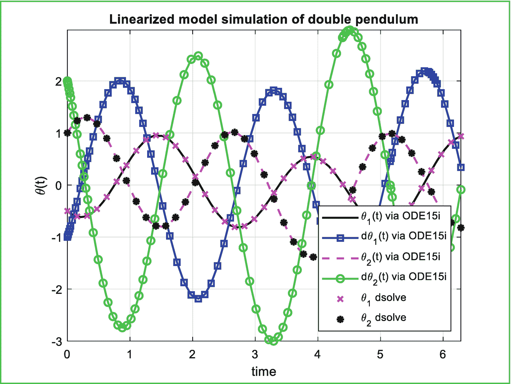

图 10-27 使用`ode15i`、`dsolve()`的 M 文件得到的双摆线性化模型仿真结果

# 参考文献

[1] Franklin, Gene F., Powell, J. David, Emami-Naeni, Abbas，`《动态系统反馈控制》`（第 6 版），Prentice Hall 出版社（2009 年）。

