# 中点法

中点法是一种二阶显式方法，包含两个步骤，可用公式 (2-4) 中的表达式表示。

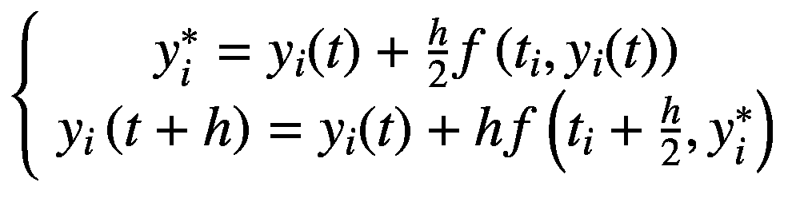

(2-4)

其中 `i` = 1, 2, 3, …, `N`。

该方法相对简单，可通过以下算法直接实现：

步骤 1. 定义 `f(t, y)`。

步骤 2. 输入初始条件：`t[0]` 和 `y[0]`。

步骤 3. 输入步长 `h` 和步数 `N`。

步骤 4. 输出 `t[0]` 和 `y[0]`。

步骤 5. 对于从 `1` 到 `N` 的 `i`，执行步骤 6 和步骤 7。

步骤 6.
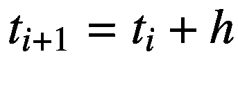
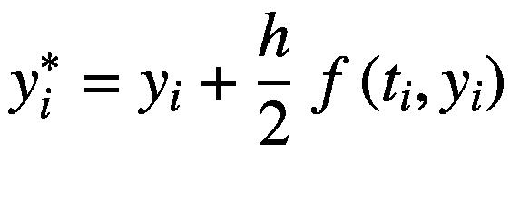
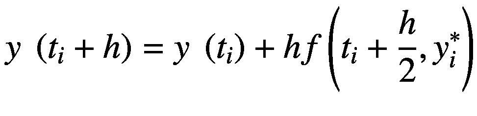

步骤 7. 输出 `t` 和 `y`。

步骤 8. 结束。

与前述方法类似，我们使用更明确的公式来描述步骤 6。

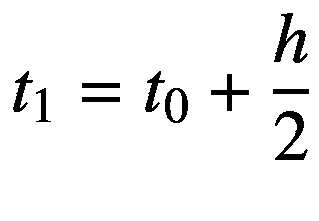
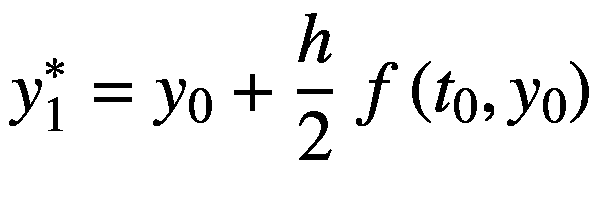
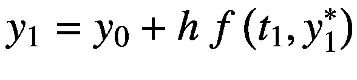
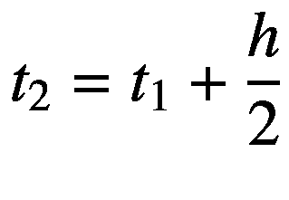
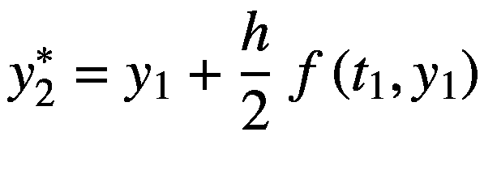
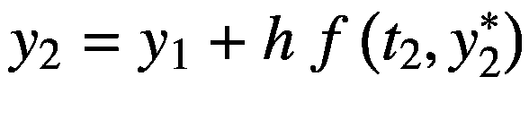

## 示例 3

示例如下：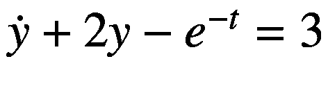 `y(0) = 1`。我们针对 `t = 0...10` 的问题，以 `h = 0.05` 的时间步长计算数值解。首先，将给定的问题方程改写为 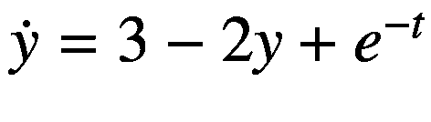。这也可以写成如下形式：`f(t, y) = 3 − 2y + e^(-t)`。

现在，基于我们的推导，编写脚本（`Example3.m`）的第 5 部分，以获得该问题的数值解，如下所示：

```
%%  2nd ORDER(explicit): Mid-Point Rule method
% Example3.m: dy/dt=3-2*y+exp(-t); with ICs: y(0)=1.0
% Part 5
yp=zeros(1,steps);          % Memory allocation
y5=[y0, zeros(1,steps-1)];  % Memory allocation
f1=3-2*y5(1)+exp(-t(1));
f=[f1, zeros(1, steps-1)];  % Memory allocation
for ii=1:steps
yp(ii)=y5(ii)+(h/2)*f(ii);
f(ii+1)=3-2*yp(ii)+exp(-(t(ii)+h/2));
y5(ii+1)=y5(ii)+h*f(ii+1);
end
plot(t, y5, 'g:', 'linewidth', 2.2)
title('\it Solutions of: $$ \frac{dy}{dt}+2*y-e^{-t}=3, y(0)=1 $$', 'interpreter', 'latex')
xlabel('\it t'), ylabel('\it y(t)')
% Compute the analytical solution:
syms u(x) x
Du=diff(u, x);
Equation=Du==3+exp(-x)-2*u;
IC = u(0)==1;
u_sol=dsolve(Equation, IC);
Solution=vectorize(u_sol);
x=t;
Solution=eval(Solution);
plot(t, Solution, 'r-.', 'linewidth', 2)
legend('\it Euler forward ', '\it Euler improved', '\it Euler  backward',...
'\it Mid-point rule','\it Analytical Solution', 'location', 'SouthEast')
xlim([0, 5])
hold off
```

我们还通过以下脚本（作为现有脚本 `Example3.m` 中的一个附加单元格）将所有模拟数据合并，从而获得这些模拟的数值结果，如下所示：

| 时间 | 欧拉前向法 | 改进欧拉法 | 欧拉后向法 | 中点法 | 欧拉后向法（另一种方式） | 解析解（精确） |
| --- | --- | --- | --- | --- | --- | --- |
| `0.00` | `1.00000` | `1.00000` | `1.00000` | `1.00000` | `1.00000` | `1.00000` |
| `0.05` | `1.10000` | `1.09378` | `1.08756` | `1.08869` | `1.09377` | `1.09397` |
| `0.10` | `1.18756` | `1.17612` | `1.16517` | `1.16721` | `1.17609` | `1.17674` |
| `0.15` | `1.26405` | `1.24853` | `1.23381` | `1.23659` | `1.24849` | `1.24948` |
| `0.20` | `1.33068` | `1.31204` | `1.29440` | `1.29775` | `1.31199` | `1.31325` |
| `0.25` | `1.38855` | `1.36760` | `1.34775` | `1.35154` | `1.36754` | `1.36900` |
| `0.30` | `1.43863` | `1.41605` | `1.39460` | `1.39871` | `1.41599` | `1.41760` |
| `0.35` | `1.48181` | `1.45816` | `1.43562` | `1.43995` | `1.45810` | `1.45981` |
| `0.40` | `1.51886` | `1.49461` | `1.47141` | `1.47588` | `1.49454` | `1.49633` |
| `0.45` | `1.55049` | `1.52603` | `1.50251` | `1.50705` | `1.52596` | `1.52777` |
| `0.50` | `1.57732` | `1.55296` | `1.52942` | `1.53398` | `1.55288` | `1.55471` |
| `0.55` | `1.59992` | `1.57590` | `1.55259` | `1.55712` | `1.57583` | `1.57764` |

| `0.60` | `1.61877` | `1.59531` | `1.57241` | `1.57687` | `1.59523` | `1.59702` |
| `0.65` | `1.63434` | `1.61158` | `1.58925` | `1.59361` | `1.61150` | `1.61325` |
| `0.70` | `1.64701` | `1.62507` | `1.60344` | `1.60767` | `1.62500` | `1.62669` |
| `0.75` | `1.65713` | `1.63612` | `1.61526` | `1.61936` | `1.63604` | `1.63767` |
| `0.80` | `1.66504` | `1.64499` | `1.62500` | `1.62893` | `1.64492` | `1.64648` |
| `0.85` | `1.67100` | `1.65197` | `1.63287` | `1.63664` | `1.65189` | `1.65339` |
| `0.90` | `1.67527` | `1.65727` | `1.63910` | `1.64270` | `1.65720` | `1.65862` |
| `0.95` | `1.67807` | `1.66111` | `1.64389` | `1.64730` | `1.66104` | `1.66239` |
| `1.00` | `1.67960` | `1.66368` | `1.64740` | `1.65063` | `1.66360` | `1.66488` |
| `1.95` | `1.61462` | `1.61168` | `1.60815` | `1.60889` | `1.61164` | `1.61191` |
| `2.00` | `1.61027` | `1.60766` | `1.60447` | `1.60515` | `1.60762` | `1.60786` |
| `...` |
| `2.95` | `1.54814` | `1.54824` | `1.54816` | `1.54819` | `1.54823` | `1.54823` |
| `3.00` | `1.54594` | `1.54608` | `1.54605` | `1.54607` | `1.54607` | `1.54607` |
| `...` |
| `4.95` | `1.50687` | `1.50702` | `1.50718` | `1.50715` | `1.50702` | `1.50701` |
| `5.00` | `1.50654` | `1.50668` | `1.50683` | `1.50680` | `1.50668` | `1.50667` |
| `...` |
| `10.00` | `1.50004` | `1.50005` | `1.50005` | `1.50005` | `1.50005` | `1.50005` |

```matlab
%% Combine all data of simulations from four methods
DATA = [t; y1; y2; y3; y4; y5; Solution];
fid = fopen('Example1_Out.dat','w');
fprintf(fid,'%2.2f  %4.5f %6.5f %6.5f %6.5f %6.5f %6.5f\n',DATA);
fclose(fid);
type Example1_Out.dat  % View output data file
```

从以表格形式呈现（写入输出文件 `IVP_ODE.txt`）并绘制在图 2-2 中的数值模拟结果可以清楚地看出，改进欧拉法（Heun 法）和欧拉后向法比另外两种方法（前向法和中点法）收敛更快，且更接近解析解。还值得一提的是，这些方法的精度在很大程度上取决于步长和问题类型，例如刚性或非刚性 ODE。此外，改进欧拉法（Heun 法）和欧拉后向法在计算时间方面比另外两种方法成本更高。

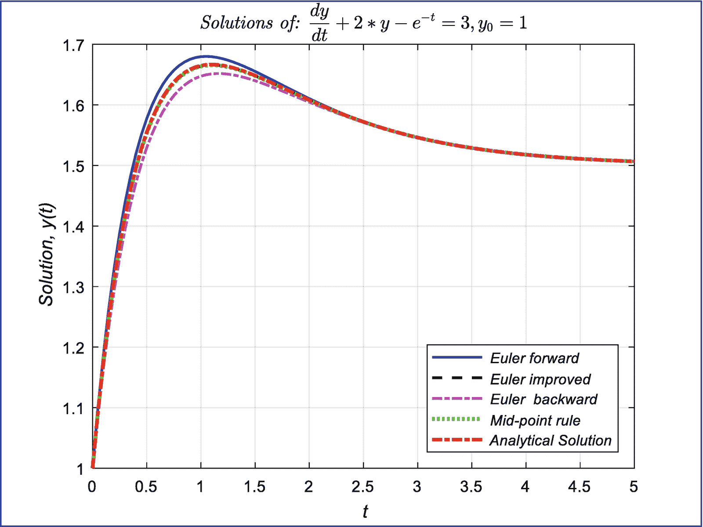

图 2-2

欧拉前向法、改进欧拉法、欧拉后向法和中点法与该问题解析解的模拟结果对比