# 轨迹问题

本章包含两个示例：通过微分方程建模的坠落物体和抛射物体，以及通过 m 文件和 Simulink 模型实现仿真模型的坠落物体和抛射物体。

## 坠落物体

我们来看一个关于坠落物体的简单物理练习。考虑一个质量为 `m` 的球在地球重力（`g`）作用下坠落，如图 11-1 所示。设 `h` 为球坠落的高度，`v(t)` 为球的速度。坐标系方向以向下为正。

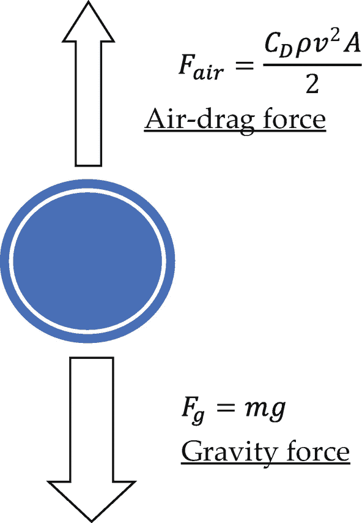

图 11-1 – 坠落物体及其所受的力

如图 11-1 所示，大气层中的坠落物体受到两种外力作用：重力/万有引力与空气阻力。根据牛顿第二定律，坠落物体所受的净外力等于加速度乘以该物体的质量。

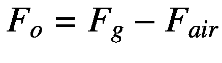 (11-1)

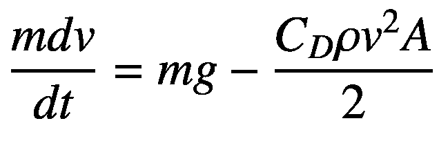 (11-2)

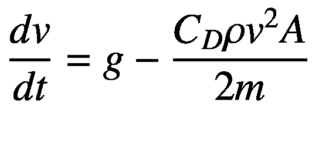 (11-3)

其中 `CD` 是坠落物体的空气阻力系数，需通过实验确定，并且取决于其形状、倾斜角度和流动条件；`ρ` 是空气密度 [kg/m³]；`A` 是坠落物体的横截面积 [m²]；`m` 是坠落物体的质量 [kg]。

阻力取决于坠落物体速度的平方。因此，随着物体加速，阻力也会增加。它会很快达到一个点（加速度等于 0），此时阻力等于重量（重力）。当阻力等于坠落物体的重量（重力）时，物体上将没有净外力 `(m dv/dt = 0)`，物体的加速度将等于 0。随后，物体根据牛顿第一运动定律以恒定速度下落。这个恒定速度被称为*终端速度*。

将所有空气阻力常数替换为一个参数 `b = (CD ρ A) / 2`，则方程(11-3)可改写为方程(11-4)所示形式。该参数称为牛顿阻力。我们得到如方程(11-4)所示的加速度新公式。

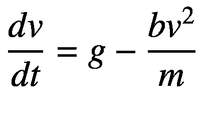 (11-4)

我们来研究两种情景，考察在 `b` 取不同值（即分别为 `b1/m = 0.1` 和 `b2/m = 0.001`）且初始条件为零时，坠落物体的运动情况。我们将找出两种情形下的终端速度。根据 `b1` 和 `b2` 的值，在情形#1 中，阻力是情形#2 中阻力的 100 倍。

情形#1 如下：`dv/dt = g - 0.1 v²`。

情形#2 如下：`dv/dt = g - 0.001 v²`。

以下是完整的仿真模型脚本 `Falling_Object.m`：

```
% Falling_Object.m
%% 任务说明. 坠落物体.
% 已知: m*dv/dt=m*g-b*v²; b/m=0.1 [1/秒]; 情形 # 1.
%        m*dv/dt=m*g-b*v²; b/m=0.001 [1/秒]; 情形 # 2
%        两种情形: v(0)=0 且 g=9.8 [米/秒²];
%           定义函数. 情形 # 1. dv/dt=9.8-0.1*v²
%           定义函数. 情形 # 2. dv/dt=9.8-0.001*v²
% 步骤 # 1. 使用函数句柄定义方程
f_C1=@(t,v)(9.8-0.1*v²');
f_C2=@(t,v)(9.8-.001*v²);
% 步骤 # 2. 定义 ODE23tb(f, timespan, IC)
[time1,v1]=ode23tb(f_C1,[0,30],0);
[time2,v2]=ode23tb(f_C2,[0,30],0);
% 步骤 # 3. 定义 ODE15s(f, timespan, IC)
[time1a,v1a]=ode15s(f_C1,[0,30],0);
[time2a,v2a]=ode15s(f_C2,[0,30],0);
% 步骤 # 4. 显示仿真结果
figure(1), plot(time1,v1,'k--', 'linewidth', 1.5); hold on
plot(time2,v2,'b-', 'linewidth', 1.5)
plot(time1a, v1a,'mo',time2a, v2a, 'rx')
legend('情形 # 1 ode23tb','情形 #2 ode23tb',...
'情形 #1 ode15s', '情形 #2 ode15s', 'location', 'southeast')
xlabel('\it 时间, [秒]'); ylabel('\it 速度, v(t) [米/秒]');
title({'\it 情形 # 1: dv = 9.8-0.1*v²', ...
'\it 情形 # 2: dv = 9.8-0.001*v²'})
grid on
% 步骤 # 5. 找出两种情形下的终端速度值
v_WHICH=(v1==max(v1));
v_MAX=v1(v_WHICH);
% 步骤 # 6. 将终端速度值添加到图中
textmessage=['情形#1 - 终端速度: '...
num2str(v_MAX) '   [米/秒]'];
gtext(textmessage);
v2_WHICH=(v2==max(v2));
v2_MAX=v2(v2_WHICH);
textmessage=['情形#2 - 终端速度: '...
num2str(v2_MAX) '   [米/秒]'];
gtext(textmessage); hold off
```

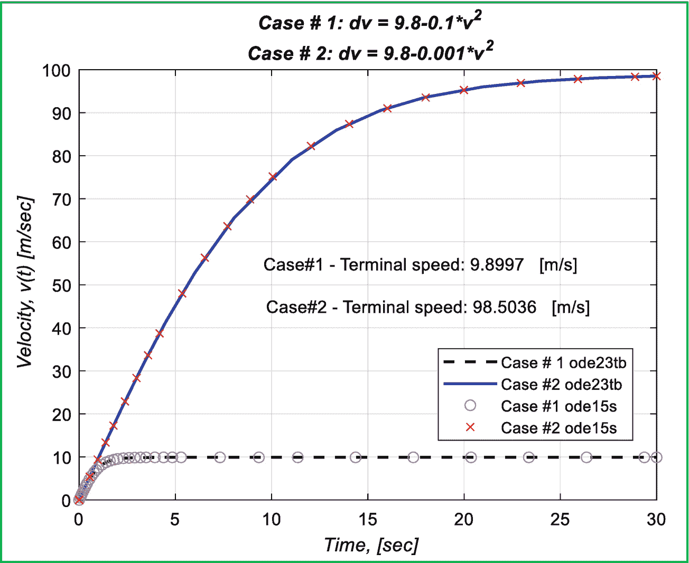

图 11-2 – 在强空气阻力（情形#1）和小空气阻力（情形#2）两种环境下，坠落物体的时间与速度关系图

两种求解器针对两种情形得到的仿真结果，如图 11-2 所示，收敛良好且几乎相同。当物体的阻力增大 100 倍时，其终端速度下降了约 90 m/s，降幅约为 995%。空气阻力对坠落物体的影响非常显著。对于情形#1 和#2，终端速度分别约在 2.5 秒和 30 秒后达到。

# 抛射球体轨迹

多个因素会影响击打或抛射球体的飞行轨迹。此练习题是微分方程应用的一个良好示例。所有优秀的网球运动员都知道如何击球，使其以特定角度飞过球网并落在对手场地上的正确位置。高质量的击球是数年艰苦训练和实践的结果。如果一名新手击球的速度比职业网球运动员快约 1%或力量稍大，那么球落地的位置会明显更远（约 0.50 米或以上），超出底线。球体轨迹问题已由数篇文献（例如参考文献[1]）中的球体轨迹理论进行了良好阐述和解释。

## 作用在球体上的力

图 11-3 显示了作用在空气中飞行的球体上的三个力。

-   重力，如下所示：

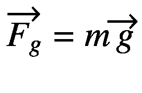

(11-5)

其中 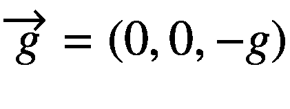 是重力加速度向量。

-   空气阻力，如下所示：

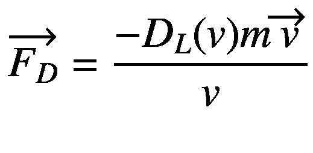

(11-6)

该力的方向与球的速度向量  相反。

-   马格努斯力，如下所示：

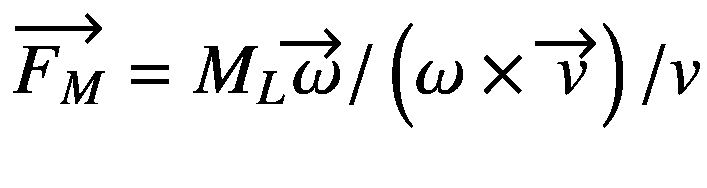

(11-7)

阻力 `D_L(v)` 和马格努斯力 `M_L(v)` 的大小通常具有理想流体理论 [2] 给出的形式，如下所示：

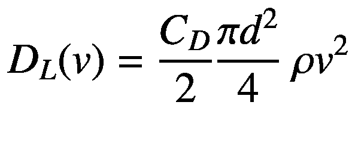

(11-8)

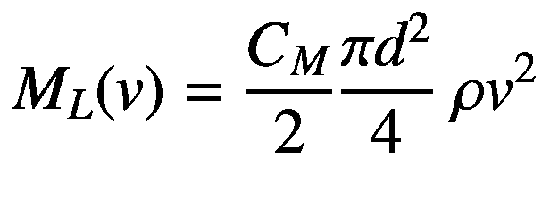

(11-9)

其中 `ρ` 是空气密度。系数 `C_D` 和 `C_M` 取决于实际流体（例如空气）以及速度 `v`、球的旋转和球表面材料。这些系数通过实验确定，并取自参考文献[1]的实验结果。对于速度为 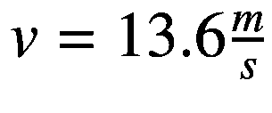 且球旋转（自转）为 `n = [800, 3250] rpm` 的网球，系数 `C_D` 和 `C_M` 仅取决于 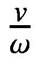 的比值，其中 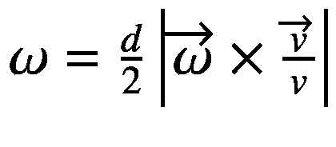 在某些情况下是旋转球赤道速度 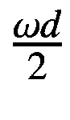 在速度向量 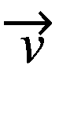 上的投影。参考文献[1]得到了以下系数的经验表达式：

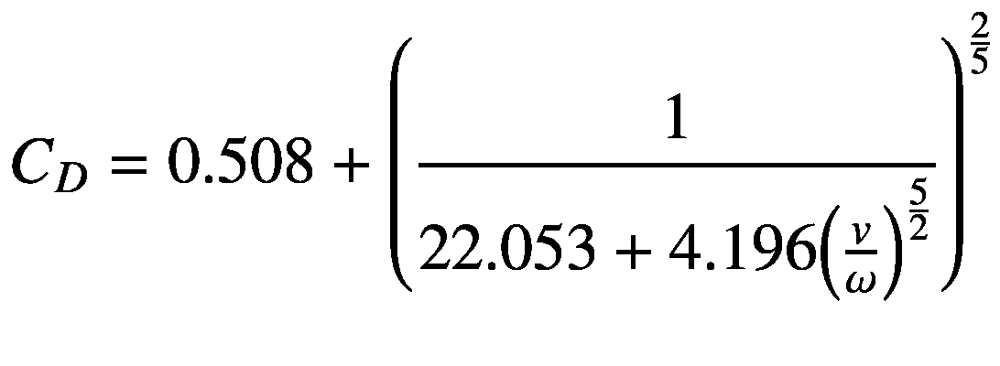

(11-10)

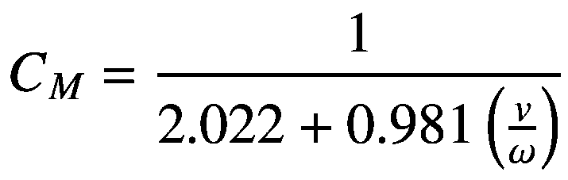

(11-11)

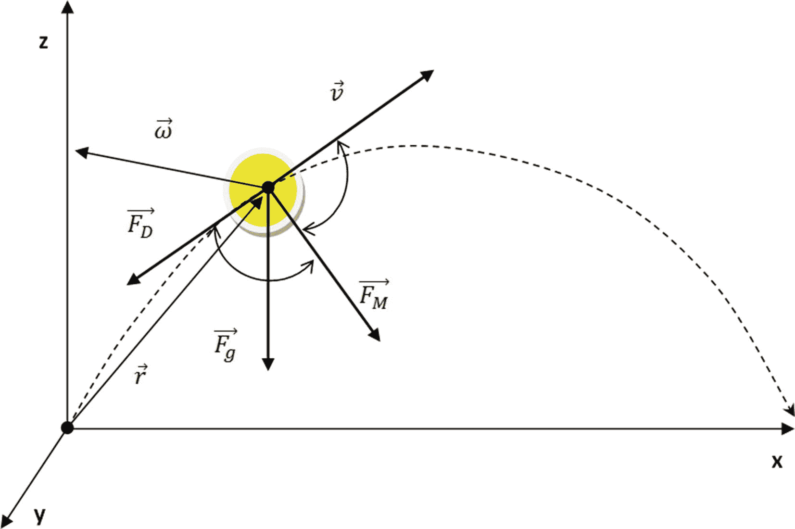

**图 11-3** 作用在空气中运动旋转球上的力

## 运动方程与模拟

我们可以忽略球旋转的减速，并取 `ω` 为常数。球体的轨迹向量可以通过牛顿第二定律方程定义，该方程针对来自参考文献[3]的位置向量 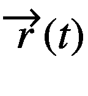。

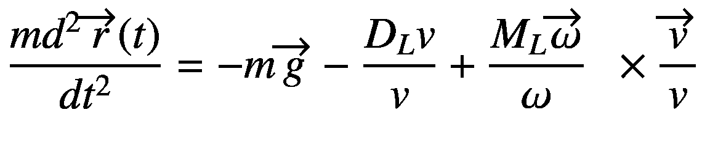

(11-12)

初始条件为 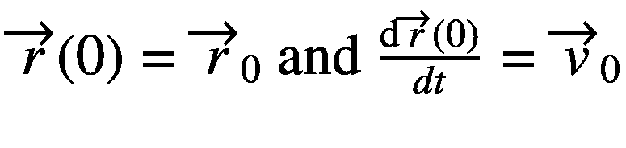。该方程是一个由三个微分方程组成的非线性系统，不存在解析解。因此，唯一的求解方法是数值求解。我们在 x-z 平面中选择 x 轴，然后通过代入 `D_L` 和 `M_L`，从方程(11-12)中得到最终公式[3]的方程(11-13)和(11-14)。

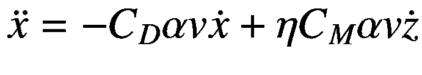

(11-13)

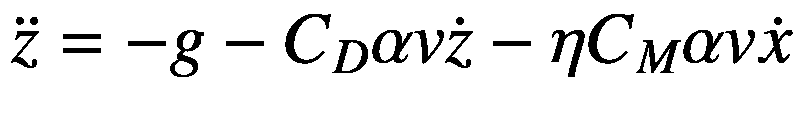

(11-14)

其中 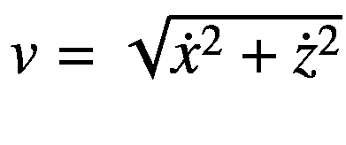 且 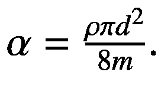 参数 `η = ±1` 描述旋转方向，例如，对于上旋，`η = 1`。对于 `t = 0` 的初始条件，使用以下初始值：

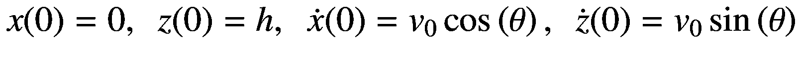

(11-15)

其中 `v0` 是初始速度向量  的大小，`θ` 是 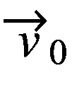 与 x 轴之间的夹角。

在模拟中，我们将使用两种条件：球在真空中和球在空气中。

对于球在真空中的情况，作用在球上的力只有重力，因此方程(11-13)和(11-14)将具有简单的形式：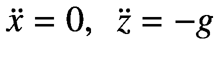。

对于球在空气中的情况，为了找到问题的数值解，我们通过引入新的变量名，将二阶常微分方程的方程(11-13)和方程(11-14)改写为一阶常微分方程组，如下所示：

运动状态由以下微分方程组描述：

$$ \left\{\begin{array}{c}\begin{array}{c}\dot{x}={v}_x\\ {}\dot{z}={v}_z\end{array}\\ {}\begin{array}{c}{\dot{v}}_x=-{C}_D\ \alpha\ v\ {v}_x+\eta {C}_M\ \alpha\ v\ {v}_z\\ {}{\dot{v}}_z=-g-{C}_D\ \alpha\ v\ {v}_z-\eta {C}_M\ \alpha\ v\ {v}_x\end{array}\end{array}\right. $$

(11-16)

其中 $$ v=\sqrt{{v_x}²+{v_z}²} $$。初始条件为 `x(0) = 0`，`z(0) = h`，`v_x(0) = v0 cos(θ)`，以及 `v_z(0) = v0 sin(θ)`。在模拟中，我们使用以下数值[1]：

重力加速度： $$ g=9.8\ \left[\frac{m}{s²}\right] $$
网球直径： $$ \mathrm{网球直径}=0.063\ \left[\mathrm{m}\right] $$
质量： $$ m=0.05\ \left[ kg\right] $$
空气密度： $$ \rho =1.29\ \left[\frac{kg}{m³}\right] $$

此外，对于初始条件，我们将使用 $$ h=1\ \left[m\right],{v}_0=25\ \left[\frac{m}{s}\right],\mathrm{and}\kern0.5em \theta ={15}⁰ $$。对于球的旋转，对于上旋，我们将使用 $$ \omega =20\ \left[\frac{1}{s}\right]\mathrm{and}\ \eta =1 $$。

网球轨迹的仿真模型是在 MATLAB 和 Simulink 中开发的。情况 #1（网球在真空中被击打）的解析解位于 `Thrown_Ball.m` 中。该脚本的仿真结果如图 11-4 所示。

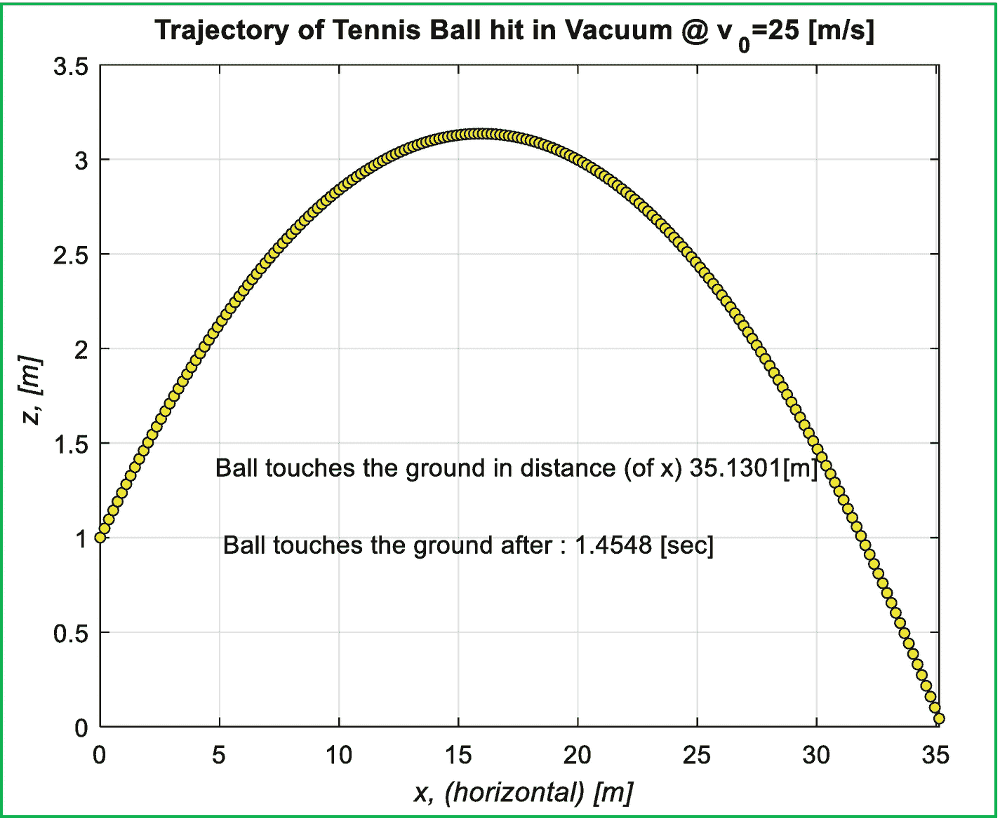

**图 11-4** 网球在真空中的轨迹

```matlab
% Thrown_Object.m. 情况 1. 解析解 - 球在真空中的轨迹
x_z_vac=dsolve('D2x=0', 'D2z=-g', 'x(0)=0',...
'Dx(0)=v0*cos(theta*pi/180)', 'z(0)=h', ...
'Dz(0)=v0*sin(theta*pi/180)', 't');
xt=x_z_vac.x  %#ok
zt=x_z_vac.z  %#ok
g=9.8;        % 重力加速度
h=1;          % 球在距离地面 1 m 处被击打
theta=15;     % 球以 15 度角被击打
v0=25;        % 球的初始速度
xt=vectorize(xt); zt=vectorize(zt); t=linspace(0,1.5, 200);
xt=eval(xt); zt=eval(zt); z_i=find(zt==min(abs(zt)));
touch_gr=xt(z_i); t_touch = t(z_i);
plot(xt, zt,'ko', 'markersize', 4,'MarkerFaceColor','y'), grid on
xlim([0, touch_gr]);
text0=('球在距离地面 h=1[m] 处以 \theta=15⁰ 角被击打');
gtext(text0, 'fontsize', 13);
text1=['球在 (x 方向) 距离 ' ... num2str(touch_gr) '[m] 处落地']; gtext(text1);
text2=['球在 ' num2str(t_touch)' [秒] 后落地'];
gtext(text2);
title('网球在真空中被击打的轨迹, v_0=25 [m/s] ')
xlabel('x, (水平方向) [m]'), ylabel('z, [m]')
```

下一个仿真模型 `Thrown_Ball_All.m` 计算了球在真空中、空气中带旋转以及空气中无旋转时的轨迹。该脚本获得的仿真结果如图 11-5 所示。

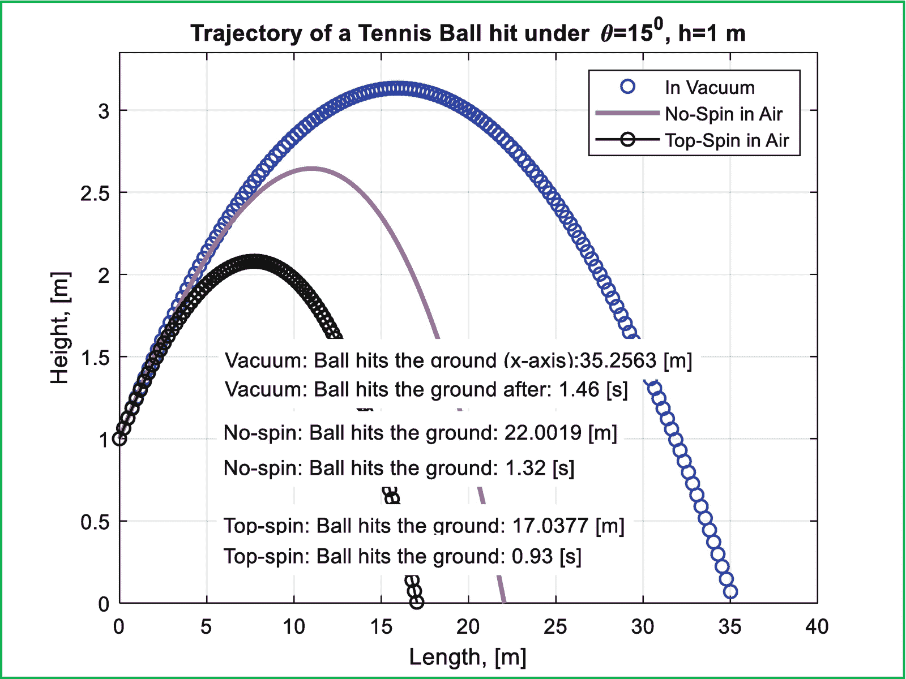

**图 11-5** 网球在真空、空气中有上旋和无旋转情况下的轨迹

# 网球轨迹模拟：MATLAB与Simulink方法

本文介绍两种模拟抛射球体（网球）轨迹的方法：使用MATLAB脚本的直接数值积分，以及使用Simulink模型的建模与仿真。

## 1. MATLAB仿真脚本

以下MATLAB脚本 `Thrown_Ball_All.m` 通过求解运动微分方程，模拟网球在真空、无旋转空气和上旋空气三种环境下的轨迹。

```matlab
% Thrown_Ball_All.m
h =1;       % [m];
v0=25;      % [m*s^-1];
theta=15;   % [deg];
ro=1.29;    % [kg*m^-3];
g=9.81;     % [m/s²]
d=.063;     % [m];
m=.05;      % [kg];
w=20;       % [m*s^-1]; 旋转球的角速度
eta=1;      % 描述旋转的方向(+ -)和存在性;
% eta=1 表示上旋。
alfa=ro*pi*d²/(8*m); time=0:.01:1.5;
ICs=[0, 1, v0*cos(theta*pi/180), v0*sin(theta*pi/180)];
u  = @(t,x)sqrt(x(3).²+x(4).²);
CD = @(t,x)(0.508+(1./(22.053+4.196*(u(t,x)./w).^(5/2))).^(2/5));
CM = @(t,x)(1/(2.022+.981*(u(t,x)./w)));
vacuum = @(t,x)([x(3); x(4); 0; -g]);
nospin = @(t,x)([x(3); x(4); (-1)*CD(t,x)*alfa*u(t,x)*x(3);
(-1)*g-CD(t,x)*alfa*u(t,x)*x(4)]);
topspin= @(t,x)([x(3); x(4);
(-1)*CD(t,x)*alfa*u(t,x)*x(3)+eta*CM(t,x)*alfa*u(t,x)*x(4);
(-1)*g-CD(t,x)*alfa*u(t,x)*x(4)-eta*CM(t,x)*alfa*u(t,x)*x(3)]);
[tvac, XZvac]= ode45(vacuum, time, ICs, []);
[tns, XZns]  = ode45(nospin, time, ICs, []);
[tts, XZts]  = ode23(topspin, time, ICs, []);
% 情况 #1. 球在真空中被击打
z_i=find(abs(XZvac(:,2))<=min(abs(XZvac(:,2))));
t_gr=XZvac(z_i,1); t_t = time(z_i);
% 情况 #2. 球在无旋转下被击打
z1_i =find(abs(XZns(:,2))<=min(abs(XZns(:,2))));
t_gr1=XZns(z1_i,1); t_t1 = time(z1_i);
% 情况 #3. 球在上旋下被击打
z2_i =find(abs(XZts(:,2))<=min(abs(XZts(:,2))));
t_gr2=XZts(z2_i,1); t_t2 = time(z2_i);
plot(XZvac(:,1), XZvac(:,2), 'bo', 'linewidth', 1), grid; hold on
plot(XZns(:,1), XZns(:,2), 'm', 'linewidth', 2)
plot(XZts(:,1), XZts(:,2), 'ko-', 'linewidth', 1.0)
legend('在真空中','在空气中无旋转','在空气中上旋'),
ylim([0, 3.35])
title '网球在 \theta=15⁰, h=1 m 条件下的轨迹'
xlabel '长度, [m]'; ylabel '高度, [m]'
tt1=['真空: 球 (在 x 轴方向) 落地距离: ' num2str(t_gr) '[m]'];
gtext(tt1, 'backgroundcolor', 'w');
tt1a=['真空: 球落地时间: ' num2str(t_t) '[s]'];
gtext(tt1a, 'backgroundcolor', 'w');
tt2=['无旋转: 球落地距离: ' num2str(t_gr1) ' [m]'];
gtext(tt2, 'backgroundcolor', 'w');
tt2a=['无旋转: 球落地时间: ' num2str(t_t1)  ' [s]'];
gtext(tt2a, 'backgroundcolor', 'w');
tt3=['上旋: 球落地距离: ' num2str(t_gr2) ' [m]'];
gtext(tt3, 'backgroundcolor', 'w');
tt3a=['上旋: 球落地时间: ' num2str(t_t2) ' [s]'];
gtext(tt3a, 'backgroundcolor', 'w'); hold off
```

## 2. Simulink模型

另一种模拟抛射球体轨迹的方法是构建一个Simulink模型 `TENNIS_Ball.slx`，如图11-6所示（以及两个子系统，如图11-7和图11-8所示），用于模拟三种情况：真空中、空气中上旋（`η = 1`）以及空气中无旋转（`η = 0`）。

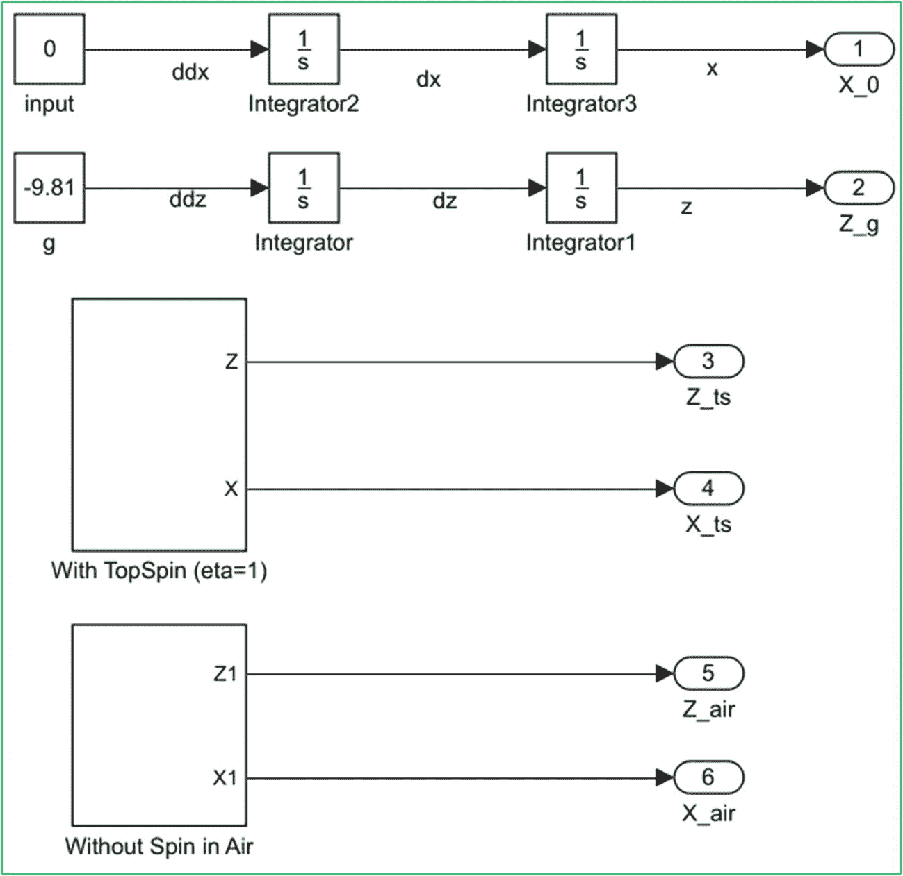
**图 11-6** 网球轨迹的主Simulink模型。

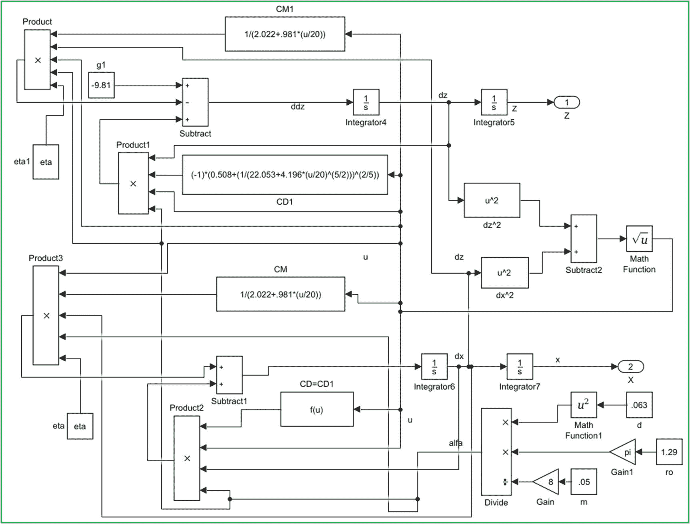
**图 11-7** 模型 `TENNIS_Ball.slx` 的上旋模型子系统（上旋：`η = 1`）。

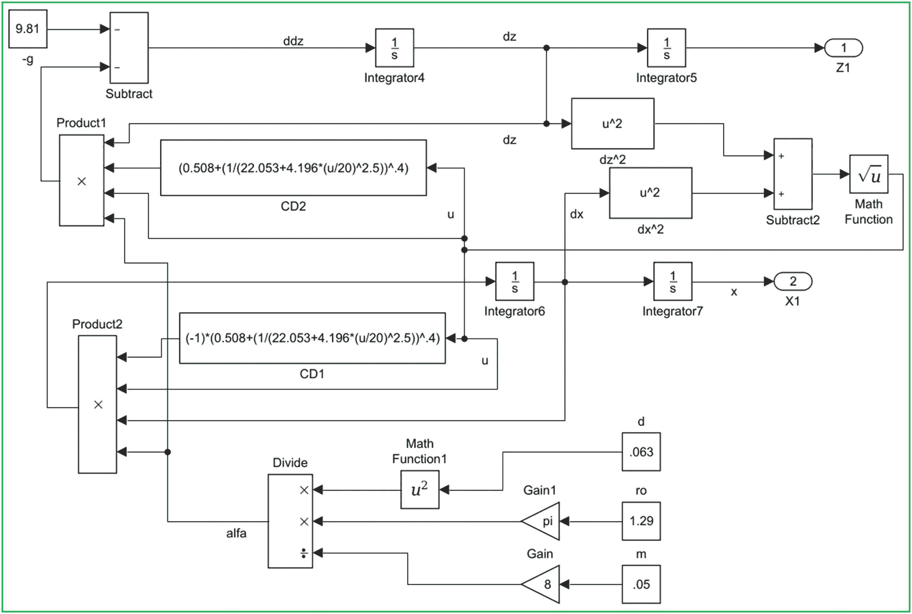
**图 11-8** 模型 `TENNIS_Ball.slx` 的无旋转（无自旋：`η = 0`）子系统。

请注意，在构建图11-6所示的Simulink模型 `TENNIS_Ball.slx` 时，使用了 [Function] 模块来处理 `C_D` 和 `C_M` 的代数表达式，以简化模型构建。此外，所有初始条件，包括 $$ \dot{z}(0)={v}_0\cos \left(\theta \right)\ \mathrm{and}\ \dot{x}(0)={v}_0\sin \left(\theta \right) $$，都通过 [Integrator] 模块的内部初始条件源插入到模型中。该问题主Simulink模型的真空部分由 [Constant] 输入、[Integrator] 和 [Scope] 模块组成。空气中带旋转和无旋转的部分在子类中建模，并置于两个子系统中，如图11-7和图11-8所示。

### 2.1. Simulink仿真脚本

当使用以下脚本 `Sim_TENNIS_Ball.m` 执行图11-6、图11-7和图11-8中所示、采用固定步长求解器 `ode8` 的Simulink模型 `TENNIS_Ball.slx` 时，我们将获得与前文图11-5所示结果相同的仿真结果（此处未显示绘图）。

```matlab
% Sim_TENNIS_Ball.m
% 使用固定步长求解器 ode8 的 SIMULINK 模型
set_param('TENNIS_ball','Solver','ode8','StopTime','1.5')
out=sim('TENNIS_ball');
plot(out.yout{2}.Values.Data,out.yout{1}.Values.Data, 'g',...
out.yout{4}.Values.Data,out.yout{3}.Values.Data, 'c:',...
out.yout{6}.Values.Data,out.yout{5}.Values.Data,'r-.', ... 'linewidth', 3), grid on
legend('通过 SIM 仿真的真空中', '通过 SIM 仿真的空气中无旋转',...
'通过 SIM 仿真的空气中上旋'), ylim([0, 3.35])
title('网球在 \theta=15⁰ & h=1 m 条件下的轨迹')
xlabel('长度, [m]'), ylabel('高度, [m]')
```

## 3. 结果分析

我们再次看到，较高的球旋转会使其飞行距离更短。此外，数值仿真结果表明，如果球在真空中被击打（或忽略空气阻力），它飞行距离最远，飞行时间最长，这与物理学课程中的知识一致。

