# 拉尔斯顿方法

拉尔斯顿方法与改进欧拉法（霍因法）类似，但系数略有不同。其表达式如公式(2-5)所示。

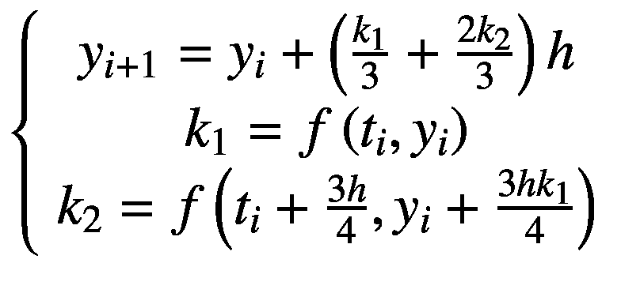

(2-5)

从表达式可以看出，这是一种显式方法，其实现方式与改进欧拉法算法类似。我们在现有脚本（`Example3.m`）中新增一个单元作为第 6 部分，如下所示：

```
%% Ralston Method
% Part 6
k1=zeros(1,steps);        % Memory allocation
k2=zeros(1,steps);        % Memory allocation
y6=[y0, zeros(1,steps)];  % Memory allocation
for jj=1:steps
k1(jj) = 3 + exp(-t(jj))-2*y6(jj);
k2(jj) = 3 + exp(-(t(jj)+3*h/4))-2*(y6(jj)+3*h*k1(jj)/4);
y6(jj+1)=y6(jj)+(k1(jj)+2*k2(jj))*h/3;
end
figure
plot(t, y6, 'b-',t, y1, 'r--','linewidth', 2)
legend('\it Ralston method','\it Euler forward method'), grid on
title('\it Solutions of: $$ \frac{dy}{dt}+2*y-e^{-t}=3, y_0=1 $$', 'interpreter', 'latex')
xlabel('\it t'), ylabel('\it Solution, y(t)'), shg
```

我们将拉尔斯顿法的结果与前向欧拉法的结果绘图比较，得到如图 2-3 所示的曲线图。

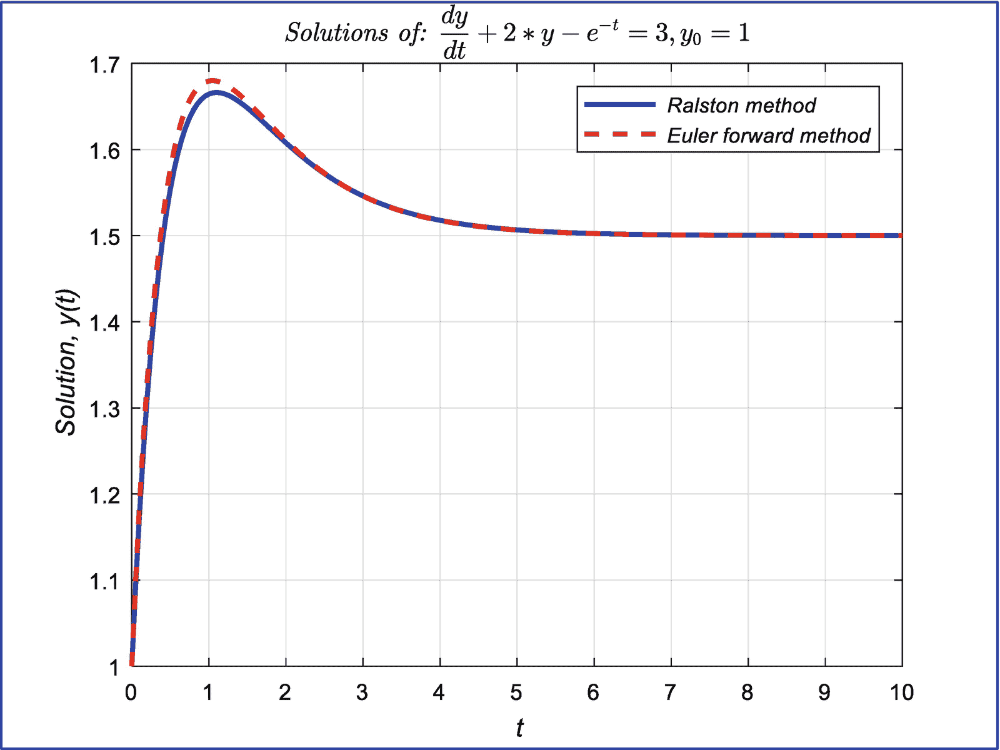

**图 2-3** 拉尔斯顿法与欧拉前向法的解对比

从图 2-3 的曲线可以看出，作为两步法的拉尔斯顿法，其性能优于相对粗糙但在计算时间上更高效的前向欧拉法。

## 龙格-库塔法

龙格-库塔法可以按不同阶次实现，例如一阶龙格-库塔法（等同于欧拉法）、二阶龙格-库塔法（等同于霍因法），以及经典的四阶和五阶龙格-库塔法。这些方法也可采用与欧拉法算法类似的算法实现，只需在第 6 步中引入一些更改。因此，在龙格-库塔法中，通过根据公式(2-6)计算函数值，对前向欧拉法算法的第 6 步进行了如下更改。

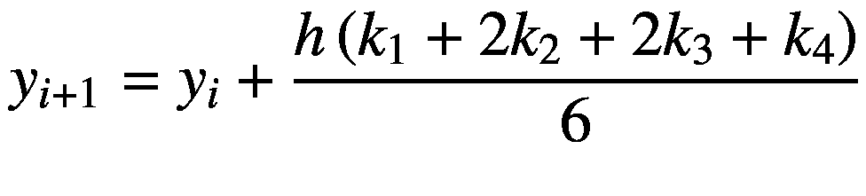

(2-6)

项 `k[1]`、`k[2]`、`k[3]`、`k[4]` 由下式计算：

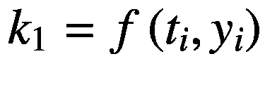

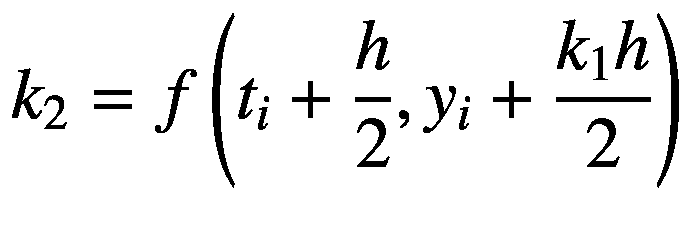

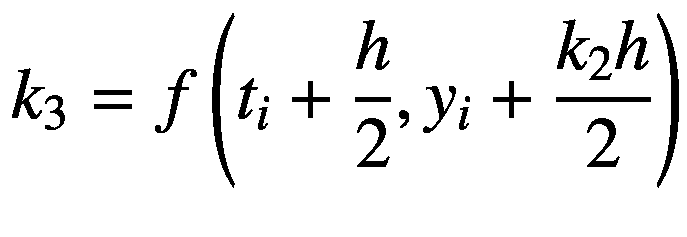

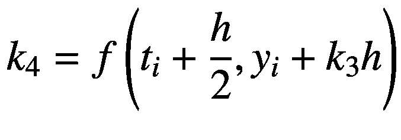

其中 `i = 0, 1, 2, …, N - 1`。总和 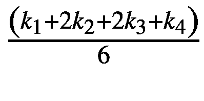 可解释为平均斜率。

### 示例 4

以下是示例问题：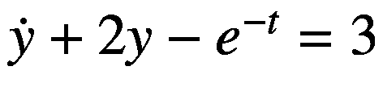，`y(0) = 1`。让我们计算 `t = 0...10`、时间步长 `h = 0.05` 时的数值解，并将给定的问题方程重写为 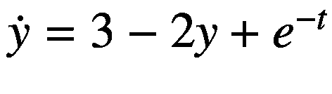。这也可以表示为 `f(t, y) = 3 - 2y + e^(-t)`，其中 `t = 0...10`。

对于 `t[0] = 0`，

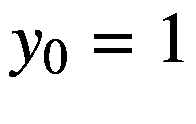

对于 `t[1] = 0.05`，

`y[0] = 1`，`k[1] = f(t[0], y[0]) = 3 - 2 * 1 + e⁰ = 2`

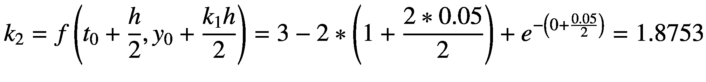

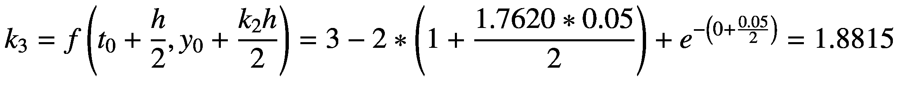

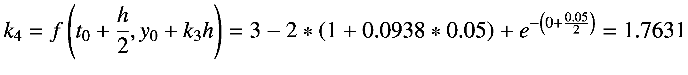

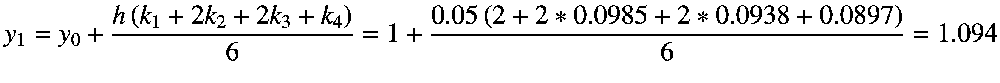

对于 `t[2] = 0.1`，

`y[1] = 1.094`，`k[1] = f(t[1], y[1]) = 3 - 2 * 1.094 + e^(-0.1) = 1.7633`

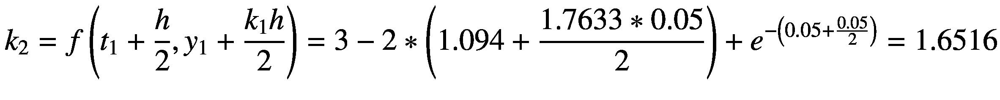

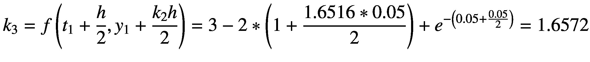

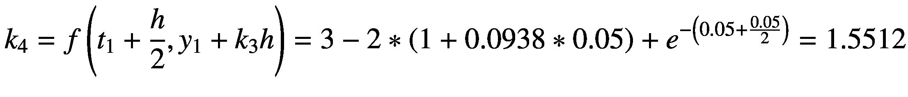

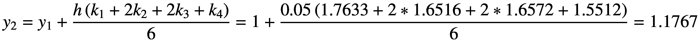

现在，我们在现有脚本（`Example1.m`）中，将经典四阶龙格-库塔法前述的所有六步流程实现为一个新的单元。

```matlab
%% 4th-Order RUNGE-KUTTA Method. Example4.m
% Part 7
% EXAMPLE. y'+2*y-exp(-t)=3 with ICs: y(0)=1\. t=0...10.
%{
Step 6 changed from Euler's Method
k_n1=f(t(n), y(n))
k_n2=f(t(n)+h/2, yn+k_n1*h/2)
k_n3=f(t(n)+h/2, yn+k_n2*h/2)
k_n4=f(t(n)+h, yn+k_n3*h)
y(n+1)=y(n)+h*(k_n1+2*k_n2+2*k_n3+k_n4)/6;
%}
k1=zeros(1,steps);         % Memory allocation
k2=k1;                     % Memory allocation
k3=k1;                     % Memory allocation
k4=k1;                     % Memory allocation
y7=[y0, zeros(1,steps)];   % Memory allocation
for ii=1:steps
k1(ii)=3+exp(-t(ii))-2*y7(ii);
k2(ii)=3+exp(-(t(ii)+h/2))-2*(y7(ii)+k1(ii)*h/2);
k3(ii)=3+exp(-(t(ii)+h/2))-2*(y7(ii)+k2(ii)*h/2);
k4(ii)=3+exp(-(t(ii)+h))-2*(y7(ii)+k3(ii)*h);
y7(ii+1)=y7(ii)+h*(k1(ii)+2*k2(ii)+2*k3(ii)+k4(ii))/6;
end
figure
plot(t, y7, 'k-.', 'linewidth', 1.5), grid on
hold on
plot(t, Solution, 'r-.', 'linewidth', 1.5)
legend('\it Runge-Kutta Method','\it Analytic solution')
title('\it Numerical Solutions of: $$ \frac{dy}{dt}+2*y-e^{-t}=3, y_0 = 1 $$', 'interpreter', 'latex')
xlabel('\it t'), ylabel('\it Solution, y(t)')
xlim([0, 5]), shg
hold off
```

执行脚本 `Example4.m` 的第 7 部分后，我们得到如图 2-4 所示的曲线图。从图中可以看出，对于给定的一阶常微分方程问题，经典四阶龙格-库塔法表现出色，并且与解析解完美收敛。


**图 2-4** 通过四阶龙格-库塔法求解的一阶常微分方程数值解与解析法（`dsolve()`）的对比