# 龙格-库塔-吉尔法

龙格-库塔方法有几种改进版本，龙格-库塔-吉尔法便是其中之一。该方法旨在**最小化舍入误差**，其表达式如公式(2-7)所示。

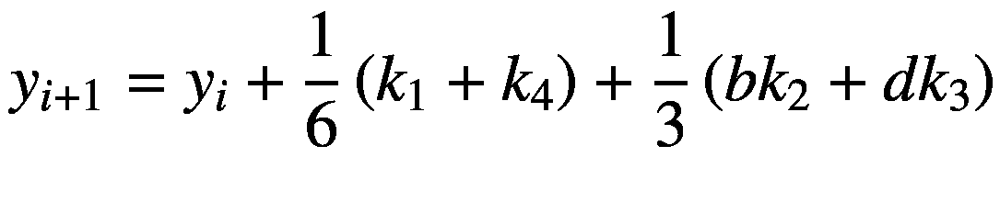
(2-7)

公式(2-7)中的项 `k[1]`、`k[2]`、`k[3]`、`k[4]` 由以下表达式计算得出：

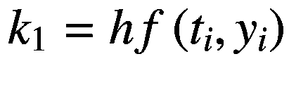

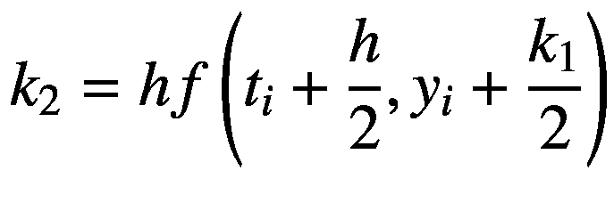

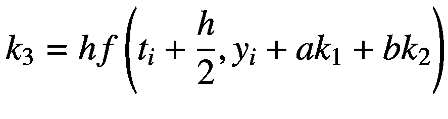

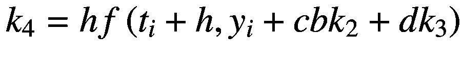

通常，使用以下项 `a`、`b`、`c`、`d` 的值：

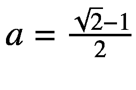，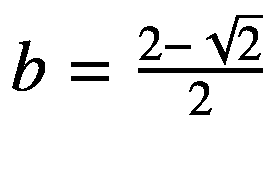，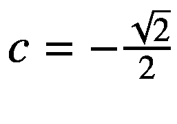，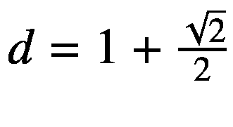

其中 `i` = 0, 1, 2, …, `N` − 1。

现在，我们将上述表达式作为一个额外的代码单元实现到我们的脚本 (`Example1.m`) 中，用于计算 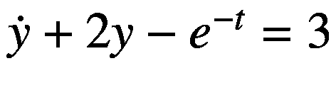 且 `y(0)` = 1 的数值解，如下所示：

```
%% Runge-Kutta-Gill method
% EXAMPLE. y'+2*y-exp(-t)=3 with ICs: y(0)=1\. t=0...10.
% Part 8
a=(sqrt(2)-1)/2; b=(2-sqrt(2))/2; c=-sqrt(2)/2; d=1+sqrt(2)/2;
y8=[y0, zeros(1, steps-1)];
for ii=1:steps
k1(ii)=h*(3+exp(-t(ii))-2*y8(ii));
k2(ii)=h*(3+exp(-(t(ii)+h/2))-2*(y8(ii)+k1(ii)*h/2));
k3(ii)=h*(3+exp(-(t(ii)+h/2))-2*(y8(ii)+a*k1(ii)+b*k2(ii)));
k4(ii)=h*(3+exp(-(t(ii)+h/2))-2*(y8(ii)+c*k2(ii)+d*k3(ii)));
y8(ii+1)=y8(ii)+(k1(ii)+k4(ii))/6+(b*k2(ii)+d*k3(ii))/3;
end
DATA1 = [t; y1; y7; y8; Solution];
% Data export
fid1 = fopen('Example1_Out2.dat', 'w');
fprintf(fid1, 'time  Euler-F  Runge-K  RK-Gill Analytic \n');
fprintf(fid1,'%2.2f  %4.5f %4.5f %4.5f %4.5f\n',DATA1);
fclose(fid1);
type Example1_Out2.dat    % View the imported data on the command window
```

现在，我们比较示例 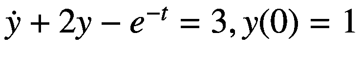 分别通过前向欧拉法、经典四阶龙格-库塔法、龙格-库塔-吉尔法以及解析法得到的数值模拟结果。

| 时间 | 前向欧拉法 | 四阶龙格-库塔法 | 四阶龙格-库塔-吉尔法 | 解析解 |
| --- | --- | --- | --- | --- |
| `0.00000` | `1.00000` | `1.00000` | `1.00000` | `1.00000` |
| `0.05000` | `1.10000` | `1.09397` | `1.09462` | `1.09397` |
| `0.10000` | `1.18756` | `1.17674` | `1.17791` | `1.17674` |
| `0.15000` | `1.26405` | `1.24948` | `1.25106` | `1.24948` |
| `0.20000` | `1.33068` | `1.31325` | `1.31516` | `1.31325` |
| `0.25000` | `1.38855` | `1.36900` | `1.37116` | `1.36900` |
| `0.30000` | `1.43863` | `1.41760` | `1.41993` | `1.41760` |
| `0.35000` | `1.48181` | `1.45981` | `1.46227` | `1.45981` |
| `0.40000` | `1.51886` | `1.49633` | `1.49887` | `1.49633` |
| `0.45000` | `1.55049` | `1.52777` | `1.53036` | `1.52777` |
| `0.50000` | `1.57732` | `1.55471` | `1.55731` | `1.55471` |
| `0.55000` | `1.59992` | `1.57764` | `1.58022` | `1.57764` |
| `0.60000` | `1.61877` | `1.59702` | `1.59956` | `1.59702` |
| `0.65000` | `1.63434` | `1.61325` | `1.61574` | `1.61325` |
| `0.70000` | `1.64701` | `1.62669` | `1.62911` | `1.62669` |
| `0.75000` | `1.65713` | `1.63767` | `1.64001` | `1.63767` |
| `0.80000` | `1.66504` | `1.64648` | `1.64874` | `1.64648` |
| `0.85000` | `1.67100` | `1.65339` | `1.65556` | `1.65339` |
| `0.90000` | `1.67527` | `1.65862` | `1.66069` | `1.65862` |
| `0.95000` | `1.67807` | `1.66239` | `1.66436` | `1.66239` |
| `1.00000` | `1.67960` | `1.66488` | `1.66675` | `1.66488` |

从这些数值模拟中，我们可以得出结论，经典的四阶龙格-库塔法的性能远优于前向欧拉法。局部截断误差如下：

前向欧拉法：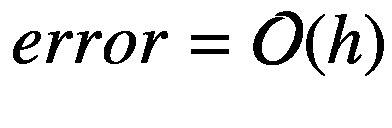

四阶龙格-库塔法：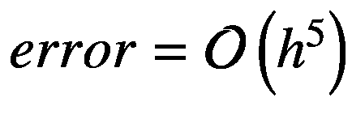

在四阶龙格-库塔法的每一步中，需要进行四次函数求值。因此，当需要进行大规模且复杂的计算时，该方法的计算成本将高于欧拉法。

## 龙格-库塔-费尔伯格方法

这是高阶龙格-库塔方法的另一种改进版本，包含六个系数（而非四个）。该方法由方程（2-8）的表达式定义。

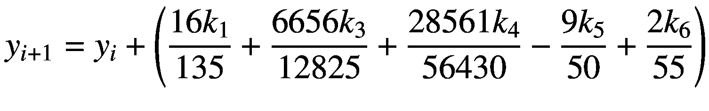
(2-8)

系数项，如`k[1]`、`k[2]`、`k[3]`、`k[4]`、`k[5]`、`k[6]`，通过以下表达式计算：


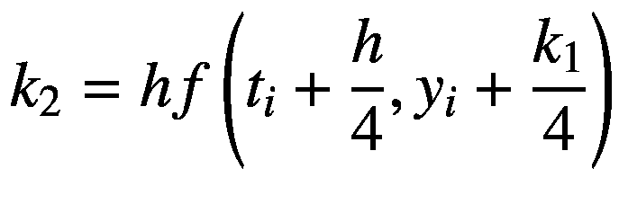
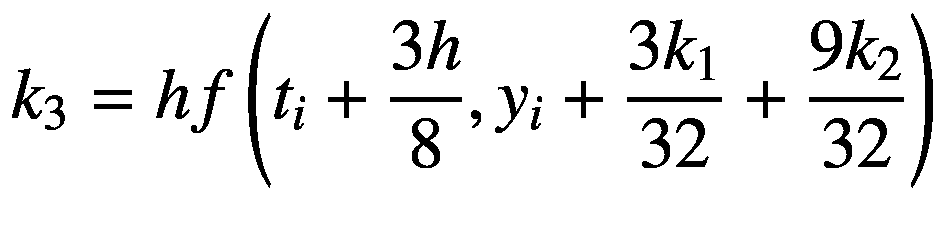
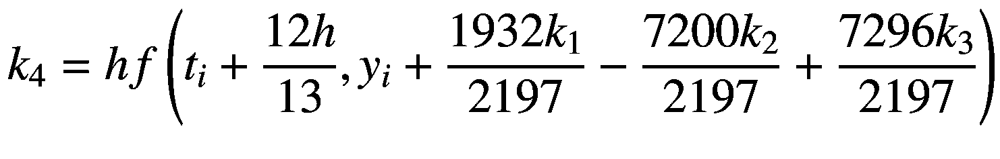
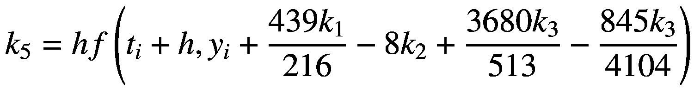
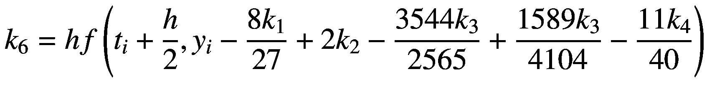

其局部误差为：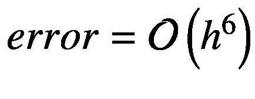。其全局误差为：。

龙格-库塔-费尔伯格方法的误差估计公式如下：

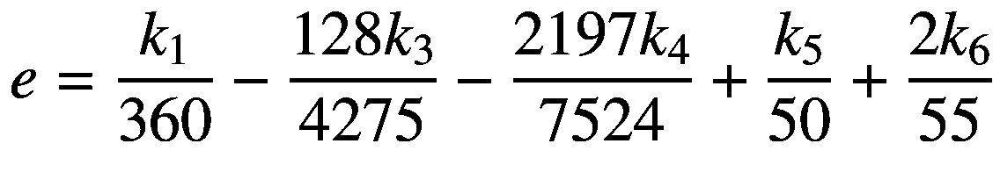
(2-9)

现在，我们实现方程(2-8)和(2-9)所示表达式中给出的所有这些过程，以求解前面的示例（`Example4.m`），并在每个计算步骤中计算误差值，如下所示：

```matlab
%% 在 `Example4.m` 中实现的龙格-库塔-费尔伯格方法
% 示例. `y'+2*y-exp(-t)=3` 初始条件: `y(0)=1`\. `t=0...10`.
% 第 9 部分
`F=@(t,y)(3-2*y+exp(-t));`
`y9=[y0, ones(1,steps-1)];`  % 内存分配
`e=zeros(1, steps);`         % 内存分配
for `n`=1:`steps`
`k_n1`=`h`*`F`(`t`(`n`), `y9`(`n`));
`k_n2`=`h`*`F`(`t`(`n`)+`h`/4, `y9`(`n`)+`k_n1`/4);
`k_n3`=`h`*`F`(`t`(`n`)+3*`h`/8, `y9`(`n`)+3*`k_n1`/32+9*`k_n2`/32);
`k_n4`=`h`*`F`(`t`(`n`)+12*`h`/13, `y9`(`n`)+1932*`k_n1`/2197-...
7200*`k_n2`/2197+7296*`k_n3`/2197);
`k_n5`=`h`*`F`(`t`(`n`)+`h`, `y9`(`n`)+439*`k_n1`/216-8*`k_n2`+...
3680*`k_n3`/513-845*`k_n4`/4104);
`k_n6`=`h`*`F`(`t`(`n`)+`h`/2,`y9`(`n`)-8*`k_n1`/27+2*`k_n2`-...
3544*`k_n3`/2565+1859*`k_n4`/4104-11*`k_n5`/40);
`y9`(`n`+1)=`y9`(`n`)+(16*`k_n1`/135+6656*`k_n3`/12825+...
28561*`k_n4`/56430-9*`k_n5`/50+2*`k_n6`/55);
`e`(`n`)=`k_n1`/360-128*`k_n3`/4275-2197*`k_n4`/7524+`k_n5`/50+2*`k_n6`/55;
end
subplot(211)
% 使用 `dsolve` 求得的该问题解析解
plot(`t`, `y9`, 'ko', `t`, `Solution`, 'r-', 'linewidth', 1.5)
legend('\it 龙格-库塔-费尔伯格方法','\it 解析解', 'location', 'southeast')
title('\it 数值解: $$ \frac{dy}{dt}+2*y-e^{-t}=3, y_0 = 1 $$', 'interpreter', 'latex')
xlabel('\it t'), ylabel('\it 解, y(t)')
xlim([0, 5]), grid on
subplot(212)
plot(`e`, 'r-', 'linewidth', 1.5), grid on
title('\it 全局误差: \epsilon')
xlabel('\it t'), ylabel('\it \epsilon(t)')
shg
```

从使用龙格-库塔-费尔伯格方法求解给定一阶微分方程的脚本 `Example4.m` 的仿真结果（如图2-5所示）来看，我们可以发现，在大约70个计算步骤之后，全局误差几乎变为零。另外，必须注意，这是一个非刚性常微分方程问题。

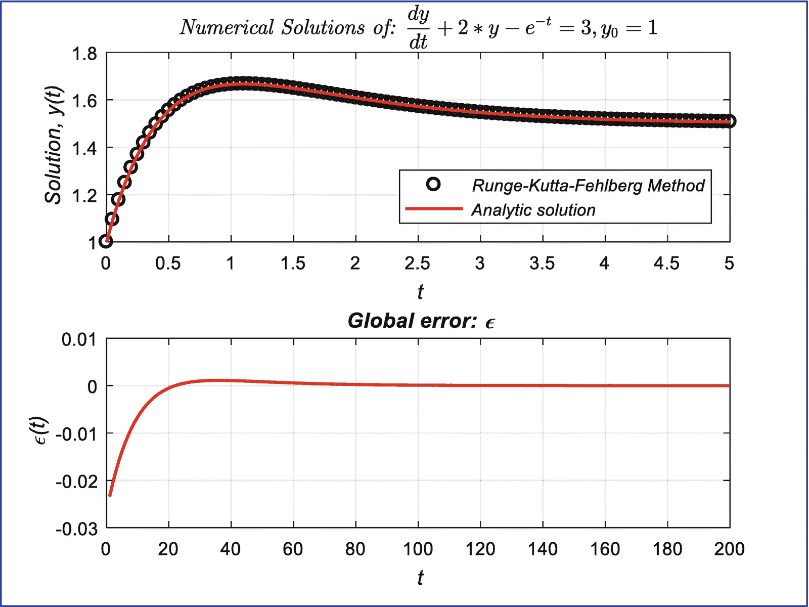
**图 2-5** 问题的数值模拟： `y(0) = 1`

## 亚当斯-巴什福思方法

亚当斯-巴什福思是一种两步法。该方法在不同文献中有多种不同的表述形式，其中一种是用迭代索引表示的，如下所示：

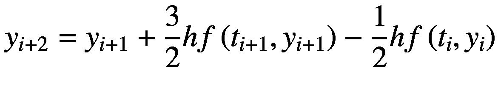
(2-10)

方程(2-10)中的表达式需要两个值，即`y[i+1]`和`y[i]`，才能计算`y[i+2]`的值。对于初值问题，`y[0]`（可以理解为`y[1]`）总是给定的。然而，这对于此计算过程来说是不够的。因此，在这种情况下，我们可以额外采用欧拉（向前）方法作为一个步骤。此外，也可以在这一步中采用泰勒级数方法，然后使用方程(2-10)所示的公式进行后续的其他迭代过程。

### 示例 5

示例问题如下： `y[0]` = 0.5

该给定示例的方程可表示为 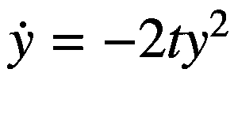，其解函数为 `f(t, y)` = −2*ty*²。让我们在模拟中采用均匀时间步长 `h` = 0.01。

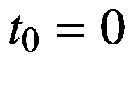
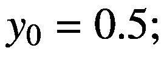
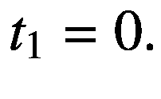
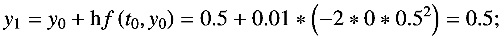

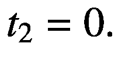

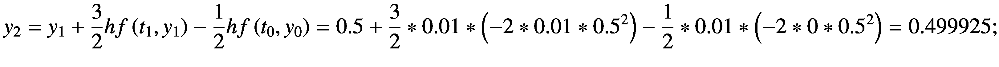


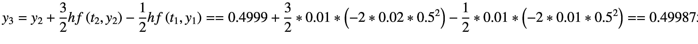

. . .

Adams-Bashforth 方法在 `Example2.m` 脚本中实现，使用的是与前几种方法（如欧拉方法实现算法）相同的算法步骤，但第 6 步除外，该步骤在公式（2-10）的推导中有所说明。求解结果如图 2-6 所示。

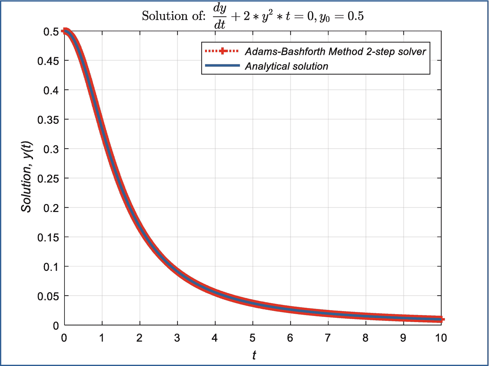

**图 2-6** 两步 Adams-Bashforth 方法

```matlab
% Example5.m
%% ADAMS or ADAMS-Bashforth 2-step Method
% EXAMPLE 2. dy/dt=-2*t*(y²); with ICs: y(0)=0.5
% Part 1.
Fn=0.5;              % ICs: u0 at t0
tend=10;             % max. time limit
h=.01;               % time step size
t=0:h:tend;          % time space
steps=length(t);     % number of steps
% NB: Dy = f(y,t)=-2*y²*t defined via Function Handle
Fcn=@(Fn,t)(-2*(Fn.²).*t);
% Memory allocation:
Fn=[Fn(1), zeros(1,steps-1)];
fn=[Fcn(Fn(1), t(1)),zeros(1,steps-1)];
for ii=1:steps-2
% EULER's method starts from here
Fn(ii+1)=Fn(ii)+h*Fcn(Fn(ii),t(ii));
% Adams-Bashforth method starts from here
fn(ii+2)=Fcn(Fn(ii+1),t(ii+1));
Fn(ii+2)=Fn(ii+1)+(h/2)*(3*fn(ii+1)-fn(ii));
end
figure
plot(t, Fn, 'r:+', 'linewidth', 2), hold on
syms u(T) T
Du = diff(u, T);
Equation=Du==-2*u²*T;
IC=u(0)==0.5;
u=dsolve(Equation, IC);      % Analytical Solution:
U=vectorize(u);
T=t;
U=eval(U);
A =plot(T, U);
A.Color=[.2 .5 .5];
A.LineWidth=A.LineWidth+1.5;
title('Solution of: $$ \frac{dy}{dt}+2*y²*t=0,  y_0=0.5 $$', 'interpreter', 'latex')
legend('\it Adams-Bashforth Method 2-step solver', '\it Analytical solution')
xlabel('\it t')
ylabel('\it Solution, y(t)')
grid on; shg
```

这是三步 Adams-Bashforth 方法 [5]：

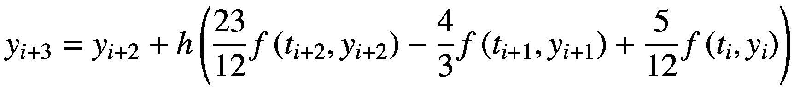

(2-11)

这是四步 Adams-Bashforth 方法：

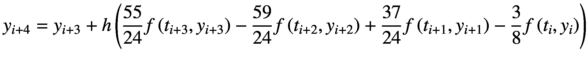

(2-12)

这是五步 Adams-Bashforth 方法：


(2-13)

用公式（2-11）、（2-12）和（2-13）所表示的三步、四步和五步 Adams-Bashforth 方法的实现方式与两步 Adams-Bashforth 方法类似。首先，使用前向欧拉方法求出 `y[i]` 的值，然后通过两步和三步 Adams-Bashforth 方法计算后续的值，例如第二个和第三个值 `y[i+1]` 和 `y[i+2]`。其他值 `y[i+3]` 和 `y[i+4]` 则分别由四步和五步 Adams-Bashforth 方法计算得出。

以下是基于三步、四步和五步 Adams-Bashforth 方法编写的脚本（`Example5.m`）的其他部分：

## ADAMS-Bashforth 方法：3步、4步和5步
```matlab
%% ADAMS-Bashforth 3-step Method
% EXAMPLE 5. dy/dt=-2*t*(y²); with ICs: y(0)=0.5
% Part 2.
% NB: Dy = f(y,t)=-2*y²*t defined via Function Handle
Fcn=@(Fn,t)(-2*(Fn.²).*t);
% Memory allocation with ZERO matrices
Fn=[Fn(1), zeros(1,steps-1)];
fn=[Fcn(Fn(1),t(1)), zeros(1,steps-1)];
for ii=1:steps-3
    % EULER's method is used here
    Fn(ii+1)=Fn(ii)+h*Fcn(Fn(ii),t(ii));
    % 2-step ADAMS-Bashforth method is used here
    Fn(ii+2)=Fn(ii+1)+h*(1.5*Fcn(Fn(ii+1),t(ii+1))-0.5*Fcn(Fn(ii),t(ii)));
    fn(ii+2)=Fcn(Fn(ii+2),t(ii+2));
    % ADAMS-Bashforth method: 3-step starts from here
    Fn(ii+3)=Fn(ii+2)+h*((23/12)*fn(ii+2)-(4/3)*fn(ii+1)+(5/12)*fn(ii));
end
plot(t, Fn, 'g:x', 'linewidth', 2), grid on
% ADAMS or ADAMS-Bashforth 4-step Method
Fcn=@(Fn,t)(-2*(Fn.²).*t);
% Memory allocation with ZERO matrices
Fn=[Fn(1), zeros(1,steps-1)];
fn=[Fcn(Fn(1),t(1)), zeros(1,steps-1)];
for ii=1:steps-4
    % EULER's method is used here
    Fn(ii+1)=Fn(ii)+h*Fcn(Fn(ii),t(ii));
    % ADAMS-Bashforth method: 2-step
    Fn(ii+2)=Fn(ii+1)+h*(1.5*Fcn(Fn(ii+1),t(ii+1))-0.5*Fcn(Fn(ii),t(ii)));
    % ADAMS-Bashforth method: 3-step
    Fn(ii+3)=Fn(ii+2)+h*((23/12)*fn(ii+2)-(4/3)*fn(ii+1)+(5/12)*fn(ii));
    fn(ii+3)=Fcn(Fn(ii+3),t(ii+3));
    % ADAMS-Bashforth method: 4-step starts from here
    Fn(ii+4)=Fn(ii+3)+h*((55/24)*fn(ii+3)-...
        (59/24)*fn(ii+2)+(37/24)*fn(ii+1)-(3/8)*fn(ii));
end
plot(t, Fn, 'm--', 'linewidth', 2), grid on
%  ADAMS-Bashforth 5-step Method
Fcn=@(Fn,t)(-2*(Fn.²).*t);
% Memory allocation with ZERO matrices
Fn=[Fn(1), zeros(1,steps-1)];
fn=[Fcn(Fn(1), t(1)), zeros(1,steps-1)];
for ii=1:steps-5
    % EULER's method is used here
    Fn(ii+1)=Fn(ii)+h*Fcn(Fn(ii),t(ii));
    % ADAMS-Bashforth method: 2-step
    Fn(ii+2)=Fn(ii+1)+h*(1.5*Fcn(Fn(ii+1),t(ii+1))-0.5*Fcn(Fn(ii),t(ii)));
    % ADAMS-Bashforth method: 3-step
    Fn(ii+3)=Fn(ii+2)+h*((23/12)*fn(ii+2)-(4/3)*fn(ii+1)+(5/12)*fn(ii));
    % ADAMS-Bashforth method: 4-step
    Fn(ii+4)=Fn(ii+3)+h*((55/24)*fn(ii+3)-(59/24)*fn(ii+2)+...
        (37/24)*fn(ii+1)-(3/8)*fn(ii));
    fn(ii+5)=Fcn(Fn(ii+4),t(ii+4));
    % ADAMS-Bashforth method: 5-step starts from here
    Fn(ii+5)=Fn(ii+4)+h*((1901/720)*fn(ii+4)-...
        (1387/360)*fn(ii+3)+(109/30)*fn(ii+2)-...
        (637/360)*fn(ii+1)+(251/720)*fn(ii));
end
plot(t, Fn, 'k-', 'linewidth', 2), grid on
title('Solution of: $$ \frac{dy}{dt}+2*y²*t=0,  y_0=0.5 $$', 'interpreter', 'latex')
legend('AB Method 2-step', 'Analytical solution', 'AB Method 3-step',...
    'AB Method 4-step', 'AB Method 5-step'), shg
```
通过执行该脚本，我们得到图 2-7 所示的绘图，该图显示了 Adams-Bashforth 三步、四步和五步方法的计算结果，并与使用 `dsolve()` 计算的问题解析解得出的数值结果进行了对比。

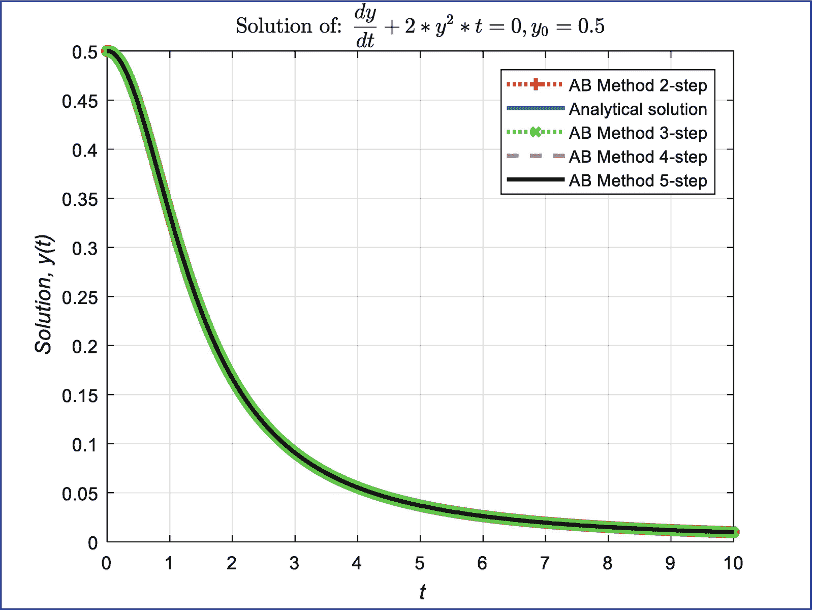

**图 2-7** Adams-Bashforth 方法（三步、四步和五步）与使用 `dsolve()` 所得解析解的仿真对比

从仿真的曲线图（图 2-6 和 2-7）可以看出，对于给定的一阶常微分方程，采用两步、三步、四步和五步的 Adams-Bashforth 方法得到的结果与解析解高度吻合，以至于更高阶 Adams-Bashforth 方法的精度提升在图中并不明显。事实上，Adams-Bashforth 方法的精度取决于给定的常微分方程类型（刚性或非刚性、线性或非线性），并且可以通过增加计算时间来显著提高精度。

## 米尔恩方法
米尔恩方法是另一种显式多步常微分方程求解器，其公式如下：

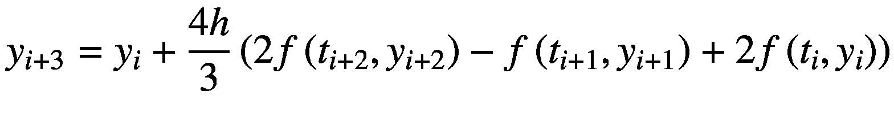 (2-14)

在实现方程 (2-14) 中的米尔恩方法时，与 Adams-Bashforth 方法类似，我们需要采用其他方法来定义 `y[i]`、`y[i+1]`、`y[i+2]` 的值。示例如下：
欧拉前向法：`y[i+1] = y[i] + h * f(t[i], y[i])`
Adams-Bashforth 方法：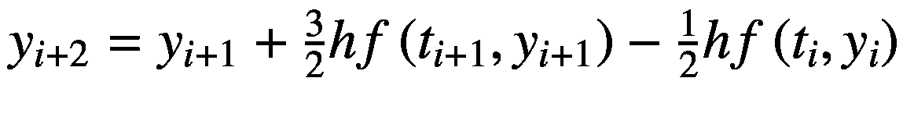

## 示例 6
示例问题如下：![$$ \frac{dy}{dt}=1-t\sqrt[3]{y} $$](images/490522_1_En_2_Chapter/490522_1_En_2_Chapter_TeX_IEq35.png)，`y(0) = 1`。
以下是在 `Example3.m` 脚本中实现米尔恩方法以求解该问题的代码：

## 米尔恩方法

以下是使用米尔恩方法求解微分方程的 MATLAB 脚本示例。

```matlab
% Example6.m
%% 米尔恩方法
% f(y,t) 的第一项由欧拉方法求得
% f(y,t) 的第二项由两步 Adams-Bashforth 方法求得
y0=1;                        % 初始条件：t0 时刻的 u0
tend=5;                      % 最大时间限制
h=.01;                       % 时间步长
t=0:h:tend;                  % 时间空间
steps=length(t);             % 步数
fun = @(t, y)(1-t*y^(1/3));
% 内存分配
y=[y0, zeros(1,steps-1)];
for ii=1:steps-3
    % 此处使用欧拉方法
    y(ii+1)=y(ii)+h*fun(t(ii), y(ii));
    % 此处使用两步 Adams-Bashforth 方法
    y(ii+2)=y(ii+1)+(3/2)*h*fun(t(ii+1),y(ii+1))-(1/2)*h*fun(t(ii),y(ii));
    % 米尔恩方法从这里开始
    y(ii+3)=y(ii)+(h/3)*(8*fun(t(ii+2),y(ii+2))-4*fun(t(ii+1),...
        y(ii+1))+8*fun(t(ii),y(ii)));
end
plot(t, y, 'b-', 'linewidth', 1.5), grid on
title('\it Milne method solution of: $$ \frac{dy}{dt}=1-t*y^\frac{1}{3} $$', 'interpreter', 'latex')
xlabel '\it t'; ylabel '\it Solution, y(t)'; shg
```

上述脚本（`Example3.m`）求解练习问题的数值解如图 2-8 所示。

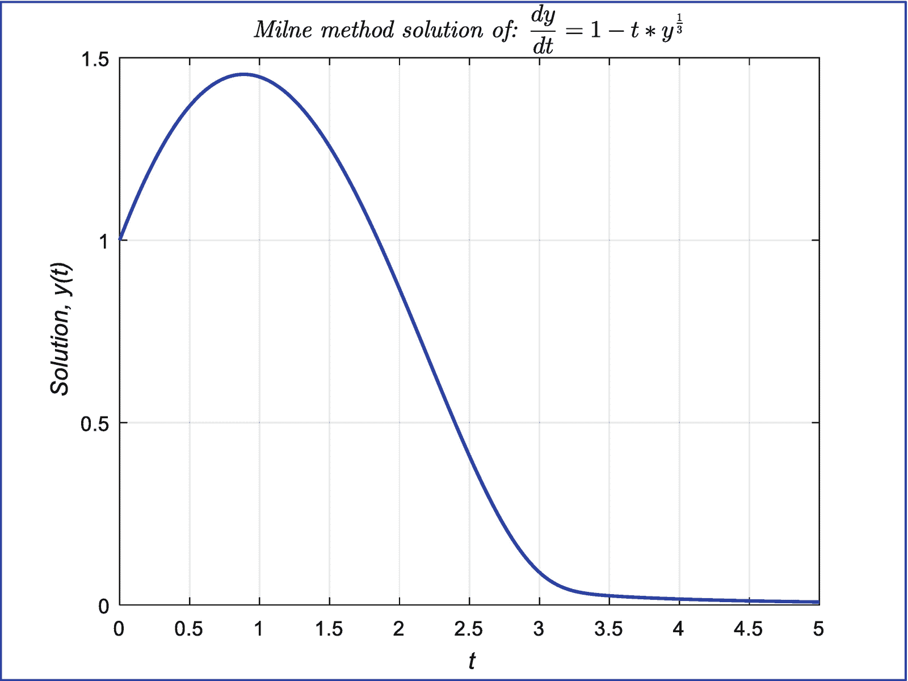

**图 2-8**

使用米尔恩方法计算 ![$$ \frac{dy}{dt}=1-t\sqrt[3]{y} $$](images/490522_1_En_2_Chapter/490522_1_En_2_Chapter_TeX_IEq36.png)，`y(0) = 1` 的数值解

## 泰勒级数法

泰勒级数法是求解一阶常微分方程的最简单技巧之一。该方法可以用以下公式表示：

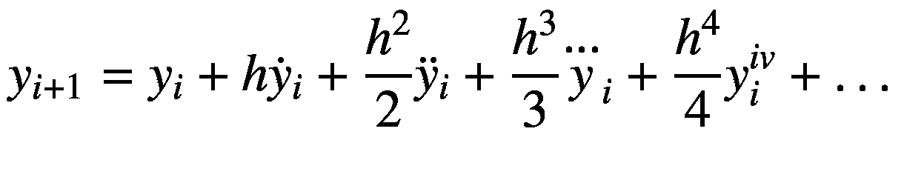

(2-15)

其中 `h` 是步长，等于 `t[i+1] - t[i]`。该技术需要根据截断项数，计算给定问题方程在 `t[i]` 处的若干阶导数。从方程 (2-15) 所示的公式可以看出，一阶泰勒级数展开等价于前向欧拉方程。通过增加泰勒级数的阶数，我们可以获得更精确的数值结果。同时，应该注意，泰勒级数的阶数越高，计算成本也越高。方程 (2-15) 中的导数 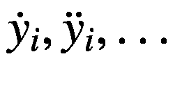 是通过对给定问题方程 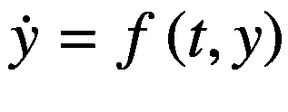 进行微分得到的。由于根据前面写出的公式，我们知道函数 `f` 依赖于两个变量 `y` 和 `t`，并且 `y` 是 `t` 的函数，因此在对函数关于 `t` 求微分时，我们必须小心谨慎。现在，来看一个具体示例，以便更明确地解释泰勒级数的应用。

### 示例 7

以下是示例问题：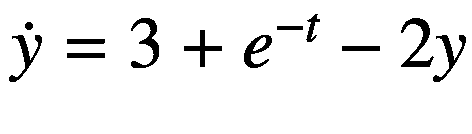，`y(0) = 1`。我们使用包含两项的泰勒级数法来计算给定一阶常微分方程的数值解。首先，计算给定一阶常微分方程的二阶和三阶导数，如下所示：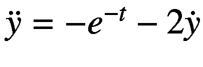 和 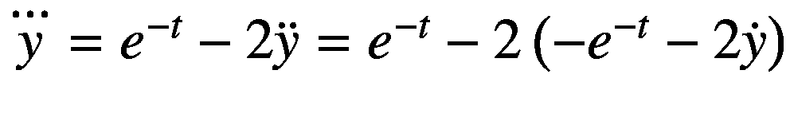。

利用已求得的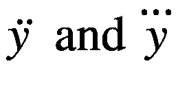表达式，我们写出用于计算二阶和三阶泰勒级数展开式中 `y[i + 1]` 的公式。问题的二阶泰勒级数展开式如下：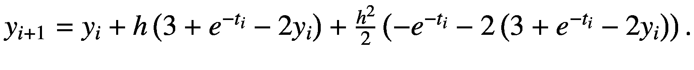

问题的三阶泰勒级数展开式如下：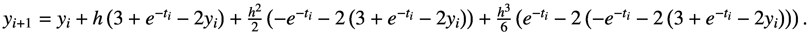

现在，我们将所有这些内容实现在名为 `Example4.m` 的脚本中，并通过执行该脚本来获得数值解。

```matlab
% Taylor series method
% Example7.m solves dy/dt=3+exp(-t)-2*y; y(0)=1
t0=0;
tend=10;
h=0.05;
t=t0:h:tend;
steps=length(t)-1;
y0=1;
y2=[y0, zeros(1, steps-1)];   % Memory allocation for 2nd-order
y3=[y0, zeros(1, steps-1)];   % Memory allocation for 3rd-order
for ii=1:steps
    % 2nd-order Taylor series:
    y2(ii+1)=y2(ii)+h*(3+exp(-t(ii))-2*y2(ii))+...
        (h²/2)*(-exp(-t(ii))-2*(3+exp(-t(ii))-2*y2(ii)));
    % 3rd-order Taylor series:
    y3(ii+1)=y3(ii)+h*(3+exp(-t(ii))-2*y3(ii))+...
        (h²/2)*(-exp(-t(ii))-2*(3+exp(-t(ii))-2*y3(ii)))+...
        (h³/6)*(exp(-t(ii))-2*(-exp(-t(ii))-2*(3+exp(-t(ii))-2*y3(ii))));
end
plot(t, y2, 'bx--', t,y3, 'ko:', 'linewidth', 1.5), grid minor
xlabel '\it t', ylabel('\it Solution, y(t)')
syms u(x)  x
Du=diff(u, x);
Equation=Du==3+exp(-x)-2*u;
IC = u(0)==1;
u_sol=dsolve(Equation, IC);
U_sol=vectorize(u_sol); x=t;
Solution=eval(U_sol);
hold on
plot(x, Solution, 'r-', 'linewidth', 1.5)
title('\it Solutions of: $$ \frac{dy}{dt}+2*y-e^{-t}=3, y_0=1 $$', 'Interpreter', 'latex')
legend('\it 2nd order Taylor series','\it 3rd order Taylor series', '\it Analytical solution'), hold off
```

通过执行前面的脚本，我们得到了图 2-9 所示的图形，该图展示了二阶和三阶泰勒级数解与其解析解的完美收敛性。

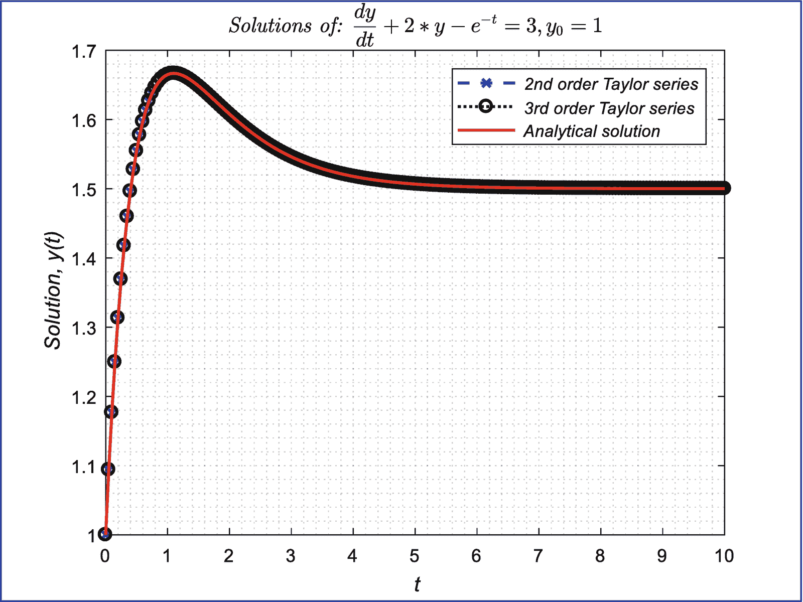

**图 2-9.**  的泰勒级数数值解与解析解的对比

从图 2-9 可以看出，通过二阶和三阶泰勒级数求得的解几乎看不到任何发散，并且通过泰勒级数法求得的数值解与解析解具有良好的收敛性。因此，可以得出结论，对于给定的问题，二阶泰勒级数的精度已经足够。

## 亚当斯-莫尔顿法

与龙格-库塔法和亚当斯-巴什福思法不同，亚当斯-莫尔顿法是一种隐式的预测-校正型常微分方程求解器。单步亚当斯-莫尔顿法 [2] 用以下简单的隐式公式表达：

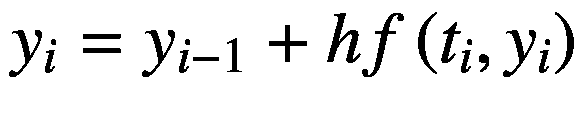 (2-16)

方程 (2-16) 中的表达式也称为*后向欧拉法*，我们之前在讨论欧拉法时已经介绍过。

在实现此方法时，可以使用以下公式：

* `y[i + 1]^(P) = y[i] + h f(t[i], y[i])` 预测步（前向欧拉法）
* `y[i + 1] = y[i] + h f(t[i + 1], y[i + 1]^(P))` 校正步（后向欧拉法）

以下是两步亚当斯-莫尔顿法：

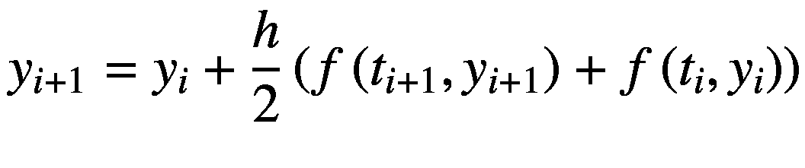 (2-17)

这也称为*梯形法则法*，可以通过以下表达式之一定义：

*  预测步（前向欧拉法）
* ，适用于 `y[i] = y[i - 1] + h f(t[i - 1], y[i - 1])` 的另一种预测步
* ，用于迭代过程的校正步

以下是三步亚当斯-莫尔顿法：

 (2-18)

方程 (2-18) 中的方法将使用以下附加的（预测步和校正步）表达式实现：

*  预测步
*  校正步
*  用于迭代的预测步
*  用于迭代过程的校正步

以下是四步亚当斯-莫尔顿法：

 (2-19)

方程 (2-19) 中的表达式应使用以下附加的（预测步和校正步）表达式实现：

*  预测步
*  校正步
*  预测器
*  校正器
*  用于迭代的预测器
*  用于迭代的校正器

以下是五步 Adams-Moulton 方法：

同样，方程式 (2-20)中的表达式将通过以下预测器-校正器步骤实现：

 预测器

 校正器

 预测器

 校正器

 预测器

 校正器

 预测器

 用于迭代过程的校正器

## 示例 8

求解以下问题：  `y[0]` = 0.5。现在，我们将通过一个脚本文件 (`Example8.m`) 来实现之前所有的表达式，以计算给定问题的数值解： `y[0]` = 0.5。

```matlab
% Example8.m
%% ADAMS-Moulton 1, 2, 3, 4 and 5 step Methods.
clc; close all; clearvars
`Fn0`=0.5;            % ICs: u0 at t0
`tend`=10;            % end time
`h`=.1;               % time step size
`t`=0:`h`:`tend`;         % time space
`steps`=`length`(`t`);    % number of steps
% Part 1
% ADAMS-Moulton 1-step Method
% NB: Dy = f(y,t)=-2*y²*t defined via Function Handle
`Fcn`=@(`Fn`,`t`)(-2*(`Fn`.²).*`t`);
% Memory allocation with ZERO matrices
`Fn`=[`Fn0`, `zeros`(1,`steps`-1)];
for `ii`=1:`steps`-1
    % EULER's forward method is used here
    `Fn`(`ii`+1)=`Fn`(`ii`)+`h`*`Fcn`(`Fn`(`ii`), `t`(`ii`));
    % ADAMS-Moulton method: 2-step starts from here
    `Fn`(`ii`+1)=`Fn`(`ii`)+`h`*`Fcn`(`Fn`(`ii`+1), `t`(`ii`+1));
end
`plot`(`t`, `Fn`, 'bs-'), `grid` on
`hold` on
%%   ADAMS-Moulton 2-step Method
% Part 2
`Fcn`=@(`Fn`,`t`)(-2*(`Fn`.²).*`t`);
% Memory allocation with ZERO matrices
`Fn`=[`Fn`(1), `zeros`(1,`steps`-1)];
for `ii`=1:`steps`-1
    % EULER's forward method is used here
    `Fn`(`ii`+1)=`Fn`(`ii`)+`h`*`Fcn`(`Fn`(`ii`), `t`(`ii`));
    % ADAMS-Moulton method: 2-step starts from here
    `Fn`(`ii`+1)=`Fn`(`ii`)+(`h`/2)*(`Fcn`(`Fn`(`ii`+1), `t`(`ii`+1))+`Fcn`(`Fn`(`ii`),`t`(`ii`)));
end
`plot`(`t`, `Fn`, 'mx--'), `grid` on
%%  ADAMS-Moulton 3-step Method
% Part 3
% Memory allocation with ZERO matrices
`Fn`=[`Fn0`, `zeros`(1,`steps`-1)];
for `ii`=1:`steps`-2
    % Predicted value by Euler's forward method
    `Fn`(`ii`+1)=`Fn`(`ii`)+`h`*`Fcn`(`Fn`(`ii`),`t`(`ii`));
    % Corrected value by trapezoidal rule
    `Fn`(`ii`+1)=`Fn`(`ii`)+(`h`/2)*(`Fcn`(`Fn`(`ii`+1),`t`(`ii`+1))+`Fcn`(`Fn`(`ii`), `t`(`ii`)));
    % Predicted solution:
    `Fn`(`ii`+2)=`Fn`(`ii`+1)+(3*`h`/2)*`Fcn`(`Fn`(`ii`+1), `t`(`ii`+1))-(`h`/2)*`Fcn`(`Fn`(`ii`), `t`(`ii`));
    % ADAMS-Moulton method: 3-step starts from here
    `Fn`(`ii`+2)=`Fn`(`ii`+1)+`h`*((5/12)*`Fcn`(`Fn`(`ii`+2),`t`(`ii`+2))+...
        (2/3)*`Fcn`(`Fn`(`ii`+1),`t`(`ii`+1))-(1/12)*`Fcn`(`Fn`(`ii`),`t`(`ii`)));
end
`plot`(`t`, `Fn`, 'ko-'), `grid` on
%%  ADAMS-Moulton 4-step Method
% Part 4
% Memory allocation with ZERO matrices
`Fn`=[`Fn0`, `zeros`(1,`steps`-1)];
for `ii`=1:`steps`-3
    % Predicted value by Euler's forward method
    `Fn`(`ii`+1)=`Fn`(`ii`)+`h`*`Fcn`(`Fn`(`ii`),`t`(`ii`));
    % Corrected value by trapezoidal rule
    `Fn`(`ii`+1)=`Fn`(`ii`)+(`h`/2)*(`Fcn`(`Fn`(`ii`+1), `t`(`ii`+1))+`Fcn`(`Fn`(`ii`), `t`(`ii`)));
    % Predicted value
    `Fn`(`ii`+2)=`Fn`(`ii`+1)+(3*`h`/2)*`Fcn`(`Fn`(`ii`+1),`t`(`ii`+1))-...
        (`h`/2)*`Fcn`(`Fn`(`ii`),`t`(`ii`));
    % Corrected value
    `Fn`(`ii`+2)=`Fn`(`ii`+1)+`h`*((5/12)*`Fcn`(`Fn`(`ii`+2),`t`(`ii`+2))+...
        (2/3)*`Fcn`(`Fn`(`ii`+1),`t`(`ii`+1))-(1/2)*`Fcn`(`Fn`(`ii`),`t`(`ii`)));
    % Predicted solution:
    `Fn`(`ii`+3)=`Fn`(`ii`+2)+`h`*((23/12)*`Fcn`(`Fn`(`ii`+2), `t`(`ii`+2))-...
        (4/3)*`Fcn`(`Fn`(`ii`+1), `t`(`ii`+1))+(5/12)*`Fcn`(`Fn`(`ii`),`t`(`ii`)));
    % ADAMS-Moulton method: 4-step starts from here
    `Fn`(`ii`+3)=`Fn`(`ii`+2)+`h`*((3/8)*`Fcn`(`Fn`(`ii`+3),`t`(`ii`+3))+...
        (19/24)*`Fcn`(`Fn`(`ii`+2),`t`(`ii`+2))-(5/24)*`Fcn`(`Fn`(`ii`+1),`t`(`ii`+1))+...
        (1/24)*`Fcn`(`Fn`(`ii`),`t`(`ii`)));
end
`plot`(`t`, `Fn`, 'gh--'), `grid` on
%%  ADAMS-Moulton 5-step Method
% Part 4
% Memory allocation with ZERO matrices
`Fn`=[`Fn`(1), `zeros`(1,`steps`-1)];
for `k`=1:`steps`-4
    % Predicted value by Euler's forward method
    `Fn`(`k`+1)=`Fn`(`k`)+`h`*`Fcn`(`Fn`(`k`),`t`(`k`));
    % Corrected value by trapezoidal rule
    `Fn`(`k`+1)=`Fn`(`k`)+(`h`/2)*(`Fcn`(`Fn`(`k`+1), `t`(`k`+1))+`Fcn`(`Fn`(`k`), `t`(`k`)));
    % Predicted value
    `Fn`(`k`+2)=`Fn`(`k`+1)+(3*`h`/2)*`Fcn`(`Fn`(`k`+1), `t`(`k`+1))- (`h`/2)*`Fcn`(`Fn`(`k`),`t`(`k`));
    % Corrected value
    `Fn`(`k`+2)=`Fn`(`k`+1)+`h`*((5/12)*`Fcn`(`Fn`(`k`+2),`t`(`k`+2))+...
        (2/3)*`Fcn`(`Fn`(`k`+1),`t`(`k`+1))-(1/2)*`Fcn`(`Fn`(`k`),`t`(`k`)));
    % Predicted value
    `Fn`(`k`+3)=`Fn`(`k`+2)+`h`*((23/12)*`Fcn`(`Fn`(`k`+2), `t`(`k`+2))-...
        (4/3)*`Fcn`(`Fn`(`k`+2), `t`(`k`+2))+(5/12)*`Fcn`(`Fn`(`k`),`t`(`k`)));
    % Corrected value
    `Fn`(`k`+3)=`Fn`(`k`+2)+`h`*((3/8)*`Fcn`(`Fn`(`k`+3),`t`(`k`+3))+...
        (19/24)*`Fcn`(`Fn`(`k`+2),`t`(`k`+2))-(5/24)*`Fcn`(`Fn`(`k`+1),`t`(`k`+1))+...
        (1/24)*`Fcn`(`Fn`(`k`),`t`(`k`)));
    % Predicted solution:
    `Fn`(`k`+4)=`Fn`(`k`+3)+`h`*((55/24)*`Fcn`(`Fn`(`k`+3), `t`(`k`+3))-...
        (59/24)*`Fcn`(`Fn`(`k`+2),`t`(`k`+2))+(37/24)*`Fcn`(`Fn`(`k`+1),`t`(`k`+1))-...
        (3/8)*`Fcn`(`Fn`(`k`),`t`(`k`)));
    % ADAMS-Moulton method: 5-step starts from here
    `Fn`(`k`+4)=`Fn`(`k`+3)+`h`*((251/720)*`Fcn`(`Fn`(`k`+4),`t`(`k`+4))+...
        (646/720)*`Fcn`(`Fn`(`k`+3),`t`(`k`+3))-(264/720)*`Fcn`(`Fn`(`k`+2),`t`(`k`+2))+ ...
        (106/720)*`Fcn`(`Fn`(`k`+1),`t`(`k`+1))-(19/720)*`Fcn`(`Fn`(`k`),`t`(`k`)));
end
`plot`(`t`, `Fn`, 'c--', 'linewidth', 2), `grid` on
`title`('\it Solutions of Adams-Moulton method: $$\frac{dy}{dt}= -2*u²*t, u_0=0.5$$ ', 'interpreter', 'latex')
`legend`('1-step', '2-step','3-step', '4-step','5-step')
`xlabel` '\it t', `ylabel`('\it Solution, y(t)'), `shg`
```

仿真结果如图 2-10 所示；收敛性良好，且对于该给定问题，Adams-Moulton 方法的单步、两步与更高步数方法之间的差异微乎其微。需要指出的是，采用更高步数的方法总能获得更高的精度；然而，更高的精度也意味着更高的计算成本，这一点同样适用于之前讨论过的多步方法，例如 Runge-Kutta 法、Adams-Bashforth 法、Milne 法和泰勒级数法。


图 2-10

单步、两步、三步、四步和五步 Adams-Moulton 方法的仿真结果

我们已经分析了几种用于求解常微分方程的显式、隐式、单步和多步数值方法。在显式方法中，我们涵盖了欧拉方法（前向和改进型）、拉尔斯顿法、龙格-库塔法、Adams-Bashforth 法（二、三、四、五步）、Milne 法和泰勒级数法，这些方法均为显式定义，对于非刚性常微分方程初值问题能提供良好结果，并且计算成本相对较低，易于实现。这些方法最大的缺点之一是无法为许多刚性问题提供精确解。

此外，我们还研究了用于求解刚性常微分方程数值解而采用的隐式定义预测-校正法。这些方法包括后向欧拉法、Adams-Moulton 法和 Milne 法。预测-校正法在求解过程中非常稳定，但实现成本较高，由于其额外的计算步骤，仿真成本远高于显式方法。预测-校正法顾名思义，首先对给定问题预测一个候选解，然后对该预测解进行校正。这类方法中最简单的一种是后向欧拉法，它首先通过前向欧拉法或牛顿-拉夫逊法预测一个解，然后进行校正。同样的技术也适用于高阶预测-校正法。在许多文献中，这些方法被归类为不同阶数的 Adams-Moulton 法[2]。

## MATLAB 内置常微分方程求解器

在 MATLAB 中，有一些内置的常微分方程求解器，例如`ode15s`、`ode15i`、`ode23`、`ode23s`、`ode23t`、`ode23tb`、`ode45`和`ode113`，它们能高效地求解多种不同类型初值问题的数值解。这些求解器基于显式龙格-库塔法和隐式 Adams-Bashforth-Moulton 法，并结合了不同的实现算法和 ODE 求解方法，例如 Dormand-Prince 法（`ode45`）、Bogacki-Shampine 法（`ode23`）、Rosenbrock 法（`ode23s`）、梯形法则（`ode23t`）、Adams-Bashforth-Moulton 法（`ode113`）、Gear 法（`ode15s`）等。使用 MATLAB 内置的 ODE 求解器相对简单。以下是 ODE 求解器的一般语法格式：

```
solver(odefun,tspan,y0)
[T,Y] = solver(odefun,tspan,y0)
[T,Y] = solver(odefun,tspan,y0,options)
[T,Y,TE,YE,IE] = solver(odefun,tspan,y0,options)
sol = solver(odefun,[t0 tf],y0...)
```

可以根据给定的问题类型选择任意求解器，具体取决于给定问题是刚性的（刚性程度如何，例如非常刚性或中等刚性）还是非刚性的，以及是显式还是隐式：`ode15s`、`ode15i`、`ode23`、`ode23s`、`ode23t`、`ode23tb`、`ode45`和`ode113`。

值得注意的是，需要谨慎选择 ODE 求解器的类型。在选择求解器类型时，应考虑以下建议和要点。这些内容取自 MATLAB 软件包的帮助库。

| 求解器类型 | 问题类型 | 精度 | 适用场景 |
| :--- | :--- | :--- | :--- |
| `ode15i` | 完全隐式 | 中等 | 仅适用于完全隐式初值问题 |
| `ode15s` | 刚性 | 低到中等 | 当`ode45`因问题刚度导致求解过慢时 |
| `ode23` | 非刚性 | 低 | 适用于误差容限较粗糙的中等刚度问题 |
| `ode23s` | 刚性 | 低 | 适用于误差容限较粗糙的刚性问题 |
| `ode23t` | 中等刚度 | 低 | 适用于中等刚度问题 |
| `ode23tb` | 刚性 | 低 | 适用于误差容限较粗糙的刚性问题 |
| `ode45` | 非刚性 | 中等 | 推荐用于大多数问题；是应首先尝试的 ODE 求解器 |
| `ode113` | 非刚性 | 低到高 | 适用于误差容限严格的问题 |

此外，这些求解器的效率取决于所选的步长类型（固定或可变）、步长大小，以及直接影响到仿真结果精度和计算过程效率的相对误差容限与绝对误差容限。使用内置 ODE 求解器时，步长可以选择为可变（自动选择）或由用户固定/指定。所有内置 ODE 求解器默认会根据给定初值问题的类型（例如刚度水平）和求解搜索空间自动采用可变步长。通过设置选项，可以在 ODE 求解器中控制误差容限。接下来，我们将通过实际练习来研究 ODE 内置求解器的所有这些关键方面和设置。

ODE 求解器的`odefun`函数可以通过以下方式定义：

*   使用函数句柄（`@`）的匿名函数
*   函数文件（`*.m`文件）
*   `matlabFunction`，利用符号数学工具箱生成的函数文件（`*.m`文件）
*   内联函数（在未来的 MATLAB 版本中，此功能将被移除）

**注意**

在调用名为`odefun`的函数时需要小心。如果它是通过匿名函数（`@`）或内联函数定义的，则应按以下命令语法调用：

```
[T Y]=ODEx(my_Function, t, y0);
```

如果我们通过函数文件定义给定问题（函数/表达式），则需要使用以下命令语法之一：

```
[T Y]=ODEx(@Fun_File, t, y0);
[T Y]=ODEx('Fun_File', t, y0);
```

时间空间可以预定义为一个行向量或列向量的时间值，或者仅包含起始值和结束值两个元素，例如`t = linspace(0, 13, 1000)`，`t = 0:0.001:13`，`t = [0, 13]`。

`ODEx`求解器会根据给定 ODE 的性质（刚性或非刚性，线性或非线性等）自动采用不同数量的步数或步长。

### 示例 9

以下是示例问题：，`y[0] = 0.5`。在这个案例中，我们名为 `Fun_File.m` 的函数文件通过下一个函数文件来定义。

```
function F=Fun_File(t, y)
F=(-2*y^2*t);
```

我们将研究几个不同的问题，以展示如何实现这些内置工具及其选项来定义 `odefun`。在第一个示例中，我们展示如何使用匿名函数 (`@`) 来模拟一个一阶常微分方程 (ODE)：，`y[0] = 0.5`。

以下脚本 (`ExampleODE1.m`) 展示了如何使用匿名函数 (`@`) 和固定步长 *h* = 0.1 来实现`ode45`、`ode23`和`ode113`求解器。

```
%%  ExampleODE1.m
% Part 1
% dy/dt=-2*t*(y^2); with ICs: y(0)=0.5
% We test methods for simulation time
clearvars; close all; clc;
F=@(t,y)(-2*y^2*t);
tmax=10;        % max. time limit
h=0.1;          % time step size is defined by a user!!!
t=0:h:tmax;     % time space
y0=0.5;         % ICs: y0 at t0
[time Yode45]=ode45(F, t, y0);
[time Yode23]=ode23(F, t, y0);
[time Yode113]=ode113(F, t, y0);
plot(time,Yode45,'ks-',time,Yode23,'ro-.',time, Yode113,'bx--') grid on
title('\it Solutions of: $$\frac{dy}{dt}+2*t^2=0, y_0 = 0.5$$', 'interpreter', 'latex')
legend ('ode45','ode23','ode113')
xlabel('\it t'), ylabel('\it Solution, y(t)'), shg
```

该脚本的输出如图 2-11 所示。从图中我们可以得出结论，对于给定问题，`ode23`、`ode45`和`ode113`在固定步长 *h* = 0.1 的情况下表现良好。

# 使用MATLAB求解器进行变步长仿真与精度比较


图 2-11 `ode23`、`ode45` 和 `ode113` 的仿真结果

## 注意

如果我们不指定输出变量名称（例如，`ode45(F, t, y0))`），那么所选求解器会将计算结果显示在绘图图形中，并且数值输出不会保存在工作区中。

## 问题描述

让我们来看一下 MATLAB 内置求解器在求解给定问题（示例 1：, `y[0] = 0.5`）时如何采用变步长，以及步长将如何影响仿真精度和计算（用时）成本。

## 求解器性能测试

```
%%  ExampleODE1.m
% Part 2
clearvars
F=@(t,y)(-2*y²*t);
tmax=10;            % max. time limit
t=[0,tmax];         % time space
y0=0.5;             % ICs: y0 at t0
tic;
[time, Yode45]=ode45(F, t, y0);
Tode45=toc;
fprintf('Tode45= %2.6f  \n', Tode45)
%
clearvars
F=@(t,y)(-2*y²*t);
tmax=10;             % max. time limit
t=[0,tmax];          % time space
y0=0.5;              % ICs: y0 at t0
tic
[time, Yode23]=ode23(F, t, y0);
Tode23=toc;
fprintf('Tode23= %2.6f  \n', Tode23)
clearvars
%
F=@(t,y)(-2*y²*t);
tmax=10;             % max. time limit
t=[0,tmax];          % time space
y0=0.5;              % ICs: y0 at t0
tic
[time, Yode113]=ode113(F, t, y0);
Tode113=toc;
fprintf('Tode113= %2.6f \n', Tode113)
```

在脚本的第 2 部分中，时间空间（`[t[0], t[end]]`）由初始时间和结束时间值定义。因此，在这种情况下，每个求解器在执行仿真时都采用了变步长。仿真是在一台装有 Windows 10（Intel Core i7: 6500 CPU at 2.50 GHz, with 8 GB RAM）的笔记本电脑上进行的。该脚本输出了以下数据，即求解器 `ode45`、`ode23` 和 `ode113` 的计算时间：

```
Tode45 = 0.003818
Tode23 = 0.004526
Tode113 = 0.008329
```

请注意，`ode45` 的计算时间（`Tode45`）（以秒为单位）是最短的。

## 与前向欧拉法及解析解的比较

让我们将 `ode45` 的仿真结果与采用固定步长的前向欧拉法以及解析解进行比较，如下所示：

```
%%  ExampleODE1.m
% Part 3
% Forward EULER method (1st order explicit)
% EXAMPLE #2: dy/dt=-2*t*(y²); with ICs: y(0)=0.5
clearvars; close all
tic
tmax=10;              % max. time limit
h=0.001;              % time step size
t=0:h:tmax;           % time space
steps=length(t)-1;    % # of steps
y0=0.5;               % ICs: y0 at t0
f=zeros(1,length(t)); % Memory allocation
y=[y0, zeros(1,steps)];   % Memory allocation
for ii=1:steps
f(ii)=-2*y(ii).²*t(ii);
y(ii+1)=y(ii)+h*f(ii);
end
TEf=toc;
fprintf('TEf= %2.6f \n', TEf)
clearvars f y0 h t TEf steps tmax ii
%%
tic
F=@(t,y)(-2*y²*t);
tmax=10;            % max. time limit
h=.001;             % time step size
t=0:h:tmax;         % time space
y0=0.5;             % ICs: y0 at t0
[time, Yode23]=ode23(F, t, y0);
Tode23=toc;
fprintf('Tode23= %2.6f \n', Tode23)
% Analytical solution:
syms u(T)  T
Du = diff(u, T);
Equation=Du==-2*u²*T;
IC = u(0)==0.5;
u=dsolve(Equation,IC);
U=double(subs(u,'T',t));
plot(t, y, 'b-', t, Yode23, 'r-.', t, U, 'm:', 'linewidth',1.5)
xlim([1.399 1.3996])
grid on
legend('\it Euler forward', '\it ode23', '\it Analytical solution')
title('\it Solutions of: $$frac{dy}{dt}+2*t*y²=0, y_0=0.5 $$', 'interpreter', 'latex')
shg
```

脚本的输出如下：

```
T_Euler = 0.000312
Tode45 = 0.120490
```

从计算结果我们可以得出结论，对于这个非刚性问题，前向欧拉法的脚本解决方案在求解速度上大约是 `ode45` 求解器的 386 倍，这意味着在计算时间方面它的成本效益高出 386 倍。同时，如图 2-12 所示，其精度相当高，误差很小。这个例子很好地展示了选择合适的数值求解方法以节省大量计算时间的重要性。


图 2-12 前向欧拉法与 MATLAB `ode45` 内置求解器的对比研究