# 求解器的 OPTIONS、ODESET 和 ODEPLOT 工具

`OPTIONS` 设置在获取数值解的过程中至关重要。例如，通过 `ODESET`，我们可以设置相对精度容差（`RelTol`），它控制解中正确的十进制小数位数（`RelTol` <= 10^(-*p*)，其中 *p* 为正确位数），以及绝对容差（误差边界：`AbsTol`），它决定了当解趋近于零时的精度。在每个迭代步中，都会计算并验证方程（2-21）所示的不等式，该不等式通过相对和绝对误差容差来评估误差信号 *E*[*i*]。

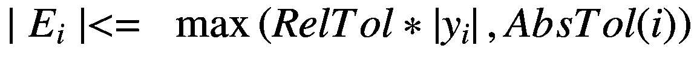

(2-21)

例如，在 MATLAB 中，默认的相对误差容差（`RelTol`）设为 0.001，这大致相当于 0.1% 的精度。

```
options = odeset('name1', value1, 'name2', value2,...)
options = odeset(oldopts, 'name1', value1,...)
options = odeset(oldopts, newopts)
```

`ODESET` 用于设置或调整 `ODEx` 求解器的选项。根据给定的问题类型、精度级别（绝对和相对误差容差）、计算时间以及额外的输入数据，可以调整许多选项。例如，对于之前的示例（示例 1：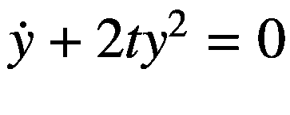 *y*[0] = 0.5），我们可以对其选项进行如下调整以提高精度，并获取输出函数值及绘制计算值作为输出：

```
options=odeset('OutputFcn',@odeplot,'RelTol',1e-5,'AbsTol',1e-7);
ode45(@(t,y)(-2*y²*t), [0, 5], 0.5, options);
```

这两行命令模拟了该问题，并通过一个交互式构建的图形输出仿真结果，我们可以从中观察解在指定解空间（例如，*t* ∈ [0, 5]）内如何收敛。如果我们不需要输出函数（`'OutputFcn'`）或想跳过它，则应该用空矩阵（[ ], [ ]）代替 `['OutputFcn', @odeplot]`，或者直接省略 `['OutputFcn', @odeplot]`，如下所示：

```
options =odeset([],[], 'RelTol', 1e-5, 'AbsTol', 1e-7);
[time Yode45]=ode45(@(t,y)(-2*y²*t), [0, 5], 0.5, options);
```

或

```
options =odeset('RelTol', 1e-5, 'AbsTol', 1e-7);
[time Yode45]=ode45(@(t,y)(-2*y²*t), [0, 5], 0.5, options);
```

此外，如果我们对 `ODESET` 选项的默认值不满意，还可以相应地调整其他一些选项。借助 `ODESET` 选项，我们还可以打印出所选 `ODE` 求解器（例如 `ode23`、`ode45`、`ode15s`、`ode113`）执行仿真迭代的统计数据（例如，成功步数、失败次数以及仿真过程组件）。当处理具有较大解搜索空间的刚性问题时，统计数据信息对于基准测试目的可能非常有用。

### 示例 10

示例问题如下：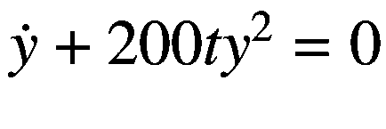 *y*[0] = 2.5。以下是用于计算并比较几个使用 `ODESET` 函数设置选项的 ODE 求解器的解决方案脚本（`ODEx_Compare.m`）：

```
clearvars; clc
disp('ODE45 性能: ')
tic;
options=odeset('stats','on','RelTol',1e-5,'AbsTol',1e-7);
ode45(@(t,y)(-200*t*y²), [0, 2], 2.5, options);
toc;
disp('%--------------------------------%    ')
clearvars
disp ('ODE113 性能: ')
tic;
options=odeset('stats','on','RelTol',1e-5,'AbsTol',1e-7);
ode113(@(t,y)(-200*t*y²), [0, 2], 2.5, options);
toc;
disp('%--------------------------------%    ')
clearvars
disp('ODE23s 性能: ')
tic;
options=odeset('stats','on','RelTol',1e-5,'AbsTol',1e-7);
ode23s(@(t,y)(-200*t*y²), [0, 2], 2.5, options);
toc;
disp('%--------------------------------%    ')
clearvars
disp('ODE15s 性能: ')
tic;
ode15s(@(t,y)(-200*t*y²),[0,2], 2.5, odeset('stats','on', ... 'RelTol', 1e-5,'AbsTol',1e-7));
toc;
disp('% ------------------------------%     ')
clearvars
disp('ODE23 性能: ')
tic;
ode23(@(t,y)(-200*t*y²), [0, 2], 2.5,... odeset('stats','on','RelTol',1e-5,'AbsTol',1e-7));
toc;
disp('%--------------------------------%    ')
```

以下是各求解器及其统计数据的对比分析：

```
ODE45 性能:
37 次成功步
3 次失败尝试
241 次函数计算
已用时间: 0.284619 秒.
%--------------------------------%
ODE113 性能:
83 次成功步
4 次失败尝试
171 次函数计算
已用时间: 0.172783 秒.
%--------------------------------%
ODE23s 性能:
204 次成功步
1 次失败尝试
821 次函数计算
204 次偏导计算
205 次 LU 分解
615 次线性系统求解
已用时间: 0.298206 秒.
%--------------------------------%
ODE15s 性能:
122 次成功步
4 次失败尝试
212 次函数计算
1 次偏导计算
24 次 LU 分解
208 次线性系统求解
已用时间: 0.212456 秒.
% ------------------------------%
ODE23 性能:
152 次成功步
7 次失败尝试
478 次函数计算
已用时间: 0.194447 秒.
%-------------------------------%
```

从脚本 `ODEx_Compare.m` 的对比仿真可以看出，对于给定的这个一阶 ODE 仿真，求解器 `ode113` 是这五个求解器中最快的。实际上，MATLAB 的所有 `ODEx` 求解器在仿真开始时都会花费相当大一部分计算时间。因此，为了减少计算时间，只有在我们能够为一个合适的初始步长做出合理预估时，才应引入该初始步长。如果指定了错误的初始步长，可能会导致解不准确。可以使用 `ODESET` 选项来引入初始步长，如下面的命令语法所示。例如，如果我们想引入初始步长为 0.0025，那么下面这个 `ODESET` 命令是合适的：

```
options=odeset('InitialStep', 2.5e-3);
```

现在，如果我们使用指定的初始步长 0.0025 以及调整过的相对和绝对误差容差来测试前面的示例，就会发现 `ode23` 是所有被测试 `ODEx` 求解器中效率最高的，其执行速度大约比其他任何使用的求解器快 10 倍。

**注意**：仅当您知道或能够预估一个合适且匹配的初始步长，并且该步长能显著减少计算/仿真时间时，才指定求解器的初始步长。否则，最好让所选求解器自动选择初始步长。

`ODEXTEND` 是 ODE 求解器的另一个工具，在我们处理大规模且计算成本高昂的问题时可能会很有用。`ODEXTEND` 工具用于在计算过程完成后计算额外的（扩展的）解点。例如，对于示例 2，该函数工具可以如下使用：

```
% 已计算的点：
SOL=ode23(@(t,y)(-200*t*y²), [0, 2], 2.5, []);
%% 扩展解点计算到 5 秒：
Tf =5;
Fun=@(t,y)(-200*t.*y.²);
solext = odextend(SOL, Fun, Tf);
plot(solext.x, solext.y(:,:), 'ko'), shg
```

这样，无需重新计算已有的数据点，就可以计算出额外的解点。

让我们看几个示例，以展示如何使用 `ODESET` 来设置 ODE 选项。


## 示例 11

给定一个一阶常微分方程 (ODE)，示例如下：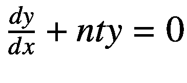，`y(0) = 3`，`n = 1, 2, 3, 4, 5, 6`。我们需要针对五个不同的 `n` 值计算该一阶 ODE 的数值解。该 ODE 可以使用 `dsolve()` 进行求解以找到其解析解。这里，我们将展示如何针对基于循环的问题使用 `ODEx` 求解器选项，以及预设 ODE 求解器的相对和绝对误差容限值的重要性。解决方案脚本 (`ODE1sim.m`) 在一个 `[for, end]` 循环内针对不同的 `n` 值求解给定的问题。

```matlab
function ODE1sim
% Numerical solutions of: y'+nty=0; y(0)=3; for t=[0, 3.5];
% For n=1, 2, 3, 4, 5, 6.
y0=3;               % 初始条件
t=[0, 3.5];         % 仿真时间
% RelTol 为相对容差
% AbsTol 为绝对容差
options =odeset('RelTol', 1e-2, 'AbsTol', 1e-1);
for n=1:6
[T,Y] = ode23(@DY1, t, y0, options, n);
if n==1
plot(T,Y, 'b-'); hold on
end
if n==2
plot(T, Y, 'kx-')
end
if n==3
plot(T, Y, 'ro--')
end
if n==4
plot(T, Y, 'kv-.')
end
if n==5
plot(T, Y, 'mp:')
end
if n==6
plot(T, Y, 'cd-')
end
end
legend('n=1','n=2','n=3', 'n=4','n=5','n=6')
title('\it Solution of: $$ \frac{dy}{dt}+n*t*y=0, n=1,2...6, y_0=3 $$', 'interpreter', 'latex')
xlabel('\it t'), ylabel('\it Solution, y(t)'), grid on
hold off
function dy = DY1(t,y, n)
dy= -n.*t.*y;
end
end
```

实际上，该脚本过于冗长，对于更大的 `n` 值效率不高。此外，图 2-13 中的曲线并不平滑，这是因为相对和绝对误差容限的值调整不当，而这些值是 `ODESET` 选择的默认值。

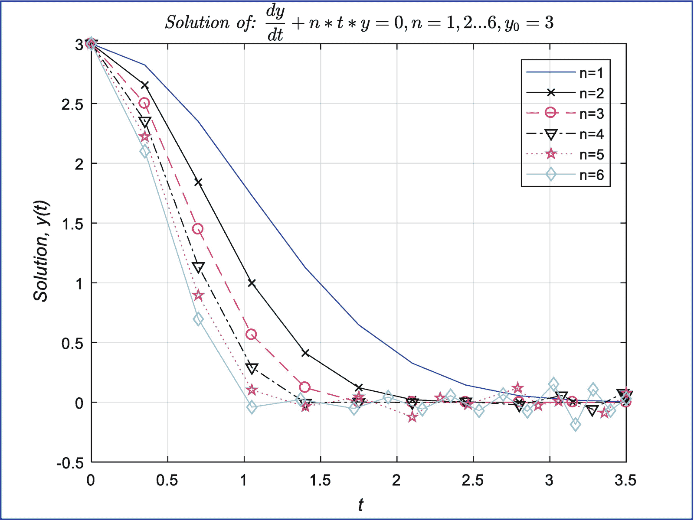

**图 2-13** 仿真  `y(0) = 3`，`n = 1, 2, 3, 4, 5, 6`

以下是针对该问题的一个紧凑解决方案 `ODE1simOK.m`，其中在 `ODESET` 内预设了 `ODEPLOT` 选项作为 `OuputFcn`。

```matlab
function ODE1simOK
% Numerical solutions of: y'+nty=0; y(0)=3; for t=[0, 3.5];
% For n=1, 2, 3, 4, 5 and 6.
%       color (color type): b-blue; g-green; r-red; m-magenta;
%       c-cyan; y-yellow; k-black.
%       lines (line type): - solid line; : colon; -- dashed line;
%       mark (marker type): o-circle; d-diamond; x-cross;
%       s-square; h-hexagon; + plus sign; * asterisk; etc.
y0=1;         % 初始条件
t=[0, 3.5];   % 仿真时间
% 预定义绘图标记标签：
labels = {};
color = 'bgrckmbgrckm';
lines = '--:-:-.--:-:-.';
mark  = 'od+xhsp*^>cs<d+xh';
% RelTol 为相对容差
% AbsTol 为绝对容差
options =odeset('RelTol', 1e-5, 'AbsTol', 1e-7);
labels=cell(1,6);
for n=1:6
[T,Y] = ode23(@DY1, t, y0, options, n);
style = [color(n) lines(n) mark(n)];
labels{n} = ['n = ' num2str(n)];
plot(T,Y,style), hold on
end
legend(labels{:},'Best'), grid on
title('Simulation of: $$ \frac{dy}{dt}+n*t*y=0, n=1,2...6 $$', 'interpreter', 'latex')
xlabel('\it t'), ylabel('\it  Solution, y(t)')
hold off
function dy = DY1(t,y, n)
dy= -n.*t.*y;
end
end
```

该脚本相当紧凑，并生成了下一个交互式构建的图形，如图 2-14 所示。

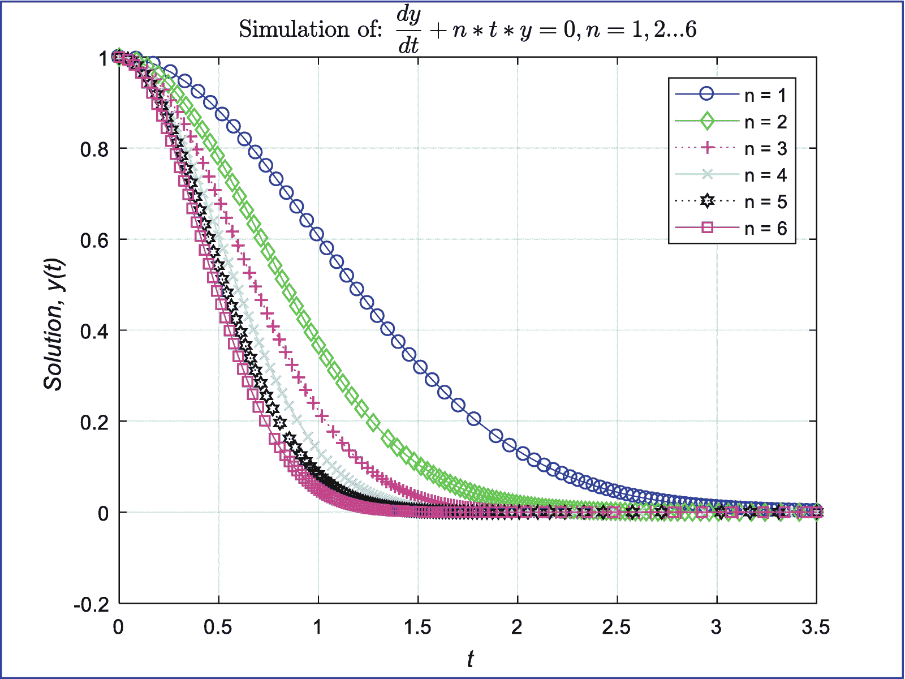

**图 2-14** 仿真 ，其中 `y(0) = 3`，`n = 1, 2, 3, 4, 5, 6`

图 2-14 中显示的解决方案比图 2-13 中显示的更精确。这种精度是通过略微收紧调整的相对和绝对误差容限实现的，如果对精度有更高要求，这些容限甚至可以进一步收紧。此外，后一个脚本由于使用了通过 `ODESET` 预设的 `ODEPLOT` 选项而更加紧凑。而且，它具有更高的精度，并对相对和绝对误差容限有更严格的控制。

在本节中，我们简要介绍了 ODE 内置求解器以及如何设置它们的参数，例如相对和绝对误差容限，如何使用 `ODESET` 绘制输出，以及如何通过几个一阶 ODE 的示例，使用 `ODEEXTEND` 计算已求解 ODE 的扩展附加值。所有这些工具和过程也适用于二阶及更高阶的 ODE，这将在下一章讨论。

## Simulink 建模

在本章中，我们将仅限于解释如何使用标准且基础的 Simulink 模块来求解和仿真几个 ODE 问题，并提供一些关于工具和选项的说明性注释和建议（有关 Simulink 建模的更多详细信息，请参见 [3]）。我们首先对几个简单的一阶 ODE 进行建模，以演示在 Simulink 环境中对 ODE 建模的简便性。


## 示例 12

以下是示例问题：，`y[0] = 0.5`。（请注意，此问题此前已通过几种不同的方法解决。）给定的问题按照以下步骤在 Simulink 中建模：

**第 1 步。** 重写给定的问题：。

**第 2 步。** 开始构建求解模型。

为了从 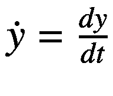 得到 `y(t)`，我们需要对 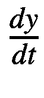 进行积分。该过程的另一种解释是在 *s* 域（使用拉普拉斯变换）：如果对  执行拉普拉斯变换，我们将得到 `s Y(s) – y(t[0])`。为了从 `s Y(s)` 得到 `Y(s)`，我们需要将 `s Y(s)` 乘以 ，这代表积分。可以从 Simulink 库浏览器中获取一个积分器模块 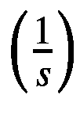，该浏览器可通过单击  启动，然后选择 **Libraries** ➤ **Simulink** ➤ **Continuous**。从右侧窗格中，我们选取 `[Integrator]` 模块并将其拖入模型区域。或者，从 2018a 开始，Simulink 的最新版本有一个用户友好的新颖选项，只需单击模型窗口的空白区域，搜索框就会弹出，如下所示：。通过输入 `in`，会弹出如图 2-15 所示的下拉选项。

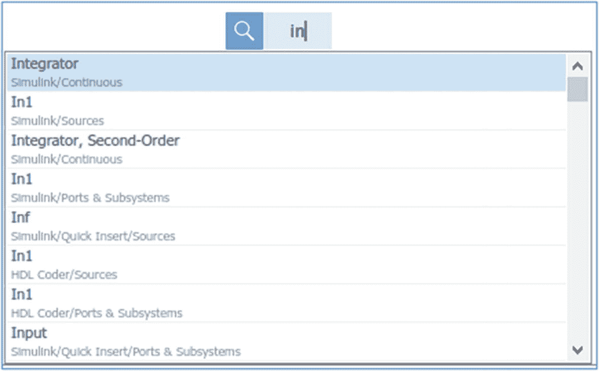

**图 2-15：** Simulink 模型搜索框的下拉选项

在下拉选项中，第一个是如图 2-16 所示的 `Integrator`；按下键盘上的 **Enter** 键。这将创建带有初始条件提示的积分器模块，如下所示：。类似地，所有其他模块都可以直接带入空白的模型窗口，而无需跳转至 Simulink 库 。例如，`Gain` 模块可以通过输入 `g` 获得，如下所示：，第一个模块就是 `Gain` 模块。接着，按下 **Enter**，`Gain` 模块就会弹出：。这个模块有一个指定增益值的选项。以类似的方式，我们可以找到模型所需的所有其他模块。

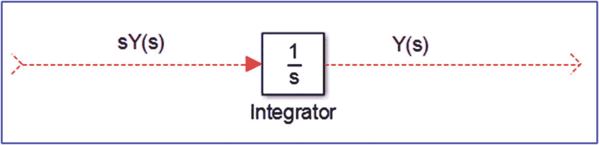

**图 2-16：** Simulink 积分器模块

> **注意：** 模型窗口区域中的这个搜索选项新功能从 MATLAB/Simulink 2018a 版本开始提供。

在此步骤中，给定的初始条件也可以在积分器模块参数中定义，该参数可通过双击模块打开。可以在积分器参数中将初始条件设置为内部或外部，如图 2-17 所示。

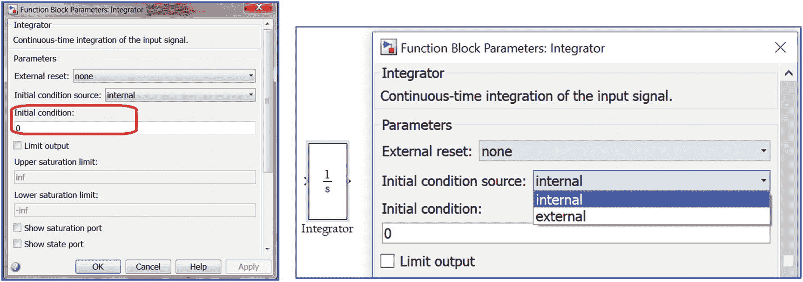

**图 2-17：** 积分器模块的初始条件设置选项

在进行常微分方程的 Simulink 建模时，我们总是需要从 `[Integrator]` 模块开始。这是在 Simulink 环境中构建微分方程或通过微分方程表述的问题的仿真模型时，首要的基本步骤。如果给定的问题具有零初始条件，那么我们就不必担心分配初始条件。默认情况下，积分器的初始条件设置为零。

在此给定示例中，初始条件值为 0.5，我们输入该值；然后点击 **Apply** 和 **OK**。在给定的代数表达式 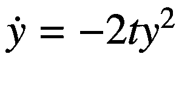 中，我们有一个乘积（`-2 * t * y²`）、常量增益（`-2`）、输入信号（时间，`t`）以及数学运算（`y²`）。此外，其他模块，如 `[Out]` 和 `[Scope]` 模块，可以添加到模型中以查看和获取计算结果。此模型中使用的七个模块中的四个可以从 **Libraries** ➤ **Simulink** ➤ **Commonly Used Blocks** 中获取：`[Gain]`、`[Product]`、`[Out1]` 和 `[Scope]`。

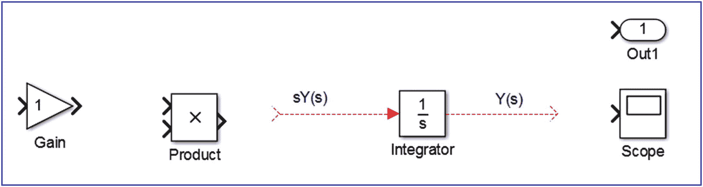

**图 2-18：** 模型的模块

此外，我们还需要一个输入信号（时间），它是一个 `[Clock]` 模块，位于 **Libraries** ➤ **Simulink** ➤ **Sources**：`[Clock]`。将其拖放到我们的模型窗口中，得到下一组模块，如图 2-19 所示。

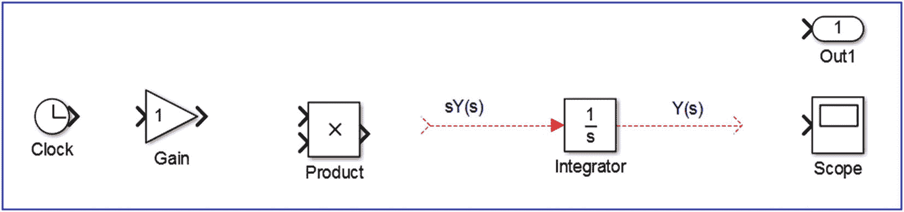

**图 2-19：** 模型的模块

最后，最后一个模块 `[Math Function]`，取自 **Simulink/Math operations**。它带有菜单选项，可以从中选择数学函数，例如指数、对数、平方、幂等。最后，我们模型所需的所有模块列表就完整了。模块 `[Math Function]`（图 2-20）用于根据来自 `[Integrator]` 模块输出端口的信号计算 `y²`。

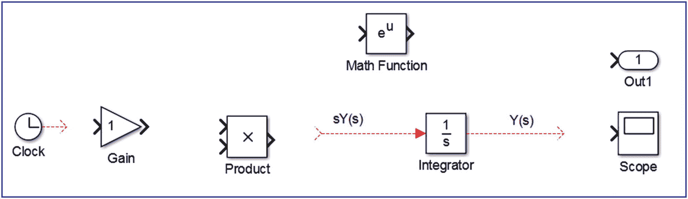

**图 2-20：** 模型的模块

现在我们收集了所有必要的模块，但仍需对所选模块的参数进行一些调整和更改。我们可以将常量 `[Gain]` 的值从 1 改为 -2，这可以通过双击模块，在 `[Gain]` 模块的弹出窗口中更改其增益值，然后点击 **OK** 来完成。我们可以通过双击 `[Math Function]` 模块并选择函数类型 `[square]`（即 `u²`），然后点击 **OK** 来更改其功能。为了获得更好或更可读的模型视图，我们可以通过点击模块并按 **Ctrl+I**，或右键单击并选择模块的 **Rotate & Flip** 选项，来将某些模块（例如 `[Math Function]`）翻转/旋转 180 度。执行这些操作后，我们得到如图 2-21 所示的模块组。

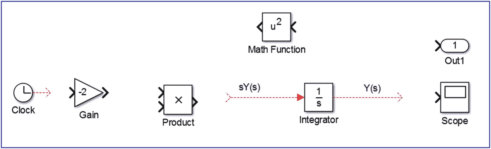

**图 2-21：** 模型的模块

对于第三步，我们通过从一个模块的输出端口向另一个模块的输入端口拖动信号线，或者通过点击一个模块并在按住 **Ctrl** 键的同时点击下一个模块，来连接所有模块。模块按以下顺序连接：

-   对于输入信号，`[Clock]` 与 `[Gain]` 模块相连。
-   `[Gain]` 模块与 `[Product]` 模块相连。
-   `[Product]` 模块与 `[Integrator]` 模块相连。
-   `[Integrator]` 模块与 `[Scope]`、`[Out1]` 和 `[Product]` 模块相连。


最终，我们得到了如下所示的完整模型 `Example_2_1ODE.mdl`，如图 2-22 所示。

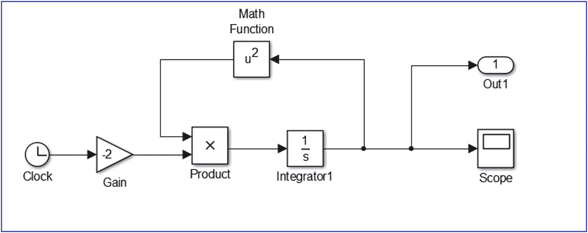

**图 2-22**  且 *y*[0] = 0.5 的完整 Simulink 模型

对于步骤 4，在连接所有模块后，可以根据所使用的 Simulink 版本，将创建好的模型保存为 `*.mdl` 或 `*.slx` 文件扩展名。创建的 Simulink 模型中所有未知的参数可以在命令窗口中，或者在 Simulink 内部的“模型属性/回调/InitFcn”中进行定义。完成所有四个步骤后，我们可以将 Simulink 模型保存为 `Example_2_1ODE.mdl`，如图 2-22 所示。

我们通过点击“运行”图标或按下 Ctrl+T 来仿真创建的 Simulink 模型。然后，我们可以通过双击 `[Scope]` 模块查看仿真结果。此外，我们还可以从 MATLAB 工作区中的 `[Out1]` 模块获得仿真结果，这些结果以两个变量 `tout` 和 `yout` 的形式呈现，这两个变量是 `[Out1]` 模块输出数据集的默认名称。这是将 Simulink 模型中的仿真结果获取到 MATLAB 工作区的少数几种可行方法之一。另一种可能更简单的方法是使用“配置属性”：`[Scope]`  模块。要使用此选项（图 2-23），请点击  图标并选择“配置属性”。将会弹出一个“示波器”窗口。转到“记录”选项卡，并选中“将数据记录到工作区”选项。如有必要，可以更改变量名和保存格式类型。第三种从 Simulink 模型中保存仿真数据或任何信号值的方法是使用 `To Workspace` 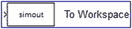 模块，将任意模块的信号连接到该模块，该模块会收集信号并将其保存到 MATLAB 工作区。该模块位于 Simulink 库中，被称为“Sinks”。此模块中的默认变量名为 `simout`，可以重命名，并且如有必要可以更改其数据结构类型。

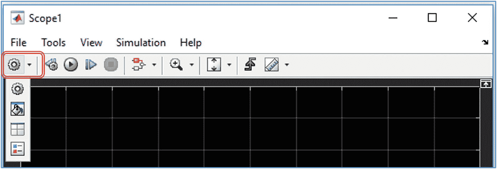

**图 2-23** 交互式地更改 `[Scope]` 模块的显示选项

最后，仿真结果显示在 `[Scope]` 模块中，如图 2-24 所示，其属性已更改。

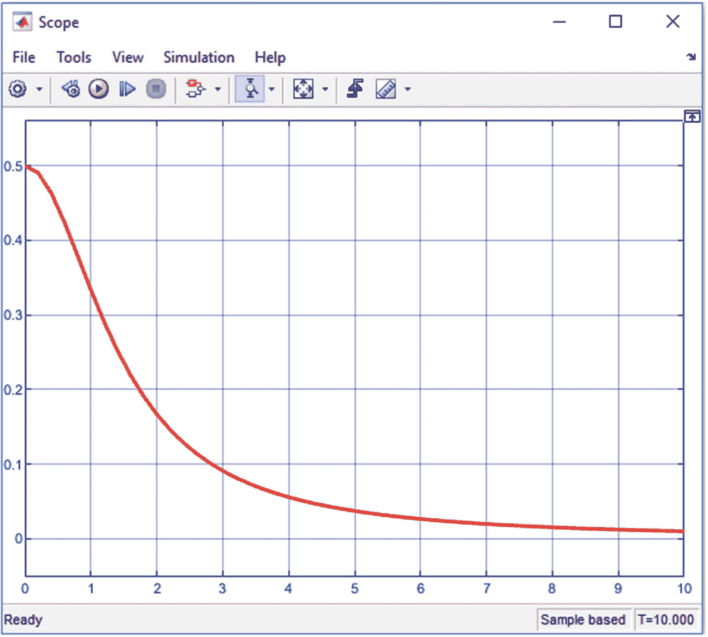

**图 2-24** `[Scope]` 模块的显示选项更改后，`[Scope]` 块中的仿真结果

> **注意** 对于不同的 Simulink 版本，`[Scope]` 模块的参数图标和选项会有所不同。

通过使用 `[Scope]` 模块的参数选项，可以调整绘制数据中的一些内容，例如背景、坐标轴颜色、线型、标记类型以及绘制数据点的颜色。此外，还可以添加图形标题和图例功能，并可调整数据保存选项。

模型参数，例如求解器类型、求解器、步长、相对和绝对容差、过零检测等，可以通过配置参数进行调整。可以通过点击  并选择其下拉选项中的“模型配置参数 Ctrl+E” 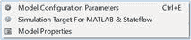，按下 Ctrl+E，或者选择“工具 ➤ 模型浏览器 ➤ 模型层次结构 ➤ 配置”来访问它们，如图 2-25 所示。

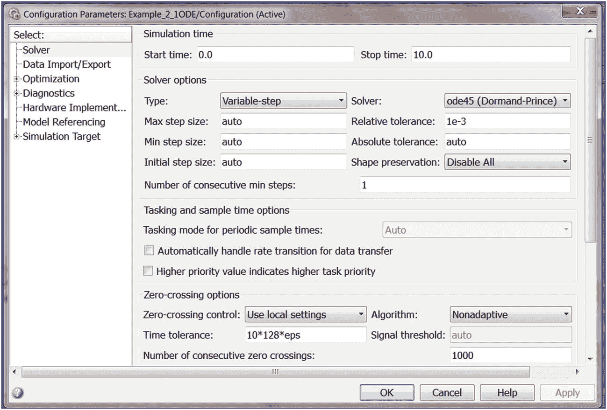

**图 2-25** 调整配置参数

求解器选项中有几个参数。我们可能需要调整它们以达到数值解所需精度和计算时间效率。这些参数包括：类型（变步长或固定步长）、求解器、步长、相对和绝对误差容限以及过零检测。以下是变步长求解器：`ode45`（Dormand-Prince，默认）、`ode23`（Bogacki-Shampine）、`ode113`（Adams）、`ode15s`（stiff/NDF）、`ode23t`（梯形规则）、`ode23tb`（stiff/TR-BD2）。固定步长求解器有：离散（无连续状态）、`ode1`（Euler）、`ode2`（Heun）、`ode3`（Bogacki-Shampine）、`ode4`（龙格-库塔）等。

Simulink 模型可以与 MATLAB 关联，并且可以在不启动 Simulink 包的情况下，从命令窗口、M 文件或函数文件中进行仿真。要执行一个 Simulink 模型（例如，`MODELname.mdl` 或 `MODELname.slx`），我们需要使用带有 `sim()` 的标准命令语法：

```
sim('MODELname');
sim('MODELname', [time0, timeEND]);
```

这将对名为 `MODELname.mdl` 的 Simulink 模型进行仿真，仿真时间范围为 `[time0, timeEND]`；此外，我们可以在仿真 Simulink 模型时指定输出数据名称。

```
[Tout, Uout] = sim('MODELname', [time0, timeEND]);
```

获得输出数据 `[Tout, Uout]` 后，我们可以执行进一步的数值分析，并绘制获得的结果。在我们开发的模型 (`Example_2_1ODE.mdl`) 示例中，我们可以使用以下命令对该模型进行仿真：

```
[Tout, Uout] = sim('Example_2_1ODE', [0, 10]);
```

## SIMSET

Simulink 模型的求解器选项（设置），例如求解器类型、相对和绝对误差容限、过零点等，可以使用命令 `simset()` 进行调整。示例如下：

```
OPTIONS = simset('solver','ode3', 'reltol', 1e-3, 'abstol', 1e-5, 'zerocross', 'off');
[Tout, Uout] = sim('Example_2_1ODE', [0, 10], OPTIONS);
```

此外，MATLAB 中还有其他的优化选项可用于调整 Simulink 模型选项，例如 `optimset`、`sdo.OptimizeOptions` 等。

```
opt = sdo.OptimizeOptions(Name, Value)
```

这可以应用于前面提到的示例，以使用非线性最小二乘优化，命令如下：

```
opts = sdo.OptimizeOptions('Method', 'lsqnonlin');
```

这将优化方法设置为 Simulink 模型求解器中的非线性最小二乘法。

前面描述的步骤和流程是 Simulink 模型开发和仿真的通用关键步骤。需要指出的是，在先前创建的模型中，有两个模块，例如 `[Out1]` 和 `[Scope]`，它们不会直接影响模型性能仿真结果。另一点需要注意的是，有些模块是可以互换的。例如，具有内部初始条件选项的 `[Integrator]` 模块可以更改为具有外部初始条件源的 `[Integrator]` 模块。另一个例子是，`[Divide]` 模块也可以被更改并转换为 `[Product]` 模块。任何模型都可以通过使用不同的模块并组合数学和代数运算，以几种不同的方式开发出来。


