# 13. 求解偏微分方程

偏微分方程是“……包含未知多元函数及其偏导数的微分方程”，根据维基百科[1]所述。偏微分方程在物理学、工程学和计算机科学中有许多应用。例如，偏微分方程被用来描述各种现象，如热传递、机械动力学、波传播、弹性力学、流体动力学等。

以下是一个给定函数的偏微分方程的广义公式。它依赖于多个自变量，以及该函数对多个自变量的偏导数。


(13-1)

这是一个二阶偏微分方程的例子。方程(13-1)的解是函数 *u*(*x*, *y*, *z*, *t*)，其偏导数将满足方程(13-1)中给出的公式。

在第 3 部分中，我们演示了如何使用 MATLAB 内置的偏微分方程求解器 `pdepe()` 和拉普拉斯算子 `del2()` 来数值求解偏微分方程，以及如何在一维和二维热传递问题以及一维和二维波传播问题的示例中，基于高斯-赛德尔和有限差分法编写脚本。

## `pdepe()`

`pdepe()` 可以求解以下形式的偏微分方程：


(13-2)

其中 *m* 代表系统的几何形状。如果是平板，*m* = 0（笛卡尔坐标系），*m* = 1 用于圆柱几何（柱坐标系），*m* = 2 用于球体形状（球坐标系）。

需要两个边界条件：一个是初始条件，另一个是每个边界上的边界条件。

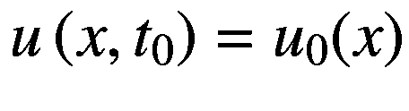
(13-3)

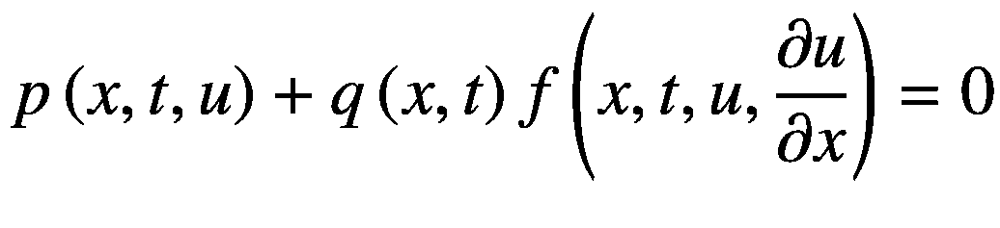
(13-4)

其中 *p*(*x*, *t*, *u*) 和 *q*(*x*, *t*) 是一些任意函数。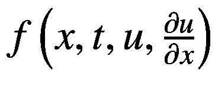 是主偏微分方程中给出的函数。

以下是 `pdepe()` 的一般语法：

```
Solution = pdepe(m, PDEfun, ICfun, BCfun, Xmesh, Tspan)
```

其中 *m* 是方程(13-2)中的幂指数，表示问题的几何/坐标系。`PDEfun` 是给定问题的偏微分方程表达式。`ICfun` 是给定问题的已知初始条件。`BCfun` 是给定问题的已知边界条件。`Xmesh` 是需要计算解的空间（距离），`Tspan` 是需要对给定问题进行模拟的时间跨度。

## 一维热传递问题

让我们考虑图 13-1 所示的系统，该系统描述了热量从墙壁的一端边界传递到另一端边界的过程，墙壁厚度为 *L*。系统有两个边界条件：*T*(*x*, 0) = 0 和 *T*(*L*, *t*) = 0，分别代表左右边界的温度值。左侧有一个提供能量的热源。

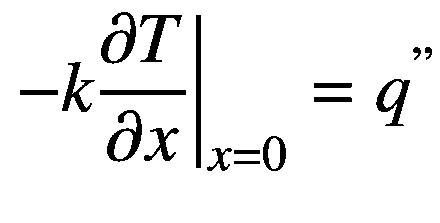
(13-4)


**图 13-1** 热量从墙壁左边界传递到右边界

以下是该系统的热传递模型，用下面的二阶偏微分方程表示：


(13-5)

其中 *T* 是温度，*ρ* 是密度，*c*[*p*] 是关键的热导率分量，*k* 是热导率。

在方程(13-5)所示的热传递问题中，


(13-6)

方程(13-2)中给出的参数 *c* 是一个常数，因此我们可以写出以下形式：


(13-7)

我们的问题中不存在源项，因此它等于零。

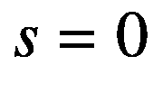
(13-8)

有两个边界条件：*T*(*L*, *t*) = 0 和 *T*(*x*, 0) = 0。

现在，结合方程(13-5)和公式 *p* + *qf* = 0，我们可以重写方程(13-4)。

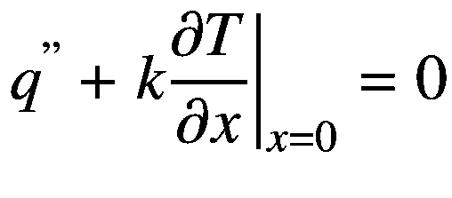
(13-9)

其中 *x* = 0，*p* = *q*″，*q* = 1。此外，从边界条件 *T*(*L*, *t*) = 0，我们知道 *x* = *L*，*p* = *T*(*L*, *t*) = *u*[*r*]，且 *q* = 0。请注意右端的 *u*[*r*] 边界条件值。

### 示例 1

假设墙壁右端的温度为 +20°*C*，即 *p* = *T*(*L*, *t*) = *u*[*r*] − 20。

以下是该问题的求解脚本 `Heat_Transfer.m`：

# MATLAB 求解热传导方程

## 仿真代码与结果

给定数据：
global ro cp k q
k = 666;         % [W/m-K]
L  = 0.25;       % [m]
ro  = 1000;      % [kg/m³]
cp = 500;        % [J/kg-K]
q   = 5e6;       % [W/m²]
tend = 5;        % [s]
m=0;             % 笛卡尔坐标系
x = linspace(0, L, 200);
t = linspace(0, tend, 50);
% 计算求解：
SOL=pdepe(m, @PDEfun, @ICfun, @BCfun, x, t);
TEMP=SOL(:,:,1);
figure(1)
plot(x, TEMP(end,:), 'b-', 'linewidth', 2), grid on
title(sprintf('t = %s 时的计算解', num2str(tend)))
xlabel('\it 距离, [m]')
ylabel('\it 温度 (\circC)')
figure(2)
plot(t, TEMP(:,1),  'k-', 'linewidth', 2), grid on
title(sprintf('t = %s 时的计算解', num2str(tend)))
xlabel('\it 时间, [s]')
ylabel('\it 温度 (\circC)')
figure(3)
mesh(x, t, SOL)
xlabel('\it 距离, [m]')
ylabel('\it 时间, [s]')
zlabel('\it 温度 (\circC)')
title('\it 方程的解：$$ k*\frac{\partial²{T}}{\partial{x²}}-\rho*c_p\frac{\partial{T}}{\partial{t}}=0 $$', 'Interpreter' ,'latex')
axis tight
function [c, f, s] = PDEfun(x, t, u, DuDx)
% PDE1
global ro cp k
c=ro*cp;
f=k*DuDx;
s=0;
end
function u0=ICfun(x)
% 初始条件：
u0=0;
end
function [pl, ql, pr, qr] = BCfun(xl, ul, xr, ur, t)
% 边界条件
global q
pl=q;     % 在热源所在的左边缘：q+k*dT/dx=0
ql=1;
pr=ur;
qr=0;     % 在右边缘：ur=0
end

## 仿真结果

图 13-2、13-3 和 13-4 分别展示了该脚本在距离、时间以及空间和时间上的仿真结果。

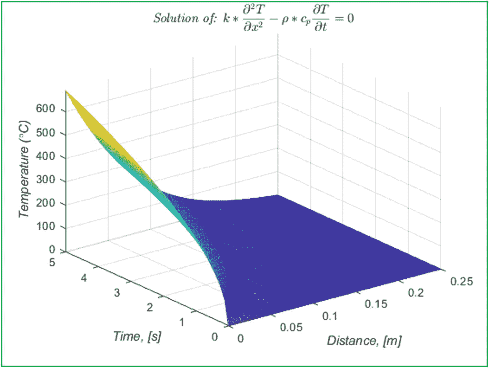
**图 13-4** 空间和时间上的解

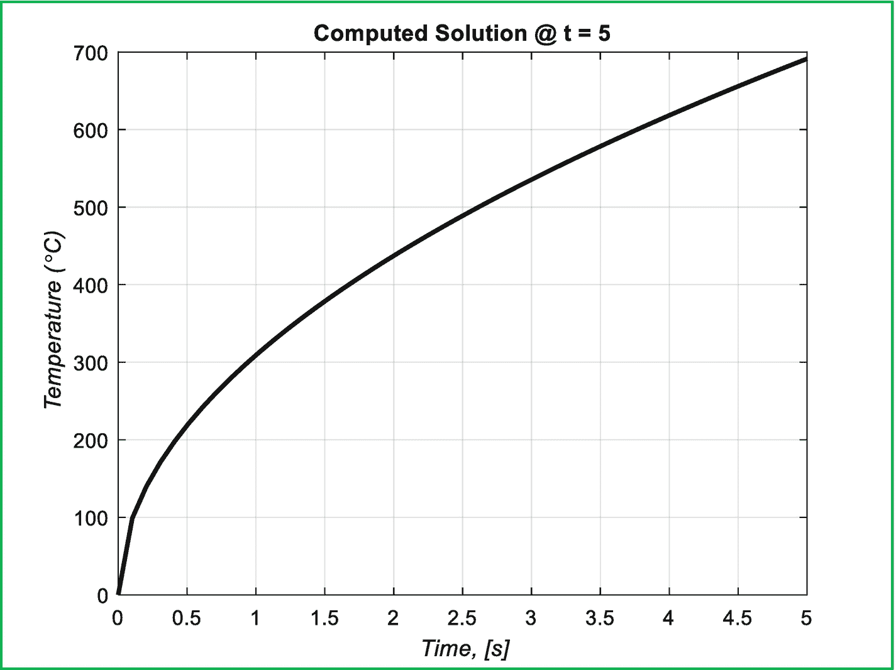
**图 13-3** 时间上的解

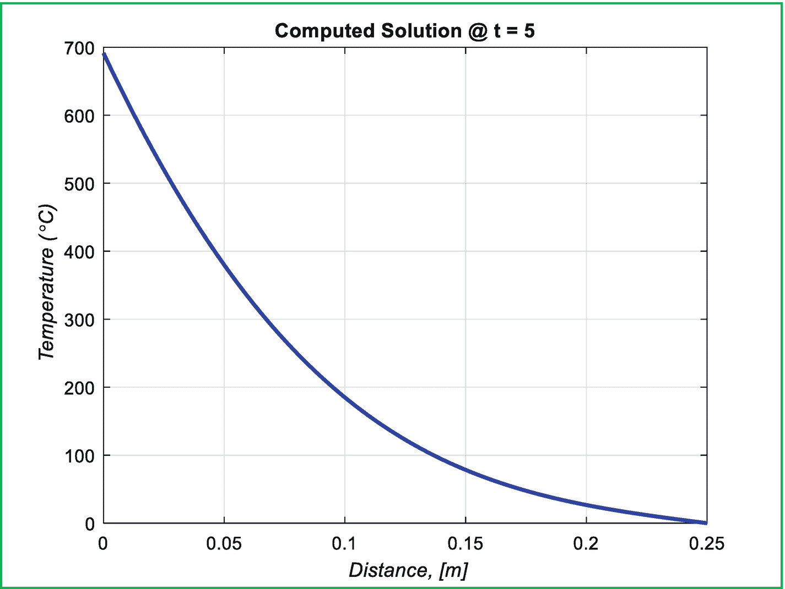
**图 13-2** 距离上的解

# 二维热传导：使用高斯-赛德尔方法求解椭圆型偏微分方程

考虑一个矩形板，其四个边被不同方式加热（左侧 `T[L]`、右侧 `T[R]`、上侧 `T[t]` 和下侧 `T[b]`），如图 13-5 所示。该板沿 x 轴的宽度为 `W`，沿 y 轴的高度为 `H`。如何计算板内部的温度？


**图 13-5** 物理系统：四面不同加热的板

该给定问题中热传导的数学表达式是如方程 (13-10) 所示的二阶椭圆型偏微分方程。


**(13-10)**

注意，这是一个二维问题。温度沿 x 轴和 y 轴发生变化。为了数值求解此问题，我们可以采用高斯-赛德尔方法 [2]。为了离散化给定的系统，我们将板分割成有限的矩形单元和节点，如图 13-6 所示。

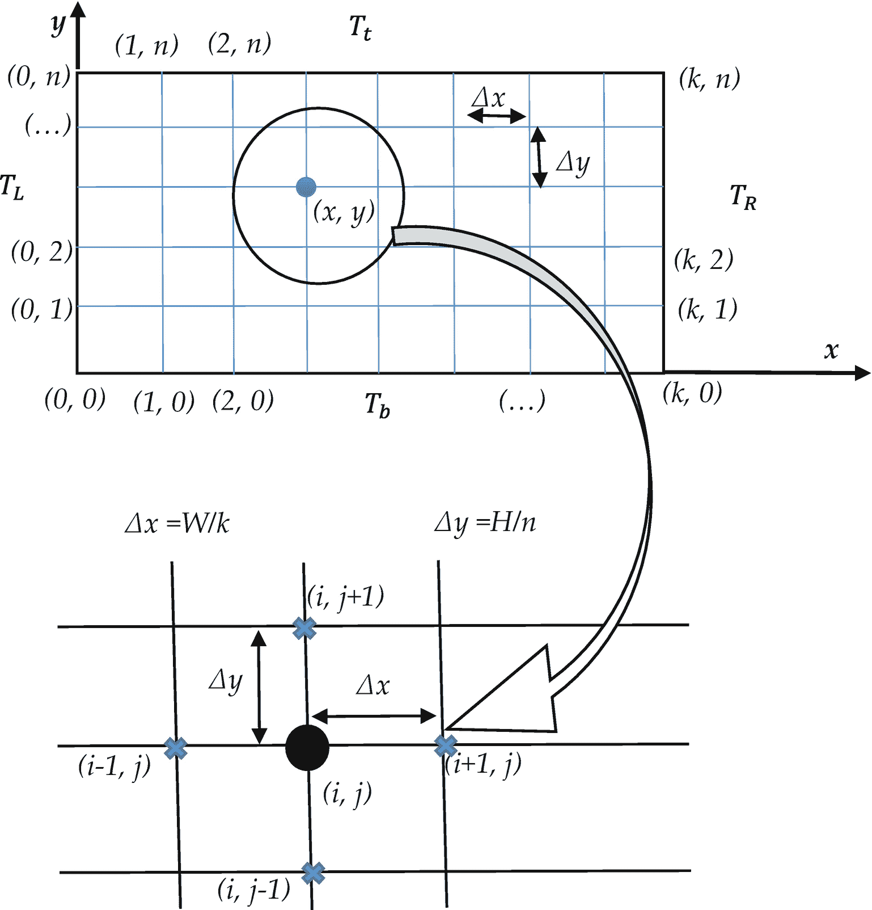

**图 13-6** 椭圆型偏微分方程的离散化方案

使用图 13-7 所示的热传导椭圆型偏微分方程的离散化方案，我们写出以下离散化方程来计算节点 `(*i, j*)` 处的温度：

![$$ \left[\frac{T_{i-1,j}^k-2{T}_{i,j}^k+{T}_{i+1,j}^k}{\Delta {x}²}\kern0.5em +\frac{T_{i,j-1}^k-2{T}_{i,j}^k+{T}_{i,j+1}^k}{\Delta {y}²}\right]=0 $$](images/490522_1_En_13_Chapter/490522_1_En_13_Chapter_TeX_Equ12.png)

**(13-11)**


**图 13-7** 温度分布：`surf()` 图

公式 (13-11) 也可以考虑 `Δx` 和 `Δy` 相等的情况来改写，换句话说，取 `Δx = Δy`，如下所示：

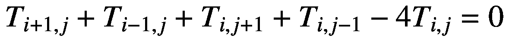

**(13-12)**

现在我们可以重写方程来计算节点 `T[i, j]` 的温度，如下所示：


**(13-13)**

这是问题的高斯-赛德尔方法公式。对方程 (13-13) 进行迭代求解，以计算每个内部节点 `(m × n)` 的温度值，直到满足预设的误差容限。迭代次数由每次迭代中根据以下公式计算出的误差值决定：

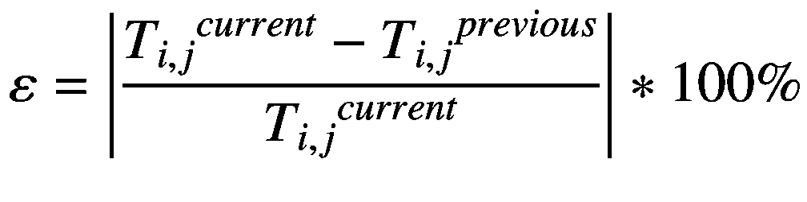

**(13-14)**

## 示例 2

让我们考察一个物理系统：一块长 3 米、宽 5 米的平板，边界条件如下：左侧 100⁰ C，右侧 75⁰ C，顶部 250⁰ C，底部 300⁰ C。我们假设所有内部节点的初始温度为 0⁰ C。

我们将系统沿 x 轴离散化为 `k=30` 个节点，沿 y 轴离散化为 `n=50` 个节点，得到如下结果：

```
Δx = W/k =3/30= 0.1 [m];  Δy = H/n =5/50= 0.1 [m];
```

请注意，平板各边上的温度值是已知的，并等于各边所施加的温度值。

沿左侧边缘：

```
T(0,0) = 1000 C; T(0, 1) = 1000 C; T(0, 2)= 1000 C, ... T(0, n)= 1000 C;
```

沿右侧边缘：

```
T(k, 0) = 750 C; T(k, 1) = 750 C; T(k, 2)= 750 C, ... T(k, n-1)= 750 C;
```

沿顶部边缘：

```
T(1, n) = 2500 C; T(2, n) = 2500 C; T(3, n)= 2500 C, ... T(k, n)= 2500 C;
```

沿底部边缘：

```
T(1, 0) = 3000 C; T(2, 0) = 3000 C; T(3, 0)= 3000 C, ... T(k-1, n-1)= 3000 C;
```

我们将误差容限设为 `0.001⁰ C`，初始误差值设为 `1⁰ C`。

现在，基于所有这些公式，如方程 (13-13) 和方程 (13-14) 所示，并结合这些边界条件（平板边缘的温度值），我们编写了下一个脚本，命名为 `Heat_Transfer_GS_method.m`：

```matlab
% 使用基于高斯-赛德尔迭代法的迭代方法进行热流模拟
% 矩形板（3 米×5 米）上的二维传热
% 不同侧面的温度/热流
clc; clearvars; close all
TL = 100;     % [C] 左侧
TR = 75;      % [C] 右侧
Tt = 250;     % [C] 顶部
Tb = 300;     % [C] 底部
k  = 30;      % x 轴方向节点数
n  = 50;      % y 轴方向节点数
W = 3;        % [m] 宽度
H = 5;        % [m] 高度
x = linspace(0, W, k);  % x 轴方向网格尺寸
y = linspace(0, H, n);  % y 轴方向网格尺寸
[xx, yy] = meshgrid(x, y);
% 注意：x 轴方向的网格尺寸与 y 轴方向不同
% 可以通过设置 k = n 使 x 轴和 y 轴方向的网格尺寸一致。
T=zeros(k, n); % 内存分配
T(1,1:n) = TL; % 平板左侧
T(k,1:n) = TR; % 平板右侧
T(1:k,n)=Tt;   % 平板顶部
T(1:k,1)=Tb;   % 平板底部
tol = 1e-3;    % 误差容限
Error = 1;     % 初始误差值
m=0;
while Error>tol
Told=T;
for ii=2:k-1
for jj=2:n-1
T(ii,jj)=(1/4)*(T(ii,jj-1)+T(ii-1, jj)+T(ii+1, jj)+T(ii, jj+1));
end
end
Error = max(max(abs((T-Told)./T)))*100;
end
figure(1)
surf(x, y, T'); colorbar;
title('\it 平板上二维温度分布')
xlabel('\it 宽度, [m]')
ylabel('\it 高度, [m]')
zlabel('\it 温度, [\circC]')
grid on
axis tight
figure(2)
ribbon(yy, T')
title('\it 平板上二维温度分布')
xlabel('\it 网格数量表示的宽度')
ylabel('\it 高度, [m]')
zlabel('\it 温度, [\circC]')
grid on
axis tight
figure(3)
contour(x, y, T'); colormap;
title('\it 平板上二维温度分布')
xlabel('\it 宽度, [m]')
ylabel('\it 高度, [m]')
zlabel('\it 温度, [\circC]')
grid on
figure(4)
pcolor(x, y, T'), shading interp;
title('\it 平板上二维温度分布')
xlabel('\it 宽度, [m]')
ylabel('\it 高度, [m]')
zlabel('\it 温度, [\circC]')
grid on; shg
```

图 13-7、13-8、13-9 和 13-10 展示了脚本的仿真结果。

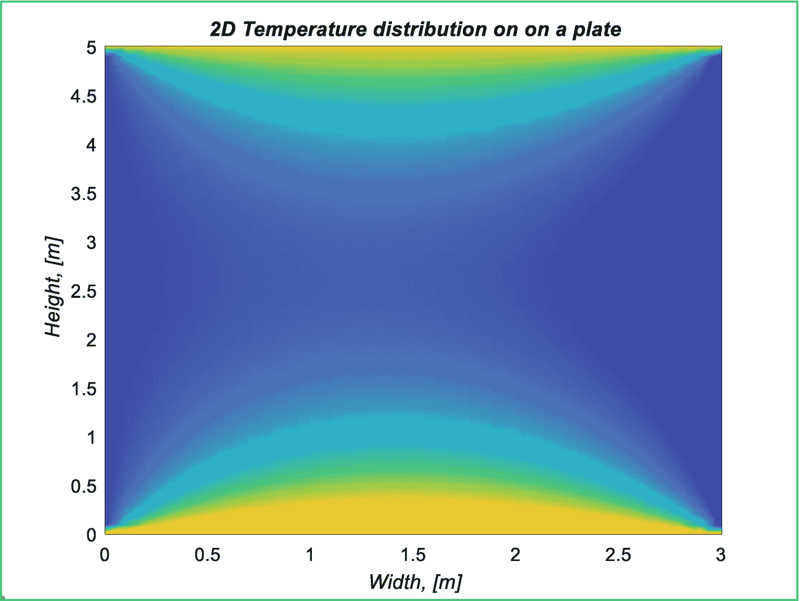

图 13-10 温度分布：`pcolor()` 绘图

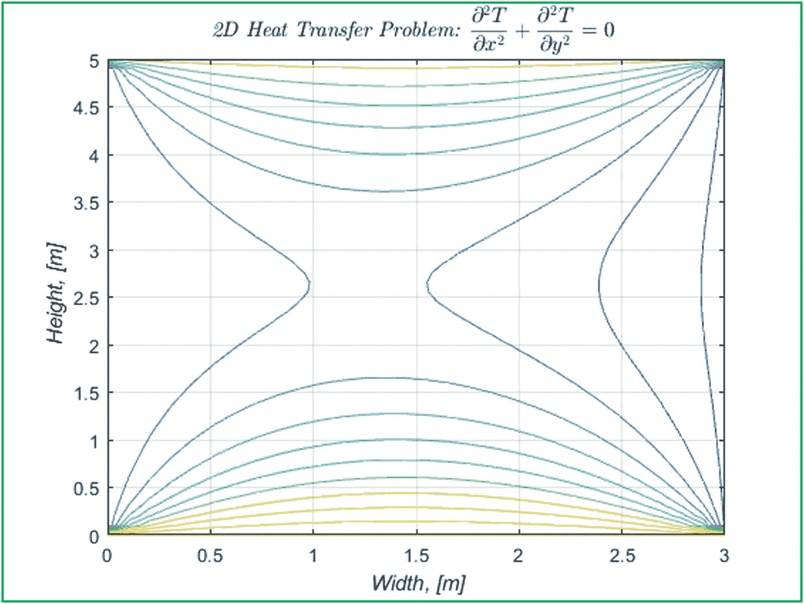

图 13-9 温度分布：`contour()` 绘图

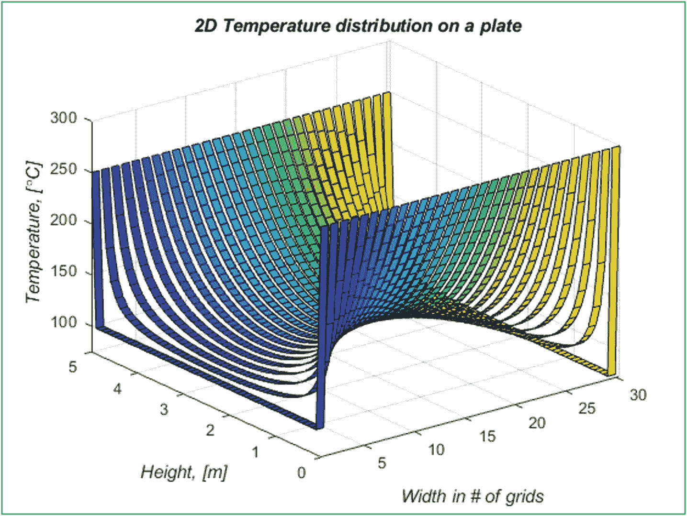

图 13-8 温度分布：`ribbon()` 绘图

请注意，通过高斯-赛德尔法计算得到的解的精度在很大程度上取决于我们设定的误差容限值，本例中该值设为`10^(-3)`。此外，解的精度会随着网格数量的增加而提高，换句话说，即通过减小网格尺寸`Δx`和`Δy`来提高精度。

## `del2()`：拉普拉斯算子

我们还可以使用离散拉普拉斯算子，根据给定的边界条件和网格来求解热传导方程。在前面展示的例子中，矩阵`T(x, y)`是在正方形网格点上计算的，即`Δx = Δy`。在这种情况下，可以使用拉普拉斯微分算子的有限差分近似（`Δ`用于计算关于`∂x²`、`∂y²`的二阶偏导数）来计算拉普拉斯 (`L`) 函数，如下所示：

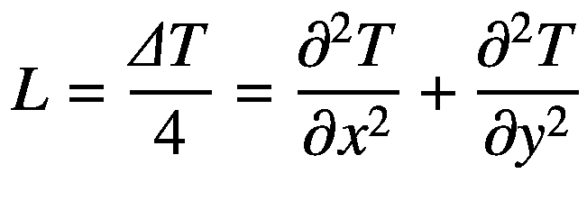

(13-15)

在 MATLAB 中，有一个内置的拉普拉斯算子函数`del2()`，它根据点 (`i`, `j`) 的值与其四个相邻点 (`i+1`, `j`)、(`i-1`, `j`)、(`i`, `j+1`) 和 (`i`, `j-1`) 的差值，来计算节点 (`i`, `j`) 上`L`的内部值。

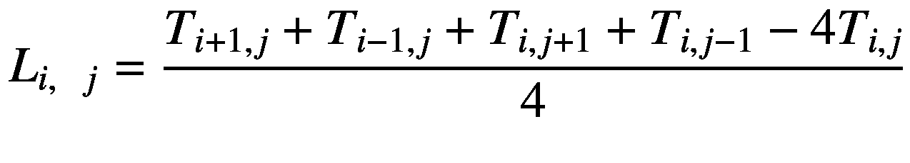

(13-16)

`T`的最终值是根据在每个节点上计算得到的`L`的内部值以及相应的`T`值计算得出的。

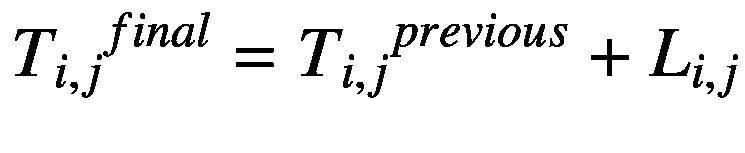

(13-17)

使用方程 (13-16) 和方程 (13-17) 以及拉普拉斯算子函数`del2()`非常直接。让我们考虑以下示例。

### 示例 3

该示例为一个 3 米乘 5 米的平板（宽乘高），其边界条件如下：左侧 100⁰C，右侧 75⁰C，顶部 250⁰C，底部 300⁰C。我们假定所有内部节点的初始温度为 0⁰C。（这与上文示例 13-2 给出的练习相同。）

我们使用拉普拉斯算子`del2()`编写了以下脚本 (`Heat_Transfer_Laplacian_Operator.m`)：

```matlab
% Heat flow simulation using the Laplacian operator
% Two dimensional heat transfer on a rectangular plate (3m-by-5m)
% with the temperature/heat flow from different sides
%%
clc; clearvars; close all
TL = 100;     % [C] Left side
TR = 75;      % [C] Right side
Tt = 250;     % [C] Top
Tb = 300;     % [C] Bottom
k  = 30;      % number of nodes along x axis
n  = 50;      % number of nodes along y axis
W = 3;        % [m] width
H =  5;       % [m] height
x = linspace(0, W, k);   % Mesh size along x axis
y = linspace(0, H, n);   % Mesh size along y axis
[xx, yy] = meshgrid(x, y);
% Here the mesh size differs along x axis from the one along y axis
% Note: the mesh size along x and y axes can be set uniform
% by setting N accordingly
T=zeros(k, n);     % Memory allocation
T(1,1:n) = TL;     % Left Side of the Plate
T(k,1:n) = TR;     % Right Side of the Plate
T(1:k,n) = Tt;     % Top Side of the Plate
T(1:k,1) = Tb;     % Bottom Side of the Plate
N_iter=0;          % Initial iteration value
while N_iter<1000
N_iter=N_iter+1;
if mod(N_iter, 2)==0
contourf(x, y, T'); colorbar;
drawnow
end
L= del2(T);
T(2:k-1, 2:n-1) = T(2:k-1, 2:n-1)+ L(2:k-1, 2:n-1);
end
title('\it 2D Heat Transfer Problem Solution:  $$ \frac{\partial²{T}}{\partial{x²}}+\frac{\partial²{T}}{\partial{y²}} =0 $$ ', 'interpreter', 'latex')
xlabel('\it Width')
ylabel('\it Height')
zlabel('\it Temperature, [\circC]')
grid on
figure(2)
surf(x, y, T'); colorbar;
title('\it 2D Heat Transfer Problem Solution:  $$ \frac{\partial²{T}}{\partial{x²}}+\frac{\partial²{T}}{\partial{y²}} =0 $$ ', 'interpreter', 'latex')
xlabel('\it Width, [m]')
ylabel('\it Height, [m]')
zlabel('\it Temperature, [\circC]')
grid on
axis tight
```

上述脚本生成了一个模拟结果的动态图，展示了热量如何在平板的内部点（节点/网格）之间移动，如图 13-11 所示。


`图 13-11` 使用拉普拉斯算子求解的二维温度分布问题

请注意，使用拉普拉斯算子 (`del2`) 计算的数值解的精度会随着迭代次数的增加而提高。这类似于有限差分法，随着误差容限的减小，其精度会更高。此外，使用拉普拉斯算子模拟的迭代过程显示了双曲线轮廓线（图 13-11），这与图 13-9 中显示的等高线相似。图 13-12 中展示的模拟结果与图 13-7 中的结果完美匹配。

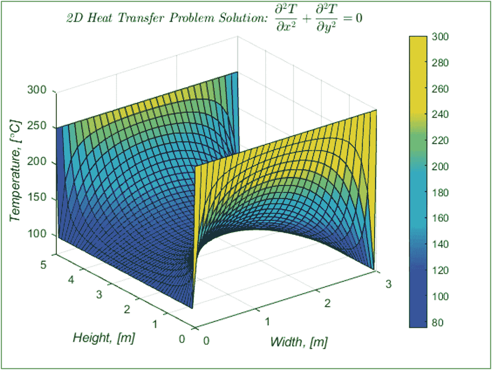

`图 13-12` 使用拉普拉斯算子（`surf()` 图）求解的二维温度分布问题

### 波动方程

波动方程是一个二阶偏微分方程，用于描述声波、机械波和光波等波的传播。它广泛应用于力学、声学、电磁学和流体动力学计算中。与热方程不同，波动方程可能包含多个空间变量（`x[1]`、`x[2]`、`x[3]`、…、`x[n]`）以及时间变量`t`。

一个通用的波动方程表述如下：

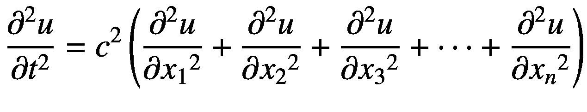

(13-18)

其中 `c` 是一个固定的非负（波传播速度）实系数。波动方程还有另一种更紧凑的表述形式，它使用了拉普拉斯算子 `∇`，如下所示：

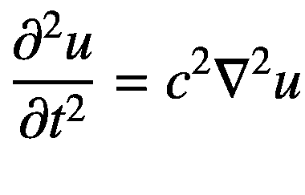

(13-19)

# 求解一维波动方程

一维空间（仅相对于 `x` 空间变量）的波动方程可表述如下：

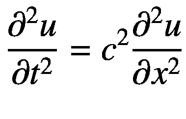

(13-20)

方程 (13-20) 描述了仅沿 `x-y` 平面发生的一维波动；该方程由法国科学家让·勒朗·达朗贝尔[3]发现。让我们以胡克定律中弹簧振动的例子，来演示一维波动方程的数值模拟。实际上，根据牛顿定律和胡克定律[4]，我们可以推导出一维偏微分波动方程。假设存在一个由有限质量 `m` 组成的阵列，这些质量通过长度为 `Δx` 的无质量弹簧相互连接，并假设弹簧单元具有均匀的弹性常数 `k`。

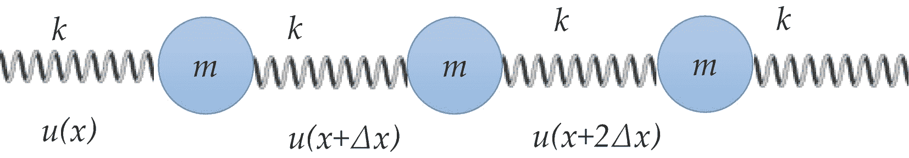

图 13-13  

从牛顿定律和胡克定律推导波动方程

图 13-13 显示了通过均匀刚性弹簧/弦相互连接的质量单元。质量单元的位移 `u(x)` 衡量了沿弹簧单元传播的应变（波）的幅度。利用图 13-13 所示系统的自由体受力图，我们可以根据牛顿定律和胡克定律（在 `x` 和 `x + 2Δx` 处）[4]计算出在 `x + Δx` 处质量单元上产生/扰动的力，如下所示：


(13-21)


(13-22)


(13-23)

现在，我们基于在 `x`、`x + 2Δx` 处计算的力的有限差分（根据胡克定律），计算 `x + Δx` 处的力，如方程 (13-22) 和 (13-23) 所示。

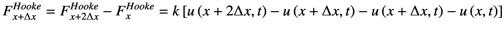

(13-24)

此外，通过将方程 (13-21) 中根据牛顿定律计算出的 `x + Δx` 处的力与方程 (13-24) 中根据胡克定律计算出的力进行等量代换，我们可以写出下式：

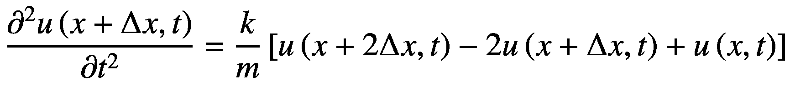

(13-25)

方程 (13-25) 的表述可以进行改写，条件是 `n` 个质量均匀分布，即 `L = nΔx`；总质量 (`M`) 沿 `n` 个节点均匀分布（`M = nm`）；并且总弹簧刚度 (`k`) 均匀分布（`K = k/n`）。


(13-26)

考虑当 `Δx` 趋近于无穷小（`Δx → 0`）且 `n` 趋近于无穷大（`n → ∞`）的情况，我们可以将方程 (13-26) 重写为更紧凑和连续的形式，如下所示：


(13-27)

其中方程的常数部分 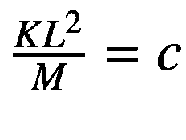 是波传播速度，它取决于弹簧的刚度和长度以及弦/弹簧的质量值。注意，通过将  代入方程 (13-27)，我们得到方程 (13-20)，即二维波动方程。

通过对方程 (13-27) 进行离散化，并将其左右两边的偏导数替换为有限（近似）差分，我们可以写出以下方程：

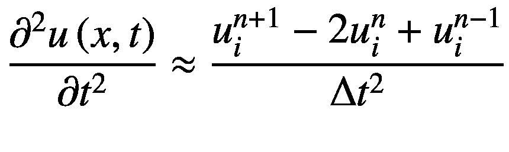

(13-28)


(13-29)

通过令方程 (13-28) 和方程 (13-29) 相等，我们可以写出方程 (13-27) 的一个代数或离散化形式。


(13-30)

通过求解方程 (13-30) 得到 ，我们可以构建数值计算的递归算法。


(13-31)

通过将常数项  和 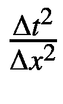 替换为 `C²`（`C` 被称为库朗数[5]），我们可以重写方程 (13-31)，如下所示：


(13-32)

### 示例 4

让我们看一个关于弹性弦的数值算例，弦长 20 [m]，均匀刚度 100 [Nm]，均匀分布质量为 2 kg。弦的两端无位移。所有三种情况的仿真周期均为 `T=30` [s]。考虑以下三种扰动情况：

-   左侧（第五、第六和第七）节点上存在的微小位移扰动：`u[3] = 0.05`，`u[4] = 0.5`，以及 `u[5] = 0.05`

-   从弦中心施加的正弦激励力：`u[100] = 0.5 * sin(10 * pi * t / T)`，其中 `T = 30` [s]

-   组合扰动：`u[3] = 0.05`，`u[4] = 0.1`，以及 `u[5] = 0.05`，并且 `u[100] = 0.5 * sin(10 * pi * t / T)`，其中 `T = 30` [s]

通过使用方程 (13-31) 并为每种情况分配零边界条件和扰动，我们可以编写以下脚本，命名为 `Wave_Propagation_1D.m`：

```
%% 弦中的波传播 - 弹簧-质量系统仿真（胡克定律）：
clearvars; clc;
% 给定参数
k = 100;                     % [Nm] 刚度
mass=2;                      % [kg] 质量
Lx = 20;                     % [m] 弦长
dx=.1;                       % [m] 节点间距
Nodes=Lx/dx;                 % 节点数量
x = linspace(0, Lx, Nodes);
K = k/Nodes;
c = K*Lx²*dx²/mass;
dt=0.05;                     % 仿真时间步长
u = zeros(Nodes,1);          % 边界条件
um1= u;
up1 = u;
C = c*dt/dx;                 % 波传播速度
t=0;                         % 仿真开始时间
T=30;                        % 仿真周期
Case = input('输入案例编号 (1, 2, 3)：   ');
if Case==1
    % 微小扰动：
    u(5:7)=[0.05 0.5 0.05];   % 案例 1
    up1(:)=u(:);
    while t<T
        % 时间演化：
        t=t+dt;
        % 保存迭代结果：
        un1=u; u=up1;
        for ii=2:Nodes-1
            up1(ii)=(C²)*(u(ii+1)-2*u(ii)+u(ii-1)) - un1(ii)+2*u(ii);
        end
        clf;
        plot(x, u, 'g-o', 'linewidth', 1), shg
    end
elseif Case == 2
    u(5:7)=0;                        % 案例 2
    up1(:)=u(:);
    while t<T
        t=t+dt;
        % 保存仿真结果：
        un1=u; u=up1;
        % 扰动源：
        u(100)=0.5*sin(10*pi*t/T);
        for ii=2:Nodes-1
            up1(ii)=(C²)*(u(ii+1)-2*u(ii)+u(ii-1)) - un1(ii)+2*u(ii);
        end
        clf;
        plot(x, u, 'k-o', 'linewidth', 1), shg
    end
else   % 案例 3
    u(5:7)=[0.05 0.5 0.05];
    up1(:)=u(:);
    while t<T
        t=t+dt;
        % 保存仿真结果：
        un1=u; u=up1;
        % 扰动源：
        u(100)=0.5*sin(10*pi*t/T);
        for ii=2:Nodes-1
            up1(ii)=(C²)*(u(ii+1)-2*u(ii)+u(ii-1)) - un1(ii)+2*u(ii);
        end
        clf;
        plot(x, u, 'r-o', 'linewidth', 1), shg
    end
end
xlabel('\it x 空间, [m]')
ylabel('\it u(t, x) 位移, [m]')
title(['\it t = '  num2str(T) '  [s] 后的波传播。', ...
       '案例 # '  num2str(Case)])
grid on
```

该脚本提供了三种情况下仿真结果的动画图。图 13-14、13-15 和 13-16 展示了脚本的仿真结果。

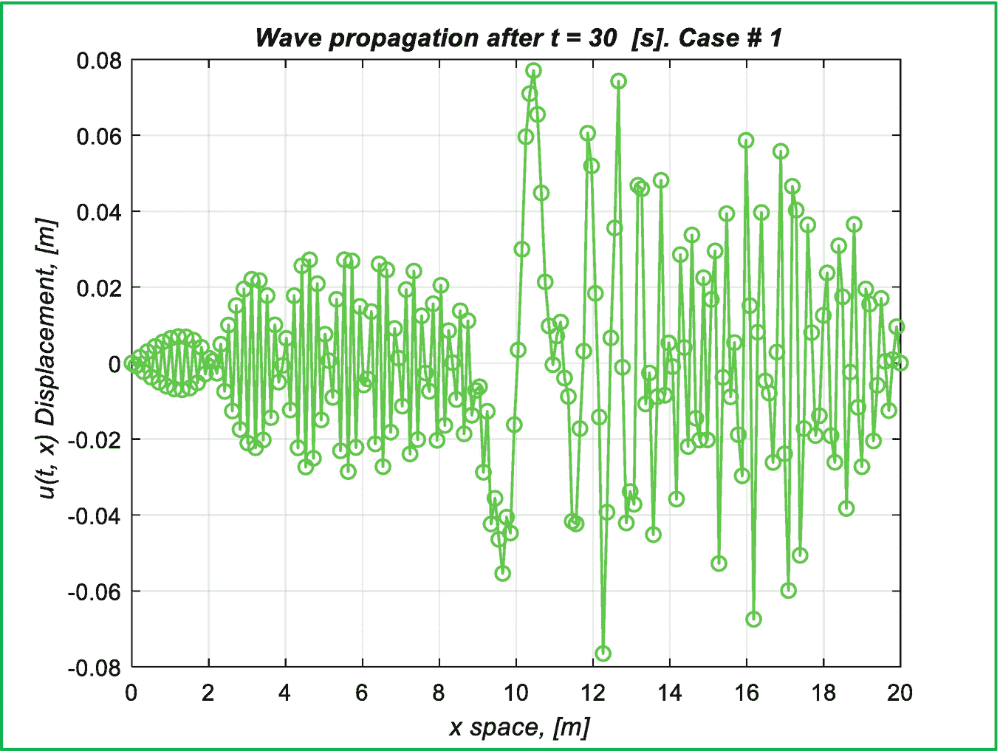

图 13-14：一维波传播问题，案例 1


图 13-15：一维波传播问题，案例 2


图 13-16：一维波传播问题，案例 3

## 求解二维波动方程

让我们考虑一个无扰动源区域的二维波动方程，其形式如下：

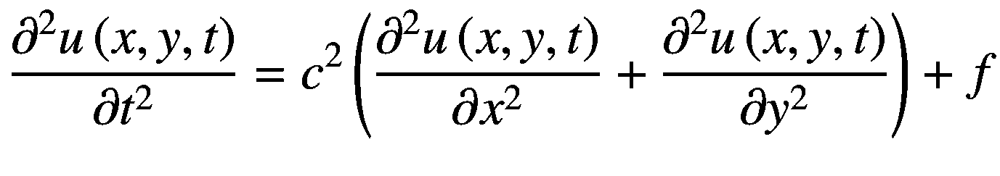

(13-33)

通过对方程 (13-33) 进行离散化，我们可以写出下一个方程：


(13-34)

为简单起见，我们设置 `Δx = Δy` 并重写方程 (13-34)。


(13-35)

方程 (13-35) 是计算二维波传播的递归算法。

以下是狄利克雷边界条件：


(13-36)

此外，为了吸收/阻止沿四个边界的传播波，让我们考虑以下零边界条件：

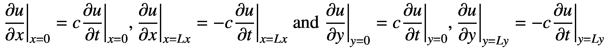

(13-37)

通过考虑先前编写的边界条件，引入 `C² = [c * Δt / Δx]²`，并使用离散化后的方程 (13-34)，我们可以写出以下方程：


(13-38)


(13-39)


(13-40)


(13-41)

其中 `C` 是波传播速度，也称为库朗数。

## 示例 5

我们以一个 5 米 x 5 米、采用狄利克雷边界条件的弹性板为例。该板中心受到一个正弦力 `f = 0.5 * sin(1.5 * π * t)` 的激励。波传播速度为 `c = 0.25`。

以下是该练习的解决方案脚本，名为 `Wave_Propagation_2D.m`：

## 二维波传播问题仿真

该解决方案脚本求解了给定的二维波传播问题，并绘制了仿真结果的动画图，如图 13-17 和图 13-18 所示。请注意，此仿真是一个计算数据的实时演示（图 13-17），因此运行速度较慢。

```matlab
% 2D Wave propagation problem simulation
clearvars; clc
% Given parameters:
Lx = 5;  % Length along x axis
Ly=Lx;   % Length along y axis
dx=.05;  % Mesh size along x axis
dy=dx;   % Mesh size along y axis
Nx = Lx/dx;   % Number of node points along x axis
Ny=Nx;         % Number of node points along y axis
x=linspace(0, Lx, Nx);
y=x;
% Simulation period:
T=50;
% Displacement:
un = zeros(Nx, Ny);    % Memory allocation
unm1=un;
unp1 =un;
C  =0.25;      % Courant number
c  = 1;        % Wave propagation speed
dt=C*dx/c;     % Time increment
t=0;           % Initial simulation time value
% Simulation Loop:
while t<T
% Boundary conditions:
un(:, [1,end])  = 0;
un([1, end], :) = 0;
% Time evolution:
t=t+dt;
% Save the simulation results:
unm1=un; un=unp1;
%  Excitation source:
un(50,50)=0.5*sin(1.5*pi*t);
for ii=2:Nx-1
for jj=2:Ny-1
unp1(ii, jj)=2*un(ii, jj)-unm1(ii, jj)+...
(C²)*(un(ii+1,jj)+un(ii,jj+1)-4*un(ii, jj)+ ...
un(ii-1, jj)+un(ii,jj-1));
end
end
surfc(x, y, un'), colorbar; shg
caxis([-0.15 0.25])   % Pseudocolor axis scaling.
title([' Simulation results after t = '  num2str(t) '  [s]'])
pause(dt)
axis tight
end
xlabel('Width, [m] ')
ylabel('Length, [m] ')
zlabel('Displacement, [m]')
%% Contour plot
figure(2)
contourf(x, y, un'), colorbar; shg
title([' Simulation results after t = '  num2str(t) '  [s]'])
axis tight
xlabel('Width, [m] ')
ylabel('Length, [m] ')
```


图 13-18 二维波传播问题仿真

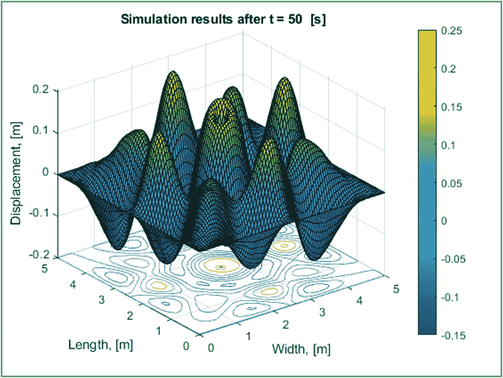
图 13-17 二维波传播问题仿真

偏微分方程示例到此结束。请注意，MATLAB 中有一个名为 PDE 工具箱的工具箱，它包含许多 GUI 入口工具和内置函数，例如几何构建（矩形、圆形、多边形）、边界条件设置、PDE 方程设置、网格划分、求解、绘图以及许多其他用户友好选项。

## 练习

以下是供您自行尝试的练习。

### 练习 1

求解一维热传导问题。假设有一根长度为 `L= 2 [m]` (0 < `x` ≤ `L`) 且 `k=0.001` 的导线。使用以下初始温度分布：`T(x, 0) = 65x [°C]`。假设导线两端都插入冰桶中（`T(0)=T(L) = 0 [°C]`）。将该问题的数值解作为一系列解进行计算。

### 练习 2

求解以下一维波动方程：

假设 `y`(0, `t`) = `y`(1, `t`) = 0，对于 0 < `x` < 1，有 `y`(`x`, 0) = `cos` (2*πx*) + 0.25 `cos` (5*πx*)，对于 0 < `x` < 1，有
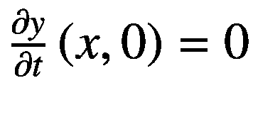。

### 练习 3

使用 `PDEPE()`。求解给定的一维热传导方程
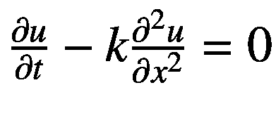，定义域为 0 < `x` < `L` 且 0 < `t`。设 `L =10` 且 `k=0.55`。对于所有 `t > 0`，边界条件为 `u(0, t) = 75` 且 `u(L, t)=125`。初始条件形式为对于 `0<x<L`，`u(x, 0)=u[0](x)`，其中 `u[0](x)` 是一个已知/给定的函数，描述了沿杆长度的初始温度分布。考虑以下情况：`u[0](x) = 5x-1.2*0`。

### 练习 4

使用拉普拉斯算子 `del2()`。求解拉普拉斯方程
，其中 `u(x, y)` 定义在 `x` ∈ [0, 2]，`y` ∈ [0, 2] 上，并具有以下边界条件：`u(x, 0)= 5, u(x, 2)=15; u(0, y)=5, u(2, y)=15`。

### 练习 5

使用高斯-赛德尔方法。求解拉普拉斯方程
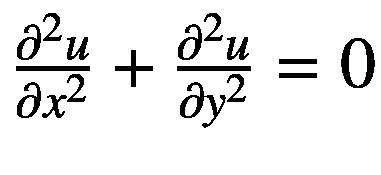，其中 `u(x, y)` 定义在 `x` ∈ [0, 2]，`y` ∈ [0, 2] 上，并具有以下边界条件：`u(x, 0)= 5, u(x, 2)=15; u(0, y)=5, u(2, y)=15`。

### 练习 6

使用递归算法。求解一维波动方程
，其中 `u(t, x)` 定义在 `x` ∈ [0, 10] 上，并具有以下边界条件：`u(t, 0)= 0` 和 `u(t, 10)=0`。弦在中间被激发，`u`(`t`, 5) = 0.25 `sin` (2*πt*)。取 =0.75。

### 练习 7

使用 `PDEPE()`。求解给定的一维热传导方程
，定义域为 0 < `x` < `L` 且 0 < `t`。设 `L=5`。对于所有 `t > 0`，边界条件为 `u(0, t) = 0` 且
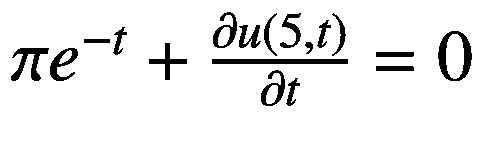。初始条件为对于 0<`x`<`L`，`u`(`x`, 0) = `sin` (2*πx*)。

### 练习 8

# 数值方法练习

使用高斯-赛德尔方法。求解拉普拉斯方程
$$ \frac{\partial²u}{\partial {x}²}+\frac{\partial²u}{\partial {y}²}=0 $$
，其中`u(x, y)`定义在`x ∈ [0, 2]`，`y ∈ [0, 2]`上，并具有以下边界条件：`u(x, 0)= 5, u(x, 2)=15; u(0, y)=5, u(2, y)=15`。

## 练习 9

使用有限差分方法。求解拉普拉斯方程
$$ \frac{\partial²u}{\partial {x}²}+\frac{\partial²u}{\partial {y}²}=0 $$
，其中`u(x, y)`定义在`x ∈ [0, 2]`，`y ∈ [0, 2]`上，并具有以下边界条件：`u(x, 0)= 5, u(x, 2)=15; u(0, y)=5, u(2, y)=15`。

## 练习 10

使用数值方法求解扩散方程（示例中是一根 5 米长的金属细棒）。温度标量场 `T` 的扩散方程表达如下：

$$ \rho {C}_p\frac{\partial T}{\partial t}=K\frac{\partial²T}{\partial {x}²}+\dot{q} $$

其中`ρ`是材料的密度，`C[p]`是比热容（在恒压下，如果是气体），`\dot{q}`是热源。

考虑一维混合狄利克雷和诺依曼边界条件。一根 5 米长的薄金属棒初始温度为 100⁰C。计算在以下边界条件值下，棒的温度将如何随时间变化：在`t = 0`时，棒的两端均置于冰上（0⁰C）。不存在热源，即`\dot{q}=0`。此外，假设热量仅沿棒流动。这里，`\rho =7800\ \left[\frac{kg}{m³}\right],{C}_p=502\left[\frac{J}{kg\ast K}\right],\mathrm{and}\ K=30\left[\frac{W}{m\ast K}\right]`。

## 习题 11

考虑习题 10 中给出的问题（扩散方程与细杆）。该杆由铜制成，初始温度为 100°C。在`t = 0`时，杆的左端被置于冰上（0°C）。计算穿过该杆的热流量。

$$ \rho =8885\ \left[\frac{kg}{m³}\right],{C}_p=376.812\left[\frac{J}{kg\ast K}\right];K=384.1\left[\frac{W}{m\ast K}\right]. $$

## 习题 12

使用有限差分法求解拉普拉斯方程
$$ \frac{\partial²u}{\partial {x}²}+\frac{\partial²u}{\partial {y}²}=0 $$
，求解定义在`x ∈ [0, 1]`，`y ∈ [0, 1]`上的`u(x, y)`，边界条件为：`u(x, 0) = 2`，`u(x, 2) = 5`；`u(0, y) = 2`，`u(2, y) = 5`。

## 习题 13

考虑以下二维波传播问题：

$$ \frac{\partial²u\left(x,y,t\right)}{\partial {t}²}={c}²\left(\frac{\partial²u\left(x,y,t\right)}{\partial {x}²}+\frac{\partial²u\left(x,y,t\right)}{\partial {y}²}\right)+f $$

弹性板的尺寸为 10 米乘 10 米，在`x = 3 m`和`y = 3 m`处受到周期力`f = sin(πt) + 2 * cos(2πt)`的激励。波传播速度为`c = 0.125`。

# 索引

## A

- `Adams-Bashforth` 法：公式化、迭代、索引、绘图、求解、问题方程

- `Adams-Moulton` 法：后向欧拉法、隐式公式化、数值解、预测/校正表达式、二阶/高阶计算、数值解实现、非齐次绘图结果、仿真结果、仿真结果、梯形法则法

- `Akzo-Nobel` 问题：数学公式化、输出图、相对误差容限、`Runge-Kutta/Simulink` 模型、仿真结果、`Simulink` 模型

## B

- 边界条件 (BCs)

- 边值问题 (BVPs)：边界条件、狄利克雷边界条件、解析解、边界条件问题仿真结果、求解脚本、方程表达式、数值解、问题通解、罗宾边界条件 (另见：罗宾边界条件)、二阶方程、刚性、Sturm-Liouville

## C

- `Chebyshev` 微分方程

- 比较分析：解析解、概念、`dsolve/laplace/ilaplace` 函数、`Euler/Adams-Moulton` 方法、拉普拉斯变换、`linear/nonlinear` 函数、`MuPAD` 命令、数值解、`ODEx` 数值解、相图、解残差、Robertson 问题、二阶非齐次、`Simulink` 模型

## D

- 自由度 (DOF) (另见：单自由度 (DOF))

- `del2()`：拉普拉斯算子、微分算子、热流仿真、`MATLAB` 仿真结果、`surf()` 图、温度分布问题、求解、`diff` 函数

- 狄利克雷边界条件问题：解析解、边界条件问题仿真结果、求解脚本

- `Dormand-Prince` 算法

- 双摆：公式化、线性化模型、`m-file (Sim_Double_Pendulum_Linear.m)`、相图、物理模型 `m-file (Sim_Double_Pendulum_Linear.m)`、`Sim_DOUBLE_Pendulum.m`、仿真模型、`Simulink` 模型、小振幅振荡

## E

- 机电/机械系统 (另见：电机建模)

- 电动势 (EMF) 电压

- 欧拉方法：算法、后向法、前向法、修正法/Heun 法、`Newton-Raphson` 技术、数值解、问题方程、二阶/高一阶常微分方程、前向法 *vs.* 解析解、`matlabFunction`、数值解、仿真结果、仿真结果

## F

- 自由落体：受力问题、牛顿第二定律、仿真模型脚本、仿真结果、终端速度、时间 *vs.* 速度

- 柔性负载模型：角速度、直流电机微分方程、机电系统、电磁转矩、运动转矩平衡、电机/轴物理模型脚本 (`Sim_DC_Motor_w_Load.m`)、`Simulink` 模型

- 受迫振动 (运动)：阻尼比、位移 *vs.* 速度、方程公式化、傅里叶级数近似、初始条件、`MATLAB` 脚本、归一化系统、响应幅值、参数模块、周期波力、脉冲外力、脚本 (`zeta_1DOF_SMD.m`)、`Simulink` 模型、零初始条件、脚本 (`zeta_1DOF_SMD.m`)

- 自由度系统：三自由度、微分方程、受迫振动、自由体受力图、自由运动、`Heaviside` 阶跃函数、数值仿真、`Simulink` 模型、系统方程、两自由度 SMD、位移/速度、外部冲激力、自由体受力图、函数文件 (`SMsysSIM.m`)、质量/阻尼/刚度系统、`MATLAB` 模型、物理模型、`Simulink` 模型、函数文件 (`SMsysSIM.m`)

## G

- `Gauss-Seidel` 法：`contour()` 图、离散方案、公式化、热传导、迭代法、`pcolor()` 图、物理系统、`ribbon()` 图、仿真结果、`surf()` 图、温度值

## H

- 热传导问题：一维问题、能源、求解脚本 (`Heat_Transfer.m`)、偏微分方程、仿真结果、求解脚本 (`Heat_Transfer.m`)；二维问题：`contour()` 图、离散方案、`Gauss-Seidel` 法、公式化、迭代法、`pcolor()` 图、物理系统、`ribbon()` 图、仿真结果、`surf()` 图、温度值

- `Heun` 法

- 高阶/耦合系统：`Akzo-Nobel` 问题 (另见：`Akzo-Nobel` 问题)、四阶问题、非齐次常微分方程、仿真结果、`Simulink` 模型、系统实现、`HIRES` 问题、`Robertson` 问题

- 高辐照响应 (`HIRES`) 问题：前向欧拉法、`Runge-Kutta` 法、仿真模型

- 胡克定律

## I

- 隐式问题：圆柱电容器、微分代数方程、微分方程、`Fimp` 匿名函数、一阶/微分代数方程、`MATLAB` 版本、数值解、仿真模型、仿真输出、仿真结果、`Simulink` 模型

- 初值问题 (IVPs)

## J, K

- 雅可比矩阵：`Chebyshev` 微分方程、微分方程、整流电路、一阶微分方程、`Simulink` 模型、版本

## L

- 拉普拉斯算子 (另见：`del2()` 拉普拉斯算子)

- 拉普拉斯变换：解析/数值解、命令语法、常系数、非连续强迫函数、特点、流程图、逆变换、`laplace/ilaplace/dsolve` 语法、内置函数、`MATLAB` 脚本、绘制解、解、非齐次/非线性、数值解、二阶非齐次

- `Lorenz` 系统：方程、`LORENZ_functions.m`、模型、仿真脚本

- `Lotka-Voltera` 问题：方程、数值/初始条件、捕食者-猎物方程、猎物/捕食者、仿真结果

## M

- 火星着陆器速度/加速度方程

- 数学/仿真模型：构建仿真模型、级联模型、微分方程、初始条件、`Lorenz` 系统方程、`LORENZ_functions.m` 模型、仿真脚本、`Lotka-Voltera`、数值/初始条件、捕食者-猎物方程、猎物/捕食者、仿真结果、数学公式化、`MATLAB` 函数、非线性系统、物理参数、旋转系统、三自由度系统、三角形微分系统、两自由度模型

- 矩阵方法 (另见：*n*-自由度 (自由度系统))

- 麦克风：微分方程、机械/电气方程、数值仿真、物理模型、`Sim_Microphone_Model.m` 文件、仿真结果、`Simulink` 模型

- 中点法则法：算法、显式方法、数值解、输出数据文件、仿真结果

- `Milne` 法：表达式、实现、数值解

- 混合边界条件 (另见：罗宾边界条件)

- 电机建模：直流电机、`DC_Motor_SIM.m` 文件、`DC_Motor_SIM.m` 文件、微分方程、EMF 电压、输入电压/输出扭矩、仿真结果、`Simulink` 模型、传递函数公式化、零初始条件、柔性负载、麦克风、摆 (另见：双摆)、泵齿轮箱

## N

- *n*-自由度 (自由度系统)：微分方程、受迫运动 (振动)、自由运动、通用公式化、牛顿第二定律

- 非零初始条件，二阶/高阶常微分方程：配置设置、选项、仿真结果、`Simulink` 模型

- 数值方法 (一阶)：`Adams-Bashforth`、`Adams-Moulton` (另见：`Adams-Moulton` 法)、比较研究、欧拉 (另见：欧拉方法)、`MATLAB` 包、匿名函数、内置 ODE 求解器、`ODEFUN` 函数、仿真结果、类型选择、中点法则、`Milne` 法、`OPTION/ODESET/ODEPLOT` 工具、精度等级、不等式方程、求解脚本 (`ODE1sim.m`)、`ODESET` 函数、误差容限 (`RelTol`)、`Ralston` 表达式、`Runge-Kutta` 法、欧拉法算法、`Fehlberg` 法、`Gill` 法、`simset()` 命令、`Simulink` 建模、泰勒级数

## O

- `ODESET` 函数

- `ODEx` 求解器：二阶/高阶常微分方程、比较仿真、计算数值解、`MATLAB` 求解器、仿真结果、`Simulink` 模型

- 常微分方程 (ODEs)：解析解、生物体 (细菌)、分类、命令语法、微分方程、`dsolve` 求解脚本 (`dsolve()`/`syms` 函数)、一阶方程、流程图、齐次/非齐次、初始/边界条件、拉普拉斯变换 (另见：拉普拉斯变换)、`MATLAB` 命令语法、运动公式、`MuPAD` 命令、牛顿第二定律、非齐次/非线性、放射性衰变、二阶命令、二阶微分方程、简短脚本/命令、符号 `MATH` 工具箱/`MuPAD` 笔记本

## P, Q

- 偏微分方程：拉普拉斯算子 `del2()`、扩散方程、离散拉普拉斯算子、`Gauss-Seidel` 法、热传导 (另见：热传导问题)、一维波动方程、PDE 应用、`PDEPE()`、递归算法、二维波动方程、波动方程、`PDEPE()`

- 预测-校正方法

- 猎物/捕食者

- 泵齿轮箱：微分方程、等效系统、自由体受力图、`Motor_Pump_Demo.m` 函数、`Motor_Pump_model.slx` 文件、数值解、原始系统、相图、求解、仿真模型、仿真结果、`Simulink` 模型、时间 *vs.* 角位移、扭振模型

## R

- `Ralston` 法

- 电阻-电感-电容 (RLC)

- `Robertson` 问题：模型

- 罗宾边界条件：边界条件、定义、用于比较、`MuPAD` 注解、仿真结果

# S

- Runge-Kutta-Fehlberg 法
- Runge-Kutta-Gill 法
- Runge-Kutta 法：`vs.` 解析法、函数值、HIRES 问题、数值解、问题方程、二阶/高阶常微分方程、`dsolve` 函数、齐次、非齐次、非线性、数值解、仿真结果
- 二阶/高阶常微分方程：Adams-Moulton 法、`diff()` 方程、欧拉方法 (另见：欧拉方法)、非零初始条件、`ODEx` 求解器、Runge-Kutta 法、`Simulink` 建模
- `Simulink` 建模：模块、完整模型、配置参数、不同方法、显示选项、交互式初始条件设置、选项、积分器模块、`MODELname.mdl`、搜索框下拉选项、二阶/高阶常微分方程、模块参数、闭环反馈系统、积分器模块、建模步骤、模型版本、数值解、问题、仿真结果、`simset()` 命令、仿真结果
- 单自由度 (DOF)：受迫振动 (运动)、自由振动 (运动)、特征方程、临界阻尼、阻尼比值、函数文件 (`SMDode.m`)、初始条件、初值问题、输入项、过阻尼问题、问题公式化、二阶常微分方程、仿真结果、函数文件 (`SMDode.m`)、无阻尼问题、欠阻尼问题
- 弹簧-质量-阻尼 (SMD) 系统：自由度 (另见：单自由度 (DOF))、自由度系统、运动/构建仿真模型、两自由度矩阵方法
- 刚性边值问题：脚本文件 (`BVP_EX5.m`)、`MuPAD` 注解、脚本文件 (`BVP_EX5.m`)、仿真结果
- 刚性常微分方程：比较分析、一阶常微分方程、前向欧拉法、函数文件、数值解、仿真结果、更刚性问题
- Sturm-Liouville 边值问题：应用领域、方程、`MATLAB` 的 BVP 求解器工具、`MuPAD` 注解、仿真结果

# T, U, V

- 泰勒级数法
- 抛球轨迹：解析解、微分方程、经验表达式、受力问题、初始条件、牛顿第二定律方程、无旋转系统、数值解、仿真结果、`Simulink` 模型、旋转球运动力、网球轨迹、`Thrown_Ball_All.m` 文件、上旋模型、子系统
- 轨迹问题：自由落体、受力问题、牛顿第二定律、仿真模型脚本、仿真结果、终端速度、时间 `vs.` 速度、抛球 (另见：抛球轨迹)
- 梯形法则法

# W, X, Y, Z

- 波动方程：公式化、一维方程、扰动情况、公式化、胡克定律、牛顿/胡克定律、递归算法、仿真结果、弹簧-质量系统仿真、二维方程、狄利克雷边界条件、公式化、传播问题、仿真、仿真结果、零边界条件