# 3. 二阶常微分方程的数值方法

二阶或更高阶的常微分方程对于物理学、工程学和自然科学中的广泛问题至关重要。例如，波动方程、电磁现象、热传导和流体力学都是用二阶或更高阶常微分方程建模的。通常，二阶常微分方程的形式如方程 (3-1) 所示。

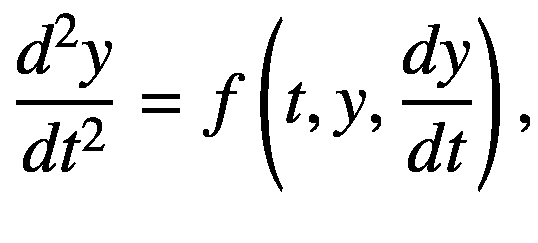

(3-1)

通常，自变量用 *t* 表示，在许多物理系统中，它通常是一个自变量（例如，相对于时间）。还有许多系统使用 *x*、*y* 和 *z* 或其他变量。

一个 *n* 阶线性微分方程可以用如下一般形式表示：

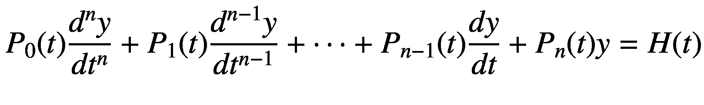

(3-2)

其中 *P*0, *P*1...*P**n* 和 *H*(*t*) 是在某个区间 *α* < *t* < *β* 上的连续实值函数，并且在该区间内 *P*0 不接近于零。如果我们用 *P*0 除以方程 (3-2)，得到以下方程：

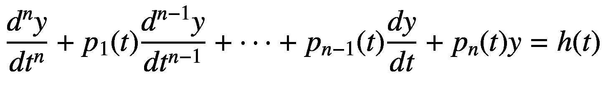

(3-3)

方程 (3-3) 也可以重写如下：

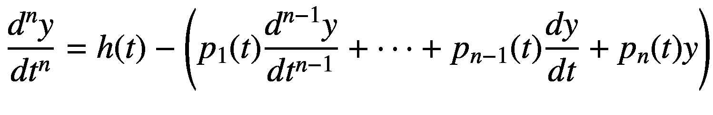

(3-4)

并且也可以写成：

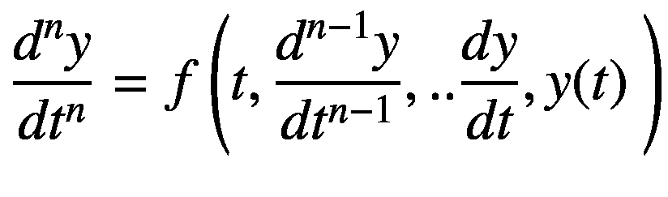

(3-5)

方程 (3-5) 类似于二阶常微分方程的方程 (3-1)。

让我们看几个二阶常微分方程的例子，以展示如何使用欧拉法、龙格-库塔法、亚当斯-巴什福思法和亚当斯-莫尔顿法以及其他方法。此外，我们还演示了如何使用 MATLAB 内置的常微分方程求解器和工具（包括 `dsolve()`）来计算数值解和解析解。

一阶常微分方程所采用的方法和先前的做法对于二阶及更高阶常微分方程是相似且有效的。对于所有显式定义的常微分方程，需要多一个（或多个）步骤，即将给定的二阶或更高阶常微分方程重写为一阶常微分方程组。对于隐式定义的常微分方程，我们通过使用 MATLAB 内置求解器 `ode15i` 和 Simulink 演示了一种单独的方法。

## 欧拉法

在前面的章节中，我们详细介绍了欧拉法的公式推导和实现算法，以展示如何数值求解一阶常微分方程。对于高阶常微分方程，欧拉法的实现步骤相同，只是中间多了一些步骤。因此，在本节中，我们将局限于通过 MATLAB 脚本实现欧拉法，直接计算二阶及更高阶常微分方程的数值解。

### 示例 1

给定一个二阶非齐次常微分方程，示例问题如下： 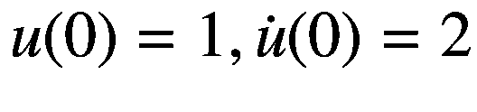。

在编写基于欧拉法的脚本之前，我们需要通过引入新变量，将给定的二阶常微分方程重写为两个一阶常微分方程组成的方程组。

 需要重写如下：。

注意 *u*[1] = *u* 且 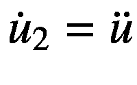。

上述重写后的一阶常微分方程组可以通过多种方式在脚本中实现，例如，直接在脚本中编写方程组、使用匿名函数（`@`）、使用函数或使用函数文件。请注意，从 MATLAB 2018a 开始，在脚本中实现函数是有效的。

以下是嵌入欧拉前向法以计算给定问题数值解（如图 3-1 所示）的脚本（名为 `Example1_2ndODE.m`）：

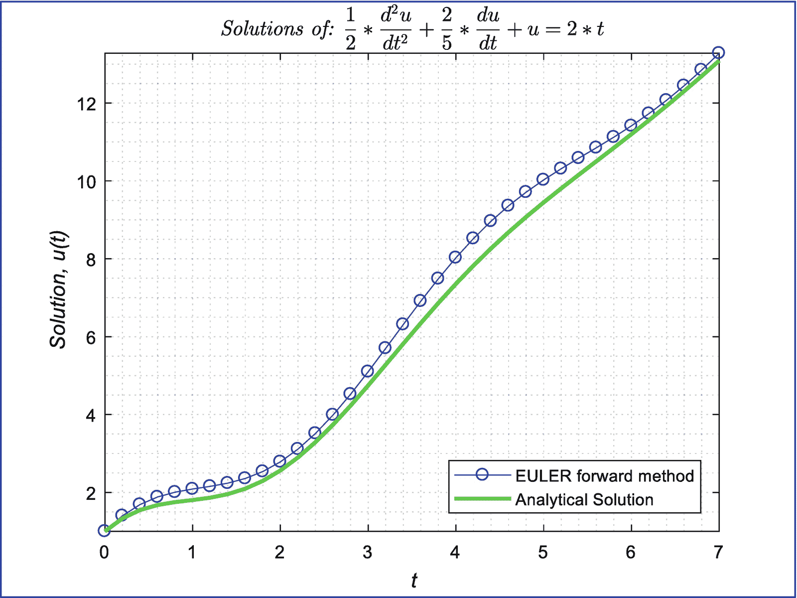

图 3-1

前向欧拉法与用 `dsolve()` 求解 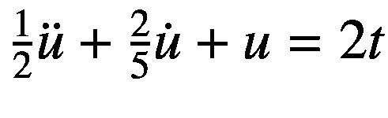, 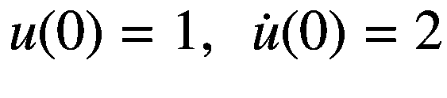 得到的解析解对比

```
% 示例 1。 (1/2)*u"+(2/5)*u'+u=2*t，初始条件：u(0)=1 & u'(0)=2
% 使用欧拉前向法和 DSOLVE 求解。
clearvars, close all; clc
h=0.2;         % 时间步长
tmax=7;        % 仿真结束时间
t0=0;          % 仿真开始时间
t=t0:h:tmax;
steps=length(t);   % 评估步数
u(1,:)=[1 2];      % 初始条件
%{
注意：u(t) 的维数是二维的，这是因为
有两个变量用于将二阶常微分方程重写为两个一阶常微分方程。
%}
% 方法 #1。 直接表达常微分方程组的方式
for k=2:steps
f=[u(k-1,2), 4*t(k)-(4/5)*u(k-1,2)-2*u(k-1,1)];
u(k,:)=u(k-1,:)+f*h;
end
% 方法 #2。 匿名函数 (@)
%{
F = @(t, u1, u2)([u2, 4*t-(4/5)*u2-2*u1]);
for k=2:steps
F1=F(t(k-1), u(k-1, 1), u(k-1, 2));
u(k,:)=u(k-1,:)+F1*h;
end
%}
% 方法 #3。  函数文件，命名为：FuFu.m
%{
function dudt = FuFu(t, u1, u2)
dudt = [u2, 4*t-(4/5)*u2-2*u1]
end
%}
%{
for k=2:steps
F1=feval(@FuFu,t(k-1), u(k-1, 1), u(k-1, 2));
u(k,:)=u(k-1,:)+F1*h;
end
%}
% 方法 #4
%{
syms T u1 u2
f=[u2, 4*T-(4/5)*u2-2*u1];
matlabFunction(f, 'file', 'F');
for k=2:steps
F1=feval(@F, t(k-1), u(k-1, 1), u(k-1, 2));
u(k,:)=u(k-1,:)+F1*h;
end
%}
plot(t, u(:,1), 'bo'), grid minor, hold on
% 问题的解析解：
syms x(T) Dx T
Dx=diff(x, T);
D2x=diff(x, T, 2);
Equation=D2x==-(4/5)*Dx-2*x+(4*T);
ICs = [x(0)==1, Dx(0)==2];
y=dsolve(Equation, ICs);
Y=double(subs(y,'T',t));
% 或使用：U=vectorize(u); T=t; U=eval(U);
plot(t, Y, 'g-', 'linewidth', 2)
legend('欧拉前向法','解析解', 'location', 'southeast')
title('\it 解的：$$\frac{1}{2}*\frac{d²u}{dt²}+\frac{2}{5}*\frac{du}{dt}+u=2*t $$', 'interpreter', 'latex')
xlabel('\it t'), ylabel('\it 解, u(t)'), hold off
axis tight; shg
```

在前面的示例中应该注意，通过减小步长（*h*），欧拉法的精度会显著提高，就像一阶常微分方程一样。


好的，作为高级文档工程师和翻译员，我将遵循您的注意事项，将给定的英文文本翻译成中文，并保留所有格式。


## 示例 2

给定一个二阶齐次常微分方程，示例问题如下：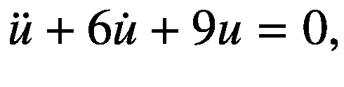 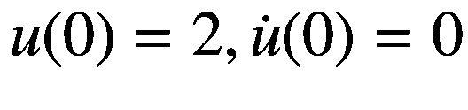。

在这个例子中，和前面的问题一样，我们通过引入新变量，将给定的二阶微分方程改写为两个一阶常微分方程。

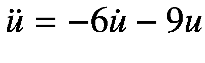 应改写为两个一阶常微分方程：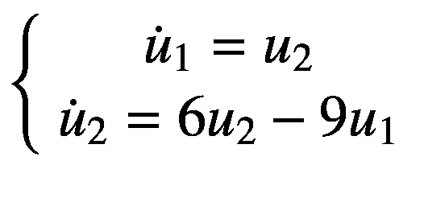。

注意 `u[1] = u` 且 。

以下是嵌入了前向欧拉法来计算该问题数值解的脚本（`Example2_2ndODE.m`）。请注意，由两个一阶常微分方程定义的给定系统，在循环中被定义为一个二维函数。在此示例中，我们演示了步长对计算出的数值解相对于系统解析解的精度的影响。

```
% EXAMPLE 2\.  u"+6*u'+9*u=0with ICs: u(0)=2 & u'(0)=0
% solved by EULER’s Forward Method and DSOLVE.
clearvars, close all
h=0.1;             % time step size
tend=2.5;          % End of calc's/simulations
t0=0;              % Start of calc's/simulations
t=t0:h:tend;       % Time space
steps=length(t);   % How many steps of evaluations
u(1,:)=[2 0];      % Initial Conditions
% NB: Size of the u(t) is two-dimensional
for k=1:steps-1
f1=[u(k,2), -9*u(k,1)-6*u(k,2)];
% f1(k,:)=[u(k,2), -9*u(k,1)-6*u(k,2)]; % If we need f1 values.
u(k+1,:)=u(k,:)+f1*h;
end
plot(t, u(:,1), 'b--x', 'linewidth', 2), grid on, hold on
% Study step size change effects on errors
h1=0.025;          % time step size
t=t0:h1:tend;
step=length(t);    % How many steps of evaluations
y(1,:)=[2 0];      % Initial Conditions
for k=1:step-1
ff1=[y(k,2), -9*y(k,1)-6*y(k,2)];
y(k+1,:)=y(k,:)+ff1*h1;
end
plot(t, y(:,1), 'g--', 'linewidth', 2)
% Analytical solution of the problem:
syms x(T) Dx T
Dx=diff(x, T);
D2x=diff(x,T,2);
Equation=D2x==-6*Dx-9*x;
ICs=[x(0)==2, Dx(0)==0];
Y=dsolve(Equation, ICs);
Y=double(subs(Y,'T',t));
plot(t, Y, 'k-', 'linewidth', 1.5)
title('\it Solution of: $$ \frac{d²u}{dt²}+6*\frac{du}{dt}+9*u=0, u_0=2, du_0=0 $$', 'interpreter', 'latex')
xlabel '\it t', ylabel '\it Solution, u(t)'
legend('EULER Method: h= 0.1', 'EULER Method: h = 0.05', 'Analytic Solution')
err1= abs((Y(end)-u(end,1))/Y(end))*100;
err2= abs((Y(end)-y(end,1))/Y(end))*100;
error1=['Error (h=0.1): ', num2str(err1),      '%'];
error2=['Error (h=0.025): ', num2str(err2),  '%'];
text(1.0, .75, error1, 'color', 'r', 'fontsize', 14)
text(1.0, .6, error2, 'color', 'r', 'fontsize', 14)
axis([0, 3.5 -0.1 2.25])
hold off
axis tight
```

执行上述脚本后，会显示出数值解的图形（如图 3-2 所示）。

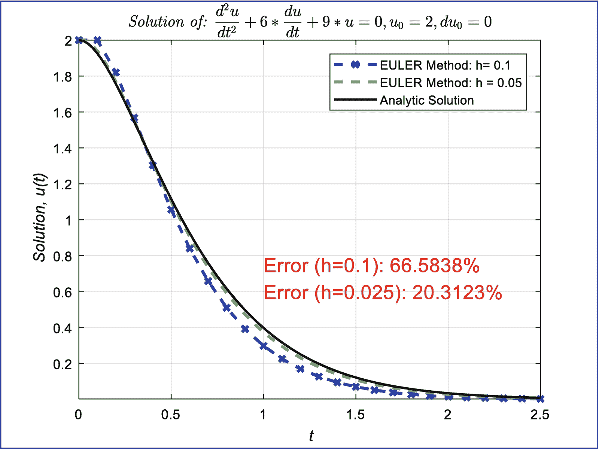

**图 3-2** 针对  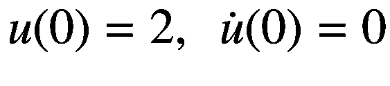 使用前向欧拉法得到的仿真结果

从这些仿真结果（如图 3-2 所示）可以看出，将步长减小到原来的四分之一，我们可以将精度提高三倍以上。这是一个显著的改进，但这是以计算时间增加四倍为代价的。

### 示例 3

给定一个二阶非齐次常微分方程，示例问题如下：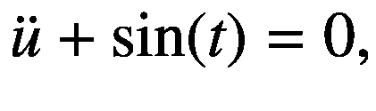 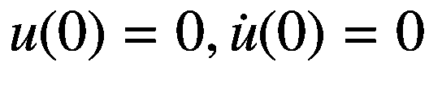。

同样在编写脚本之前，我们将给定问题改写为两个一阶常微分方程。

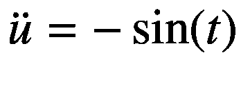 被重写为：

注意 `u[1] = u` 且 。

以下是一个脚本（`Example3_2ndODE.m`），它嵌入了前向欧拉法来寻找该问题的数值解（如图 3-3 所示）。请注意，在我们的脚本中，一阶常微分方程组是直接表示的，如上文重写的公式所示。

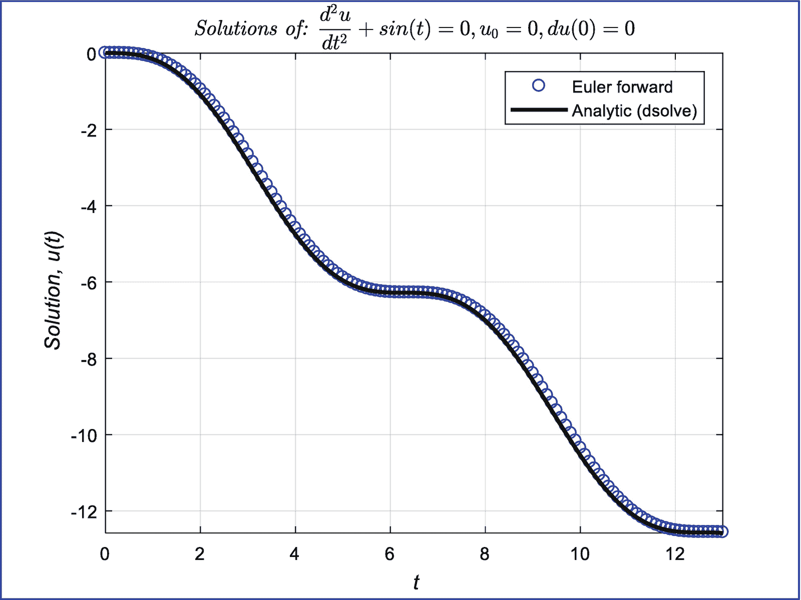

**图 3-3** 前向欧拉法与解析解（`dsolve`）的仿真结果对比。示例 3：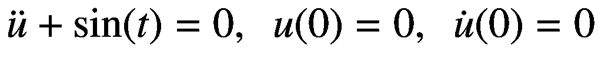。

```
% Example3_2ndODE.m
%% EXAMPLE 3\.  u"=-sin(t) with ICs: u(0)=0 & u'(0)=0
% solved by forward EULER Method and DSOLVE
clc, clearvars; close all
h=0.1;                   % Time step size
tend=13;                 % End of calc's/simulations
t0=0;                    % Start of calc's/simulations
t=t0:h:tend;             % Time space
steps=length(t);         % How many steps of evaluations
u(1,:)=[0 0];            % Initial Conditions
for k=1:steps-1
f1=[u(k,2), -sin(t(k))];
u(k+1,:)=u(k,:)+f1*h;
end
plot(t', u(:,1),'bo')
hold on, axis tight
clearvars u
% Analytical solution of the problem:
syms u(T) T
Du=diff(u, T);
D2u=diff(u, T, 2);
Equation=D2u==-sin(T);
ICs = [u(0)==0, Du(0)==0];
u=dsolve(Equation, ICs);
U=vectorize(u);
T=t;
U=eval(U);
plot(T, U, 'k-', 'linewidth', 2), grid on
legend('Euler forward', 'Analytic (dsolve)')
title('\it Solutions of: $$ \frac{d²u}{dt²}+sin(t)=0, u_0=0, du(0)=0 $$', 'interpreter', 'latex')
xlabel('\it t'), ylabel('\it Solution, u(t)')
shg
```


### 示例 4

给定一个二阶非齐次常微分方程，示例如下：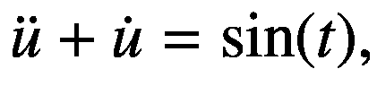 .

同样，在创建脚本之前，我们将给定的问题重写为两个一阶常微分方程。

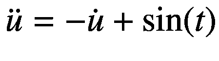 被重写为：

注意 `u[1] = u` 且 。

以下是一个脚本（`Example4_2ndODE.m`），它嵌入了前向欧拉法来求该问题的数值解（如图 3-4 所示）。注意，在我们的脚本中，一阶常微分方程组是直接在一个`[for ... end]`循环中表达的，如之前重写的公式所示。

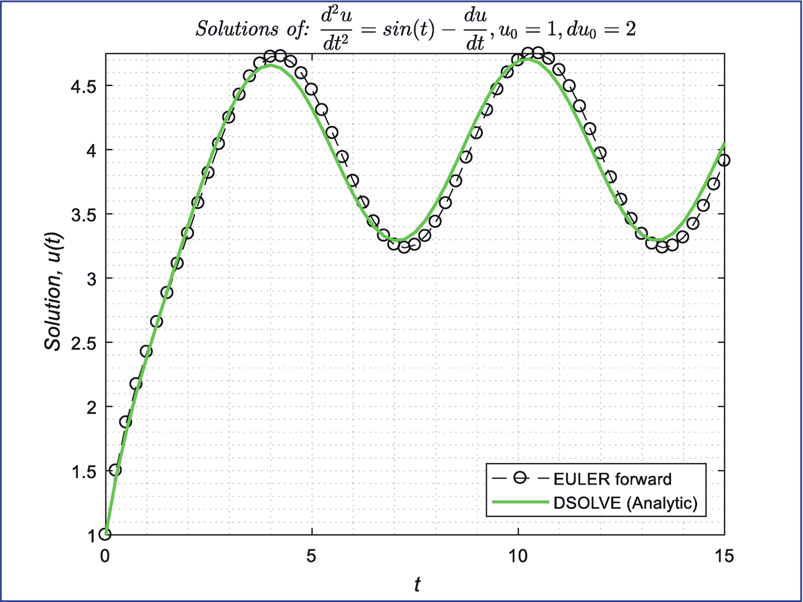

**图 3-4** 示例 4 的仿真结果：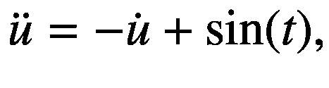 

```
% Example4_2ndODE.m
%% EXAMPLE 4\. u"+u'=sin(t) with ICs: [1, 2]
% by EULER Forward Method& DSOLVE (analytical solution)
clearvars; clc; close all
u=[1, 2];            % ICs: u0 at t0
tmax=15;             % max. time limit
h=0.25;              % time step size
t=0:h:tmax;          % time space
steps=length(t);     % # of steps
f = @(t, u)([u(2), -u(2)+sin(t)]);
for k=1:steps-1
u(k+1,:)=u(k,:)+f(t(k), u(k,:)).*h;
end
plot(t, u(:,1),'k--o'), grid minor; hold on
% Analytical solution of the problem:
syms u(T) T
Du=diff(u, T);
D2u=diff(u, T, 2);
Equation=D2u==sin(T)-Du;
ICs = [u(0)==1, Du(0)==2];
u=dsolve(Equation, ICs);
U=double(subs(u,'T',t));
plot(t, U, 'g-', 'linewidth', 1.5)
title('\it Solutions of: $$ \frac{d²u}{dt²}=sin(t)-\frac{du}{dt}, u_0=1, du_0=2 $$', 'Interpreter', 'latex')
legend('EULER forward', 'DSOLVE (Analytic)', 'location', 'southeast')
xlabel '\it t', ylabel('\it Solution, u(t)')
axis tight, hold off
```

## 示例 5

给定一个二阶非齐次常微分方程，示例如下：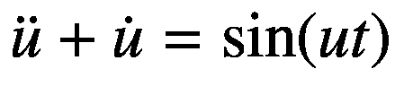，。

注意，这是一个非线性和非齐次的二阶常微分方程。让我们再次测试为欧拉法选择步长的重要性。

同样，在创建脚本之前，我们用两个一阶常微分方程重写给定的问题。

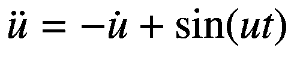 用下式表达：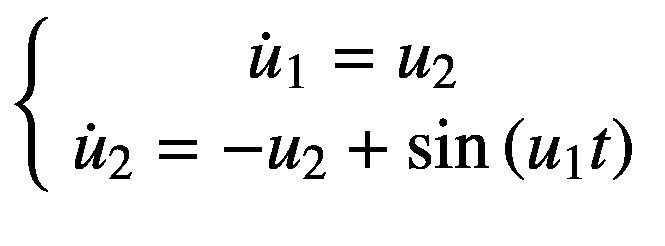

注意 `u[1] = u` 且 。

以下是一个脚本（`Example5_2ndODE.m`），它嵌入了前向欧拉法来求该问题的数值解（如图 3-3 所示）。注意，在我们的脚本中，一阶常微分方程组是直接在脚本中的 `[for ... end]` 循环、匿名函数（`@`）、符号 `matlabFunction` 以及一个函数文件中实现的。选择的步长分别为 0.025、0.05、0.10 和 0.20。

```
% Example5_2ndODE.m
%% EXAMPLE 5\.  u"=-u'+sin(t*u) with ICs: u(0)=1 & u'(0)=2
% solved by Forward EULER  Method
clearvars; clc; close all
h1=0.025;            % Time step size
tmax=13;             % End of simulations
t0=0;                % Start of simulations
t=t0:h1:tmax;        % Time space
steps=length(t);     % How many steps of evaluations
u(1,:)=[1 2];        % Initial Conditions
% NB: Size of the u(t) is two-dimensional
% Direct method (direct expression)
for k=1:steps-1
f1=[u(k,2), -u(k,2)+sin(t(k)*u(k,1))];
u(k+1,:)=u(k,:)+f1*h1;
end
plot(t, u(:,1),'b-', 'linewidth', 2), grid minor
hold on
clearvars t u
h2=0.05;             % Time step size
t=t0:h2:tmax;
steps=length(t);
u(1,:)=[1 2];        % Initial Conditions
% Way # 2\. Anonymous function (@)
F = @(t, u1, u2)([u2, -u2+sin(t*u1)]);
for k=1:steps-1
u(k+1,:)=u(k,:)+F(t(k), u(k,1), u(k,2))*h2;
end
plot(t, u(:,1),'g-.', 'linewidth', 2), grid on
clearvars t u
h3=0.1;              % Step size
t=t0:h3:tmax;        % Time space
steps = numel(t);    % Number of steps
u(1,:)=[1 2];        % Initial Conditions
% Way # 3\. MatlabFunction
syms T u1 u2
F=[u2, -u2+sin(T*u1)];
matlabFunction(F, 'file', 'F5');
for k=1:steps-1
u(k+1,:)=u(k,:)+h3*feval(@F5, t(k), u(k,1), u(k,2));
end
plot(t, u(:,1),'r:', 'linewidth', 2), grid on
clearvars t u
h4=0.2;              % Step size
t=t0:h4:tmax;        % Time space
steps = numel(t);    % Number of steps
u(1,:)=[1 2];        % Initial Conditions
% Way # 4\. Function File: FuFu5.m
for k=1:steps-1
u(k+1,:)=u(k,:)+h4*feval(@FuFu5, t(k), u(k,1), u(k,2));
end
plot(t, u(:,1),'k--', 'linewidth', 2), grid on
title('\it Numerical Solutions of: $$ \frac{d²u}{dt²}=sin(t*u)-\frac{du}{dt}, u_0 = 1, du_0 = 2 $$', 'interpreter', 'latex')
xlabel('\it t'), ylabel('\it Solution, u(t)')
xlim([0, 23])
legend('h = 0.025', 'h = 0.05', 'h = 0.1', 'h = 0.2', 'location', 'southeast')
axis tight
function du = FuFu5(T, u1, u2)
du = [u2, -u2+sin(T*u1)];
end
```

从图 3-5 所示的仿真结果中可以清楚地看到，如果选择的步长不合适，求得的数值解将与真实解产生显著偏离。

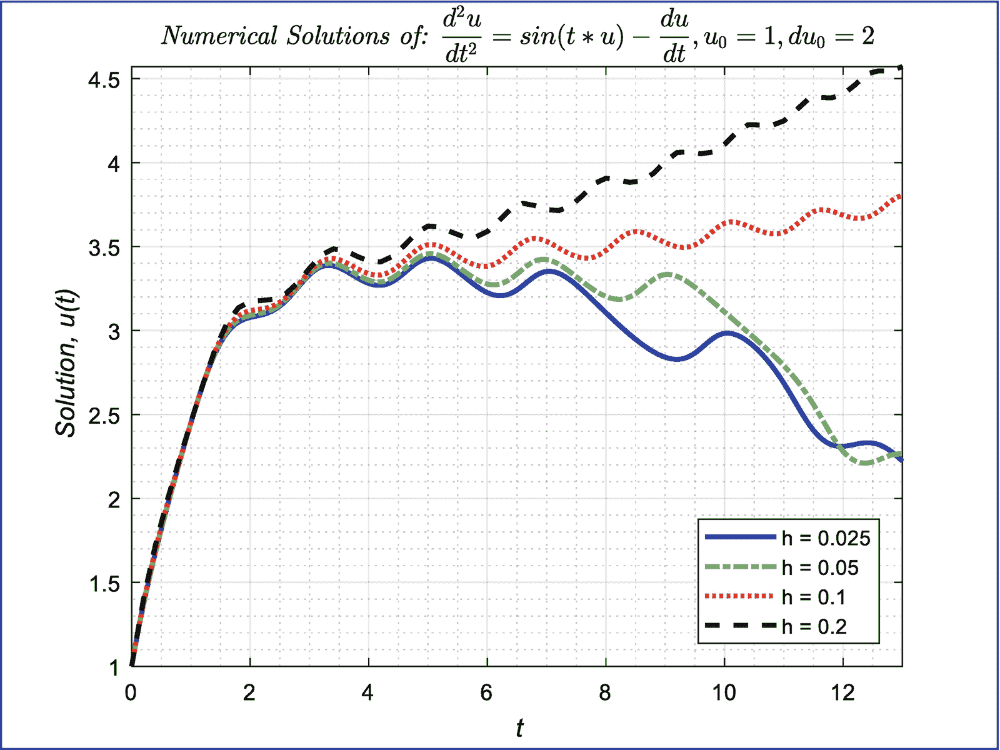

**图 3-5** 示例的仿真结果：，

基于我们研究过的示例，我们可以对欧拉法做出以下一般性评述：

-   它们简单易行，便于通过脚本实现。因此，在使用其他更高阶、更复杂或计算成本更高的方法之前，先从这些方法入手是合乎逻辑的。
-   它们适用于计算粗略的近似解。然而，其效率和准确性取决于所选步长和给定的常微分方程类型，例如线性或非线性、齐次或非齐次、刚性或非刚性。
-   使用欧拉法计算解的准确性，可以通过与其他方法进行比较来评估。

## 龙格-库塔法

我们已经阐述了不同阶数的龙格-库塔法，并了解了它们求解一阶常微分方程的实现算法步骤。因此，在本节中，我们将重点介绍如何通过脚本实现经典的 4/5 阶龙格-库塔法，来求解二阶及更高阶常微分方程的数值解。


## 示例 6

给定一个二阶非齐次常微分方程，示例如下：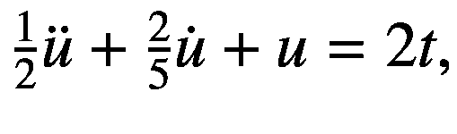 。

首先，在实现龙格-库塔方法时，我们需要引入新变量（类似于欧拉方法），将给定的二阶常微分方程重写为两个一阶常微分方程构成的方程组。

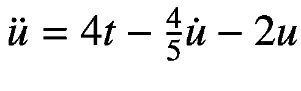 被转换为：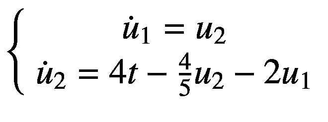

注意 `u[1]` = `u` 且 。

前面写好的这个一阶常微分方程组有多种实现方式。它们分别是匿名函数（`@`）、函数文件、符号 `matlabFunction` 以及直接方法。以下脚本 `RK_2ndODE_ex6.m` 基于 **4 阶**龙格-库塔方法计算给定问题的数值解。在本示例中，我们采用不同的步长，即 `h` = 0.1、0.2、0.3 和 0.4，并将求得的数值解与使用 `dsolve()` 计算的解析解进行比较。

```
% RK_2ndODE_ex6.m
% 示例 6\. (1/2)*u"+(2/5)*u'+u=2*t，初始条件：u(0)=1 & u'(0)=2
% 通过 4 阶龙格-库塔方法和 DSOLVE 实现
clearvars; close all
h=0.1;               % 时间步长
t0=0;                % 计算/仿真开始时间
tmax=5;              % 计算/仿真结束时间
t=t0:h:tmax;         % 时间空间
steps=length(t);     % 步数
u(1,:)=[1 2];        % 初始条件
% 注意：u(t) 的维度是二维的。
% 方法 #1\. 匿名函数 (@)
FuFu=@(t, u1, u2)([u2, 4*t-2*u1-(4/5)*u2]);
%%% 对于方法 #1 匿名函数 (@) FuFu：
for ii=1:steps-1
k1=FuFu(t(ii), u(ii,1), u(ii,2));
k2=FuFu(t(ii)+h/2, u(ii,1)+h*k1(:,1)/2,u(ii,2)+h*k1(:,2)/2);
k3=FuFu(t(ii)+h/2,u(ii,1)+h*k2(:,1)/2,u(ii,2)+h*k2(:,2)/2);
k4=FuFu(t(ii)+h,u(ii,1)+h*k3(:,1),u(ii,2)+h*k3(:,2));
u(ii+1,:)=u(ii,:)+h*(k1+2*k2+2*k3+k4)/6;
end
plot(t(:)', u(:,1), 'b:o', 'markersize', 9), grid on, hold on
clearvars t u
h=0.2;       % 时间步长
t=t0:h:tmax; steps=length(t);    u(1,:)=[1 2];
% 方法 #2\. 函数文件，命名为：F_RK_ex1.m
%%% 使用名为 F.m 的函数文件  % 方法 #2
for ii = 1:steps-1
k1=feval(@RK_ex1,t(ii), u(ii,1), u(ii,2));
k2=feval(@RK_ex1,t(ii)+h/2,u(ii,1)+h*k1(:,1)/2,u(ii,2)+h*k1(:,2)/2);
k3=feval(@RK_ex1,t(ii)+h/2,u(ii,1)+h*k2(:,1)/2,u(ii,2)+h*k2(:,2)/2);
k4=feval(@RK_ex1,t(ii)+h,u(ii,1)+h*k3(:,1),u(ii,2)+h*k3(:,2));
u(ii+1,:)=u(ii,:)+h*(k1+2*k2+2*k3+k4)/6;
end
plot(t(:)', u(:,1), 'g-p')
clearvars  t u
h=0.3;       % 时间步长
t=t0:h:tmax; steps=length(t);    u(1,:)=[1 2];
% 方法 #3\. matlabFunction
syms T u1 u2
f=[u2, 4*T-2.0*u1-(4/5)*u2];
matlabFunction(f, 'file', 'F_ex1');
%%% 使用函数文件 F
for ii = 1:steps-1
k1 = feval(@F_ex1, t(ii), u(ii,1), u(ii,2));
k2 = feval(@F_ex1, t(ii), u(ii,1)+h*k1(:,1)/2,u(ii,2)+h*k1(:,2)/2);
k3 = feval(@F_ex1, t(ii), u(ii,1)+h*k2(:,1)/2,u(ii,2)+h*k2(:,2)/2);
k4 = feval(@F_ex1, t(ii), u(ii,1)+h*k3(:,1),u(ii,2)+h*k3(:,2));
u(ii+1,:)=u(ii,:)+h*(k1+2*k2+2*k3+k4)/6;
end
plot(t(:)', u(:,1), 'r--h', 'linewidth', 2)
clearvars  t u
h=0.4;       % 时间步长
t=t0:h:tmax; steps=length(t);    u(1,:)=[1 2];
% 方法 # 4\. 直接方法
for ii = 1:steps-1
k1 = [u(ii,2), 4*t(ii)-2*u(ii,1)-(4/5)*u(ii,2)];
k2 = [u(ii,2)+h*k1(:,1)/2, 4*(t(ii)+h/2)-...
2*(u(ii,1)+h*(k1(:,1))/2)-(4/5)*(u(ii,2)+h*k1(:,2)/2)];
k3 = [u(ii,2)+h*k2(:,1)/2,    4*(t(ii)+h/2)- ...
2*(u(ii,1)+h*k2(:,1)/2)-(4/5)*(u(ii,2)+h*k2(:,2)/2)];
k4 = [u(ii,2)+h*k3(:,1), 4*(t(ii)+h)-2*(u(ii,1)+h*k3(:,1))- ...
(4/5)*(u(ii,2)+k3(:,2)*h)];
u(ii+1,:)=u(ii,:)+h*(k1+2*k2+2*k3+k4)/6;
end
plot(t(:)', u(:,1), 'm-.d', 'linewidth', 1.5)
% 问题的解析解：
y=dsolve('D2x=-(4/5)*Dx-2*x+(4*t)', 'x(0)=1, Dx(0)=2','t');
Y=double(subs(y,'t',t));
plot(t, Y, 'k-', 'linewidth', 1.5)
legend('h = 0.1','h = 0.2','h = 0.3','h = 0.4', '解析解', 'location', 'southeast')
title('\it 龙格-库塔解对比解析解：$$ \frac{1}{2}*\frac{d²u}{dt²}+\frac{2}{5}*\frac{du}{dt}=2*t$$', 'interpreter', 'latex')
xlim([0, 5])
xlabel('\it t')
ylabel('\it 解, u(t)')
hold off
function f=RK_ex1(t, u1, u2)
f = [u2,4*t-2.0*u1-(4/5)*u2];
end
```

此示例（如图 3-6 所示）清楚地展示了所选步长的重要性，与欧拉方法类似，步长对计算解有显著影响。

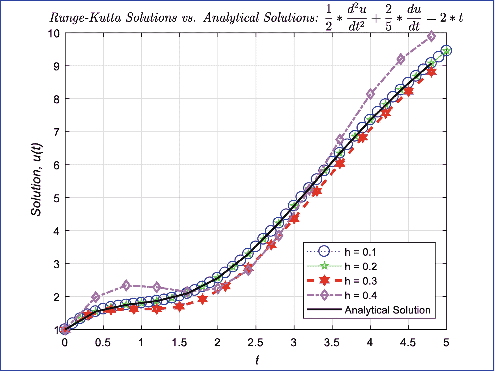

**图 3-6** 龙格-库塔（4/5 阶）方法与通过 `dsolve()` 求解的解析解对比


## 示例 7

示例问题如下：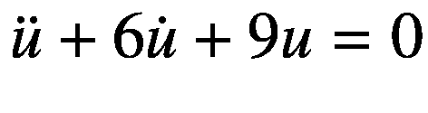，初始条件为：。

我们通过引入新变量，将给定的方程表达为两个一阶常微分方程。

将重写为：

注意，这里*u*[1] = *u*，且 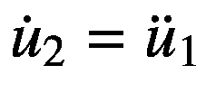。

以下是一个名为 `RK_2ndODE_ex7.m` 的脚本，它嵌入了四阶龙格-库塔法和前向欧拉法，并将它们的数值解与通过 `dsolve()` 求得的解析解进行比较。请注意，给定的方程组使用 `matlabFunction` 为龙格-库塔法进行了表达，该函数会自动生成一个函数文件。对于欧拉法，给定的方程组则是直接实现的。

```
% RK_2ndODE_ex7.m
% 示例 7\. x"+9x'+6x=0，初始条件：x(0)=2, Dx(0)=0
% 四阶龙格-库塔法
clearvars; close all
h=0.2;              % 时间步长
t0=0;               % 计算/仿真起始时间
tmax=3;             % 计算/仿真结束时间
t=t0:h:tmax;        % 时间空间
steps=length(t);    % 评估步数
u(1,:)=[2 0];       % 初始条件
% 龙格-库塔法
syms u1 u2
f=[u2, -6.*u1-9*u2]; matlabFunction(f, 'file', 'RK_ex2');
for ii=1:steps-1
k1=feval(@RK_ex2, u(ii,1), u(ii,2));
k2=feval(@RK_ex2, u(ii,1)+h*k1(:,1)/2,u(ii,2)+h*k1(:,2)/2);
k3=feval(@RK_ex2, u(ii,1)+h*k2(:,1)/2,u(ii,2)+h*k2(:,2)/2);
k4=feval(@RK_ex2, u(ii,1)+h*k3(:,1),u(ii,2)+h*k3(:,2));
u(ii+1,:)=u(ii,:)+h*(k1+2*k2+2*k3+k4)/6;
end
plot(t(:)', u(:,1), 'ko'), hold on
% 前向欧拉法
for k=1:steps-1
f1=[u(k,2), -6*u(k,1)-9*u(k,2)];
u(k+1,:)=u(k,:)+f1*h;
end
plot(t, u(:,1), 'b--*')
% 解析解：
y=dsolve('D2x=-6*x-9*Dx', 'x(0)=2, Dx(0)=0','t');
Y=double(subs(y,'t',t)); plot(t, Y, 'g-', 'linewidth', 2)
grid on, xlabel('\it t'), ylabel('\it 解, u(t)')
legend('RK: h = 0.2 ','EM: h = 0.2',  '解析解 (dsolve)')
title('Runge-Kutta, Euler Forward vs. Analytical Solutions of: $$ \frac{d²}{dt²}+9*\frac{du}{dt}+6*u=0 $$', 'interpreter', 'latex')
xlim([0, 3])
hold off; shg
```

对于采用大步长（*h=0.2*）的前向欧拉法来说，这是一个中等刚性的问题。它的表现不如龙格-库塔法，如图 3-7 所示。

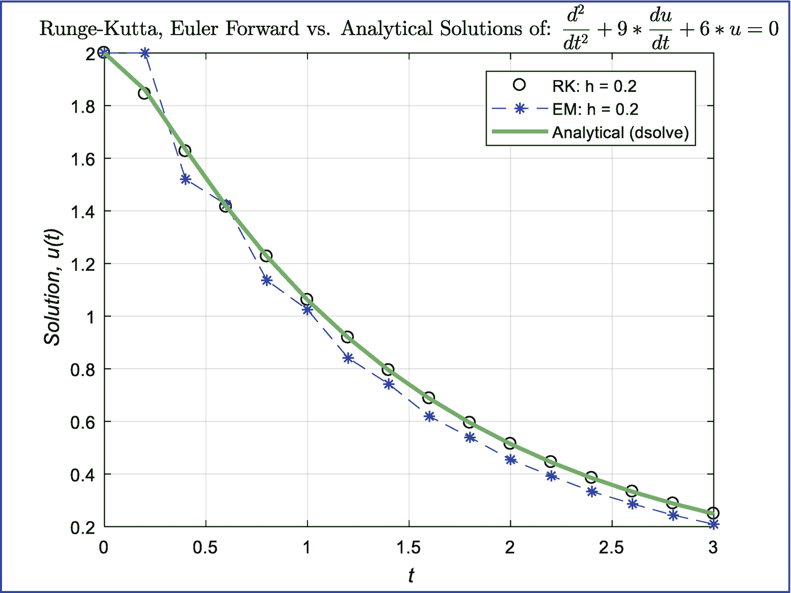

**图 3-7** 问题的仿真：，初始条件：

## 示例 8

给定一个二阶齐次常微分方程，示例问题如下：，初始条件为：。

同样，在开始编写脚本之前，我们先将给定问题重写为两个一阶常微分方程。

将  写为：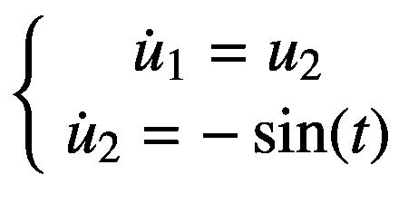

注意，这里*u*[1] = *u*，且 。

以下脚本 `RK_2ndODE_ex8.m` 嵌入了龙格-库塔法，用于求解该问题的数值解。请注意，在此脚本中，一阶常微分方程组是通过一个名为 `FF` 的匿名函数（`@`）定义的。

```
% RK_2ndODE_ex8.m
% 示例 8\. u"=-sin(t)，初始条件：u(0)=0 & u'(0)=0
clearvars; close all; clc
h=0.3;             % 步长
t0=0;              % 仿真起始时间
tmax=13;           % 仿真结束时间
t=t0:h:tmax;       % 仿真时间空间
steps=length(t);   % 仿真步数
u(1,:)=[0, 0];     % 初始条件
% 龙格-库塔法：
FF=@(t, u1, u2)([u2,-sin(t)]);
for ii=1:steps-1
k1=FF(t(ii), u(ii,1), u(ii,2));
k2=FF(t(ii)+h/2, u(ii,1)+h*k1(:,1)/2,u(ii,2)+h*k1(:,2)/2);
k3=FF(t(ii)+h/2,u(ii,1)+h*k2(:,1)/2,u(ii,2)+h*k2(:,2)/2);
k4=FF(t(ii)+h,u(ii,1)+h*k3(:,1),u(ii,2)+h*k3(:,2));
u(ii+1,:)=u(ii,:)+h*(k1+2*k2+2*k3+k4)/6;
end
plot(t, u(:,1), 'k--+'), grid on; hold on
% 前向欧拉法：
for ii=1:steps-1
u(ii+1,:)=u(ii,:)+h*[u(ii,2), -sin(t(ii))];
end
plot(t, u(:,1), 'r-.p')
% 解析解：
y=dsolve('D2y=-sin(t)', 'y(0)=0, Dy(0)=0','t');
Y=double(subs(y,'t',t));
plot(t, Y, 'm-', 'linewidth', 1.5)
title('Runge-Kutta, Euler Forward vs. Analytical Solutions of: $$ \frac{d²}{dt²}+sin(t)=0 $$', 'interpreter', 'latex')
xlabel '\it t'; ylabel '\it 解, u(t)'
legend('RK: h = 0.3', 'EM: h = 0.3', 'DSOLVE')
hold off; axis tight; shg
```

同样，图 3-8 中显示的仿真结果表明，通过龙格-库塔法计算的数值解与解析解吻合良好，而通过前向欧拉法计算的数值解与解析解的值存在一些偏差。

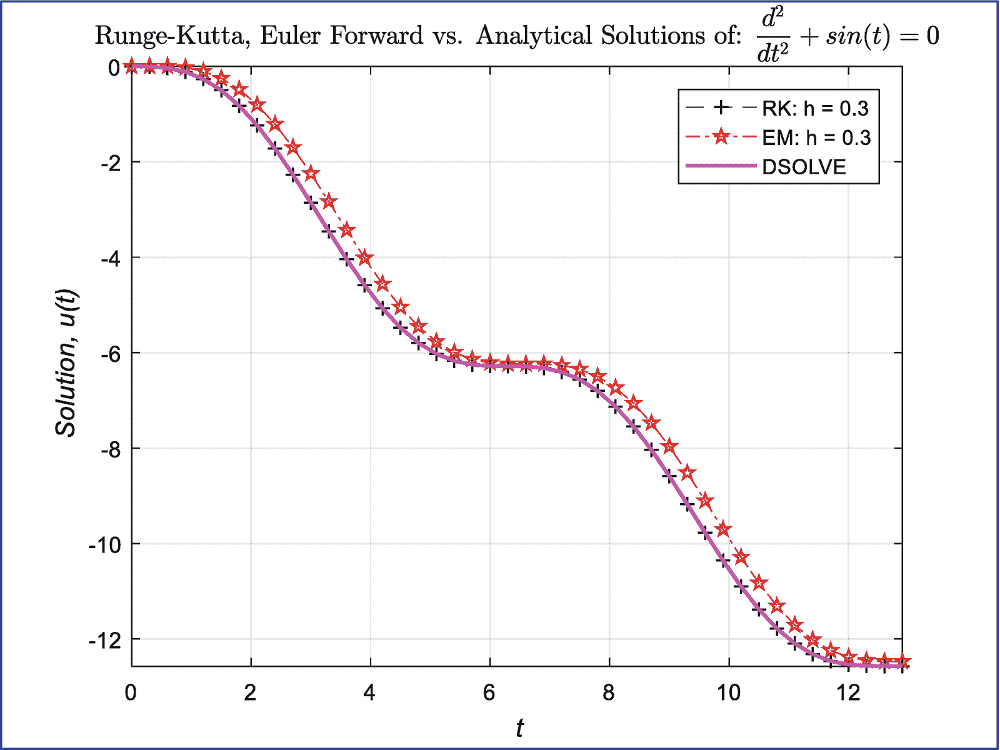

**图 3-8** 问题的仿真：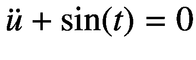，初始条件：


### 示例 9

给定一个二阶非齐次常微分方程，示例问题如下：，初始条件为 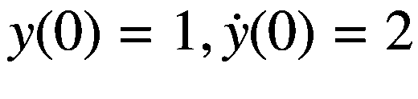。

在开始编写脚本之前，我们再次将给定问题重写为两个一阶常微分方程。

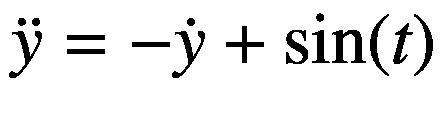 可表示为：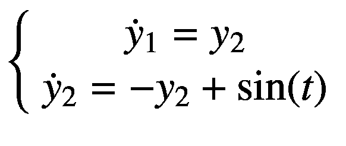

注意，*y*[1] = *y*，且 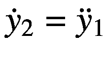。

以下脚本（`RK_2ndODE_ex9.m`）嵌入了龙格-库塔法和前向欧拉法，用于计算该问题的数值解。请注意，在此脚本中，我们直接根据之前为龙格-库塔法和前向欧拉法重写的两个一阶常微分方程，嵌入了该一阶常微分方程组。

```
% RK_2ndODE_ex9.m
% 示例 9.  y"+y'=sin(t) 初始条件: [1, 2]
clearvars; close all; clc
h=0.25;                  % 步长
t0=0;                    % 仿真起始时间
tmax=13;                 % 仿真结束时间
t=t0:h:tmax;             % 仿真时间向量
steps=length(t);         % 仿真步数
y(1,:)=[1, 2];           % 初始条件
% 龙格-库塔法:
for ii=1:steps-1
k1=[y(ii,2),             sin(t(ii))-y(ii,2)];
k2=[y(ii,2)+k1(:,1)*h/2, sin(t(ii)+h/2)-y(ii,2)+k1(:,2)*h/2];
k3=[y(ii,2)+k2(:,1)*h/2, sin(t(ii)+h/2)-y(ii,2)+k2(:,2)*h/2];
k4=[y(ii,2)+k3(:,1)*h,   sin(t(ii)+h)-y(ii,2)+k3(:,2)*h];
y(ii+1,:)=y(ii,:)+h*(k1+2*k2+2*k3+k4)/6;
end
plot(t, y(:,1), 'k--', 'linewidth', 1.5)
grid on; hold on
% 前向欧拉法:
for ii=1:steps-1
y(ii+1,:)=y(ii,:)+h*[y(ii,2), sin(t(ii))-y(ii,2)];
end
plot(t, y(:,1), 'r-.+', 'linewidth', 1.5)
% 解析解:
y=dsolve('D2y=-Dy+sin(t)', 'y(0)=1, Dy(0)=2','t');
Y=double(subs(y,'t',t));
plot(t, Y, 'm-', 'linewidth', 1.5)
title('\it 龙格-库塔法、欧拉法与解析解对比: $$ \frac{d²u}{dt²}=sin(t)-\frac{du}{dt} $$', 'Interpreter', 'latex')
xlabel '\it t'; ylabel '\it 解, u(t)'
legend('龙格-库塔法: h = 0.25', '欧拉法: h = 0.25', '解析解', 'location', 'southeast')
hold off; axis tight; shg
```

从问题 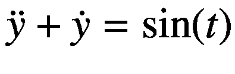,  的仿真结果（如图 3-9 所示）可以清楚地看出，在步长较大（*h* = 0.25）时，龙格-库塔法的性能不如前向欧拉法，尽管其计算时间和仿真步数成本是其四倍。

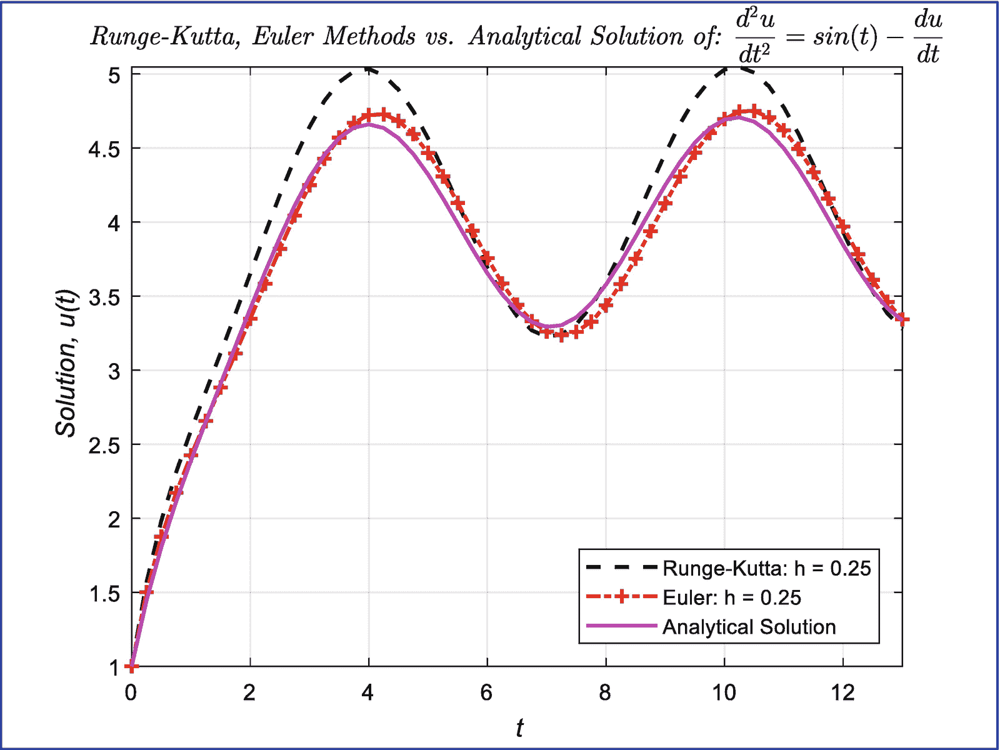

**图 3-9** 问题的仿真结果：, 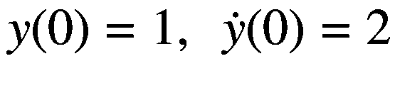

### 示例 10

给定一个二阶非齐次非线性常微分方程，示例问题如下：，初始条件为 。

在编写脚本之前，我们再次将给定问题表示为两个一阶常微分方程。

 可表示为：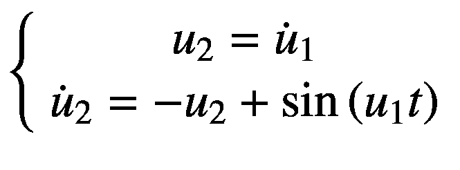

注意，*u*[1] = *u*，且 。

以下是一个名为 `RK_2ndODE_ex10.m` 的脚本，它嵌入了龙格-库塔法和前向欧拉法，并比较了它们在两种不同步长（*h* = 0.05 和 *h* = 0.01）下的结果。两种方法的一阶常微分方程组都直接在 `for ... end` 循环内表示。

```
% RK_2ndODE_ex10.m
% 示例 10.  u"=-u'+sin(t*u) 初始条件: u(0)=1 & u'(0)=2
clearvars; close all; clc
h=0.05;              % 步长
t0=0;                % 仿真起始时间
tmax=15;             % 仿真结束时间
t=t0:h:tmax;         % 仿真时间向量
steps=length(t);     % 仿真步数
u(1,:)=[1, 2];       % 初始条件
% 龙格-库塔法: h = 0.05
for ii=1:steps-1
k1=[u(ii,2),             sin(u(ii,1)*t(ii))-u(ii,2)];
k2=[u(ii,2)+k1(:,1)*h/2, sin(u(ii,1)*t(ii)+h/2)-...
u(ii,2)+k1(:,2)*h/2];
k3=[u(ii,2)+k2(:,1)*h/2, sin(u(ii,1)*t(ii)+h/2)- ...
u(ii,2)+k2(:,2)*h/2];
k4=[u(ii,2)+k3(:,1)*h,   sin(u(ii,1)*t(ii)+h)-u(ii,2)+k3(:,2)*h];
u(ii+1,:)=u(ii,:)+h*(k1+2*k2+2*k3+k4)/6;
end
subplot(211)
plot(t(:)', u(:,1), 'k--x'), grid on; hold on
title('龙格-库塔法 vs. 欧拉法求解: $$ \frac{d²u}{dt²}+\frac{du}{dt}=sin(t*u) $$', 'interpreter', 'latex')
xlabel '\it t'; ylabel '\it 解, u(t)'
clearvars t u k1 k2 k3 k4
h=0.01;            % 步长
t=t0:h:tmax; steps=length(t);    u(1,:)=[1, 2];
% 龙格-库塔法: h = 0.01
for ii=1:steps-1
k1=[u(ii,2),             sin(u(ii,1)*t(ii))-u(ii,2)];
k2=[u(ii,2)+k1(:,1)*h/2, sin(u(ii,1)*t(ii)+h/2)-...
u(ii,2)+k1(:,2)*h/2];
k3=[u(ii,2)+k2(:,1)*h/2, sin(u(ii,1)*t(ii)+h/2)-...
u(ii,2)+k2(:,2)*h/2];
k4=[u(ii,2)+k3(:,1)*h,   sin(u(ii,1)*t(ii)+h)-u(ii,2)+k3(:,2)*h];
u(ii+1,:)=u(ii,:)+h*(k1+2*k2+2*k3+k4)/6;
end
subplot(212)
plot(t(:)', u(:,1), 'k--x'), hold on
clearvars -except t0 tmax
h=0.05;            % 步长
t=t0:h:tmax;
steps=length(t);
u(1,:)=[1, 2];
% 前向欧拉法: h = 0.05
for ii=1:steps-1
u(ii+1,:)=u(ii,:)+h*[u(ii,2), sin(u(ii,1)*t(ii))-u(ii,2)];
end
subplot(211)
plot(t(:)', u(:,1), 'r-', 'linewidth', 1.5), grid on
legend('RK: h = 0.05', 'EM: h = 0.05')
clearvars t u
h=0.01;            % 步长
t=t0:h:tmax;
steps=length(t);
u(1,:)=[1, 2];
% 前向欧拉法: h = 0.01
for ii=1:steps-1
u(ii+1,:)=u(ii,:)+h*[u(ii,2), sin(u(ii,1)*t(ii))-u(ii,2)];
end
subplot(212)
plot(t(:)', u(:,1), 'r-', 'linewidth',1.5), grid on
xlabel '\it t'; ylabel '\it 解, u(t)'
legend( 'RK: h = 0.01',  'EM: h = 0.01')
hold off; axis tight; shg
```

从本例的仿真结果（如图 3-10 所示）可以看出，两种方法对所选的步长都非常敏感。当使用相当小的步长（*h* = 0.01）时，两种方法（如图 3-10 下方的子图所示）都能很好地收敛。

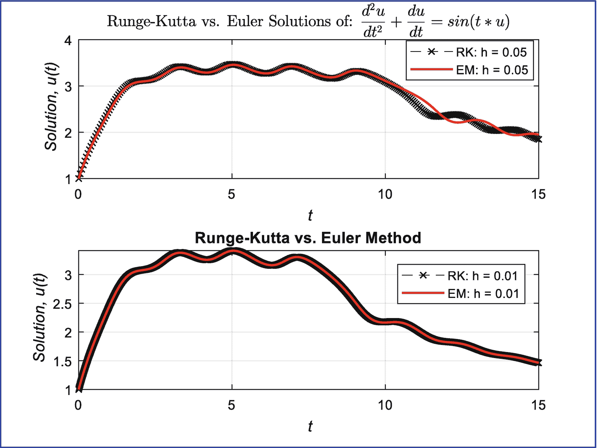

**图 3-10** 示例的仿真结果：, 。

从二阶常微分方程的练习中可以看出，在求解线性非齐次常微分方程时，龙格-库塔法在精度上明显优于前向欧拉法。另一方面，在求解非线性非齐次常微分方程时，前向欧拉法的表现相当不错。


