# Adams-Moulton 方法

在之前关于一阶常微分方程的章节中，我们构建了一阶、二阶和五阶 Adams-Moulton 方法，并描述了其求解常微分方程初值问题的实现算法。与欧拉法或龙格-库塔法不同，该方法是一种使用隐式格式定义的预测-校正法。在此，我们将重点介绍如何通过 MATLAB 脚本实现一阶、二阶、三阶、四阶和五阶 Adams-Moulton 方法，以计算二阶常微分方程的数值解。

## 示例 11

这是示例问题：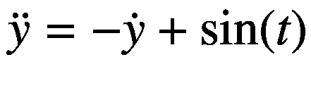，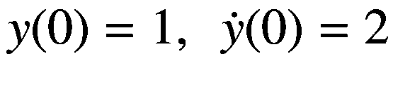。

同样，在编写脚本之前，我们将给定问题用两个一阶常微分方程表示。

 表示为：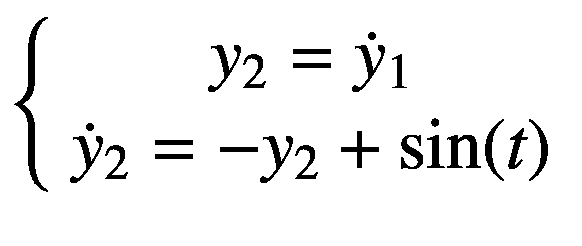

请注意，`y[1]` = `y` 且 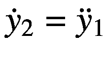。

这是一个脚本（`Adams_Moulton_2ndODE_ex11.m`），其中嵌入了不同阶次的 Adams-Moulton 方法来计算该问题的数值解。请注意，在我们的脚本中，一阶常微分方程组通过匿名函数（`@`）定义为二维函数。

# Adams-Moulton 方法数值模拟

## Part 1: 1st-order Method
```matlab
% ADAMS-Moulton 1st order method
% Adams_Moulton_2ndODE_ex11.m
% Part 1
clearvars; close all
Fn(1,:)=[1, 2];      % ICs: u0 at t0
tend=15;             % max. time limit
h=0.10;              % time step size
t=0:h:tend;          % time space
steps=length(t);     % # of steps
% Function is defined via anonymous function:
Fcn =@(t, y1, y2)([y2, -y2+sin(t)]);
for ii=1:steps-1
    % Predicted solution by EULER's forward method here:
    Fn(ii+1,:)=Fn(ii,:)+h*Fcn(t(ii), Fn(ii, 1),Fn(ii,2));
    % ADAMS-Moulton method: 2-step starts from here
    Fn(ii+1,:)=Fn(ii,:)+h*Fcn(t(ii+1),Fn(ii, 1),Fn(ii,2));
end
plot(t, Fn(:,1), 'bs-'), grid on; hold on
```

## Part 2: 2-step Method
```matlab
% ADAMS-Moulton 2-step Method
% Part 2
clearvars Fn
Fn(1,:)=[1, 2];      % ICs: u0 at t0
Fcn =@(t, y1, y2)([y2, -y2+sin(t)]);
for ii=1:steps-1
    % EULER's forward method is used here
    Fn(ii+1,:)=Fn(ii,:)+h*Fcn(t(ii), Fn(ii, 1),Fn(ii,2));
    % ADAMS-Moulton method: 2-step starts from here
    Fn(ii+1,:)=Fn(ii,:)+(h/2)*(Fcn(t(ii+1),Fn(ii+1,1),Fn(ii+1,2))+...
                                Fcn(t(ii),Fn(ii,1),Fn(ii,2)));
end
plot(t, Fn(:,1), 'mx--')
```

## Part 3: 3-step Method
```matlab
% ADAMS-Moulton 3-step Method
% Part 3
clearvars Fn
Fn(1,:)=[1, 2];
Fcn =@(t, y1, y2)([y2, -y2+sin(t)]);
for k=1:steps-2
    % 1st: Predicted value by EULER's forward method
    Fn(k+1,:)=Fn(k,:)+h*Fcn(t(k), Fn(k, 1),Fn(k,2));
    % 2nd: Corrected value by trapezoidal rule
    Fn(k+1,:)=Fn(k,:)+(h/2)*(Fcn(t(k+1),Fn(k+1,1),Fn(k+1,2))+ ...
                             Fcn(t(k),Fn(k,1),Fn(k,2)));
    % Predicted solution:
    Fn(k+2,:)=Fn(k+1,:)+(3*h/2)*Fcn(t(k+1),Fn(k+1,1),Fn(k+1,2))-...
                         (h/2)*Fcn(t(k),Fn(k,1),Fn(k,2));
    % ADAMS-Moulton method: 3-step starts from here
    Fn(k+2,:)=Fn(k+1,:)+h*((5/12)*Fcn(t(k+2),Fn(k+2,1),Fn(k+2,2))+...
                            (2/3)*Fcn(t(k+1),Fn(k+1,1),Fn(k+1,2))-...
                            (1/12)*Fcn(t(k),Fn(k,1),Fn(k,2)));
end
plot(t, Fn(:,1), 'ko:')
```

## Part 4: 4-step Method
```matlab
% ADAMS-Moulton 4-step Method
% Part 4
clearvars Fn
Fn(1,:)=[1, 2];
Fcn =@(t, y1, y2)([y2, -y2+sin(t)]);
for k=1:steps-3
    % 1st Predicted value: by Euler's forward method
    Fn(k+1,:)=Fn(k,:)+h*Fcn(t(k),Fn(k,1),Fn(k,2));
    % 1st Corrected value: by trapezoidal rule
    Fn(k+1,:)=Fn(k,:)+(h/2)*(Fcn(t(k+1),Fn(k+1,1),Fn(k+1,2))+...
                             Fcn(t(k),Fn(k,1),Fn(k,2)));
    % 2nd Predicted value
    Fn(k+2,:)=Fn(k+1,:)+(3*h/2)*Fcn(t(k+1),Fn(k+1,1),Fn(k+1,2))-...
                         (h/2)*Fcn(t(k),Fn(k,1),Fn(k,2));
    % 2nd Corrected value
    Fn(k+2,:)=Fn(k+1,:)+h*((5/12)*Fcn(t(k+2),Fn(k+2,1),Fn(k+2,2))+...
                            (2/3)*Fcn(t(k+1),Fn(k+1,1),Fn(k+1,2))-...
                            (1/2)*Fcn(t(k),Fn(k,1),Fn(k,2)));
    % Predicted solution:
    Fn(k+3,:)=Fn(k+2,:)+h*((23/12)*Fcn(t(k+2),Fn(k+2,1),Fn(k+2,2))-...
                           (4/3)*Fcn(t(k+1),Fn(k+1,1),Fn(k+1,2))+...
                           (5/12)*Fcn(t(k),Fn(k,1),Fn(k,2)));
    % Corrected solution by ADAMS-Moulton method 4-step from here:
    Fn(k+3,:)=Fn(k+2,:)+h*((3/8)*Fcn(t(k+3),Fn(k+3,1),Fn(k+3,2))+...
                           (19/24)*Fcn(t(k+2),Fn(k+2,1),Fn(k+2,2))-...
                           (5/24)*Fcn(t(k+1),Fn(k+1,1),Fn(k+1,2))+...
                           (1/24)*Fcn(t(k),Fn(k,1),Fn(k,2)));
end
plot(t, Fn(:,1), 'k-.*')
```

## Part 5: 5th-order Method
```matlab
% ADAMS-Moulton's 5th-order method
% Part 5
clearvars Fn
Fn(1,:)=[1, 2];
Fcn =@(t, y1, y2)([y2, -y2+sin(t)]);
for k=1:steps-4
    % 1st Predicted value: by Euler's forward method
    Fn(k+1,:)=Fn(k,:)+h*Fcn(t(k),Fn(k,1),Fn(k,2));
    % 1st Corrected value: by trapezoidal rule
    Fn(k+1,:)=Fn(k,:)+(h/2)*(Fcn(t(k+1),Fn(k+1,1),Fn(k+1,2))+...
                             Fcn(t(k),Fn(k,1),Fn(k,2)));
    % 2nd Predicted value
    Fn(k+2,:)=Fn(k+1,:)+(3*h/2)*Fcn(t(k+1),Fn(k+1,1),Fn(k+1,2))-...
                         (h/2)*Fcn(t(k),Fn(k,1),Fn(k,2));
    % 2nd Corrected value
    Fn(k+2,:)=Fn(k+1,:)+h*((5/12)*Fcn(t(k+2),Fn(k+2,1),Fn(k+2,2))+...
                            (2/3)*Fcn(t(k+1),Fn(k+1,1),Fn(k+1,2))-...
                            (1/2)*Fcn(t(k),Fn(k,1),Fn(k,2)));
    % 3rd Predicted solution:
    Fn(k+3,:)=Fn(k+2,:)+h*((23/12)*Fcn(t(k+2),Fn(k+2,1),Fn(k+2,2))-...
                           (4/3)*Fcn(t(k+1),Fn(k+1,1),Fn(k+1,2))+...
                           (5/12)*Fcn(t(k),Fn(k,1),Fn(k,2)));
    % Corrected solution by ADAMS-Moulton method 4-step from here:
    Fn(k+3,:)=Fn(k+2,:)+h*((3/8)*Fcn(t(k+3),Fn(k+3,1),Fn(k+3,2))+...
                           (19/24)*Fcn(t(k+2),Fn(k+2,1),Fn(k+2,2))-...
                           (5/24)*Fcn(t(k+1),Fn(k+1,1),Fn(k+1,2))+...
                           (1/24)*Fcn(t(k),Fn(k,1),Fn(k,2)));
    % Predicted solution:
    Fn(k+4,:)=Fn(k+3,:)+h*((55/24)*Fcn(t(k+3),Fn(k+3,1),Fn(k+3,2))-...
                           (59/24)*Fcn(t(k+2),Fn(k+2,1),Fn(k+2,2))+...
                           (37/24)*Fcn(t(k+1),Fn(k+1,1),Fn(k+1,2))-...
                           (3/8)*Fcn(t(k),Fn(k,1),Fn(k,2)));
    % Corrected solution by ADAMS-Moulton 5-step method from here:
    Fn(k+4,:)=Fn(k+3,:)+h*((251/720)*Fcn(t(k+4),Fn(k+4,1),Fn(k+4,2))+...
                           (646/720)*Fcn(t(k+3),Fn(k+3,1),Fn(k+3,2))-...
                           (264/720)*Fcn(t(k+2),Fn(k+2,1),Fn(k+2,2))+...
                           (106/720)*Fcn(t(k+1),Fn(k+1,1),Fn(k+1,2))-...
                           (19/720)*Fcn(t(k),Fn(k,1),Fn(k,2)));
end
plot(t, Fn(:,1), 'g--', 'linewidth', 2), grid on
title('Adams-Moulton method simulation of: $$ \frac{d²y}{dt²} = sin(t)-\frac{dy}{dt} $$', 'interpreter', 'latex')
xlabel '\it t', ylabel('\it Solution, y(t)')
```

## Analytical Solution and Visualization
```matlab
% Analytical solution of the problem:
Y=dsolve('D2u=-Du+sin(T)', 'u(0)=1, Du(0)=2','T');
Y=double(subs(Y,'T',t));
plot(t, Y, 'r-')
legend('1-step','2-step','3-step','4-step','5-step', 'DOLVE', 'location', 'southeast')
hold off
```

从使用不同阶次（或步数）的 Adams-Moulton 方法所得的模拟结果图（如图 3-11 所示）可以看出，该方法对于给定问题表现良好，其不同阶次的求解器产生的计算结果与使用 `dsolve()` 计算得到的解析解具有良好的一致性。对于任何显式定义的二阶或更高阶常微分方程初值问题，我们可以通过类似的方式实现该方法及之前的脚本，只需根据给定问题对脚本内容进行几处更改。脚本中唯一需要更改的是初始条件和模拟时间，最后一项重要的更改是根据给定问题的公式重新定义匿名函数（`@`）。例如，我们可以轻松编辑之前的脚本，来计算另一个二阶常微分方程的数值解。

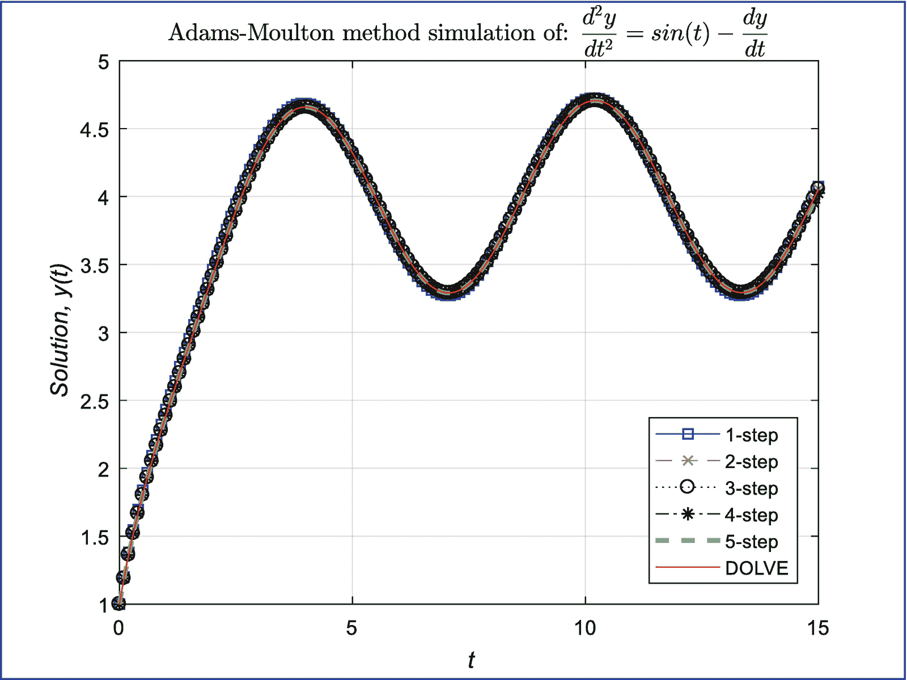

**图 3-11** 示例的模拟结果：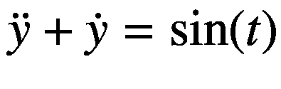，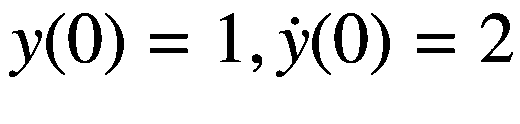

## 示例 12

以下是示例问题：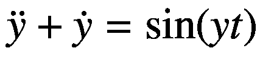，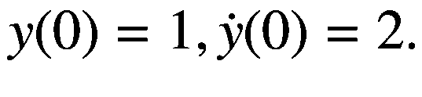

通过应用一步、两步、三步、四步和五步的亚当斯-莫尔顿方法，我们可以通过编辑之前的脚本 `Adams_Moulton_2ndODE_ex1.m`，编写一个名为 `Adams_Moulton_2ndODE_ex12.m` 的新脚本来求解给定的非齐次常微分方程。

# Adams_Moulton_2ndODE_ex12.m
## 示例 12\. y"+y'=sin(yt) 初始条件: [1, 2]
### 亚当斯-莫尔顿一阶方法
% 第一部分
`clearvars`; `close all`
`Fn(1,:)=[1, 2];`     % 初始条件: `t0` 处的 `u0`
`tend=13;`            % 仿真结束时间
`h=0.1;`             % 步长
`t=0:h:tend;`        % 仿真空间
`steps=length(t);`   % 步数
% 注意: y"+y'=sin(yt) =>DDy = f(t,y,dy)=sin(yt)-dy 通过匿名函数 (`@`) 定义:
`Fcn =@(t, u1, u2)([u2, -u2+sin(u1*t)]);`
```
for ii=1:steps-1
    % 1 步: 此处使用欧拉前向法
    Fn(ii,:)=Fn(ii,:)+h*Fcn(t(ii), Fn(ii, 1),Fn(ii,2));
    % 亚当斯-莫尔顿方法从此处开始
    Fn(ii+1,:)=Fn(ii,:)+h*Fcn(t(ii+1),Fn(ii, 1),Fn(ii,2));
end
subplot(211)
plot(t, Fn(:,1), 'bs-'), grid on; hold on
```

## 亚当斯-莫尔顿二阶方法
% 第二部分
`clearvars` `Fn`
`Fn(1,:)=[1, 2];`
```
for ii=1:steps-1
    % 通过欧拉前向法预测:
    Fn(ii+1,:)=Fn(ii,:)+h*Fcn(t(ii), Fn(ii, 1),Fn(ii,2));
    % 通过亚当斯-莫尔顿方法校正
    Fn(ii+1,:)=Fn(ii,:)+(h/2)*(Fcn(t(ii+1),Fn(ii+1,1),Fn(ii+1,2))+ ...
                               Fcn(t(ii),Fn(ii,1),Fn(ii,2)));
end
plot(t, Fn(:,1), 'm--p', 'markersize', 9), grid on
```

## 亚当斯-莫尔顿三阶方法
% 第三部分
`clearvars` `Fn`
`Fn(1,:)=[1, 2];`
```
for ii=1:steps-2
    % 1 步: 通过欧拉前向法预测值
    Fn(ii+1,:)=Fn(ii,:)+h*Fcn(t(ii), Fn(ii, 1),Fn(ii,2));
    % 2 步: 通过梯形法则校正值
    Fn(ii+1,:)=Fn(ii,:)+(h/2)*(Fcn(t(ii+1),Fn(ii+1,1),Fn(ii+1,2))+...
                               Fcn(t(ii),Fn(ii,1),Fn(ii,2)));
    % 预测解:
    Fn(ii+2,:)=Fn(ii+1,:)+(3*h/2)*Fcn(t(ii+1),Fn(ii+1,1),Fn(ii+1,2))-...
                           (h/2)*Fcn(t(ii),Fn(ii,1),Fn(ii,2));
    % 亚当斯-莫尔顿方法: 三步法从此处开始
    Fn(ii+2,:)=Fn(ii+1,:)+h*((5/12)*Fcn(t(ii+2),Fn(ii+2,1),Fn(ii+2,2))+...
                             (2/3)*Fcn(t(ii+1),Fn(ii+1,1),Fn(ii+1,2))-...
                             (1/12)*Fcn(t(ii),Fn(ii,1),Fn(ii,2)));
end
plot(t, Fn(:,1), 'k-', 'linewidth', 2.5), grid on
legend('1 步', '2 步','3 步'), hold off
title('亚当斯-莫尔顿方法仿真: $$ \frac{d²y}{dt²} = sin(yt)-\frac{dy}{dt} $$', 'interpreter', 'latex')
xlim([0, 13]), xlabel( '\it t'), ylabel('\it 解, y(t)')
```

## 亚当斯-莫尔顿四阶方法
% 第四部分
`clearvars` `Fn`
`Fn(1,:)=[1, 2];`
```
for ii=1:steps-3
    % 1 步: 通过欧拉前向法预测值
    Fn(ii+1,:)=Fn(ii,:)+h*Fcn(t(ii), Fn(ii, 1),Fn(ii,2));
    % 2 步: 通过梯形法则校正值
    Fn(ii+1,:)=Fn(ii,:)+(h/2)*(Fcn(t(ii+1),Fn(ii+1,1), Fn(ii+1,2))+... Fcn(t(ii),Fn(ii,1),Fn(ii,2)));
    % 3 步: 预测解:
    Fn(ii+2,:)=Fn(ii+1,:)+(3*h/2)*Fcn(t(ii+1),Fn(ii+1,1),Fn(ii+1,2))-...
                           (h/2)*Fcn(t(ii),Fn(ii,1),Fn(ii,2));
    % 3 步: 校正亚当斯-莫尔顿方法:
    Fn(ii+2,:)=Fn(ii+1,:)+h*((5/12)*Fcn(t(ii+2),Fn(ii+2,1),Fn(ii+2,2))...
                            +(2/3)*Fcn(t(ii+1),Fn(ii+1,1),Fn(ii+1,2))-...
                            (1/12)*Fcn(t(ii),Fn(ii,1),Fn(ii,2)));
    % 预测解:
    Fn(ii+3,:)=Fn(ii+2,:)+h*((23/12)*Fcn(t(ii+2),Fn(ii+2,1),Fn(ii+2,2))...
                            -(4/3)*Fcn(t(ii+1),Fn(ii+1,1),Fn(ii+1,2))+...
                            (5/12)*Fcn(t(ii),Fn(ii,1),Fn(ii,2)));
    % 通过亚当斯-莫尔顿方法校正解 四步法从此处开始:
    Fn(ii+3,:)=Fn(ii+2,:)+h*((3/8)*Fcn(t(ii+3),Fn(ii+3,1),Fn(ii+3,2))+...
                            (19/24)*Fcn(t(ii+2),Fn(ii+2,1),Fn(ii+2,2))-...
                            (5/24)*Fcn(t(ii+1),Fn(ii+1,1),Fn(ii+1,2))+...
                            (1/24)*Fcn(t(ii),Fn(ii,1),Fn(ii,2)));
end
subplot(212)
plot(t, Fn(:,1), 'k:o', 'markersize',9, 'markerfacecolor', 'y'), hold on
```

## 亚当斯-莫尔顿五阶方法
% 第五部分
`clearvars` `Fn`
`Fn(1,:)=[1, 2];`
```
for ii=1:steps-4
    % 1 步: 通过欧拉前向法预测值
    Fn(ii+1,:)=Fn(ii,:)+h*Fun(t(ii), Fn(ii, 1),Fn(ii,2));
    % 2 步: 通过梯形法则校正值
    Fn(ii+1,:)=Fn(ii,:)+(h/2)*(Fun(t(ii+1),Fn(ii+1,1),Fn(ii+1,2))+...
                               Fun(t(ii),Fn(ii,1),Fn(ii,2)));
    % 3 步: 预测解:
    Fn(ii+2,:)=Fn(ii+1,:)+(3*h/2)*Fun(t(ii+1),Fn(ii+1,1),Fn(ii+1,2))-...
                           (h/2)*Fun(t(ii),Fn(ii,1),Fn(ii,2));
    % 3 步: 校正亚当斯-莫尔顿方法:
    Fn(ii+2,:)=Fn(ii+1,:)+h*((5/12)*Fun(t(ii+2),Fn(ii+2,1),Fn(ii+2,2))+...
                             (2/3)*Fun(t(ii+1),Fn(ii+1,1),Fn(ii+1,2))-...
                             (1/12)*Fun(t(ii),Fn(ii,1),Fn(ii,2)));
    % 预测解:
    Fn(ii+3,:)=Fn(ii+2,:)+h*((23/12)*Fun(t(ii+2),Fn(ii+2,1),Fn(ii+2,2))...
                            -(4/3)*Fun(t(ii+1),Fn(ii+1,1),Fn(ii+1,2))+...
                            (5/12)*Fun(t(ii),Fn(ii,1),Fn(ii,2)));
    % 通过亚当斯-莫尔顿方法校正解 四步法从此处开始:
    Fn(ii+3,:)=Fn(ii+2,:)+h*((3/8)*Fun(t(ii+3),Fn(ii+3,1),Fn(ii+3,2))+...
                            (19/24)*Fun(t(ii+2),Fn(ii+2,1),Fn(ii+2,2))-...
                            (5/24)*Fun(t(ii+1),Fn(ii+1,1),Fn(ii+1,2))+...
                            (1/24)*Fun(t(ii),Fn(ii,1),Fn(ii,2)));
    % 预测解:
    Fn(ii+4,:)=Fn(ii+3,:)+h*((55/24)*Fun(t(ii+3),Fn(ii+3,1),Fn(ii+3,2)) ...
                            -(59/24)*Fun(t(ii+2),Fn(ii+2,1),Fn(ii+2,2))+...
                            (37/24)*Fun(t(ii+1),Fn(ii+1,1),Fn(ii+1,2))-...
                            (3/8)*Fun(t(ii),Fn(ii,1),Fn(ii,2)));
    % 通过亚当斯-莫尔顿五步法校正解从此处开始:
    Fn(ii+4,:)=Fn(ii+3,:)+ ...      h*((251/720)*Fun(t(ii+4),Fn(ii+4,1),Fn(ii+4,2))+...
                            (646/720)*Fun(t(ii+3),Fn(ii+3,1),Fn(ii+3,2))-...
                            (264/720)*Fun(t(ii+2),Fn(ii+2,1),Fn(ii+2,2))+...
                            (106/720)*Fun(t(ii+1),Fn(ii+1,1),Fn(ii+1,2))-...
                            (19/720)*Fun(t(ii),Fn(ii,1),Fn(ii,2)));
end
plot(t, Fn(:,1), 'r-', 'linewidth', 2.5), grid on
legend('4 步','5 步')
xlabel( '\it t'), ylabel('\it 解, y(t)');
hold off; shg
xlim([0, 13])
```

从绘制的结果（如图 3-12 所示）中，我们可以得出结论：通过亚当斯-莫尔顿高阶求解器（两步、三步、四步和五步求解方法）找到的解紧密收敛。它们比一步求解器精确得多。然而，与亚当斯-巴什福思和龙格-库塔方法类似，阶数越高，计算时间成本也大幅增加。

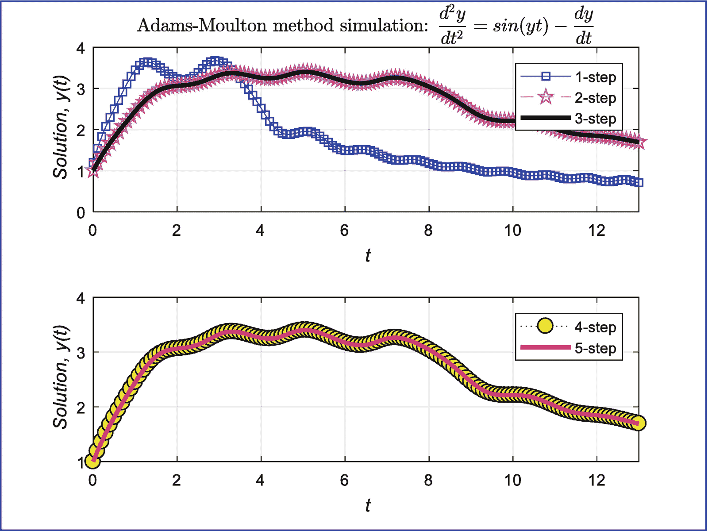

**图 3-12** 示例仿真：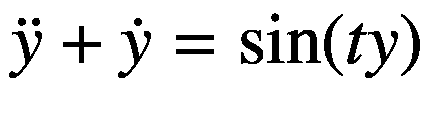，

## Simulink 建模

使用 `Simulink` 建模求解二阶或更高阶常微分方程与求解一阶常微分方程非常相似，区别在于需要额外的一个或多个 `Integrator` 模块，以便从二阶或更高阶导数变量中获得解。让我们通过几个示例来演示如何使用 `Simulink` 建模求解二阶常微分方程。

## 示例 13

示例问题如下：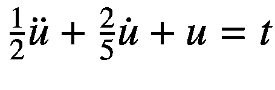，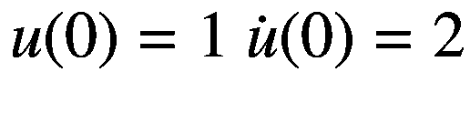。

在开始建模之前，我们首先重写给定的二阶常微分方程，如下所示：

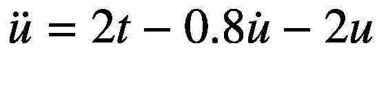

请注意，要得到 *u*(*t*)，必须对进行两次积分，如图 3-13 所示。

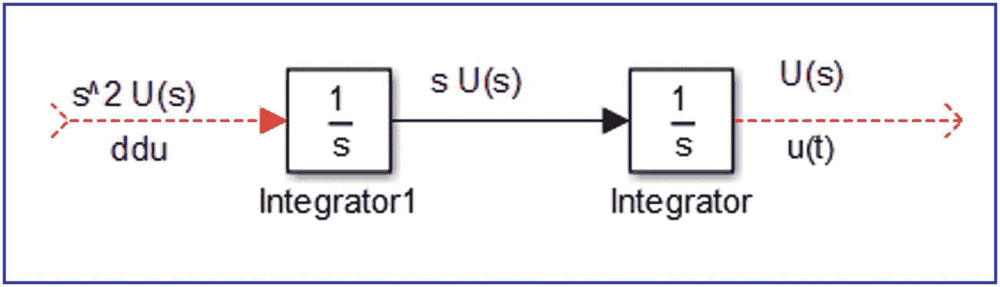

**图 3-13** — 使用`Integrator`模块进行二重积分

给定的问题已在 `Sim_Model_2ndODE_ex13.mdl` 中建模，如图 3-14 所示。

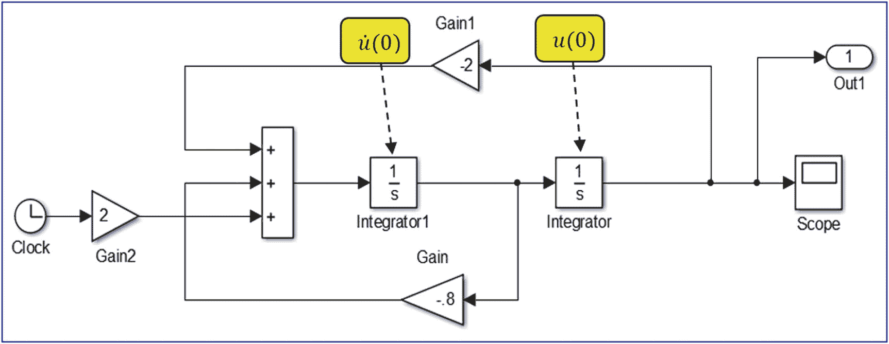

**图 3-14** — 问题的 `Simulink` 模型：，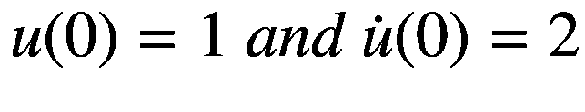

对于图 3-14 所示的 `Simulink` 模型，`Integrator1` 模块的内部初始条件值为 `2.0`，另一个模块的内部初始条件值为 `1.0`。执行该模型（图 3-14）后，即可获得显示在 `Scope` 模块中的仿真结果。

，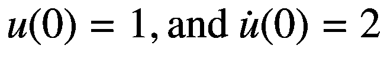 的仿真结果显示在 `Scope` 模块中，如图 3-15 所示。注意，在显示的 `Scope` 模块中，我们做了一些调整，包括设置其背景颜色、从模块参数中绘制数据点（标记和线型），以及设置绘制的数据点的颜色，这些操作类似于 `MATLAB` 的绘图工具。

**注：** 自 `MATLAB` 2012/`Simulink` 8.0 起，`Scope` 模块参数中提供了更改背景颜色、更改绘制数据的线型和标记类型、更改坐标轴颜色以及添加图例的选项。

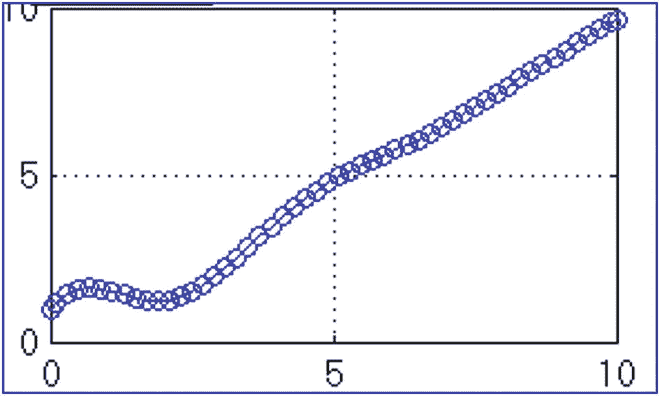

**图 3-15** — 图 3-14 中 `Simulink` 模型的 `Scope` 模块显示的仿真结果

---

## 示例 14

示例问题如下：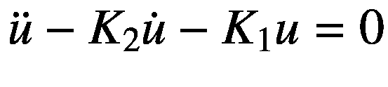，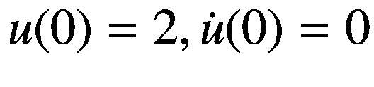。

此问题的建模步骤与上一个问题相似，区别在于有两个增益 *K*[1] 和 *K*[2]，它们可以在命令窗口中指定，或通过从模型窗口菜单中选择 **文件** → **模型属性** → **回调** → **初始化函数** 进行初始化。

该练习的 `Simulink` 模型被命名为 `Sim_Model_2ndODE_ex14.mdl`，如图 3-16 所示。

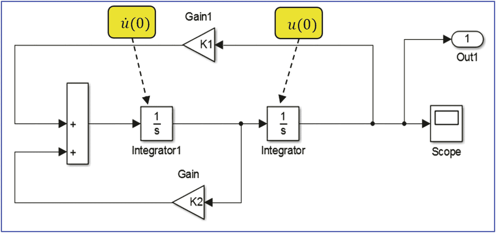

**图 3-16** — ，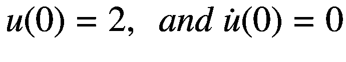 的 `Simulink` 模型

还可以使用带有外部初始条件的积分器模块。这可以通过双击 `Integrator` 模块并从下拉菜单中选择初始条件源来实现，如图 3-17 所示。

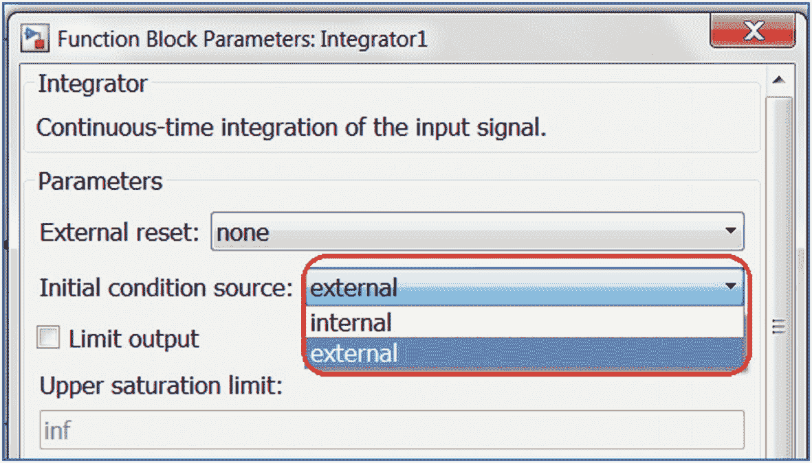

**图 3-17** — `Integrator` 模块参数设置

按下 `应用` 和 `确定` 确认后，我们得到以下更新后的模型模块：

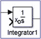

对于这个更改后的 `Integrator` 模块，现在我们添加一个 `常量` 模块作为初始条件的源值，更新后的模型 (`Sim_Model_2ndODE_ex2.mdl`) 将如图 3-18 所示。

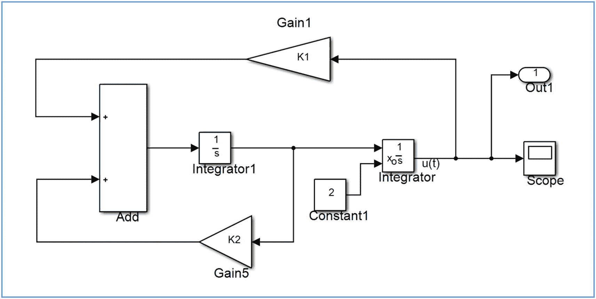

**图 3-18** — ，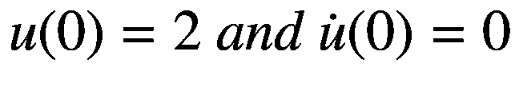 的另一种 `Simulink` 模型

首先初始化增益值 (*K*[1] =  − 6， *K*[2] =  − 9)，然后对我们创建的模型进行仿真，即可在示波器模块中获得如图 3-19 所示的输出。

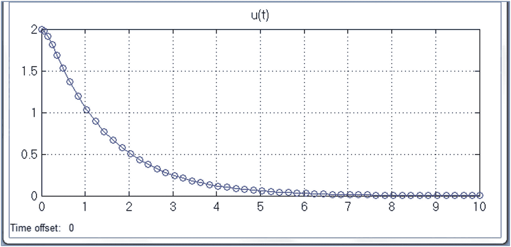

**图 3-19** — *K*[1] = − 6， *K*[2] =  − 9 时，， 的仿真结果

同样，在图 3-19 所示的`[Scope]`模块参数中，我们对绘制数据点的标记、线条颜色和类型做了一些调整。此外，在输出信号的`[Scope]`显示中，我们为其分配了一个标题 *u*(*t*)。为此，我们首先选择连接到示波器的信号线，然后右键单击并选择 **属性** → **信号名称**：*u*(*t*)。当处理连接到同一个`[Scope]`显示的两个或多个信号时，此选项有助于识别信号。

---

### 示例 15

示例问题如下：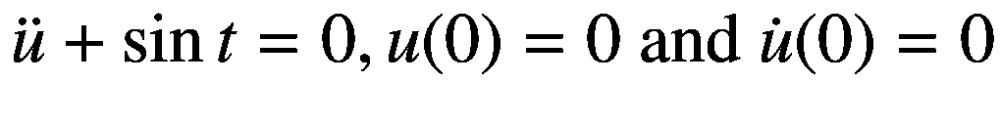。给定的问题可以重写为：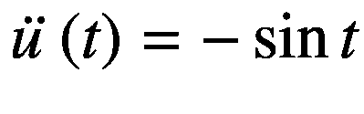。

此问题相对简单，其数值解可以通过模型 `Sim_Model_2ndODE_ex15.mdl` 计算得到，该模型与上一个问题的仿真模型类似，都采用了二重积分。

在我们开发的 Simulink 模型中（图 3-20），模型版本 A 和模型版本 B 的输入信号模块不同。这是一个很好的例子，说明我们可以轻松地将一种类型的模块替换为另一种类型，以简化模型。两个版本的模型产生的结果相同，可以从图 3-21 所示的`[Scope2]`结果中观察到。

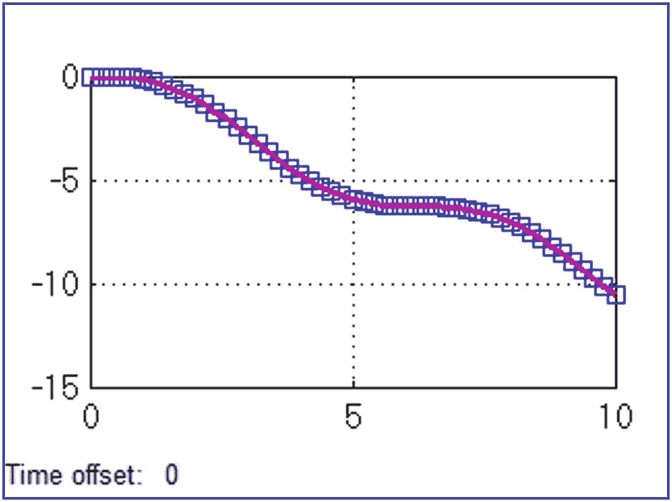

**图 3-21** — `[Scope2]`显示了图 3-20 中两个模型的仿真结果

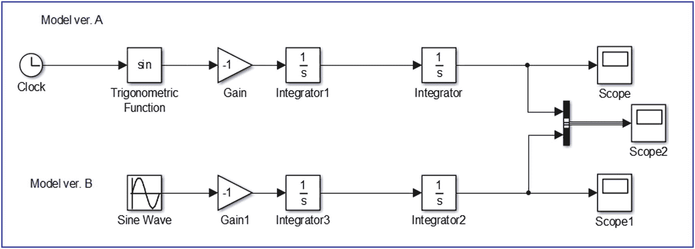

**图 3-20** — 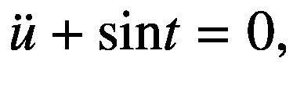 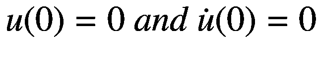 的 Simulink 模型的两个版本

### 示例 16

示例问题如下：, 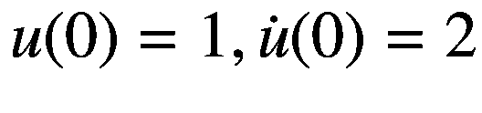。

首先，将给定的二阶常微分方程改写为以下形式：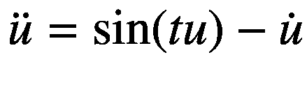。注意，该问题是通过闭环反馈系统建模的（因为在本例中，我们有 ），这不同于之前属于开环系统的例子（之前只有 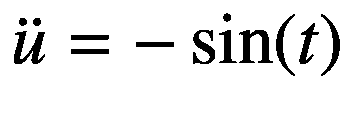）。图 3-22 展示了完整的 Simulink 模型 `Sim_Model_2ndODE_ex16.mdl`。图 3-23 展示了所构建 Simulink 模型的仿真结果。

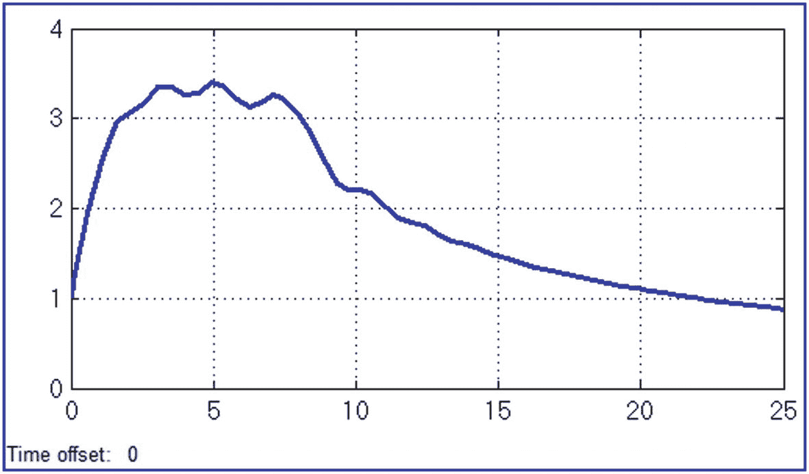

**图 3-23** 图 3-22 中 Simulink 模型的 `[Scope]` 模块显示的仿真结果

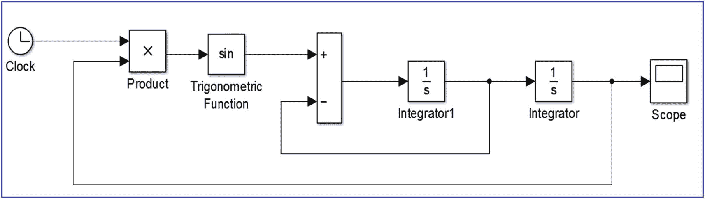

**图 3-22** Simulink 模型，对应 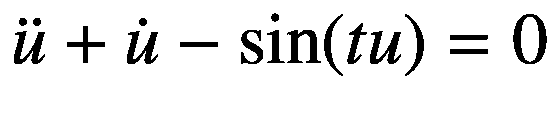, 

从 `[Scope]` 窗口显示的图中可以看出，结果似乎不太平滑，这是由于模型求解器的步长和误差容限选择不当所致。所有调整和设置都可以通过相应修改配置参数来完成，可通过点击菜单面板 `Model Configuration Parameters` （适用于 MATLAB R2012b 或更新版本）进入；然后选择 `Solver`，或者从菜单栏选择 `Tools` ➤ `Model Explorer` ➤ `Configuration` ➤ `Solver`。

## 非零初始条件

并非所有初值问题都从零（时间）初始条件开始。让我们求解一个从非零初始点开始的初值问题。

### 示例 17

示例问题如下：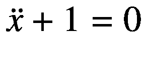，初始条件为：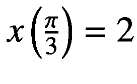；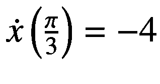。

这里有一个 Simulink 模型 `Sim_Model_2ndODE_ex17.mdl`，它以两个不同版本创建，其中一个版本（版本 1）使用 `[Second-Order Integrator]` 实现，另一个版本（版本 2）使用两个一阶 `[Integrator]` 模块实现。两个版本的模型是等价的，并且两个初始条件被预定义为内部参数。构建的 Simulink 仿真模型如图 3-24 所示。

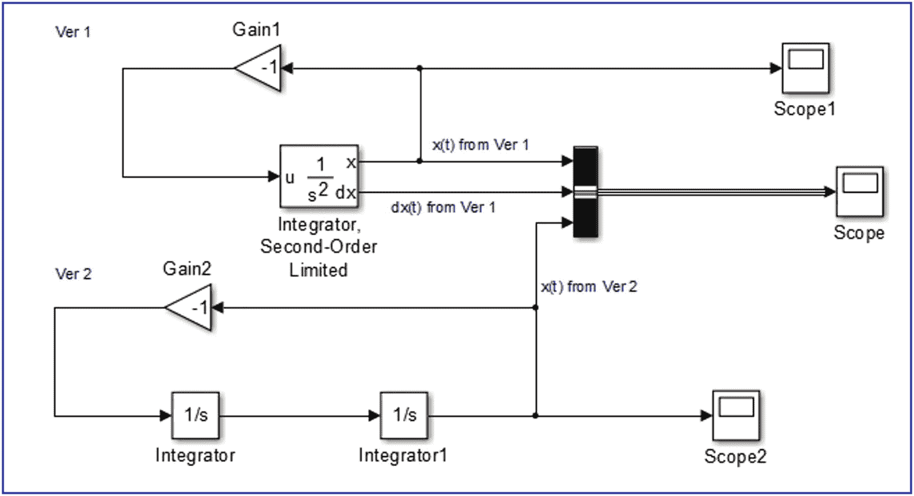

**图 3-24** Simulink 模型，对应 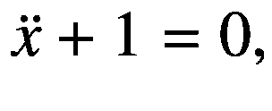 ；

在此给定示例中，初值问题并非从 *t* = 0 开始，而是从 *t* = 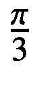 开始。因此，仿真必须从 *t* =  开始，这可以在 Simulink 模型参数中轻松实现。为此，我们在配置参数中进行修改。选择 `Solver` ➤ `Start Time`，并将 0 替换为 `pi/3`，如图 3-25 中突出显示的那样。

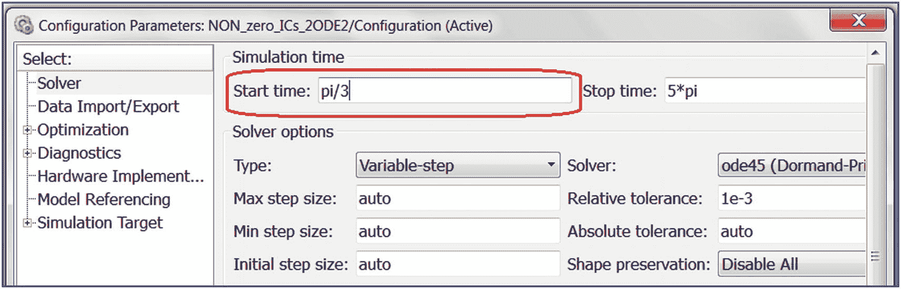

**图 3-25** 配置参数设置以设定仿真时间

注意，`[Second-Order (double) Integrator]` 模块从 MATLAB 2011/Simulink 开始提供。

# ODEx 求解器

通过仿真图 3-24 所示的模型，我们从 `[Scope]` 窗口获得了两个版本模型的结果（如图 3-27 所示）。`[Scope]` 模块包含来自版本 1 的 `` 输出信号以及来自版本 2 的 `x(t)` 信号。我们通过右键单击选项，为来自版本 1 的 `` 信号和来自版本 2 的 `x(t)` 信号指定了信号名称。单击信号线，然后右键单击并选择 `Properties` > `Signal name`。输入 `x(t)` 并点击 `Apply` 和 `OK`，如图 3-26 所示。最后，图 3-27 所示的仿真结果包含了所有指定的图例。

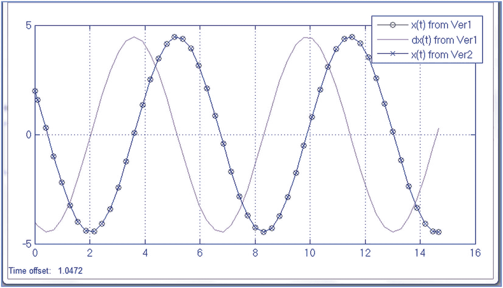

**图 3-27** 仿真结果 ``


**图 3-26** 使用右键单击选项设置信号名称

从图 3-27 示波器中显示的输出可以看出，这两个版本的模型给出了相同的结果。

总结所有 Simulink 建模的示例，从学习的角度来看，在 Simulink 中对常微分方程进行编程或建模相对简单。

我们已经介绍了用于一阶常微分方程的 MATLAB 内置求解器。在本节中，我们将使用内置求解器和工具来求解二阶及更高阶的常微分方程。在这方面，我们用于一阶常微分方程的所有内置工具都是有效的，并且使用相同的命令语法。在求解二阶或更高阶常微分方程时，我们需要将给定问题改写为一阶常微分方程组。

## 示例 18

以下是示例问题：`` ``。

在编写用于 MATLAB 内置 ODE 求解器的命令脚本之前，我们需要通过引入新变量，将给定的二阶 ODE 重写为一阶 ODE 方程组。

`` 被重写为如下形式：``

注意 `u[1] = u` 且 ``。

前面写出的一阶 ODE 方程组可以在脚本中使用 `matlabFunction`、匿名函数（`@`）、函数文件和内联函数（将在未来的 MATLAB 版本中移除）来表达。

**注意**

如果给定的问题不是刚性的或隐式定义的，`ode45` 是求解初值问题（IVPs）时推荐首选尝试的求解器。

该脚本（`ODEx_solvers_EX18.m`）嵌入了 ODE 求解器（如 `ode45`、`ode23` 和 `ode113`）的命令语法，用于计算给定问题的数值解。计算得到的数值解如图 3-28 所示。

```matlab
% ODEx_solvers_EX18.m
clearvars; close all
t0=0;               % 仿真开始时间
tend=5;             % 仿真结束时间
t=[t0, tend];
u(1,:)=[1; 2];      % 初始条件
% ode45 - 龙格-库塔 4/5 阶
Fun1 = inline('[u(2); 4*t-2*u(1)-u(2).*(4/5)]','t', 'u');
[T1, U1]=ode45(Fun1, t, u, []);
plot(T1, U1(:,1), 'rp', 'markersize', 9); grid on; hold on
% ode23 - 龙格-库塔 2/3 阶
Fun2=@(t, u)([u(2); 4*t-u(1).*2-u(2).*(4/5)]);
[T2, U2]=ode23(Fun2, t, u);
plot(T2, U2(:,1), 'b:o', 'markersize', 9)
% ode113 - 亚当斯高阶法
[T3, U3]=ode113(@Fun3, t, u);
plot(T3, U3(:,1), 'k-', 'linewidth', 2)
legend('ode45', 'ode23', 'ode113')
title('Simulation of: (1/2)ddy+(2/5)dy+y=2t')
xlabel('Time, t'), ylabel('Solution, u(t)'), axis tight
```

被基于亚当斯方法的 `ode113` 求解器调用的函数 m 文件 `Fun3.m` 如下所示：

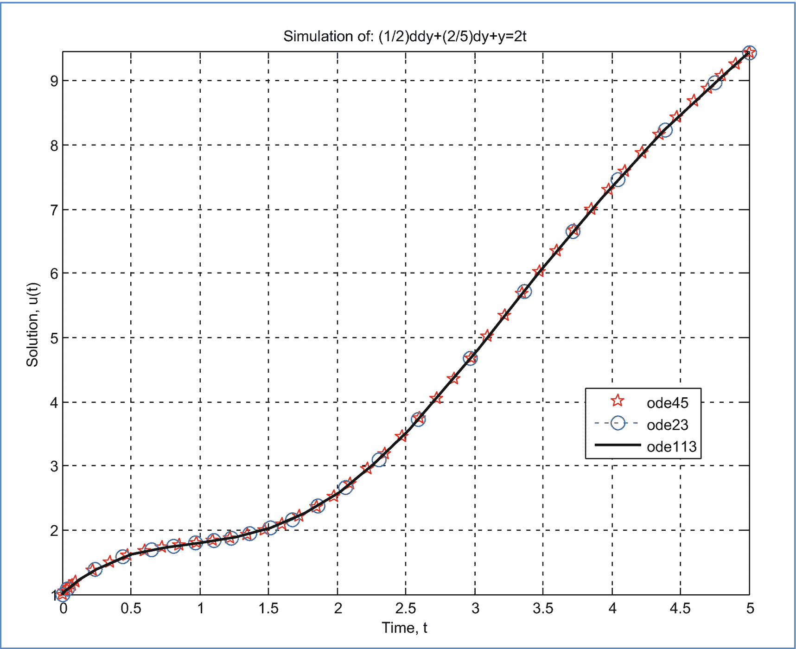

**图 3-28**

示例仿真：`` ``

```matlab
function f = Fun3(t,u)
% Fun3.m 是一个函数文件。
% 此函数文件被求解器 ode113 调用。
f = [u(2); t.*4.0-u(1).*2.0-u(2).*(4.0./5.0)];
end
```

## 示例 19

以下是示例问题：``，``。

在本例中，与上一个问题类似，我们可以通过引入新变量，将给定问题重写为两个一阶 ODE。

`` 被重写为如下形式：``

注意 `u[1] = u` 且 ``。

以下是脚本（`ODEx_solvers_EX19.m`），它嵌入了基于龙格-库塔方法的 `ode45`、用于刚性问题的 `ode15s` 以及高阶亚当斯法的 `ode113` 等 MATLAB 求解器，用于计算问题的数值解：

## 示例 19

### 示例 19

```matlab
% ODEx_solvers_EX19.m
clearvars; close all
t0=0; tend=5;  t=[t0, tend]; u(1,:)=[2 0];
% ode45 - 4/5 阶龙格-库塔法
Fun1 = inline('[u(2); -6*u(1)-9*u(2)]','t', 'u');
[T1, U1]=ode45(Fun1, t, u, []);
plot(T1, U1(:,1), 'r*', 'markersize', 9), grid on; hold on
% ode15s - 刚性问题求解器
Fun2=@(t, u)([u(2); -6*u(1)-9*u(2)]);
[T2, U2]=ode15s(Fun2, t, u,[]); plot(T2, U2(:,1), 'bo', 'markersize', 9)
% ode113 - 亚当斯高阶法
[T3, U3]=ode113(Fun2, t, u,[]);
plot(T3, U3(:,1), 'k-.', 'linewidth', 2)
legend('ode45', 'ode15s', 'ode113',0)
title('Simulation: ddy+9dy+6y=0\. ode45, ode15s, ode113')
xlabel('Time, t'); ylabel('Solution, u(t)')
```

仿真结果（如图 3-29 所示）表明，由`ode45`、`ode15s`和`ode113`求解器计算得到的解高度趋同。

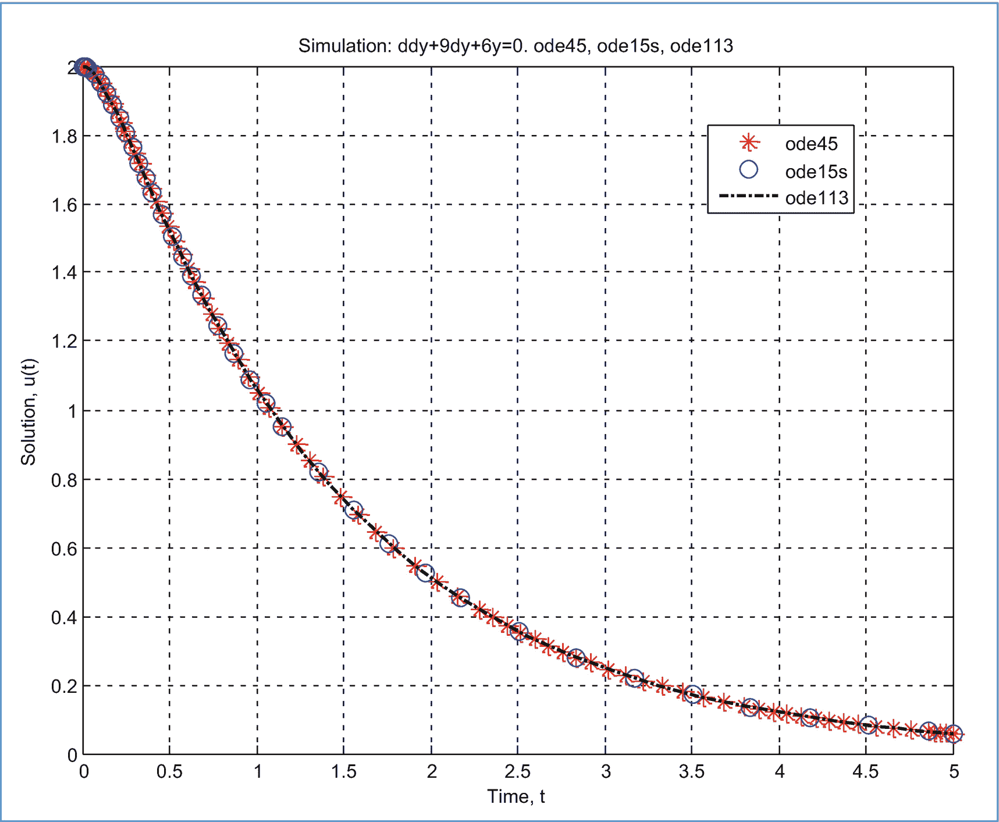

**图 3-29**

对比仿真： 

## 示例 20

下面是示例问题：

请注意，在该问题中，初始条件设定在 `t` = 1。

在本例中，我们同样从引入新变量，将给定的二阶问题重写为两个一阶常微分方程开始。

 被重写为：

请注意 `y`[1] = `y` 且  。

以下名为 `ODEx_solvers_EX20.m` 的脚本嵌入了 `ode45` 求解器，并执行名为 `ICs_non_Zero_2ODE.mdl` 的 Simulink 模型，以计算给定问题的数值解：

```matlab
% ODEx_solvers_EX20.m
% 给定： t*y"+2y'+4y=4，初始条件： y(1)=1, y'(1)=1
% 注意：仿真起始点不是 "0" 而是 1
t=[1,50];  % 注意：仿真从 1 开始。
y_s=inline('[y(2); (1/t)*(4-2*y(2)-4*y(1))]', 't', 'y');
ICs=[1, 1]; options=odeset('reltol', 1e-6);
[time, y_sol]=ode45(y_s, t, ICs, options);
plot(time, y_sol(:,1),'r', 'linewidth', 2), grid on
title('模拟 t*ddy+2dy+4y=4，初始条件 y(1)=1, dy(1)=1')
xlabel('时间, t'), ylabel('解, y(t)'), ylim([.8 1.35]); hold on
% 通过 SIMULINK 模拟： ode23
opts=simset('reltol',1e-6,'solver', 'ode23');
K=4; sim('ICs_non_Zero_2ODE_EX3', [1, 50], opts);
plot(SIM_outs(:,1), SIM_outs(:,2), 'bo-' ,'linewidth', 1)
legend('ode45', 'Simulink ode23', 0); hold off
```

图 3-30 展示了一个以两个不同版本创建的 Simulink 模型 (`ICs_non_Zero_2ODE_EX3.mdl`)。两者输出相同的结果。后一模型（替代模型）通过选择 Simulink 库 ➤ 用户自定义函数，采用函数模块  开发而成。[积分器]模块中的初始条件作为内部初始条件实现，仿真时间设置为从 `t` = 1 *秒*开始。仿真结果如图 3-31 所示。

**注意：** 对于初始值问题起始时间非零的 Simulink 模型，仿真必须从给定的初始时间（值）开始。例如，对于  仿真必须从  开始。


**图 3-31** 使用 MATLAB 的 `ode45` 求解器和 Simulink 的 `ode23` 求解器对问题进行仿真


**图 3-30** 示例 20 的 Simulink 模型 (`ICs_non_Zero_2ODE_EX3.mdl`)

## 示例 21

下面是示例问题：

请注意，在该问题中，初始条件设定在 

在本例中，我们同样通过引入新变量，将给定的二阶问题表示为两个一阶常微分方程开始。

 表示为：

请注意 `y`[1] = `y` 且  。

脚本 `ODEx_solvers_EX21.m` 嵌入了 Simulink 的 `ode23`、MATLAB 的 `ode45`、通过脚本实现的四阶龙格-库塔方法以计算数值解，以及 `dsolve()` 以计算问题的解析解。该示例的 Simulink 模型 (`ICs_non_Zero_2ODE_EX4.mdl`) 如图 3-32 所示。


`**图 3-32**` 问题的 Simulink 模型 (`ICs_non_Zero_2ODE_EX4.mdl`)

```
% ODEx_solvers_EX21.m
% 给定： y"-2y'+5y=0, y(pi/2)=0, y'(pi/2)=2
clearvars; close all
%% SIMULINK 解法
%!!! 注意：计算从 pi/2 开始
opts=simset('reltol',1e-5,'solver', 'ode23');
[time, Yout]=sim('ICs_non_Zero_2ODE_EX4', [pi/2, 2*pi], opts);
plot(time, Yout(:,1), 'm--o', 'markersize', 9), hold on
%% 龙格-库塔（基于 ode45 求解器）解法
% 注意：计算从 pi/2 开始，这是初始条件的设定点。
ICs=[0; 2];    %初始条件
ts=pi/2;       %!!! 注意：计算从 pi/2 开始
tend=2*pi;
U(1,:)=[0, 2];
[time,u_sol]=ode45(@(t,u)([u(2); 2*u(2)-5*u(1)]),[ts,tend], ICs);
plot(time, u_sol(:,1), 'b>', 'markersize', 9), hold on
%% 龙格-库塔（基于脚本）解法
% 注意：计算从 pi/2 开始，这是初始条件的设定点。
U(1,:)=[0, 2];    %初始条件
ts=pi/2;          %!!! 注意：计算从 pi/2 开始
h=pi/20; tend=2*pi; t=ts:h:tend; steps=length(t);
FF=@(t, u1, u2)([u2, 2*u2-5*u1]);
for ii=1:steps-1
k1=FF(t(ii), U(ii,1), U(ii,2));
k2=FF(t(ii)+h/2,U(ii,1)+h*k1(:,1)/2,U(ii,2)+h*k1(:,2)/2);
k3=FF(t(ii)+h/2,U(ii,1)+h*k2(:,1)/2,U(ii,2)+h*k2(:,2)/2);
k4=FF(t(ii)+h,U(ii,1)+h*k3(:,1),U(ii,2)+h*k3(:,2));
U(ii+1,:)=U(ii,:)+h*(k1+2*k2+2*k3+k4)/6;
end
plot(t(:)',U(:,1),'k:p','markersize', 13, 'markerfacecolor', 'c')
%% 解析解：通过 dsolve
y=dsolve('D2y=2*Dy-5*y', 'y(pi/2)=0', 'Dy(pi/2)=2', 'x');
display('y(t) 为'); pretty(y); y=vectorize(y); x=t; Yt=eval(y);
plot(t, Yt, 'g-', 'linewidth', 2.5), grid on; hold on
legend('Simulink(ode23 ~变步长)','ODE45','RK 四阶脚本','解析解')
title('ddy-2dy+5y=0, y(\pi/2)=0, dy(\pi/2)=2')
xlabel('t, 时间'), ylabel('y(t), 解'), hold off; shg
```

执行上述脚本 (`ODEx_solversEX4.m`) 后，该脚本还会执行 Simulink 模型 (`ICs_non_Zero_2ODE_EX21.mdl`)，即可得到显示所有结果的图（如图 3-33 所示）。


`**图 3-33**` 问题的仿真结果

此外，在命令行窗口中得到以下符号表达式，即问题的解析解：

```
y(t) 为
/   pi \
- sin(2 x) exp| - -- | exp(x)
\   2  /
```

从图 3-33 所示的图中可以清楚地看到，采用 `ode23` 变步长求解器的 Simulink 模型和四阶龙格-库塔方法计算出的数值解与给定二阶常微分方程的解析解良好收敛。

## `diff()`

`diff()` 是 MATLAB 的一个内置函数，用于计算差分和近似导数。它的工作方式类似于泰勒级数方法，通过评估函数的近似导数来计算计算演化中的差分。让我们考虑以下示例并应用 `diff` 函数。

### 示例 22

火星着陆器在着陆时的速度和加速度运动方程如下：


与之前的问题不同，本例中我们并不关心着陆器的位移 `y(t)`；而是需要评估其着陆时的速度（`\dot{y}(t)=v(t)`）和加速度（`\ddot{y}(t)=a(t)`），其中 `m` 是火星着陆器的质量，`k` 是阻尼系数，`g` 是火星的重力加速度。在本数值模拟中，我们使用以下数值：

![$$ m=150\ \left[ kg\right],k=1.2\ \left[N\ m\ s\right],g=3.885\ \left[\frac{m}{s²}\right]. $$](images/490522_1_En_3_Chapter/490522_1_En_3_Chapter_TeX_IEq145.png)

在本例中，我们再次通过引入新变量，将给定的二阶常微分方程重写为两个一阶常微分方程。

`\ddot{y}+(k/m)\dot{y}²=g` 表示如下：


请注意，`y[1] = y` 且 `\dot{y}_2 = \ddot{y}_1`。

以下是嵌入了 `ode45` 求解器和 `diff` 函数的脚本（`MARS_lander.m`）：

```
%%  MARS Lander Vehicle velocity and acceleration while landing
%   MARS_lander.m
t=0:.05:6; u0=[20, 67.0556]; g=3.885; k=1.2; m=150;
%F=inline('[u(2); g-(k/m)*(u(2).²)]', 't', 'u');
Flander=@(t, u)([u(2); g-(k/m)*(u(2).²)]);
[time, Uout]=ode45(Flander, t, u0, []);
% Acceleration is a derivative of velocity!
acc = diff(Uout(:,2))/(time(2)-time(1));
plot(t,Uout(:,2),'ro',t(2:end),acc,'bs'); hold on
% Time derivative:
Ttt=[diff(t);diff(t)];
% Velocity:
Utt=diff(Uout);
% Acceleration:
UT=Utt./Ttt';
plot(t(2:end),UT(:,1),'b-',t(2:end),UT(:,2), ...
'm--','linewidth',2.5)
legend({'Velocity1 [m/s]';'Acceleration1 [m²/s]';...
'Velocity2'; 'Acceleration2'},0); grid minor
title('Mars lander"s velocity and acceleration during landing')
xlabel('time'), ylabel('v, a'), shg
```

从图 3-34 所示的图形可以看出，对于给定问题（火星着陆器着陆时的运动方程），`ode45` 和 `diff` 这两种方法都生成了良好收敛的解。


`**图 3-34**`

使用 `ode45` 和 `diff` 评估的火星着陆器速度和加速度

当需要计算复杂函数的符号导数时，使用 `diff()` 非常简便。以下是一个示例：

通过对几个二阶常微分方程的仿真示例，我们演示了如何实现欧拉法、龙格-库塔法、龙格-库塔-吉尔法、龙格-库塔-费尔伯格法、亚当斯-巴什福思法、米尔恩法、亚当斯-莫尔顿法以及泰勒级数法来求解常微分方程。此外，我们还使用了`MATLAB`内置的`ODE`求解器和工具，例如`ode23`、`ode23tb`、`ode45`、`ode113`、`odeset`和`diff()`。同时，我们还演示了使用求解器（如`ode2`、`ode3`、`ode23`、`ode45`）和工具（如`simset`和`sim`）的`Simulink`建模技术。所有这些方法和工具都适用于所有显式定义的常微分方程及常微分方程组。这些方法的效率和精度取决于给定的`ODE`方程类型，例如线性或非线性、齐次或非齐次、刚性或非刚性。此外，所采用的数值方法的精度和效率还取决于用户选择/设置的误差容限和步长。

```matlab
>> syms x y t
>> F=[sin(10*t); x²+y³+2*x*y²; t²*sinc(2*x/y)];
dF=[diff(F(1),t); diff(F(2), x, y); diff(F(3), x, y)]
dF =
10*cos(10*t)
3*y² + 4*x*y
(t²*sin((2*pi*x)/y))/(2*pi*x) - (t²*cos((2*pi*x)/y))/y
>> pretty(dF)
+-                                     -+
|              10 cos(10 t)             |
|                                       |
|                 2                     |
|              3 y  + 4 x y             |
|                                       |
|   2    / 2 pi x \    2    / 2 pi x \  |
|  t  sin| ------ |   t  cos| ------ |  |
|        \   y    /         \   y    /  |
|  ---------------- - ----------------  |
|       2 pi x               y          |
+-                                     -+
```