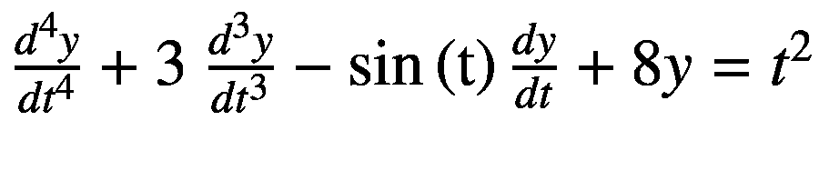
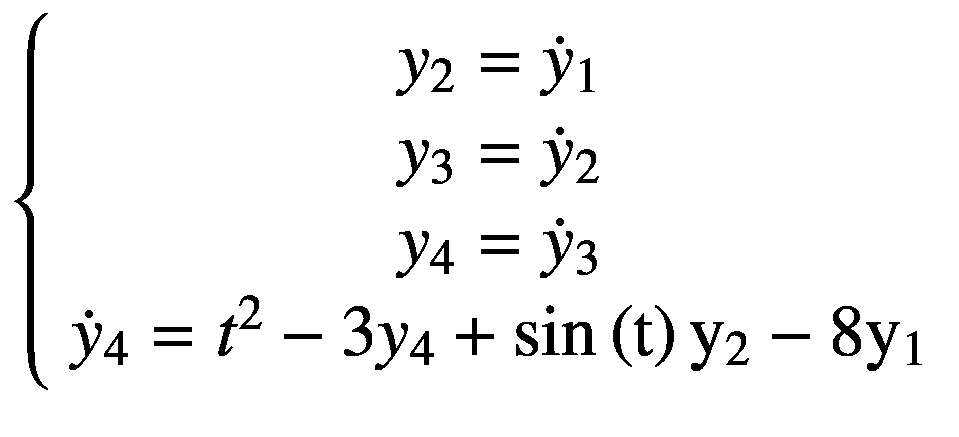
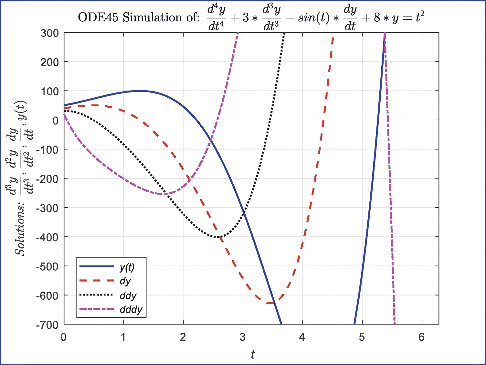
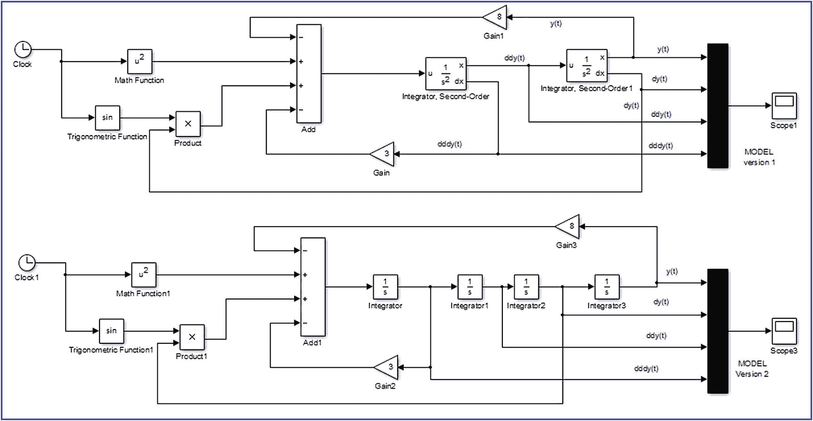
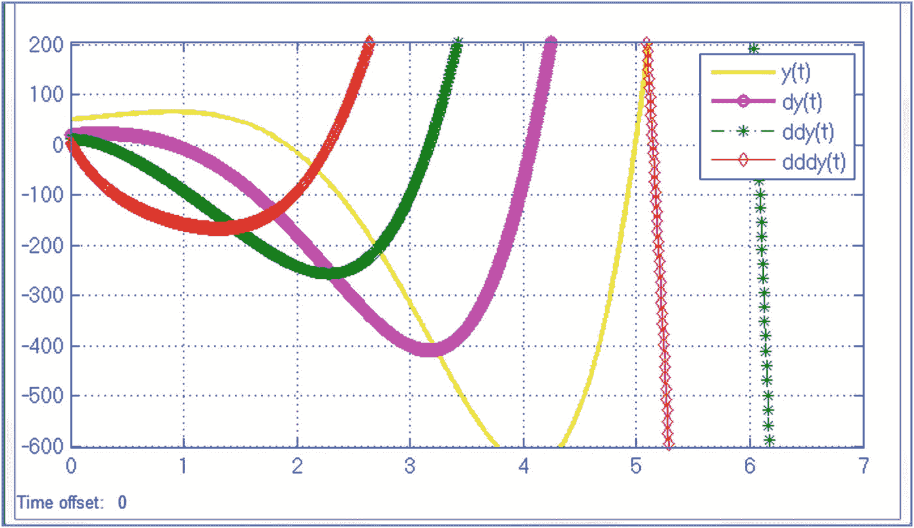
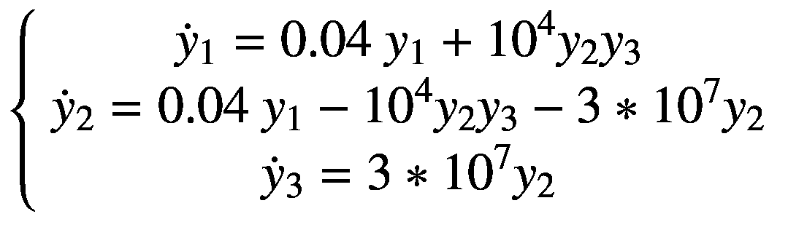
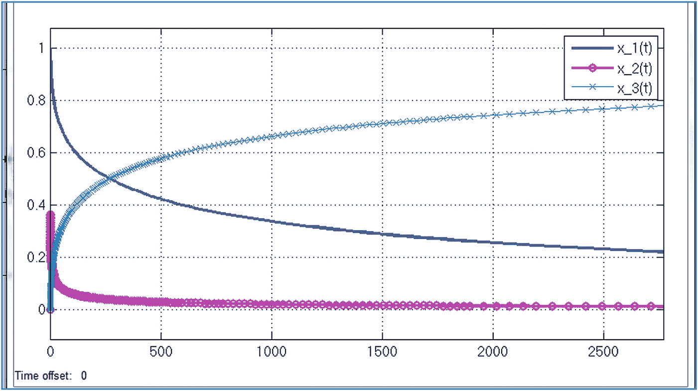
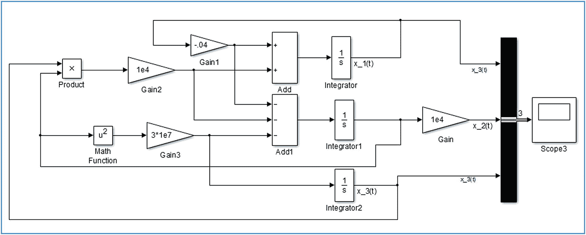

# 5. 高阶与耦合常微分方程

本章致力于数值求解高阶和耦合常微分方程（ODE）。通常，求解高阶 ODE 和耦合 ODE 系统所使用的步骤与二阶 ODE 相似，唯一的区别在于，在将给定的高阶 ODE 改写为一阶 ODE 系统时，需要为新变量添加额外的步骤。

## 四阶 ODE 问题

让我们考虑以下四阶非齐次 ODE：

，`y(0) = 50`，`dy(0) = 40`，`d²y(0) = 30`，`d³y(0) = 20`。

上述给定的四阶 ODE 可以通过如下四个一阶 ODE 组成的系统重写：



该系统通过脚本 `SOLVE_4order_ODE.m` 实现：

```matlab
function SOLVE_4order_ODE
% 帮助：使用 f4ode（嵌套函数）的 EXE4orderODE.m
%       对问题进行仿真。
close all
time=[0, 2*pi]; y0=[50, 40, 30, 20];
[t, y]=ode45(@f4ode, time, y0, odeset('reltol', 1e-8));
figure('name', 'Simulate with ODE45'),
plot(t,y(:,1), 'b-', t,y(:,2), 'r--',t,y(:,3), ...
'k:',t,y(:,4), 'm-.','linewidth', 1.5)
legend('\it y(t)', '\it dy','\it ddy','\it dddy',... 'location','best')
title('ODE45 仿真: $$ \frac{d⁴y}{dt⁴}+3*\frac{d³y}{dt³}-sin(t)*\frac{dy}{dt}+8*y=t² $$', 'interpreter', 'latex')
grid on, ylim([-700 300]), xlim([0, 2*pi])
xlabel('\it t')
ylabel('\it 解: $$ \frac{d³y}{dt³}, \frac{d²y}{dt²}, \frac{dy}{dt}, y(t) $$', 'interpreter', 'latex')
grid on
figure('name','Simulate with ODE23');
ode23(@f4ode, time, y0, odeset('reltol', 1e-8))
ylim([-700 300]), xlim([0, 2*pi])
legend('\it y(t)', '\it dy','\it ddy','\it dddy', 'location','best')
title('ODE23 仿真: $$ \frac{d⁴y}{dt⁴}+3*\frac{d³y}{dt³}-sin(t)*\frac{dy}{dt}+8*y=t² $$', 'interpreter', 'latex')
xlabel('\it t')
ylabel('\it 解: $$ \frac{d³y}{dt³}, \frac{d²y}{dt²}, \frac{dy}{dt}, y(t) $$', 'interpreter', 'latex')
grid on
function f=f4ode(t, y)
% 给定的四阶 ODE 为： y""+3*y"'-sin(t)*y'+8*y=t²
f=[y(2); y(3); y(4); t.²-3.*y(4)+sin(t).*y(2)-8.*y(1)];
end
end
```

使用 `ode45` 的仿真结果（如图 5-1 所示）与使用 `ode23` 得到的结果（此处未显示绘图）吻合良好。注意，在脚本 `SOLVE_4order_ODE.m` 中，使用了一个嵌套函数 (`f4ode`) 来表达给定的四阶 ODE，该函数也可用匿名函数替代。示例如下：



图 5-1：四阶非齐次非线性 ODE 问题的仿真

```matlab
f4ode=@(t, y)([y(2); y(3); y(4); t.²-3.*y(4)+sin(t).*y(2)-8.*y(1)]);
```

那么调用 `ode45` 或 `ode23` 的语法如下：

```matlab
[t, y]=ode45(f4ode, time, y0, odeset('reltol', 1e-8));
```

图 5-2 展示了给定四阶 ODE 问题的两个版本的 Simulink 模型（`Fourth_order_ODE.slx`）。



图 5-2：四阶非齐次 ODE 的 Simulink 模型

注意，在第一个和`二阶积分器`模块中，所有初始条件（IC）都是内部源的输入。两个模型唯一的区别在于：第一个模型中使用了两个`二阶积分器`模块，而第二个模型中使用了四个一阶`积分器`模块。注意，在图 1-3 所示的仿真结果中，输出信号名称显示在图例中。也就是说，这些名称是通过将连接到 `Mux` 模块的每个信号分别命名为 `y(t)`、`dy(t)`、`ddy(t)`、`dddy(t)` 获得的。您可以通过右键单击并逐一重命名信号来重命名这些信号。来自 Simulink 模型 `Fourth_order_ODE.slx` 的仿真结果（图 5-3）与来自脚本 `SOLVE_4order_ODE.m` 的 `ode45` 求解器输出（如图 5-1 所示）是一致的。



图 5-3：`Scope` 中显示的 Simulink 模型仿真结果

从我们对高阶 ODE 的仿真可以看出，计算高阶 ODE 的数值解与二阶 ODE 类似，用于仿真高阶 ODE 的工具和函数与我们在求解一阶和二阶 ODE 时使用的相同。我们在高阶 ODE 中遇到的唯一区别是，在脚本中将高阶 ODE 改写为一阶 ODE 时需要额外的步骤，并且在 Simulink 建模中需要额外的`积分器`模块。

## Robertson 问题

Robertson 问题 [1] 描述了化学反应，并常被用作针对刚性初值问题 (IVP) 的 ODE 求解器的测试问题。它是用于耦合系统以及刚性 ODE 问题的一个很好的例子。Robertson 问题由以下耦合的一阶微分方程组描述：



其初始条件为 `y1(0) = 1`，`y2(0) = 0`，`y3(0) = 0`。

这个问题可以相对容易地通过 Simulink 建模实现。图 5-4 显示了 Simulink 模型（`Robertson_problem.mdl`），图 5-5 显示了仿真结果。



图 5-5：Robertson 问题的 Simulink 模型仿真结果（放大视图）



图 5-4：Simulink 中的 Robertson 问题模型（`Robertson_problem.mdl`）

Robertson 问题是用于演示刚性 ODE 的一个很好的例子。其数值解是通过 Simulink 建模方法计算的，并且计算出的解被证明是相当稳定的。然而，为了评估所开发的 Simulink 模型的精度和计算时间效率，需要使用其他方法（如 Milne 方法、Adams-Moulton 方法或改进的 Euler 方法）或内置的 ODEx 求解器（如 `ode15`、`ode23s` 和 `ode113`）来开发其他数值仿真模型。


