# 6. 隐式常微分方程

求解常微分方程的现代理论和方法已在广泛的软件应用和工具中实现。数值搜索解的理论已被充分理解，并且有稳健的方法可求解不同类型的问题。然而，微分代数方程的理论研究尚未达到与常微分方程相同的深度。Ascher 和 Petzold [1] 进行过一些扩展研究，但这发生在 20 世纪 70 年代。尽管有许多重要的应用使用微分代数方程对各种系统进行建模，但求解微分代数方程的方法在某种程度上是有限的，因为微分代数方程所涉及的问题难以求解，且其背后的理论难以理解。因此，专门针对微分代数方程的研究和文献数量有限。在本章中，我们将展示一些可求解微分代数方程的 MATLAB/Simulink 工具。

首先，让我们定义隐式常微分方程。给定问题可以表示为以下一般形式：

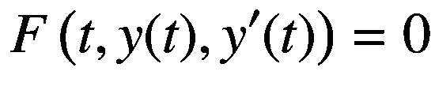

(6-1)

其中 `F` 是一个连续且足够光滑的函数，被称为*一阶隐式微分方程*。如果这个方程可以解出 `y′(t)`，我们将得到一个或多个显式定义的微分方程，这些正是前几章讨论过的显式常微分方程。

在本节中，我们将通过几个隐式定义（或特意当作隐式处理的）常微分方程的示例，演示如何使用 MATLAB 内置的常微分方程求解器 `ode15i` 获得隐式初值问题的数值解。我们还将把从 `ode15i` 获得的解与从 `ode15s`、`ode45` 和 Simulink 模型获得的解进行比较。我们将通过具体示例和一些适用于广泛初值问题的标准流程，解释隐式定义初值问题的求解问题，以便使用 MATLAB 工具获得数值解。

事实上，求解隐式常微分方程的主要困难之一在于，无法通过将最高阶（微分）变量置于方程一侧或分离变量的方式对其进行计算。另一个困难是，并非所有初始条件都被显式定义。在较新版本的 MATLAB 中（从 MATLAB 7/8 版本开始），有一个名为 `ode15i` 的内置常微分方程求解器，以及一个名为 `decic()` 的函数，用于计算给定隐式常微分方程的一致初始值。

让我们开始研究如何计算形式为 `F(t, y(t), y′(t)) = 0`、时间区间为 `[t[0], t[end]]` 且在 `t[0]` 处有初始条件的完全隐式一阶微分方程组的数值解。一致初始条件 `t0, y0(t0), and y0′(t0)` 需要满足代数方程 `F(t0, y0(t0), y0′(t0)) = 0`，其中 `F` 是一个光滑函数。

求解器 `ode15i` 的一般语法与其他 MATLAB 常微分方程求解器（包括 `ode23`、`ode45`、`ode113` 等）类似。但如前所述，对于隐式常微分方程，还有一个与 `ode15i` 配合使用的额外工具/函数，称为 `decic()`。该函数为一阶常微分方程定义一致的 `y0′(t0)` 初始值，为二阶常微分方程定义一致的 `y0″(t0)` 初始值，以此类推。

## 示例 1

以下是示例问题：

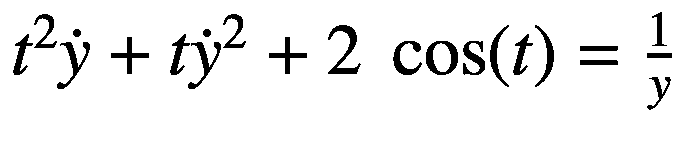

初始条件为 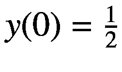。给定的常微分方程可以改写为方程(8.44)所示的隐式微分方程形式，如下所示：

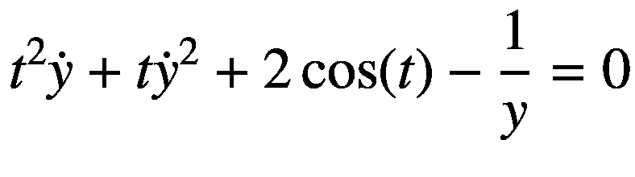

随后，也可以表示如下：

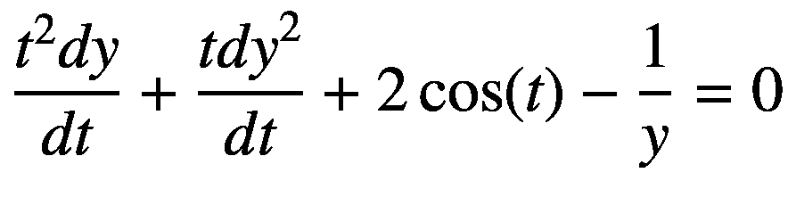

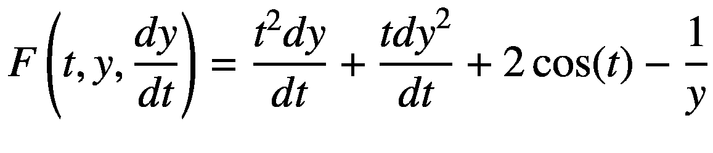

以及如下：

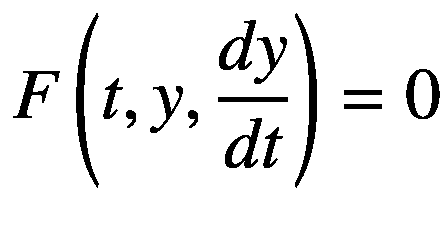

请注意，表达式 `F(t, y, dy) = 0` 是在隐式常微分方程中定义 `F` 与显式常微分方程的主要区别。在本例中，包含三个参数（即 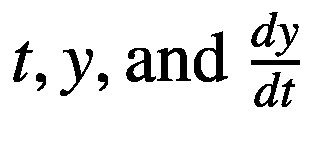 ）的 `F` 函数，可以直接通过匿名函数（`@`）来表示。以下是完整的解决方案，名为 `IMPLICIT_1ODE_EX1.m`：

```matlab
% IMPLICIT_1ODE_EX1.m
%{
示例 1\. 问题：t²*y'+t*(y')²+2*cos(t)=1/y，初始条件：y(0)=1/2；
第 1 部分。
问题函数通过名为 Yin 的函数句柄定义。
引入一个新变量：dy=yp。
%}
clearvars; close all
Yin=@(t,y, yp)(t²*yp+t*yp²+2*cos(t)-1/y);
y0=1/2; yp0=0;  % 初始条件
[t, yt]=ode15i(Yin, [0, 6*pi], y0, yp0);
plot(t, yt, 'bo-')
title('\it Simulation of: $$ t²*\frac{dy}{dt}+t*(\frac{dy}{dt})²+2*cos(t)=y^{-1}, y_0=\frac{1}{2} $$', 'interpreter', 'latex')
grid on;
xlabel('\it t'),
ylabel( '\it Solution, y(t)'),
hold on
% 第 2 部分。解决该问题的另一种方法是使用 SIMULINK，
% 并将仿真开始时间设置为 1e-3，结束时间设置为 6*pi。
[t, Y_t]=sim('IMPLICIT_1ODE_EX1_sim', [1e-3 6*pi]);
plot(t, Y_t(:,1), 'rx--')
legend('ode15i (脚本)', 'Simulink ode15s', 'location', 'best')
```

也可以使用带有 `ode15s` 求解器的 Simulink 工具来建模并仿真给定的隐式常微分方程。请注意，初始条件 () 作为内部条件插入到了积分器模块中。图 6-1 显示了一个完整的 Simulink 模型，名为 `IMPLICIT_1ODE_EX1_sim.mdl`。

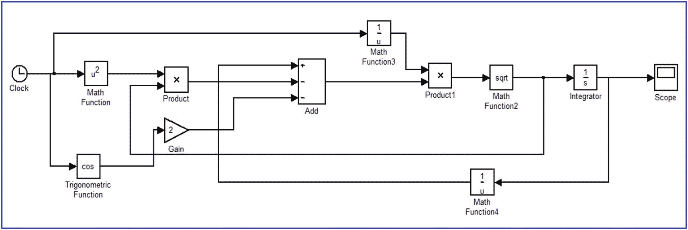

图 6-1

Simulink 模型 - `IMPLICIT_1ODE_EX1_sim.mdl` 是该问题的求解模型：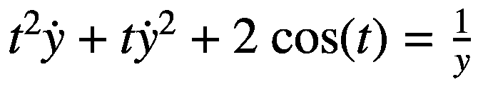。

通过执行前面所示的模型第 1 部分和第 2 部分（`ode15i`），即 `IMPLICIT_1ODE_EX1.m`，以及 Simulink 模型（`ode15s`），即 `IMPLICIT_1ODE_EX1_sim.mdl`，我们得到了问题的数值结果，如图 6-2 所示。

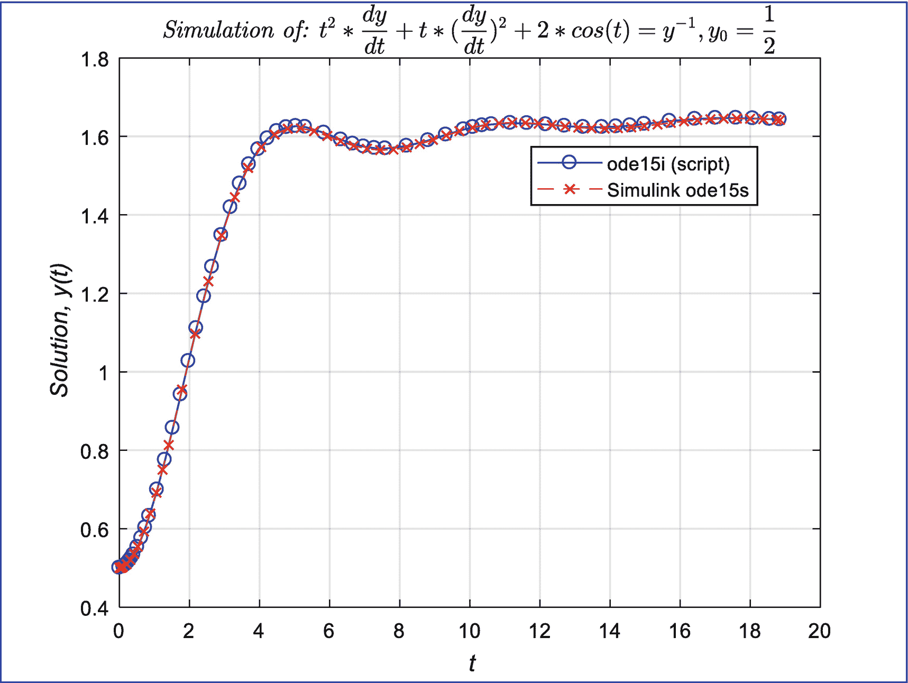

图 6-2

隐式常微分方程问题： 使用 `ode15i` 和 `ode15s` (Simulink) 的仿真结果

从图 6-2 所示的仿真结果中，我们可以得出结论：两种求解工具（MATLAB 的 `ode15i` 和 Simulink 的 `ode15s`）都能给出良好的收敛解。这意味着，要求解隐式定义的常微分方程，我们也可以通过适当调整常微分方程求解器选项来使用 Simulink 建模。

本部分中的二阶常微分方程初值问题（示例 2 和示例 3）旨在演示如何将给定的二阶齐次常微分方程视为隐式初值问题，从而展示 `ode15i` 的实现过程，即使这些方程是显式定义的。

## 示例 2

## 示例 2

给定一个二阶齐次常微分方程，示例如下：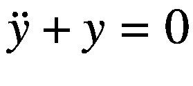，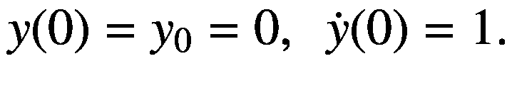

请注意，该简单二阶常微分方程的解析解为`y(t) = sin(t)`。实际上，给定的问题是一个明确定义的二阶初值问题。为了更好地理解`ode15i`的用法，这里将此问题视为一个隐式常微分方程来处理。

我们将给定的二阶微分方程重写为由两个一阶常微分方程组成的系统，并将其表示为隐式一阶常微分方程或微分代数方程。

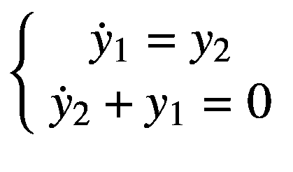 => 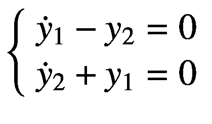 或 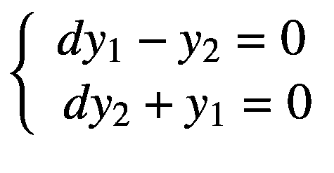

利用推导出的这两个一阶常微分方程，在创建的脚本文件`IMPLICIT_2ODE_EX2.m`中创建并调用一个匿名函数，以获取数值解。该仿真模型脚本包含三部分。第一部分通过将给定问题视为隐式常微分方程，并使用`ode15i`求解来计算解。第二部分通过将给定问题视为显式常微分方程（保持原样），并使用`ode45`求解来计算解。第三部分使用`dsolve()`计算问题的解析解。三部分的结果将绘制在同一张图中进行对比。

```matlab
% IMPLICIT_2ODE_EX2.m
%{
示例 2\. 隐式表达的常微分方程问题: y"(t)+y(t)=0
我们首先将给定的常微分方程定义为两个一阶常微分方程: F(t,y1,y2,dy1,dy2)=>dy1=y2;=>dy2+y1=0]=>{dy1-y2; dy2+y1};
注意：隐式常微分方程与显式常微分方程在定义函数（函数文件或匿名函数（@））时的差异。
%}
clearvars; close all
% 第一部分. ODE15i
Fex2=@(t, y, dy)([dy(1)-y(2); dy(2)+y(1)]);
y0=[0, 1]; dy0=[1, 0];      % 初始条件
F_aty0=[0, 0]; F_atyd0=[];  % 在 y0 和 dy0 处的函数值
Tspan=[0, 2*pi];            % 时间跨度
% 寻找一致初始值：
[y0, dy0]=decic(Fex2, 0, y0, dy0, F_aty0, F_atyd0);
% 使用 ode15i 计算问题解：
[t, y]= ode15i(Fex2, Tspan, y0, dy0);
plot(t, y(:,1), 'bd-',t, y(:,2), 'rx-')
hold on
% 第二部分. ODE45
%%%% 注意：Fex2 与 FEX2 匿名函数句柄的差异：
FEX2=@(t, y)([y(2); -y(1)]);
y0=0; dy0=1;                                 % 初始条件
Tspan=[0, 2*pi];                             % 时间跨度
[time, Y]=ode45(FEX2,Tspan, [y0, dy0], []);
plot(time, Y(:,1), 'kh--',time, Y(:,2), 'go--')
title('\it ode15i 与 ode45 对比：y"(t)+y(t)=0 的解')
xlabel('\it t'), ylabel('\it 解: y(t), $$ \frac{dy}{dt}$$', 'interpreter', 'latex'), grid
% 第三部分. DSOLVE：解析解
yt=dsolve('D2y+y=0', 'y(0)=0','Dy(0)=1', 't');
Yt=vectorize(yt);
Yt=subs(Yt, t);  % 替代方案: eval(Yt, t);
plot(t, Yt, 'c-', 'linewidth', 1.5)
legend('通过 ode15i 求得的 y(t)',...
'通过 ode15i 求得的 dy','通过 ode45 求得的 y(t)',...
'通过 ode45 求得的 dy','y(t)解析解', ...
'location', 'best')
```

最后，脚本的仿真输出如图 6-3 所示；输出包含了来自`ode15i`和`ode45`求解器的数值结果以及通过`dsolve()`求得的解析解。图 6-3 中显示的结果证明了这些常微分方程求解器的正确用法。

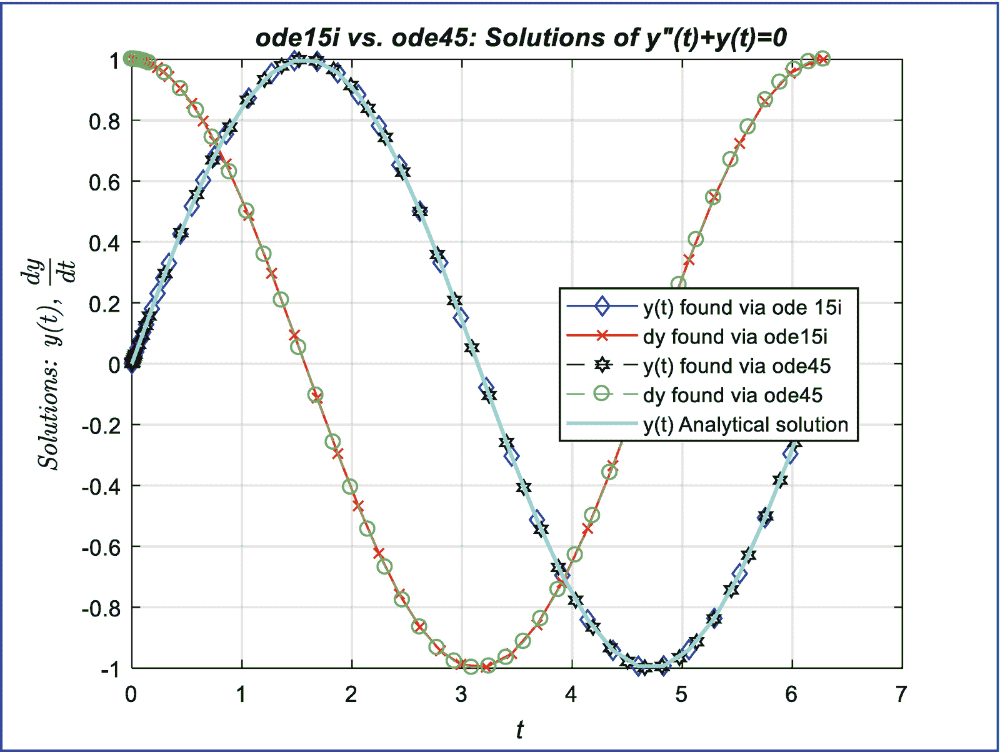

示例 2：使用`ode15i`、`ode45`、`dsolve()`求解

## 示例 3

问题示例如下：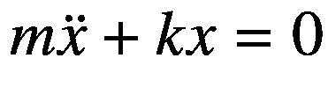，`x(0) = x[0] = 1`，。参数如下：`m = 13`; `k = 1213`。注意，给定的二阶常微分方程是显式定义的，但我们有意将其视为隐式常微分方程，以演示如何使用`ODEx`系列求解器。

首先，我们将给定的二阶常微分方程重写为两个一阶常微分方程。

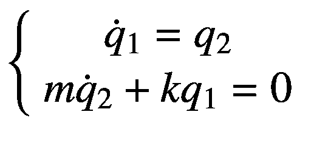 => 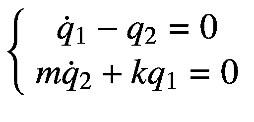 或 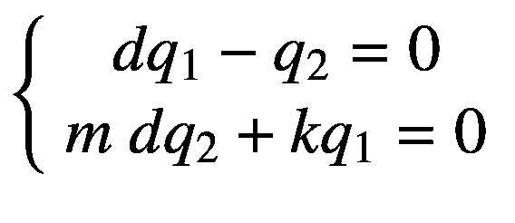

基于推导出的两个一阶微分代数方程，我们编写一个名为`DAE_Fun.m`的函数文件。另一种选择是，不用单独的函数m文件，而是创建一个匿名函数（`@`）。

```matlab
function f=DAE_Fun(~,q, dq, k, m)
%{
函数文件: DAE_Fun.m
注意：遵循参数的顺序至关重要。如果 k 与 m 的顺序互换，将得到完全不同的结果。需要在上述仿真脚本中的常微分方程求解器之前为 k 和 m（m=13，k=113）赋值。
%}
f = [dq(1)-q(2), m*dq(2) + k*q(1)]';
return
```

所有初始条件以及输入参数（如`m = 13`和`k = 1213`）的值都在下一个名为`IMPLICIT_2ODE_EX3.m`的脚本中定义。该脚本由两部分组成。第一部分将给定问题视为隐式常微分方程，第二部分则将其视为显式常微分方程。

### 示例 3

使用 `ode15i` 求解隐式定义的常微分方程 `m*x"+k*x=0` 初始条件：`x(0)=1`, `x'(0)=0`。

注意：匿名函数（`@`）表达式在 `Fun` 中是如何定义以求解隐式常微分方程问题的。在本例中，我们将一个二阶系统转换为两个设为零的一阶常微分方程组：`dq(1)-q(2)=0 && m*dq(2)+k*q(1)=0`。这是求解隐式定义的常微分方程的关键点。

```
Fun = @(t, q, dq, k, m)([dq(1)-q(2); m*dq(2)+k*q(1)]);
```

注意：在 `ode15i`/`ode45` 等函数中调用匿名函数 `Fun` 时，需要使用匿名函数名且不带 `@` 符号。例如：`ode15i(Fun, t,[],[],[],...)`。

注意：在计算 `dq0` 时，我们将 `q0` 代入函数 `Fun` 的两个方程中，通过这种方式，我们从 `q0` 的值得到 `dq0` 的值。类似地，函数（`Fun`）在 `q0` 和 `dq0` 处的值是根据 `q0` 和 `dq0` 同时计算得出的。

```
clearvars; close all
% 第一部分
m=13; k=113;
q0=[1,0]; dq0=[0,0];         % 初始条件
F_atq0=[0, k]; F_atdq0=[];   % 在 q0 和 dq0 处的函数值
% 一致初始值：
[q0, dq0]=decic(@Fun, 0, q0, dq0, F_atq0, F_atdq0,[], k, m);
% 使用 ode15i 计算解值：
[t, ft]=ode15i(@Fun, [0,pi], q0,[0, 0]', [], k, m);
plot(t, ft(:,1), 'bx--', t, ft(:,2), 'kd-.'); hold on
```

为了进行比较，我们用 `ode45` 求解上述问题，因为它是一个显式定义的初值问题。

### 示例 4（第2部分）

显式定义的常微分方程，使用 `ode45` 求解。

已知： `m*x"+k*x=0`，初始条件： `x(0)=1`, `x'(0)=0`。 给定的二阶常微分方程也可以写作： `x"+w²*x=0`。

注意：与上述使用 `ode15i` 求解隐式常微分方程的情况相比，这里描述了在应用 `ode45` 时如何定义两个一阶常微分方程。

注意：匿名函数 `FFunc` 的第三个输入参数是 `omegaSQ`，它等于 `k/m`。

```
FFunc=@(t, q, omegaSQ)([q(2); -omegaSQ*q(1)]);
M=13; K=113; omegaSQ=(K/M);
[t, FF]=ode45(FFunc, [0,pi], [1,0],[],  omegaSQ);
plot(t, FF(:,1), 'ro-',t, FF(:,2), 'm+-')
legend('ode15i x(t)','ode15i dx(t)','ode45 x(t)',...
'ode45 dx(t)', 'location', 'best')
title('ode15i vs. ode45: 方程解  $$ m*\frac{d²x}{dt²}+k*x=0 $$ ', 'interpreter', 'latex'), shg
xlabel('\it t')
ylabel('解: $$ x(t), \frac{dx}{dt} $$', 'interpreter', 'latex')
grid on; hold off
```

两个求解器 `ode15i` 和 `ode45` 的数值解结果已添加到图中，如图 6-4 所示。

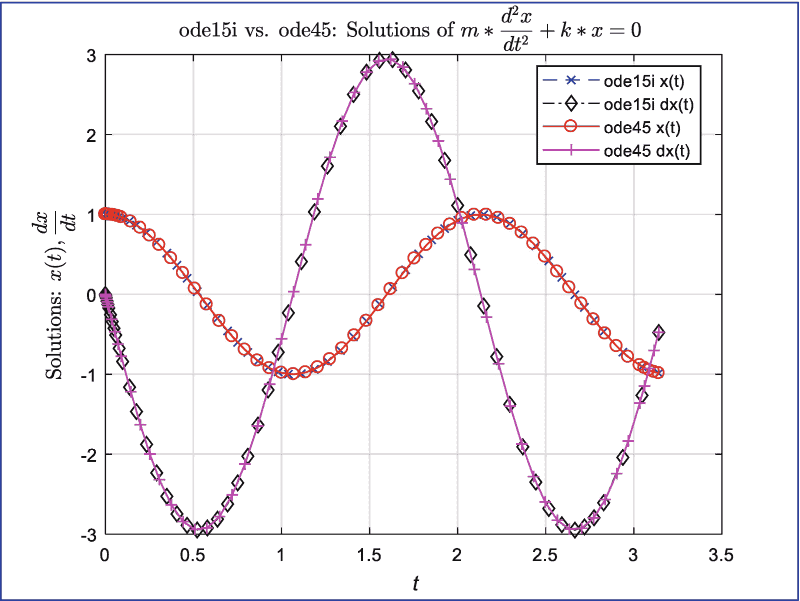

**图 6-4** 使用 `ode15i` 和 `ode45` 求解的 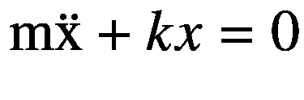

两种方法（`ode15i` 和 `ode45`）都得到了收敛良好的结果（如图 6-4 所示），这证明了对于由微分代数方程定义的隐式常微分方程，ODEs 求解器和相关函数的正确使用。

### 示例 4

给定一个二阶（真正）隐式常微分方程，示例如下：，`x`(0) = 1，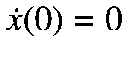。

这是一个真正的隐式常微分方程初值问题，可以使用求解器 `ode15i` 求解。在本示例中，与之前的示例一样，我们将其改写为两个一阶微分代数方程。

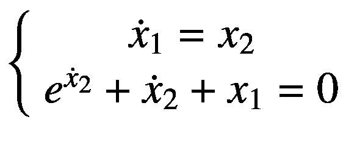 => 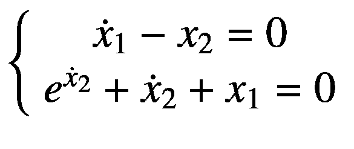 或 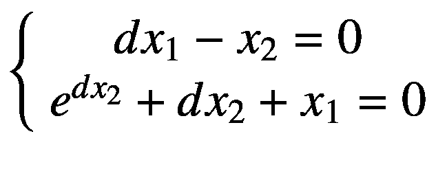

根据之前推导出的两个微分方程，我们创建一个匿名函数（`@`），并执行所有标准流程：使用 `decic` 定义初始条件，使用 `ode15i` 工具计算数值解。求解的 m 文件名为 `IMPLICIT_2ODE_EX4.m`，内容如下：

```
% IMPLICIT_2ODE_EX4.m
%{
示例 4\. 真正的隐式问题：exp(x")+x"+x=0，初始条件：x(0)=1, x'(0)=0。
注意：匿名函数 Fimp 定义为两个一阶微分代数方程。
%}
Fimp = @(t, x, dx)([dx(1)-x(2); exp(dx(2))+dx(2)+x(1)]);
x0=[1, 0]; dx0=[0, 0];             % 初始条件
F_atx0=[0,exp(0)+1]; F_atdx0=[ ]; % x0 和 dx0 处的函数值
% 寻找一致的初始值：
[x0, dx0]=decic(Fimp, 0, x0, dx0, F_atx0, F_atdx0);
[t, ft]=ode15i(Fimp, [0,13], x0,dx0);
plot(t, ft(:,1), 'bx-', t, ft(:,2), 'kd-')
hold on
Out=sim('IMPLICIT_2ODE_EX4_sim.mdl');
plot(Out.yout{1}.Values.Time, Out.yout{1}.Values.Data, 'r--', 'linewidth', 1.5)
plot(Out.yout{2}.Values.Time, Out.yout{2}.Values.Data, 'g--', 'linewidth', 1.5)
legend('x(t) with ode15i','dx(t) with ode15i', ...
'x(t) with Simulink','dx(t) with Simulink','location', 'best')
title('\it ODE15i 对方程的解：  $$ e^{\frac{d²x}{dt²}}+\frac{d²x}{dt²}+x=0 $$',  'interpreter', 'latex')
xlabel('\it t')
ylabel('\it $$ x(t), \frac{dx}{dt} $$', 'interpreter', 'latex')
grid on;
axis tight; shg
```

图 6-5 显示了该问题的 Simulink 模型求解方案（`IMPLICIT_2ODE_EX4_sim.mdl`）。两个初始条件均在 [积分器] 模块内部设置，方程求解器选择设为 `auto`。

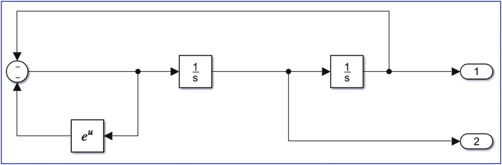

**图 6-5** 求解 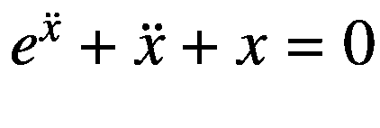 的 Simulink 模型 `IMPLICIT_2ODE_EX4_sim.mdl`

# 文本排版

**注意：** 最新版本的 Simulink 有一个名为`DAESSC`的 DAE 求解器，该求解器旨在与 Simulink 的 Simscape Toolbox 一起使用。`ode15i`和 Simulink 模型的仿真结果（如图 6-6 所示）表明，计算出的解收敛得非常好。

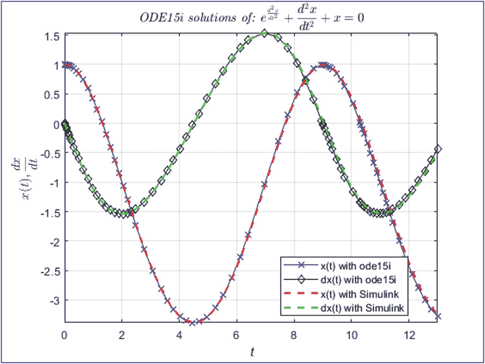

**图 6-6** 使用`ode15i`求解的问题

## 示例 5

给定一个隐式定义的二阶常微分方程，示例如下：，*y*(0) = 0，*y*′(0) = 0。该微分方程描述了圆柱形电容器中的空间电荷电流。该问题取自文献[2]。这是一个特殊的练习：在 *x* = 0 的中心附近，*y'* 显著增加。因此，我们需要将 *x*(0) 近似为 0.001，并使用求解器`ode15i`和`ode45`的默认容差，在一阶系统区间 [*x*(0), 1] 上进行积分。该问题的求解算法与示例 2 和示例 3 类似，重写过程也相似；因此，此处不再添加解释性说明。请注意，在给定的求解脚本`IMPLICIT_2ODE_EX5.m`中，匿名函数 (`@`) 是在隐式情况 (`Fimp`) 和显式情况 (`Fexp`) 下创建的。

```
%{
示例 5\. 隐式定义问题： y*(y")²=exp(2*x) 初始条件：y(0)=0, y'(0)=0。在此情况下，我们可以用显式形式定义给定问题，但为了演示，我们将其定义为隐式问题，并使用 ode15i 求解。然后，我们将其显式定义，并使用 ode45 求解。
注意：Fimp 匿名函数定义为两个一阶常微分方程。将 Fimp 与为显式 ODE 求解器 ode45 定义微分方程的 Fexp 进行比较。
%}
Fimp = @(t, y, dy)([dy(1)-y(2); y(1)*dy(2).²-exp(2*t)]);
y0=[0.001, 0]; dy0=[0,0];         % 初始条件
F_aty0=[0,sqrt(1e3)]; F_atdy0=[]; % y0 和 dy0 处的函数值
% 一致的初始值
[y0, dy0]=decic(Fimp, 0, y0, dy0, F_aty0, F_atdy0);
[t, ft]=ode15i(Fimp, [0.001,1], y0,dy0);
plot(t, ft(:,1), 'bx-', t, ft(:,2), 'kd-')
title('解： $$ y*(\frac{d²y}{dx²})²=e^{2*x} $$', 'interpreter', 'latex')
xlabel('\it x'), ylabel('\it y(x), dy(x)')
grid on, hold on
Fexp=@(t, y)([y(2); sqrt(exp(2*t)./y(1))]);
ICs=[0.001, 0];
timespan=[0, 1];
[t, yt]=ode45(Fexp, timespan, ICs, []);
plot(t, yt(:,1),'ro-', t, yt(:,2), 'g+-')
Out=sim('IMPLICIT_2ODE_EX5_sim.slx', [1e-3, 1]);
plot(Out.yout{1}.Values.Time, Out.yout{1}.Values.Data, 'r--', 'linewidth', 1.5)
plot(Out.yout{2}.Values.Time, Out.yout{2}.Values.Data, 'k--', 'linewidth', 1.5)
legend('使用 ode15i 的 y(x)','使用 ode15i 的 dy(x)','使用 ode45 的 y(x)', ...
'使用 ode45 的 dy(x)', '使用 Simulink 的 y(x)', ...
'使用 Simulink 的 dy(x)', 'location', 'best');
hold off; shg
```

在 Simulink 中，名为`IMPLICIT_2ODE_EX5_sim.slx`（如图 6-7 所示）的模型默认采用变步长求解器，求解器选择设置为`auto`。[积分器 1]（*y*(*t*) 之前）上的初始条件设置为 0.001，以更好地逼近初始条件并避免奇异性问题。

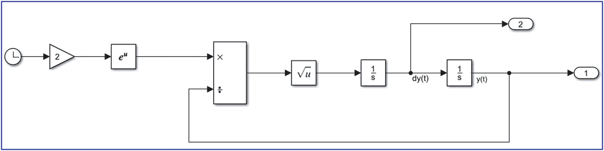

图 6-7 隐式定义二阶常微分方程的 Simulink 模型：，*y*(0) = 0，*y*′(0) = 0

仿真结果（如图 6-8 所示）表明，所有选定的求解器，如`ode15i`、`ode45`和`ode2`，都产生了良好收敛的数值解，证明了所选方法的正确性。请注意，在所有方法中，都选择了具有变步长的 ODEx 求解器。

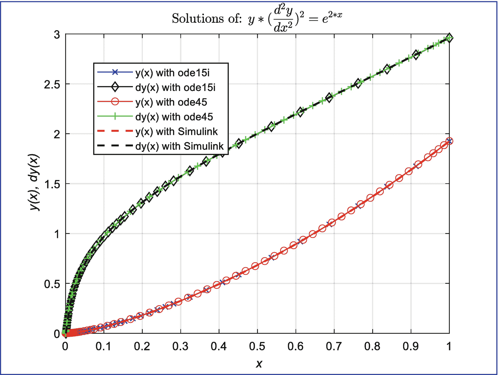

图 6-8 问题仿真结果：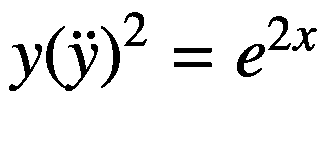，*y*(0) = 0，*y*′(0) = 0

## 示例 6

示例问题如下：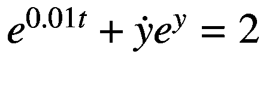，*y*(0) = 2。我们首先将方程重写为隐式或微分代数方程的形式。

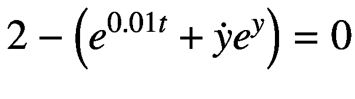

也可以表述如下：

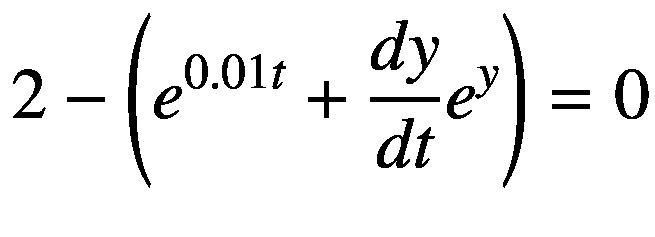

该方程包含三个参数：，可以通过匿名函数 (`@`) 表达。完整的仿真模型位于名为`IMPLICIT_1ODE_EX6.m`的文件中，该文件调用图 6-9 所示的 Simulink 模型`IMPLICIT_1ODE_Ex6_sim.mdl`。该练习的仿真结果如图 6-10 所示。

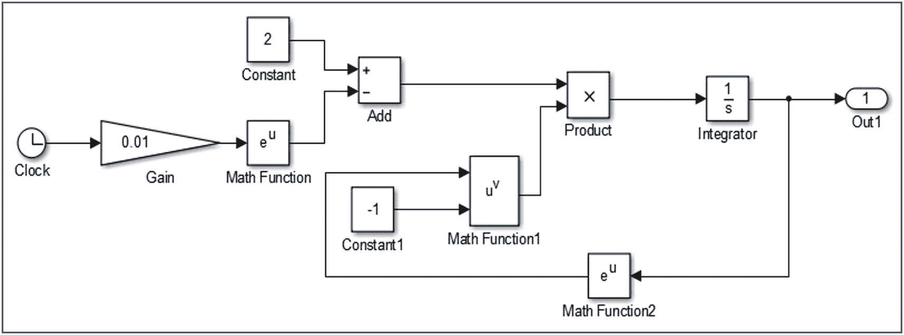

图 6-9 针对问题的 Simulink 模型`IMPLICIT_1ODE_Ex6_sim.mdl`

进入`/IMPLICIT_1ODE_EX6.m`文件。
示例6：`exp(.01*t)+y'*exp(y)=2`，初始条件：`y(0)=2`。
```matlab
clearvars; close all
Fun=@(t, y, dy)(2-(exp(.01*t)+dy*exp(y)));
y0=2; dy0=1/2; t0=0; F_aty0=1;
[y0, dy0]=decic(Fun,t0, y0, dy0, F_aty0, [] );
tspan=[0, 130];
[time, y]=ode15i(Fun, tspan, y0, dy0, []);
plot(time, y, 'bd-'), grid minor
title('解： $$ e^{0.01*t}+\frac{dy}{dt}*e^y=2 $$', ... 'interpreter', 'latex')
xlabel '\it t', ylabel '\it y(t)'
% dsolve
yt=dsolve('2-(exp(.01*t)+Dy*exp(y))=0', 'y(0)=2');
Yt=vectorize(yt);
t=time;
Yt=eval(Yt);
hold on; plot( t, Yt, 'mx--', 'linewidth', 1.5), ylim([-.4 4])
% Simulink 模型在时间跨度 0...130 秒内执行。
[time,y]=sim('IMPLICIT_1ODE_EX6_sim', [0, 130]);
plot(time, y, 'k-', 'linewidth', 1.5)
legend('ode15i','dsolve：解析解','SIMULINK', ... 'location', 'best'), shg
```

Simulink模型(`IMPLICIT_1ODE_Ex6_sim.mdl`)是基于问题公式 `$$ \frac{dy}{dt}=\left(2-{e}^{0.01t}\right){e}^y $$` 构建的。请注意，初始条件`y`(0) = 2是通过积分器模块作为内部源实现的，所有误差容限保持不变。

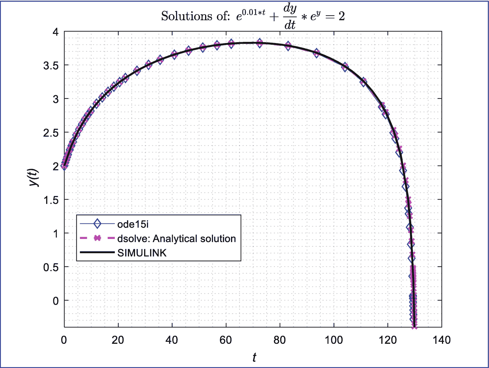

图6-10

问题仿真结果：`$$ {e}^{0.01t}+\dot{y}{e}^y=2 $$`，`y`(0) = 2

前述使用`ode15i`和`decic`的程序和脚本，以及通过调整初始条件来计算隐式定义（真正隐式或为演示目的“刻意”视为隐式常微分方程）的一阶和二阶常微分方程数值解的Simulink建模方法，也适用于高阶隐式常微分方程（或微分代数方程）和常微分方程组。从前面的示例可以得出结论，Simulink建模是求解隐式定义常微分方程或微分代数方程的一个良好替代方案，只需在初始条件设置以及必要时对求解器设置进行调整即可。