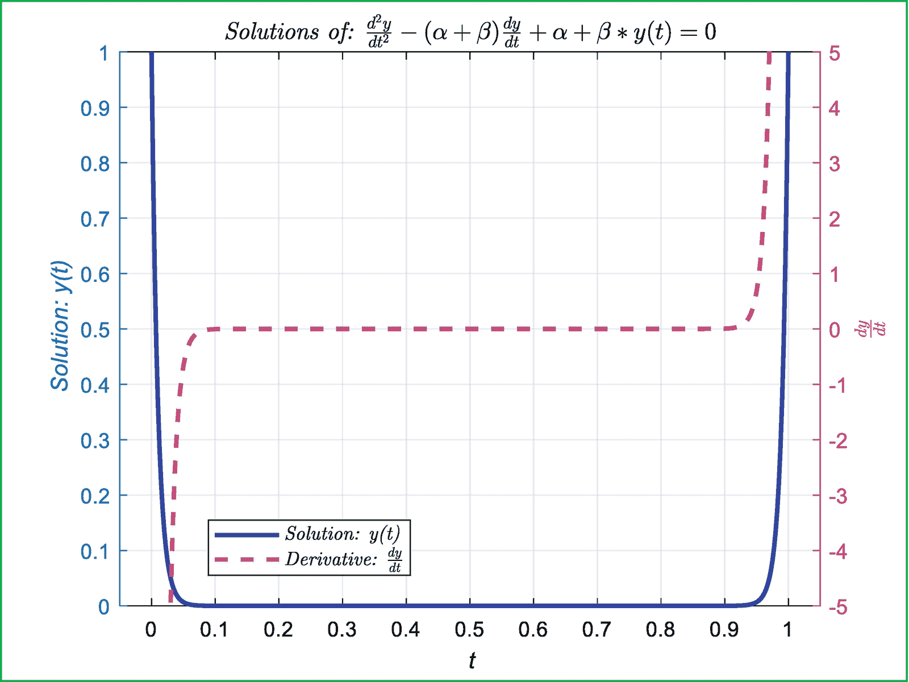
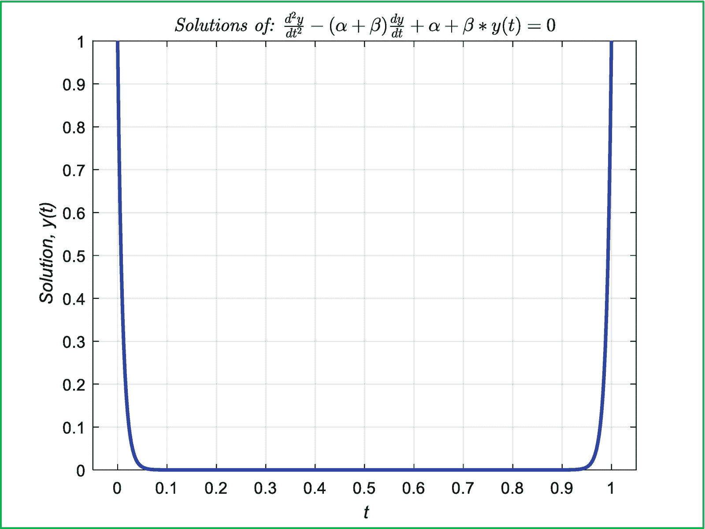
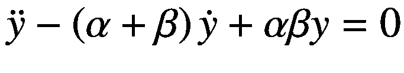
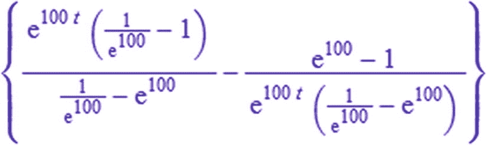

# Results are not displayed.

从 MuPAD 笔记`BVP_EX4_MuPAD.mn`的解析解仿真结果和`BVP_EX4.m`针对不同`ω`值获得的数值解（图 8-6）来看，所有解都吻合得很好。此外，随着`ω`的增加，解`y(t)`的幅度成比例减小。仿真结果表明，初始猜测函数（例如正弦函数和余弦函数）与数值猜测值完美收敛。

## 刚性边值问题

存在许多与常微分方程初值问题相似的刚性边值问题，并且已经开发出了一些方法和技巧来解决此类问题。在本节中，我们将看一个刚性边值问题的示例。高效地求解这些问题通常是一项挑战。让我们考虑下一个示例。

## 示例 5

以下是一个刚性边值问题示例：，边界条件为`y(0)` = `y(1)` = 1，且`α` = 100，`β` = −100。

该问题[2]具有很强的刚性，其解取决于`α`、`β`的值。与之前解决的问题类似，通过将给定的二阶方程转换为两个一阶微分方程来求解。这需要引入新变量，然后将新导出的方程组实现到名为`BVP_EX5.m`的脚本中。仿真结果如图 8-5 和图 8-6 所示。



**图 8-6** 方程在边界条件：`y(0)` = `y(1)` = 1 且`α` = 100，`β` = −100 下的仿真结果



**图 8-5** 方程在边界条件：`y(0)` = `y(1)` = 1 且`α` = 100，`β` = −100 下的仿真结果

```matlab
function BVP_EX5

Solutions_initial = bvpinit(0:.0025:1,[10 10]);

tol=1e-16; % 容差

OPT = bvpset('stats','on','abstol',tol,'reltol',tol,'Nmax',1000);

solutions_final=bvp4c(@ODE_fun1,@BC_fun1,Solutions_initial, OPT);

x = 0:.0025:1; y = deval(solutions_final, x);

close all

figure(1), plot(x, y(1,:), 'b', 'linewidth', 2);

title('\it Solutions of: $\frac{d²y}{dt²}-(\alpha+\beta)\frac{dy}{dt}+\alpha+\beta*y(t)=0$', 'interpreter', 'latex'); grid on

xlabel('\it t')

ylabel('\it Solution, y(t)'),

xlim([-.05 1.05])

figure(2)

yyaxis left

plot(x, y(1,:),'b', 'linewidth', 2)

title('\it Solutions of: $\frac{d²y}{dt²}-(\alpha+\beta)\frac{dy}{dt}+\alpha+\beta*y(t)=0$', 'interpreter', 'latex'); grid on

grid on

ylabel('\it Solution: y(t)')

xlabel('\it t')

yyaxis right

plot(x,y(2,:),'m--','linewidth', 2)

ylabel('\it $\frac{dy}{dt}$', 'Interpreter', 'latex')

axis([-0.05 1.05 -5  5]), grid on

legend('\it Solution: y(t)', '\it Derivative: $\frac{dy}{dt}$', 'Interpreter', 'latex', 'location', 'southwest');

function dydx = ODE_fun1(~,y)

alpha=100; beta=-100;

dydx = [ y(2),     (alpha+beta)*y(2)-alpha*beta*y(1)];

end

function res = BC_fun1(y1,yend)

res = [ 1-y1(1) ,   1-yend(1)];

end

end
```

另一种解决方案是使用 MuPAD 笔记中的符号数学工具箱命令来解析求解该问题。以下是名为`BVP_EX5_MuPAD.mn`的求解脚本：

