# 二自由度系统

许多机械系统的运动都是通过将其建模为 SMD（弹簧-质量-阻尼）系统来研究的。让我们考虑图 9-11 所示的受外力的二自由度 SMD 系统。请注意，质量块 1 和质量块 2 下的摩擦力被视为线性的。

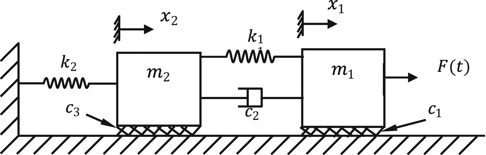

图 9-11

受外部脉冲力 *F*(*t*) 作用的双质量弹簧-质量-阻尼系统

在我们开始推导系统方程之前，图 9-12 展示了所给系统的另一种等效物理模型，该模型通过将作用于质量块 1 和 2 下的摩擦阻尼替换为施加在每个质量块上的阻尼器来实现。

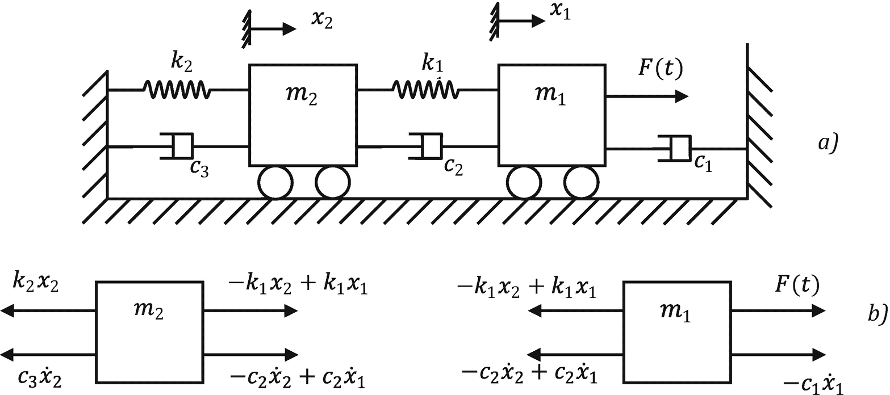

图 9-12

a) 系统的另一种物理模型；b) 质量块 1、2 的受力图

利用系统的受力图，并对每个质量块上的作用力应用达朗贝尔原理，我们可以写出系统的运动方程。

对于质量块 1：

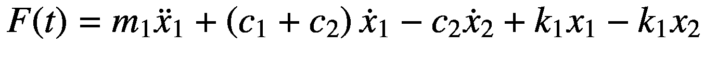

(9-36)

对于质量块 2：

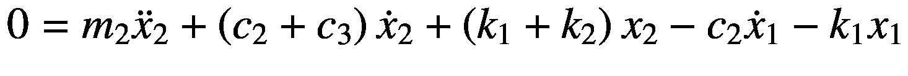

(9-37)

请注意，`m`[1]、`m`[2]、`c`[1]、`c`[2]、`c`[3]、`k`[1]、`k`[2] 分别是质量、阻尼和刚度的系统参数。`x`[1] 和 `x`[2] 分别是质量块 1 和 2 的位移，并且 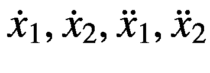 分别是质量块 1 和质量块 2 的速度和加速度。

通过引入新的状态变量，我们将方程 (9-36) 和 (9-37) 重写为一阶常微分方程组。为避免混淆，将变量重命名为 `x`[1] = `y`[1] 和 `x`[2] = `y`[2]。

![$$ \left\{\begin{array}{c}{\dot{x}}_1={y}_2\\ {}\begin{array}{c}{\dot{y}}_2=\frac{1}{m_1}\left[F(t)-\left({c}_1+{c}_2\right){y}_2+{c}_2{y}_4-{k}_1{y}_1+{k}_1{y}_3\right]\\ {}{\dot{x}}_2={y}_4\\ {}{\dot{y}}_4=\frac{1}{m_2}\left[{c}_2{y}_2-\left({c}_2+{c}_3\right){y}_4+{k}_1{y}_1-\left({k}_1+{k}_2\right){y}_3\right]\end{array}\end{array}\right. $$](images/490522_1_En_9_Chapter/490522_1_En_9_Chapter_TeX_Equ34.png)

(9-38)

基于方程(9-38)中定义的系统模型，针对施加外 *F*(*t*) = *F*[0] sin (10*t*) 的情况，我们编写了名为 `SMsysSIM.m` 和 `two_DOF_sys_sim_ALL.m` 的 MATLAB 模型，并构建了一个名为 `Two_DOF_SMsys.mdl` 的 Simulink 模型。

```
function SMsysSIM(t, ICs)
% SMsysSIM.m
% t 是时间；ICs 是初始条件。
if nargin<1
% 如果未提供输入参数和初始条件，则
t=[0,5]; ICs=[1; 1.5; -1; 1];
OPTs=odeset('OutputFcn', @odeplot,'reltol', 1e-4,'abstol',1e-6);
ode45(@SMsys1,t, ICs, OPTs)
else
Opts=odeset('OutputFcn', @odeplot,'reltol', 1e-4,'abstol',1e-6);
ode45(@SMsys1,t, ICs, Opts)
end
function DX=SMsys1(t, y)
k1=90; k2=85; c1=2; c2=1; c3=3; m1=5; m2=3; F0=3.3;
Dx(1)= y(2);
Dx(2)=(1/m1)*(F0*sin(10*t)-(c1+c2)*y(2)+c2*y(4)-k1*y(1)+k1*y(3));
Dx(3)= y(4);
Dx(4)= (1/m2)*(c2*y(2)-(c2+c3)*y(4)+k1*y(1)-(k1+k2)*y(3));
DX=[Dx(1); Dx(2); Dx(3); Dx(4)];
end
end
```

此函数文件 (`SMsysSIM.m`) 计算质量块 1 和 2 的位移和速度值，并在不包含图形属性（如图标题、图例等）的单个图中进行绘制。

接下来的 m 文件 (`two_DOF_sys_sim_ALL.m`) 使用 ODE 求解器（`ode23`、`ode23s`、`ode23tb` 和 `ode113`）和 Simulink 模型 (`Two_DOF_SMsys.mdl`) 计算质量块 1 和 2 的位移和速度值，并分别绘制带有所有图形属性的图形，如图 9-14、图 9-15 和图 9-16 所示。

```
% two_DOF_sys_sim_ALL.m
clearvars; close all
ICs=[1; 1.5; -1; 1];
k1=90; k2=85; c1=2; c2=1; c3=3; m1=5; m2=3; F0=3.3;
F=@(t, y)[y(2);(1/m1)*(F0*sin(10*t)-(c1+c2)*y(2)+c2*y(4)- ...
k1*y(1)+k1*y(3)); y(4); ...
(1/m2)*(c2*y(2)-(c2+c3)*y(4)+k1*y(1)-(k1+k2)*y(3))];
t=0:.005:5;
Opts=odeset('OutputFcn',@odeplot,'reltol', 1e-4, 'abstol', 1e-6);
ode45(F, t, ICs, Opts)
xlabel('\it time'), ylabel('x_1, dx_1, x_2,  dx_2'), grid on
legend('x_1(t)', 'dx_1(t)', 'x_2(t)', 'dx_2(t)')
title('Simulation of 2-DOF system')
%% Testing different solvers with different ODE settings
% ODE45 with fixed time step of 0.005
ts=0:.005:5; % fixed time step of 0.005
[t1, y1]=ode45(F, ts, ICs, []);
%% ODE23tb with variable time step
t=[0, 5];
[t2, y2]=ode23tb(F, t, ICs, []);
%% ODE23 calls an embedded function SMsys. A fixed time step of 0.005
[t3, y3]=ode23(@SMsys, ts, ICs);
%% ODE113 with the varying step size and function handle
[t4, y4]=ode113(@(t, y)[y(2); (1/m1)*(F0*sin(10*t)- ...
(c1+c2)*y(2)+c2*y(4)-k1*y(1)+k1*y(3)); y(4);
(1/m2)*(c2*y(2)-(c2+c3)*y(4)+k1*y(1)-(k1+k2)*y(3))],t, ICs);
%% SIMULINK model: Two_DOF_SMsys.slx with ODE23S & rel. error tol. 1e-6
OPTs=simset('reltol', 1e-6, 'solver', 'ode23s');
XOUT=sim('Two_DOF_SMsys', t, OPTs); % Simulates model: Two_DOF_SMsys.slx
figure('name', 'Displacement: x1')
plot(t1,y1(:,1), 'b-o'), hold on
plot(t2,y2(:,1), 'r--s')
plot(t3,y3(:,1), 'm-.x'),
plot(t4,y4(:,1), 'g:+')
plot(XOUT.tout, XOUT.yout{1}.Values.Data, 'k-'), grid on
legend('ode45','ode23tb','ode23',...
'ode113','Simulink(ode23s ~var)')
title('Displacement of body mass: m_1')
xlabel('time, [sec]'), ylabel('x_1(t)')
figure('name', 'Displacement: x2')
plot(t1,y1(:,3), 'b-o'), hold on
plot(t2,y2(:,3), 'r--s')
plot(t3,y3(:,3), 'm-.x'),
plot(t4,y4(:,3), 'g:+')
plot(XOUT.tout, XOUT.yout{2}.Values.Data, 'k-'), grid on
legend('ode45','ode23tb','ode23',...
'ode113','Simulink(ode23s ~var)')
title('Displacement of body mass: m_2')
xlabel('time, [sec]'), ylabel('x_2(t)')
% Function called by ODE23TB
function DX=SMsys(t,y)
k1=90; k2=85; c1=2; c2=1; c3=3; m1=5; m2=3; F0=3.3;
Dx(1)= y(2);
Dx(2)=(1/m1)*(F0*sin(10*t)-(c1+c2)*y(2)+c2*y(4)-k1*y(1)+k1*y(3));
Dx(3)= y(4);
Dx(4)= (1/m2)*(c2*y(2)-(c2+c3)*y(4)+k1*y(1)-(k1+k2)*y(3));
DX=[Dx(1); Dx(2); Dx(3); Dx(4)];
end
```

请注意，Simulink 模型 (`Two_DOF_SMsys.mdl`) 从名为 `two_DOF_sys_sim_ALL.m` 的仿真 m 文件中获取所有参数（`m1`, `m2`, `k1`, `k2`, `c1`, `c2`, `c3`, `F0`）值和初始条件值（在积分器块中定义，变量名为 `ICs(1)`, `ICs(2)`, `ICs(3)`, `ICs(4)`）。请注意，输入图（Simulink 模型 `Two_DOF_SMsys.mdl` 中的正弦波）的幅值设置为 `F0`，频率（弧度/秒）设置为 `10`。

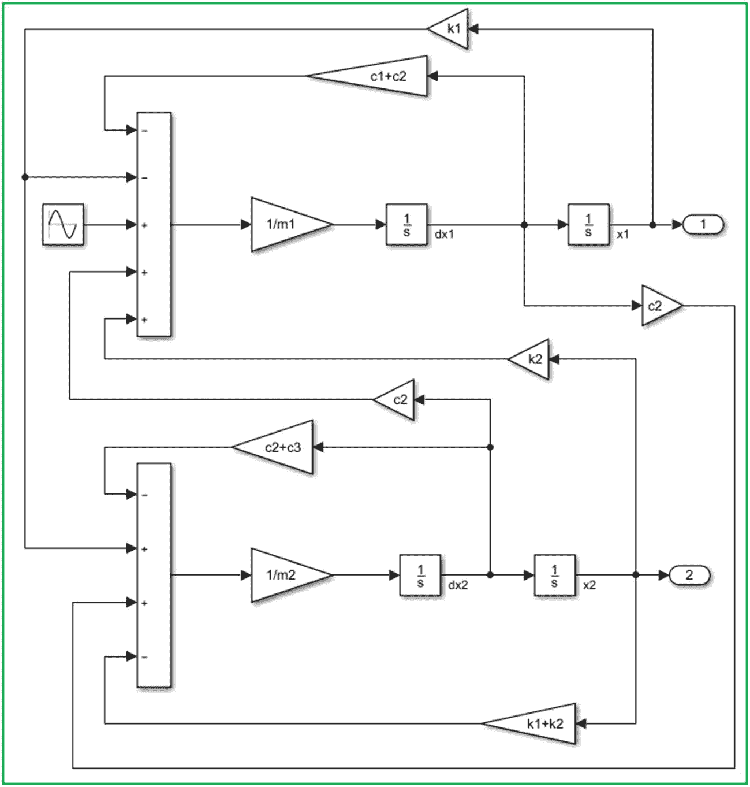

图 9-13

Simulink 模型，`Two_DOF_SMsys.slx`

我们运行模型 `two_DOF_sys_sim_ALL.m`，它会自动调用/仿真 Simulink 模型 (`Two_DOF_SMsys.mdl`) 和函数文件。随后，我们得到显示仿真结果的下图（图 9-14、图 9-15 和图 9-16）。

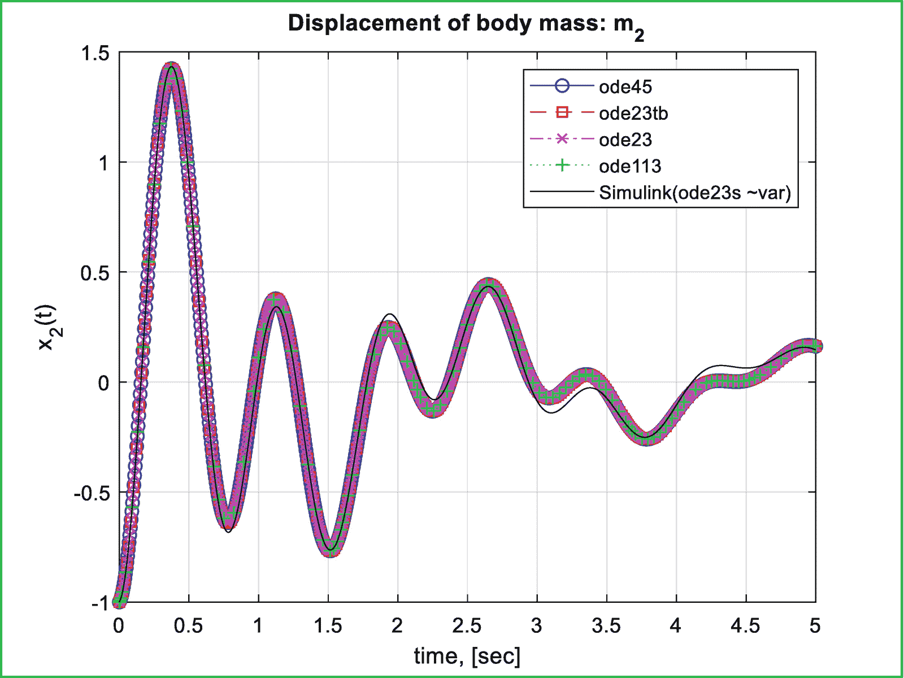

图 9-16

使用 MATLAB/Simulink 的不同 ODE 求解器计算得到的质量块 2 的位移


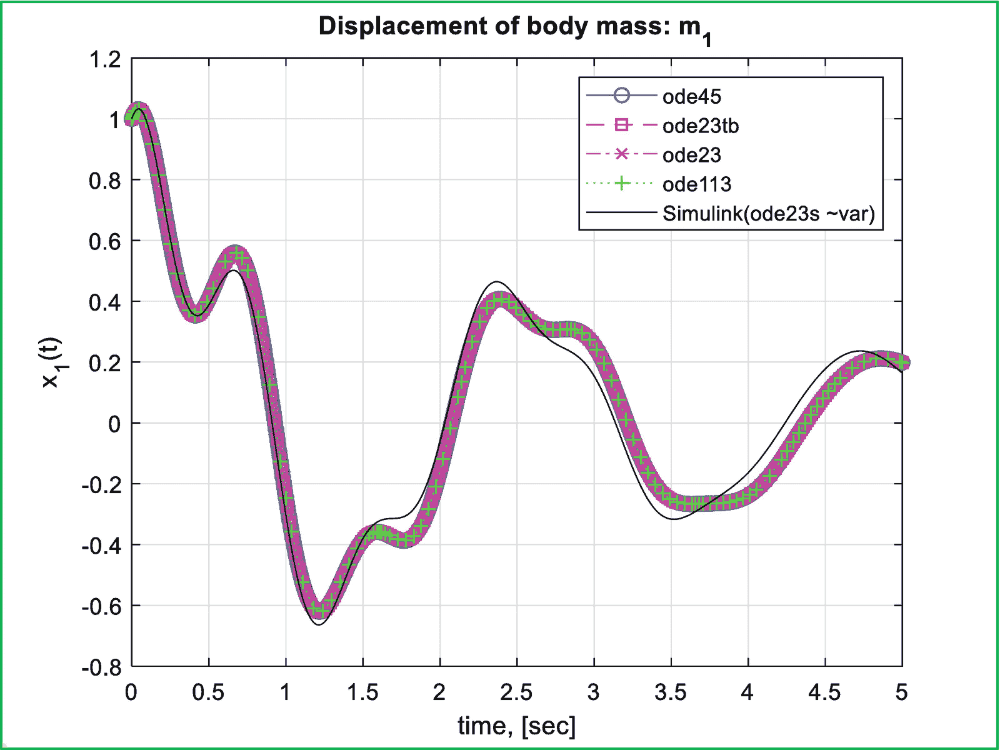

**图 9-15**  
使用 MATLAB/Simulink 的不同 ODE 求解器计算得到的物体 1 的位移

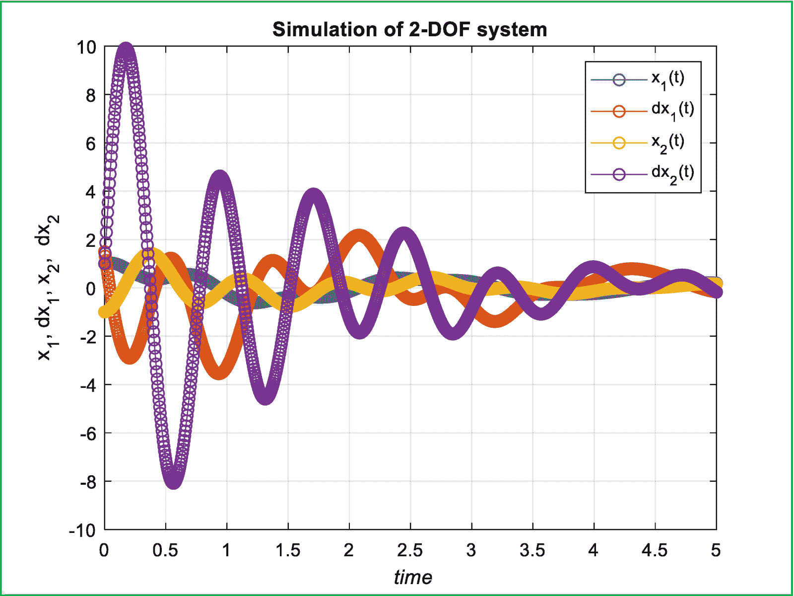

**图 9-14**  
物体 1 和物体 2 的位移与速度

图 9-14 和 9-15 中的仿真结果表明，所有使用的 ODE 求解器（`ode23`、`ode23tb`、`ode23s`、`ode45`、`ode113`）都得到了良好收敛的解。

## 三自由度系统

让我们考虑图 9-17 中所示的三自由度弹簧-质量-阻尼器系统，该系统有三个通过弹簧和阻尼器相互连接的质量块。它类似于之前的二自由度系统。我们将推导系统的运动方程并构建仿真模型。

根据其自由体受力图（图 9-17），系统的运动方程可以用公式 (9-39) 所示的二阶微分方程组表示：


(9-39)

公式 (9-39) 可以改写如下：

![$$ \left\{\begin{array}{c}{m}_1{\ddot{x}}_1(t)+\left({k}_1+{k}_2\right){x}_1(t)-{k}_2{x}_2(t)+\left({c}_1+{c}_2\right)\ {\dot{x}}_1(t)-{c}_2{\dot{x}}_2(t)={F}_1(t)\kern8.25em \\ {}{m}_2{\ddot{x}}_2(t)-{k}_2{x}_1(t)+\left({k}_2+{k}_3\right){x}_2(t)-{k}_3{x}_3(t)+\left({c}_2+{c}_3\right)\ {\dot{x}}_2(t)-{c}_2{\dot{x}}_1(t)-{c}_3{\dot{x}}_3(t)={F}_2(t)\\ {}{m}_3{\ddot{x}}_3(t)-{k}_3{x}_2(t)+\left({k}_3+2{k}_4\right){x}_3(t)-{c}_3{\dot{x}}_2(t)+{c}_3{\dot{x}}_3(t)={F}_3(t)\end{array}\kern0.5em \right.\kern0.75em \left(9-40\right) $$](img/490522_1_En_9_Chapter_TeX_Equd.png)

(9-40)

请注意，`m_1`、`m_2`、`m_3`、`c_1`、`c_2`、`c_3`、`k_1`、`k_2` 和 `k_3` 分别是系统的质量、阻尼和刚度参数。`x_1`、`x_2` 和 `x_3` 分别是物体 1、2、3 的位移。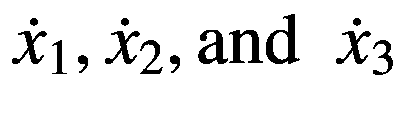 是速度，而  分别是物体 1、2、3 的加速度。`F_1(t)`、`F_2(t)` 和 `F_3(t)` 分别是施加在物体 1、2、3 上的外部作用力。

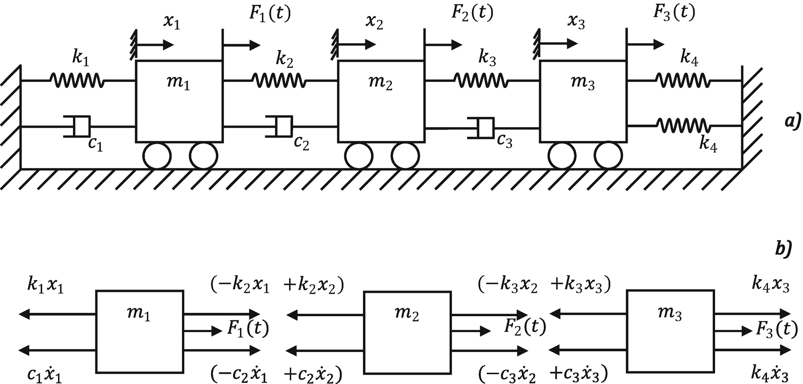

**图 9-17**  
三自由度系统：a) 系统的物理模型，三个质量块在无摩擦的平面上滚动；b) 系统的自由体受力图

请注意，公式 (9-39) 和公式 (9-40) 中的系统方程是二阶 ODE，它们是线性且时不变的。它们通过 `x_1(t)`、`x_2(t)` 和 `x_3(t)` 的坐标系进行耦合。因此，这些方程必须同时求解。对于数值仿真，系统参数采用以下数值：`m_1 = 2.5 [kg]`；`m_2 = 2.0 [kg]`；`m_3 = 3.0 [kg]`；![$$ {k}_1=25\ \left[\frac{N}{m}\right];{k}_2=5\ \left[\frac{N}{m}\right];{k}_3={k}_4=30\left[\frac{N}{m}\right] $$](images/490522_1_En_9_Chapter/490522_1_En_9_Chapter_TeX_IEq19.png)；![$$ {c}_1=2.5\left[\frac{Ns}{m}\right];{c}_2=0.5\left[\frac{Ns}{m}\right];{c}_3=3.5\left[\frac{Ns}{m}\right] $$](images/490522_1_En_9_Chapter/490522_1_En_9_Chapter_TeX_IEq20.png)。

我们分别在强迫运动和自由运动的情况下对该系统进行仿真。

- **强迫运动**（振动）情况，初始条件为零：

  例如：`F_1(t) = 20 sin (120*t)`；`F_2(t) = 0`；`F_3(t) = 20Φ(t − t_0)`；

  请注意，`F_3(t)` 是一个在 `t_0 = 0` 时施加的 Heaviside 阶跃函数 `Φ(t − t_0)`。

- **自由运动**（振动）情况。未施加外部作用力：`F_1(t) = F_2(t) = F_3(t) = 0`；仅在物体 1 上施加了一个初始（激励）位移：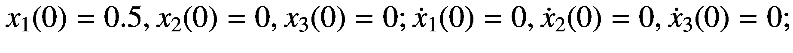。

请注意，在编写仿真模型之前，我们通过一阶 ODE 来重写公式 (9-39) 中的系统方程。该系统具有三个二阶（加速度）变量，即 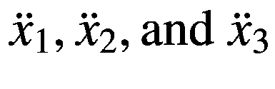，这些变量将被新变量替换，即 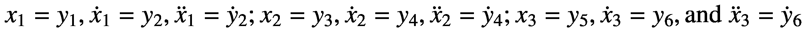。使用这些新变量，我们可以写出如下一阶耦合 ODE 方程组。

![$$ \left\{\begin{array}{c}\begin{array}{c}{\dot{x}}_1={y}_2\\ {}{\dot{y}}_2=\left(\frac{1}{m_1}\right)\left({F}_1(t)-\left({k}_1+{k}_2\right){y}_1+{k}_2{y}_3-\left({c}_1+{c}_2\right){y}_2+{c}_2{y}_4\ \right)\end{array}\\ {}\begin{array}{c}{\dot{x}}_2={y}_4\\ {}\ {\dot{y}}_4=\left(1/{m}_2\right)\left({F}_2(t)+{k}_2{y}_1-\left({k}_2+{k}_3\right){x}_3+{k}_3{y}_5-\left({c}_2+{c}_3\right){y}_4\right)\end{array}\\ {}\begin{array}{c}{\dot{x}}_3={y}_6\\ {}{\dot{y}}_6=\left(\frac{1}{m_3}\right)\left({F}_3(t)+{k}_3{y}_3-\left({k}_3+2{k}_4\right){y}_5+{c}_3{y}_4-{c}_3{y}_6\right)\end{array}\end{array}\right. $$](img/490522_1_En_9_Chapter_TeX_Equ35.png)

(9-41)

基于公式 (9-41) 中的方程，我们使用 `ode45` 求解器编写了一个名为 `three_MASS.m` 的函数文件。请注意，该函数文件包含一个名为 `third_DOF(t, y)` 的嵌套函数，用于定义公式 (9-41) 中给出的系统方程。系统参数值和外部作用力也在此嵌套函数内定义。Heaviside 阶跃函数通过 MATLAB 的内置函数 `step()` 表示。


```matlab
% three_MASS.m
% 说明：高度耦合三自由度系统的仿真。
clearvars; clc
t=0:.01:120;  % 仿真时间跨度
IC=[0;0;0;0;0;0];           % 案例 #1
% IC=[0.5; 0; 0; 0; 0; 0];  % 案例 #2
F1=20*sin(120*t);F2=0; t0=0; F3=20*stepfun(t,t0); % 案例 #1
% F1=0; F2=F1; F3=F1;                             % 案例 #2
k1=25; k2=5; k3=30; k4=k3; c1=2.5; c2=.5; c3=3.5;
m1=2.5; m2=2; m3=3;
[t, xyz]=ode45(@third_DOF, t, IC, []);
% SIMULINK 模型：ThreeDOFsys.slx，使用 ODE113 求解器，相对误差容限 1e-6
OPTs=simset('reltol', 1e-6, 'solver', 'ode113');
[tt, YY, X123]=sim('ThreeDOFsys', [0, 20], OPTs);% 运行：ThreeDOFsys.slx
figure('name', 'Matlab vs. Simulink')
plot(t(1:2000),xyz(1:2000,1),'bo',t(1:2000),xyz(1:2000,3), ...
'rx', t(1:2000), xyz(1:2000,5), 'ks', ...
tt(1:5000),X123(1:5000,1),'r-',tt(1:5000),X123(1:5000,2), ...
'b--', tt(1:5000), X123(1:5000,3), 'g-.','linewidth',1.5)
legend('质量 1: x_1(t) (Matlab)','质量 2: x_2(t) (Matlab)', ...
'质量 3: x_3(t) (Matlab)', ...
'质量 1: x_1(t) (Simulink)', '质量 2: x_2(t) (Simulink)', ...
'质量 3: x_3(t) (Simulink)')
title('\it 三自由度 SMD（耦合）系统')
xlabel('\it 时间, [秒]')
ylabel('\it 位移, x_1(t), x_2(t), x_3(t)'), grid on
figure('name', '动画')
for k=1:t(end)-20
% 注意：为提高可视化效果，x1、x2、x3 的位移幅度放大了 10 倍
plot(-20,0,'*', 20,0, '*', -10+10*xyz(k+20,1), 0, 'r-o',...
-5+10*xyz(k+20,3),0,'g-o',...
10+10*xyz(k+20,5),0,'b-o','markersize', 35, ...
'markerfacecolor', 'c');
grid on; Motion(k)=getframe;
end
movie(Motion)
function  dx = third_DOF(t, y)
% 说明：三自由度系统
k1=25; k2=5; k3=30; k4=k3; c1=2.5; c2=.5; c3=3.5;
m1=2.5; m2=2; m3=3;
F1=20*sin(120*t);F2=0; t0=0; F3=20*stepfun(t,t0);     % 案例 #1
% F1=0; F2=0; F3=0;                                   % 案例 #2
dx=zeros(6,1);
dx(1)=y(2);
dx(2)=(1/m1)*(F1-(k1+k2)*y(1)+k2*y(3)-(c1+c2)*y(2)+c2*y(4));
dx(3)=y(4);
dx(4)=(1/m2)*(F2+k2*y(1)-(k2+k3)*y(3)+k3*y(5)-...
(c2+c3)*y(4)+c2*y(2)+c3*y(6));
dx(5)=y(6);
dx(6)=(1/m3)*(F3+k3*y(3)-(k3+2*k4)*y(5)+c3*y(4)-c3*y(6));
end
```

该仿真模型包含了受迫运动（案例 #1）和自由运动（案例 #2）的输入，例如针对受迫和自由运动情况分别施加的输入力以及非零初始条件（针对质量 1）。

此外，模型还包含了调用并执行系统 Simulink 模型的命令，如图 9-18 所示。需要注意的是，Simulink 模型 `ThreeDOFsys.slx` 会接收所有参数的数值，而初始条件则通过仿真函数文件 `three_MASS.m` 在积分器模块内部设置。Simulink 模型的外部力幅值通过依次选择“模型属性” ➤ “回调” ➤ “初始化函数” 来设定。

* `F1 = 30; F2=0; F3=30;` % 用于案例 #1
* `F1 = 0; F2=0; F3=0;` % 用于案例 #2

请注意，在 Simulink 模型 `ThreeDOFsys.slx` 中，`正弦波`模块用于产生作用于质量 1 的输入力信号 `F1(t)`，其参数设置如下：`幅值 =1`、`频率=120`、`相位=0`、`偏置 =0`、`采样时间=0`。其输出公式为：`O(t) = 幅值 * sin (频率 * t + 相位) + 偏置`。输入力信号为 `F1(t) = O(t) * F1`，其中 `F1` 是常数增益值。作用于质量 3 的力为常数值，等于 `F3`。作用于质量 2 的力为 0。因此，`F2 = 0`，在模型中忽略不计。

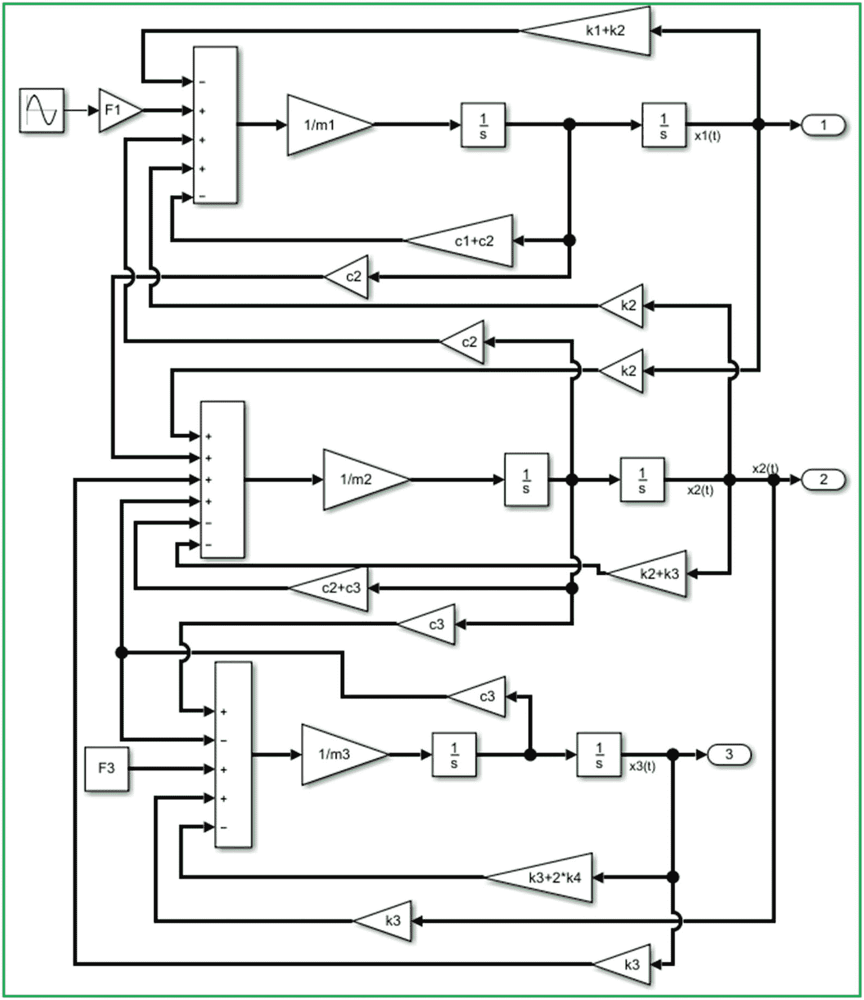

**图 9-18**

三自由度系统的 Simulink 模型 (`ThreeDOFsys.slx`)

## 受迫运动情况

在这种情况下，我们采用全部为零的初始条件和两个非零的外部施加力：

```
IC=[0;0;0;0;0;0];                                 % 案例 #1
F1=20*sin(120*t);F2=0; t0=0; F3=20*stepfun(t,t0); % 案例 #1
```

通过仿真调用并执行 Simulink 模型 (`ThreeDOFsys.slx`) 的 MATLAB 脚本 (`three_MASS.m`)，我们得到了如图 9-19 所示的仿真结果，以及一个（此处未展示的）展示三个质量块相对运动的动画图。

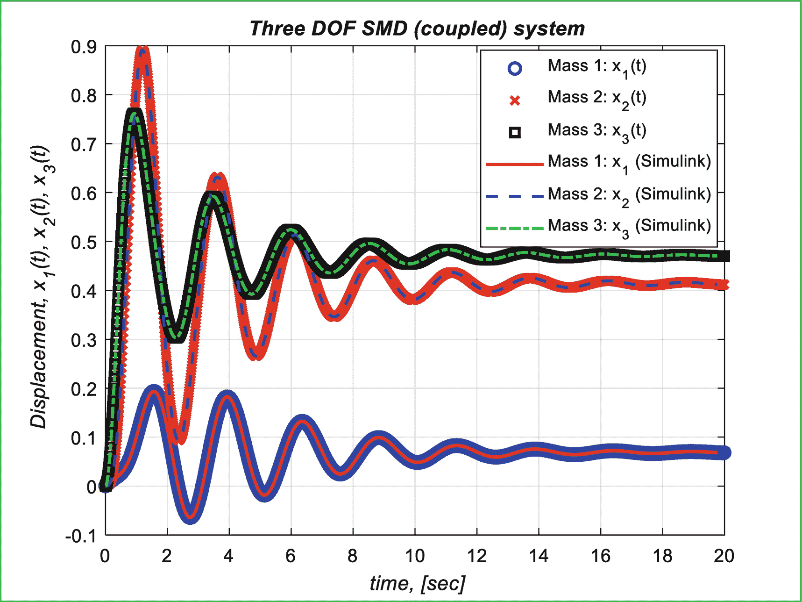

**图 9-19**

三自由度耦合系统受迫振动的仿真结果

图 9-19 中的仿真结果表明，MATLAB 模型的结果与 Simulink 模型的结果相匹配。

## 自由运动情况

在这种情况下，我们采用全部为零的初始条件和两个非零的外部施加力。

```
IC=[0.5;0;0;0;0;0];    % 案例 #2
F1=0; F2=0; F3=0;      % 案例 #2
```

案例 #2（自由运动，如图 9-20 所示）的仿真结果显示，质量 1 上的微小初始位移（非零）也会引起其他两个质量块产生位移。尽管使用了不同的求解器和步长，由 MATLAB 和 Simulink 模型计算出的结果依然完美地吻合。

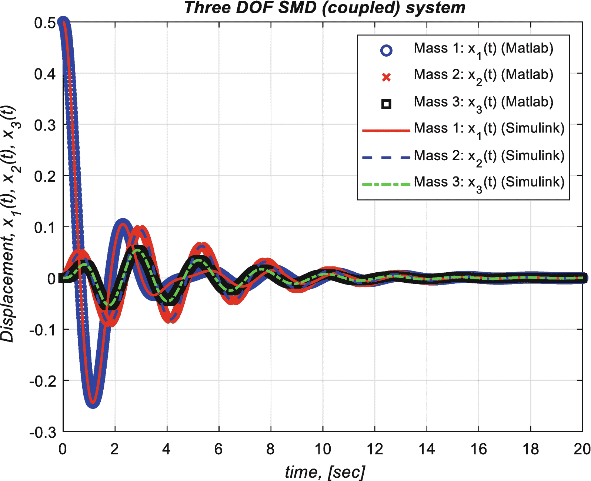

**图 9-20**

三自由度 SMD 系统自由运动的仿真结果


