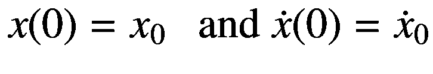
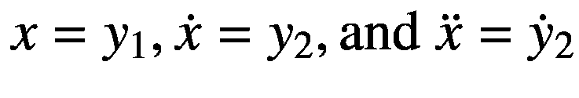
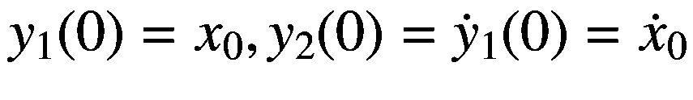
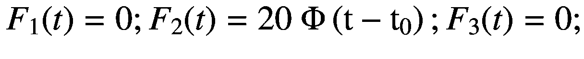
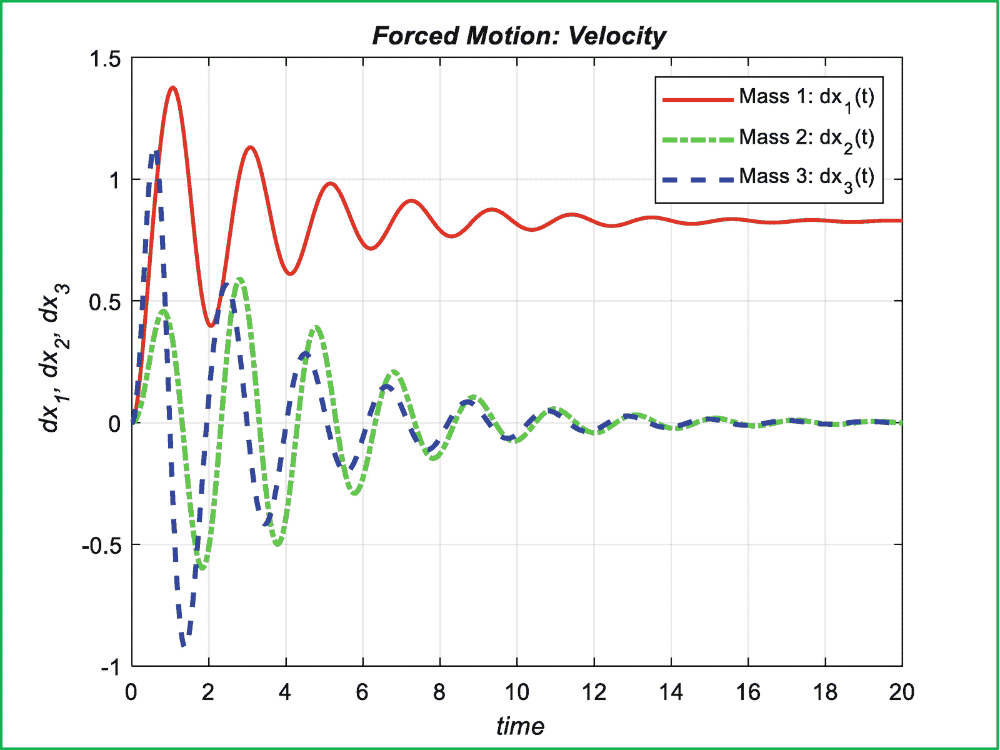
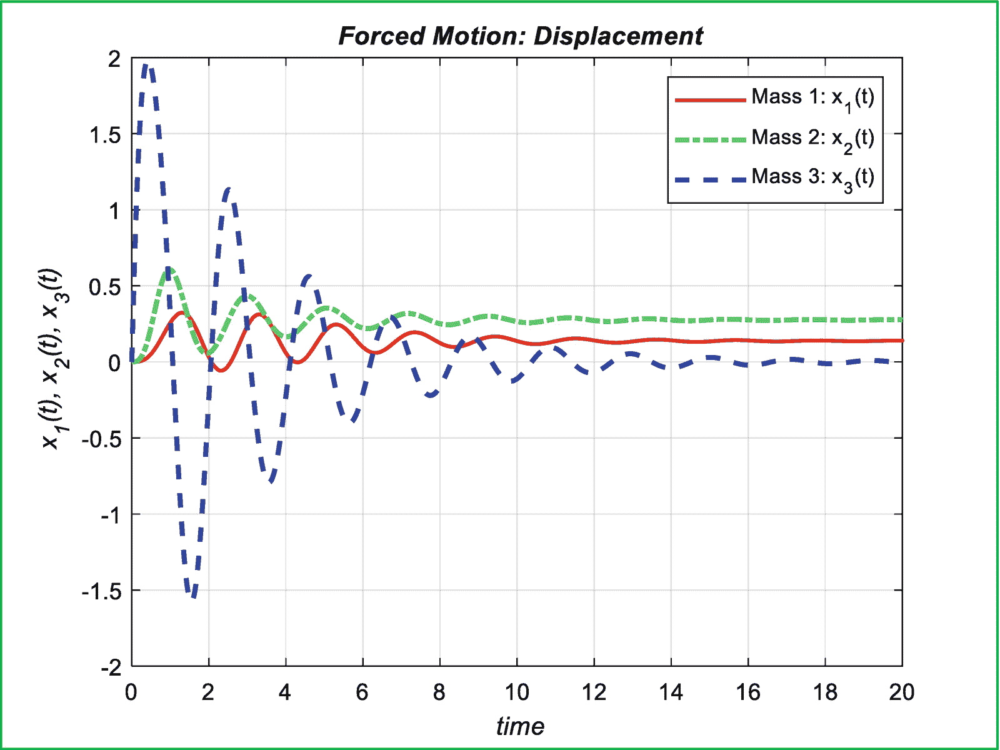
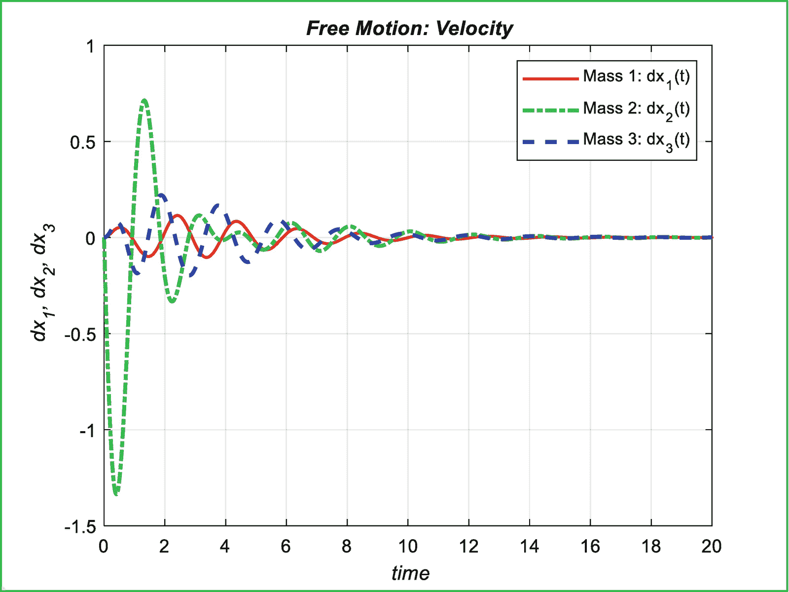
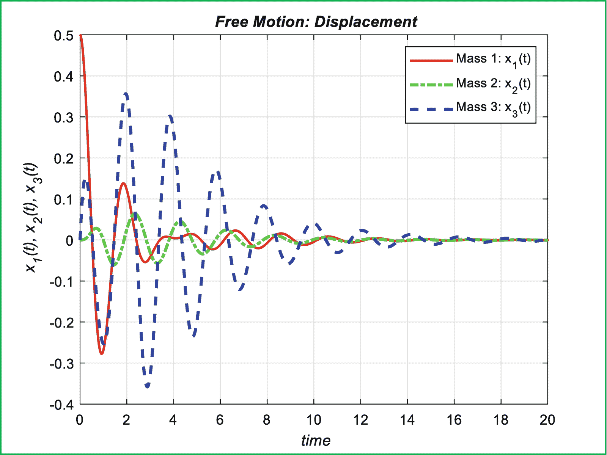

# `n`自由度系统的矩阵方法

当给定的 `n` 自由度系统为线性时，存在另一种更高效的方法，即矩阵方法，用于构建此类系统的仿真模型。让我们考虑一个阻尼线性 `n` 自由度弹簧-质量-阻尼系统的受迫响应。此类系统最通用的表述形式如下：

![$$ \left[M\right]\ddot{x}+\left[C\right]\dot{x}+\left[K\right]x=\left[B\right]F(t) $$](images/490522_1_En_9_Chapter/490522_1_En_9_Chapter_TeX_Equ36.png)

(9-42)

初始条件为 ，其中 `[M]`、`[C]`、`[K]` 分别是质量矩阵、阻尼矩阵和刚度矩阵，`[B]` 是施加力 `F(t)` 的列力矩阵。通过将方程 (9-1) 两边除以 `[M]` 或乘以 `M^{-1}` 并引入新变量，二阶常微分方程被转换为一阶常微分方程。引入新变量，例如对于一个二阶系统，将是 。通过这些代换，得到由两个微分方程组成的下一个系统。

![$$ \left\{\begin{array}{c}{\dot{y}}_1={y}_2\\ {}{\dot{y}}_2=\left[{M}^{-1}\right]\left[B\right]F(t)-\left[{M}^{-1}\right]\left[K\right]{y}_1-\left[{M}^{-1}\right]\left[C\right]{y}_2\end{array}\right. $$](images/490522_1_En_9_Chapter/490522_1_En_9_Chapter_TeX_Equ37.png)

(9-43)

初始条件为 。方程 (9-43) 中的公式可以用以下更明确的形式写出：

![$$ \dot{y}=\left[\begin{array}{c}{\dot{y}}_1\\ {}{\dot{y}}_2\end{array}\right]=\left[\begin{array}{c}\left[0\right]{y}_1+\left[I\right]{y}_2\\ {}\left[{M}^{-1}\right]\left[B\right]F(t)-\left[{M}^{-1}\right]\left[K\right]{y}_1-\left[{M}^{-1}\right]\left[C\right]{y}_2\end{array}\right] $$](images/490522_1_En_9_Chapter/490522_1_En_9_Chapter_TeX_IEq27.png)

![$$ \left[\begin{array}{c}\left[0\right]\\ {}\left[{M}^{-1}\right]\left[B\right]F(t)\end{array}\right]+\left[\begin{array}{c}\left[0\right]{y}_1+\left[I\right]{y}_2\\ {}-\left[{M}^{-1}\right]\left[K\right]{y}_1-\left[{M}^{-1}\right]\left[C\right]{y}_2\end{array}\right] $$](images/490522_1_En_9_Chapter/490522_1_En_9_Chapter_TeX_Equ38.png)

(9-44)

这可以表示为更通用的形式：

![$$ \dot{y}(t)=f(t)+\left[A\right]y(t) $$](images/490522_1_En_9_Chapter/490522_1_En_9_Chapter_TeX_Equ39.png)

(9-45)

其中 `A` 是由以下方程定义的状态矩阵：

![$$ A=\left[\begin{array}{cc}0&amp; I\\ {}-\left[{M}^{-1}\right]\left[K\right]&amp; -\left[{M}^{-1}\right]\left[C\right]\end{array}\right] $$](images/490522_1_En_9_Chapter/490522_1_En_9_Chapter_TeX_Equ40.png)

(9-46)

此外，我们可以写出以下内容：

![$$ y(t)=\left[\begin{array}{c}{y}_1(t)\\ {}{y}_2(t)\end{array}\right],f(t)=\left[\begin{array}{c}0\\ {}{M}^{-1} BF(t)\end{array}\right],{y}_0=\left[\begin{array}{c}{y}_1(0)\\ {}{y}_2(0)\end{array}\right]=\left[\begin{array}{c}{x}_0\\ {}{\dot{x}}_0\end{array}\right] $$](images/490522_1_En_9_Chapter/490522_1_En_9_Chapter_TeX_Equ41.png)

(9-47)

总结一下，在计算出矩阵 `A` 和力向量 `f(t)` 之后，如果给定的系统受到外力作用，我们可以对方程 ![$$ \dot{y}(t)=f(t)+\left[A\right]y(t) $$](images/490522_1_En_9_Chapter/490522_1_En_9_Chapter_TeX_IEq28.png) 进行数值求解。

`示例。` 让我们考虑先前研究过的三自由度弹簧-质量-阻尼系统。

![$$ \left[M\right]=\left[\begin{array}{ccc}2.5&amp; 0&amp; 0\\ {}0&amp; 2&amp; 0\\ {}0&amp; 0&amp; 3\end{array}\right] $$](images/490522_1_En_9_Chapter/490522_1_En_9_Chapter_TeX_IEq29.png), ![$$ \left[C\right]=\left[\begin{array}{ccc}{c}_1+{c}_2&amp; -{c}_2&amp; 0\\ {}-{c}_2&amp; {c}_2+{c}_3&amp; -{c}_3\\ {}0&amp; -{c}_3&amp; {c}_3\end{array}\right]=\left[\begin{array}{ccc}3&amp; -0.5&amp; 0\\ {}-0.5&amp; 4&amp; -3.5\\ {}0&amp; -3.5&amp; 3.5\end{array}\right] $$](images/490522_1_En_9_Chapter/490522_1_En_9_Chapter_TeX_IEq30.png), ![$$ \left[K\right]=\left[\begin{array}{ccc}{k}_1+{k}_2&amp; -{k}_2&amp; 0\\ {}-{k}_2&amp; {k}_2+{k}_3&amp; -{k}_3\\ {}0&amp; -{k}_3&amp; {k}_3+2{k}_4\end{array}\right]=\left[\begin{array}{ccc}30&amp; -5&amp; 0\\ {}-5&amp; 35&amp; -30\\ {}0&amp; -30&amp; 90\end{array}\right] $$](images/490522_1_En_9_Chapter/490522_1_En_9_Chapter_TeX_IEq31.png)

同样，我们考虑两种情况：受迫运动和自由运动。

`受迫运动（振动）情况。` 在此情况下，初始条件为零，外力施加于质量块 2，而质量块 1 和 3 自由：

注意 `F_2(t)` 是幅度为 20 的赫维赛德阶跃函数 `Φ(t - t_0)`，作用于 `t_0 = 0`。

我们编写该问题的仿真模型脚本 `MASS3.m`，其中包含一个嵌套函数 `DOF3(t, x)`。

function MASS3
% HELP. 三自由度系统仿真。
t=0:.01:120;          % 仿真时间跨度
IC=[0;0;0;0;0;0];    % 情况 #1. 受迫运动
% IC=[0.5;0;0;0;0;0]; % 初始条件
[t, x123]=ode45(@DOF3, t, IC, []);
figure('name', '矩阵方法')
H=plot(t, x123(:,1), t, x123(:,3), t, x123(:,5));
H(1).Color = [1 0 0];
H(2).Color = [0 1 0];
H(3).Color = [0 0 1];
H(1).LineStyle = '-';
H(2).LineStyle = '-.';
H(3).LineStyle = '--';
H(1).LineWidth = 1.5;
H(2).LineWidth = 2.0;
H(3).LineWidth = 2.0;
legend('质量块 1: x_1(t)', '质量块 2: x_2(t)', '质量块 3: x_3(t)')
ylabel('\it x_1(t), x_2(t), x_3(t)')
xlabel('\it time')
title('\it 受迫运动：位移'), grid on
% title('\it 自由运动：位移'), grid on
xlim([0, 20])
figure(2)
G=plot(t, x123(:,2), t, x123(:,4), t, x123(:,6));
G(1).Color = [1 0 0];
G(2).Color = [0 1 0];
G(3).Color = [0 0 1];
G(1).LineStyle = '-';
G(2).LineStyle = '-.';
G(3).LineStyle = '--';
G(1).LineWidth = 1.5;
G(2).LineWidth = 2.0;
G(3).LineWidth = 2.0;
legend('质量块 1: dx_1(t)', '质量块 2: dx_2(t)', '质量块 3: dx_3(t)')
title('\it 受迫运动：速度'), grid on
% title('\it 自由运动：速度'), grid on
xlabel('\it time'), ylabel('\it dx_1, dx_2, dx_3')
xlim([0, 20])
function  dx = DOF3(t, x)
% HELP: 三自由度系统仿真
k1=25; k2=5; k3=30; k4=k3; c1=2.5; c2=.5; c3=3.5;
m1=2.5; m2=2; m3=3; M=[m1 0 0; 0 m2 0; 0 0 m3];
K=[k1+k2, -k2, 0; -k2, k2+k3, -k3; 0, -k3, k3+2*k4];
C=[c1+c2, -c2, 0; -c2, c2+c3, -c3; 0, -c3, c3];
% 情况 1: 施加外力
F1= 0; t0=0; F2=20*stepfun(t,t0); F3=0;
% 情况 2: 自由振动（无外力施加）
% F1=0;F2=0;F3=0;
B=[F1;F2;F3]; A=[zeros(3) eye(3); -inv(M)*K, -inv(M)*C];
f=(M\eye(3))*B; dx=A*x+[0;0;0;f];
end
end

注意，对于大型系统，矩阵求逆计算函数计算成本很高。因此，使用反斜杠（`\`）运算符代替`inv()`，因为它在计算上比矩阵求逆方法更高效、更精确。例如，`M\eye(3)`等价于`inv(M)`，但比`inv(M)`更精确、更高效。

通过执行模型`MASS3.m`，我们获得了受迫运动的仿真结果，如图9-21和图9-22所示。

图9-22 三自由度弹簧-质量-阻尼系统受迫运动的仿真结果

图9-21 三自由度弹簧-质量-阻尼系统受迫运动的仿真结果

自由运动（振动）情况。最初，仅对质量块2施加一个微小位移，另外两个质量块的初始条件均为零：`$$ {x}_1(0)=0.5,{x}_2(0)=0,{x}_3(0)=0;{\dot{x}}_1(0)=0,{\dot{x}}_2(0)=0,{\dot{x}}_3(0)=0, $$`(img/490522_1_En_9_Chapter_TeX_IEq32.png)`F1(t) = F2(t) = F3(t) = 0`。仿真结果如图9-23和图9-24所示。

图9-24 自由运动：速度

图9-23 自由运动：位移

所开发的、包含自由运动和受迫运动的三自由度弹簧-质量-阻尼仿真模型，只需对系统参数进行少量调整，即可应用于`n`自由度系统。矩阵法相对简单且计算效率高。