# 10. 机电系统与机械系统

本章涵盖机电系统和机械系统。我们以具有输入电压和柔性负载的直流电机、麦克风、电机-泵-齿轮箱以及双摆为例，讨论如何构建机电系统和机械系统的仿真模型。通过在 MATLAB 和 Simulink 环境中开发和仿真模型，我们展示机电系统和机械系统的线性和非线性行为。

## 直流电机建模

直流电机是电子设备以及各类大型和小型机器中应用最广泛的电机，用于从电源产生扭矩。图 10-1 展示了具有输入电压和输出扭矩的直流电机简化物理模型。

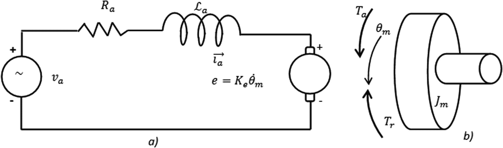

**图 10-1** 直流电机：a) 电枢电路；b) 转子受力图

我们可以假设转子具有惯量 `Jm` 和粘性摩擦常数 `c`。转子盘的受力图显示了正方向。存在两个扭矩：施加扭矩 `Ta = ia * Kt` 和阻力扭矩 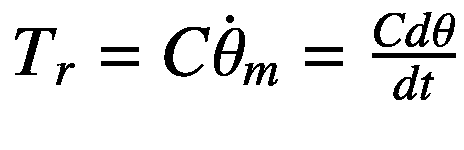。阻力扭矩的方向与施加扭矩 (`Ta`) 相反。根据受力图应用牛顿定律，我们得到方程 (10-1) 所示的微分方程。

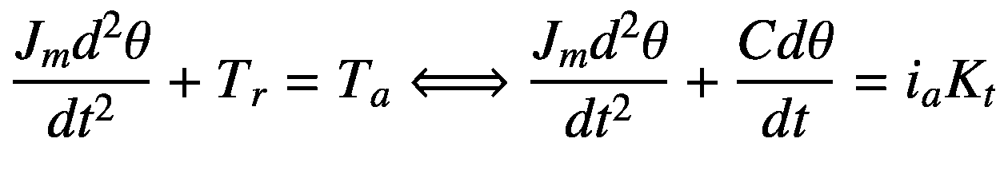

(10-1)

其中 `Kt` 是扭矩常数，`θm` 是电机轴的角位移，`ia` 是流经电枢的电流。根据电路，使用基尔霍夫定律，得到电路电压的另一个微分方程，如方程 (10-2) 所示。该方程考虑了反电动势 (EMF) 电压，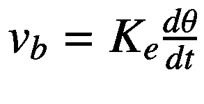。

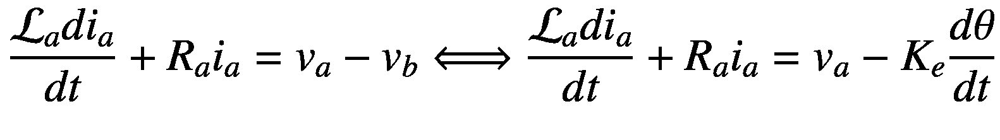

(10-2)

其中 `La` 是电路电感，`Ra` 是电路电阻，`Ke` 是反电动势常数，`va` 是电路电压。方程 (10-1) 和 (10-2) 中的两个微分方程可以通过拉普拉斯变换重写为 `s` 域，并考虑零初始条件。

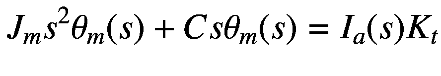

(10-3)

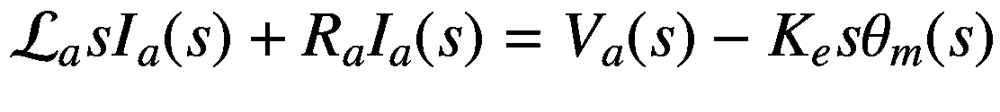

(10-4)

通过从方程 (10-4) 中定义 `Ia(s)` 并将其代入方程 (10-3)，得到以下表达式：

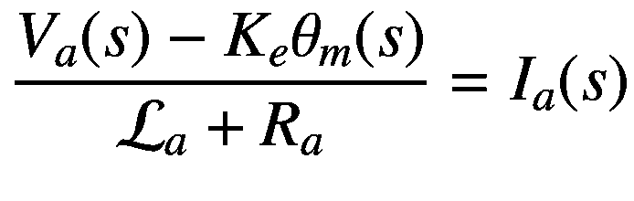

(10-5)

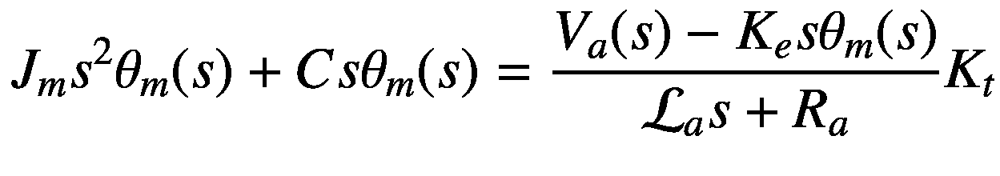

(10-6)

![$$ \left[{J}_m{s}²+ Cs+\frac{s{K}_t{K}_e}{{\mathcal{L}}_as+{R}_a}\right]{\theta}_m(s)=\frac{V_a(s){K}_t}{{\mathcal{L}}_as+{R}_a} $$](images/490522_1_En_10_Chapter/490522_1_En_10_Chapter_TeX_Equ7.png)

(10-7)

根据方程 (10-7) 中的表达式，可以由此计算出传递函数，即输出 `θm(s)` 除以输入 `Va(s)`：

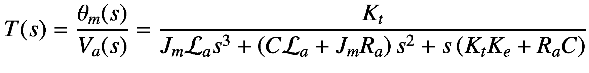

(10-8)

该传递函数的另一种形式是角速度 `ω(s)` 除以输入电压 `Va(s)`。


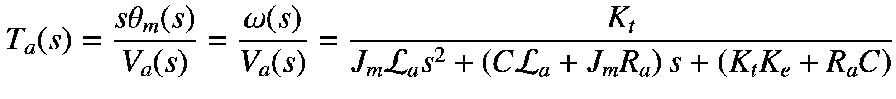

（10-9）

利用公式 (10-8) 和 (10-9) 所示的传递函数表达式，我们可以构建直流电机的 Simulink 模型 `DC_motor.slx`（见图 10-2）。

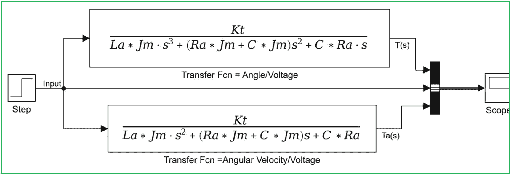

**图 10-2** 直流电机的 Simulink 模型 `DC_motor.slx`

请注意，模型的所有参数均通过选择模型属性 `DC_motor` ➤ 回调函数 ➤ InitFcn 来定义。

- `Jm=0.01;` % [kgm²]
- `C=0.1;` % [Nms]
- `Ke=0.01;` % [Nm/A]
- `Kt=1;` % [Nm/A]
- `Ra=1.25;` % [Ohm]
- `La=0.5;` % [H]

输入信号是一个阶跃函数，代表在阶跃时间为一秒时施加的 12V 恒定电压。模型的仿真结果如图 10-3 所示，该结果取自模型 `DC_motor.slx` 的 `Scope` 模块。

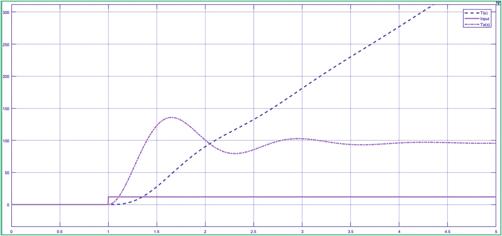

**图 10-3** 直流电机 Simulink 模型 `DC_motor.slx` 的仿真结果

另一种直流电机的替代仿真模型是基于四阶/五阶龙格-库塔法的 MATLAB 脚本。模型 `DC_Motor_SIM.m` 如下所示：

```
function DC_Motor_SIM
h=0.001;             % 时间步长
t=0:h:5;             % 仿真时间
theta0 = [0, 0];     % 初始条件
ia0    = 0;          % 初始条件
u=[theta0, ia0];
for m=1:length(t)-1
k1(m,:)=DC_Motor(t(m), u(m,:));
k2(m,:)=DC_Motor(t(m), u(m,:)+h*k1(m,:)./2);
k3(m,:)=DC_Motor(t(m), u(m,:)+h*k2(m,:)./2);
k4(m,:)=DC_Motor(t(m), u(m,:)+h*k3(m,:));
u(m+1,:)=u(m,:)+h*(k1(m,:)+2*k2(m,:)+2*k3(m,:)+k4(m,:))./6;
end
close all
figure(1)
plot(t,u(:,1),'b',t,u(:,2),'r--',t,u(:,3),'k:','linewidth', 1.5)
title('\it 直流电机仿真 (输入 V_a = 12 [V])')
xlabel('\it 时间, t [s]'), ylabel('\it \theta_i(t), i_a(t)')
legend('\theta_m(t)','\omega(t)','i_a(t)', 'location', 'northwest')
grid on
ylim([0, 320])
function dudx=DC_Motor(t, u)
% DC_Motor(u) 是一个嵌套函数。
% 本仿真中使用的参数为：
Jm=0.01;    % [kgm²]
C=0.1;      % [Nms]
Ke=0.01;    % [Nm/A]
Kt=1;       % [Nm/A]
Ra=1.25;    % [Ohm]
La=0.5;     % [H]
Va=12*stepfun(t, 1);   % [V]
dudx=zeros(1,3);
dudx(1)=u(2);
dudx(2)=(1/Jm)*(u(3)*Kt-C*u(2));
dudx(3)=(1/La)*(Va-Ke*u(2)-Ra*u(3));
return
```

图 10-4 显示了 MATLAB 模型 `DC_Motor_SIM.m` 的仿真结果。

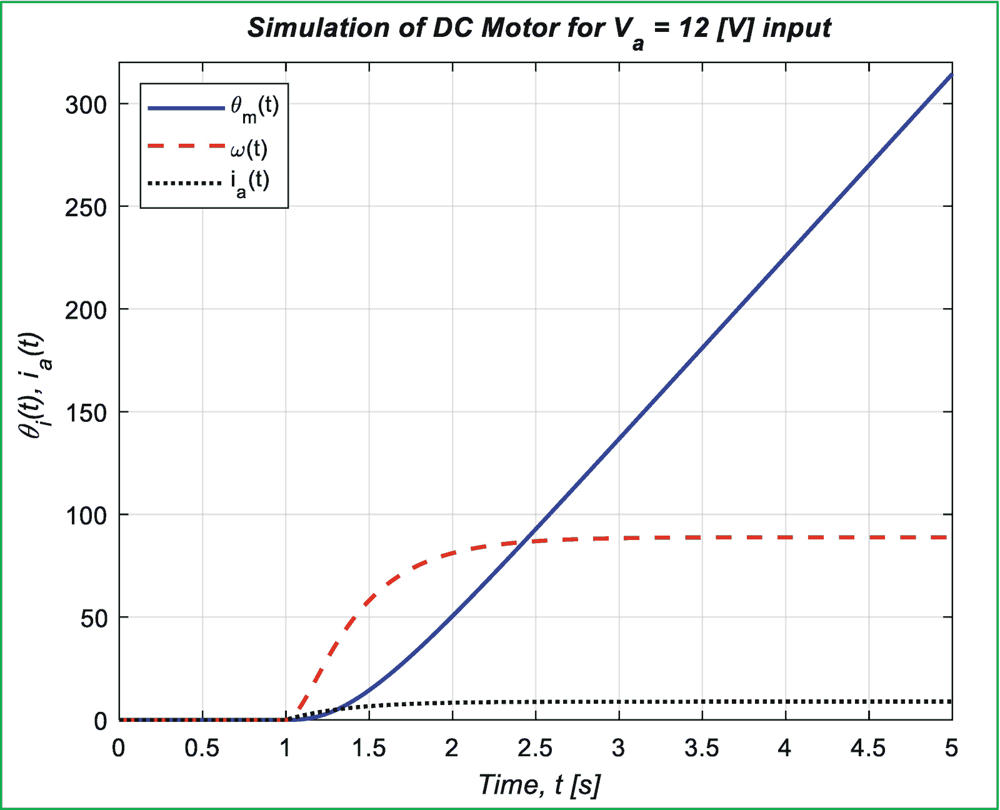

**图 10-4** 通过脚本实现的龙格-库塔法进行的直流电机仿真

## 对带有柔性负载的直流电机进行建模

图 10-5 展示了一个带有柔性负载的直流电机物理模型；它由电气和机械部件组成，例如电压源、电感、电阻、旋转轴和负载盘。此练习与前一个类似，但有一个区别，即在本例中施加了一个柔性负载。

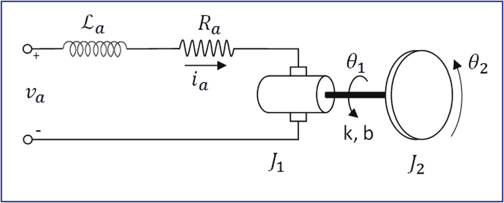

**图 10-5** 带有柔性负载的直流电机

对于图 10-5 所示的机电系统（本练习取自 [1]），可以推导出以下运动微分方程和系统组件的关系式：

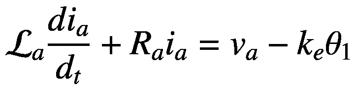

（10-10）

此外，电机的机电转矩（`τm`）和柔性轴的转矩（`τf`）可通过以下公式得出：

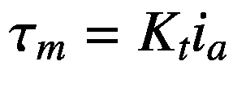

（10-11）

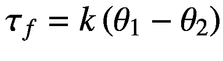

（10-12）

现在，可以通过应用牛顿第二定律来写出另一个运动转矩平衡方程，该定律指出，物体的质量代表了施加的力与由此产生的加速度之间的比例关系。将此定律应用于旋转物体表明，每个物体都具有与施加的转矩和由此产生的角加速度相关的对应转动惯量（例如，`τ = J * ω_dot`）。换句话说，旋转质量等效地由转动惯量来表示。

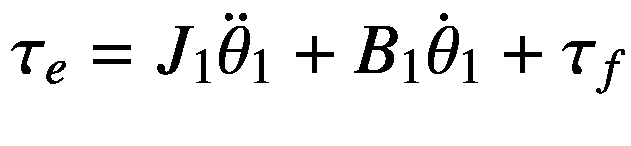

（10-13）

类似地，柔性轴的转矩方程可以写成如下形式：

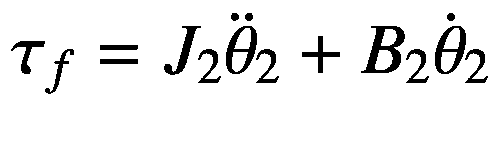

（10-14）

将公式 (10-12) 中的 `τf` 代入公式 (10-14)，我们得到系统柔性轴部分的另一个运动微分方程。

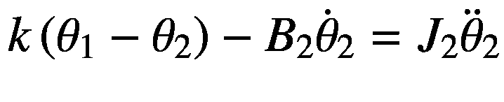

（10-15）

最后，通过设置 `τe = τm` 并将公式 (10-12) 中的 `τf` 代入，我们推导出第三个微分方程，以构建系统的完整模型。

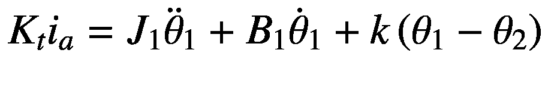

（10-16）

现在，利用这三个微分方程，具体来说是公式 (10-10)、公式 (10-15) 和公式 (10-16)，在 Simulink 中建立了系统的仿真模型（图 10-6）。

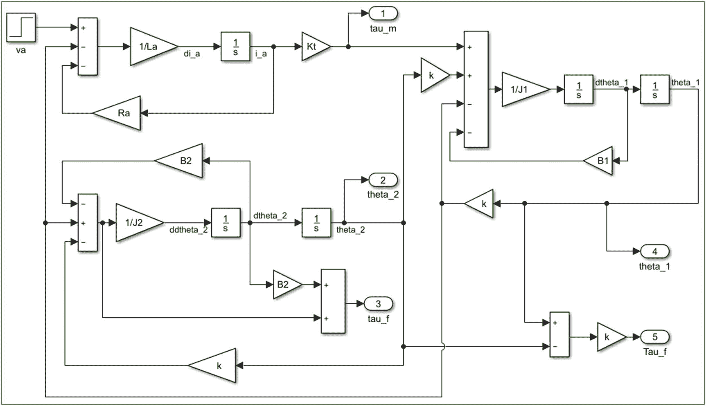

**图 10-6** 带有柔性负载的直流电机系统的 Simulink 模型 `DC_Motor_w_Load.slx`


请注意，在图 10-6 所示的带弹性负载直流电机系统的 Simulink 模型（`DC_Motor_w_Load.slx`）中，信号名称（`di_a` 和 `i_a`）代表 `di[a]` 和 `i[a]`，而 `dtheta_1`、`theta_1`、`ddtheta_2`、`dtheta_2` 和 `theta_2` 代表 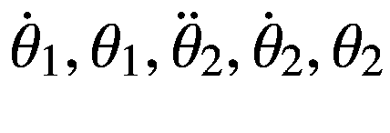。这些信号名称是通过信号的右键选项（信号属性）添加的。此外，名为 `tau_m`、`theta_2`、`tau_f`（以及 `Tau_f`）和 `theta_1` 的输出模块分别代表 `τ[m]`、`θ[2]`、`τ[f]` 和 `θ[1]`。请注意，两个输出模块 `tau_f` 和 `Tau_f` 的数值结果基于公式(10-14)和公式(10-12)给出的表达式。

对于模型的仿真，以下是 A-max 32 型有刷直流电机的数据：

- 输入：阶跃时间为 1 秒时施加的 `v[a]` = 12 [V] 的阶跃函数
- 电阻：`R[a]` = 7.17 [Ω]
- 弹簧常数：![$$ k=0.01\ \left[\frac{\mathrm{N}}{\mathrm{m}}\right] $$](images/490522_1_En_10_Chapter/490522_1_En_10_Chapter_TeX_IEq6.png)
- 粘性阻尼：`B[1]` = 7.05 ∗ 10^(-5)[N m sec]
- 转子惯量：`J[1]` = 4.14 ∗ 10^(-5)[kg ∗ m²]
- 负载惯量：`J[2]` = 2.12 ∗ 10^(-3)[kg ∗ m²]
- 粘性摩擦：`B[2]` = 3 ∗ 10^(-5)[N m sec]
- 电机电气常数：`k[e]` = 0.29 [V ∗ s]
- 扭矩常数：![$$ {K}_t=4.6\ast {10}^{-4}\left[\mathrm{N}\ast \frac{\mathrm{m}}{\mathrm{A}}\right] $$](images/490522_1_En_10_Chapter/490522_1_En_10_Chapter_TeX_IEq7.png)
- 电枢电感：![$$ {\mathcal{L}}_a=9.53\ast {10}^{-4}\left[H\right] $$](images/490522_1_En_10_Chapter/490522_1_En_10_Chapter_TeX_IEq8.png)

请注意，这些输入变量可以通过 MATLAB 工作区定义，或者（更推荐）通过模型设置（`Ctrl+E`） ➤  ➤ `Callbacks` ➤ `InitFcn`：模型初始化函数进行定义。后一种方式更可取，因为我们分配的所有输入变量都将附加到模型中。

- 电机扭矩：`τ[m]` = ?
- 弹性轴扭矩：`τ[f]` = ?
- 输出（电机轴角位移）：`θ[1]` = ?
- 输出（负载盘角位移）：`θ[2]` = ?

计算得到的输出（`τ[m]`、`τ[f]`、`θ[1]`、`θ[2]`）分别从输出模块的端口号 1、3、5、4 和 2 获取。仿真结果图通过以下脚本（`Sim_DC_Motor_w_Load.m`）获得：

```
clc; close all
figure('name', 'Torque plot')
subplot(211)
plot(out.yout{1}.Values, 'k-'), grid on
ylabel('\it Torque, \tau_m, [Nm]')
title('\it Motor torque, \tau_m')
subplot(212)
plot(out.yout{3}.Values, 'b--x'), grid on
hold on
plot(out.yout{5}.Values, 'k-'),
ylabel('\it Torque, \tau_f, [Nm]')
legend('\tau_f from Eqn. (14)', '\tau_f from Eqn. (12)')
title('\it Torque on the flexible shaft, \tau_f'), hold on
hold off
xlim([0, 13])
figure('name', 'Angular displacement')
subplot(211)
plot(out.yout{4}.Values, 'k-'), grid on
ylabel('\it  \theta_1')
title('\it Angular displacement of the motor shaft, \theta_1')
subplot(212)
plot(out.yout{2}.Values, 'b-'), grid on
ylabel('\it \theta_2')
title('\it Angular displacement of the flexible shaft, \theta_2')
```

总之，我们在模型（图 10-6）的仿真结果（图 10-7 和图 10-8）中证明，弹性负载轴的扭矩值存在不稳定区域。这是由于轴的弹性特性所致。

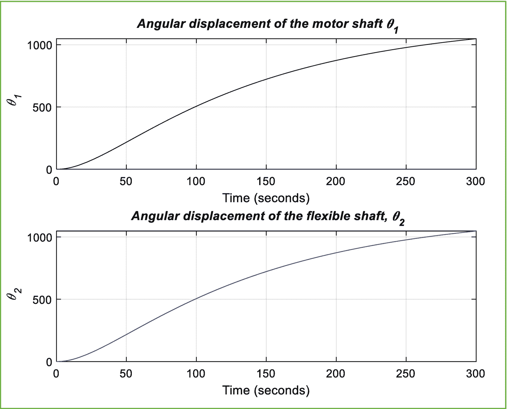

图 10-8：电机扭矩（`τ[e]`）和弹性负载轴扭矩（`τ[f]`）

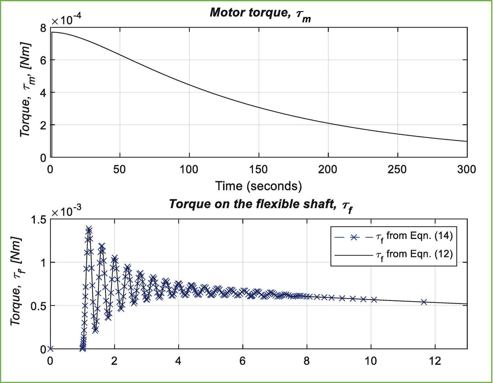

图 10-7：电机轴角速度（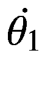）和弹性负载轴角速度（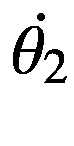）

在 Simulink 中采用带弹性负载的直流电机仿真模型（图 10-6）是开发仿真模型的众多可行方法之一。该 Simulink 模型（图 10-6）可以通过使用各种模块进行简化和优化，以提高可读性。此外，也可以通过编写脚本开发类似的仿真模型。


