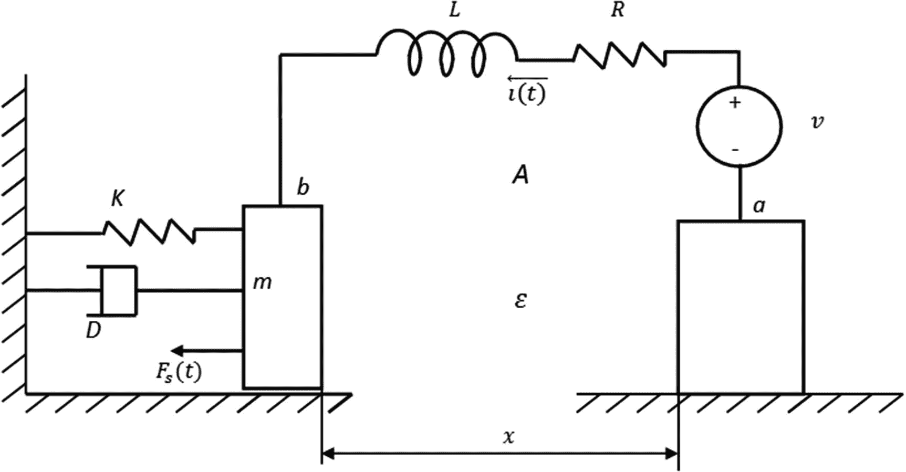
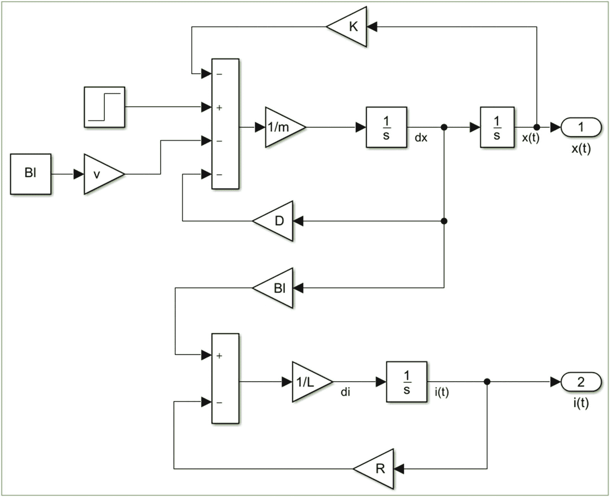
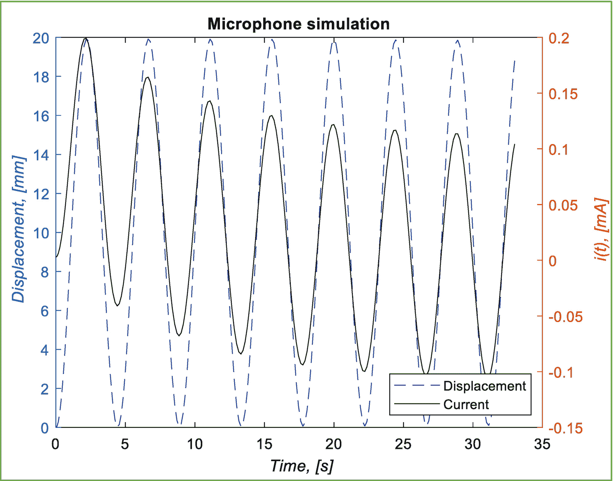

# 麦克风建模

麦克风的简化物理模型（图 10-9）由电气和机械组件构成。其电气组件包括：刚性固定于麦克风框架上的电容器极板（a）、电荷源（`v`）、电阻（`R`）和电感（`L`）。模型的机械部件为质量为`m`的可动板（振膜（`b`）），该板通过一组刚度常数为`K`的弹簧和阻尼常数为`D`的阻尼器连接至框架。声波穿过拾音口并对可动板（振膜（`b`））施加一个力`Fs(t)`。



**图 10-9** 麦克风简化物理模型

电容`C`是极板间距离`x`的函数，即`C(x) = εA / x`，其中`ε`是极板间材料的介电常数（空气在 20°C 时的介电常数为 1.0059，`A`是极板的表面积）。电荷`q`与极板间电压`v`的关系由公式`q = C(x)v`确定。电场继而会对可动板（`b`）产生如下阻碍其运动的力`Fe`：`Fe = q² / (2εA)`。力`Fe`等效于由磁通密度（`B`）和线圈长度（`l`）感应产生的力（`F = Blv`），因此我们用`F = Blv`替代`Fe`。描述该系统运行的微分方程包含两部分，一部分是机械部分，另一部分是电气部分。

以下是机械部分：

`Fs(t) = mẍ + Dẋ + Kx(t) + F`

(10-17)

`Fs(t)` 是运动空气对可动板（`b`）（振膜）施加的力。`m` 是可动板（`b`）（振膜）的质量。`D` 是摩擦或阻尼常数。`K` 是可动板（`b`）（振膜）的刚度或弹簧常数。`x(t)` 是可动板（`b`）（振膜）的位移。`ẋ = dx/dt` 是可动板（`b`）（振膜）的速度。`ẍ = d²x/dt²` 是可动板（`b`）（振膜）的加速度。`F = Blv` 是由磁通和线圈电流感应产生的力。`v` 是电路中的电压。

以下是电压形式的电气部分：

`Fv = Ri + L(di/dt)`

(10-18)

`R` 是线圈的电阻，单位为欧姆。`i` 是线圈中的电流。`L` 是电感，`L di/dt` 是线圈两端的电压。`Fv = Bl(dx/dt)` 是由磁通密度（`B`）乘以线圈长度（`l`）产生的电压。数值仿真时，我们采用以下数值：

`v = 4.8 × 10⁻³ [V]`；`i[0] = 3 mA = 3 × 10⁻³ [A]`；`m = 50 g = 50 × 10⁻³ [kg]`；`K = 0.1 [N/m]`；`D = 3 × 10⁻⁵ [N·m·sec]`；`Bl = 0.5`；`R = 5 [Ω]`；`L = 45 [H]`；`Fs = 10⁻⁴ [N]`

最后，汇总系统（麦克风）机械部分和电气部分的前两个方程，推导出以下方程组：

```
{
  Fs(t) = m(d²x/dt²) + D(dx/dt) + Kx(t) + Blv
  (Bl)(dx/dt) = Ri + L(di/dt)
}
```

(10-19)

也可重写如下：

```
{
  d²x/dt² = (1/m)[Fs(t) - D(dx/dt) - Kx(t) - Blv]
  di/dt = (1/L)[(Bl)(dx/dt) - Ri]
}
```

(10-20)

通过将`Fs(t)`作为激励力信号（视为输入信号）来建立系统的仿真模型。

图 10-10 展示了 Simulink 中的仿真模型（`Microphone_Model.mdl`）。以下是显示其仿真结果的脚本（`Sim_Microphone_Model.m`）：



**图 10-10** 麦克风的 Simulink 模型（`Microphone_Model.slx`）

```
clc; close all; clearsk
out=sim('Microphone_Model');
figure('name', 'Microphone')
yyaxis left
plot(out.yout{1}.Values, 'b--')
ylabel('\it 位移，[mm]')
yyaxis right
plot(out.yout{2}.Values, 'k-')
xlabel('\it 时间，[s]')
ylabel('\it i(t)，[mA]')
legend('位移', '电流', 'location', 'southeast')
title('麦克风仿真')
```

从图 10-11 所示的仿真模型结果可以清晰地看出，当系统受到阶跃参考信号（如阶跃 4.8 [mV]输入电压）激励时，麦克风振膜（可动部分）的运动是周期性的，且系统中电气元件中的电流也是周期性的。



**图 10-11** 麦克风振膜的仿真


