# 建模电机-泵-齿轮箱系统

一个电机通过图 10-12 所示的齿轮箱驱动一台泵。转子具有转动惯量（*J*[1] = 1.5 *kgm*²，*J*[2] = 0.5 *kgm*²，*J*[3] = 1.0 *kgm*²，*J*[4] = 2.0 *kgm*²），连接轴具有扭转刚度（\\ {}{J}_2^{\prime }{\ddot{\theta}}_2={k}_1\left({\theta}_1-{\theta}_2\right)+{k}_2^{\prime}\left({\theta}_3-{\theta}_2\right)\\ {}{J}_3^{\prime }{\ddot{\theta}}_3={k}_2^{\prime}\left({\theta}_2-{\theta}_3\right)\end{array}\right. $$](images/490522_1_En_10_Chapter/490522_1_En_10_Chapter_TeX_Equ21.png)

(10-21)

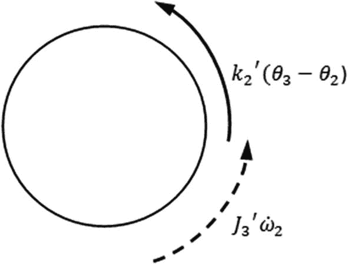

图 10-14

质量块 3 的受力图

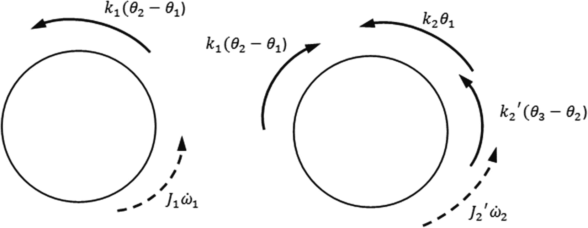

图 10-13

质量块 1 和质量块 2 的受力图

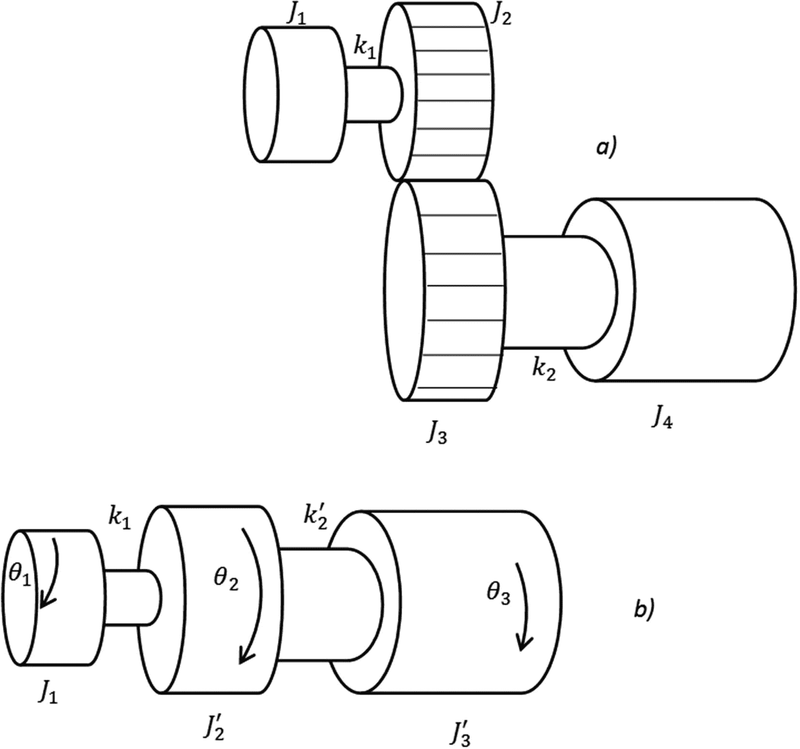

图 10-12

a) 原始系统；b) 等效系统

其中 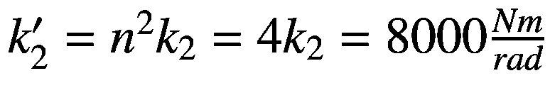, 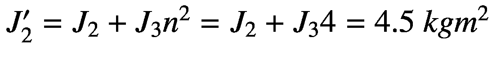, 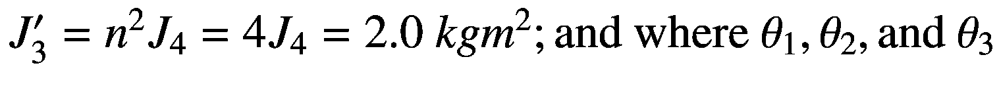 分别是质量块 1、质量块 2 和质量块 3 的角位移。

最后，通过仿真模型求解方程(10-22)所示的微分方程组。

![$$ \left\{\begin{array}{c}{\ddot{\theta}}_1=\frac{k_1}{J_1}\left({\theta}_2-{\theta}_1\right)\\ {}{\ddot{\theta}}_2=\frac{1}{J_2^{\prime }}\Big{k}_1\left({\theta}_1-{\theta}_2\right)+{k}_2^{\prime}\left({\theta}_3-{\theta}_2\right)\\ {}{\ddot{\theta}}_3=\frac{k_2^{\prime }}{J_3^{\prime }}\left({\theta}_2-{\theta}_3\right)\end{array}\right. $$(10-22)第一个仿真模型。利用方程(10-22)中的方程组，我们构建了如图 10-15 所示的 Simulink 模型 `Motor_Pump_model.mdl`。注意，在该 Simulink 模型中，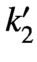 用 `k2p` 表示，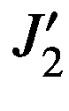 用 `J2p` 表示，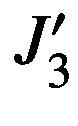 用 `J3p` 表示。

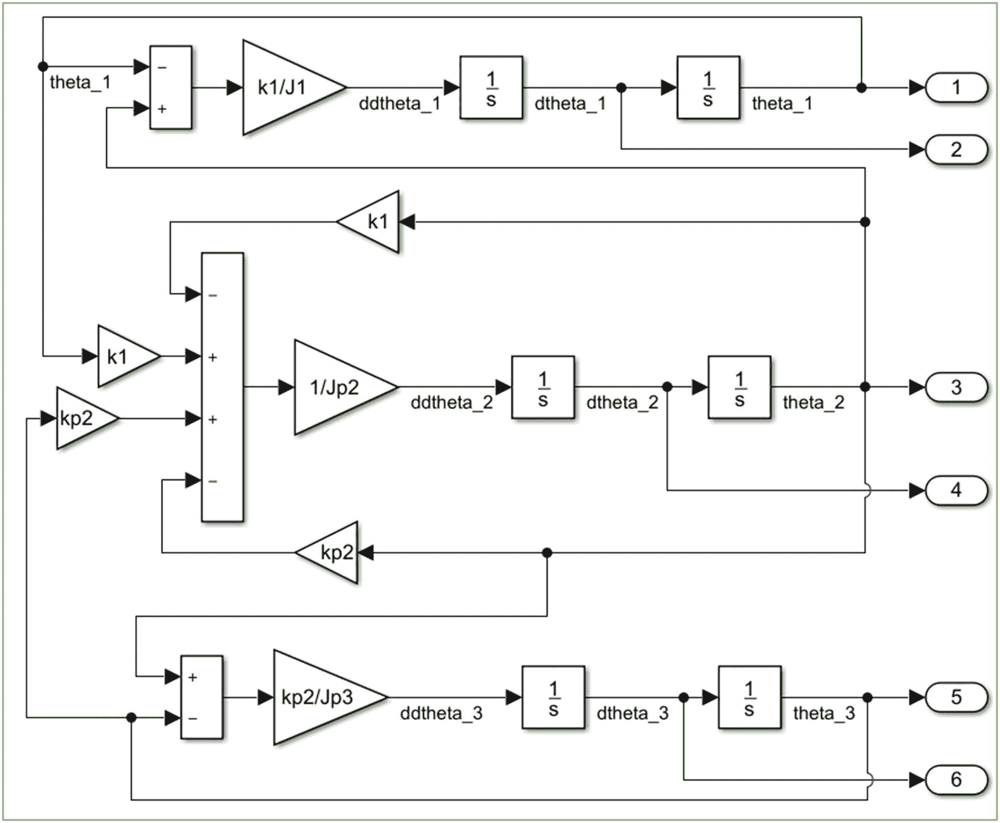

图 10-15

系统电机泵的 Simulink 模型 `Motor_Pump_model.slx`

在定义了刚度参数、转动惯量数值以及模型中积分器模块的内部初始条件 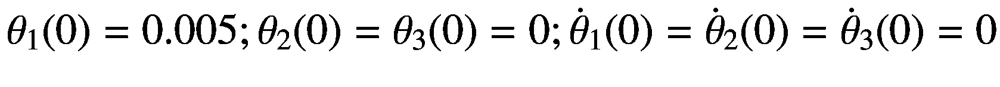 之后，我们执行 Simulink 模型，并从 Scope1 和 Scope2 获取结果。仿真结果以时间与*θ*1、*θ*2、*θ*3 的关系图形式展示，如图 10-16 所示；以及以相图形式展示，如图 10-17 和图 10-18 所示，例如*θ*1 vs *ω*1、*θ*2 vs *ω*2、*θ*3 vs *ω*3。请注意，为了使仿真结果更平滑，我们对相对误差容限和绝对误差容限分别设置了严格的限值，即 `RelTol` = 10^(−6) 和 `AbsTol` = 10^(−9)。

脚本 `Sim_Motor_Pump.m` 执行 Simulink 模型 `Motor_Pump_model.slx` 并绘制结果。

```
clc; close all; clearvars
out=sim('Motor_Pump');
figure('name', 'Motor Pump')
yyaxis left
plot(out.yout{1}.Values, 'b--'), hold on
plot(out.yout{3}.Values, 'k-')
ylabel('\it Angular Displacement \theta_1, \theta_3, [rad]')
yyaxis right
plot(out.yout{5}.Values, 'r-.'), grid on
xlabel('\it Time, [s]')
ylabel('\it Angular Displacement \theta_2,  [rad]')
legend('\theta_1', '\theta_3', '\theta_1','location', 'southeast')
title('\it Motor Pump simulation')
xlim([0, 1.5])
%% Phase plots
theta1 = out.yout{1}.Values.Data;
dtheta1 = out.yout{2}.Values.Data;
theta2 = out.yout{3}.Values.Data;
dtheta2 = out.yout{4}.Values.Data;
theta3 = out.yout{5}.Values.Data;
dtheta3 = out.yout{6}.Values.Data;
figure('name', 'Motor Pump - Phase plot 1')
plot(theta1, dtheta1, 'b--'), grid on
ylabel('\it \omega_1')
title('Phase plot')
xlabel('\theta_1')
axis square
figure('name', 'Motor Pump - Phase plot 2')
plot(theta2, dtheta2, 'k-', theta3, dtheta3, 'r-.')
title('Phase plot')
xlabel(' \theta_2, \theta_3')
ylabel('\it \omega_2, \omega_3')
legend('\theta_2 vs. \omega_2', '\theta_3 vs. \omega_3', 'location', 'southeast')
axis square
grid on
```

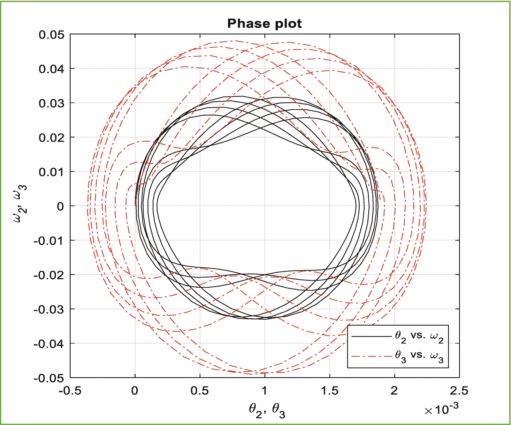

图 10-18

相图：*θ**i* *与 ω**i* 的关系

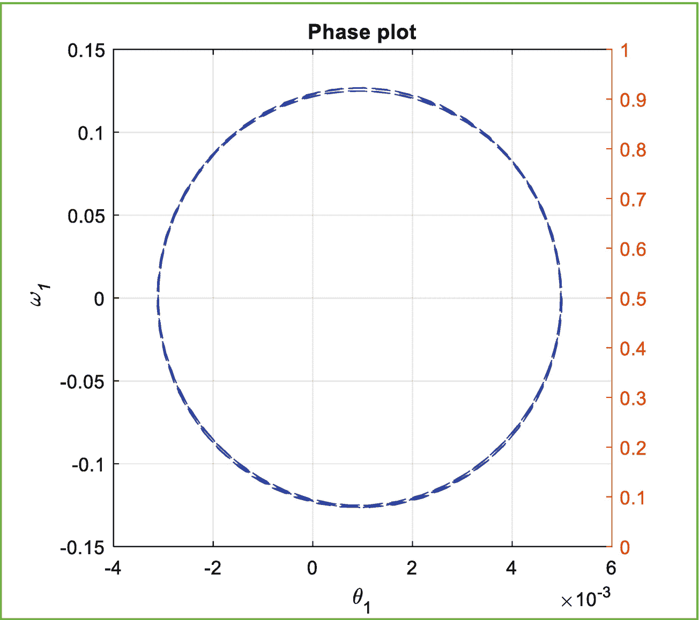

图 10-17

相图：*θ**i* *与 ω**i* 的关系

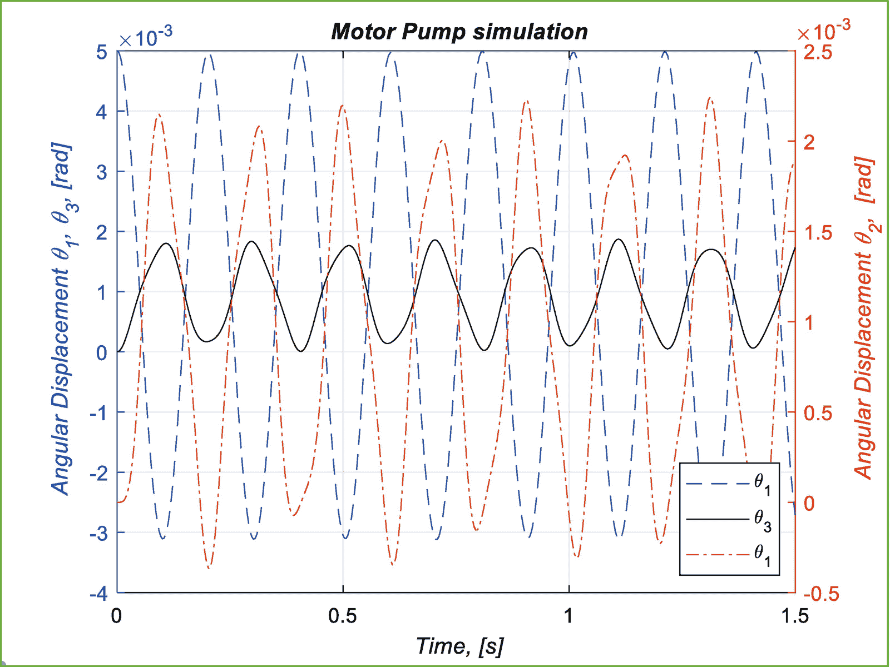

图 10-16

时间与三个质量块角位移的关系

为了简化 MATLAB 脚本编写过程，将方程(10-22)所示的微分方程组改写成矩阵形式。

![$$ \left\{\begin{array}{c}{\ddot{\theta}}_1\\ {}{\ddot{\theta}}_2\\ {}{\ddot{\theta}}_2\end{array}\right\}=\left[\begin{array}{ccc}-\frac{k_1}{J_1}&amp; \frac{k_1}{J_1}&amp; 0\\ {}\frac{k_1}{J_2^{\prime }}&amp; -\left(\frac{k_1}{J_2^{\prime }}+\frac{k_2^{\prime }}{J_2^{\prime }}\right)&amp; \frac{k_2^{\prime }}{J_2^{\prime }}\\ {}0&amp; \frac{k_2^{\prime }}{J_2^{\prime }}&amp; -\frac{k_2^{\prime }}{J_2^{\prime }}\end{array}\right]\left\{\begin{array}{c}{\theta}_1\\ {}{\theta}_2\\ {}{\theta}_3\end{array}\right\} $$](images/490522_1_En_10_Chapter/490522_1_En_10_Chapter_TeX_Equ23.png)

(10-23)

第二个仿真模型。下一个模型是一个名为 `Motor_Pump_Model_2.m` 的脚本，它嵌入了方程(10-23)中的系统模型，并使用求解器 `ode113` 计算问题的数值解。


```
% Motor_Pump_Model_2.m
K1=1200;              % [牛米/弧度]
K2prime=8000;         % [牛米/弧度]
J1=1.5;               % [千克平方米]
J2prime=4.5;          % [千克平方米]
J3prime=2.0;          % [千克平方米]
t=[0, 1.5];           % 仿真时间
theta0=[.005; 0; 0];  % 初始条件
dtheta0=[0; 0; 0];    % 初始条件
KJ=[-K1/J1, K1/J1, 0;
K1/J2prime, -(K1/J2prime+K2prime/J2prime), K2prime/J2prime;
0, K2prime/J3prime, -K2prime/J3prime;];
A=[zeros(3), eye(3); KJ, zeros(3)]; Fun=@(t, theta)(A*theta);
opts=odeset('reltol', 1e-6, 'abstol', 1e-9);
[time, THETA]=ode113(Fun, t, [theta0; dtheta0], opts);
figure; plot(time, THETA(:,1), 'b',time, THETA(:,2), 'm--', ...
time, THETA(:,3), 'k:', 'linewidth', 1.5)
legend('\it \theta_1(t)','\theta_2(t)','\theta_3(t)', 'location', 'southeast'), grid on
title('电机-泵模型仿真 MATLAB'), xlabel('t, 时间'),
ylabel('\it \theta_1(t), \theta_2(t), \theta_3(t) ')
figure; plot(THETA(:,1), THETA(:,4), 'b',...
THETA(:,2), THETA(:,5), 'm--', THETA(:,3),...
THETA(:,6), 'k:', 'linewidth', 1.5)
legend('\it \omega_1(t)','\omega_2(t)','\omega_3(t)', 'location', 'southeast')
title('电机-泵模型仿真 MATLAB')
xlabel('\it \theta_1(t), \theta_2(t), \theta_3(t)')
ylabel('\it \omega_1(t), \omega_2(t), \omega_3(t)'), axis square
grid on
```

请注意，在此上下文中未显示第二次仿真方法（使用 `ode113`）的结果。

第三种仿真方案。该建模问题的下一个示例使用龙格-库塔方法，并通过名为 `Motor_Pump_Demo.m` 的函数文件实现，如下所示：

```matlab
function Motor_Pump_Demo
h=0.01;                  % 时间步长
t=0:h:1.5;               % 仿真时间
theta0  = [0.005, 0, 0]; % 初始条件
dtheta0 = [0, 0, 0];     % 初始条件
u=[theta0, dtheta0];     % 整体初始条件
for m=1:length(t)-1
k1(m,:)=Motor_pump_shaft(u(m,:));
k2(m,:)=Motor_pump_shaft(u(m,:)+h*k1(m,:)./2);
k3(m,:)=Motor_pump_shaft(u(m,:)+h*k2(m,:)./2);
k4(m,:)=Motor_pump_shaft(u(m,:)+h*k3(m,:));
u(m+1,:)=u(m,:)+h*(k1(m,:)+2*k2(m,:)+2*k3(m,:)+k4(m,:))./6;
end
close all; figure(1)
plot(t,u(:,1),'b',t,u(:,3),'k:',t,u(:,5),'m-.','linewidth', 1.5)
title('惯性质量的角位移')
xlabel('时间, t'),
ylabel('\theta_1(t), \theta_2(t), \theta_3(t)')
legend('\theta_1(t)','\theta_2(t)','\theta_3(t)','location', 'southeast'), grid on
figure(2)
plot(t,u(:,2),'b',t,u(:,4),'k:',t,u(:,6),'m-.','linewidth', 1.5)
title('惯性质量的角速度')
xlabel('时间, t'), ylabel('\omega_1(t), \omega_2(t), \omega_3(t)')
legend('\omega_1(t)','\omega_2(t)','\omega_3(t)','location', 'southeast'), grid on
figure(3); plot(u(:,1), u(:,2), 'b', u(:,3), u(:,4), 'm--',...
u(:,5), u(:,6), 'k:', 'linewidth', 1.5),
axis square, axis tight; title('惯性质量的相图')
xlabel('\theta_1(t), \theta_2(t), \theta_3(t)')
ylabel('\it \omega_1(t), \omega_2(t), \omega_3(t)')
legend('\omega_1(t)','\omega_2(t)','\omega_3(t)','location', 'southeast')
function dudx=Motor_pump_shaft(u)
K1=1200;       % [牛米/弧度]
K2prime=8000;  % [牛米/弧度]
J1=1.5;        % [千克平方米]
J2prime=4.5;   % [千克平方米]
J3prime=2.0;   % [千克平方米]
dudx=zeros(1,6);
dudx(1)=u(2);
dudx(2)=(-K1/J1)*u(1)+(K1/J1)*u(3);
dudx(3)=u(4);
dudx(4)=(K1/J2prime)*u(1)-(K1/J2prime+K2prime/J2prime)*u(3)+...
(K2prime/J2prime)*u(5);
dudx(5)=u(6);
dudx(6)=(K2prime/J3prime)*u(3)-(K2prime/J3prime)*u(5);
return
```

系统的所有三种仿真模型都能生成相同的角位移、速度及相图结果。如前所述，数值解的精度取决于所用求解器的步长。


