# 双摆建模

摆广泛应用于机械装置和机构中，例如内燃机、机械臂和操纵器。基于图 10-19 所示的双摆，我们可以通过应用拉格朗日方程来推导每个质量的动能和势能方程。注意，该系统由 `θ[1]` 和 `θ[2]` 定义了两个自由度。假设杆件无质量，质量集中于质点。关节无摩擦。

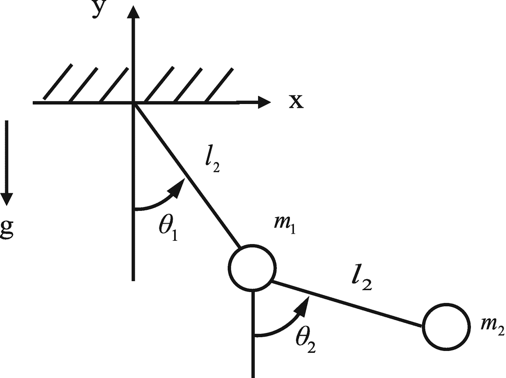

图 10-19

双摆的物理模型

质量 `m[1]` 和 `m[2]` 的双摆运动方程通过以下公式推导得出：


(10-24)


(10-25)

这两个方程可通过将第一个方程除以 `l[1]`，第二个方程除以 `l[2]` 进行简化。

![$$ \left\{\begin{array}{c}\left({m}_1+{m}_2\right){l}_1{\ddot{\theta}}_1-{m}_2{l}_2\sin \left({\theta}_2-{\theta}_1\right)\left({\dot{\theta}}_2-{\dot{\theta}}_1\right){\dot{\theta}}_2+{m}_2{l}_2\cos \left({\theta}_2-{\theta}_1\right){\ddot{\theta}}_2+\left({m}_1+{m}_2\right)g\sin \left({\theta}_1\right)=0\\ {}-{m}_2{l}_1\sin \left({\theta}_2-{\theta}_1\right)\left({\dot{\theta}}_2-{\dot{\theta}}_1\right){\dot{\theta}}_1+{m}_2{l}_1\cos \left({\theta}_2-{\theta}_1\right){\ddot{\theta}}_1+{m}_2{l}_2{\ddot{\theta}}_2+{m}_2g\sin \left({\theta}_2\right)=0\ \end{array}\right. $$](img/490522_1_En_10_Chapter_TeX_Equa.png)

(10-26)

如公式 (10-26) 所示的方程组描述了双摆的运动。

对于数值仿真，采用以下数值：![$$ {m}_1=10\ \left[ kg\right];{m}_2={m}_1;{l}_1=5\ \left[m\right];\mathrm{and}\ {l}_2={l}_1.\mathrm{The}\ \mathrm{following}\ \mathrm{are}\ \mathrm{the}\ \mathrm{initial}\ \mathrm{conditions}:{\uptheta}_1(0)=-0.5;{\uptheta}_2(0)=-1;{\dot{\uptheta}}_1(0)=1;{\dot{\uptheta}}_2(0)=2\. $$](images/490522_1_En_10_Chapter/490522_1_En_10_Chapter_TeX_IEq26.png)

基于双摆的运动方程组，我们可以开发 Simulink 模型 `DOUBLE_pendulum.slx`（图 10-20）。

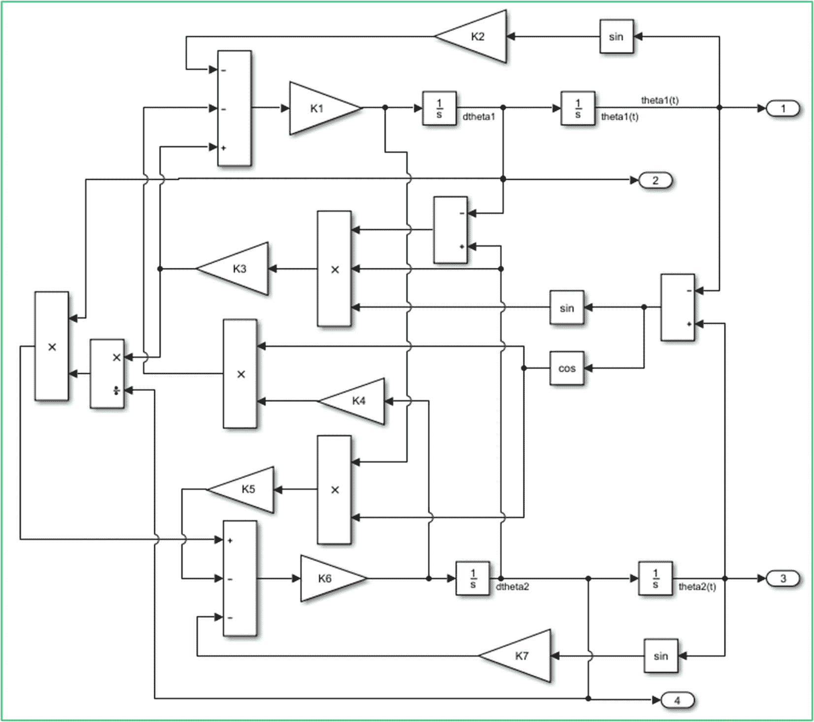

图 10-20

双摆的 Simulink 模型

注意，在图 10-20 所示的模型中，所有初始条件均通过 `[Integrator]`（`[Integrator]`、`[Integrator2]`、`[Integrator3]`、`[Integrator4]`）模块按照 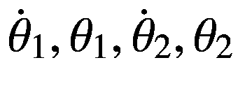 的顺序设置。此外，为了简化模型，`[Gain]` 模块被合并为 `K[1]`、`K[2]`、…、`K[7]`，其值在模型 `DOUBLE_pendulum.slx` 的模型属性中定义。注意我们通过 `[Out]` 模块的通道获得的仿真结果（图 10-21）。调用并执行该 Simulink 模型的 M 文件名为 `Sim_DOUBLE_Pendulum.m`，如下所示：

```
clc; close all; clears
out=sim('DOUBLE_pendulum');
figure('name', 'Double Pendulum Sim');
subplot(211)
plot(out.yout{1}.Values, 'b-', 'linewidth', 1.5), hold on
plot(out.yout{3}.Values, 'r-.', 'linewidth', 1.5)
title('角位移')
xlabel('时间, [s]')
ylabel('\theta_1, \theta_2')
legend('\theta_1', '\theta_2'); grid on
subplot(212)
plot(out.yout{2}.Values, 'b-', 'linewidth', 1.5), hold on
plot(out.yout{4}.Values, 'r-.', 'linewidth', 1.5)
title('角速度')
xlabel('时间, [s]')
ylabel('d\theta_1, d\theta_2')
legend('d\theta_1', 'd\theta_2'); grid on; shg
```

注意，在 Simulink 模型 `DOUBLE_Pendulum.slx` 的配置参数  中，位于“保存到工作区或文件”选项卡下：。

我们已经从 `[保存选项]`  中的 `[将数据点限制为最后:]` 1000 的复选框中移除了勾选。此外，我们在变量名（默认名称）`out` 下勾选了 ，并选择格式类型为数据集：。

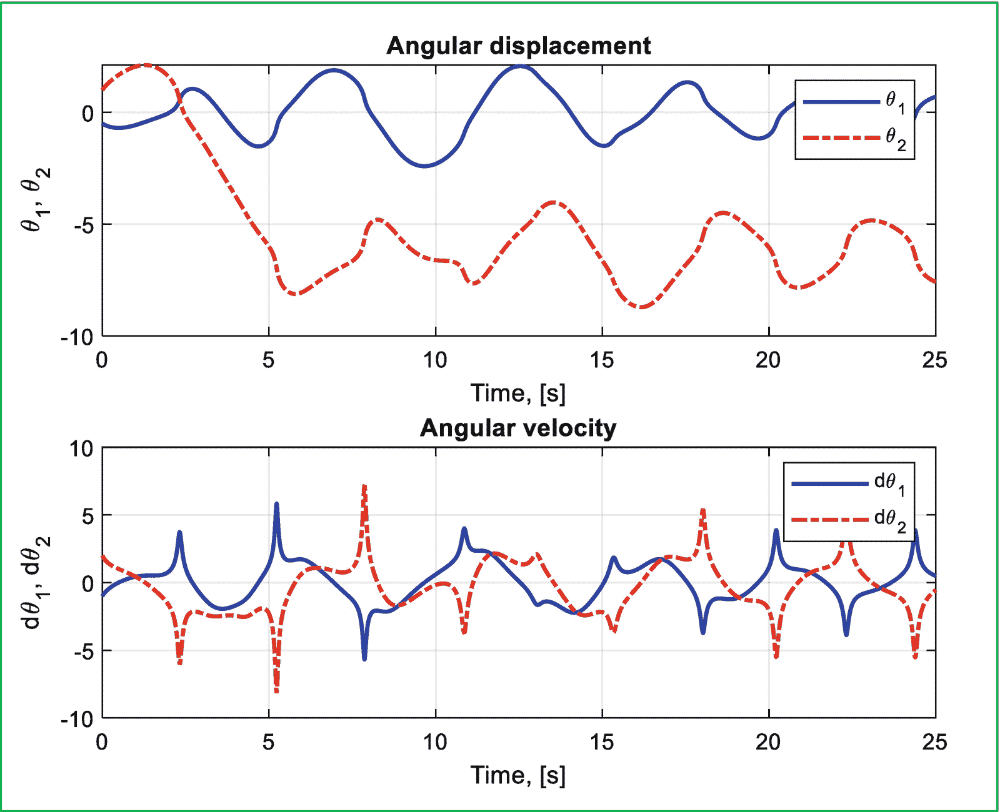

图 10-21

来自 Simulink 模型 `DOUBLE_pendulum.slx` 的仿真结果

一种替代仿真模型。该问题的另一种方法可以通过求解器 `ode15i` 开发，该求解器用于隐式定义的微分方程。以下是一个名为 `DOUBLE_Pedulum_Model_2.m` 的脚本，用于仿真双摆模型的运动。该脚本的仿真结果如图 10-22 和图 10-23 所示。

```
%%  ODE15i 隐式 ODE 求解器
% 帮助: 此脚本仿真双摆模型
% theta1(0)=-0.5; dtheta1(0)= -1
% theta2(0)= 1; dtheta2(0) = 2.
L1= 5; L2 = L1;        % 米
g = 9.81;              % 米/秒²
m1=10;                 % 千克
m2=10;                 % 千克
M=m1+m2;
test=@(t, theta, dtheta)([-dtheta(1)+theta(2);
M*L1*dtheta(2)+m2*L2*cos(theta(3)-theta(1))*dtheta(4)-...
m2*L2*(theta(4)*(theta(4)-theta(2)))*sin(theta(3)-...
theta(1))+M*g*sin(theta(1));
-dtheta(3)+theta(4);
m2*L2*dtheta(4)+m2*L1*cos(theta(3)-theta(1))*dtheta(2)-...
m2*L1*(theta(2)*(theta(4)-theta(2)))*sin(theta(3)- ...
theta(1))+m2*g*sin(theta(3))]);
% theta10=-.5; dtheta10=-1; theta20=1; dtheta20=2;
tspan=[0:pi/30:5*pi];  % 使用固定时间步长的仿真时间
the0=[-.5, -1, 1, 2];
dthe0=[0; 0; 0; 0];    % dtheta0 由 theta0 确定
theF0=[1 1 1 1]; dtheF0=[];
[the0, dthe0]=decic(test, 0, the0,theF0, dthe0, dtheF0);
[time, theta]=ode15i(test, tspan, the0, dthe0);
figure('name', '双摆 1')
plot(time, theta(:,1), 'b-', time, theta(:,2), 'k-.', 'linewidth', 1.5), hold on
plot(time, theta(:,3),'r--',time,theta(:,4), 'm:', 'linewidth', 2)
legend('\theta_1(t)','d\theta_1(t)','\theta_2(t)','d\theta_2(t)', 'location', 'southeast')
title('使用 ODE15i 求解的双摆问题')
xlabel('时间'), ylabel('\theta(t)'), grid on
figure('name', '双摆 2'), yyaxis left
plot(theta(:,1), theta(:,2),'b-', 'linewidth', 1.5)
ylabel('d\theta_1'), yyaxis right
plot(theta(:,3), theta(:,4), 'm-.', 'linewidth', 1.5)
legend('\theta_1 vs. d\theta_1','\theta_2 vs. d\theta_2(t)', 'location', 'southeast')
title('双摆问题的相图')
xlabel('\theta_1, \theta_2'), ylabel('d\theta_2'),
axis tight; grid on; shg
```

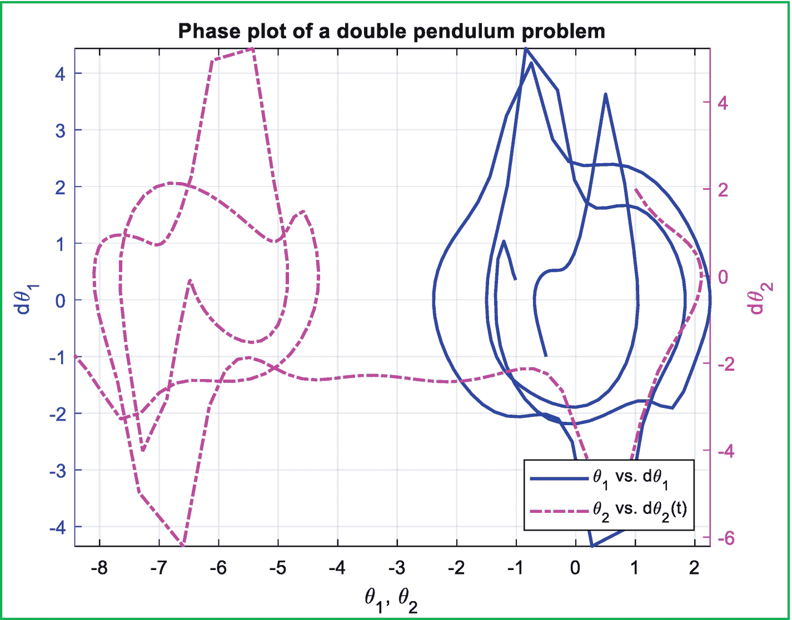

图 10-23

使用基于 `ode15i` 的模型仿真双摆问题

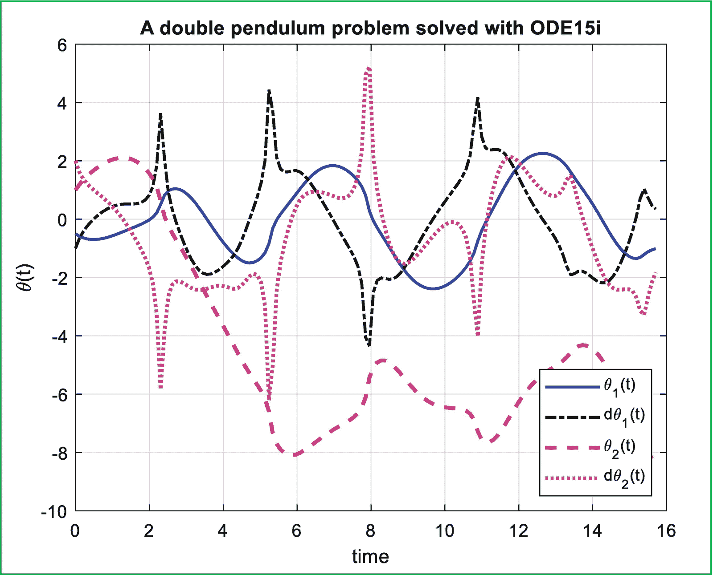

图 10-22

使用基于 `ode15i` 的模型仿真双摆问题

从 Simulink 模型 (`DOUBLE_pendulum.slx`) 和基于 `ode15i` 的 `DOUBLE_Pedulum_model_2.m` 模型的仿真结果可以看出，两种方法产生的结果几乎相同。差异是由于 `ode15i` 和 Simulink 模型中求解器步长的不同造成的。这些仿真模型基于双摆的非线性数学模型。就双摆两个杆的角位移 `θ[1]` 和 `θ[2]` 以及速度 `dθ[1]` 和 `dθ[2]` 而言，系统的行为是非线性的（图 10-21、10-22 和 10-23）。

双摆的线性化模型。对于两个质量的小幅度振荡，我们可以通过取 sin `θ` ≈ `θ` 和 cos `θ` ≈ 1 来近似公式 (10-24)、公式 (10-25) 和公式 (10-26) 中的系统公式并对其进行线性化。此外，我们从公式中忽略了一阶导数项 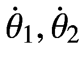 (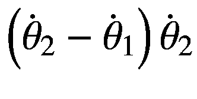)。

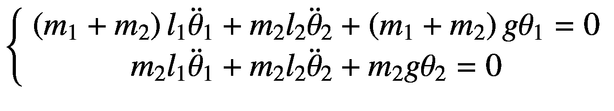

(10-27)

注意，公式 (10-27) 中的摆的线性化模型是一个齐次二阶常微分方程。该模型通过一个名为 `Double_Pendulum_Linear.slx` 的 Simulink 模型实现，如图 10-24 所示，其仿真结果如图 10-25 和 10-26 所示。

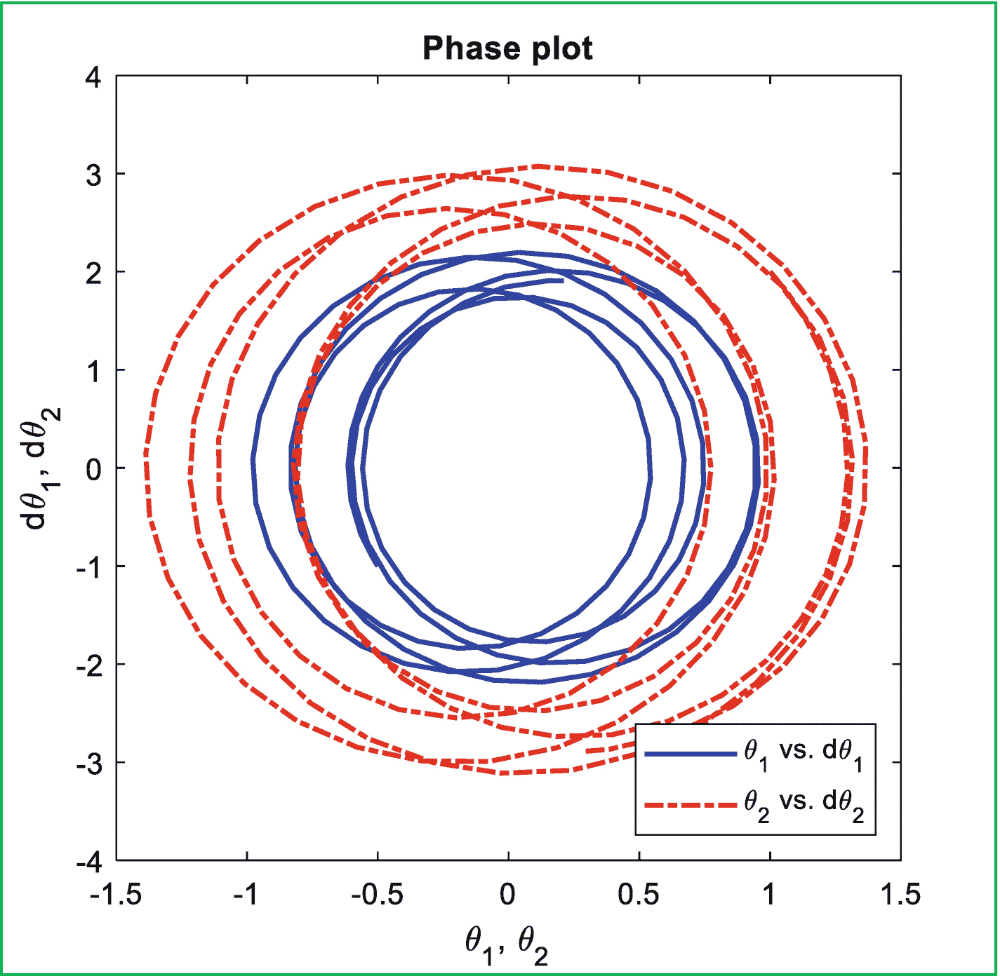

图 10-26

小幅度振荡双摆的相图

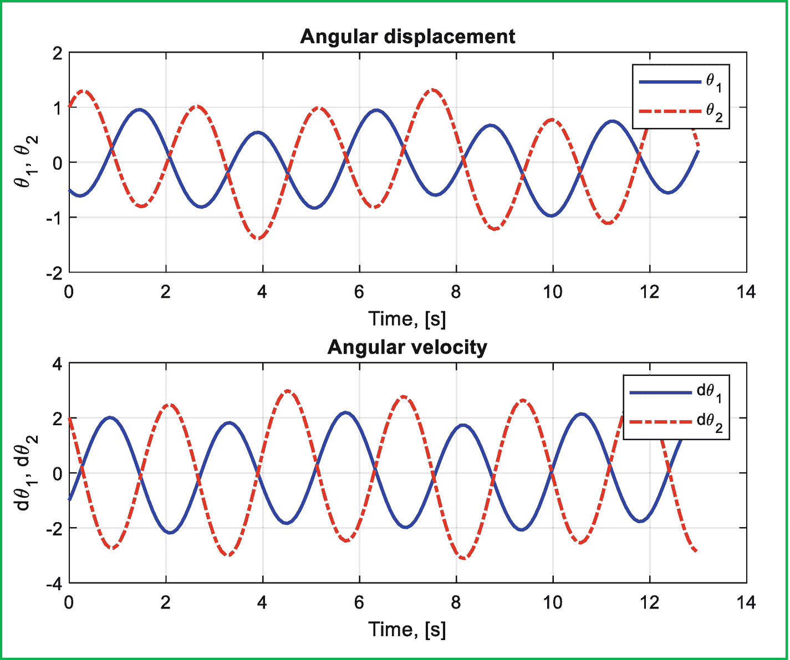

图 10-25

小幅度振荡双摆的仿真结果

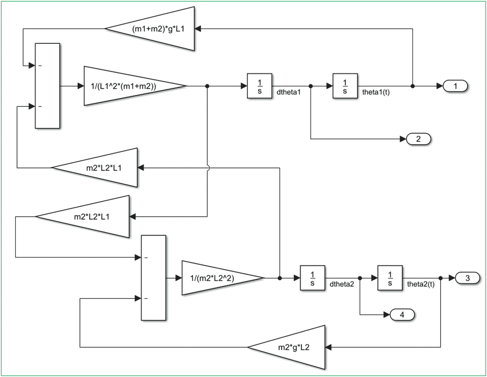

图 10-24

用于模拟小幅度振荡的双摆线性化模型

以下是运行该 Simulink 模型并绘制结果的 M 文件 (`Sim_Double_Pendulum_Linear.m`)：

```
clc; close all; clears
out=sim('Double_Pendulum_Linear');
figure('name', '双摆仿真');
subplot(211)
plot(out.yout{1}.Values, 'b-', 'linewidth', 1.5), hold on
plot(out.yout{3}.Values, 'r-.', 'linewidth', 1.5)
title('角位移')
xlabel('时间, [s]')
ylabel('\theta_1, \theta_2')
legend('\theta_1', '\theta_2')
grid on
subplot(212)
plot(out.yout{2}.Values, 'b-', 'linewidth', 1.5), hold on
plot(out.yout{4}.Values, 'r-.', 'linewidth', 1.5)
figure('name', '相图')
plot(out.yout{1}.Values.Data, out.yout{2}.Values.Data, 'b-',...
out.yout{3}.Values.Data,out.yout{4}.Values.Data, 'r-.', 'linewidth', 1.5)
legend('\theta_1 vs. d\theta_1', '\theta_2 vs. d\theta_2', 'location', 'southeast')
title('相图')
xlabel('\theta_1, \theta_2'), ylabel('d\theta_1, d\theta_2')
axis square
```

另一种方法。创建双摆线性化模型的另一种方法是使用 `ode15i`（一种隐式 ODE 求解器）并使用 `dsolve()` 函数计算解析解。注意，当系统的运动方程是线性 ODE 时，`dsolve()` 函数可以计算问题的解析解公式。以下是脚本 `DOUBLE_Pedulum_Linear_2.m` 的第二部分，它实现了双摆的线性化模型：

```
%% 第二部分.
%% 由 ODE15i 求解的双摆线性化模型
%   DOUBLE_Pedulum_Linear_2.m
L1= 5; L2 = L1;      % 米
g = 9.81;            % 米/秒²
m1=10;               % 千克
m2=10;               % 千克
M=m1+m2;
test=@(t, theta, dtheta)([ dtheta(1)-theta(2);
(m1+m2)*L1*dtheta(2)+m2*L2*dtheta(4)+(m1+m2)*g*theta(1);
dtheta(3)-theta(4); m2*L2*dtheta(4)+m2*L1*dtheta(2)+m2*g*theta(3)]);
tspan=[0, 2*pi];
% 初始条件:
theta10=-.5; dtheta10=-1; theta20=1; dtheta20=2;
the0=[theta10, dtheta10, theta20, dtheta20];
thep0=[0;0;0;0]; theF0=[1 1 1 1]; dtheF0=[];
[the0, dthep0]=decic(test,0, the0,theF0,thep0, dtheF0);
[time, theta]=ode15i(test, tspan, the0,dthep0);
plot(time, theta(:,1), 'k', time, theta(:,2), 'bs-',...
time, theta(:,3),'m--', time, theta(:,4), 'go-','linewidth', 1.5)
title('双摆线性化模型仿真')
xlabel('时间'), ylabel('\theta(t)'), axis tight;
grid on; hold on
%% 使用 DSOLVE 对线性化模型进行解析求解
clearvars t
syms theta1(t)  theta2(t)
Dtheta1=diff(theta1, t, 1);
Dtheta2=diff(theta2, t, 1);
D2theta1=diff(theta1, t,2);
D2theta2=diff(theta2, t,2);
EQN = [D2theta1==(-1/(M*L1))*(m2*L1*D2theta2+M*g*theta1), ...
D2theta2==(-1/(m2*L1))*(m2*L1*D2theta1+m2*g*theta2)];
ICs = [theta1(0)==-.5,Dtheta1(0)==-1, theta2(0)==1, Dtheta2(0)==2];
Theta=dsolve(EQN, ICs);
t=0:pi/20:2*pi;
Theta1=(vectorize(Theta.theta1)); Theta2=(vectorize(Theta.theta2));
% 计算 Theta1 和 Theta2 的值:
theta1=eval(Theta1); theta2=eval(Theta2);
plot(t, theta1, 'mx', t, theta2, 'k*', 'linewidth', 1.5)
legend('\theta_1(t) 通过 ODE15i','d\theta_1(t) 通过 ODE15i',...
'\theta_2(t) 通过 ODE15i','d\theta_2(t) 通过 ODE15i',...
'\theta_1 dsolve','\theta_2 dsolve'), grid on; hold off
```

图 10-25、10-26 和 10-27 中所示的 Simulink 模型仿真结果与使用求解器 `ode15i` 和 `dsolve()`（解析求解器）的结果相同。线性化模型的行为是周期性的，并且仅在摆臂的振荡角度非常小（最大 5 度，或 0.0873 弧度）时才有效。

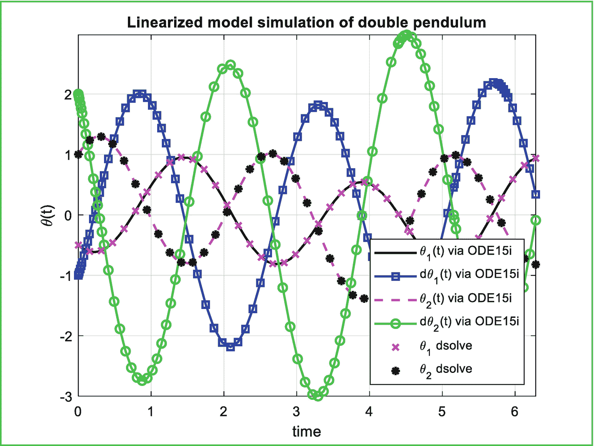

图 10-27

使用 `ode15i`、`dsolve()` 的 M 文件得到的双摆线性化模型仿真结果


