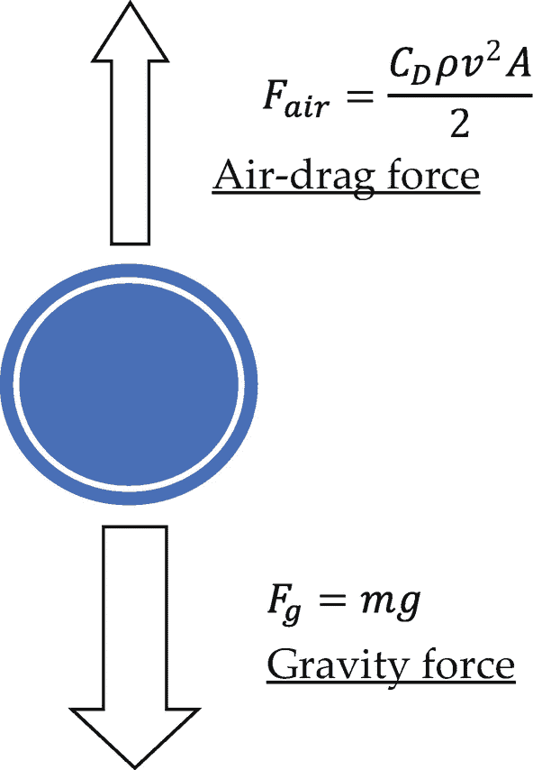
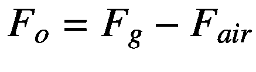
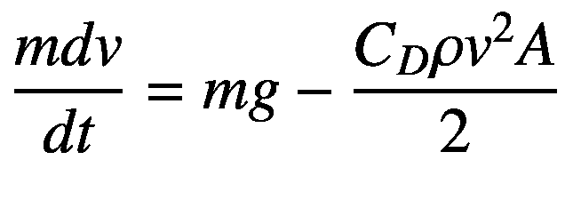
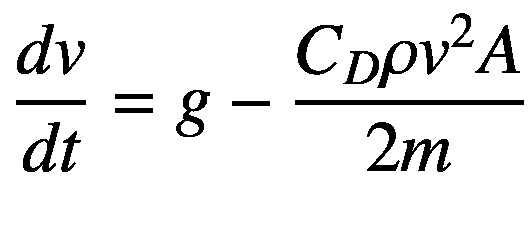
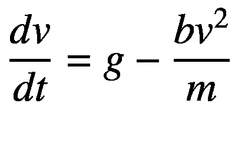
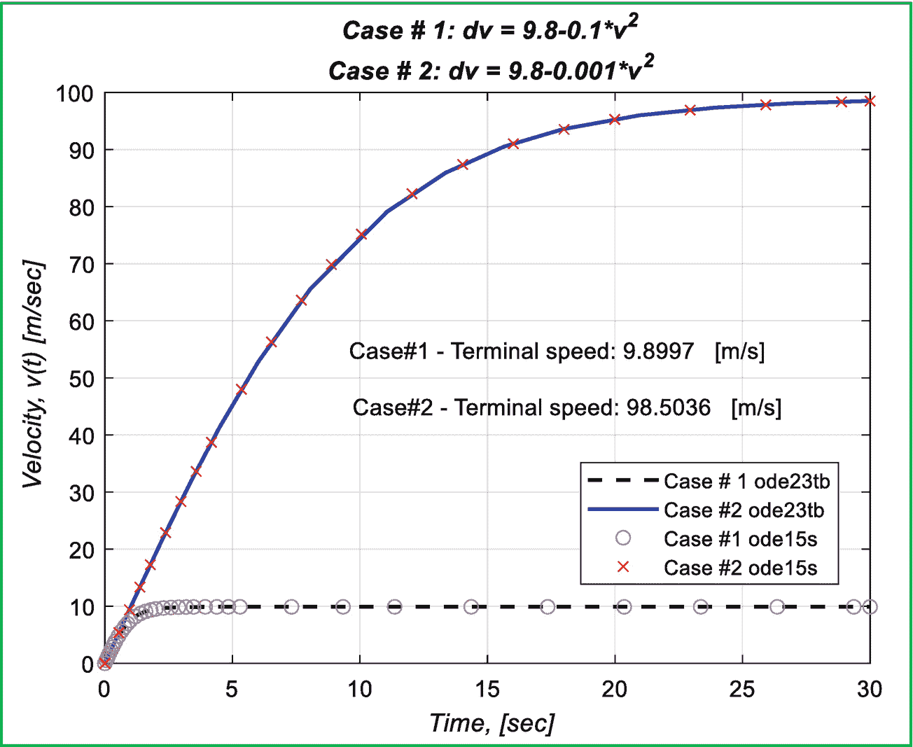

# 轨迹问题

本章包含两个示例：通过微分方程建模的坠落物体和抛射物体，以及通过 m 文件和 Simulink 模型实现仿真模型的坠落物体和抛射物体。

## 坠落物体

我们来看一个关于坠落物体的简单物理练习。考虑一个质量为 `m` 的球在地球重力（`g`）作用下坠落，如图 11-1 所示。设 `h` 为球坠落的高度，`v(t)` 为球的速度。坐标系方向以向下为正。



图 11-1 – 坠落物体及其所受的力

如图 11-1 所示，大气层中的坠落物体受到两种外力作用：重力/万有引力与空气阻力。根据牛顿第二定律，坠落物体所受的净外力等于加速度乘以该物体的质量。

 (11-1)

 (11-2)

 (11-3)

其中 `CD` 是坠落物体的空气阻力系数，需通过实验确定，并且取决于其形状、倾斜角度和流动条件；`ρ` 是空气密度 [kg/m³]；`A` 是坠落物体的横截面积 [m²]；`m` 是坠落物体的质量 [kg]。

阻力取决于坠落物体速度的平方。因此，随着物体加速，阻力也会增加。它会很快达到一个点（加速度等于 0），此时阻力等于重量（重力）。当阻力等于坠落物体的重量（重力）时，物体上将没有净外力 `(m dv/dt = 0)`，物体的加速度将等于 0。随后，物体根据牛顿第一运动定律以恒定速度下落。这个恒定速度被称为*终端速度*。

将所有空气阻力常数替换为一个参数 `b = (CD ρ A) / 2`，则方程(11-3)可改写为方程(11-4)所示形式。该参数称为牛顿阻力。我们得到如方程(11-4)所示的加速度新公式。

 (11-4)

我们来研究两种情景，考察在 `b` 取不同值（即分别为 `b1/m = 0.1` 和 `b2/m = 0.001`）且初始条件为零时，坠落物体的运动情况。我们将找出两种情形下的终端速度。根据 `b1` 和 `b2` 的值，在情形#1 中，阻力是情形#2 中阻力的 100 倍。

情形#1 如下：`dv/dt = g - 0.1 v²`。

情形#2 如下：`dv/dt = g - 0.001 v²`。

以下是完整的仿真模型脚本 `Falling_Object.m`：

```
% Falling_Object.m
%% 任务说明. 坠落物体.
% 已知: m*dv/dt=m*g-b*v²; b/m=0.1 [1/秒]; 情形 # 1.
%        m*dv/dt=m*g-b*v²; b/m=0.001 [1/秒]; 情形 # 2
%        两种情形: v(0)=0 且 g=9.8 [米/秒²];
%           定义函数. 情形 # 1. dv/dt=9.8-0.1*v²
%           定义函数. 情形 # 2. dv/dt=9.8-0.001*v²
% 步骤 # 1. 使用函数句柄定义方程
f_C1=@(t,v)(9.8-0.1*v²');
f_C2=@(t,v)(9.8-.001*v²);
% 步骤 # 2. 定义 ODE23tb(f, timespan, IC)
[time1,v1]=ode23tb(f_C1,[0,30],0);
[time2,v2]=ode23tb(f_C2,[0,30],0);
% 步骤 # 3. 定义 ODE15s(f, timespan, IC)
[time1a,v1a]=ode15s(f_C1,[0,30],0);
[time2a,v2a]=ode15s(f_C2,[0,30],0);
% 步骤 # 4. 显示仿真结果
figure(1), plot(time1,v1,'k--', 'linewidth', 1.5); hold on
plot(time2,v2,'b-', 'linewidth', 1.5)
plot(time1a, v1a,'mo',time2a, v2a, 'rx')
legend('情形 # 1 ode23tb','情形 #2 ode23tb',...
'情形 #1 ode15s', '情形 #2 ode15s', 'location', 'southeast')
xlabel('\it 时间, [秒]'); ylabel('\it 速度, v(t) [米/秒]');
title({'\it 情形 # 1: dv = 9.8-0.1*v²', ...
'\it 情形 # 2: dv = 9.8-0.001*v²'})
grid on
% 步骤 # 5. 找出两种情形下的终端速度值
v_WHICH=(v1==max(v1));
v_MAX=v1(v_WHICH);
% 步骤 # 6. 将终端速度值添加到图中
textmessage=['情形#1 - 终端速度: '...
num2str(v_MAX) '   [米/秒]'];
gtext(textmessage);
v2_WHICH=(v2==max(v2));
v2_MAX=v2(v2_WHICH);
textmessage=['情形#2 - 终端速度: '...
num2str(v2_MAX) '   [米/秒]'];
gtext(textmessage); hold off
```



图 11-2 – 在强空气阻力（情形#1）和小空气阻力（情形#2）两种环境下，坠落物体的时间与速度关系图

两种求解器针对两种情形得到的仿真结果，如图 11-2 所示，收敛良好且几乎相同。当物体的阻力增大 100 倍时，其终端速度下降了约 90 m/s，降幅约为 995%。空气阻力对坠落物体的影响非常显著。对于情形#1 和#2，终端速度分别约在 2.5 秒和 30 秒后达到。