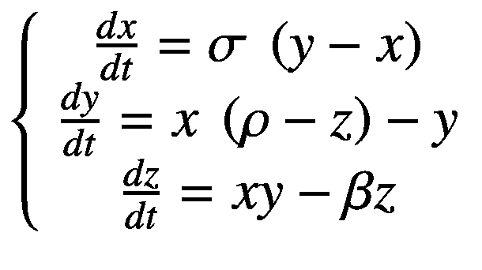
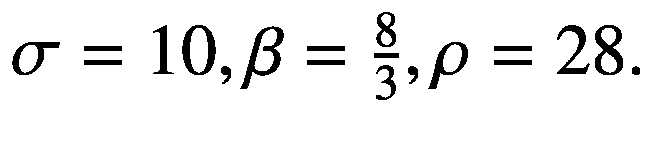
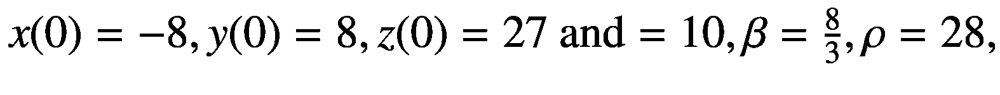
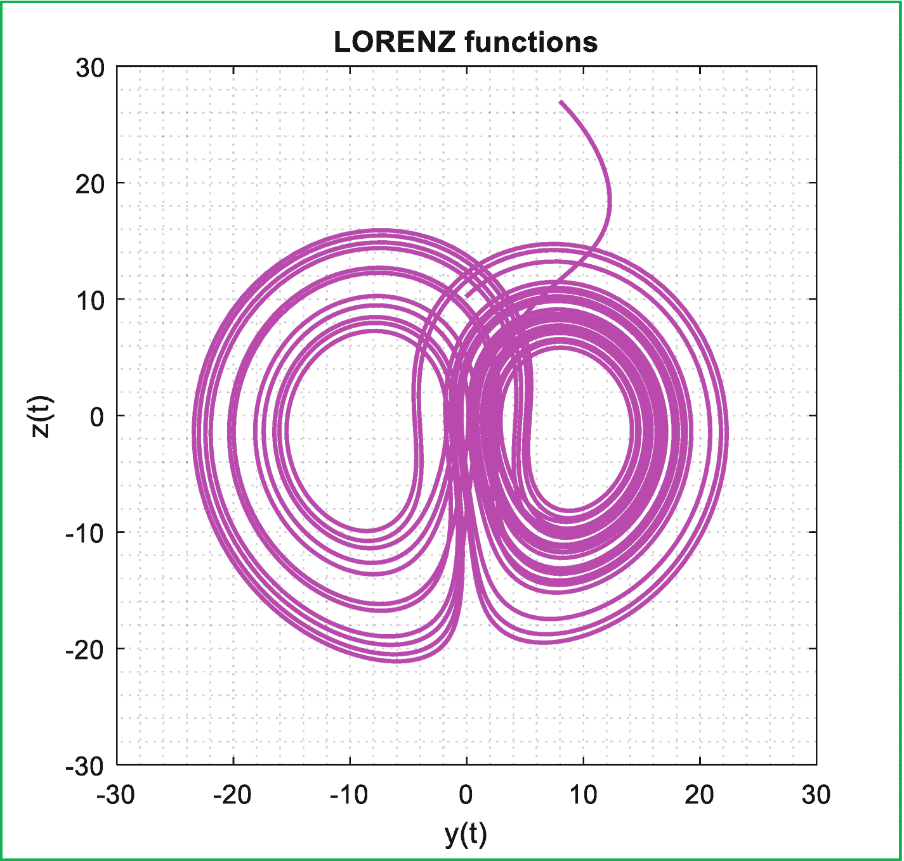
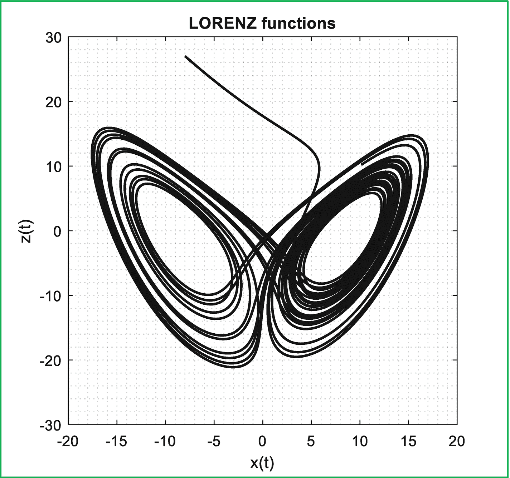
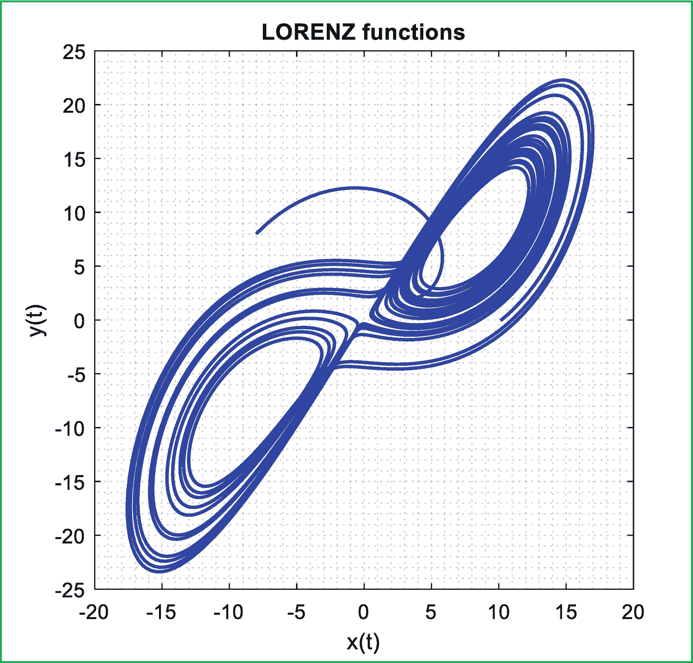
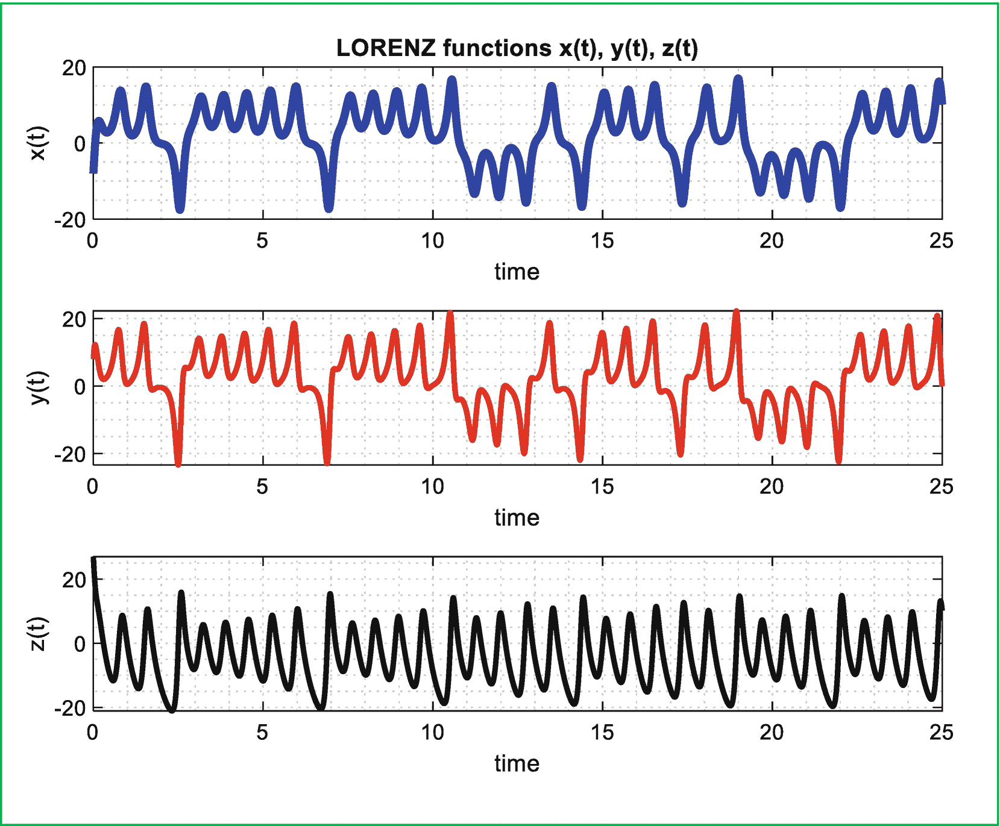
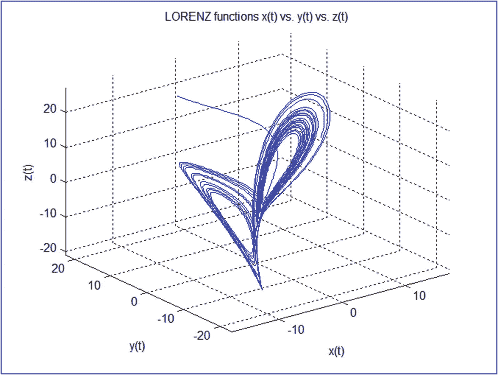

# 12. 模拟问题

本章包含两个例子的数学模型和模拟模型：洛伦兹系统和洛特卡-沃尔泰拉问题。

## 洛伦兹系统

洛伦兹系统是一个常微分方程组，由爱德华·洛伦兹在 1963 年进行天气预报分析时首次研究并观测到。随后，他提出了一个用于大气对流的简化数学公式 [1]。目前，该系统广泛应用于预测自然界中观测到的混沌过程，以及对大气对流现象、模型发电机 [2]、无刷直流电机 [3]、电路 [4]、激光器 [5] 和化学反应 [6] 进行简化形式建模。

洛伦兹系统由三个洛伦兹方程组成，如下所示：



(12-1)

其中 `x`、`y` 和 `z` 是系统状态变量。`t` 是时间，`σ`、`β` 和 `ρ` 是系统参数。

洛伦兹系统是非线性的且是三维的。根据系统参数 `σ`、`β` 和 `ρ` 的取值，洛伦兹系统的行为会有所不同。本节为了演示目的，使用了以下参数值： 需要注意的是，洛伦兹系统参数值的微小变化会导致整个系统行为发生剧烈变化，但在更长的演化过程中，其解并不总是呈现混沌行为。

我们开发了一个名为 `LORENZ_functions.m` 的洛伦兹方程模拟脚本（使用的示例初始条件为 ，且 `t=0:.005:25`）。它接受两个输入参数，具体是时间范围和初始条件。

```matlab
function LORENZ_functions(t,ICs)
% LORENZ Functions
if nargin<1
ICs=[-8, 8, 27]; t=0:.005:25;
end
Sigma=10; Beta=8/3; Ro=28;
% Dx/Dt=-Sigma*X+Sigma*Y;
% Dy/Dt=- Y-X*Z;
% Dz/Dt=-Beta*Z+X*Y-Beta*Ro;
Lorenz_sys = @(t, X)([-Sigma*X(1)+Sigma*X(2);-X(2)-X(1).*X(3); ...
-Beta*X(3)+X(1).*X(2)-Beta*Ro]);
[time, fOUT]=ode45(Lorenz_sys, t, ICs, [ ]);
close all; figure
plot3(fOUT(:,1), fOUT(:,2), fOUT(:,3)), grid
xlabel('x(t)'), ylabel('y(t)'), zlabel('z(t)')
title('LORENZ functions x(t) vs. y(t) vs. z(t)'), axis tight
figure; comet3(fOUT(:,1), fOUT(:,2), fOUT(:,3))% WATCH Animations
figure; subplot(311); plot(time, fOUT(:,1), 'b','linewidth', 3), grid minor; title('LORENZ functions x(t), y(t), z(t)'), xlabel('time'), ylabel('x(t)')
subplot(312); plot( time', fOUT(:,2), 'r', 'linewidth', 2 ),
grid minor; xlabel 'time', ylabel 'y(t)'
subplot(313); plot(time, fOUT(:,3),'k', 'linewidth', 2),
grid minor
xlabel('time'), ylabel('z(t)')
figure; plot(fOUT(:,1), fOUT(:,2), 'b', 'linewidth', 1.5)
grid minor, title('LORENZ functions'), xlabel('x(t)')
ylabel('y(t)'), axis square
figure; plot(fOUT(:,1), fOUT(:,3), 'k', 'linewidth', 1.5)
grid minor, title('LORENZ functions'), xlabel('x(t)')
ylabel('z(t)'),axis square
figure; plot(fOUT(:,2), fOUT(:,3), 'm', 'linewidth', 1.5)
grid minor, title('LORENZ functions'), xlabel('y(t)')
ylabel 'z(t)',axis square
```

执行此脚本后，我们得到图 12-1、12-2、12-3、12-4 和 12-5 所示的图形。



图 12-5

洛伦兹函数 `y(t)` 与 `z(t)` 的关系图



图 12-4

洛伦兹函数 `x(t)` 与 `z(t)` 的关系图



图 12-3

洛伦兹函数 `x(t)` 与 `y(t)` 的关系图



图 12-2

洛伦兹函数（方程）`x(t)`、`y(t)`、`z(t)` 随时间变化的模拟结果（以子图形式显示）



图 12-1

洛伦兹函数 `x(t)` 与 `y(t)` 与 `z(t)` 的关系图

基于 `ode45` 求解器开发的模拟模型的数值解的精度在很大程度上取决于步长。同样，本练习的数值解也可以通过使用其他常微分方程求解器和 Simulink 建模，或编写采用欧拉法、龙格-库塔法、亚当斯法或亚当斯-莫尔顿法的 MATLAB 脚本来获得。