# Lotka-Voltera 问题

Lotka-Voltera 模型最初由阿尔弗雷德·洛特卡于 1910 年提出 [7]。该模型的微分方程组是科尔莫戈罗夫模型 [8] 的一个具体实例。Lotka-Voltera 问题方程组，也称为*捕食者-猎物方程*，描述了自然界中观察到的捕食者与猎物之间的关系，并由以下一阶常微分方程组构成：

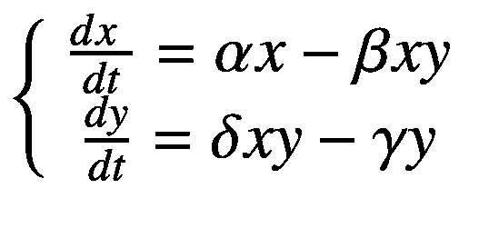

(12-2)

其中，`x` 变量可视为猎物的密度或数量（例如，兔子）；`y` 变量表示捕食者的密度或数量（例如，狼）；`α` 是猎物种群的内禀增长率；`β` 是捕食者捕食率系数；`δ` 是捕食者每捕食一个猎物的繁殖率；`γ` 是捕食者的死亡率。

Lotka-Voltera 模型中的非线性微分方程常被用来描述自然界中两个物种为生存而相互作用的生物系统动态 [8, 9]。这两个物种中，一个是捕食者，另一个是猎物。

Lotka-Voltera 模型对猎物和捕食者的环境及演化做出了一些假设，列举如下：
*   猎物在任何时候都有充足的食物。
*   捕食者的食物供应取决于猎物的种群规模。
*   种群的增长率和减少率与种群规模成正比。
*   在整个过程中，环境不会改变以偏袒任何一个物种，模型中的任何一个物种也不会适应环境。Lotka-Voltera 方程的解是确定且连续的，这意味着猎物的数量与捕食者的数量会持续相互重叠。

为了模拟 Lotka-Voltera 模型，我们将使用以下数值和初始条件（猎物与捕食者的数量）：`α = 1`，`β = 0.05`，`δ = 0.02`，`γ = 0.5` 且 `x(0) = 10`，`y(0) = 10`。以下是模型代码：

```
% Lotka_Voltera.m
% LOTKA-VOLTERA ~ Predator-Prey ~ two body simulation %%%%%
% dx/dt = alfa*x-beta*x*y;
% dy/dt = delta*x*y-gamma*y;
Alfa = 1; Beta = 0.05; Delta = 0.02; Gamma = 0.5;
% NOTE: x(1)=x and x(2)=y
dxy=@(t,x)([Alfa*x(1)-Beta*x(1).*x(2);...
Delta*x(1).*x(2)-Gamma*x(2)]);
time=[0, 20];
ICs=[10 10];      % Initial number of preys and predators
%   Since this has two populations, we pass the array [1 2].
%   Options=odeset('reltol', 1e-5),'NonNegative', [1 2]);
opts=odeset('reltol', 1e-5, 'NonNegative', [1 2]);
[t, xy]=ode45(dxy, time, ICs, opts);
plot(t, xy, 'linewidth', 2),
grid minor, legend('Prey','Predator')
title('Lotka-Voltera function: predator/prey two-body sim.')
figure
plot(xy(:,1),xy(:,2)), grid on; hold on
ICs=[40 20];
opts=odeset('reltol', 1e-5, 'NonNegative', [1 2]);
[t, xy]=ode45(dxy, time, ICs, opts);
plot(xy(:,1),xy(:,2), 'r--', 'linewidth', 1.5), grid on
ICs=[60 20];
opts=odeset('reltol', 1e-5, 'NonNegative', [1 2]);
[t, xy]=ode45(dxy, time, ICs, opts);
plot(xy(:,1),xy(:,2), 'mo-', 'linewidth', 1.5), grid on
ICs=[80 20];
opts=odeset('reltol', 1e-5, 'NonNegative', [1 2]);
[t, xy]=ode45(dxy, time, ICs, opts);
plot(xy(:,1),xy(:,2), 'kx:', 'linewidth', 1.5), grid on
ICs=[Alfa/Beta Gamma/Delta];
opts=odeset('reltol', 1e-5, 'NonNegative', [1 2]);
[t, xy]=ode45(dxy, time, ICs, opts);
plot(xy(:,1),xy(:,2), 'gx-', 'linewidth', 1.5), grid on
title('Lotka-Voltera model: 20 predators vs.~ preys')
xlabel('x(t), prey rate'), ylabel('y(t), predator rate')
legend('x_0/y_0=1','x_0/y_0=2','x_0/y_0=3','x_0/y_0=4',...
'ICs=[\alpha/\beta \gamma/\delta]'), hold off
```

图 12-6 和图 12-7 显示了该脚本的仿真结果。

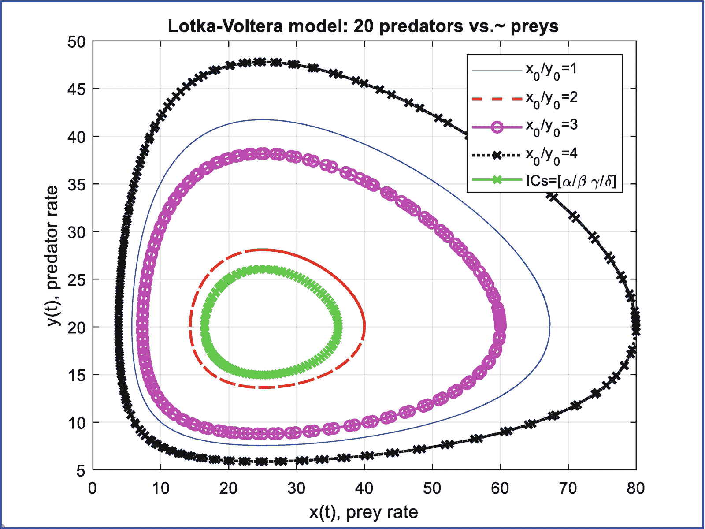

**图 12-7**

Lotka-Voltera 模型模拟，包含 20 个捕食者与 20、60、80 个猎物，以及一个特殊情况，即猎物数为 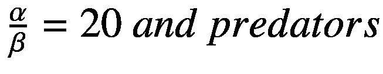 且捕食者数为 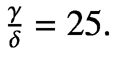

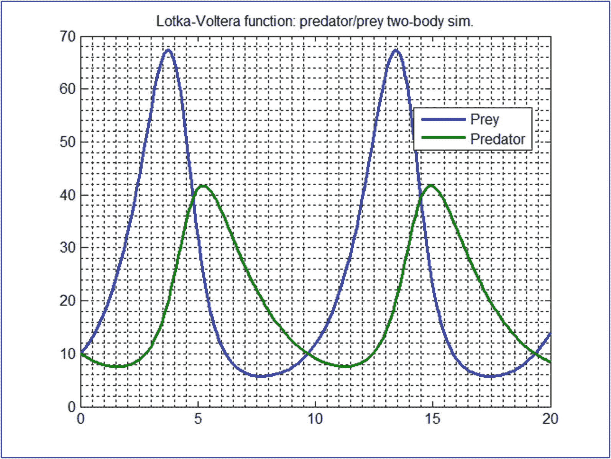

**图 12-6**

包含 20 个猎物和 20 个捕食者的 Lotka-Voltera 模拟

Lotka-Voltera 问题的建模方法不仅可应用于自然界生物过程的研究，也可用于存在干扰因素下各行业发展动态的建模。

## 练习

以下是供您自行尝试的练习。

### 练习 1

执行以下操作：
*   使用求解器 `ode2` 在 Simulink 中构建 Lorenz 系统的两个仿真模型，并使用亥姆霍兹法在 MATLAB 中通过编写脚本构建 Lorenz 系统的两个仿真模型（不使用 ODEx 求解器）。
*   对这两个模型进行仿真，并将其结果与使用亥姆霍兹法（不使用 ODEx 求解器）的 MATLAB 脚本模型的仿真结果进行比较。

### 练习 2

执行以下操作：
*   使用 `ode8` 构建 Lotka-Voltera 问题的 Simulink 模型，并基于 Lotka-Voltera 问题的 MATLAB 脚本模型开发四步 Adams-Moulton 方法（不使用 ODEx 求解器，例如 `ode23`、`ode45`、`ode113` 等）。
*   对这两个模型进行仿真并比较其结果。

### 练习 3

控制是工程学的重要组成部分，许多系统都用微分方程建模。这里有一个复杂控制问题的例子，其公式如下：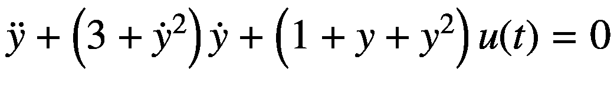，其中 `u(t) = sin(t)`。给定的初始条件为 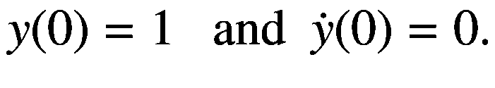
1.  在 Simulink 中构建该问题的仿真模型，并使用函数块计算代数运算。使用 `ode23`。
2.  使用 `ode45` 编写该问题的仿真脚本。
3.  使用改进的欧拉法构建该问题的仿真模型。
4.  对 (a)、(b) 和 (c) 中的模型进行仿真。要使改进欧拉法的解与其他两种方法的解收敛，合适的步长是多少？

### 练习 4

执行以下操作：

## 练习 4

1.  在三自由度质量-弹簧-阻尼器系统（见第 10 章图 10-16）的质量块 1 之前增加一个额外的质量块（`m[0] = 1 [kg]`）。在新的质量块（`m[0]`）两侧各添加一个阻尼器（![$$ {C}_0=1\ \left[\frac{Nm}{s}\right] $$](images/490522_1_En_12_Chapter/490522_1_En_12_Chapter_TeX_IEq7.png)），在两个质量块之间添加一个弹簧（![$$ {K}_0=25\left[\frac{N}{m}\right] $$](images/490522_1_En_12_Chapter/490522_1_En_12_Chapter_TeX_IEq8.png)），不添加施加的力（`F = 0 [N]`），并移除一个阻尼器（`C[1]`）和一个弹簧（`K[1]`）。系统的其余部分保持不变。绘制该物理模型的示意图，构建自由体图，并建立四自由度系统运动方程的数学公式。
2.  使用 `ode23` 在 Simulink 中构建仿真模型，并使用 `ode45` 求解器为 (a) 中的新四自由度弹簧-质量-阻尼器系统开发一个仿真脚本。
3.  对来自 (b) 的两个模型进行仿真并比较其结果。

### 练习 5

执行以下操作：
-   基于第 9 章中公式 (9-3) 和 (9-4) 的推导，构建一个基于 MATLAB `ode23` 求解器的麦克风模型仿真模型。
-   仿真你的模型，并将结果与第 9 章中给出的麦克风 Simulink 模型的仿真结果进行比较。
-   编写一个 MATLAB 脚本，使用 MATLAB 的内置 ODE 求解器 `ode23tb`、`ode45` 和 `ode113`，根据第 9 章中公式 (9-3) 和 (9-4) 的推导，仿真麦克风模型的膜片位移和电流响应的系统响应，然后比较这些解。
-   通过使用嵌入式 MATLAB 函数模块来计算系统中的电流，简化麦克风的 Simulink 模型。

### 练习 6

执行以下操作：
-   构建一个基于 MATLAB `ode23` 求解器的仿真模型和一个基于三步 Adams-Moulton 方法的 MATLAB 脚本模型，用于一个带有柔性负载的直流电机。
-   仿真这些模型，并将结果与带有柔性负载的直流电机的 Simulink 模型的仿真结果进行比较。

### 练习 7

执行以下操作：
1.  通过编写一个 MATLAB 脚本并使用 `ode23`，开发一个单自由度弹簧-质量-阻尼系统的仿真模型，该系统受幅值为 10 N 的阶跃函数（亥维赛函数 Φ(`t` − 1)）激励，质量 M=10 kg，阻尼 C=50 ![$$ \left[\frac{Nm}{s}\right] $$](images/490522_1_En_12_Chapter/490522_1_En_12_Chapter_TeX_IEq9.png)，刚度 K=100 ![$$ \left[\frac{N}{m}\right], $$](images/490522_1_En_12_Chapter/490522_1_En_12_Chapter_TeX_IEq10.png)。提示：使用内置函数 `stepfun()`。
2.  在 Simulink 中为 (a) 部分的系统开发一个仿真模型，此时系统受脉冲力（狄拉克 δ 函数 `δ(t)`）激励，例如，在 `t` = 3 秒时幅值为 1000 N。
3.  对 (a) 和 (b) 部分的模型进行仿真，仿真时长为 0 到 90 秒。

### 练习 8

执行以下操作：
1.  写出一个两自由度弹簧-质量-阻尼系统的数学公式，考虑两个质量块下的干摩擦力（`c[1]`, `c[3]`, 且 `c[1] = c[3]`）为非线性（库仑摩擦）阻尼。提示：使用符号函数。
2.  在 Simulink 中构建 (a) 部分系统的仿真模型。
3.  使用 (b) 部分的 Simulink 模型以及以下参数值计算系统响应：`F = 10cos(25t)`，![$$ {C}_2=1\left[\frac{Nm}{s}\right],{K}_1=85\left[\frac{N}{m}\right],{K}_2=75\left[\frac{N}{m}\right],{m}_1=5\ \left[ kg\right],{m}_2=3.5\ \left[ kg\right] $$](images/490522_1_En_12_Chapter/490522_1_En_12_Chapter_TeX_IEq11.png)，以及摩擦系数值 `μ = 1.05`。

### 练习 9

执行以下操作：
1.  重新设计第 9 章中给出的三自由度弹簧-质量-阻尼系统 Simulink 模型，并针对受迫振动情况进行简化。
2.  编写一个 MATLAB 脚本，使用四/五阶龙格-库塔法（不使用 `ode45`）计算三自由度弹簧-质量-阻尼系统在自由振动情况下的系统响应。
3.  编写一个 MATLAB 脚本，使用后向欧拉法计算三个质量块在受迫振动情况下的系统响应。
4.  进行必要的更改，使用 (a) 和 (b) 部分的仿真结果以动画形式显示系统响应。

### 练习 10

使用模态分析，针对以下三种情况，定义图 9-25 所示的两自由度弹簧-质量-阻尼系统的系统响应：
-   情况 #1. `F(t) = 10 sin (20t)[N]`；初始条件：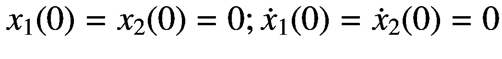
-   情况 #2. `F(t) = δ(t) [N]`（脉冲力：`狄拉克 δ` 函数）；初始条件：
-   情况 #3. `F1 = 0 [N]`；初始条件：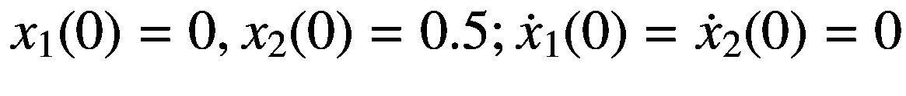

### 练习 11

定义一个三自由度弹簧-质量-阻尼系统（如图 9-18 所示）的系统响应，该系统定义如下：
![$$ \left[M\right]=\left[\begin{array}{ccc}2.5&amp; 0&amp; 0\\ {}0&amp; 2&amp; 0\\ {}0&amp; 0&amp; 3\end{array}\right] $$](images/490522_1_En_12_Chapter/490522_1_En_12_Chapter_TeX_IEq15.png), ![$$ \left[C\right]=\left[\begin{array}{ccc}3&amp; -0.5&amp; 0\\ {}-0.5&amp; 2.5&amp; -0.5\\ {}0&amp; -0.5&amp; 3\end{array}\right] $$](images/490522_1_En_12_Chapter/490522_1_En_12_Chapter_TeX_IEq16.png), ![$$ \left[K\right]=\left[\begin{array}{ccc}30&amp; -5&amp; 0\\ {}-5&amp; 25&amp; -5\\ {}0&amp; -5&amp; 30\end{array}\right] $$](images/490522_1_En_12_Chapter/490522_1_En_12_Chapter_TeX_IEq17.png),
对于给定的初始条件如下，是否可以使用模态分析来解析计算该系统的响应？
情况 #1. `F1 = 0[N]`；`F2 = 0 [N]`；`F3 = δ(t)[N]`（脉冲力：狄拉克 δ 函数）；初始条件：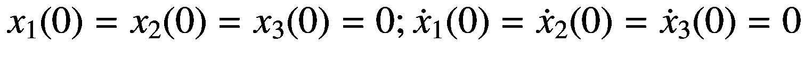
情况 #2. `F1 = F2 = F3 = 0 [N]`；初始条件：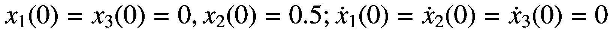
对于这两种情况，采用 `ode113` 求解器计算系统的数值解。

### 练习 12

执行以下操作：
-   编写一个 MATLAB 脚本，使用 `ode23` 和 `ode45` 计算直流电机模型的系统响应。

- 对直流电机的 Simulink 模型进行必要的更改，通过使用嵌入式 MATLAB 函数模块来计算负载。

### 练习 13

执行以下操作：

- 编写一个 MATLAB 脚本，以动画图的形式仿真三个不同下落物体（具有三个不同的空气阻力系数值：0.2、0.35 和 0.52，质量 `M`=5 kg）的位移和速度。
- 编写一个 MATLAB 脚本，以动画图的形式仿真一个带有上旋和无旋的投掷球的轨迹。

### 练习 14

受到地震作用的多层建筑可以被建模为一个仅在水平方向存在位移的弹簧-质量耦合系统。让我们考虑一个五层建筑受到外力 `Fi = [F[0] cos (ωt); 1.12F[0] cos (ωt); 0.88F[0] cos (ωt); 0.5F[0] cos (ωt); 0.5F[0] cos (1.15ωt); 0.45F[0] cos (1.25ωt)]` 的激励。该系统的数学表述可由以下微分方程组写出：

$$
\left\{\begin{array}{c}{m}_1{\ddot{x}}_1=-{k}_1{x}_1+{k}_2\left({x}_2-{x}_1\right)+{F}_1(t)\\
{}{m}_2{\ddot{x}}_2=-{k}_2\left({x}_2-{x}_1\right)+{k}_3\left({x}_3-{x}_2\right)+{F}_2(t)\\
{}\begin{array}{c}{m}_3{\ddot{x}}_3=-{k}_3\left({x}_3-{x}_2\right)+{k}_4\left({x}_3-{x}_2\right)+{F}_3(t)\\
{}\begin{array}{c}{m}_4{\ddot{x}}_4=-{k}_4\left({x}_4-{x}_3\right)+{k}_5\left({x}_4-{x}_3\right)+{F}_4(t)\\
{}{m}_5{\ddot{x}}_5=-{k}_5\left({x}_5-{x}_4\right)+{F}_5(t)\end{array}\end{array}\end{array}\right.
$$

其中 `x[1]`、`x[2]`、…、`x[5]` 分别表示第一、第二、…、第五层楼板的质量位置。`m[1]`、`m[2]`、…、`m[5]` 分别表示第一、第二、…、第五层楼板的集中质量。每层楼板都被视为其集中质量位于质心处。`k[1]`、`k[2]`、…、`k[5]` 分别表示第一、第二、…、第五层楼板的刚度，并忽略每层楼板的阻尼效应。使用以下建筑物理参数的数值：`k[1] = k[2] = … = k[5] = 10⁶ [N/m]`（每层刚度相同），`m[1] = 5500 [kg]`，`m[2] = 5000 [kg]`，`m[3] = 5500 [kg]`，`m[4] = 6000 [kg]`，`m[5] = 4750 [kg]`，以及施加的外力 `F[0] = 5000 N`，频率为 `ω = 13 [Hz]`。

建立该系统的仿真模型，并使用以下方法在 `t = 0…15 [秒]` 时间段内进行仿真：

1. 编写一个基于欧拉法的脚本。
2. 创建一个 Simulink 模型（使用固定步长求解器 `ode5`）。
3. 编写一个使用 4/5 阶龙格-库塔法的脚本。

然后比较从方法 1（欧拉法）、方法 2（Simulink 模型）、方法 3（4/5 阶龙格-库塔法）获得数值解，并检查每种方法在计算时间方面的效率。

定义该建筑的自振频率和振型。

### 练习 15

设盐水罐 A、B 和 C 的体积分别为 80、60 和 30，如图 12-8 所示（问题背景和条件已修改）。

图 12-8：级联的三个盐水罐

假设水以恒定速率 `R (R=10)` 进入罐 A，以速率 `R` 从 A 排到 B，以速率 `R` 从 B 排到 C，然后以速率 `R` 从罐 C 排出。因此，各罐的体积保持不变。假设每个罐均匀搅拌，这意味着每个罐内盐水浓度均匀。令 `y1`、`y2`、`y3` 表示在时刻 `t` 每个罐中的盐量。加入罐 A 的水含盐量为 0%。因此，所有罐中的盐最终都从排水管流失。该级联系统由化学平衡定律建模：变化率 = 输入率 − 输出率。

通过应用上述平衡定律，我们可以将系统模型写为三角微分系统：

$$
\left\{\begin{array}{c}{\dot{y}}_1=-\frac{1}{8}{y}_1\\
{}{\dot{y}}_2=\frac{1}{8}{y}_1-\frac{1}{6}{y}_2\\
{}{\dot{y}}_3=\frac{1}{6}{y}_2-\frac{1}{2}{y}_3\end{array}\right.
$$

假设给定以下初始条件（罐中的盐量）：`y1 = 1.5`，`y2 = 1.5`，`y3 = 1.5`。

计算由该 ODE 方程组描述的系统在 `t = 0…15` 时间段内的数值解。

- 编写一个函数文件，命名为 `BrineODE.m`。
- 编写一个匿名函数。
- 编写一个内联函数。
- 创建一个 Simulink 模型，命名为 `BrineODEsim.mdl`。
- 使用 `ode23`、`ode45` 和 `ode113` 以及一个 Simulink 模型（使用固定步长求解器 `ode3`），并比较解，检查每种方法的效率。取更小的时间步长，并从 m 文件运行您创建的 Simulink 模型（`BrineODEsim.mdl`）。
- 编写一个基于 4/5 阶龙格-库塔法的脚本文件，并将从龙格-库塔法脚本得到的解与 `ode23`、`ode45`、`ode113` 以及 Simulink 模型得到的解进行比较。
- 如果可行，使用 `dsolve()` 和拉普拉斯变换计算系统的解析解。

### 练习 16

给定一个两自由度旋转系统（参见电机-泵齿轮箱），仅对圆盘 2 施加扭矩 `τa = 10 Nm`；质量转动惯量：`J[1] = 1.5 kgm²`，`J[2] = 0.5 kgm²`；扭转刚度：`k1 = 1200 Nm/rad`，`k2 = 2000 Nm/rad`；摩擦阻尼：`c[1] = 12 Nm/sec`，`c[2] = 22 Nm/sec`。所有初始条件为零。

图 12-9：旋转系统示例

完成以下练习：

1. 推导系统的运动方程。
2. 通过应用拉普拉斯变换推导传递函数形式 `Θ2(s) / Ta(s)`，并在 Simulink 和 MATLAB 中进行仿真。（提示：使用 `tf()` 和 `step()`。）
3. 使用三步 Adams-Moulton 法（通过编写脚本）开发系统的仿真模型，并在 `t = 0…2 [秒]` 时间段内以步长 `Δt = 0.01` 进行仿真。
4. 开发一个 Simulink 模型（使用可变步长求解器，如 `ode23s`），并调整绝对和相对误差容限。
5. 使用矩阵方法编写系统运动方程的函数文件，并在 `t = 0…2 [秒]` 时间段内，采用固定时间步长 `Δt = 0.01`，使用 `ode113` 对系统进行仿真。
6. 比较上述练习 2、3、4 和 5 中计算出的数值解，并评估每种方法的准确性。
7. 定义该建筑系统的自振频率和振型。

### 练习 17

图 12-10 展示了一个具有以下物理参数的轻度阻尼三自由度弹簧-质量-阻尼系统：

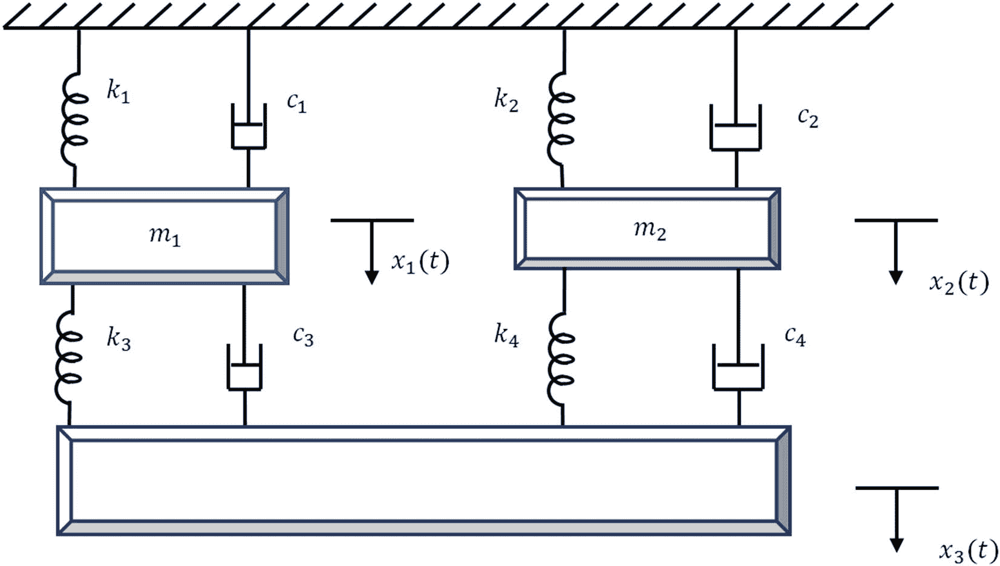

**图 12-10**：三自由度弹簧-质量-阻尼系统

参数：`m[1] = 1 [kg]`, `m[2] = 1 [kg]`, `m[3] = 3 [kg]`, `k[1] = 1110 [N/m]`, `k[2] = 4440 [N/m]`, `k[3] = 3330 [N/m]`; `k[4] = 5550 [N/m]`; `c[1] = 0.4 [N-m/sec]`; `c[2] = 0.44 [N-m/sec]`; `c[3] = 0.66 [N-m/sec]`; `c[4] = 0.88 [N-m/sec]`。所有初始条件均为零。

请执行以下练习：

- 推导系统的运动方程。
- 通过应用拉普拉斯变换，推导传递函数形式：`X3 / F(s)`。
- 通过应用模态分析，定义固有频率和模态阻尼比。
- 使用控制系统工具箱的 `bode()` 和 `freqresp()` 函数，或通过将系统的传递函数形式中的 `s = jω` 代入，计算系统在 0… 100 `[rad/sec]` 范围内的频率响应和相位图。
- 如果系统具有零初始条件，例如 `x2 = 0 [m]`; `x3 = 0 [m]`; `x1 = 0`; `dx[1]/dt(0) = 0 [m/sec]`; `dx[2]/dt(0) = 0 [m/sec]`; `dx[3]/dt(0) = 0 [m/sec]`，使用 `ode45` 在时域中模拟系统 `x1`、`x2` 和 `x3` 的自由响应（位移）。为什么在此模拟中系统的自由响应为零？

*   如果系统具有非零初始条件，例如`x2 = 0.05 [m]`; `x3 = -0.025 [m]`; `x1 = 0`; `dx[1]/dt(0) = 0 [m/sec]`; `dx[2]/dt(0) = 0 [m/sec]`; `dx[3]/dt(0) = 0 [m/sec]`，使用`ode23tb`在时域中模拟系统`x1`、`x2`和`x3`位移的自由响应。

## 练习 18

本示例是一个爱情动力学故事。这是一个有趣且具有启发性的例子，用于基于中世纪意大利的历史故事研究非线性系统的动力学。故事是这样的，有一位名叫彼特拉克的学者兼诗人，在 23 岁时爱上了一位名叫劳拉的已婚法国美妇。在 21 年的时间里，彼特拉克创作了 366 首诗歌的合集，以纪念他对劳拉的爱。这些诗歌表达了从极度喜悦到深度抑郁的广泛情感。Rinaldi^(⁴) 开发了一个相对简单的模型，用微分方程表达了彼特拉克和劳拉的情感，重现了不同诗歌的时间顺序。

描述爱情动力学的模型由 Rinaldi 提出的三个耦合的一阶微分方程组成。在该模型中，劳拉由一个单一变量`L(t)`描述，代表她对诗人彼特拉克的态度。正值表示同情或爱慕，而负值则表示冷淡和敌意。诗人彼特拉克由两个变量描述：他对劳拉的爱`P(t)`和他的诗歌灵感`IP`。`P`的高值对应喜悦的爱，而低值（负值）则表示抑郁。Rinaldi 提出的完整彼特拉克-劳拉模型如下：

```
{
    dL/dt = -α[L]*L(t) + β[L]*[P(t)*(1 - P(t)² / γ[L]²) + A[P]]
    dP/dt = -α[P]*P(t) + β[P]*[L(t) + A[L] / (1 + δ[P]*IP)]
    dI[P]/dt = -α[IP]*IP + β[IP]*P(t)
}
```

(a)

其中，`α[L]`、`α[P]`、`α[IP]`和`β[L]`、`β[P]`、`β[IP]`是反馈参数，为正数，代表劳拉、彼特拉克的情感以及彼特拉克写诗灵感。常数`A[P]`和`A[L]`描述了彼特拉克和劳拉的外表。另外两个参数`γ[L]`和`δ[P]`是劳拉和彼特拉克对情感或灵感的反馈情绪。

请注意，(a) 中的微分方程组由三个耦合的一阶微分方程组成。对于仿真模型，取以下值：

```
α[L] = 3*α[P], α[IP] = 0.1*α[P], α[P] = 1.2, β[L] = α[P], β[P] = 5*α[P], β[IP] = 10*α[P]
```

`A[L] > 0`, `A[P] < 0` 因此，`A[L] = 2`, `A[P] = -1`, `γ[L] = δ[P] = 1`。

此外，考虑初始条件`L(0) = 3`、`P(0) = 1`和`IP = 0`，初始仿真使用`t = [0, 10⁴]` sec。

*   通过编写脚本，使用改进的欧拉法和四/五阶龙格-库塔法开发一个计算机仿真模型来研究爱情故事的动力学。

*   使用 Ralston 法和 Milne 法开发一个仿真模型。

*   使用变步长求解器（`ode8`）创建一个 Simulink 模型。

*   通过绘制合理时间段内的三维线图（提示：使用`plot3`）比较以下方法的数值解：(1) 改进欧拉法和龙格-库塔法，(2) Ralston 法和 Milne 法，(3) Simulink 模型，即绘制`P(t)` 与 `L(t)` 与 `IP`的关系图，并动态模拟`P(t)` 与 `L(t)` 与 `IP`的关系（提示：使用`comet3`）。

*   如果彼特拉克对劳拉的爱大于劳拉对彼特拉克的爱，会发生什么？爱情的动力学将如何改变？

*   是否可以使用符号数学工具箱或 MuPAD 笔记本来计算该问题的解析解？

脚注 ¹ ²