# 13. 求解偏微分方程

偏微分方程是“……包含未知多元函数及其偏导数的微分方程”，根据维基百科[1]所述。偏微分方程在物理学、工程学和计算机科学中有许多应用。例如，偏微分方程被用来描述各种现象，如热传递、机械动力学、波传播、弹性力学、流体动力学等。

以下是一个给定函数的偏微分方程的广义公式。它依赖于多个自变量，以及该函数对多个自变量的偏导数。


(13-1)

这是一个二阶偏微分方程的例子。方程(13-1)的解是函数 *u*(*x*, *y*, *z*, *t*)，其偏导数将满足方程(13-1)中给出的公式。

在第 3 部分中，我们演示了如何使用 MATLAB 内置的偏微分方程求解器 `pdepe()` 和拉普拉斯算子 `del2()` 来数值求解偏微分方程，以及如何在一维和二维热传递问题以及一维和二维波传播问题的示例中，基于高斯-赛德尔和有限差分法编写脚本。

## `pdepe()`

`pdepe()` 可以求解以下形式的偏微分方程：

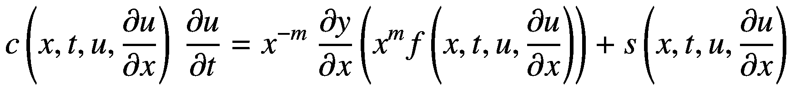

(13-2)

其中 *m* 代表系统的几何形状。如果是平板，*m* = 0（笛卡尔坐标系），*m* = 1 用于圆柱几何（柱坐标系），*m* = 2 用于球体形状（球坐标系）。

需要两个边界条件：一个是初始条件，另一个是每个边界上的边界条件。

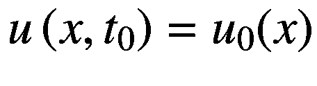

(13-3)

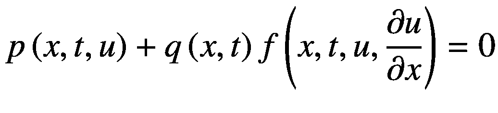

(13-4)

其中 *p*(*x*, *t*, *u*) 和 *q*(*x*, *t*) 是一些任意函数。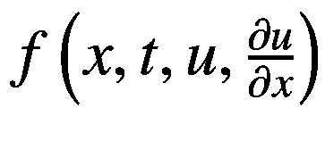 是主偏微分方程中给出的函数。

以下是 `pdepe()` 的一般语法：

```
Solution = pdepe(m, PDEfun, ICfun, BCfun, Xmesh, Tspan)
```

其中 *m* 是方程(13-2)中的幂指数，表示问题的几何/坐标系。`PDEfun` 是给定问题的偏微分方程表达式。`ICfun` 是给定问题的已知初始条件。`BCfun` 是给定问题的已知边界条件。`Xmesh` 是需要计算解的空间（距离），`Tspan` 是需要对给定问题进行模拟的时间跨度。

## 一维热传递问题

让我们考虑图 13-1 所示的系统，该系统描述了热量从墙壁的一端边界传递到另一端边界的过程，墙壁厚度为 *L*。系统有两个边界条件：*T*(*x*, 0) = 0 和 *T*(*L*, *t*) = 0，分别代表左右边界的温度值。左侧有一个提供能量的热源。

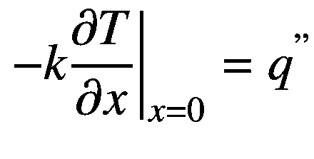

(13-4)

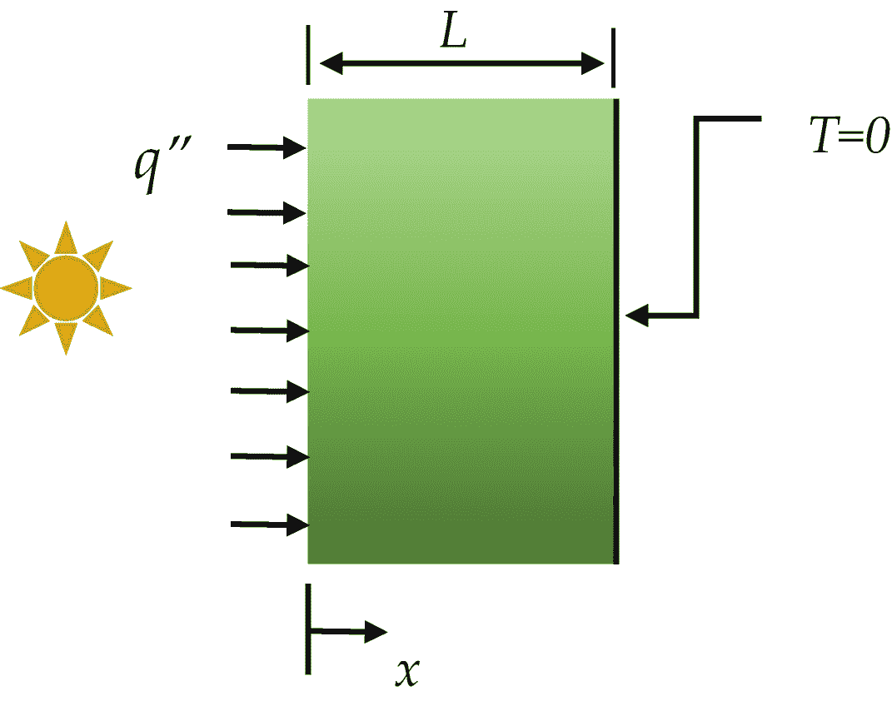

**图 13-1** 热量从墙壁左边界传递到右边界

以下是该系统的热传递模型，用下面的二阶偏微分方程表示：

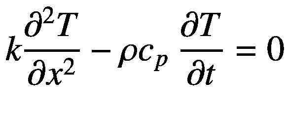

(13-5)

其中 *T* 是温度，*ρ* 是密度，*c*[*p*] 是关键的热导率分量，*k* 是热导率。

在方程(13-5)所示的热传递问题中，

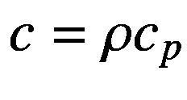

(13-6)

方程(13-2)中给出的参数 *c* 是一个常数，因此我们可以写出以下形式：

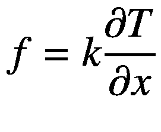

(13-7)

我们的问题中不存在源项，因此它等于零。

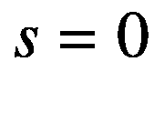

(13-8)

有两个边界条件：*T*(*L*, *t*) = 0 和 *T*(*x*, 0) = 0。

现在，结合方程(13-5)和公式 *p* + *qf* = 0，我们可以重写方程(13-4)。

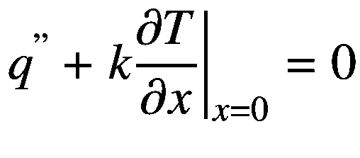

(13-9)

其中 *x* = 0，*p* = *q*″，*q* = 1。此外，从边界条件 *T*(*L*, *t*) = 0，我们知道 *x* = *L*，*p* = *T*(*L*, *t*) = *u*[*r*]，且 *q* = 0。请注意右端的 *u*[*r*] 边界条件值。


### 示例 1

假设墙壁右端的温度为 +20°*C*，即 *p* = *T*(*L*, *t*) = *u*[*r*] − 20。

以下是该问题的求解脚本 (`Heat_Transfer.m`)：

```
% 给定数据：
global ro cp k q
k = 666;         % [W/m-K]
L  = 0.25;       % [m]
ro  = 1000;      % [kg/m³]
cp = 500;        % [J/kg-K]
q   = 5e6;       % [W/m²]
tend = 5;        % [s]
m=0;             % 笛卡尔坐标系
x = linspace(0, L, 200);
t = linspace(0, tend, 50);
% 计算求解：
SOL=pdepe(m, @PDEfun, @ICfun, @BCfun, x, t);
TEMP=SOL(:,:,1);
figure(1)
plot(x, TEMP(end,:), 'b-', 'linewidth', 2), grid on
title(sprintf('t = %s 时的计算解', num2str(tend)))
xlabel('\it 距离, [m]')
ylabel('\it 温度 (\circC)')
figure(2)
plot(t, TEMP(:,1),  'k-', 'linewidth', 2), grid on
title(sprintf('t = %s 时的计算解', num2str(tend)))
xlabel('\it 时间, [s]')
ylabel('\it 温度 (\circC)')
figure(3)
mesh(x, t, SOL)
xlabel('\it 距离, [m]')
ylabel('\it 时间, [s]')
zlabel('\it 温度 (\circC)')
title('\it 方程的解：$$ k*\frac{\partial²{T}}{\partial{x²}}-\rho*c_p\frac{\partial{T}}{\partial{t}}=0 $$', 'Interpreter' ,'latex')
axis tight
function [c, f, s] = PDEfun(x, t, u, DuDx)
% PDE1
global ro cp k
c=ro*cp;
f=k*DuDx;
s=0;
end
function u0=ICfun(x)
% 初始条件：
u0=0;
end
function [pl, ql, pr, qr] = BCfun(xl, ul, xr, ur, t)
% 边界条件
global q
pl=q;     % 在热源所在的左边缘：q+k*dT/dx=0
ql=1;
pr=ur;
qr=0;     % 在右边缘：ur=0
end
```

图 13-2、13-3 和 13-4 分别展示了该脚本在距离、时间以及空间和时间上的仿真结果。

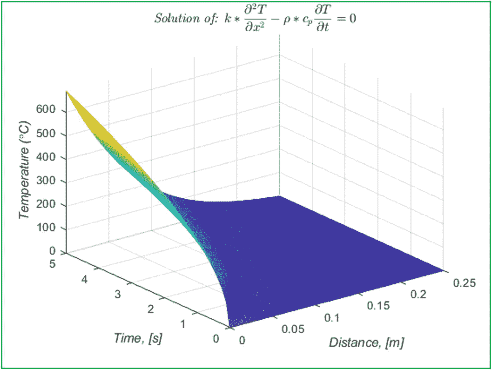

**图 13-4** 空间和时间上的解

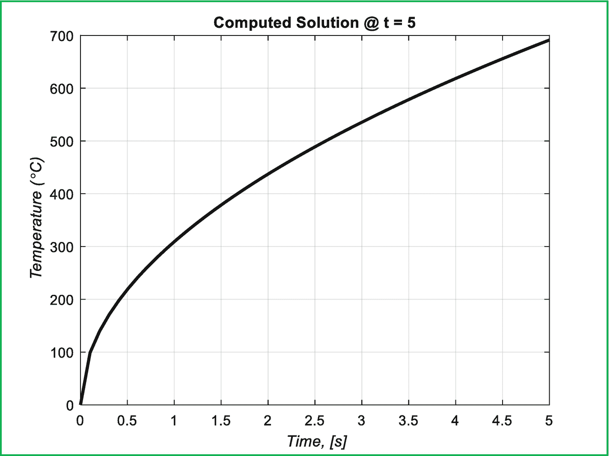

**图 13-3** 时间上的解

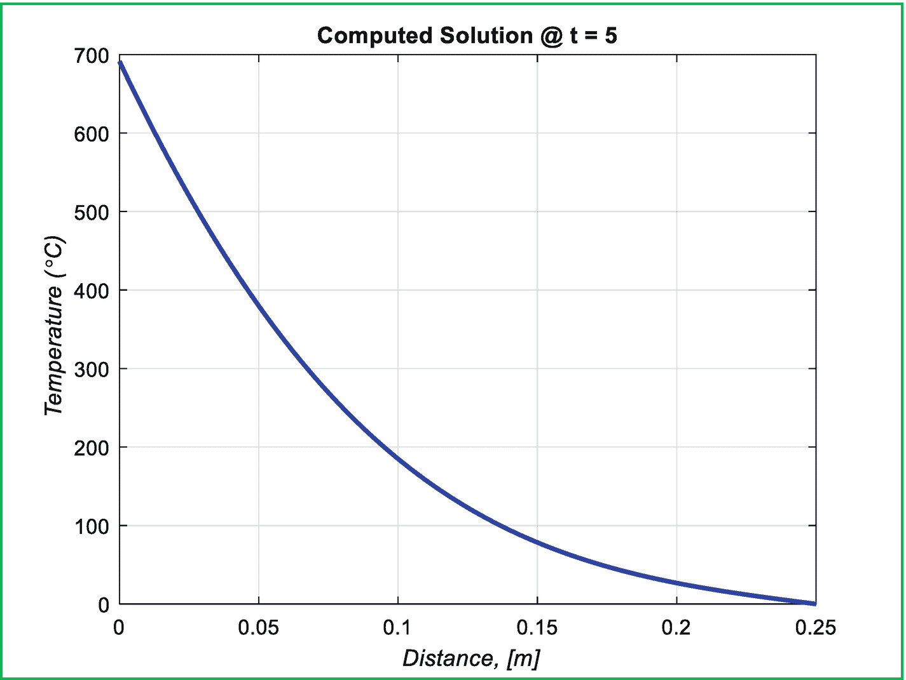

**图 13-2** 距离上的解

