# 二维热传导：使用高斯-赛德尔方法求解椭圆型偏微分方程

考虑一个矩形板，其四个边被不同方式加热（左侧 `T[L]`、右侧 `T[R]`、上侧 `T[t]` 和下侧 `T[b]`），如图 13-5 所示。该板沿 x 轴的宽度为 `W`，沿 y 轴的高度为 `H`。如何计算板内部的温度？

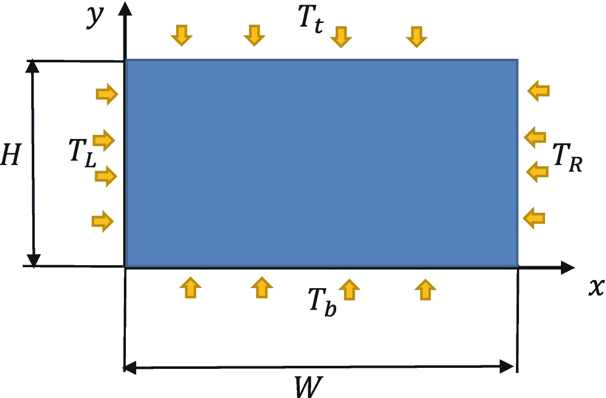

**图 13-5** 物理系统：四面不同加热的板

该给定问题中热传导的数学表达式是如方程 (13-10) 所示的二阶椭圆型偏微分方程。

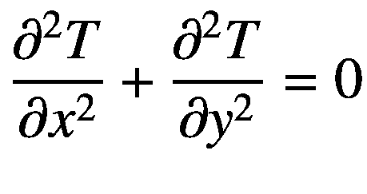

**(13-10)**

注意，这是一个二维问题。温度沿 x 轴和 y 轴发生变化。为了数值求解此问题，我们可以采用高斯-赛德尔方法 [2]。为了离散化给定的系统，我们将板分割成有限的矩形单元和节点，如图 13-6 所示。

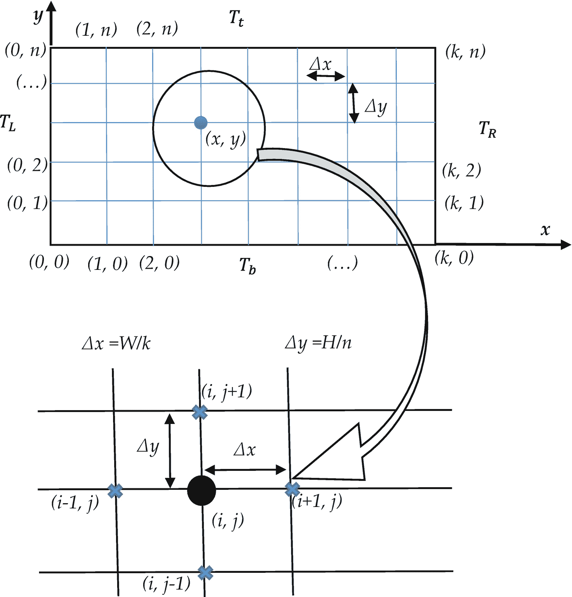

**图 13-6** 椭圆型偏微分方程的离散化方案

使用图 13-7 所示的热传导椭圆型偏微分方程的离散化方案，我们写出以下离散化方程来计算节点 `(*i, j*)` 处的温度：

![$$ \left[\frac{T_{i-1,j}^k-2{T}_{i,j}^k+{T}_{i+1,j}^k}{\Delta {x}²}\kern0.5em +\frac{T_{i,j-1}^k-2{T}_{i,j}^k+{T}_{i,j+1}^k}{\Delta {y}²}\right]=0 $$](images/490522_1_En_13_Chapter/490522_1_En_13_Chapter_TeX_Equ12.png)

**(13-11)**

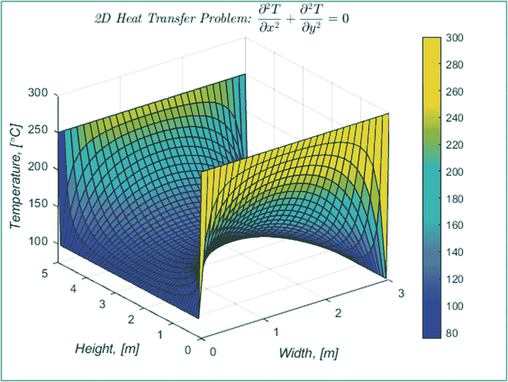

**图 13-7** 温度分布：`surf()` 图

公式 (13-11) 也可以考虑 `Δx` 和 `Δy` 相等的情况来改写，换句话说，取 `Δx = Δy`，如下所示：

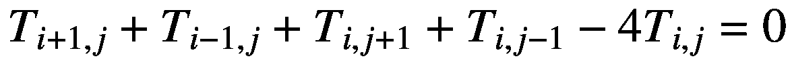

**(13-12)**

现在我们可以重写方程来计算节点 `T[i, j]` 的温度，如下所示：

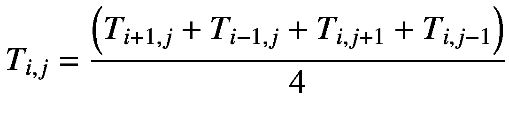

**(13-13)**

这是问题的高斯-赛德尔方法公式。对方程 (13-13) 进行迭代求解，以计算每个内部节点 `(m × n)` 的温度值，直到满足预设的误差容限。迭代次数由每次迭代中根据以下公式计算出的误差值决定：

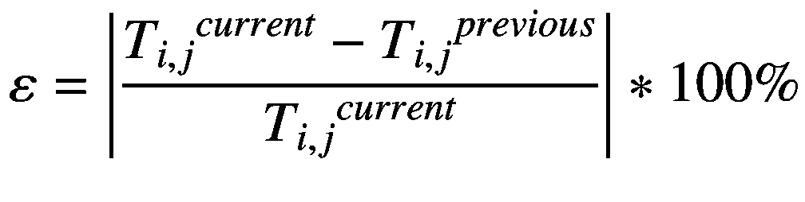

**(13-14)**

## 示例 2

让我们考察一个物理系统：一块长 3 米、宽 5 米的平板，边界条件如下：左侧 100⁰ C，右侧 75⁰ C，顶部 250⁰ C，底部 300⁰ C。我们假设所有内部节点的初始温度为 0⁰ C。

我们将系统沿 x 轴离散化为 `k=30` 个节点，沿 y 轴离散化为 `n=50` 个节点，得到如下结果：

```
Δx = W/k =3/30= 0.1 [m];  Δy = H/n =5/50= 0.1 [m];
```

请注意，平板各边上的温度值是已知的，并等于各边所施加的温度值。

沿左侧边缘：

```
T(0,0) = 1000 C; T(0, 1) = 1000 C; T(0, 2)= 1000 C, ... T(0, n)= 1000 C;
```

沿右侧边缘：

```
T(k, 0) = 750 C; T(k, 1) = 750 C; T(k, 2)= 750 C, ... T(k, n-1)= 750 C;
```

沿顶部边缘：

```
T(1, n) = 2500 C; T(2, n) = 2500 C; T(3, n)= 2500 C, ... T(k, n)= 2500 C;
```

沿底部边缘：

```
T(1, 0) = 3000 C; T(2, 0) = 3000 C; T(3, 0)= 3000 C, ... T(k-1, n-1)= 3000 C;
```

我们将误差容限设为 `0.001⁰ C`，初始误差值设为 `1⁰ C`。

现在，基于所有这些公式，如方程 (13-13) 和方程 (13-14) 所示，并结合这些边界条件（平板边缘的温度值），我们编写了下一个脚本，命名为 `Heat_Transfer_GS_method.m`：

```matlab
% 使用基于高斯-赛德尔迭代法的迭代方法进行热流模拟
% 矩形板（3 米×5 米）上的二维传热
% 不同侧面的温度/热流
clc; clearvars; close all
TL = 100;     % [C] 左侧
TR = 75;      % [C] 右侧
Tt = 250;     % [C] 顶部
Tb = 300;     % [C] 底部
k  = 30;      % x 轴方向节点数
n  = 50;      % y 轴方向节点数
W = 3;        % [m] 宽度
H = 5;        % [m] 高度
x = linspace(0, W, k);  % x 轴方向网格尺寸
y = linspace(0, H, n);  % y 轴方向网格尺寸
[xx, yy] = meshgrid(x, y);
% 注意：x 轴方向的网格尺寸与 y 轴方向不同
% 可以通过设置 k = n 使 x 轴和 y 轴方向的网格尺寸一致。
T=zeros(k, n); % 内存分配
T(1,1:n) = TL; % 平板左侧
T(k,1:n) = TR; % 平板右侧
T(1:k,n)=Tt;   % 平板顶部
T(1:k,1)=Tb;   % 平板底部
tol = 1e-3;    % 误差容限
Error = 1;     % 初始误差值
m=0;
while Error>tol
Told=T;
for ii=2:k-1
for jj=2:n-1
T(ii,jj)=(1/4)*(T(ii,jj-1)+T(ii-1, jj)+T(ii+1, jj)+T(ii, jj+1));
end
end
Error = max(max(abs((T-Told)./T)))*100;
end
figure(1)
surf(x, y, T'); colorbar;
title('\it 平板上二维温度分布')
xlabel('\it 宽度, [m]')
ylabel('\it 高度, [m]')
zlabel('\it 温度, [\circC]')
grid on
axis tight
figure(2)
ribbon(yy, T')
title('\it 平板上二维温度分布')
xlabel('\it 网格数量表示的宽度')
ylabel('\it 高度, [m]')
zlabel('\it 温度, [\circC]')
grid on
axis tight
figure(3)
contour(x, y, T'); colormap;
title('\it 平板上二维温度分布')
xlabel('\it 宽度, [m]')
ylabel('\it 高度, [m]')
zlabel('\it 温度, [\circC]')
grid on
figure(4)
pcolor(x, y, T'), shading interp;
title('\it 平板上二维温度分布')
xlabel('\it 宽度, [m]')
ylabel('\it 高度, [m]')
zlabel('\it 温度, [\circC]')
grid on; shg
```

图 13-7、13-8、13-9 和 13-10 展示了脚本的仿真结果。

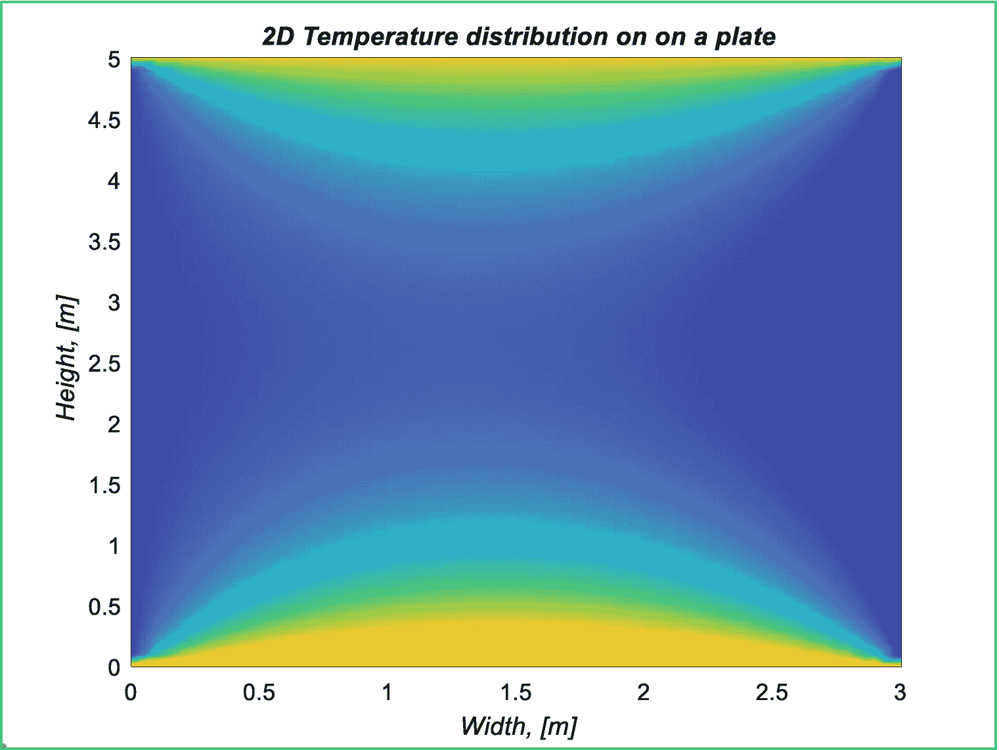

图 13-10 温度分布：`pcolor()` 绘图

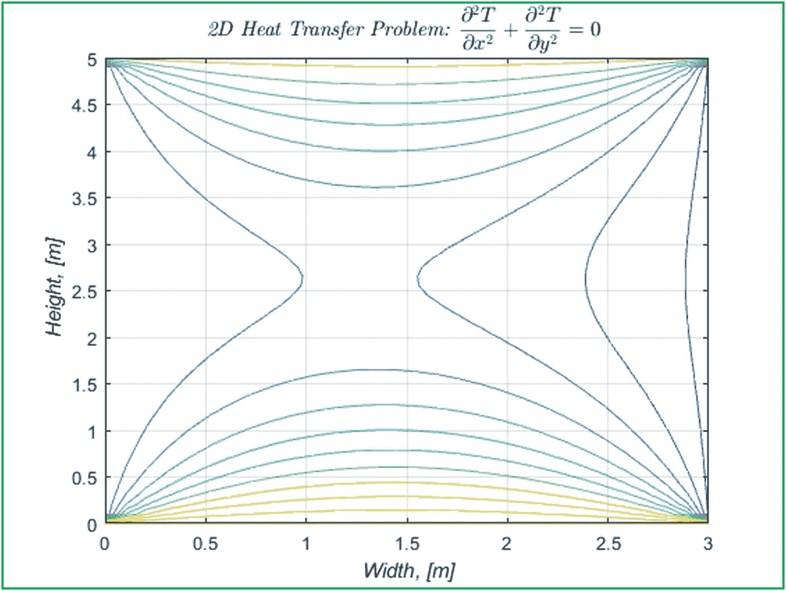

图 13-9 温度分布：`contour()` 绘图

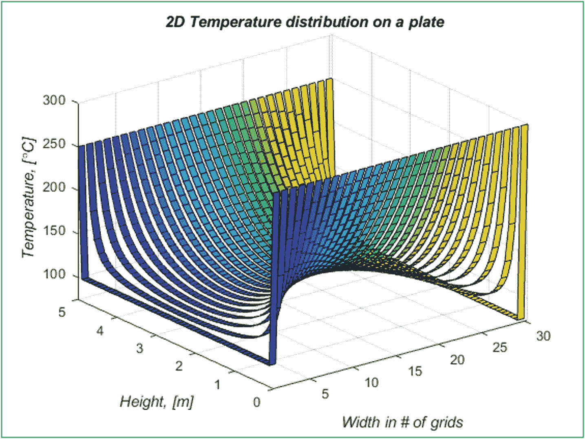

图 13-8 温度分布：`ribbon()` 绘图

请注意，通过高斯-赛德尔法计算得到的解的精度在很大程度上取决于我们设定的误差容限值，本例中该值设为`10^(-3)`。此外，解的精度会随着网格数量的增加而提高，换句话说，即通过减小网格尺寸`Δx`和`Δy`来提高精度。

## `del2()`：拉普拉斯算子

我们还可以使用离散拉普拉斯算子，根据给定的边界条件和网格来求解热传导方程。在前面展示的例子中，矩阵`T(x, y)`是在正方形网格点上计算的，即`Δx = Δy`。在这种情况下，可以使用拉普拉斯微分算子的有限差分近似（`Δ`用于计算关于`∂x²`、`∂y²`的二阶偏导数）来计算拉普拉斯 (`L`) 函数，如下所示：

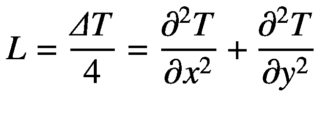

(13-15)

在 MATLAB 中，有一个内置的拉普拉斯算子函数`del2()`，它根据点 (`i`, `j`) 的值与其四个相邻点 (`i+1`, `j`)、(`i-1`, `j`)、(`i`, `j+1`) 和 (`i`, `j-1`) 的差值，来计算节点 (`i`, `j`) 上`L`的内部值。

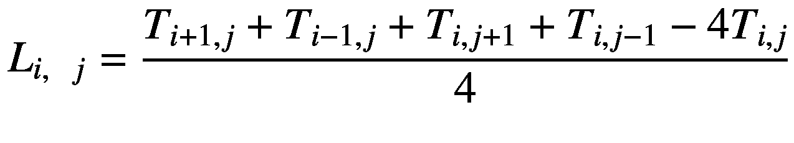

(13-16)

`T`的最终值是根据在每个节点上计算得到的`L`的内部值以及相应的`T`值计算得出的。

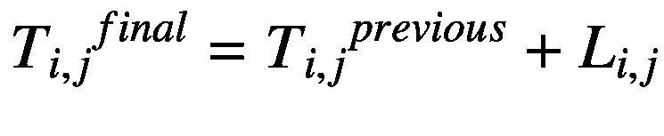

(13-17)

使用方程 (13-16) 和方程 (13-17) 以及拉普拉斯算子函数`del2()`非常直接。让我们考虑以下示例。

### 示例 3

该示例为一个 3 米乘 5 米的平板（宽乘高），其边界条件如下：左侧 100⁰C，右侧 75⁰C，顶部 250⁰C，底部 300⁰C。我们假定所有内部节点的初始温度为 0⁰C。（这与上文示例 13-2 给出的练习相同。）

我们使用拉普拉斯算子`del2()`编写了以下脚本 (`Heat_Transfer_Laplacian_Operator.m`)：

```matlab
% Heat flow simulation using the Laplacian operator
% Two dimensional heat transfer on a rectangular plate (3m-by-5m)
% with the temperature/heat flow from different sides
%%
clc; clearvars; close all
TL = 100;     % [C] Left side
TR = 75;      % [C] Right side
Tt = 250;     % [C] Top
Tb = 300;     % [C] Bottom
k  = 30;      % number of nodes along x axis
n  = 50;      % number of nodes along y axis
W = 3;        % [m] width
H =  5;       % [m] height
x = linspace(0, W, k);   % Mesh size along x axis
y = linspace(0, H, n);   % Mesh size along y axis
[xx, yy] = meshgrid(x, y);
% Here the mesh size differs along x axis from the one along y axis
% Note: the mesh size along x and y axes can be set uniform
% by setting N accordingly
T=zeros(k, n);     % Memory allocation
T(1,1:n) = TL;     % Left Side of the Plate
T(k,1:n) = TR;     % Right Side of the Plate
T(1:k,n) = Tt;     % Top Side of the Plate
T(1:k,1) = Tb;     % Bottom Side of the Plate
N_iter=0;          % Initial iteration value
while N_iter<1000
N_iter=N_iter+1;
if mod(N_iter, 2)==0
contourf(x, y, T'); colorbar;
drawnow
end
L= del2(T);
T(2:k-1, 2:n-1) = T(2:k-1, 2:n-1)+ L(2:k-1, 2:n-1);
end
title('\it 2D Heat Transfer Problem Solution:  $$ \frac{\partial²{T}}{\partial{x²}}+\frac{\partial²{T}}{\partial{y²}} =0 $$ ', 'interpreter', 'latex')
xlabel('\it Width')
ylabel('\it Height')
zlabel('\it Temperature, [\circC]')
grid on
figure(2)
surf(x, y, T'); colorbar;
title('\it 2D Heat Transfer Problem Solution:  $$ \frac{\partial²{T}}{\partial{x²}}+\frac{\partial²{T}}{\partial{y²}} =0 $$ ', 'interpreter', 'latex')
xlabel('\it Width, [m]')
ylabel('\it Height, [m]')
zlabel('\it Temperature, [\circC]')
grid on
axis tight
```

上述脚本生成了一个模拟结果的动态图，展示了热量如何在平板的内部点（节点/网格）之间移动，如图 13-11 所示。

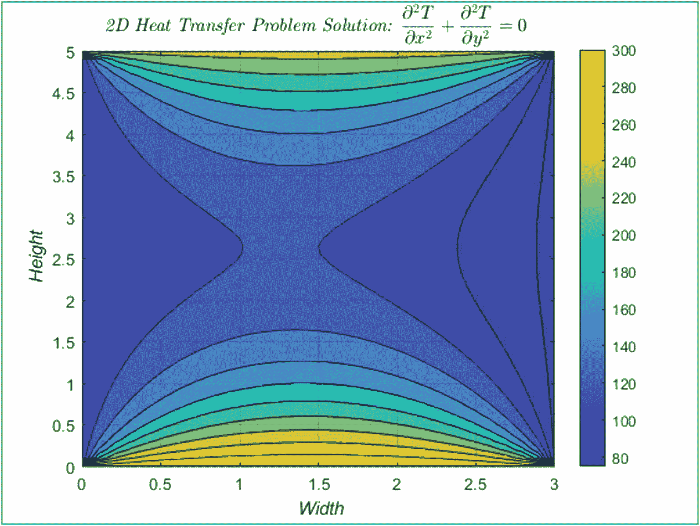

`图 13-11` 使用拉普拉斯算子求解的二维温度分布问题

请注意，使用拉普拉斯算子 (`del2`) 计算的数值解的精度会随着迭代次数的增加而提高。这类似于有限差分法，随着误差容限的减小，其精度会更高。此外，使用拉普拉斯算子模拟的迭代过程显示了双曲线轮廓线（图 13-11），这与图 13-9 中显示的等高线相似。图 13-12 中展示的模拟结果与图 13-7 中的结果完美匹配。

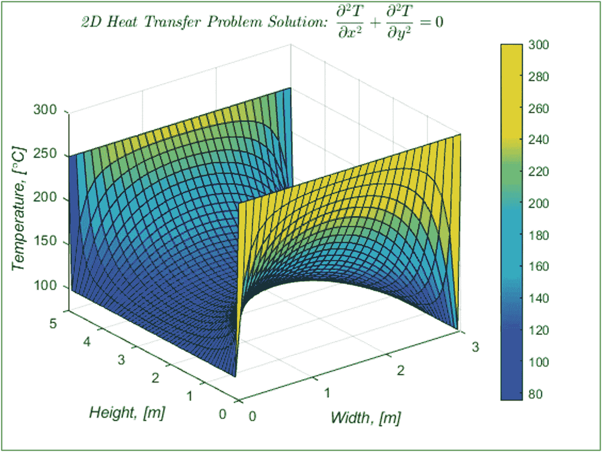

`图 13-12` 使用拉普拉斯算子（`surf()` 图）求解的二维温度分布问题

### 波动方程

波动方程是一个二阶偏微分方程，用于描述声波、机械波和光波等波的传播。它广泛应用于力学、声学、电磁学和流体动力学计算中。与热方程不同，波动方程可能包含多个空间变量（`x[1]`、`x[2]`、`x[3]`、…、`x[n]`）以及时间变量`t`。

一个通用的波动方程表述如下：

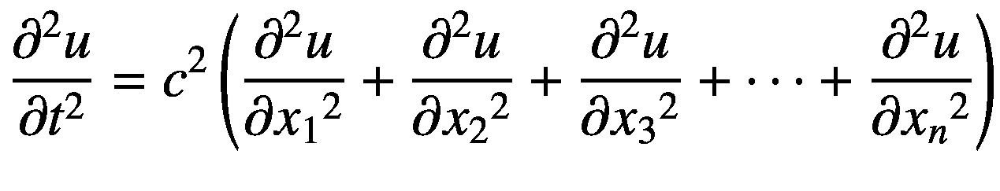

(13-18)

其中 `c` 是一个固定的非负（波传播速度）实系数。波动方程还有另一种更紧凑的表述形式，它使用了拉普拉斯算子 `∇`，如下所示：

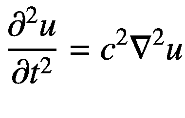

(13-19)