# 求解一维波动方程

一维空间（仅相对于`x`空间变量）的波动方程可表述如下：

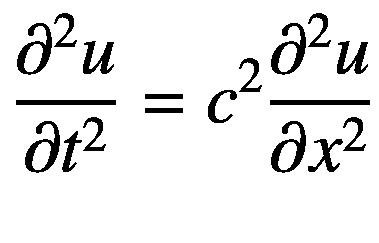

(13-20)

方程(13-20)描述了仅沿`x-y`平面发生的一维波动；该方程由法国科学家让·勒朗·达朗贝尔[3]发现。让我们以胡克定律中弹簧振动的例子，来演示一维波动方程的数值模拟。实际上，根据牛顿定律和胡克定律[4]，我们可以推导出一维偏微分波动方程。假设存在一个由有限质量`m`组成的阵列，这些质量通过长度为`Δx`的无质量弹簧相互连接，并假设弹簧单元具有均匀的弹性常数`k`。

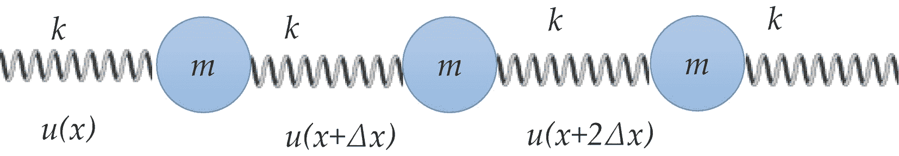

图 13-13  
从牛顿定律和胡克定律推导波动方程

图 13-13 显示了通过均匀刚性弹簧/弦相互连接的质量单元。质量单元的位移`u(x)`衡量了沿弹簧单元传播的应变（波）的幅度。利用图 13-13 所示系统的自由体受力图，我们可以根据牛顿定律和胡克定律（在`x`和`x + 2Δx`处）[4]计算出在`x + Δx`处质量单元上产生/扰动的力，如下所示：

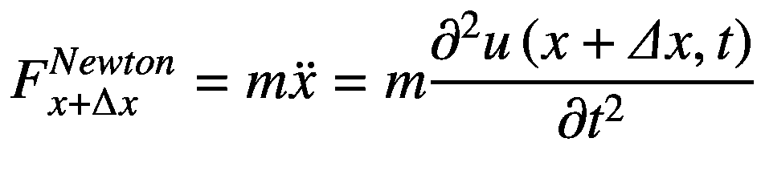

(13-21)

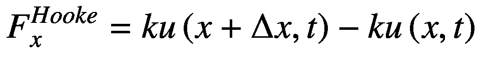

(13-22)

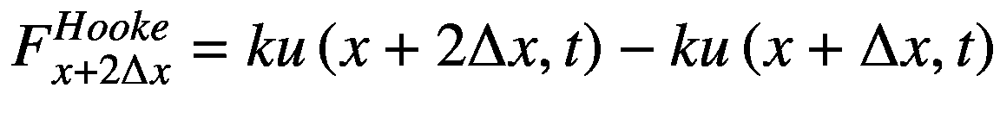

(13-23)

现在，我们基于在`x`、`x + 2Δx`处计算的力的有限差分（根据胡克定律），计算`x + Δx`处的力，如方程(13-22)和(13-23)所示。

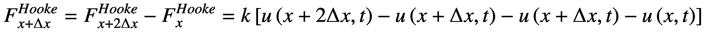

(13-24)

此外，通过将方程(13-21)中根据牛顿定律计算出的`x + Δx`处的力与方程(13-24)中根据胡克定律计算出的力进行等量代换，我们可以写出下式：

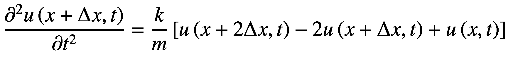

(13-25)

方程(13-25)的表述可以进行改写，条件是`n`个质量均匀分布，即`L = nΔx`；总质量(`M`)沿`n`个节点均匀分布（`M = nm`）；并且总弹簧刚度(`k`)均匀分布（`K = k/n`）。

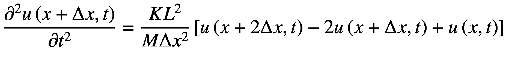

(13-26)

考虑当`Δx`趋近于无穷小（`Δx → 0`）且`n`趋近于无穷大（`n → ∞`）的情况，我们可以将方程(13-26)重写为更紧凑和连续的形式，如下所示：

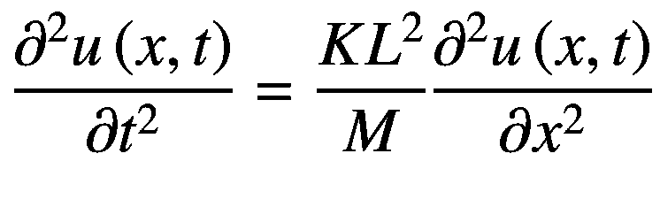

(13-27)

其中方程的常数部分 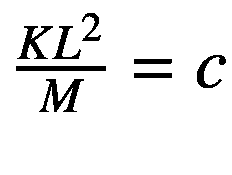 是波传播速度，它取决于弹簧的刚度和长度以及弦/弹簧的质量值。注意，通过将  代入方程(13-27)，我们得到方程(13-20)，即二维波动方程。

通过对方程(13-27)进行离散化，并将其左右两边的偏导数替换为有限（近似）差分，我们可以写出以下方程：

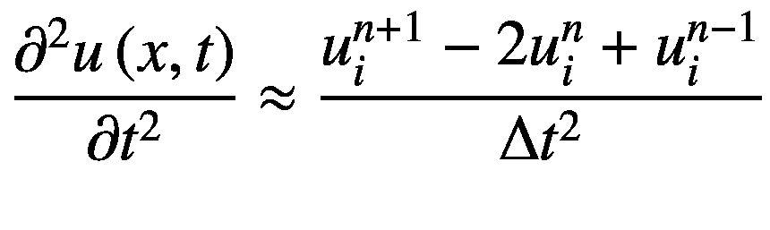

(13-28)

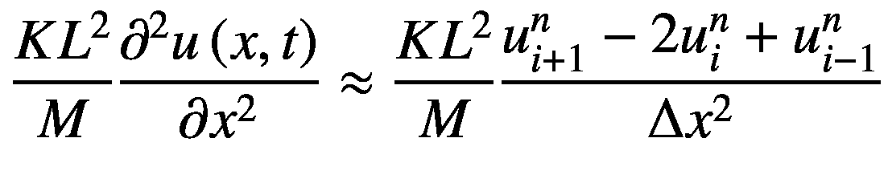

(13-29)

通过令方程(13-28)和方程(13-29)相等，我们可以写出方程(13-27)的一个代数或离散化形式。

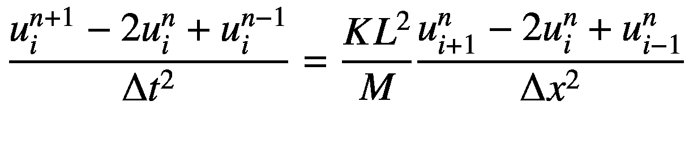

(13-30)

通过求解方程(13-30)得到 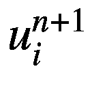，我们可以构建数值计算的递归算法。

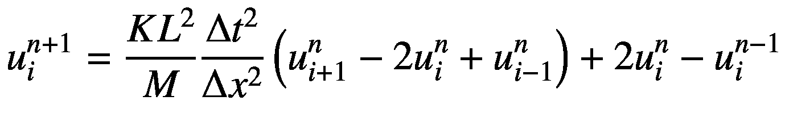

(13-31)

通过将常数项 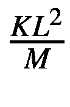 和 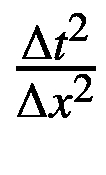 替换为 `C²`（`C`被称为库朗数[5]），我们可以重写方程(13-31)，如下所示：

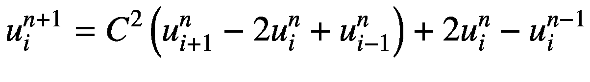

(13-32)


### 示例 4

让我们看一个关于弹性弦的数值算例，弦长 20 [m]，均匀刚度 100 [Nm]，均匀分布质量为 2 kg。弦的两端无位移。所有三种情况的仿真周期均为 `T=30` [s]。考虑以下三种扰动情况：

-   左侧（第五、第六和第七）节点上存在的微小位移扰动：`u[3] = 0.05`，`u[4] = 0.5`，以及 `u[5] = 0.05`
-   从弦中心施加的正弦激励力：`u[100] = 0.5 * sin(10 * pi * t / T)`，其中 `T = 30` [s]
-   组合扰动：`u[3] = 0.05`，`u[4] = 0.1`，以及 `u[5] = 0.05`，并且 `u[100] = 0.5 * sin(10 * pi * t / T)`，其中 `T = 30` [s]

通过使用方程 (13-31) 并为每种情况分配零边界条件和扰动，我们可以编写以下脚本，命名为 `Wave_Propagation_1D.m`：

```
%% 弦中的波传播 - 弹簧-质量系统仿真（胡克定律）：
clearvars; clc;
% 给定参数
k = 100;                     % [Nm] 刚度
mass=2;                      % [kg] 质量
Lx = 20;                     % [m] 弦长
dx=.1;                       % [m] 节点间距
Nodes=Lx/dx;                 % 节点数量
x = linspace(0, Lx, Nodes);
K = k/Nodes;
c = K*Lx²*dx²/mass;
dt=0.05;                     % 仿真时间步长
u = zeros(Nodes,1);          % 边界条件
um1= u;
up1 = u;
C = c*dt/dx;                 % 波传播速度
t=0;                         % 仿真开始时间
T=30;                        % 仿真周期
Case = input('输入案例编号 (1, 2, 3)：   ');
if Case==1
% 微小扰动：
u(5:7)=[0.05 0.5 0.05];   % 案例 1
up1(:)=u(:);
while t<T
% 时间演化：
t=t+dt;
% 保存迭代结果：
un1=u; u=up1;
for ii=2:Nodes-1
up1(ii)=(C²)*(u(ii+1)-2*u(ii)+u(ii-1)) - un1(ii)+2*u(ii);
end
clf;
plot(x, u, 'g-o', 'linewidth', 1), shg
end
elseif Case == 2
u(5:7)=0;                        % 案例 2
up1(:)=u(:);
while t<T
t=t+dt;
% 保存仿真结果：
un1=u; u=up1;
% 扰动源：
u(100)=0.5*sin(10*pi*t/T);
for ii=2:Nodes-1
up1(ii)=(C²)*(u(ii+1)-2*u(ii)+u(ii-1)) - un1(ii)+2*u(ii);
end
clf;
plot(x, u, 'k-o', 'linewidth', 1), shg
end
else   % 案例 3
u(5:7)=[0.05 0.5 0.05];
up1(:)=u(:);
while t<T
t=t+dt;
% 保存仿真结果：
un1=u; u=up1;
% 扰动源：
u(100)=0.5*sin(10*pi*t/T);
for ii=2:Nodes-1
up1(ii)=(C²)*(u(ii+1)-2*u(ii)+u(ii-1)) - un1(ii)+2*u(ii);
end
clf;
plot(x, u, 'r-o', 'linewidth', 1), shg
end
end
xlabel('\it x 空间, [m]')
ylabel('\it u(t, x) 位移, [m]')
title(['\it t = '  num2str(T) '  [s] 后的波传播。', ...
'案例 # '  num2str(Case)])
grid on
```

该脚本提供了三种情况下仿真结果的动画图。图 13-14、13-15 和 13-16 展示了脚本的仿真结果。

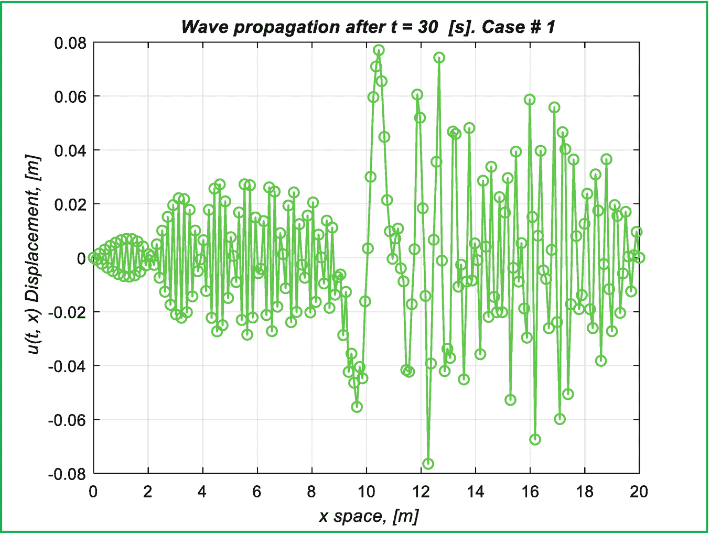

图 13-14：一维波传播问题，案例 1

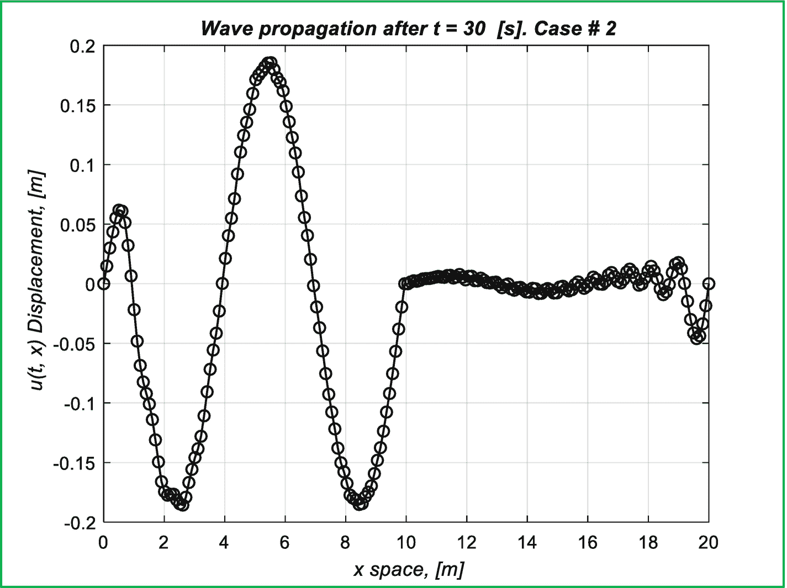

图 13-15：一维波传播问题，案例 2

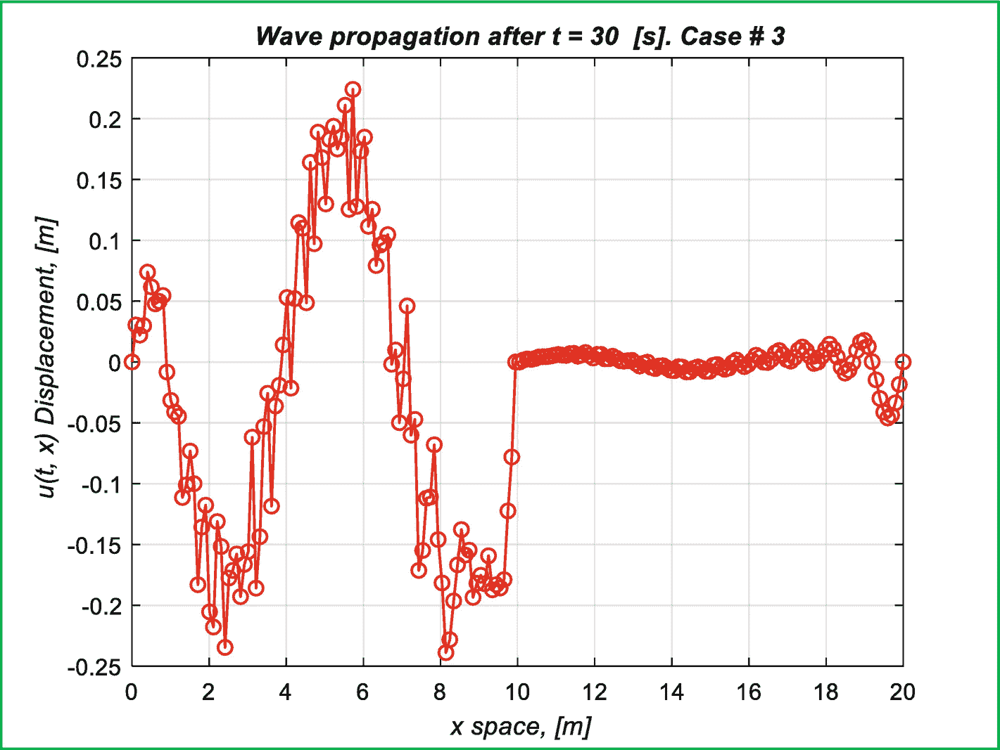

图 13-16：一维波传播问题，案例 3

## 求解二维波动方程

让我们考虑一个无扰动源区域的二维波动方程，其形式如下：

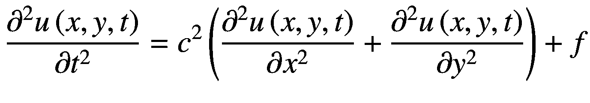

(13-33)

通过对方程 (13-33) 进行离散化，我们可以写出下一个方程：

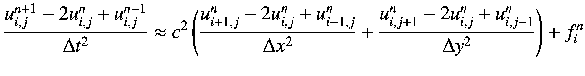

(13-34)

为简单起见，我们设置 `Δx = Δy` 并重写方程 (13-34)。

![$$ {u}_{i,j}^{n+1}=2{u}_{i,j}^n-{u}_{i,j}^{n-1}+{\left[c\frac{\Delta t}{\Delta x}\right]}²\left({u}_{i+1,j}^n-4{u}_{i,j}^n+{u}_{i-1,j}^n+{u}_{i,j+1}^n+{u}_{i,j-1}^n\right)+\Delta {t}²\ {f}_i^n $$](images/490522_1_En_13_Chapter/490522_1_En_13_Chapter_TeX_Equ36.png)

(13-35)

方程 (13-35) 是计算二维波传播的递归算法。

以下是狄利克雷边界条件：

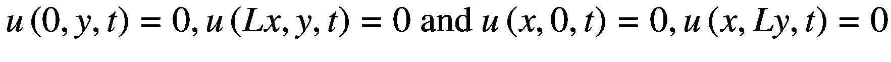

(13-36)

此外，为了吸收/阻止沿四个边界的传播波，让我们考虑以下零边界条件：


(13-37)

通过考虑先前编写的边界条件，引入 `C² = [c * Δt / Δx]²`，并使用离散化后的方程 (13-34)，我们可以写出以下方程：

![$$ {u}_{1,j}^{n+1}=2{u}_{2,j}^n+\frac{C²-1}{C²+1}\left[{u}_{2,j}^{n+1}-{u}_{1,j}^n\right] $$](images/490522_1_En_13_Chapter/490522_1_En_13_Chapter_TeX_Equ39.png)

(13-38)

![$$ {u}_{i,1}^{n+1}=2{u}_{i,2}^n+\frac{C²-1}{C²+1}\left[{u}_{i,2}^{n+1}-{u}_{i,1}^n\right] $$](images/490522_1_En_13_Chapter/490522_1_En_13_Chapter_TeX_Equ40.png)

(13-39)

![$$ {u}_{n_x,j}^{n+1}=2{u}_{n_x-1,j}^n+\frac{C²-1}{C²+1}\left[{u}_{n_x-1,j}^{n+1}-{u}_{n_x,j}^n\right] $$](images/490522_1_En_13_Chapter/490522_1_En_13_Chapter_TeX_Equ41.png)

(13-40)

![$$ {u}_{i,{n}_y}^{n+1}=2{u}_{i,{n}_y-1}^n+\frac{C²-1}{C²+1}\left[{u}_{i,{n}_y-1}^{n+1}-{u}_{i,{n}_y}^n\right] $$](images/490522_1_En_13_Chapter/490522_1_En_13_Chapter_TeX_Equ42.png)

(13-41)

其中 `C` 是波传播速度，也称为库朗数。


好的，作为高级文档工程师和翻译员，我将遵循您的指示，准确翻译以下文本。


## 示例 5

我们以一个 5 米 x 5 米、采用狄利克雷边界条件的弹性板为例。该板中心受到一个正弦力 *f* = 0.5 *sin* (1.5*πt*) 的激励。波传播速度为 *c* = 0.25。

以下是该练习的解决方案脚本，名为 `Wave_Propagation_2D.m`：

```
% 2D Wave propagation problem simulation
clearvars; clc
% Given parameters:
Lx = 5;  % Length along x axis
Ly=Lx;   % Length along y axis
dx=.05;  % Mesh size along x axis
dy=dx;   % Mesh size along y axis
Nx = Lx/dx;   % Number of node points along x axis
Ny=Nx;         % Number of node points along y axis
x=linspace(0, Lx, Nx);
y=x;
% Simulation period:
T=50;
% Displacement:
un = zeros(Nx, Ny);    % Memory allocation
unm1=un;
unp1 =un;
C  =0.25;      % Courant number
c  = 1;        % Wave propagation speed
dt=C*dx/c;     % Time increment
t=0;           % Initial simulation time value
% Simulation Loop:
while t<T
% Boundary conditions:
un(:, [1,end])  = 0;
un([1, end], :) = 0;
% Time evolution:
t=t+dt;
% Save the simulation results:
unm1=un; un=unp1;
%  Excitation source:
un(50,50)=0.5*sin(1.5*pi*t);
for ii=2:Nx-1
for jj=2:Ny-1
unp1(ii, jj)=2*un(ii, jj)-unm1(ii, jj)+...
(C²)*(un(ii+1,jj)+un(ii,jj+1)-4*un(ii, jj)+ ...
un(ii-1, jj)+un(ii,jj-1));
end
end
surfc(x, y, un'), colorbar; shg
caxis([-0.15 0.25])   % Pseudocolor axis scaling.
title([' Simulation results after t = '  num2str(t) '  [s]'])
pause(dt)
axis tight
end
xlabel('Width, [m] ')
ylabel('Length, [m] ')
zlabel('Displacement, [m]')
%% Contour plot
figure(2)
contourf(x, y, un'), colorbar; shg
title([' Simulation results after t = '  num2str(t) '  [s]'])
axis tight
xlabel('Width, [m] ')
ylabel('Length, [m] ')
```

该解决方案脚本求解了给定的二维波传播问题，并绘制了仿真结果的动画图，如图 13-17 和图 13-18 所示。请注意，此仿真是一个计算数据的实时演示（图 13-17），因此运行速度较慢。

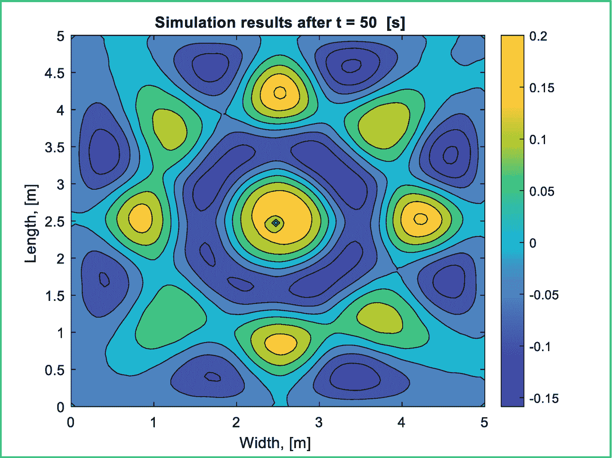

图 13-18

二维波传播问题仿真

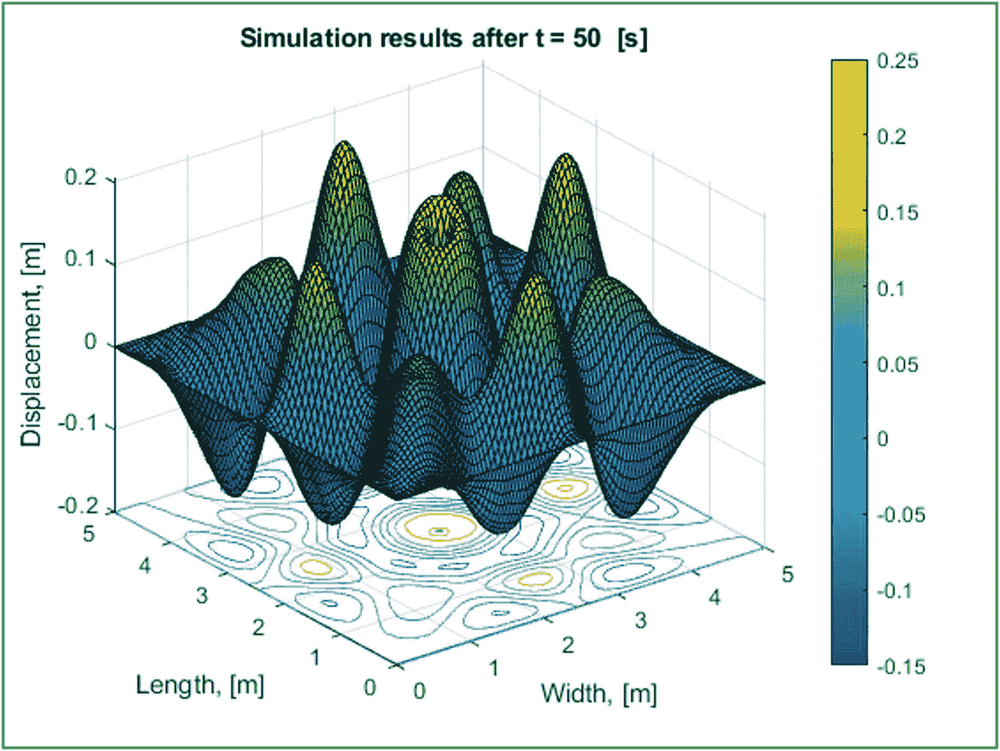

图 13-17

二维波传播问题仿真

偏微分方程示例到此结束。请注意，MATLAB 中有一个名为 PDE 工具箱的工具箱，它包含许多 GUI 入口工具和内置函数，例如几何构建（矩形、圆形、多边形）、边界条件设置、PDE 方程设置、网格划分、求解、绘图以及许多其他用户友好选项。

## 练习

以下是供您自行尝试的练习。

### 练习 1

求解一维热传导问题。假设有一根长度为 *L= 2 [m]* (0 < *x* ≤ *L*) 且 *k=0.001* 的导线。使用以下初始温度分布：*T(x, 0) = 65x [°C]*。假设导线两端都插入冰桶中（*T(0)=T(L) = 0 [°C]*）。将该问题的数值解作为一系列解进行计算。

### 练习 2

求解以下一维波动方程：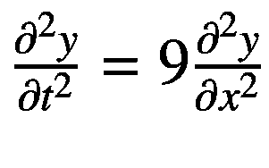。

假设 *y*(0, *t*) = *y*(1, *t*) = 0，对于 0 < *x* < 1，有 *y*(*x*, 0) = *cos* (2*πx*) + 0.25 *cos* (5*πx*)，对于 0 < *x* < 1，有 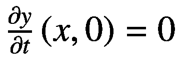。

### 练习 3

使用 `PDEPE()`。求解给定的一维热传导方程 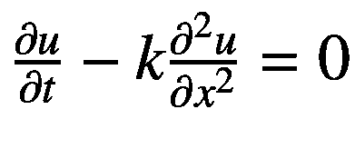，定义域为 0 < *x* < *L* 且 0 < *t*。设 *L =10* 且 *k=0.55*。对于所有 *t > 0*，边界条件为 *u(0, t) = 75* 且 *u(L, t)=125*。初始条件形式为对于 *0<x<L*，*u(x, 0)=u*[*0*]*(x)*，其中 *u*[*0*]*(x)* 是一个已知/给定的函数，描述了沿杆长度的初始温度分布。考虑以下情况：*u*[*0*]*(x) = 5x-1.2*0。

### 练习 4

使用拉普拉斯算子 `del2()`。求解拉普拉斯方程 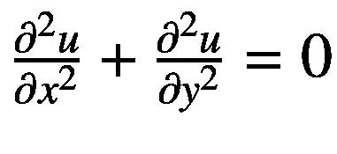，其中 *u(x, y)* 定义在 *x* ∈ [0, 2]，*y* ∈ [0, 2] 上，并具有以下边界条件：*u(x, 0)= 5, u(x, 2)=15; u(0, y)=5, u(2, y)=15*。

### 练习 5

使用高斯-赛德尔方法。求解拉普拉斯方程 ，其中 *u(x, y)* 定义在 *x* ∈ [0, 2]，*y* ∈ [0, 2] 上，并具有以下边界条件：*u(x, 0)= 5, u(x, 2)=15; u(0, y)=5, u(2, y)=15*。

### 练习 6

使用递归算法。求解一维波动方程 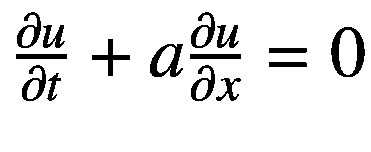，其中 *u(t, x)* 定义在 *x* ∈ [0, 10] 上，并具有以下边界条件：*u(t, 0)= 0* 和 *u(t, 10)=0*。弦在中间被激发，*u*(*t*, 5) = 0.25 *sin* (2*πt*)。取 =0.75。

### 练习 7

使用 `PDEPE()`。求解给定的一维热传导方程 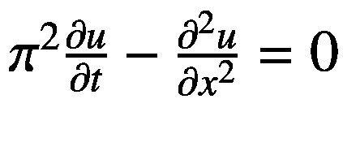，定义域为 0 < *x* < *L* 且 0 < *t*。设 *L=5*。对于所有 *t > 0*，边界条件为 *u(0, t) = 0* 且 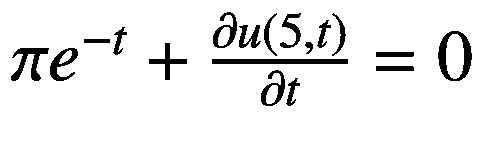。初始条件为对于 *0<x<L*，*u*(*x*, 0) = *sin* (2*πx*)。

### 练习 8

使用高斯-赛德尔方法。求解拉普拉斯方程 ，其中 *u(x, y)* 定义在 *x* ∈ [0, 2]，*y* ∈ [0, 2] 上，并具有以下边界条件：*u(x, 0)= 5, u(x, 2)=15; u(0, y)=5, u(2, y)=15*。

### 练习 9

使用有限差分方法。求解拉普拉斯方程 ，其中 *u(x, y)* 定义在 *x* ∈ [0, 2]，*y* ∈ [0, 2] 上，并具有以下边界条件：*u(x, 0)= 5, u(x, 2)=15; u(0, y)=5, u(2, y)=15*。

### 练习 10

使用数值方法求解扩散方程（示例中是一根 5 米长的金属细棒）。温度标量场 (*T*) 的扩散方程表达如下：

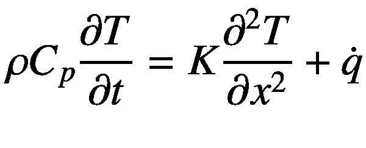

其中 *ρ* 是材料的密度，*C*[*p*] 是比热容（在恒压下，如果是气体），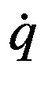 是热源。

考虑一维混合狄利克雷和诺依曼边界条件。一根 5 米长的薄金属棒初始温度为 100⁰C。计算在以下边界条件值下，棒的温度将如何随时间变化：在 *t = 0* 时，棒的两端均置于冰上（0⁰C）。不存在热源，即 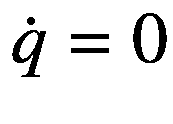。此外，假设热量仅沿棒流动。这里，![$$ \rho =7800\ \left[\frac{kg}{m³}\right],{C}_p=502\left[\frac{J}{kg\ast K}\right],\mathrm{and}\ K=30\left[\frac{W}{m\ast K}\right]. $$](images/490522_1_En_13_Chapter/490522_1_En_13_Chapter_TeX_IEq22.png)


### 习题 11

考虑习题 10 中给出的问题（扩散方程与细杆）。该杆由铜制成，初始温度为 100°C。在 `t = 0` 时，杆的左端被置于冰上（0°C）。计算穿过该杆的热流量。

![$$ \rho =8885\ \left[\frac{kg}{m³}\right],{C}_p=376.812\left[\frac{J}{kg\ast K}\right];K=384.1\left[\frac{W}{m\ast K}\right]. $$](images/490522_1_En_13_Chapter/490522_1_En_13_Chapter_TeX_Equb.png)

### 习题 12

使用有限差分法求解拉普拉斯方程 ，求解定义在 `x ∈ [0, 1]`，`y ∈ [0, 1]` 上的 `u(x, y)`，边界条件为：`u(x, 0) = 2`，`u(x, 2) = 5`；`u(0, y) = 2`，`u(2, y) = 5`。

### 习题 13

考虑以下二维波传播问题：


弹性板的尺寸为 10 米乘 10 米，在 `x = 3 m` 和 `y = 3 m` 处受到周期力 `f = sin(πt) + 2 * cos(2πt)` 的激励。波传播速度为 `c = 0.125`。


