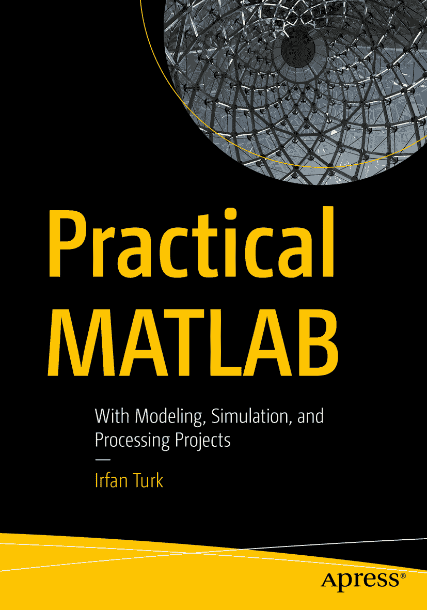

# 版权信息

ISBN 978-1-4842-5280-2

电子版 ISBN 978-1-4842-5281-9

[`doi.org/10.1007/978-1-4842-5281-9`](https://doi.org/10.1007/978-1-4842-5281-9)

© 2019 伊尔凡·图尔克

本作品受版权保护。出版商保留所有权利，涉及材料的全部或部分内容，具体包括翻译、重印、重用插图、朗诵、广播、以微缩胶片或任何其他物理形式复制，以及以电子方式改编、计算机软件或任何当前已知或未来开发的类似或不同方法进行传输或信息存储与检索。书中可能出现的商标名称、标识和图像。对于每个出现的商标名称、标识或图像，我们仅在编辑风格中使用，且为商标所有者的利益，无意侵犯商标。

`MATLAB`® 是 The MathWorks, Inc. 的注册商标。本出版物中使用的商品名称、商标、服务标志及类似术语（即使未被明确标识）不应被视为对其是否受专有权利保护的表达。

尽管本书中的建议和信息在出版时被认为是真实和准确的，但作者、编辑和出版商均不对可能存在的任何错误或遗漏承担法律责任。出版商不对本书所含内容作任何明示或暗示的保证。

本书由 Springer Science+Business Media New York 在全球图书贸易中发行，地址：233 Spring Street, 6th Floor, New York, NY 10013。电话：1-800-SPRINGER，传真：(201) 348-4505，电子邮件：orders-ny@springer-sbm.com，或访问 www.springeronline.com。Apress Media, LLC 是一家加利福尼亚有限责任公司，其唯一成员（所有者）是 Springer Science + Business Media Finance Inc (SSBM Finance Inc)。SSBM Finance Inc 是一家特拉华州公司。

# 献词

*本书献给所有 MATLAB 爱好者。*

# 引言

本书源于编程讲义、从不同计算算法中积累的经验以及对现实生活问题数学模型的研究。本书的目的在于介绍并教授 `MATLAB` 作为一种编程语言，并将编程概念应用于金融计算模型、数值方法、随机性模拟、基于基本统计的数据分析、可视化与动画、计算生物学、信号处理、图像处理和声音处理。除了这些示例之外，本书还教授如何创建带有图形用户界面（GUI）的应用程序。

本项目的目标读者是希望将 `MATLAB` 作为编程语言学习的人、希望提升解题能力的 `MATLAB` 用户，以及希望准备带 GUI 应用程序的高级用户。

本书分为两部分。第一部分解释了语言的基本概念，如变量、数据类型和常用内置函数。除了这些主题之外，还介绍了语言的基础知识，如算法、`m` 文件、选择结构、循环和用户自定义函数。在本书的第二部分，我展示了来自不同领域的问题求解。在示例中，必要时会解释算法方法。每个新项目，无论是函数还是命令，都会加以解释，以便读者理解主题并不错过任何新内容。

本产品可用作教科书，也可作为学院或大学本科或低年级一学期研究生课程的补充材料。这些课程可能包括但不限于使用 `MATLAB` 进行计算机编程、使用 `MATLAB` 解决科学与工程问题、科学计算以及使用 `MATLAB` 进行数学建模。本书的第一部分应在这些课程中讲授。在本书的第二部分中，各章内容相互独立。因此，可以根据课程需要自由选择第二部分中的主题。在学习本书内容之前，具备预科水平的数学知识有助于理解建模概念，因此建议将此作为学习本课程的先决条件。尽管任何编程语言的背景知识可能有助于掌握示例中使用的算法，但这并非必备条件。本书也是个人学习者的实用资源和教科书。它提供了 152 个说明性和指导性示例，其中包括解决方案和代码。

本书的源代码可通过位于 `www.apress.com/9781484252802` 的“下载源代码”按钮访问。

# 致谢
我想提及并感谢几位在本书编写过程中帮助过我的人。我特别感谢 Apress 副编辑总监 Steve Anglin，他给了我撰写本书的殊荣。我也衷心感谢 Apress 编辑运营经理 Mark Powers，他帮助并指导我将此产品变为现实。我还感谢 Apress 的首席开发编辑 Matthew Moodie 成为这个团队的一员，以及本项目的审阅者 Karpur Shukla。我要感谢我的主要博士导师、巴赫塞希尔大学软件工程系的副教授 Maksat Ashyraliyev 博士，他对我技能的培养做出了无价的贡献。最后，感谢我的朋友兼同事 Ibrahim Emre Celikkale 提出的建议。

# 关于作者和关于技术审阅者

## 关于作者

## 关于技术审阅者

