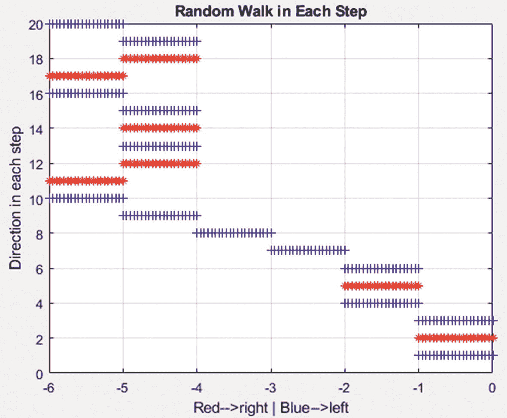
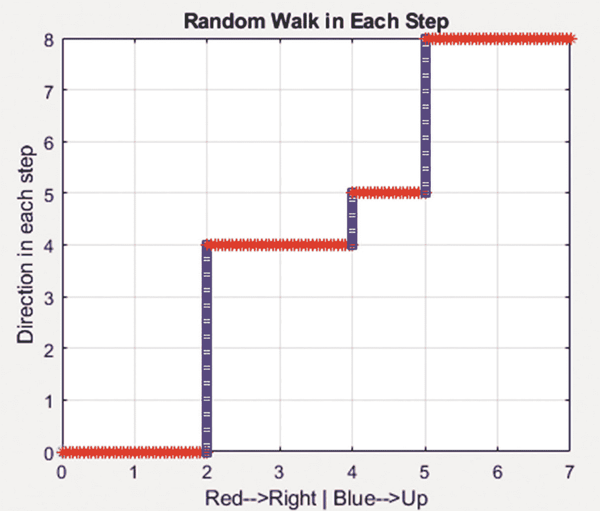
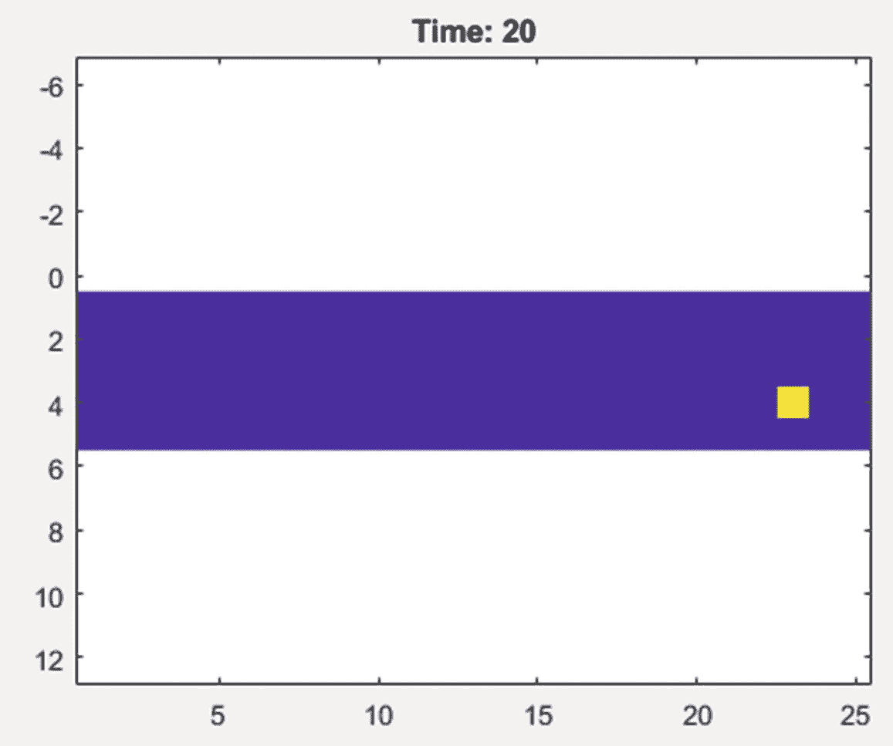
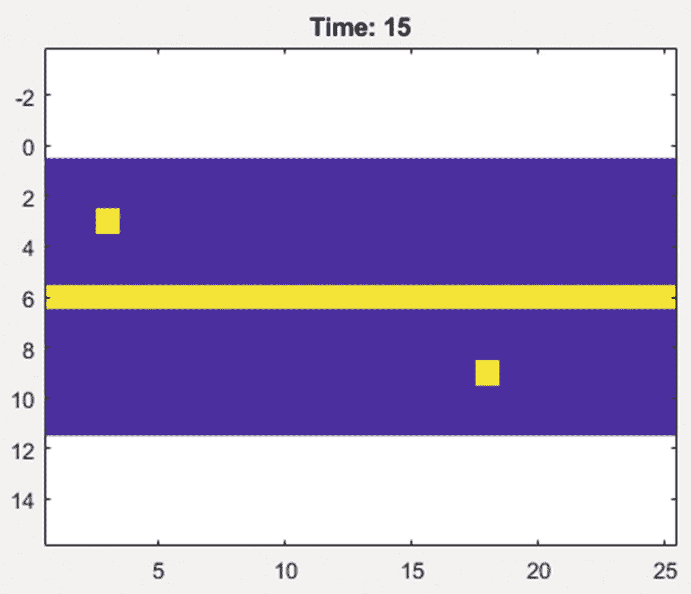

# 5. 仿真应用

在本章中，我们首先介绍如何生成随机数。然后，涵盖掷硬币、掷一对骰子、随机行走和交通流等主题。在每一节中，我都提供了相关编程思路的说明，并在必要时进行解释。

## 随机数生成

在 MATLAB 中创建伪随机数序列时，可以使用 `rand`、`randn` 或 `randi` 命令之一（见表 5-1）。我们还可以利用 `rng` 函数来控制这些数字的可重复性。

**表 5-1** 随机生成函数

| 函数 | 说明 | 示例 |
| --- | --- | --- |
| `rand(n)`<br>`rand(n,m)` | 生成介于 0 和 1 之间的均匀分布伪随机数 | `> rand(2)`<br>`ans =`<br>`0.8147    0.1270`<br>`0.9058    0.9134` |
| `randn(n)`<br>`randn(n,m)` | 生成正态分布伪随机数 | `> randn(2)`<br>`ans =`<br>`0.3188   -0.4336`<br>`-1.3077    0.3426` |
| `randi(imax)`<br>`randi(imax,x,y)` | 生成上限为 `imax` 的均匀分布伪随机整数 | `> randi(5,2,3)`<br>`ans =`<br>`5     5     3`<br>`1     5     5` |
| `rng` | 控制随机数生成 | `> rng('shuffle')` |
| `randperm(n)`<br>`randperm(n,k)` | 创建包含从 1 到 n 的 *k* 个不重复整数排列的行向量 | `> randi(5,2,3)`<br>`ans =`<br>`2    4    3    1` |

在同一个会话中，每次运行 `rand`、`randn` 或 `randi` 函数时，都会得到不同的数值。但是，如果关闭当前会话并打开一个新会话，那么对同一函数执行时，会出现相同的值。这是由于 `rng` 函数使用了相同的默认种子。这个默认种子是种子值为 0 的梅森旋转算法。如果将种子类型更改为 `shuffle`，那么每次调用 `rng` 时都会得到不同的数值。`randperm(n,k)` 函数会创建从 1 到 n 的整数的 *k* 个随机排列。

**示例 5-1.** 使用 `rand` 命令创建 2 到 8 之间的七个数字。

**解法 5-1.** 要得到七个数字，我们可以使用一个行向量。如果使用 `rand` 命令，我们会得到 0 到 1 之间的数字。将这些数字乘以 10 然后四舍五入，得到的数字将介于 0 和 10 之间。如果我们使用 `mod` 7，那么所有数字将介于 0 和 6 之间。通过加 2 进行移位后，我们就可以得到所需的数字。为了展示所有步骤，可以使用以下代码。不过，只需输入一行代码（如代码底部的代码所示）即可完成全部任务。

*Example5p1.m*

```
%Example5p1

%This code produces 7 numbers

MyNumbers = rand(1,7);

MyBigNumb = MyNumbers*10;

MyIntegers = round(MyBigNumb);

MyMod = mod(MyIntegers,7);

MyFinal = MyMod + 2;

disp(['The numbers are: ',int2str(MyFinal)])

%MyFinal=2+mod(round(10*rand(1,7)),7)
```

代码执行后，屏幕上将显示以下输出。

```
> Example5p1

The numbers are: 3  3  4  7  6  8  2

>
```

**示例 5-2.** 使用 `randperm` 函数，创建介于 1 到 20 之间的五个整数。然后，使用 `randperm` 函数随机选择的数字，创建另一个包含 10 个数字的序列。该序列的前两个元素应该是 `randperm` 创建的第一个数字。该序列的第三和第四个元素应该是 `randperm` 创建的第二个数字。序列其余元素也应采用相同的模式。

**解法 5-2.** 以下代码可用于完成给定的任务。

*Example5p2.m*

```
%Example5p2

%This code uses randperm function

Numbers = randperm(20,5);

Seq= Numbers([1,1,2,2,3,3,4,4,5,5]);

disp('Randomly Selected Numbers:');

disp(Numbers);

disp('Numbers of Sequence:');

disp(Seq);
```

代码执行后，屏幕上将显示以下输出。

```
> Example5p2

Randomly Selected Numbers:

3     9    19     5     1

Numbers of Sequence:

3     3     9     9    19    19     5     5     1     1

>
```

### 抛硬币

涉及抛硬币的实验可以使用上一节中的技术进行，或者简单地使用 `randi(2,1)` 命令来实现，如示例 5-3 所示。

**示例 5-3.** 编写代码，询问用户抛硬币的次数。然后代码应调用一个函数来确定序列中正面和反面的数量。代码应在屏幕上输出正面和反面的数量以及抛掷序列。

**解法 5-3.** 以下代码可用于完成给定的任务。

*Example5p3.m*

```
%Example5p3

%This code spins coin

Times=input('Number of times to flip the coin?\n');

[H,T,Sequence]=FlipCoin(Times)

function [H,T,Sequence]=FlipCoin(Times)

rng('shuffle')

n=1; H=0; T=0;

Sequence = zeros(1,n);

while n <= Times

Result = randi(2,1);

if Result == 1

H=H+1;

Cond = 'H';

else

T=T+1;

Cond = 'T';

end

Sequence(n) = Cond;

n=n+1;

end

Sequence = char(Sequence);

end
```

该代码调用 `FlipCoin` 函数，通过 `randi(2,1)` 命令获取随机整数。此命令告诉 MATLAB 将选择一个整数：1 或 2。因此，每次都会选择一个数字。如果数字是 1，则视为正面（`H`），否则结果保存为 `T`，表示反面。所有这些结果都作为 ASCII 表中对应于 `H` 和 `T` 的数字保存到 `Sequence` 变量中。计数完成后，使用 `char` 函数将 `Sequence` 变量转换为 `H` 和 `T`。

代码执行后，屏幕上将显示以下输出。

```
> Example5p3

Number of times to flip the coin?

H =

T =

Sequence =

'TTHTTHTTTT'

>
```

### 掷一对骰子

编程模拟掷一对骰子或单个骰子有多种方法。最简单的方法之一是使用 `randi(6,1,2)` 命令（单个骰子则用 `randi(6,1)`）。通过此方式，可以在 1 到 6 之间选取两个整数。为了说明这一点，我们可以参考示例 5-4。

**示例 5-4。** 编写代码，使用 `randi` 命令模拟掷一对骰子。代码应询问用户掷骰子的次数。然后，所有结果（包括每次掷骰的总和）都应显示在屏幕上。

**解法 5-4。** 要获取代表骰子的两个数字，可以使用 `randi(6,1,2)` 命令。为实现该任务，可以使用以下代码。

*Example5p4.m*

```
%Example5p4

%This code rolls die and prints the sum

N=input('Enter the number of times to roll\n');

[Results,Sums] = RollDie(N);

disp('The Rolled Die');

disp(Results);

disp('The Sums For Each Rolling');

disp(Sums);

function [Results,Sums] = RollDie(Number)

Results = zeros(Number,2);

Sums = zeros(Number,1);

for i=1:Number

Die=randi(6,1,2);

Sum=Die(1)+Die(2);

Results(i,1:2)=Die;

Sums(i)=Sum;

end

end
```

运行代码后，将得到以下输出。

```
> Example5p4
```

# 编程示例：骰子、随机漫步与交通流

## 掷骰子模拟

**示例 5-5。** 编写代码模拟掷一对骰子。代码应询问用户是否想要玩。如果用户想玩，则代码掷一对骰子。如果数字之和为 7，计算机应输出“你赢了 100 美元”以及所获得的数字，并继续掷骰。如果数字之和为 10，计算机应输出“你赢了 50000 美元”以及所获得的数字，并继续掷骰。对于其余的和的可能性，程序应停止运行。

**解法 5-5。** 以下代码可用于完成给定任务。

*`Example5p5.m`*

```
%Example5p5
%This code simulates a pair of dice
N=input('Enter 1 to roll a pair of dice\n');
while (N==1)
Die=randi(6,1,2);
switch sum(Die)
case 7
disp('You WON $100');
fprintf('Numbers: %i and %i\n',...
Die(1),Die(2));
case 10
disp('You WON $50000');
fprintf('Numbers: %i and %i\n',...
Die(1),Die(2));
otherwise
N=2;
fprintf('Numbers: %i and %i\n',...
Die(1),Die(2));
end
end
```

运行代码后，屏幕上将打印以下输出。

```
> Example5p5
Enter 1 to roll a pair of dice
You WON $100
Numbers: 2 and 5
Numbers: 2 and 1
>
```

如输出所示，运行程序并输入 1 后，程序开始运行。然后，计算机掷出 2 和 5，其和为 7，并打印“你赢了 100 美元”且继续运行。在第二次尝试中，掷出的数字是 2 和 1，其和为 3。由于 3 不属于已识别的特殊情况，代码更改了变量 `N` 的值，并结束运行。

## 随机漫步

也可以使用 `rand` 命令模拟随机漫步。本节将分别说明一维和二维的情况。

**示例 5-6。** 编写代码模拟一维漫步，方向随机从 1 或 -1 中选取，以向右或向左移动 20 步。

**解法 5-6。** 虽然问题是一维的，但为了清晰地看到向左和向右的步骤，路径将在每一步沿 `y` 方向向上绘制一步。向右的步骤将以红色表示，向左的步骤以蓝色表示。以下代码可用于完成给定任务。

*`Example5p6.m`*

```
%Example5p6
%The code simulates random walk in 1-d
close all; Y=1; P = 0;%position
Steps = 20; Step = 1;
for i=1:Steps
W = rand;
if W>0.5
P = P + Step;
St = linspace(P-1,P,21);
plot(St,Y,'r*')
hold on
else
St = linspace(P,P-1,21);
P = P - Step;
plot(St,Y,'b+')
hold on
end
Y = Y + 1;
pause(0.5)
end
grid on
xlabel('Red-->right | Blue-->left')
ylabel('Direction in each step')
title('Random Walk in Each Step')
disp(['Final Place :',num2str(P)])
```

运行代码后，将得到如图 5-1 所示的输出。



图 5-1 示例 5-6 的输出

随机漫步从向左移动开始，然后向右移动，再向左移动，以此类推。最终，位置从起点向左移动了六步。在命令提示符中，我们还会得到以下结果。

```
> Example5p6
Final Place :-6
>
```

**示例 5-7。** 编写代码模拟二维随机漫步。在每一步中，计算机可以在 `x` 方向向右移动一步，或者在 `y` 方向向上移动一步，共 15 步。

**解法 5-7。** 以下代码可用于完成给定任务。

*`Example5p7.m`*

```
%Example5p7
%The code simulates random walk in 2-d
close all;clear all;P = 0;%position
Steps = 15;X=0;Y=0;Step = 1;
plot(X,Y,'co');hold on
format short
for i=1:Steps
W = rand;
if W<0.5
X = X + Step;
St = linspace(X-1,X,21);
plot(St,Y,'r*')
hold on
else
Y = Y + Step;
St = linspace(Y-1,Y,21);
plot(X,St,'b+')
hold on
end
end
grid on
xlabel('Red-->Right | Blue-->Up')
ylabel('Direction in each step')
title('Random Walk in Each Step')
```

运行代码后，将得到如图 5-2 所示的图形。



图 5-2 示例 5-7 的输出

如图 5-2 所示，漫步向右移动了七次，向上移动了八次。这个总数对应于代码中的总步数。

在命令提示符中，运行代码后还会得到以下结果。

```
> Example5p7
1     0
2     0
2     1
2     2
2     3
2     4
3     4
4     4
4     5
5     5
5     6
5     7
5     8
6     8
7     8
>
```

## 交通流

本节中，我们将使用图像函数 `imagesc`，用颜色来表示车辆交通流。换句话说，我们对道路的不同路段进行着色，以表示交通流。

**例 5-8。** 编写代码，显示一条宽度为 5 个单位、长度为 20 个单位的道路上的车辆流动。

**解 5-8。** 以下代码可用于完成给定任务。

*`Example5p8.m`*

```
%Example5p8
%This code shows traffic flow
rw=5;%road width
rl=25;%road length
road = zeros(rw,rl);
xpos=2;ypos=4;
road(ypos,xpos)=1;
imagesc(road)
axis equal
for t=0:20
%clear previous vehicle
road(ypos,xpos)=0;
%update new position
xpos=xpos +1;
road(ypos,xpos)=1;
%plot new position
imagesc(road)
Time=sprintf('Time: %i',t);
title(Time)
axis equal;
pause(0.4);
end
```

如代码所示，在每次迭代中向右移动后，车辆道路的颜色被赋值为 0。为了向前移动，道路的颜色被赋值为 1。每次，颜色都通过 `imagesc` 函数显示。这样做是为了以图形形式展示交通流。每一帧之间，计算机会等待 0.4 秒，以便慢速观察模拟过程。

图 5-3 显示了通过该代码进行模拟的最终帧。



图 5-3 `Example5p8` 的输出

**例 5-9。** 编写代码，显示具有两个相反方向（去程和返程）的交通流。每条道路上应有一辆车行驶。

**解 5-9。** 以下代码可用于完成给定任务。

*`Example5p9.m`*

```
%Example5p9
%This code shows traffic flow
rw=11;rl=25;
road = zeros(rw,rl);
road(6,:)=1;
x1pos=2;y1pos=9;
x2pos=19;y2pos=3;


road(`y1pos`,`x1pos`)=1;
road(`y2pos`,`x2pos`)=1;
imagesc(road);axis equal
for t=0:15
    %clear previous vehicle
    road(`y1pos`,`x1pos`)=0;
    road(`y2pos`,`x2pos`)=0;
    %update new position
    `x1pos`=`x1pos` +1;
    `x2pos`=`x2pos` -1;
    road(`y1pos`,`x1pos`)=1;
    road(`y2pos`,`x2pos`)=1;
    %plot new position
    imagesc(road)
    `Time`=sprintf('Time: %i',t);
    title(`Time`);axis equal;
    pause(0.4);
end
```

代码执行后，屏幕上将显示如图 5-4 所示的输出。



图 5-4

Example5p9 的输出

## 习题

- 5.1. 使用 `randi` 命令生成 3 到 7 之间的 10 个数字。
- 5.2. 使用 `randperm` 函数，创建 1 到 15 之间的七个整数。然后，通过 `randperm` 函数随机选择的数字，创建另一个包含 20 个数字的序列。该序列的前三个元素应为 `randperm` 创建的第一个数字。该序列的第四、五、六个元素应为 `randperm` 创建的第二个数字。其余元素依此类推。
- 5.3. 编写代码，抛一枚硬币 20 次。代码应在屏幕上打印出正面和反面的次数以及抛掷序列。
- 5.4. 编写代码，使用 `rand` 命令模拟一对骰子掷 10 次。所有结果，包括每次掷骰的点数和，都应显示在屏幕上。
- 5.5. 编写代码模拟一对骰子。如果点数之和为 5，程序应输出“你获得了 $200”并继续投掷。如果点数之和为 12，程序应输出“你赢得了大奖！！”并继续投掷。如果点数之和为 8，程序应停止；否则应继续运行。
- 5.6. 编写代码模拟二维随机游走。每一步，计算机可以在 *x* 方向向左走一步，或者在 *y* 方向向下走一步，总共走 20 步。
- 5.7. 编写代码，显示两条车辆在宽度为 6 个单位、长度为 24 个单位的道路上的流动。

