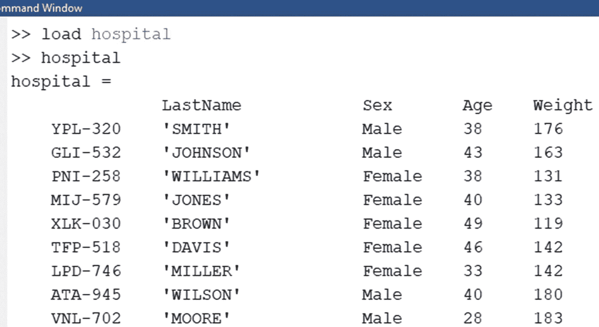
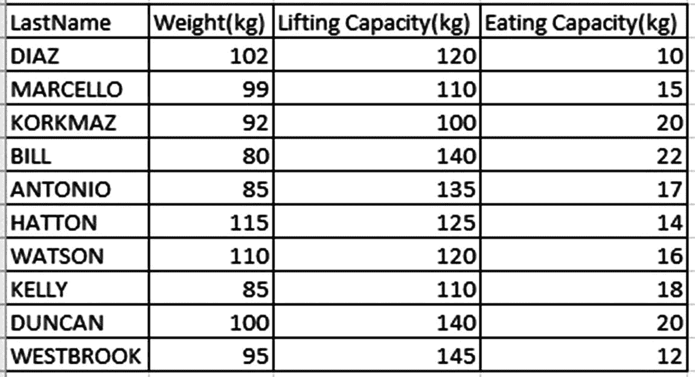
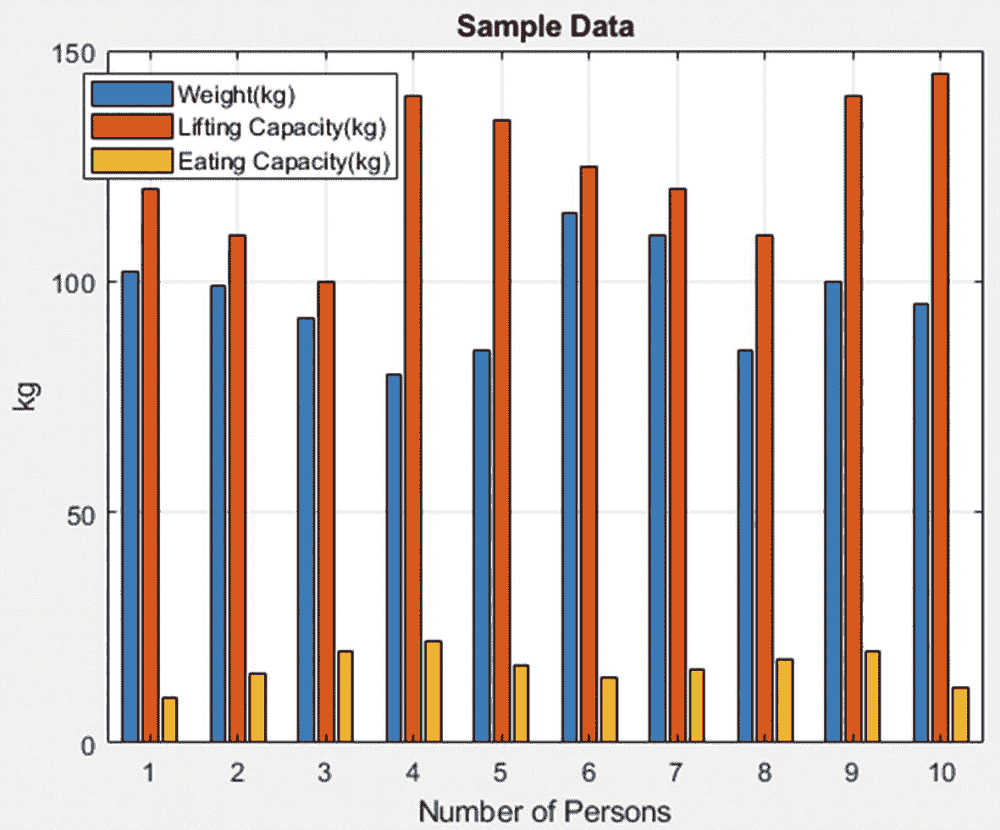

# 6. 基本统计与数据分析

本章首先简要讨论 MATLAB 中使用的基本统计函数。之后，介绍排序、搜索以及使用 Microsoft Excel 文件处理数据的内容。

## 基本统计

MATLAB 在统计领域提供了大量特性和即用型内置函数。在本书中，我只介绍该主题的概要及一些基本统计函数（表 6-1）。

表 6-1

MATLAB 中与统计相关的一些基本函数

| 函数 | 说明 | 示例 |
| --- | --- | --- |
| `max()` | 返回最大值 | `max([1,34,21,5])` |
| `mean()` | 返回平均值或均值 | `mean([1,34,21,5])` |
| `median()` | 返回中位数 | `median([1,34,21,5])` |
| `min()` | 返回最小值 | `min([1,34,21,5])` |
| `mode()` | 返回出现频率最高的值 | `mode([1,34,5,21,5])` |
| `std()` | 返回标准差 | `std([1,34,5,21,5])` |
| `var()` | 返回方差 | `var([1,34,5,21,5])` |

例 6-1. 使用函数 `randi()` 随机生成一个 3 × 4 的矩阵。然后，计算该矩阵每列的最大值、平均值和标准差。

解 6-1. 以下代码可用于创建矩阵并查找矩阵每列的所需值。

*Example6p1.m*

```
%Example6p1
%This code finds statistical values
`A`=randi(100,3,4);
%Maximum number is set as 100
Maximum = max(`A`);
MeanVal = mean(`A`);
StanDev = std(`A`);
disp(['The maximum numbers are ',...
num2str(Maximum)])
disp(['The mean numbers are ',...
num2str(MeanVal)])
disp(['The standard deviations are ',...
num2str(StanDev)])
```

代码执行后，屏幕上将显示以下输出。

```
> Example6p1
The maximum numbers are 84  92  97  98
The mean numbers are 37.6667           57      60.3333      56.3333
The standard deviations are 40.2782       44.441      32.5167      36.8556
>
```

## 数据分析

本节介绍各种排序和搜索函数，以及数据处理示例。

### 排序与搜索

通过 `sort` 函数可以轻松实现数据的升序或降序排列。

示例 6-2. 现有数据：23, 70, 86, 5, 120, 50, -9, 61, 100。编写代码，将这些数据分别按升序和降序排列。

解法 6-2. 可以将这些数据定义为一个向量，然后在命令提示符下按如下方式进行排序。

*Example6p2.m*

```
%Example6p2
%此代码对数据进行排序
`A`=[23,70,86,5,120,50,-9,61,100];
DescendSort = sort(`A`,'descend');
AscendSort = sort(`A`,'ascend');
disp('降序排列:');
disp(DescendSort);
disp('升序排列:');
disp(AscendSort);
```

运行上述代码后，将得到如下输出结果。

```
> Example6p2
降序排列:
  120   100    86    70    61    50    23     5    -9
升序排列:
    -9     5    23    50    61    70    86   100   120
>
```

在某些情况下，需要对多组数据（如矩阵中的行或列）进行排序。这种情况在示例 6-3 中说明。

示例 6-3. 使用 `randi()` 函数随机生成一个 3 × 5 的矩阵。然后，对该矩阵的每一列和每一行按降序排列。

解法 6-3. 以下代码可用于对矩阵的列和行进行排序。

*Example6p3.m*

```
%Example6p3
%此代码对行和列进行排序
`A`=randi(100,3,5);
SortColumn=sort(`A`,1);
SortRow=sort(`A`,2);
disp('原始矩阵');
disp(`A`);
disp('按列排序');
disp(SortColumn)
disp('按行排序');
disp(SortRow)
```

运行上述代码后，将得到如下输出结果。

```
> Example6p3
原始矩阵
    94    29    87   100    58
    46     1    40    54    65
    32    61    26    96    27
按列排序
    32     1    26    54    27
    46    29    40    96    58
    94    61    87   100    65
按行排序
    29    58    87    94   100
     1    40    46    54    65
    26    27    32    61    96
>
```

如输出结果所示，如果以 `sort(Matrix,1)` 的形式使用 `sort` 命令，则是对列进行排序；如果使用 `sort(Matrix,2)`，则是对行进行排序。

搜索在 MATLAB 中同样非常简单。通常，有三种不同的搜索方式可供使用。可以在向量或矩阵中搜索某个数值。可以在字符串组中搜索一组字母或一个字符串。最后，我们还可以在数据集中搜索某些信息。我们将通过示例逐一讲解这些情况。

示例 6-4. 考虑矩阵 `Mat = [32,98,17,71,67; 39,71,65,28,17; 77,49,71,68,71]`。编写代码在该矩阵中搜索数值 71。

解法 6-4. 可以编写以下代码来执行搜索。

*Example6p4.m*

```
%Example6p4
%此代码在矩阵中查找索引
`Matrx` =[32,98,17,71,67;...
39,71,65,28,17;...
```

# 示例与数据处理

## 示例 6-5

考虑字符串 `12345 ABcde Antonio`。编写代码，不区分大小写地搜索字符串 `antonio`。

**解法 6-5.** MATLAB 是一种区分大小写的语言。因此，字符串 `Antonio` 和 `antonio` 是两个不同的字符串。可以使用以下代码来搜索所需的字符串。

*Example6p5.m*

```matlab
%Example6p5
%此代码查找字符串
Text = '12345 ABcde Antonio';
Scr = 'antonio';
NewText = upper(Text);
NewScr= upper(Scr);
Findit = strfind(NewText,NewScr);
disp('字符串位置: ');
disp(Findit);
```

如上所示，字符串可以在 MATLAB 中定义为包含这些字符串的向量。运行上述代码后，将得到如下输出结果。

```
> Example6p5
字符串为
>
```

该输出表明，搜索的字符串嵌套在更长的字符串中，并且从向量的第十三个元素开始。如果字符串不存在，则会得到一个空集 `[]`，这意味着未找到搜索的单词。

## 示例 6-6

MATLAB 中有一个可供使用的数据集，名为 `hospital`。这些数据的部分内容如图 6-1 所示。


图 6-1

让我们将这些数据加载到工作区中。然后，在数据集中搜索姓氏为 DIAZ 的人以及其他相关信息。之后，找出所有 50 岁的人。

**解法 6-6.** 要查找 DIAZ，我们需要搜索包含字符串的 `LastName` 列。要搜索数字 50，我们需要处理 `Age` 列。以下代码可用于执行给定的任务。

*Example6p6.m*

```matlab
%Example6p6
%此代码查找数据
load hospital
IsThere=ismember(hospital.LastName,'DIAZ');
index = find(IsThere);
fprintf('姓氏为 DIAZ 的人是:\n')
hospital(index,:)
fprintf('年龄为 50 的信息:\n')
hospital(find(hospital.Age==50),:)
```

在这段代码中，命令 `ismember` 用于判断 DIAZ 是否是元胞数组 `hospital.LastName` 的一个成员。如果是，则返回 1，否则返回 0。通过使用 `find` 命令，可以找出所需信息的索引。

执行上述代码后，我们将得到如下输出结果。

```
> Example6p6
姓氏为 DIAZ 的人是:
ans =
    LastName    Sex       Age     Weight    Smoker    BloodPressure
    ________    ____      ____    ______    ______    _____________
    'DIAZ'      'Male'    45      172       true      136          93

年龄为 50 的信息:
ans =
    LastName          Sex       Age      Weight    Smoker
    ________          ____      ____     ______    ______
    'ROBINSON'        'Male'    50       172       false
    'REED'            'Male'    50       186       true

    BloodPressure      Trials
    _____________      ______
    125          93    [1×3 double]
    129          89    [        22]
>
```

### 数据处理

本节通过一个示例，介绍如何从 Microsoft Excel 数据文件中提取和处理信息。

## 示例 6-7

编写代码，从 Excel 文件 `DataProcessing1.xlsx`（图 6-2）中获取信息。


图 6-2

获取第二列、第三列和第四列的数据，包括它们对应的标题。将这些数据绘制成条形图。

**解答 6-7.** 以下代码可用于完成指定任务。

*Example6p7.m*

```matlab
%Example6p7
%This code plots graphics from an Excel file
DataFile = importdata('DataProces.xlsx');
NewVar1=(DataFile.textdata.Sheet1{1,2});
NewVar2=(DataFile.textdata.Sheet1{1,3});
NewVar3=(DataFile.textdata.Sheet1{1,4});
bar(DataFile.data.Sheet1)
grid on
title('Sample Data')
xlabel('Number of Persons');
ylabel('kg');
legend(NewVar1,NewVar2,NewVar3);
```

这里，我们可以从变量 `NewVar1`、`NewVar2` 和 `NewVar3` 中获取列标题。

代码执行后，我们将看到如图 6-3 所示的图形结果。


图 6-3

在 MATLAB 中，你也可以处理逗号分隔值（`.csv`）文件。

## 示例 6-8

编写代码，打印 MATLAB 中 `outages.csv` 文件数据的前五行。

**解答 6-8.** 以下代码可用于完成给定任务。

*Example6p8.m*

```matlab
%Example6p8
%This code works with csv data
T = readtable('outages.csv');
Y=head(T,4); % show first 4 rows of table
disp(Y)
```

代码运行后，将得到以下输出。

```
> Example6p8
Region       OutageTime        Loss    Customers   RestorationTime   Cause
_______     ________________  ______  __________  _______________   _________
'SouthWest'  2002-02-01 12:18  458.98  1.8202e+06  2002-02-07 16:50  'winter storm'
'SouthEast'  2003-01-23 00:49  530.14  2.1204e+05   NaT              'winter storm'
'SouthEast'  2003-02-07 21:15  289.4   1.4294e+05  2003-02-17 08:14  'winter storm'
'West'      2004-04-06 05:44  434.81  3.4037e+05  2004-04-06 06:10  'equipment fault'
>
```

## 习题

- `6.1.` 使用 `rand()` 函数随机创建一个 4 × 5 的矩阵。然后，计算该矩阵每一列的最大值、平均值和标准差。
- `6.2.` 给定数据 30, 45, 100, 65, 98, 45, 61, 和 10。编写代码，将给定数据分别按升序和降序排序。
- `6.3.` 使用 `randi()` 函数随机创建一个 2 × 6 的矩阵。然后，将该矩阵的每一列和每一行按降序排序。
- `6.4.` 给定矩阵 `Mat = [41, 45, 100, 65, 41, 45, 61, 10]`。编写代码，在该矩阵中搜索 `41`。
- `6.5.` 给定字符串 `5361 Sen Antonio Ben Banderas`。编写代码，搜索字符串 `anderas`，不区分大小写。

