# 7. 数据可视化与动画

MATLAB 提供了非常强大的数据可视化技术。在本章中，我们将探讨如何可视化数据以及创建动画。数据可视化在第 1 章中已经有所涉及。因此，本章将重点介绍动画技术。在 MATLAB 中，可以使用三种基本技术创建动画。这些方法可以概括为：更新坐标、对对象应用变换以及创建影片。

## 数据可视化

我们已经在第 1 章中学习了如何在单个图形中可视化二维数据（包括单图和多图）。在本节中，我们将学习如何可视化三维数据（表 7-1）。

表 7-1
与三维绘图相关的一些函数

| 函数 | 描述 |
| --- | --- |
| `plot3(x,y,z)` | 创建三维线图 |
| `bar3` | 绘制三维条形图 |
| `comet3(x,y,z)` | 绘制动画三维图形 |
| `ezmesh` | 以三维形式可视化函数 |
| `ezplot3` | 三维参数曲线绘图器 |
| `mesh(x,y,z)` | 创建网格曲面图 |
| `pie3` | 绘制三维饼图 |
| `scatter3` | 三维散点图函数 |
| `stem3` | 创建三维茎秆图 |
| `surf` | 绘制三维着色曲面图 |
| `waterfall` | 创建瀑布图 |

`示例 7-1.` 考虑给定的三维函数。
0 ≤ *t* ≤ 4*π*，*x* = sin (t)，*y* = cos (t)，*z* = t。

在单个图形中绘制 *x*、*y* 和 *z* 的图。

`解答 7-1.` 以下代码可用于完成给定任务。

`Example7p1.m`

```
%Example7p1

%This code plots 3-D

close all;

t = linspace(0,8*pi,1000);

x=sin(3*t);y=cos(2*t)-5;z=3*t;

plot3(x,y,z)

xlabel('sin(t)');

ylabel('cos(t)');

zlabel('t');

grid on

title('3-D Plot')
```

在这段代码中，`close all` 命令会关闭调用它时所有活动的图形窗口。代码运行后，将显示如图 7-1 所示的输出。

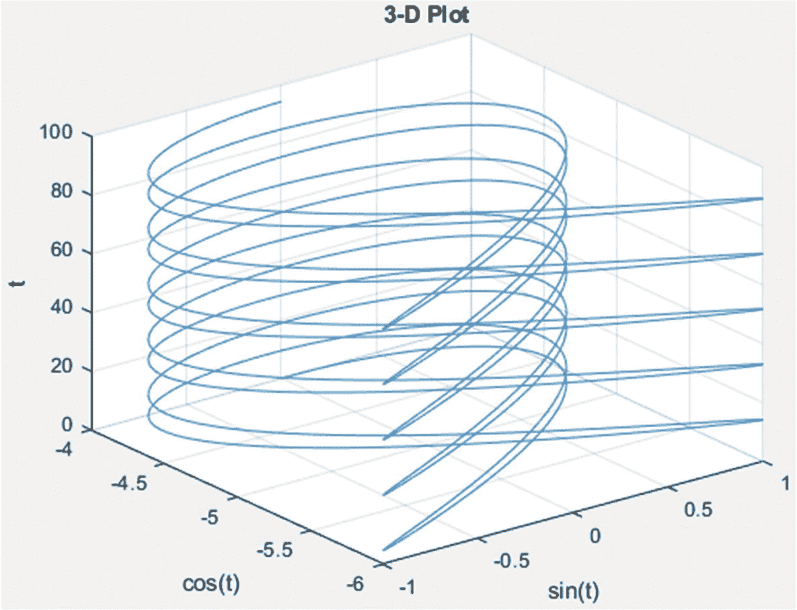

图 7-1
`Example7p1` 的输出

在 MATLAB 中，有两个重要的函数可以生成包含两个变量的值，即 `peaks` 和 `meshgrid`。

函数 `peaks(x,y)` 默认通过高斯分布产生一个 49 × 49 的矩阵。函数 `meshgrid(x,y)` 复制网格向量 *x* 和 *y* 以生成完整的网格。

使用函数 `[X,Y,Z] = peaks(x,y,z)` 和 `[X,Y,Z] = meshgrid(x,y,z)`，也可以创建三个变量。

`示例 7-2.` 编写代码，在两个不同的图形窗口上绘制两个不同的函数。第一个图属于以下函数（绘制墨西哥草帽）：

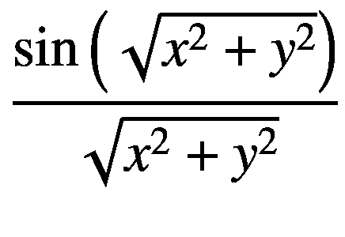

其中 *x* 和 *y* 在 -8 到 8 之间。第二个函数（绘制牛仔帽）为

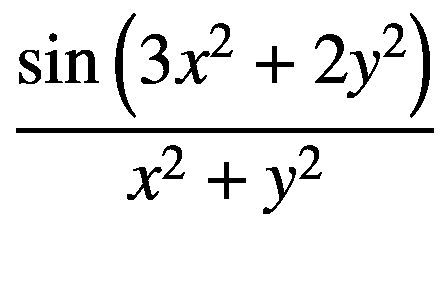

其中 *x* 和 *y* 在 -1.5 到 1.5 之间。

`解答 7-2.` 以下代码可用于完成给定任务。

`Example7p2.m`

```
%Example7p2

%This code uses meshgrid and surf

close all;

[x,y] = meshgrid(linspace(-8,8,30));

[xx,yy]=meshgrid(linspace(-1.5,1.5,30),...

linspace(-1.5,1.5,30));

z1 = sin (sqrt(x.²+y.²))./sqrt(x.²+y.²);

z2 = sin(3*xx.²+2*yy.²)./(xx.²+yy.²);

figure(1)

surf(z1), shading flat

title('Mexican Hat');

figure(2)

surf(z2), shading faceted

title('Cowboy Hat');

% other possible shadings: flat, faceted, interp
```

代码运行后，结果输出如图 7-2 和 7-3 所示。

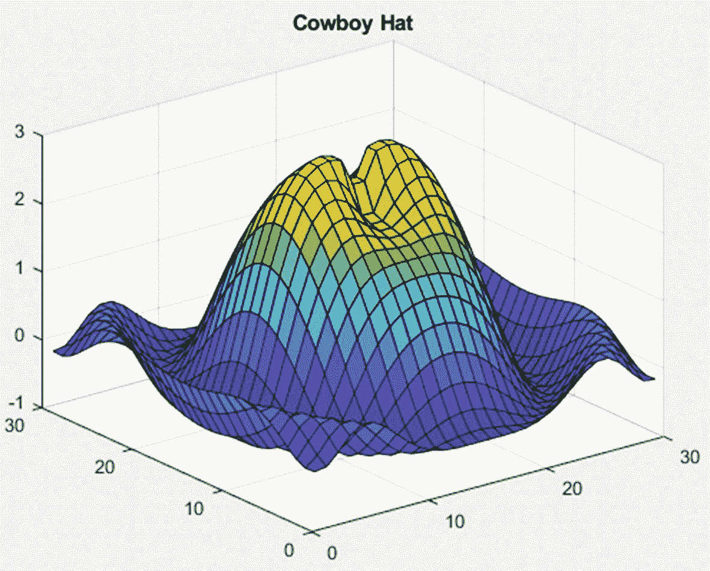

图 7-3
`Example7p2` 的第二个输出

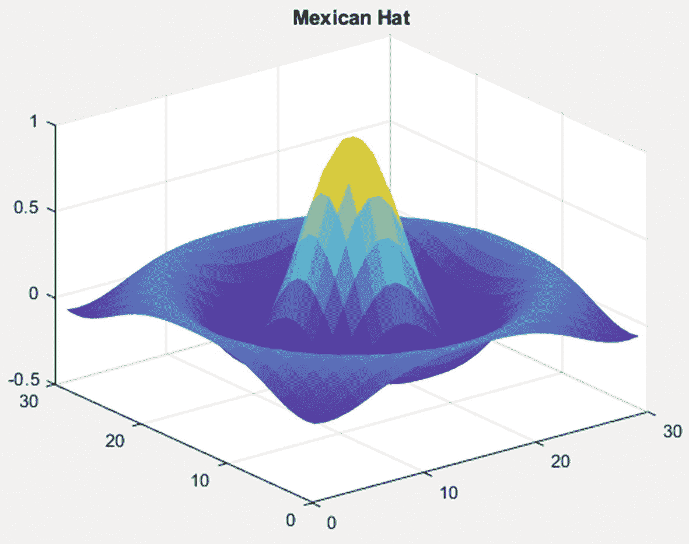

图 7-2
`Example7p2` 的第一个输出

## 动画

有三种技术可用于使用数据创建动画：更新坐标、应用变换和创建影片。

### 更新坐标

在此类动画中，对象属性会在循环中被更新和调用。这些属性大多是 `x` 和 `y` 坐标的数据，如示例 7-3 所示。

`示例 7-3.` 考虑以下函数。

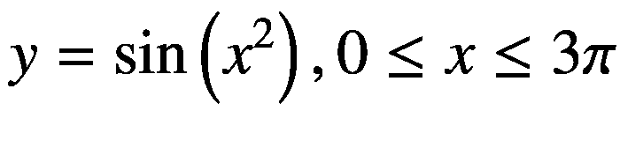

编写代码，通过改变其系数来制作函数 `y` 的动画。

`解答 7-3.` 以下代码可用于完成给定任务。

`Example7p3.m`

```
%Example7p3

%This code animates 2-D

x = 0:0.05:3*pi;

y = sin(x.²);

N = length(x);

for i=1:N

y_plot = (i/N)*y;

plot(x,y_plot)

axis([0,3*pi,-1,1]);

xlabel('x values')

ylabel('y values')

title('Animating 2-D')

pause(0.02)

end

grid on
```

在上述代码中，函数 `y` 的系数从 `1/189` 到 1 被绘制出来。在循环中的每次绘图之后，`pause(0.02)` 命令会让计算机暂停 0.02 秒，以便在视觉上观察每一帧的变化。

代码运行后，绘图将呈现动画效果。图 7-4 所示的图形是动画的最后一帧。

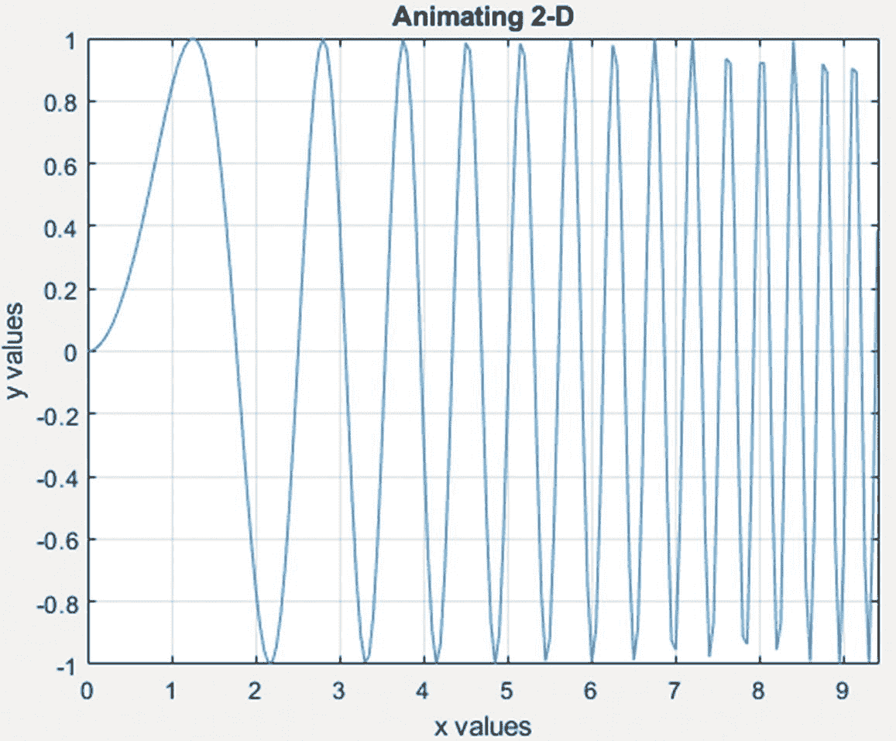

图 7-4

`Example7p3` 的运行结果快照

`示例 7-4.` 编写使用 `drawnow` 函数来展示动画的代码。代码应在一个圆上绘制线条。

`解答 7-4.` 以下代码可用于完成给定任务。

`Example7p4.m`

```
%Example7p4

%This code animates 2-D

N=100;

Angle = linspace(-pi,pi,N);

xc = sin(Angle);yc = cos(Angle);

plot(xc,yc);axis equal

xt = [1 1 1 1];yt = [0 0 0 0];

hold on

t = area(xt,yt); % initialize flat triangle

for j = 1:N

xt(j) = xc(j); % determine new vertex value

yt(j) = yc(j);

t.XData = xt; % update data
```

# 最终帧与动画创建技术

t.YData = yt; % 更新数据

drawnow % 显示更新

end

title('Final Frame of Animation')

```

在上述代码中，`area` 函数用于绘制 `yt` 值相对于 `xt` 值的图形，并填充 0 与 `yt` 之间的区域。在 `for` 循环内部，绘制的数据被更新，并通过 `drawnow` 函数进行显示。代码运行后，将得到图 7-5 所示的输出，这是该代码动画的最后一帧。

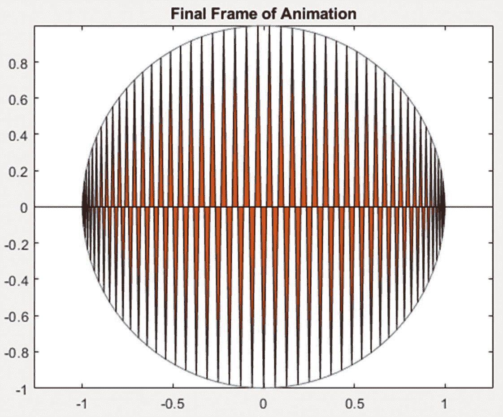

图 7-5

Example7p4 的运行结果快照

## 应用变换

在此技术中，对对象应用变换。`hgtransform` 函数用于创建变换对象。

### 示例 7-5

编写代码，使用 `hgtransform` 创建一个 3D 星形围绕 `z` 轴旋转，同时星形从大尺寸缩放到小尺寸的动画。

### 解答 7-5

以下代码可用于完成给定任务。

*Example7p5.m*

```matlab
%Example7p5
%This code uses hgtransform function
ax = axes('XLim',[-1.5,1.5],...
    'YLim',[-1.5,1.5],'ZLim',[-1.5,1.5]);
view(3) %sets for 3-d view
grid on
[x,y,z] = cylinder([.1 0]);
h(1) = surface(x,y,z,'FaceColor','yellow');
h(2) = surface(x,y,-z,'FaceColor','cyan');
h(3) = surface(z,x,y,'FaceColor','magenta');
h(4) = surface(-z,x,y,'FaceColor','green');
h(5) = surface(y,z,x,'FaceColor','blue');
h(6) = surface(y,-z,x,'FaceColor','red');
t = hgtransform('Parent',ax);
set(h,'Parent',t)
Rz = eye(4);Sxy = Rz;
for r = 1:.1:2*pi
    Rz = makehgtform('zrotate',r);
    % Scaling matrix
    Sxy = makehgtform('scale',r/5);
    set(t,'Matrix',Rz/Sxy)
    drawnow
    pause(0.02)
    if r == 3.6
        f = getframe;
    end
end
imshow(f.cdata)
title('Frame at r=3.6')
```

代码运行后，将得到图 7-6 所示的输出。

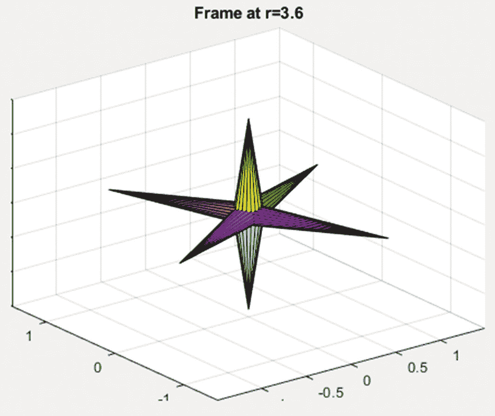

图 7-6

示例 7-5 的输出

## 创建视频

创建视频是另一种对数据进行动画处理的方法。在此方法中，使用 `getframe` 函数获取每次迭代中每幅绘图的图像。然后，使用 `movie` 函数创建动画。

### 示例 7-6

对于以下给出的函数

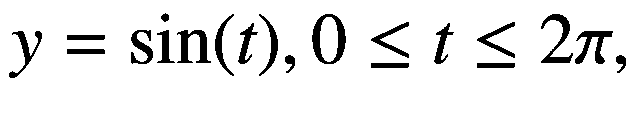

编写代码以视频形式制作函数 `y` 的动画。

### 解答 7-6

以下代码可用于完成给定任务。

*Example7p6.m*

```matlab
%Example7p6
%This code creates a movie
t=linspace(0,2*pi,1000);Count=1;
figure('Name',...%'NumberTitle','off')
    'Original Draw','Menu','none')
for freq=0:0.1:2*pi
    y=sin(freq*t);
    plot(t,y);
    xlabel('2 pi');ylabel('Results');
    axis([0,2*pi,-1,1])
    Script1=sprintf('y(t)=sin(%.1f t)',freq);
    title('Sinusoidal Function');
    text(1,0.5,Script1)
    M(Count)=getframe;Count=Count+1;
end
figure('Name',...
    'Playing Created Animation twice','Menu','none')
movie(M,2);
```

代码运行后，输出如图 7-7 所示。

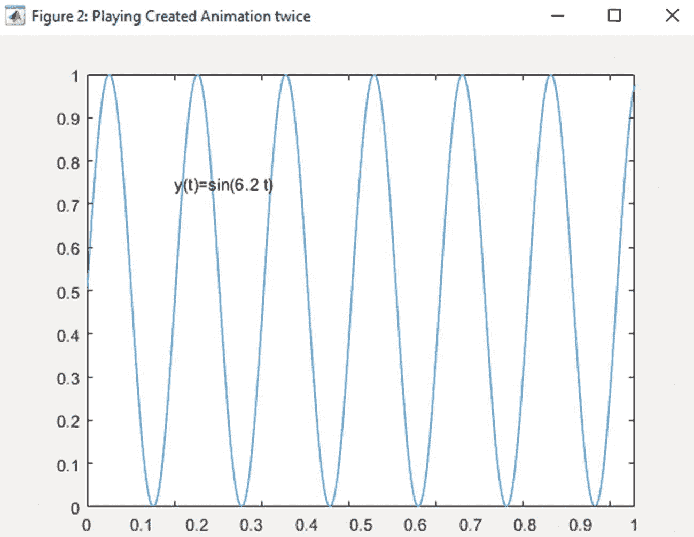

图 7-7

程序 Example7p6 的第二个输出

当您想要保存所创建的视频时，可以使用 `writeVideo` 和 `VideoWriter` 函数。

### 示例 7-7

使用 `peaks` 和 `surf` 函数创建一个视频。然后，将该视频保存为 `*.avi` 文件。

### 解答 7-7

以下代码可用于创建 `*.avi` 文件。

*Example7p7.m*

```matlab
%Example7p7
%This code saves the movie as *.avi
myVideo = VideoWriter('myfile.avi');
uncompressedVideo = VideoWriter('myfile.avi',...
    'Uncompressed AVI');
myVideo.FrameRate = 40;
myVideo.Quality = 100;
open(myVideo); % Open file to write
L = peaks;
surf(L);
axis tight manual
set(gca,'nextplot','replacechildren');
for m = 1:60
    surf(sin(2*pi*m/20)*L,L)
    frame = getframe;
    writeVideo(myVideo, frame);
end
close(myVideo);%close file
```

在此代码中，函数`VideoWriter`创建一个视频写入对象。该对象的类与其名称相同，即`VideoWriter`。使用函数`writeVideo`，将帧写入该文件。代码执行后，会在当前目录下创建并保存一个名为`myfile.avi`的文件。

## 习题

- **7.1.** 考虑此处给出的三维函数。
    `0 ≤ t ≤ 2π`, `x = sin(2t)`, `y = cos(3t)`, `z = 5t`
    - 在单个图形中绘制`x`、`y`和`z`的图表。
- **7.2.** 考虑以下函数。
    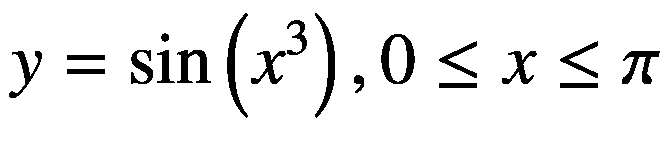
    - 编写代码，通过改变其系数来制作函数`y`的动画。
- **7.3.** 编写使用`drawnow`函数来展示动画的代码。代码应在一个正方形上绘制线条。
- **7.4.** 编写代码，使用`hgtransform`函数创建一个3D星形围绕`y`轴旋转，同时星形从小尺寸缩放至大尺寸的动画。
- **7.5.** 对于以下给出的函数
    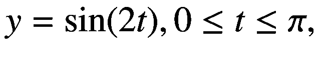
    - 编写代码，以视频形式将函数`y`的动画播放两次，并保存所创建的动画。


