# 8. 计算生物学

计算生物学是应用科学的一个分支，它结合了理论方法、数学建模和计算机科学的应用，以解决生物、生态、社会和行为的各种问题。在本章中，我们将看到一些使用MATLAB代码编写的应用实例。通过几个例子说明了细菌生长和种群模型。然后，介绍了包括寄主-寄生蜂模型、生物信息学、捕食者-猎物模型和流行病模型等主题。

## 细菌生长与种群模型

细菌生长或种群模拟可以使用微分方程建模。理想情况下，细菌生长可以表示为 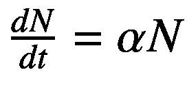，其中`N`是时间`t`时的细胞数量，`α`是生长速率常数。该模型是一个一阶微分方程模型，其解为`N = N[0] ∗ e^(αt)`，其中`N[0]`是初始条件。对于数值解，可以使用MATLAB的ODE求解器。该方程也可用于种群建模。

**示例 8-1.** 对于 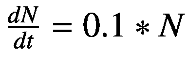，其中`N`代表细菌细胞数量，编写代码绘制细菌细胞数量增长的图形。初始细胞数量为100，时间范围为1到20。代码还应使用`ode45`求解器绘制数值解。精确解和数值解应显示在同一张图上。

**解法 8-1.** 以下代码可用于完成给定任务。
`Example8p1.m`
```matlab
%Example8p1
%This code solves first-order ODE
%which models Bacterial Growth
clear all;close all;
time=0:0.1:20;
Alpha=0.1;% Grow Rate
N_0=100;%initial condition
N=N_0*exp(Alpha*time); %Exact Solution
[x,y]=ode45(@MyFunc,[0,20],100);
plot(time,N,x,y,'ro');
xlabel('time:t');title('Population Changes');
ylabel('Population');grid on;
function Out=MyFunc(x,y)
Alpha=0.1;
Out=Alpha*y;
end
```

执行代码后，将得到如图8-1所示的输出。
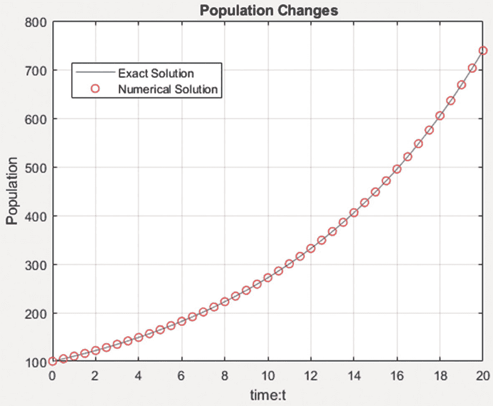
图8-1 解析解与数值解

在图8-1中，红色圆圈表示数值解，蓝色线条表示精确解。它们彼此非常接近，这让我们对变化的产生方式有了一定了解。

读者可能会质疑如此求解数值解的原因。在某些情况下，你或许不知道问题的精确解或解析解，甚至可能根本不存在解。在这种情况下，你可能需要了解解的大致形态。对此，你可以使用数值方法或数值解，以特定精度找到问题的答案。由于解的不精确性，数值解有时也被称为近似解。

微分方程，
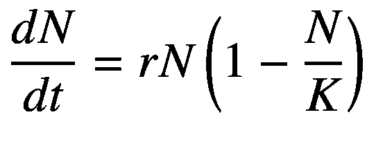 (1)
称为**逻辑增长**或**逻辑斯谛方程**，其中`K`是环境容量，`r`是增长率。该模型可用于细菌生长或种群模型。该逻辑斯谛方程的解为 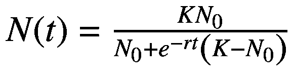。

**示例 8-2.** 编写代码求解逻辑斯谛方程，其中`K = 100`, `r = 0.1`, `N[0] = 2`，时间范围为1到100。代码应对解析解进行动态显示。然后，数值解和解析解应绘制在同一张图上。

**解法 8-2.** 以下代码可用于完成给定任务。
`Example8p2.m`
```matlab
%Example8p2
%This code solves logistic equation
clear all;close all;
K=500;% environmental capacity
N0=2;% Initial population size
r=0.1;% growth rate
time=linspace(1,100,100);
%N=zeros(1,length(time));
% analytic (exact) solution
for i=1:length(time) % Animation part
N(i)=K/(1+(K/N0-1)*exp(-r*time(i)));
plot(N,'b');
drawnow
end
[Tode,Node]=ode45(@lge,[1 100],2);
plot(time,N,Tode,Node,'r');
xlabel('Time');title('Population Changes');
ylabel('Population');grid on;
legend('Analytical Solution',...
'Numerical Solution');
function dN=lge(T,N)
r=0.1;
K=500;
dN=r.*N.*(1-N/K);
end
```

执行代码后，我们将得到如图8-2所示的输出。
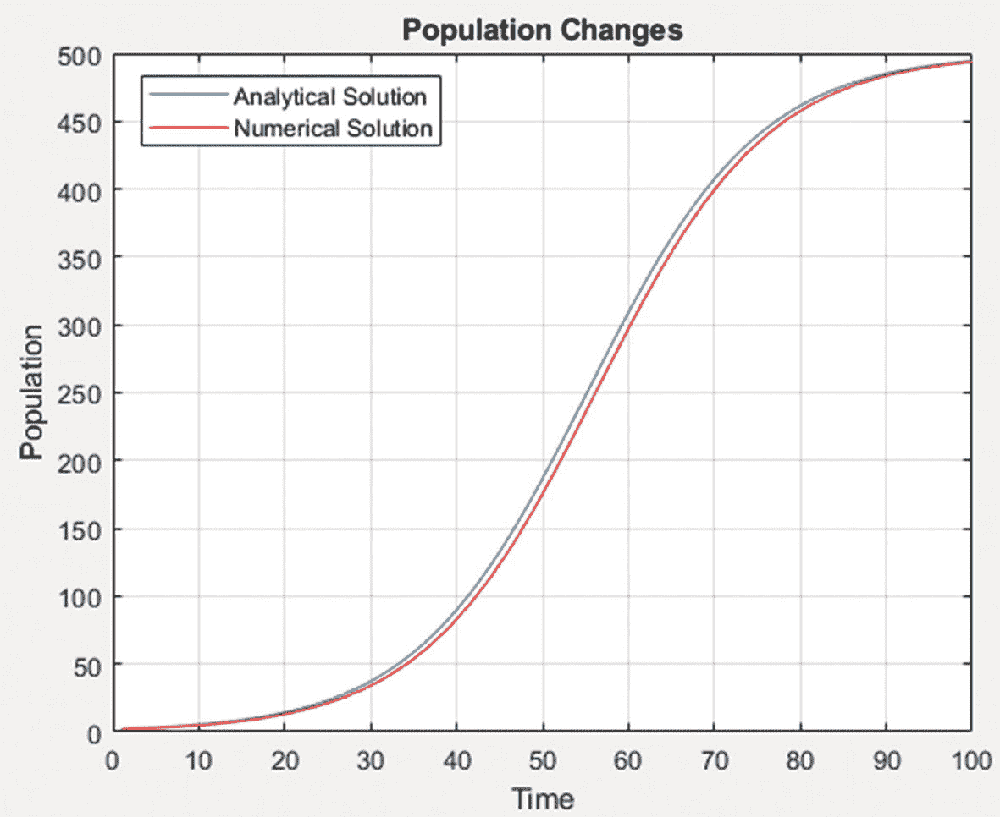
图8-2 逻辑增长的图形

## 宿主-寄生蜂模型

寄生蜂是一种与宿主紧密共栖以从中获益的生物。寄生蜂及其宿主通常相互利用。*Nicholson-Bailey 模型*是一个用于模拟宿主-寄生蜂关系的离散时间模型。
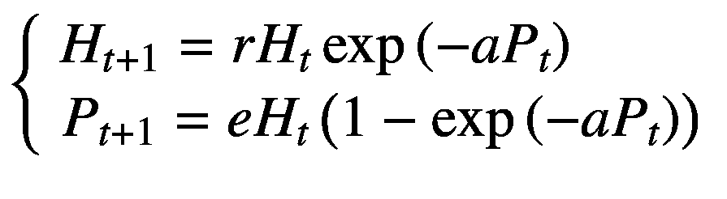 (2)
在方程2中，`H[t]`表示第`t`代宿主物种的密度，`P[t]`表示第`t`代寄生蜂生物的密度。此外，`r`是宿主产卵数量，`e`是寄生蜂产卵数量，`a`是比例常数。

**示例 8-3.** 编写代码模拟Nicholson-Bailey模型。宿主和寄生蜂的初始种群分别为22和10。世代数为25。系数为`e = 1`, `a = 0.0069`, `r = 2`。

**解法 8-3.** 以下代码可用于完成给定任务。
`Example8p3.m`
```matlab
%Example8p3
%This code solves Nicholson-Bailey model
clear all;close all;
e=1; a=0.069; r=2;
Ngens=25;  %number of generations
time=1:1:Ngens;
H=zeros(1,Ngens); P=zeros(1,Ngens);
```

P(1)=10; H(1)=22; %initial conditions

for t=1:Ngens-1
H(t+1)=r*H(t)*exp(-a*P(t));
P(t+1)=e*H(t)*(1-exp(-a*P(t)));
end

plot(time,H,'r',time,P,'b');
legend('Host','Parasitoid');
xlabel('Generation t');ylabel('Population');
title('Nicholson-Bailey Model');grid on;

```
执行代码后，我们将得到如图 8-3 所示的输出。

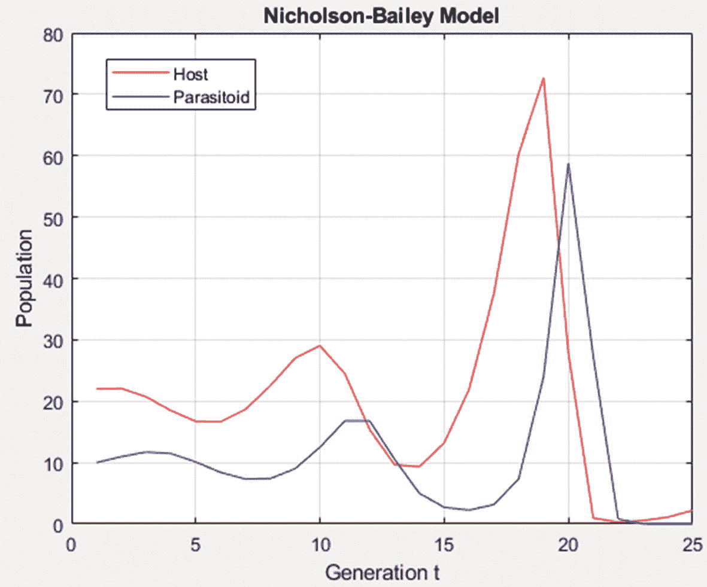

图 8-3 Nicholson-Bailey 模型的图形

## 生物信息学

生物信息学是一个广泛的交叉学科领域。它开发包括算法和软件在内的方法来理解生物学数据。全面涉及该主题的内容超出了本书的范围。本节介绍与分子生物学基因相关的几个应用。

### 基因组测序

基因由脱氧核糖核酸（DNA）构成。DNA 有四种不同的碱基（核苷酸）：腺嘌呤（A）、胸腺嘧啶（T）、鸟嘌呤（G）和胞嘧啶（C）。在 DNA 链上，A 与 T 配对，G 与 C 配对，反之亦然。基因组测序用于研究 DNA 中核苷酸的排列顺序。

**示例 8-4.** 给定一段 DNA 序列 `TCAGGGAATTCCTACTTTTGTATTCGCCAG`。编写代码将该序列转录为 RNA。

**解法 8-4.** 如果在 MATLAB 中安装了 Bioinformatics Toolbox，那么只需使用内置函数，就能轻松将代码转录为 `rna`。不过，在本解法中，我们将自行编写所有必需的代码。

*Example8p4.m*

```matlab
%Example8p4
%This code transcribes DNA code to RNA
Seq='TCAGGGAATTCCTACTTTTGTATTCGCCAG';
Result = MyDNA2RNA(Seq);
fprintf('DNA : %s\n',Seq')
fprintf('RNA : %s\n',Result')
```

此处，序列 `Seq` 被传递给所定义的函数 `MyDNA2RNA`。该函数保存在另一个文件中，以便也可在其他示例中使用。该函数执行转录操作。得到结果后，代码会同时打印原始代码和转录后的代码。

*MyDNA2RNA.m*

```matlab
function [Result]=MyDNA2RNA(Seq)
L=length(Seq);
Result ="";
for i=1:L
    switch Seq(i)
        case 'A'
            Result(i) = 'U';
        case 'T'
            Result(i) = 'A';
        case 'G'
            Result(i) = 'C';
        case 'C'
            Result(i) = 'G';
        otherwise
            disp('Code has WRONG Letter');
    end
end
end
```

代码执行后，我们得到以下输出。

```
>> Example8p4
DNA : TCAGGGAATT C CTA C TTT T GTATTCGCCAG
RNA : AGUCCCUUAAGGAUGAAAACAUAAGCGGUC
>>
```

**示例 8-5.** 给定一段 DNA 序列 `TCAACCGGTCGTAGCTAC`。编写代码将其转录为 RNA。然后，使用遗传密码表（图 8-4）将其翻译为氨基酸序列。最后，代码应在屏幕上显示最终的序列。

**解法 8-5.** 在遗传密码表中，核苷酸每三个一组被分隔开。每一组称为一个*密码子*。除了 `UAA`、`UAG` 和 `UGA` 之外，每个密码子都对应一个氨基酸。这三个密码子被称为*无义密码子*。

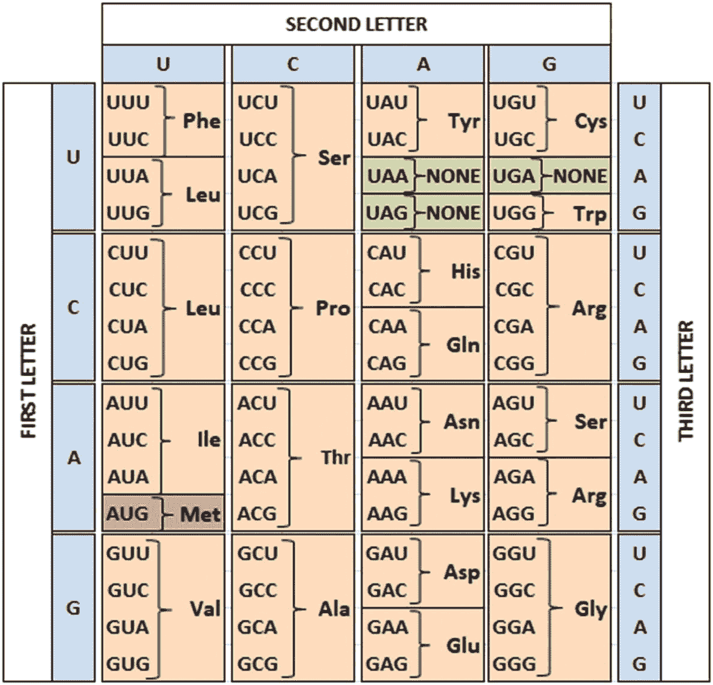

图 8-4: 遗传密码表

所有氨基酸均以三字母缩写形式列于图 8-4 中。例如，`AUU` 代表异亮氨酸，缩写为 `Ile`。也可以用其首字母 `I` 来表示。然而，有些氨基酸以相同的字母开头。这些氨基酸被分配了不同的单字母。这些单字母编码取自 MATLAB 官方网站。在本示例中，我们将用三字母和单字母两种形式来展示每个氨基酸。

*Example8p5.m*

```matlab
%Example8p5
%This code transcribes DNA code to RNA
Seq='TCAGGGAATTCCTACTTTTGTATTCGCCAG';
Convert = MyDNA2RNA(Seq);
fprintf('DNA : %s\n',Seq');
fprintf('RNA : %s\n',Convert);
Codons = MyCodons(Convert);
disp('Codons :');
disp(Codons);
[Codn3,Codn1]= GeneticCode(Codons);
disp('Amino Acids with 3 codes');
disp(Codn3);
disp('Amino Acids with 1 code');
disp(Codn1);
```

在上述代码中，定义了三个函数：`MyDNA2RNA`、`MyCodons` 和 `GeneticCode`。第一个函数与上一个问题中的函数相同。另外两个函数如下所示。

*MyCodons.m*

```matlab
function [Out] = MyCodons(Seq)
%This function takes the sequence
%and returns them as codons
L=length(Seq);
Subst=mod(L,3);
Seq2=cell(1,(L-Subst)/3);
for k=1:(L/3)
    Seq2{k} = Seq(3*k-2:3*k);
end
Out = Seq2;
end
```

*GeneticCode.m*

```matlab
function [Out1,Out2] = GeneticCode(Seq)
L=length(Seq);%Below are 20 amino acids
Seq2=cell(1,L);Seq3=cell(1,L);
Phe=['UUU','UUC'];Ile=['AUU','AUC','AUA'];
Leu=['UUA','UUG','CUU','CUC','CUA','CUG'];
Met=['AUG'];NONE=['UAA','UAG','UGA'];
Val=['GUU','GUC','GUA','GUG'];
Ser=['UCU','UCC','UCA','UCG','AGU','AGC'];
Pro=['CCU','CCC','CCA','CCG'];
Thr=['ACU','ACC','ACA','ACG'];
Ala=['GCU','GCC','GCA','GCG'];
Tyr=['UAU','UAC'];His=['CAU','CAC'];
Gln=['CAA','CAG'];Asn=['AAU','AAC'];
Lys=['AAA','AAG'];Asp=['GAU','GAC'];
Glu=['GAA','GAG'];Cys=['UGU','UGC'];
Arg=['CGU','CGC','CGA','CGG','AGA','AGG'];
Gly=['GGU','GGC','GGA','GGG'];Trp=['UGG'];
for i=1:(L)
    if contains(Seq(i),Phe)
        AA='Phe';Aa='F';
    elseif contains(Ile,Seq(i))
        AA='Ile';Aa='I';
    elseif contains(Leu,Seq(i))
        AA='Leu';Aa='L';
    elseif contains(Met,Seq(i))
        AA='Met';Aa='M';
    elseif contains(NONE,Seq(i))
        AA='NON';Aa='-';
    elseif contains(Val,Seq(i))
        AA='Val';Aa='V';
    elseif contains(Ser,Seq(i))
        AA='Ser';Aa='S';
    elseif contains(Pro,Seq(i))
        AA='Pro';Aa='P';
    elseif contains(Thr,Seq(i))
        AA='Thr';Aa='T';
    elseif contains(Ala,Seq(i))
        AA='Ala';Aa='A';
    elseif contains(Tyr,Seq(i))
        AA='Tyr';Aa='Y';
```

elseif contains(Gln, Seq(i))
AA = 'Gln'; Aa = 'Q';
elseif contains(Lys, Seq(i))
AA = 'Lys'; Aa = 'K';
elseif contains(Glu, Seq(i))
AA = 'Glu'; Aa = 'I';
elseif contains(Arg, Seq(i))
AA = 'Arg'; Aa = 'R';
elseif contains(Gly, Seq(i))
AA = 'Gly'; Aa = 'G';
else
AA = '---'; Aa = '-';
end
Seq2{i} = AA; Seq3{i} = Aa;
end
Out1 = Seq2; Out2 = Seq3;
end
```

代码运行后，会显示以下输出。
```
> Example8p5
DNA : TCAGGGAATTCCTACTTTTGTATTCGCCAG
RNA : AGUCCCUUAAGGAUGAAAACAUAAGCGGUC
Codons :
Columns 1 through 8
'AGU'    'CCC'    'UUA'    'AGG'    'AUG'    'AAA'    'ACA'    'UAA'
Columns 9 through 10
'GCG'    'GUC'
Amino Acids with 3 codes
Columns 1 through 8
'NON'    'Pro'    'Ile'    'Arg'    'Met'    'Lys'    'Thr'    'NON'
Columns 9 through 10
'Ala'    'Val'
Amino Acids with 1 code
'-'    'P'    'I'    'R'    'M'    'K'    'T'    '-'    'A'    'V'
>
```

一个连字符或三个连字符代表无义密码子。

**示例 8-6.** 从前一个示例中，序列为 `TCAACCGGTCGTAGCTAC`，去掉第一个字母，然后再次转录新序列。将得到的氨基酸写成一个单词，其中每个字母代表一个氨基酸。解释所得结果。

**解法 8-6.** 可以使用以下代码来完成给定任务。

*Example8p6.m*
```matlab
%Example8p6
%This code transcribes DNA code to RNA
Seq='TCAGGGAATTCCTACTTTTGTATTCGCCAG';
Seq2=Seq(2:end);
Convert = MyDNA2RNA(Seq2);
Codons = MyCodons(Convert);
[Codn3,Codn1]= GeneticCode(Codons);
MySeq=";
for k=1:length(Codn1)
MySeq(k)=Codn1{k};
end
disp('Original Sequence:');disp(Seq);
disp('Updated Sequence');disp(Seq2);
disp('Obtained Amino Acids:');disp(MySeq);
```

此处的 `MyDNA2RNA`、`MyCodons` 和 `GeneticCode` 函数与之前使用的函数相同。代码运行后，得到以下输出。
```
> Example8p6
Original Sequence:
TCAGGGAATTCCTACTTTTGTATTCGCCAG
Updated Sequence
CAGGGAATTCCTACTTTTGTATTCGCCAG
Obtained Amino Acids:
VL-R-KIKR
>
```

如图所示，此处得到的氨基酸与上一个问题中得到的氨基酸不同。这表明，如果序列中缺失了任何一个碱基，转录后将得到完全不同的序列。

### 点阵图

点阵图用于展示给定两个序列的比较结果。为了绘制图形，通常会生成一个二维矩阵，因此得到的图形也是二维的。第一个给定序列放置在矩阵的行上，第二个给定序列放置在矩阵的列上。在矩阵中，`1` 表示匹配，`0` 表示不匹配。

**示例 8-7.** 对于给定的两个序列 `Seq1=AATGCAATT` 和 `Seq2=ATTGACT`，编写代码以打印出点矩阵并绘制点阵图。在图形中，匹配点应显示为红色，不匹配点应显示为蓝色。

**解法 8-7.** 以下代码可用于完成给定任务。

*Example8p7.m*
```matlab
%Example8p7
%This code creates dot matrix and dot plot
Seq1='AATGCAATT';Seq2='ATTGACT';
X=length(Seq1);Y=length(Seq2);
DotMatrix=zeros(Y,X);
for i=1:Y
Places=strfind(Seq1,Seq2(i));
DotMatrix(i,Places)=1;
end
disp('The Dot Matrix:');
disp(DotMatrix);figure;hAxes=gca;
imagesc(hAxes,DotMatrix);
colormap(hAxes,[0,0,1;1,0,0]);
ylabel(fliplr(Seq2));title(Seq1);
```

在上述代码中，使用 `strfind` 命令找到了 `Seq2` 变量中每个元素的匹配位置。然后，在这些位置将 `DotMatrix` 中的值赋为 `1`。创建矩阵后，使用 `figure` 函数生成图形。`gca` 命令用于处理当前图形的坐标轴，并通过 `imagesc` 函数使用缩放颜色显示图形。使用 `colormap` 命令为当前图形分配匹配和不匹配的颜色。`Seq2` 变量的顺序使用 `fliplr` 命令反转，并将其放置在 *y* 轴上，同时 `Seq2` 变量作为标题显示。

执行代码后，我们将得到以下输出。
```
> Example8p7
The Dot Matrix:
1     1     0     0     0     1     1     0     0
0     0     1     0     0     0     0     1     1
0     0     1     0     0     0     0     1     1
0     0     0     1     0     0     0     0     0
1     1     0     0     0     1     1     0     0
0     0     0     0     1     0     0     0     0
0     0     1     0     0     0     0     1     1
>
```

```
然后会显示图 8-5 所示的图像。

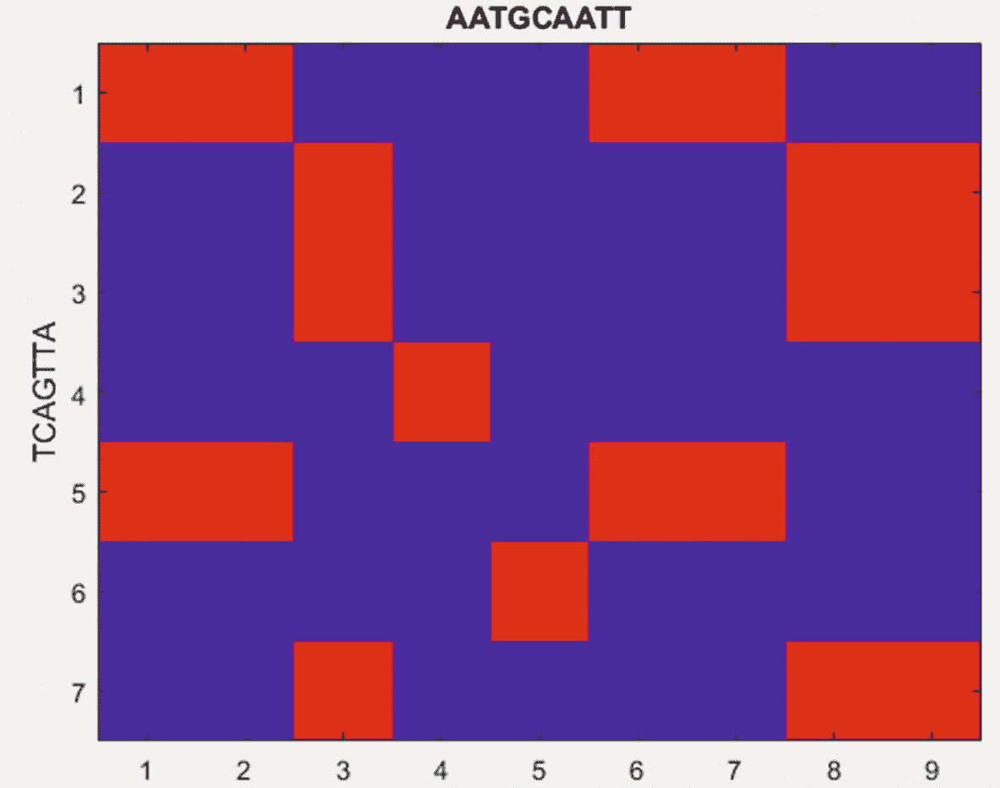

图 8-5 点矩阵的点阵图

## 捕食者–猎物模型

捕食者基本上是指为了生存而吃掉其他生物的有机体。猎物则是被捕食者吃掉的有机体。捕食者与猎物之间的一些例子可以是狮子与斑马、老虎与水牛、鲨鱼与鱼类。

### 两种群模型

用于描述捕食者与其猎物之间关系的最著名模型是洛特卡-沃尔泰拉方程。

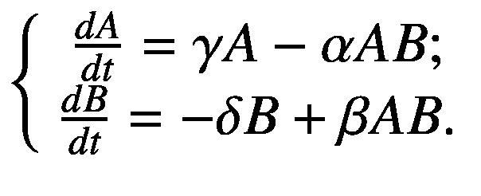

`(3)`

`A(t)` 表示时间 `t` 时猎物的种群规模，`B(t)` 表示时间 `t` 时捕食者的种群规模。在方程中，`γ` 是猎物种群的增长率，`α` 是捕食率，`δ` 是捕食者的死亡率，`β` 是捕食者的繁殖率。

如果对所示的洛特卡-沃尔泰拉方程进行解读，可以得出以下结论。

*   在方程 3 中，如果没有捕食者，假设 `B(t) = 0`，那么猎物种群呈指数增长。

*   在方程 3 中，如果没有猎物存在，即 `A(t) = 0`，那么捕食者种群呈指数下降。

洛特卡-沃尔泰拉方程是非线性一阶微分方程。对于此类非线性微分方程，由于非线性的性质，通常难以找到解析解。尽管有报道称在这些方程的一些假设下存在解析解，但在本节中，我们将借助 `MATLAB` 的数值求解器来求解洛特卡-沃尔泰拉方程。

**示例 8-8.** 对于给定的方程 3，编写代码以模拟捕食者和猎物种群规模随时间的变化。捕食者和猎物的初始种群规模分别为 10 和 100。时间跨度设为 0 到 50。其他系数给定为 `γ = 0.4`、`α = 0.4`、`δ = 2.0` 和 `β = 0.1`。对所得图形进行解释。图形标题应为“捕食者-猎物模型”，且图形上不应有菜单栏。

**解法 8-8.** 以下代码可用于完成给定任务。

`Example8p8.m`

```matlab
%Example8p8

%This code solves Lotka-Volterra equations

y0 = [100;10];%initial populations

[t,x] = ode45(@LVfunc,[0 50],y0);

A = x(:,1);%Prey

B = x(:,2);%Predator

figure('Name','Predator-Prey Model',...

'NumberTitle','off','MenuBar', 'none');

plot(t,A,'-o',t,B,'r-');grid on;

legend('Preys','Predators');

title('Population Along With Time')

xlabel('Time');ylabel('Population');

function dxdt = LVfunc(t,x)

gama = 0.4; alpha = 0.4;

delta = 2.0; beta = 0.1;dxdt=[0;0];

dxdt(1)=gama*x(1)-alpha*x(1)*x(2);%prey

dxdt(2)=-delta*x(2)+beta*x(1)*x(2);%predators

end
```

运行代码后，将显示图 8-6 所示的输出结果。

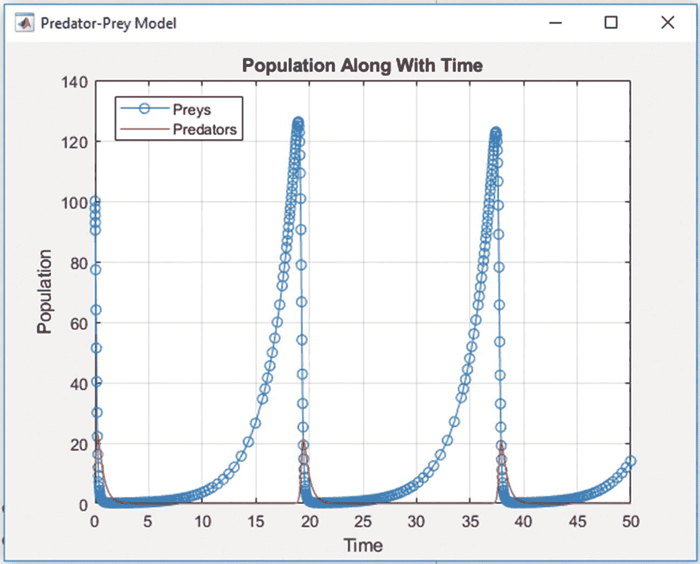

图 8-6 捕食者-猎物种群模型

在图 8-6 中，我们看到捕食者和猎物的初始种群规模分别为 100 和 10。为了更清晰地观察初始时刻水平方向的变化，在代码的第九行，我们可以使用 `semilog` 函数代替 `plot` 函数。仅更改这两个函数，即可得到图 8-7 所示的图形。

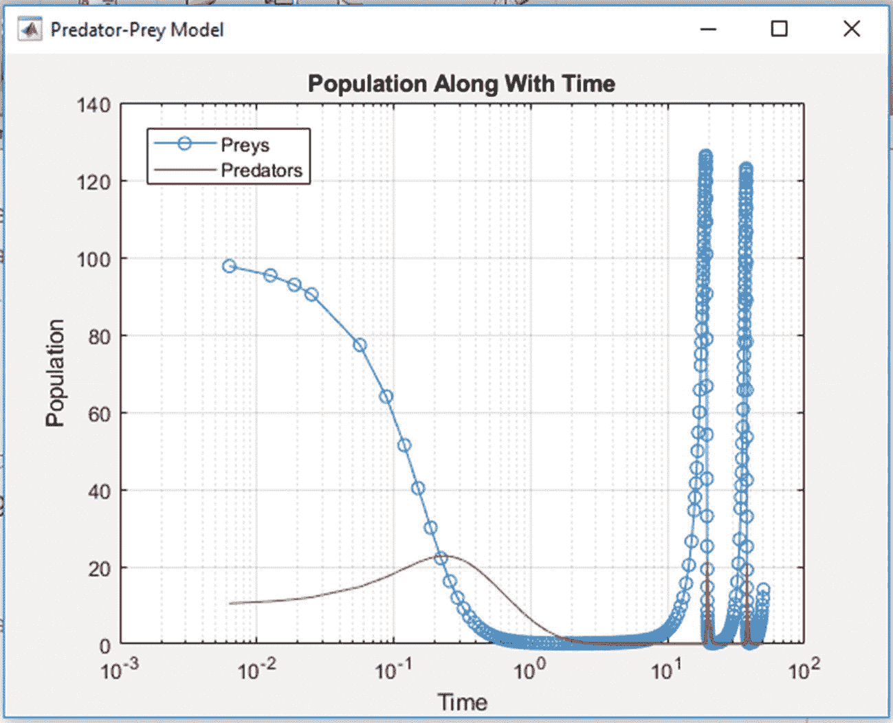

图 8-7 使用 `semilog` 绘制的捕食者-猎物种群图

图 8-6 和图 8-7 使用了相同的 `x` 和 `y` 值。在第二张图中，`x` 轴使用了以 10 为底的对数刻度值。

在图 8-7 中，我们清晰地看到，从初始时刻开始，猎物种群呈指数下降，而捕食者种群则相对于猎物下降的速度缓慢增长。在时间等于 1 之前，捕食者和猎物的种群规模变得相等。至于剩余时间或长期趋势，我们可以参考图 8-6。

随着猎物种群数量增加，经过一段时间后，捕食者的种群数量也随之增加。捕食者捕食猎物的速度超过了猎物繁殖的速度。结果，猎物种群开始下降。因此，捕食者的食物供应减少，它们的种群数量也开始下降。一段时间后，整个场景开始重复，种群数量随时间表现出可预测的行为。

### 三种生物模型

存在一个针对三种生物的修正 Lotka-Volterra 模型。该模型由三个方程组成。

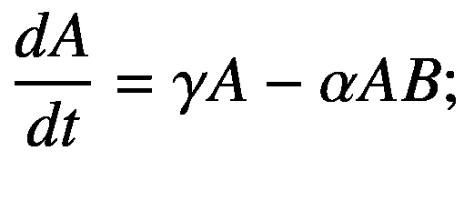

`(4)`

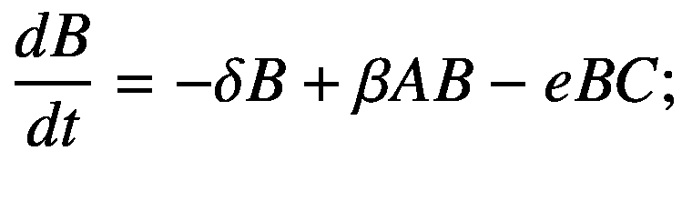

`(5)`

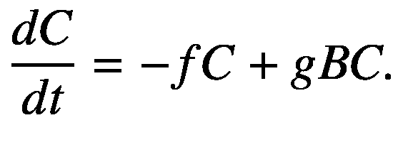

`(6)`

这里，`C` 是除前一节介绍的 `A` 和 `B` 之外的另一种生物体。当存在相互作用时，`C` 可以捕食捕食者 `B`。在没有捕食者的情况下，生物体 `C` 的数量可能会下降。根据方程 4、5 和 6，生物体 `A` 和 `C` 之间不存在相互作用。

**示例 8-9.** 对于给定的方程 4、5 和 6，编写代码以模拟捕食者、猎物和第三种生物体的种群数量随时间的变化情况。所有三种生物的初始种群数量均为 100。时间范围将从 0 到 60。其他系数给定为：`γ` = 0.4，`α` = 0.4，`δ` = 2.0，`β` = 0.2，`e` = 0.2，`f` = 0.1，`g` = 0.15。

**解答 8-9.** 以下代码可用于完成给定任务。

`Example8p9.m`

```matlab
%Example8p9

%Lotka-Volterra eqns with 3 species

clear all;close all;

y0 = [100;100;100];%initial populations

[t,x] = ode45(@LVfunc2,[0 60],y0);

A = x(:,1);%Prey

B = x(:,2);%Predator

C = x(:,3);%3rd Organism

figure('Name','Predator-Prey Model',...

'NumberTitle','off','MenuBar', 'none');

plot(t,A,'-o',t,B,'r-',t,C,'gx');grid on;

legend('Preys','Predators','3rd organism');

title('Population Along With Time')

xlabel('Time');ylabel('Population');
```

`LVfunc2.m`

```matlab
function dxdt = LVfunc2(t,x)

dxdt=[0;0;0]; gama = 0.4; alpha = 0.4;

delta = 2.0; beta = 0.2;

e=0.2;f=0.1;g=0.15;

dxdt(1)=gama*x(1)-alpha*x(1)*x(2);%prey

dxdt(2)=-delta*x(2)+beta*x(1)*x(2)-...

e*x(2)*x(3);%predators

dxdt(3)=f*x(2)*x(3)-g*x(3);%3rd organism

end
```

代码运行后，将显示图 8-8 中的输出结果。

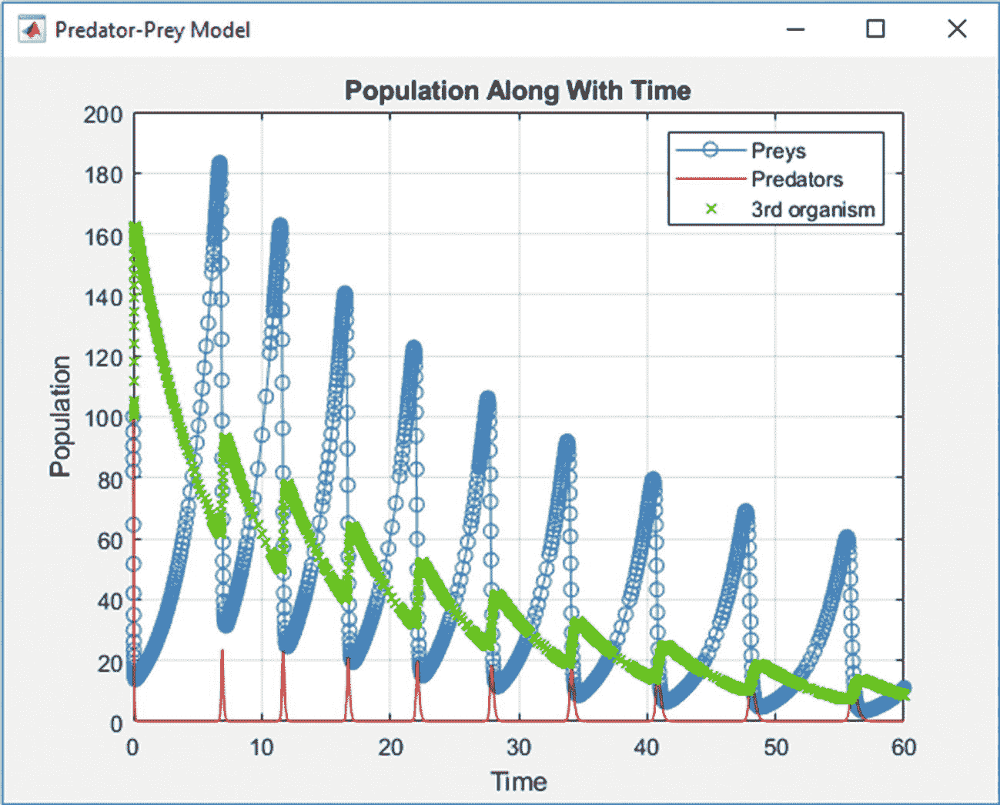
图 8-8 三种生物的种群数量

在图 8-8 中，我们可以看到种群数量的长期运行情况。仅通过观察此输出，我们可以说猎物和第三种生物的数量随时间推移而减少。然而，这张图具有误导性。如果我们把最终时间从 60 增加到 100，我们会看到每种生物的条形图趋于稳定，并且在一定时间后它们的行为变得可预测。我们可以在图 8-9 中看到这种情况，其中最终时间设置为 200。

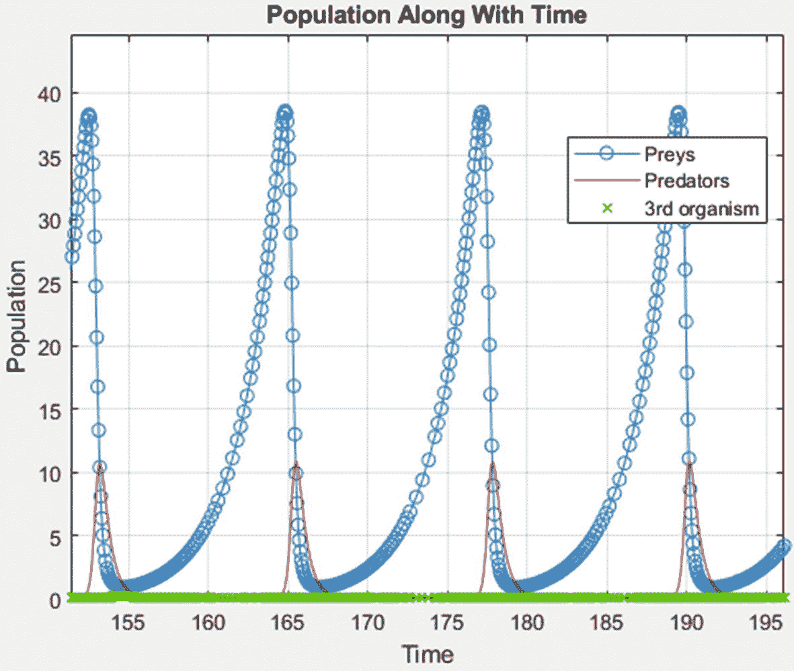
图 8-9 三种生物初始阶段的种群数量

对于动力学过程的初始阶段，我们可以查看图 8-10 中的输出。

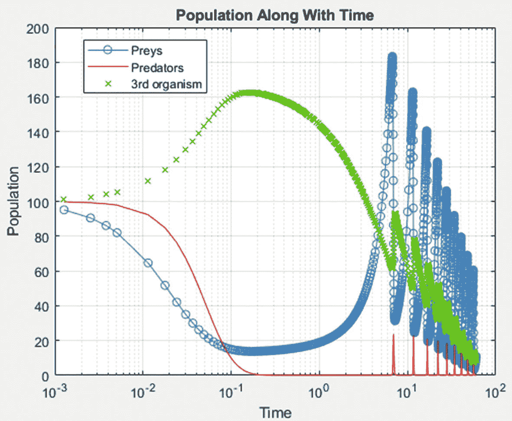
图 8-10 三种生物初始阶段的种群数量

## 流行病模型

本节介绍 `SI`、`SIS`、`SIR`、`SIRS` 以及 HIV 动态的流行病模型。

### SI 流行病模型

在此流行病模型中，存在两个不同的阶段：易感者（`S`）和感染者（`I`）。两种生物的总人数应等于总人口规模 `N`。换句话说，

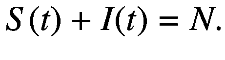
(7)

不考虑出生和死亡的 `SI` 模型具有以下形式：

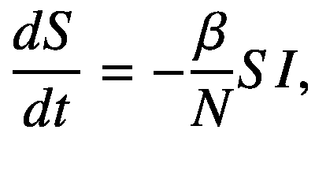
(8)

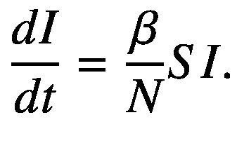
(9)

这里，`β/N SI` 表示在给定时间内因感染者导致的感染人数，`β` 是感染者在一定时间内的接触率。

**示例 8-10.** 对于给定的方程 7、8 和 9，编写代码以模拟 `SI` 阶段种群数量随时间的变化情况。易感者初始种群数量为 9，感染者初始种群数量为 1，总人口为 10。时间范围从 0 到 10，`β` = 0.9。

**解答 8-10.** 以下代码可用于完成给定任务。

`Example8p10.m`

```matlab
%Example8p10
%This code solves SI model
[t,x]=ode45(@SI,[0,10],[9,1]);
plot(t,x);grid on;
xlabel('time');title('SI Model');
ylabel('population');
legend('Susceptible','Infected','Recovered');
function Si=SI(t,x)
beta=.9;N=10;
%x(1)=susceptible group
Si(1,:)=-(beta/N)*x(1)*x(2);
%x(2)=exposed by infection
Si(2,:)=(beta/N)*x(1)*x(2);
end
```

代码运行后，将显示图 8-11 中所示的输出结果。

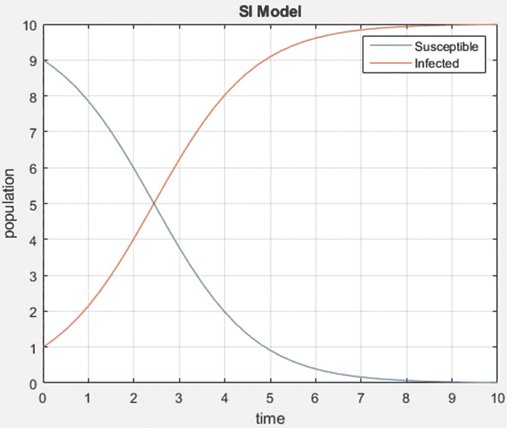
图 8-11 `SI` 模型的动态过程

如图 8-11 所示，感染者人数从 1 人开始，最终所有人群均被感染。相反，易感者人数从 9 人开始，到 10 天结束时减少到 0，因为每个人都从 `S` 阶段进入了 `I` 阶段。在此模型中，当时间趋于无穷大时，每个人都会被感染。因此，可以得出结论，该模型更适用于高度传染性疾病。

### SIS 流行病模型

在该流行病模型中，似乎存在三个阶段：易感（`S`）阶段、感染（`I`）阶段，然后再次进入易感（`S`）阶段。最后一个阶段实际上就是第一个阶段。因此，`SIS` 模型中实际上只存在两个阶段。所有被感染的生物体重新变得易感。这类模型更适用于通常在一个周期内会反复感染的疾病。

所有生物体的总数量应等于总人口规模 `N`。

不考虑出生和死亡的 `SIS` 模型形式如下：

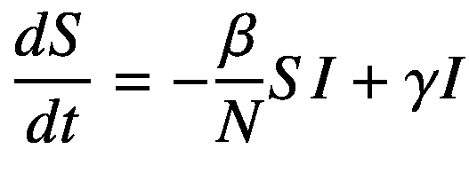
(10)

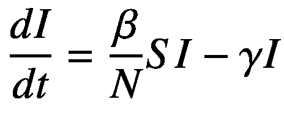
(11)

其中，`β` 是某一时刻由感染者造成的接触率，`γ` 是恢复率。

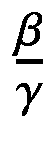 的比值称为*基本再生数 R[0]*。如果 `R[0]` > 1，疾病将流行；否则（`R[0]` ≤ 1），疾病将会消散。

**示例 8-11.** 针对给定的公式 10 和 11，编写代码来模拟 `SIS` 模型的人口规模。易感（`S`）和感染（`I`）状态的初始种群数分别为 9 和 1。时间跨度从 0 到 50。系数给定为 `γ` = 1.0 和 `β` = 0.9。

**解决方案 8-11.** 以下代码可用于完成给定任务。

`Example8p11.m`

```matlab
%Example8p11
%This code solves SIS model
[t,x]=ode45(@SIS,[0,10],[9,1]);
plot(t,x);grid on;
xlabel('time');
title('SIS Model with ${R}_{0} \ge 1$',...
'FontAngle','italic','Interpreter',...
'Latex');
ylabel('population');
legend('Susceptible','Infected');
function Si=SIS(t,x)
beta=.9;N=10;
gamma=1.0;%Recovery rate
%x(1)=susceptible group
Si(1,:)=-(beta/N)*x(1)*x(2)+gamma*x(2);
%x(2)=exposed by infection
Si(2,:)=(beta/N)*x(1)*x(2)-gamma*x(2);
end
```

在上述代码中，为了打印标题 `R[0]` ≤ 1，使用了 LaTeX 解释器。运行代码后，得到的结果如图 8-12 所示。

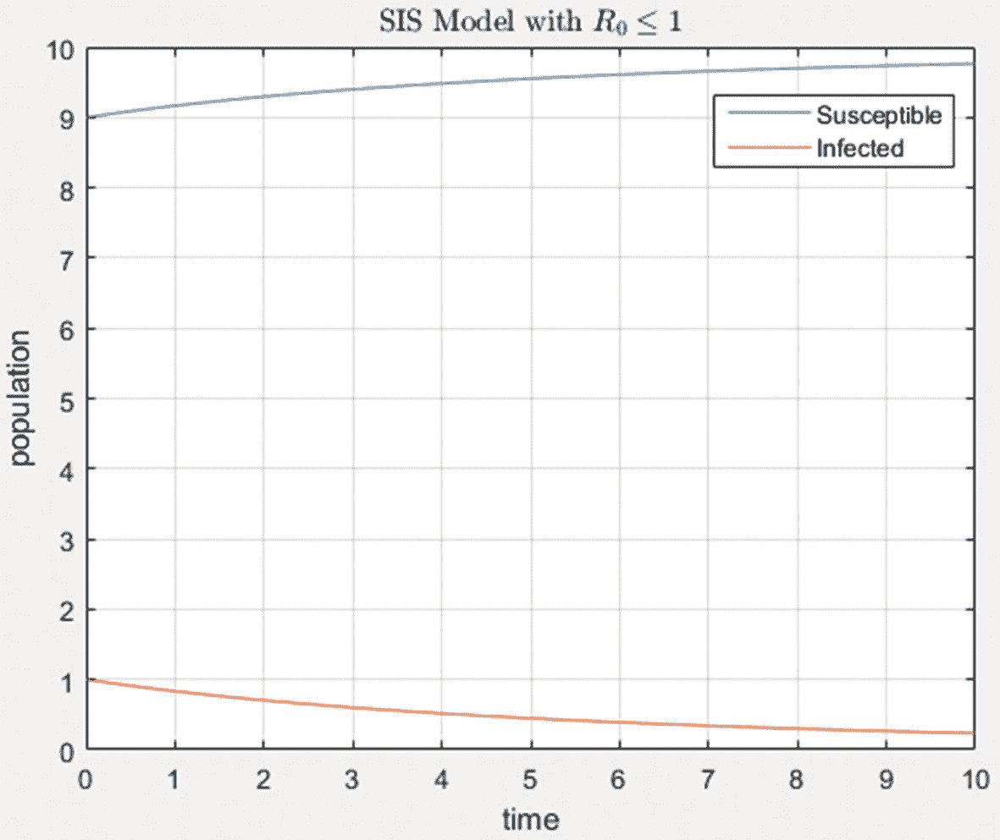
**图 8-12** 当 `R[0]` ≤ 1 时 `SIS` 模型的动态特征

很明显，随着时间的推移，疾病会逐渐消失。

**示例 8-12.** 使用示例 8-11 中相同的人口规模和时间跨度来模拟 `SIS` 动态。此示例的系数给定为 `γ` = 0.1 和 `β` = 0.9，以使 `R[0]` > 1。

**解决方案 8-12.** 以下代码可用于完成给定任务。

`Example8p12.m`

```matlab
%Example8p12
%This code solves SIS model
[t,x]=ode45(@SIS,[0,10],[9,1]);
plot(t,x);grid on;xlabel('time');
title('SIS Model with ${R}_{0} \ge 1$',...
'Interpreter','Latex');
ylabel('population');
legend('Susceptible','Infected');
function Si=SIS(t,x)
beta=.9;N=10;
gamma=0.1;%Recovery rate
Si(1,:)=-(beta/N)*x(1)*x(2)+gamma*x(2);
Si(2,:)=(beta/N)*x(1)*x(2)-gamma*x(2);
end
```

运行代码后，得到的结果如图 8-13 所示。

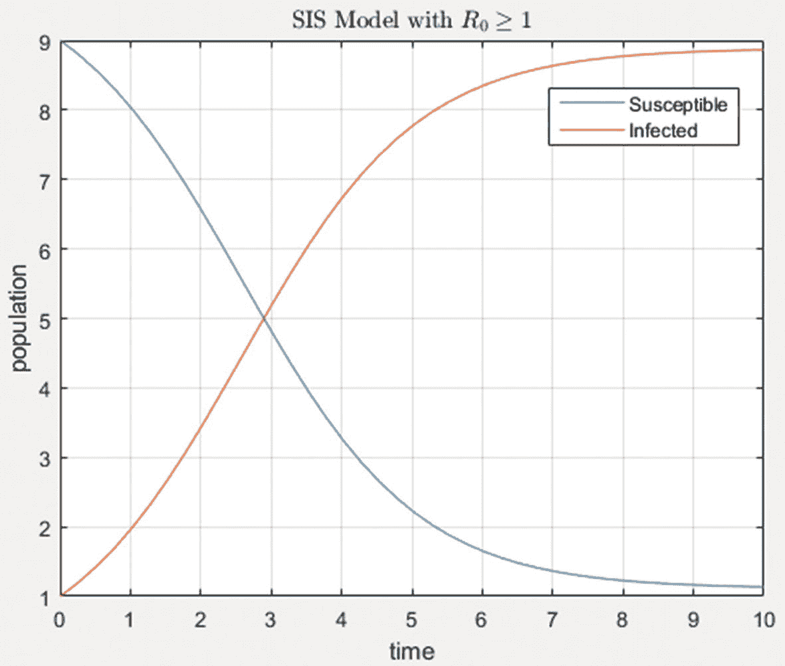

### 图 8-13：当 `R0` > 1 时 SIS 模型的动态特征

如图 8-13 所示，当 `R0` > 1 时，疾病会传播到整个群体。

## SIR 流行病模型

在该流行病模型中，存在三个不同的阶段：易感（S）、感染（I）和康复（R）。所有生物体的总数量应等于总人口规模 `N`。换句话说，

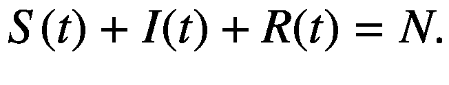

(12)

不考虑出生和死亡的 SIR 模型形式如下：

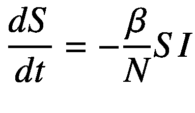

(13)


(14)

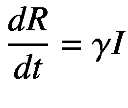

(15)

其中，`β` 是某一时刻由一名感染者造成的接触率，`γ` 是恢复率。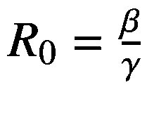 是基本再生数。

### 示例 8-13

针对给定的公式 13、14 和 15，编写代码来模拟所有 S、I 和 R 状态随时间变化的人口规模。S、I 和 R 种群的初始数量分别为 9、1 和 0。时间跨度从 0 到 50。其他系数给定为 `γ` = 0.1 和 `β` = 0.9。

### 解决方案 8-13

以下代码可用于完成给定任务。

**`Example8p13.m`**

```
%Example8p13

%This code solves SIR model

[t,x]=ode45(@SIR,[0,50],[9,1,0]);

%semilogx(t,x);

plot(t,x);

xlabel('time');ylabel('population');

title('SIR Model');grid on;

legend('Susceptible','Infected','Recovered');

function Sir=SIR(t,x)

beta=.9;%contact rate by people in population i

gamma=.1;%Recovery rate

N=10;%N=Total number of population

%dS/dt=Sir(1),x(1)=susceptible people

ds=-(beta/N)*x(1)*x(2);

%dI/dt=Sir(2),x(2)=exposed by infection

di=(beta/N)*x(1)*x(2)-gamma*x(2);

%dr/dt=sir(3),x(3)=Recovered from infection

dr=gamma*x(2);

Sir=[ds;di;dr];

end
```

运行代码后，得到的输出如图 8-14 所示。

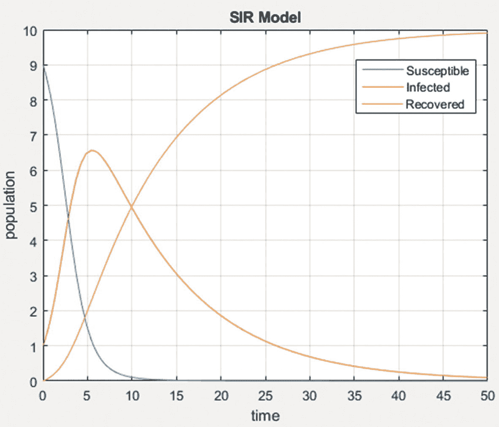

### 图 8-14：当 `R0` > 1 时 SIR 模型的动态特征

在这个结果中，`R0` 大于 1。如果我们使用 `γ` = 1.0 并保持此示例中的其余参数不变，当再生数等于或小于 1 时，得到的图形如图 8-15 所示。

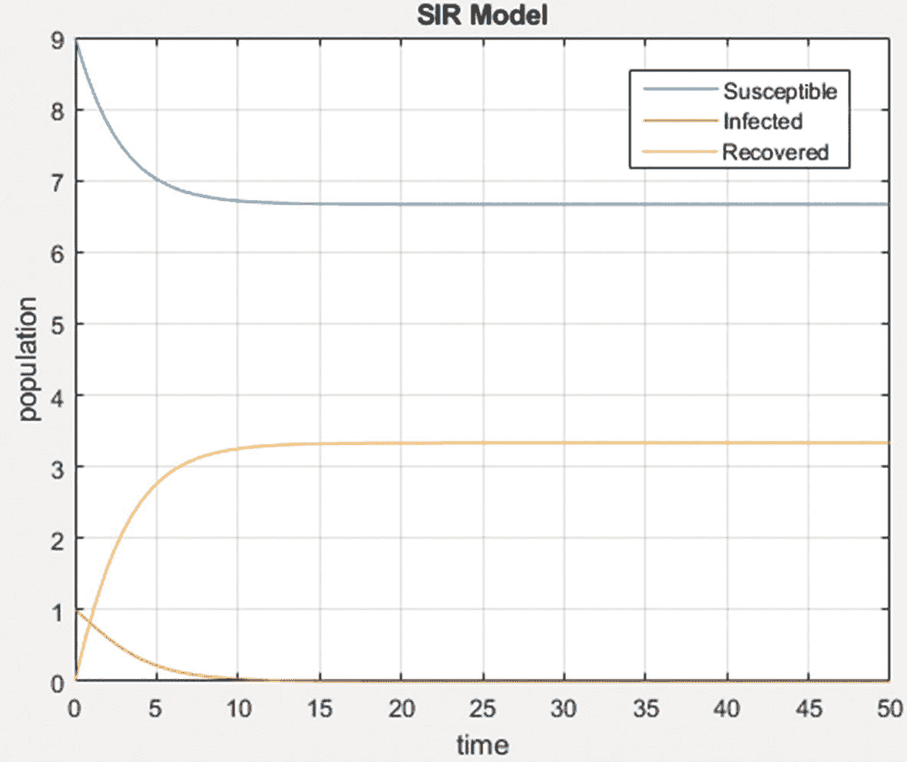

### 图 8-15：当 `R0` ≤ 1 时 SIR 模型的动态特征

## SEIR 传染病模型

在此传染病模型中，如图 8-16 所示，在已知的 `S`、`I` 和 `R` 阶段中增加了潜伏期阶段（`E`）。


### 图 8-16：SEIR 模型的阶段

所有有机体的总人口数应等于总人口规模 `N`。即，

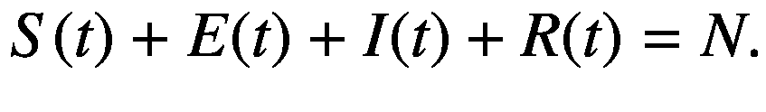

(16)

不考虑出生和死亡的 SEIR 模型可写为以下方程组。


(17)

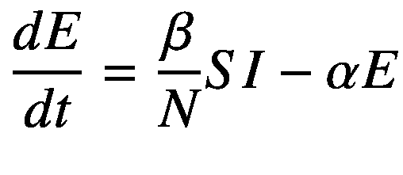
(18)

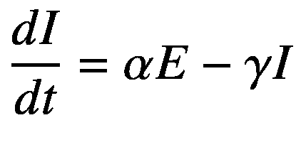
(19)


(20)

在公式 17、18、19 和 20 中，`β` 控制疾病在易感者和感染者之间随时间传播的速率，`α` 是潜伏期和感染者之间的接触率，`γ` 是恢复率。

### 示例 8-14

对于给定的公式 17、18、19 和 20，编写代码模拟所有种群数量随时间的变化。`S`、`E`、`I` 和 `R` 组的初始种群规模分别为 17、2、1 和 0。时间跨度从 0 到 50。其他系数为 `β` = 0.8，`α` = 0.4，`γ` = 0.3。

### 解决方案 8-14

以下代码可用于完成给定任务。

**`Example8p14.m`**

```
%Example8p14

%This code solves SEIR model

[t,x]=ode45(@Seir,[0,50],[17,2,1,0]);

plot(t,x);

xlabel('time');ylabel('population');

title('SEIR Model');grid on;

legend('Susceptible',...

'Exposed','Infected','Recovered');

function SEIR=Seir(t,x)

N=10;beta=.8;delta=0.4;gamma=1;

SEIR(1,:)=-(beta/N)*x(1)*x(3);

SEIR(2,:)=(beta/N)*x(1)*x(3)-delta*x(2);

SEIR(3,:)=delta*x(2)-gamma*x(3);

SEIR(4,:)=gamma*x(3);

end
```

# SEIR 模型

运行代码后，将显示如图 8-17 所示的输出。

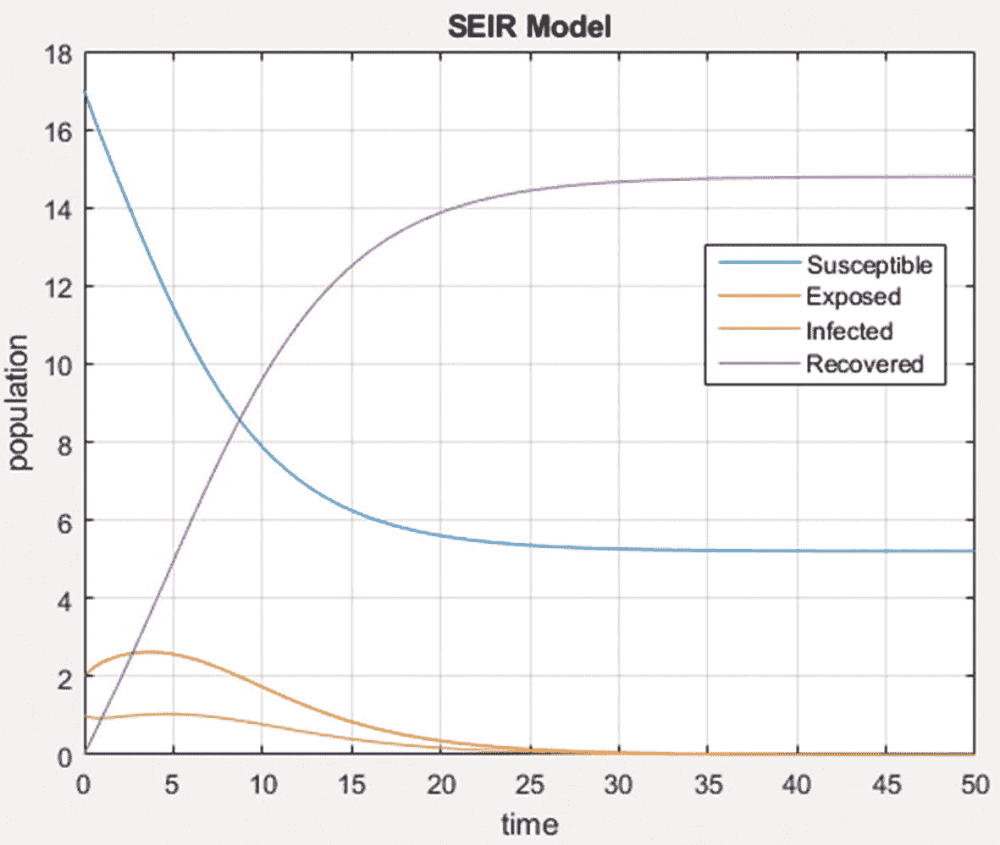

图 8-17：SEIR 模型

为了清晰地观察动态变化的初始阶段，我们可以用 `semilogx` 命令替换 `plot` 函数，得到如图 8-18 所示的结果。

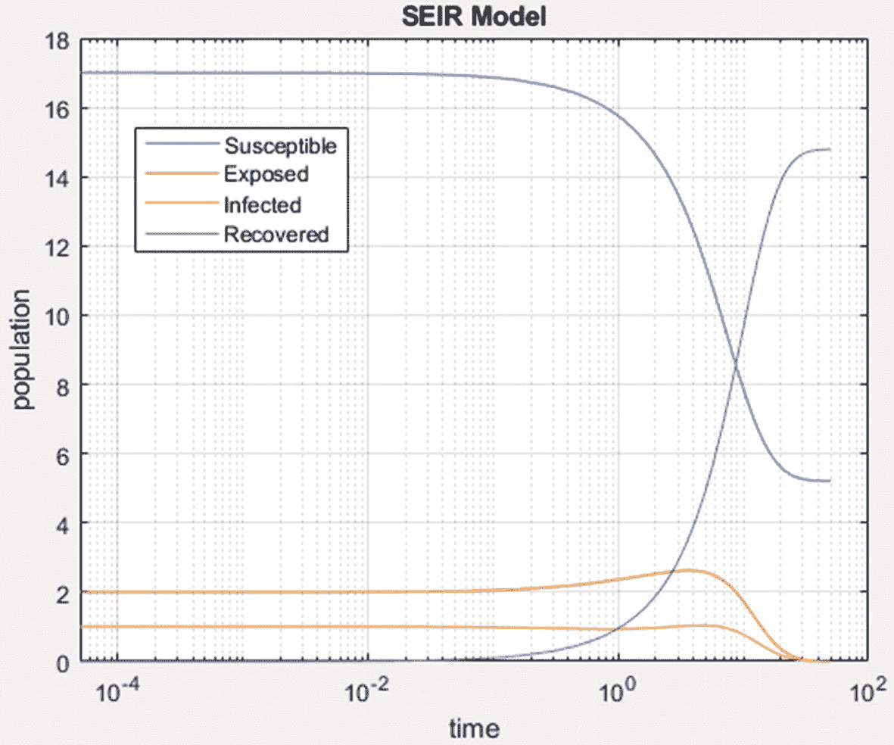

图 8-18：SEIR 动态变化的初始阶段

如图 8-18 所示，各类型种群数量在时间等于 1 之前就开始发生变化。从长远来看，我们看到感染者和潜伏期人群几乎变为零，其余人口处于易感和恢复状态。参照图 8-17，可以得出结论：当时间趋于无穷时，这些状态保持稳定。

我们需要牢记的一个重要点是，只需更改动力学的系数，这些结果就可能改变。如果我们在方程中加入死亡率或出生率，我们可能会遇到与之前示例中完全不同的情况。

## HIV 的细胞动力学

人类免疫缺陷病毒（HIV）会攻击并改变免疫系统，最终导致通常致命的获得性免疫缺陷综合征（AIDS）。几十年来，研究人员和科学家一直试图找到保护人们免受 HIV 和 AIDS 侵害的解决方案。HIV 攻击体内一种特定类型的细胞，即 CD4 辅助细胞（或称 T 细胞）。关于 T 细胞和病毒动力学的基本模型包含一个由三个方程组成的方程组：

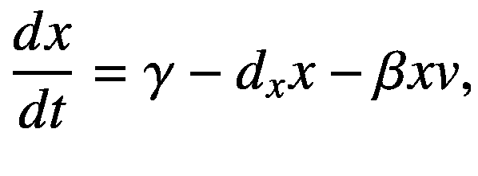
(21)

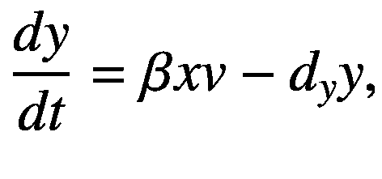
(22)

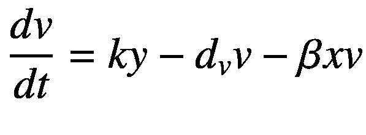
(23)

在此方程组中，`dx/dt` 表示未感染细胞数量随时间的变化，`dy/dt` 表示感染细胞数量随时间的变化，`dv/dt` 表示游离病毒颗粒数量随时间的变化，其中初始条件应满足 `x[0] > 0`，`v[0] > 0` 且 `y[0] = 0`。

对于公式 21、22 和 23 的模型，基本再生数 `R[0]` 为

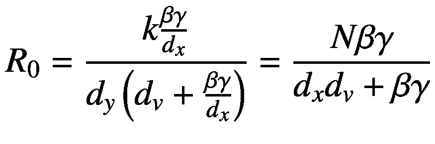
(24)

其中 `γ` 是免疫系统产生未感染细胞的速率，`βxv` 是因游离病毒与未感染细胞接触而产生感染细胞的速率。`N` 是游离病毒颗粒的数量，应远大于 1。`d[x]`、`d[y]` 和 `d[v]` 分别是未感染细胞、感染细胞和病毒颗粒的死亡率。时间以天为单位预先测量。`k` 是感染细胞产生游离病毒颗粒的速率。

**例 8-15.** 对于公式 21、22 和 23，编写代码模拟未感染细胞、感染细胞和病毒颗粒数量随时间的变化。未感染细胞、感染细胞和病毒颗粒的初始种群规模分别为 10⁶、0 和 2。时间跨度将从 0 到 50。其他系数为 `γ = 10⁵`，`k = 200`，`β = 3 ∗ 10⁻⁷`，`d[x] = 0.12`，`d[y] = 0.5`，`d[v] = 4`。

**解 8-15.** 以下代码显示了主代码中使用的核心函数。

*Hiv.m*

```matlab
function HIV=Hiv(t,x)

dx=0.12;dy=0.5;dv=4;

beta=3e-7;k=1e+2;gamma=1e+5;

HIV(1,:)=gamma -dx*x(1)-beta*x(1)*x(3);

HIV(2,:)=beta*x(1)*x(3) -dy*x(2);

HIV(3,:)=k*x(2)-dv*x(3)-beta*x(1)*x(3);

end
```

上述代码中大部分变量的值取自 Linda J. S. Allen 所著的《数学生物学导论》（Pearson Education，2007 年，第 278 页）。代码的主部分可以编写如下。

*Example8p15.m*

```matlab
%Example8p15
%This code solves HIV model
clear all;close all;
[t,x]=ode45(@Hiv,[0,50],[1e+6,0,2]);
plot(t,x(:,1));
xlabel('Time in days');ylabel('Population');
title('Uninfected Cells');grid on;
figure;plot(t,x(:,2))
xlabel('Time in days');ylabel('Population');
title('Infected Cells');grid on;
figure;plot(t,x(:,3))
xlabel('Time in days');ylabel('Population');
title('Virus Particles');grid on;
```

