# 9. 信号处理

信号处理是电气工程的子领域之一，它分析、修改并操作宇宙中所有数据源的信息。在信号处理中，一个*信号*是一种将数据从一个设备传输到另一个设备的电流或电磁流。宇宙中的一切，如声音、图像和视频，都可以被描述为一种波形的信号。在数学上，信号可以表示为一个或多个独立变量的函数。

信号处理有着非常广阔的应用领域，包括脑机接口、语音识别、体感游戏、三维电视、可穿戴技术、生物识别安全等等。全面覆盖这一主题超出了本章的范围。在这里，我们回顾一些入门主题以及使用 MATLAB 在该领域的几个应用，包括信号类型、电流、快速傅里叶变换和谐波分析。

## 信号类型

信号可以分类为几种类型，例如能量信号和功率信号，或者确定性信号和概率性信号。在本节中，我们将介绍连续信号和离散信号、模拟信号和数字信号、周期信号和非周期信号，以及偶信号和奇信号。

### 连续信号和离散信号

对于一个定义为函数的信号，如果对于独立变量（例如，*t*）的每一个值，都存在一个对应的值（例如，*y*），那么该函数被称为*连续时间* (CT) 信号。然而，如果一个表示为函数的信号只在独立变量*t*的某些离散值上被定义，那么它被称为*离散时间* (DT) 信号。在某些情况下，DT 可能没有一个时间函数。例如，在灰度图像中，表示图像颜色的图像矩阵中存在二维离散值。

在图 9-1 中，我们看到 *y*(*t*) 的图形，其中

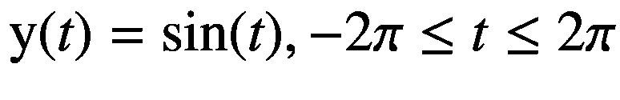
(1)

是一个连续信号。

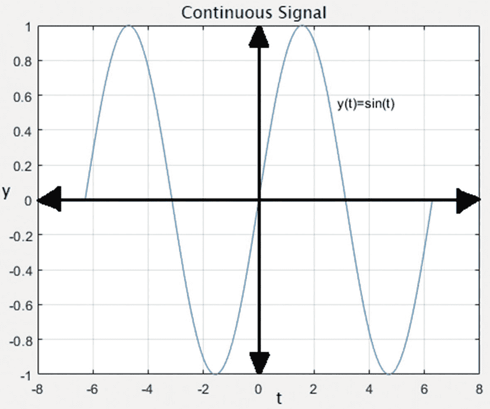

在图 9-2 中，虽然使用了相同的函数，但输出却不同。因为使用了*t*的离散值，所以得到的输出也是一个离散信号。

![$$
y\left[t\right]=\sin (t),t=0,\pm \frac{\pi }{6},\pm \frac{2\pi }{6},\pm \frac{3\pi }{6},\dots, \pm \frac{12\pi }{6}$$](images/483991_1_En_9_Chapter/483991_1_En_9_Chapter_TeX_Equ2.png)
(2)

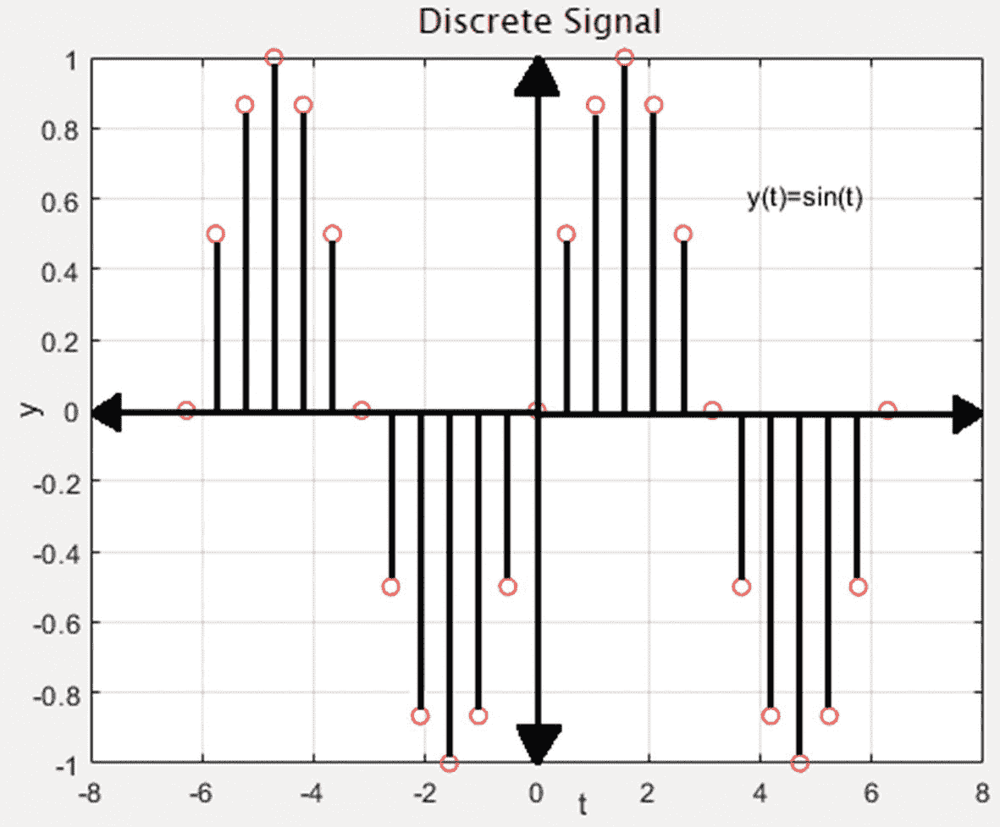

在等式 2 中，因为*t*具有离散值，所以函数*y*也具有离散值（对应于*t*值）。

通常，连续函数用圆括号表示，而方括号用于定义离散函数。

**示例 9-1.** 对于给定的离散信号函数 *y* = *f*[*t*] = cos(2*t*)，其中 *t* 定义为 −*π* ≤ *t* ≤ *π*，为*t*创建 10 个均匀分布的离散值。然后代码应计算对应的*y*值并将其打印在屏幕上。

**解答 9-1.** 以下代码可用于完成给定任务。

*Example9p1.m*

```matlab
%Example9p1
%This code has a discrete signal


t = linspace(-2*pi,2*pi,10);
y = cos(2*pi*t);
disp('y Values:');
disp(y);
```

对于直流信号，`linspace`函数对于创建均匀分布的时间值非常有用。代码执行后，将获得以下输出。

```
> Example9p1

y Values:

Columns 1 through 9

-0.2070  0.7580  -0.9983  0.8292  -0.3202  -0.3202  0.8292  -0.9983  0.7580

Column 10

-0.2070

>
```

## 习题

*   **8.1.** 编写代码求解逻辑斯蒂方程，其中 `K` = 50, `r` = 0.2, `N[0]` = 4, 时间从 1 到 200。该代码应对解析解进行动画演示。然后，数值解和解析解应绘制在同一张图上。

*   **8.2.** 编写代码模拟 Nicholson-Bailey 模型。宿主和寄生蜂的初始种群数量分别为 10 和 5。世代数为 50。系数为 `e` = 2, `a` = 0.0069, 和 `r` = 3。

*   **8.3.** 给定一个 DNA 序列 TTCCTACTTTTGTATTCGCCAG。编写代码将其转录为 RNA。

*   **8.4.** 给定一个 DNA 序列 GGTCGTAGCTAC。编写代码将其转录为 RNA。然后，利用遗传密码表，将其翻译成一个氨基酸序列。最后，代码应在屏幕上打印出最终序列。

*   **8.5.** 对于两个序列 `Seq1=GTTAACAATT` 和 `Seq2=GTGAT`，编写代码打印出点矩阵并绘制点图。在图中，匹配点应以红色显示，不匹配点应以蓝色显示。

*   **8.6.** 对于等式 10 和 11，编写代码模拟 SIS 模型的种群大小。S 和 I 状态的初始种群分别为 20 和 2。时间跨度从 0 到 80。系数为 `γ` = 0.50 和 `β` = 0.8。

*   **8.7.** 对于等式 13、14 和 15，编写代码模拟所有 S、I 和 R 阶段种群大小随时间的变化。S、I 和 R 种群的初始数量分别为 20、1 和 0。时间跨度从 0 到 50。其他系数为 `γ` = 1.3 和 `β` = 0.7。

*   **8.8.** 对于等式 17、18、19 和 20，编写代码模拟所有种群数量随时间的变化。S、E、I 和 R 组的初始种群数量分别为 27、2、1 和 0。时间跨度从 0 到 50。其他系数为 `β` = 0.7, `α` = 0.3, 和 `γ` = 0.2。


# 9. 模拟信号和数字信号
从信号的幅度来考虑，信号可分为模拟信号和数字信号。*模拟信号*是一种连续波，能够在一段时间内保持其变化。而*数字信号*的幅度值个数是有限的，这些值既非连续也无无限多。此外，模拟信号的波形类似正弦函数，而数字信号的波形则像方波。

模拟信号的例子有声音、音乐、温度以及空气中的 Wi-Fi 信号。数字信号的例子则包括录制在 CD 上的声音、数字温度计以及 MP3 播放器中的音乐。

## 周期信号和非周期信号
经过一段时间后能重复自身的信号称为*周期信号*。在一段时间内不重复自身的信号则称为非周期信号或*非周期信号*。

如果满足以下等式，则连续时间信号 `y(t)` 被称为周期信号。

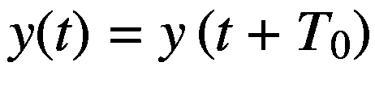

(3)

对所有 `t` 和正常数 `T0` 成立。

类似地，如果满足以下等式，则离散时间信号 `y[t]` 被称为周期信号。

![$$ y\left[t\right]=y\left[t+{T}_0\right] $$](images/483991_1_En_9_Chapter/483991_1_En_9_Chapter_TeX_Equ4.png)

(4)

对所有 `t` 和正常数 `T0` 成立。

**注释 9-1.** 假设 `y(t)` 是代表连续信号的函数。那么如果

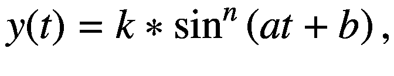

(5)

或者

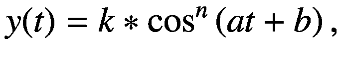

(6)

那么，信号 `y(t)` 的周期 `T0` 为

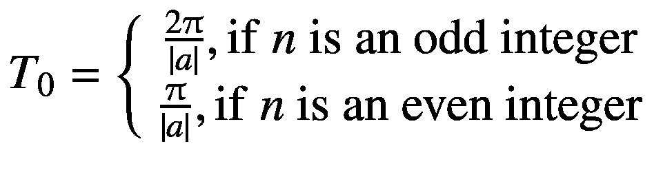

(7)

在方程 (5) 和 (6) 中，常数 `k`、`a` 和 `b` 均为实数，且 `n` 应为整数。在方程 (7) 中，`|a|` 是 `a` 的绝对值。

**注释 9-2.** 假设 `y(t)` 是代表连续信号的函数。那么如果

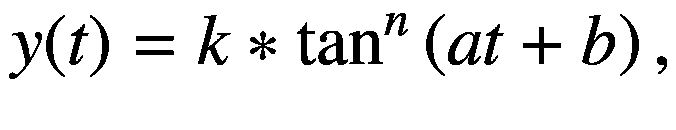

(8)

或者

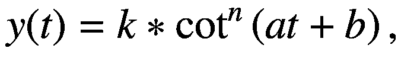

(9)

那么，信号 `y(t)` 的周期 `T0` 为

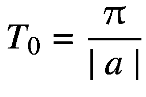

(10)

在方程 (8) 和 (9) 中，常数 `k`、`a` 和 `b` 均为实数，且 `n` 应为整数。

**示例 9-2.** 定义了一个连续时间信号 `y(t) = 5*sin³(4*t − 1)`。求该信号的周期。然后编写代码绘制该信号在 `−2*π ≤ t ≤ 2*π` 范围内的图形。

**解答 9-2.** 在该示例中，信号是连续信号。因此，我们可以使用注释 9-1 来求周期。我们看到 `n = 3`，是一个奇数，并且 `a = 4`。那么 `T0 = (2π) / |4| = π / 2`。

以下代码可用来完成给定任务。

*Example9p2.m*

```
%Example9p2
%This code has a periodic signal
t = -2*pi:0.001:2*pi;
y = 5*(sin(4*t-1)).^3;
plot(t,y); grid on;
xlabel('t'); ylabel('y');
title('A Periodic Signal');
```

代码运行后，输出结果如图 9-3 所示。

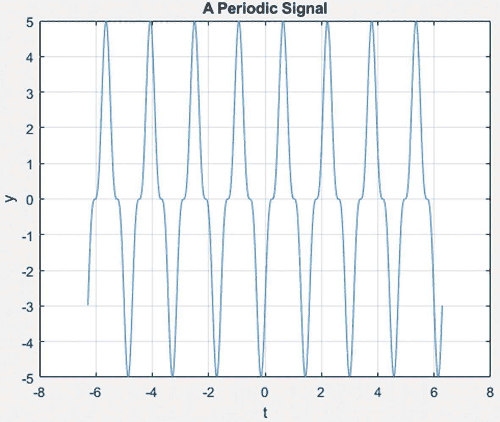

**图 9-3** `y(t) = 5*sin³(4*t − 1)` 的图形

如图 9-3 所示，该信号每隔 `π/2` 重复自身。

**示例 9-3.** 定义了一个连续时间信号 `y(t) = 2*sin(4*t) + cos(6*t − 2)`。求该信号的周期。然后编写代码绘制该信号在 `−π ≤ t ≤ π` 范围内的图形。

**解答 9-3.** 在该示例中，信号是将正弦函数与余弦函数相加。我们将分别计算这两个函数的周期。然后求出这两个周期的最小公倍数。我们将正弦项的周期定义为 `T0`，余弦项的周期定义为 `T1`。然后根据注释 9-1，可得 `T0 = (2π) / |4| = π/2`，`T1 = (2π) / |6| = π/3`。那么 `最小公倍数(π/2, π/3) = π`。该信号的图形周期应为 `π`。

以下代码可用来完成给定任务。

*Example9p3.m*

```
%Example9p3
%This code has a periodic signal
t = -pi:0.001:pi;
y = 2*sin(4*t)+cos(6*t-2);
plot(t,y); grid on;
xlabel('t'); ylabel('y');
title('A Periodic Signal');
```

代码执行后，我们得到如图 9-4 所示的输出。

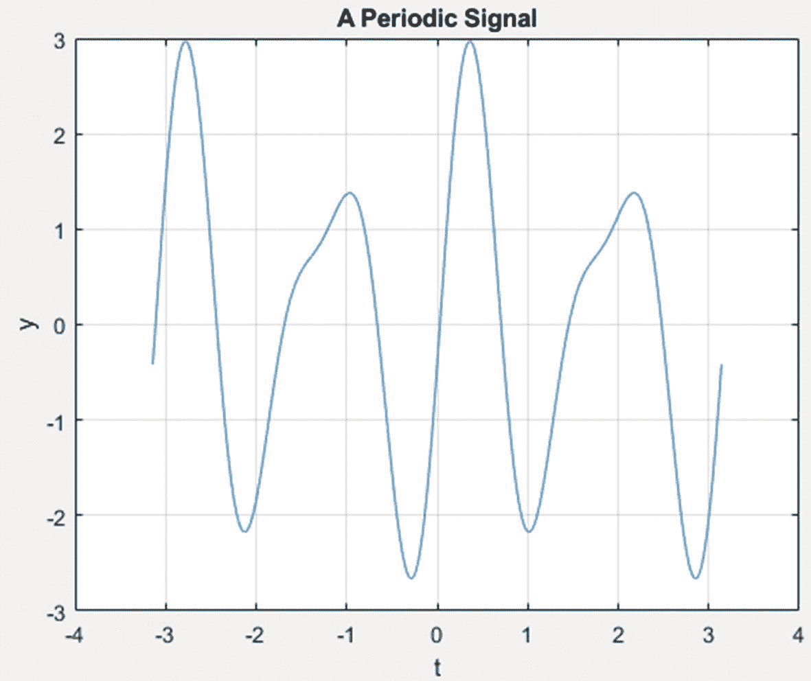

`图 9-4` `y(t) = 2*sin(4*t) + cos(6*t − 2)` 信号的图形

显然，如图 9-4 所示，该信号每隔 `π` 周期重复自身。

## 偶信号和奇信号

如果满足以下等式，则连续时间信号 `y(t)` 被称为*偶信号*。

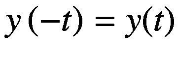

(11)

如果满足以下等式，则被称为*奇信号*。

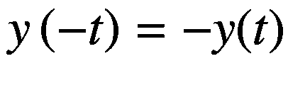

(12)

类似地，如果满足以下等式，则离散时间信号 `y[t]` 被称为偶信号。

![$$ y\left[-t\right]=y\left[t\right] $$](images/483991_1_En_9_Chapter/483991_1_En_9_Chapter_TeX_Equ13.png)

(13)

如果满足以下等式，则被称为奇信号。

![$$ y\left[-t\right]=-y\left[t\right] $$](images/483991_1_En_9_Chapter/483991_1_En_9_Chapter_TeX_Equ14.png)

(14)

`示例 9-4.` 对于给定的连续时间信号 `y(t) = sin²(t) + cos(t) + 1`，编写代码通过图形判断该信号是偶信号还是奇信号。`y(t)` 和 `y(−t)` 的图形应显示在同一张图中。

`解答 9-4.` 以下代码可用来完成给定任务。

`Example9p4.m`

```
%Example9p4

%This code plots an even signal

t = -pi:0.001:pi;

y=(sin(t)).²+cos(3*t)+1;

subplot(121);plot(t,y);grid on;

xlabel('t');ylabel('y');

title('Signal of y(t)');

t = -t;

y=(sin(t)).²+cos(3*t)+1;

subplot(122);plot(t,y);grid on;

xlabel('t');ylabel('y');

title('Signal of y(-t)');
```

代码执行后，我们得到如图 9-5 所示的输出。

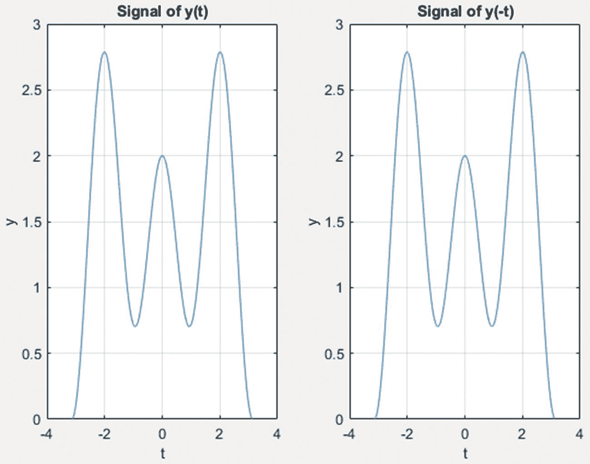

`图 9-5` `y(t) = sin²(t) + cos(t) + 1` 信号的图形

图 9-5 显示两个图形完全相同，这表明该信号是偶信号。

## 电流

在本节中，我们将通过一个示例来学习如何计算电路中的电流。此外，我们还将研究如何根据基尔霍夫定律求解 RL 电路中的电流。

### 示例 9-5

考虑图 9-6 所示的一个包含八个电阻和两个电池的电路。求流过回路的电流 `x`、`y` 和 `z`。

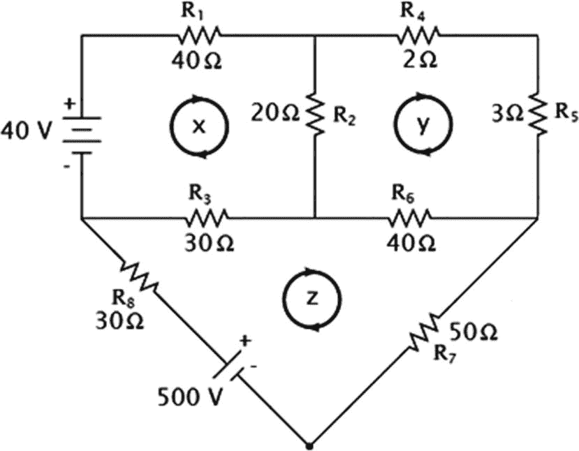

`图 9-6` 一个电路网络

#### 解 9-5

为了求出流过各回路的电流，我们为每个回路列出如下方程。

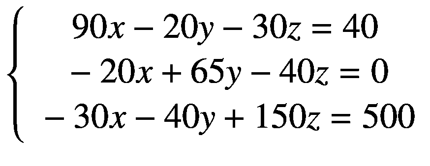 (15)

以下代码可用于求解此方程组。

`Example9p5.m`

```
%Example9p5

%This code finds currents

%for an electrical network

A=[90 -20 -30;-20 65 -40;-30 -40 150];

B=[40;0;500];

Sol=(A)\B;

disp(['x=',num2str(Sol(1))]);

disp(['y=',num2str(Sol(2))]);

disp(['z=',num2str(Sol(3))]);
```

执行代码后，我们将得到以下输出。

```
> Example9p5

x=3

y=4

z=5

>
```

一个电路可以包含多种元件，包括开关、电压源 (`V`)、电阻 (`R`) 和电感 (`L`)，如图 9-7 所示。

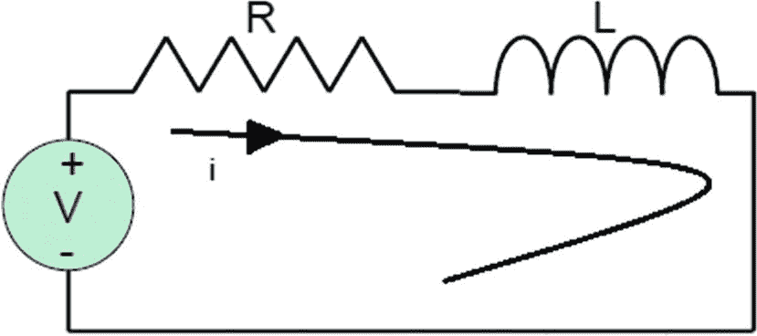

`图 9-7` 一个 RL 网络

以下是图 9-7 所示网络的控制方程。

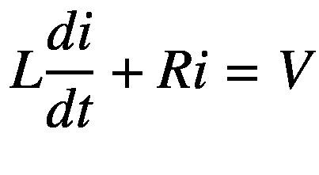 (16)

方程 (16) 的解为

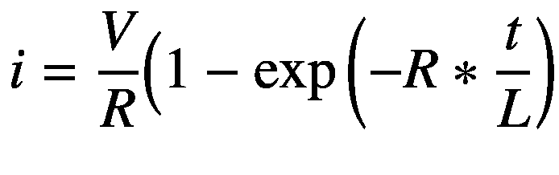 (17)

### 示例 9-6

对于一个 RL 网络，给定系数为 `V` = 2 伏特，`R` = 1 欧姆；`L` = 1/2 亨利，0 ≤ `time` ≤ 5。编写代码来模拟电流 `i` 随时间变化的值。

#### 解 9-6

以下代码可用于完成指定任务。

`Example9p6.m`

```
%Example9p6

%This code plots current values

t=0:0.05:5;

V=2;R=1;L=1/2;

i=(V/R)*(1-exp(-R.*t/L));

plot(t,i,'bo');grid on;

xlabel('t');ylabel('current');

title('Current with time');
```

执行代码后，将显示如图 9-8 所示的输出。

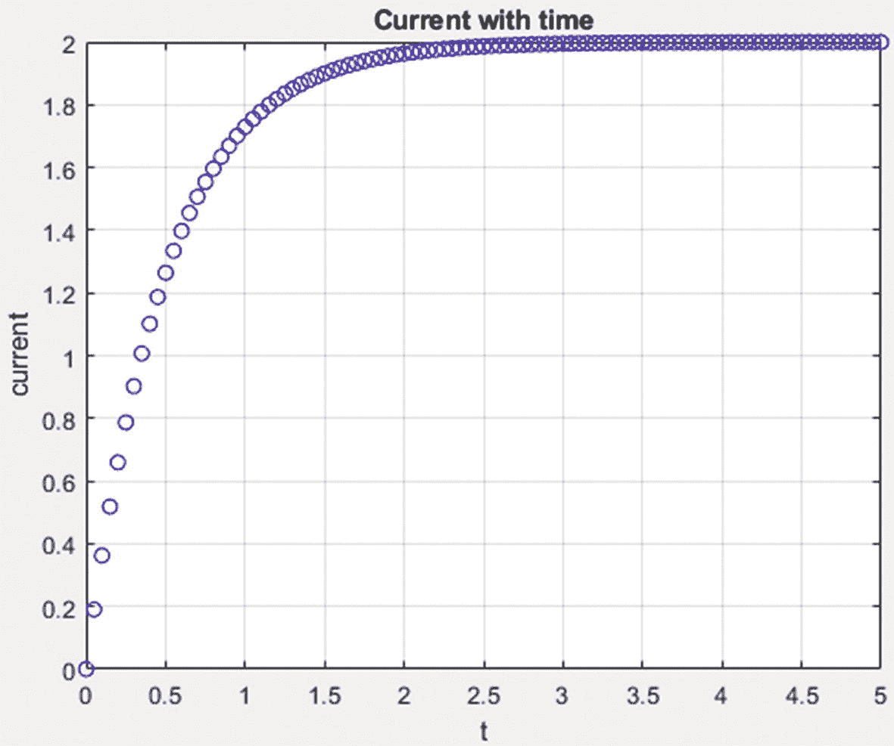

*图 9-8 示例 9-6 中电流的值*

## 谐波分析

周期信号可以用傅里叶级数表示为一系列正弦波和余弦波的和。计算此类信号的过程称为*谐波分析*。此时，我们需要回顾一下傅里叶级数的定义。

### 备注 9-3
假设对于所有 `x` 值，`f(x)` 的定义周期为 `2L`，即 `f(x) = f(x + 2L)`。那么 `f(x)` 的傅里叶级数为

 (18)

此处，`a[n]` 和 `b[n]` 被称为*傅里叶系数*，其中

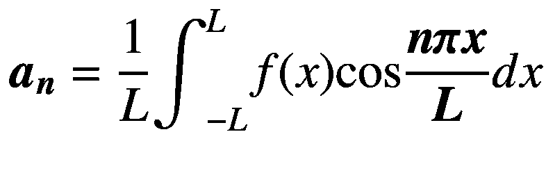 (19)

以及

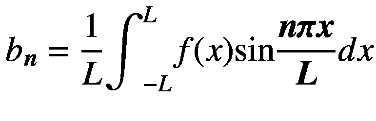 (20)

其中 `n` = 1, 2, 3, …

### 示例 9-7
如方程 (18)、(19) 和 (20) 所定义的信号 `f(x)` 的系数给定为 `L = 2`，`a[0] = 0`，`a[n] = 0`，以及 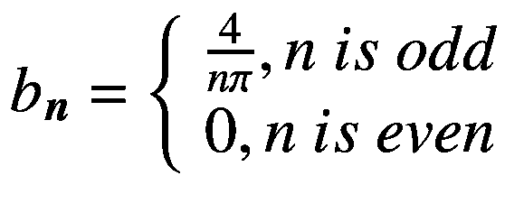。计算当 `n` = 49 时，方程 (18) 中的信号 `f(x)`。然后绘制信号 `f(x)` 在 −2π ≤ x ≤ 2π 范围内的图形。

#### 解 9-7
如果将给定的 `a[0]`、`a[n]` 和 `b[n]` 代入方程 (18)，我们得到：

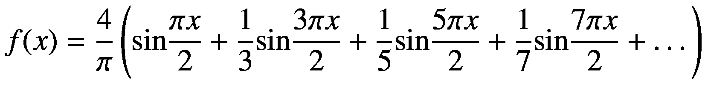 (21)

因此，我们需要计算 `f(x)` 包含 49 项时的方程 (21)。以下代码可用于获取 `f(x)` 的图形。

*Example9p7.m*
```matlab
%Example9p7

%This code plots graph of a signal

n=49;Point=1000;

x=linspace(-2*pi,2*pi,Point);

bn=zeros(1,Point);a0=0*bn;an=0*bn;

for i=1:2:n

Calc=(1/i).*sin((i*pi.*x)/2);

bn = bn + Calc;

end

bn=(4/pi)*bn;fx=a0+an+bn;

plot(x,fx);grid on;axis('equal');

xlabel('x');ylabel('signal');

title('Square Wave Signal');
```

执行代码后，输出如图 9-9 所示。

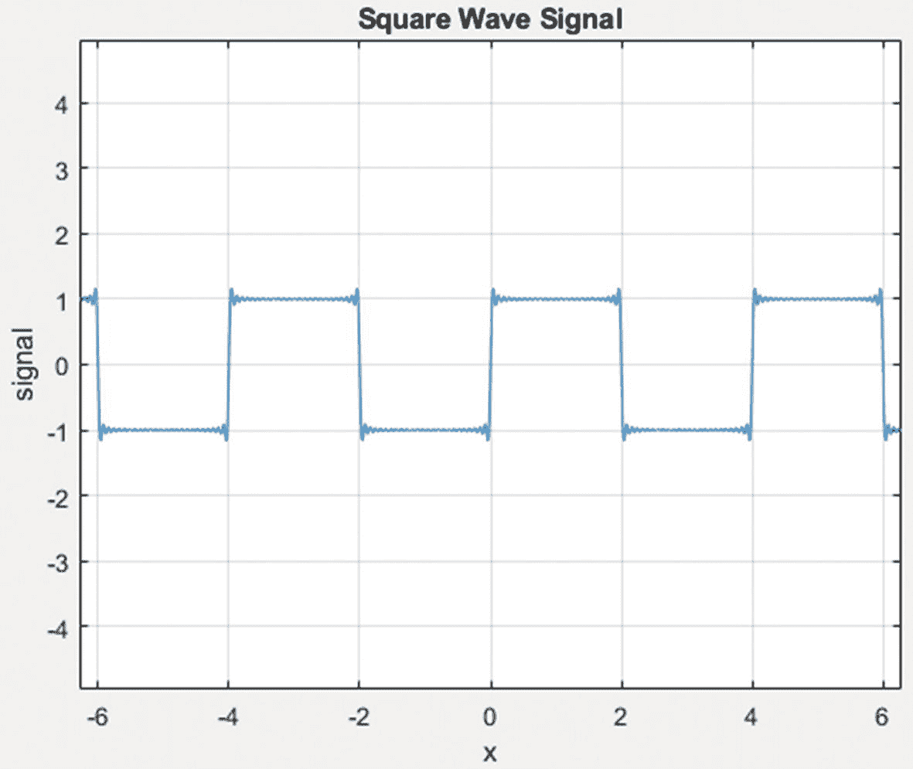

*图 9-9 示例 9-7 的输出*

如图 9-9 所示，该信号为方波信号。信号的周期为 4（`L` = 2）。如果在代码中选择更大的 `n`，图像将看起来更像一个精确的方波。

### 示例 9-8
根据方程式 18、19 和 20 定义的信号 `f(x)` 的系数为 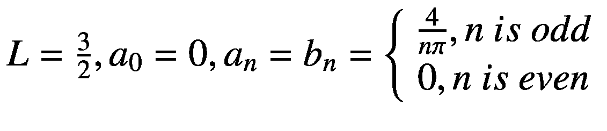。按方程式 18 计算 `n` = 79 时信号 `f(x)` 的值。然后绘制信号 `f(x)` 在 −2π ≤ x ≤ 2π 范围内的图形。

### 解决方案 9-8
将给定的 `a[0]`、`a[n]` 和 `b[n]` 代入方程式 18，得到以下结果：

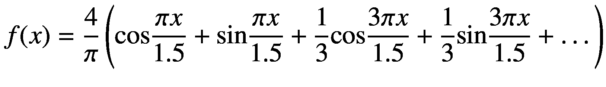 (22)

因此，我们需要计算 `f(x)` 的方程式 22，其中包含 79 项。可以使用以下代码生成 `f(x)` 的图形。

*Example9p8.m*
```matlab
%Example9p8

%This code plots graph of a signal

n=79;Point=1000;

x=linspace(-2*pi,2*pi,Point);

bn=zeros(1,Point);a0=0*bn;an=0*bn;

for i=1:2:n

Calc1=(1/i).*cos((i*pi.*x)/1.5);

Calc2=(1/i).*sin((i*pi.*x)/1.5);

an = an + Calc1;

bn = bn + Calc2;

end

fx=a0+(4/pi)*(an+bn);

plot(x,fx);grid on;axis('equal');

xlabel('x');ylabel('signal');

title('Signal in time');
```

执行代码后，我们会得到图 9-10 所示的输出。

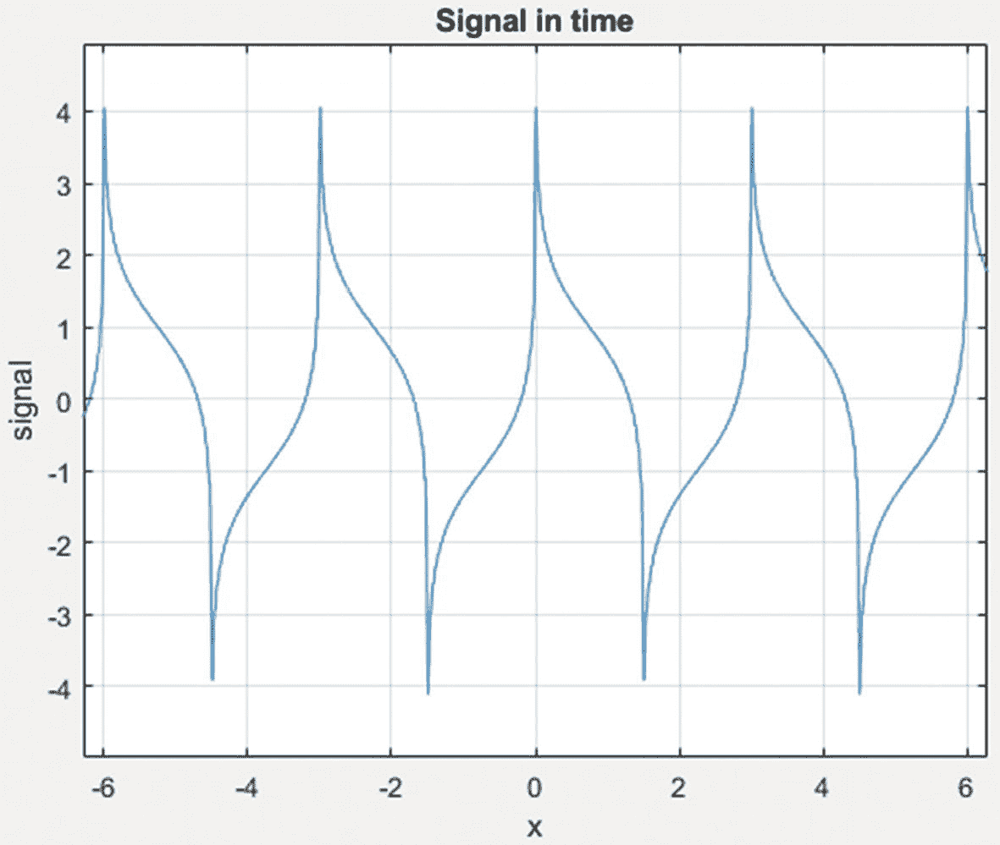

**图 9-10** 示例 9-8 的输出

如图 9-10 所示，该信号的周期为 3（`L` = 1.5）。

## 快速傅里叶变换

我们已经在上一节关于周期函数的内容中学习了傅里叶级数。当处理非周期信号时，我们需要了解傅里叶变换方法。傅里叶变换将时间序列与频率序列配对。快速傅里叶变换 (`FFT`) 是处理离散傅里叶变换 (`DFT`) 的一种更好方法。然而，在理解 `FFT` 之前，我们将先了解傅里叶变换的定义。

### 备注 9-4

函数 `f(t)` 的连续时间傅里叶变换定义为：

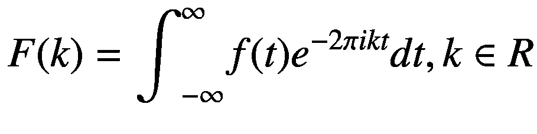

(23)

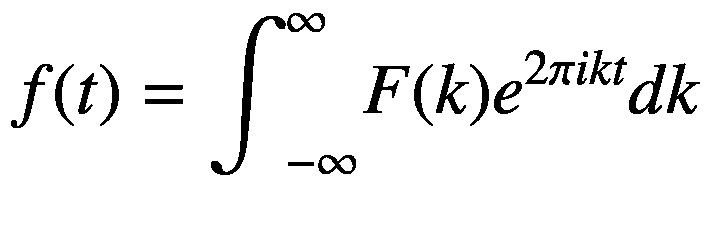

(24)

其中 `F(k)` 可以通过使用逆傅里叶变换得到。如果方程式 23 的结果收敛，则信号 `f(t)` 存在傅里叶变换。逆傅里叶变换将频率序列映射回相应的时间序列。

### 备注 9-5

时间有限序列 `f[t]`（其中 0 ≤ `t` ≤ `N` − 1）的 `DFT` 定义为：

前向 `DFT` ![$$ F\left[r\right]=\sum \limits_{n=0}^{N-1}f\left[t\right]{e}^{\frac{-2\pi jnr}{N}},0\le r\le N-1 $$](images/483991_1_En_9_Chapter/483991_1_En_9_Chapter_TeX_IEq8.png) (25)

逆 `DFT` ![$$ f\left[t\right]=\frac{1}{N}\sum \limits_{n=0}^{N-1}F\left[r\right]{e}^{\frac{-2\pi jnr}{N}},0\le k\le N-1 $$](images/483991_1_En_9_Chapter/483991_1_En_9_Chapter_TeX_IEq9.png) (26)

尽管方程式 23 和 24 看起来很复杂，但只需代入欧拉方法，即 `e^(ix)` = `cos(x) + isin(x)`，我们就可以让它们变得简单得多，类似于傅里叶级数。

`FFT` 是一种能以更优方式求解序列的 `DFT` 的算法。该算法由 James W. Cooley 和 John W. Tukey 于 1965 年共同开发。Cooley 和 Tukey 利用了周期正弦波的特性。换句话说，部分计算会出现重复。通过节省这些计算成本，他们减少了所需时间，并获得了一种更好的算法。

对于长度为 `n` 的信号，使用 `DFT` 的时间复杂度（处理 `n` 个样本所需的时间）是 `O(n²)`。而 `FFT` 的复杂度优于 `DFT`，为 `O(nlog(n))`。

在 `MATLAB` 中，使用 `fft` 函数来计算 `FFT`。由于索引从 1 开始，而不是 0，因此方程式 25 和 26 中求和符号的边界是从 `n` = 1 到 `N`。

### 示例 9-9

编写代码，将 `fft` 应用于函数 `x`，其中 `x = sin(2πt)`，0 ≤ `t` ≤ 1。该代码应为 `t` 生成 100 个样本，并且向量 `x` 的长度应为 512。该代码应在屏幕上绘制 `x` 的图形和功率谱。

### 解决方案 9-9

以下代码可用于完成给定的任务。

`Example9p9.m`

```matlab
%Example9p9

%This code works with fft

Fs = 100; % Sampling frequency

t=linspace(0,1,Fs);

x = sin(2*pi*t);

Nfft = 512; % Length of FFT

X = fft(x,Nfft);

% FFT is symmetric, take half

X = X(1:Nfft/2);

% Frequency vector

f = (0:Nfft/2-1)*Fs/Nfft;

figure(1);%for graph of sine

stem(t,x);grid on;

title('Signal of Sine Wave');

xlabel('Time');

ylabel('Amplitude');

figure(2); % for power spectum

plot(f,abs(X));grid on;

title('Power Spectrum');

ylabel('Power');

xlabel('Frequency');
```

运行代码后，得到的结果如图 9-11 所示。

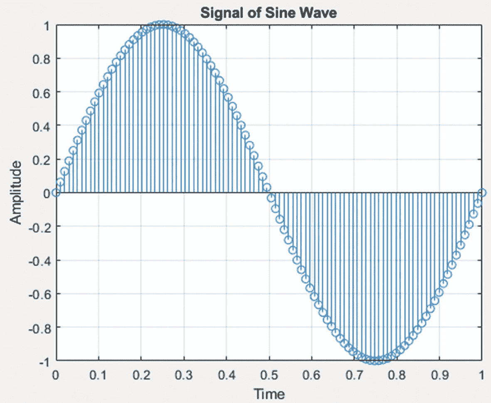

**图 9-11** 正弦波信号

对于正弦波的功率谱，我们生成了如图 9-12 所示的输出。

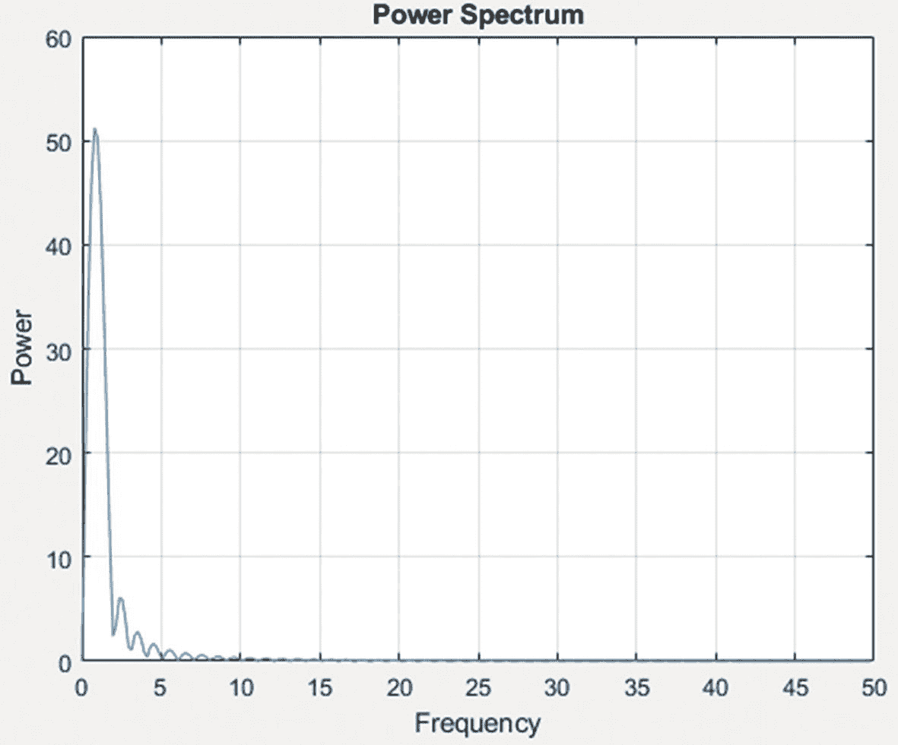

**图 9-12** 正弦波的功率谱

### 示例 9-10

编写代码，对向量 `x` 应用 `fft`，其中 `x` 的前四个元素为 [1, 2, 0, 2]，其余 59 个元素为零。然后，代码应分别在不同图形上绘制频谱幅度的估计值和相位谱的估计值。

### 解答 9-10

以下代码可用于完成给定任务。

`Example9p10.m`

```matlab
%Example9p10

%This code works with fft

x = [1 2 0 2 zeros(1,60)]; % zero-padded sequence

N = length(x);X = fft(x);

X = fftshift(X); % shift DFT coefficients

w=linspace(-pi,pi,N);%compute frequencies

stem(w,abs(X)); % plot magnitude spectrum

grid on;title('Magnitude of Spectrum');

xlabel('Frequency');ylabel('Amplitude');

figure; % new one is opened

stem(w,angle(X));% plot the phase spectrum

grid on;title('Phase Spectrum');

xlabel('Frequency');ylabel('Amplitude');
```

运行代码后，将生成如图 9-13 和图 9-14 所示的输出结果。

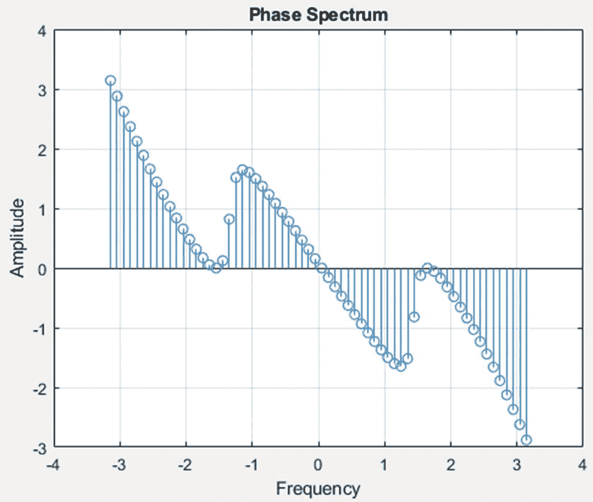

**图 9-14** 相位谱的估计

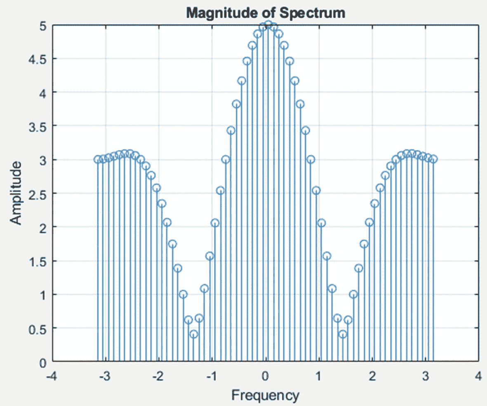

**图 9-13** 频谱幅度的估计

`FFT` 也可以应用于音频文件和图像文件进行分析。作为示例，我们将展示如何对图像应用 `fft2` 函数。这里，`fft2` 是 `fft` 的二维函数。在此示例中，`fft2` 函数被用作滤波器，而非用于分析。处理图像文件是一个广泛的课题，将在下一章进行探讨。

### 示例 9-11

编写代码，将 `FFT` 作为滤波器应用于彩色图像。图像名为 `covboys.png`，位于与代码相同的目录中。应用 `FFT` 后，应在屏幕上显示图像。然后，应将图像转换回原始图像，并在另一个不同的图形上显示原始图像。

### 解答 9-11

以下代码可用于完成给定任务。

`Example9p11.m`

```matlab
%Example9p11

%This code apply fft to 2-dimensional picture.

P = imread('cowboys.png');%reads the image

Y=fft2(P); %apply the filter

imshow(Y) % filtered image is shown

figure;

YY=ifft2(Y);%image is converted back
```


