# 10. 图像处理

MATLAB 提供了非常强大的工具来处理图形和图像文件，以及操作声音、音频和视频文件。本章涉及与图像处理相关的不同主题。首先，我将介绍图像的类型。随后讨论图像类型和格式的转换、图像操作、图像增强、图像恢复、彩色处理、图像分割和数学形态学。

## 图像类型

在 MATLAB 中，大多数图像由二维矩阵表示。在矩阵中，每个元素对应一个像素。如果一幅图像由 *n* × *m* 个像素组成，其矩阵的大小也是 *n* × *m*。因此，图像中的每一个像素都对应其矩阵表示中的一个元素。

我们来考虑一个具有 *n* × *m* 二维的图像。其对应的矩阵将有 *n* 行和 *m* 列。如果我们将该矩阵称为 *M*，那么它的元素可以如图 10-1 所示进行表示。

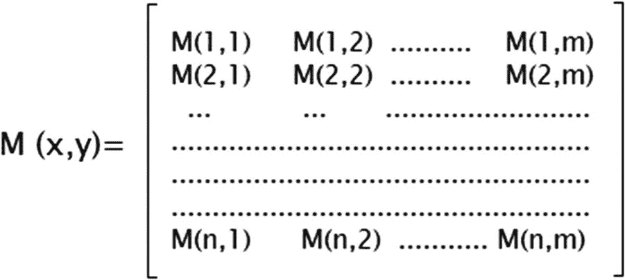

**图 10-1** 二维图像的矩阵表示

MATLAB 支持数量可观的图像格式。这些格式包括 `.bmp`、`.gif`、`.jpg`、`.jpeg`、`.hdf`、`.pcx`、`.png`、`.tiff`、`.xwd` 等。

在 MATLAB® 的图像处理工具箱中，基本有四种不同类型的图像：二值图像、灰度图像、索引图像和真彩色 (RGB) 图像。

### 二值图像

二值图像在其对应的矩阵表示中由 0 和 1 组成。0 代表图像中的白色，1 代表图像中的黑色。二值图像在工作区中存储为逻辑数组。图 10-2 是一个二值图像的示例。

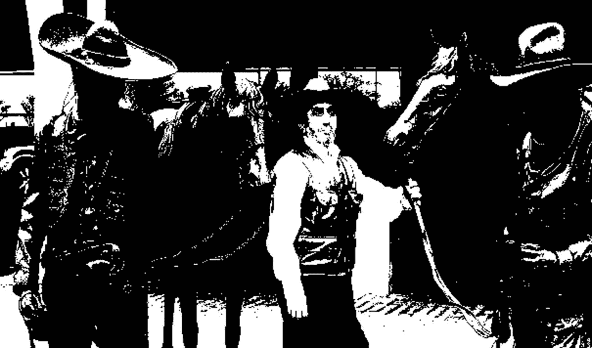

**图 10-2** 二值图像示例

### 灰度图像

灰度图像由数据矩阵表示，根据矩阵的类别具有不同的强度值。数据类型可能属于 `uint8`、`uint16`、`int16`、`single` 或 `double` 这些类别之一。`single` 或 `double` 数据类型的值范围为 0 到 1。对于 `uint8`，值范围为 0 到 255。对于 `uint16`，值范围是 0 到 65,535。最后，对于 `int16`，值范围为 -32,768 到 32,767。图 10-3 是图 10-2 中所示同一图像的灰度版本。


**图 10-3** 灰度图像示例

### 索引图像

索引图像由数组和颜色映射矩阵组成。颜色映射矩阵是一个 *m* × 3 的 `double` 类矩阵，其元素取值范围为 0 到 1。数组中的每个元素指向颜色映射矩阵中的某一行，用于设置图像的颜色。图 10-4 清晰地展示了颜色映射矩阵与数组矩阵之间的关系。

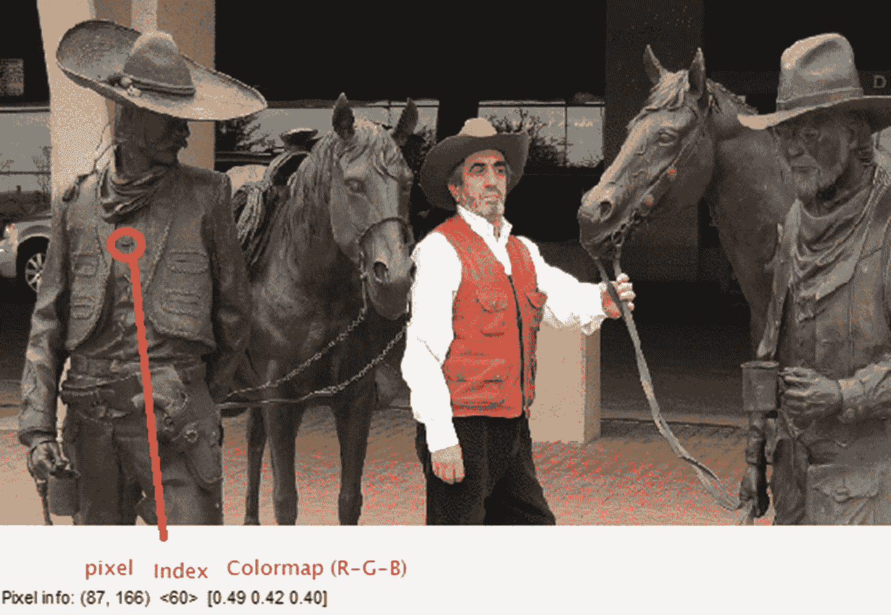

**图 10-4** 带有像素值、索引编号和颜色映射的索引图像

### 真彩色 (RGB) 图像

真彩色图像有时也称为 RGB（红-绿-蓝）图像。它们由三个矩阵组成，每个矩阵的大小为 *n* × *m*。因此，对于真彩色图像，(`n, m, 1`) 显示红色值，(`n, m, 2`) 显示绿色值，`(n, m, 3)` 显示蓝色值。这三个矩阵的组合决定了真彩色 (RGB) 图像的颜色。表示真彩色图像的数组可以是 `uint8`、`uint16`、`single` 或 `double` 类，其中像素值指定强度值。

显然，RGB 图像直接表示颜色，而不是将像素值映射到颜色映射矩阵。

**示例 10-1.** 编写一个程序，读取名为 `peppers.png` 的文件中真彩色图像的像素值。然后，对红、绿、蓝三种颜色取转置。将修改后的数据显示为新图像。

**解决方案 10-1.** 以下代码可用于完成给定任务。

*Example10p1.m*

```matlab
%Example10p1

%This code takes the transpose of RGB

RGB = imread('peppers.png');

subplot(211);imshow(RGB)

New_RGB(:,:,1) = RGB(:,:,1)';

New_RGB(:,:,2) = RGB(:,:,2)';

New_RGB(:,:,3) = RGB(:,:,3)';

subplot(212);imshow(New_RGB)
```

运行代码后，输出结果如图 9-15 和图 9-16 所示。


**图 9-16** 应用 `ifft2` 后得到的原始图像

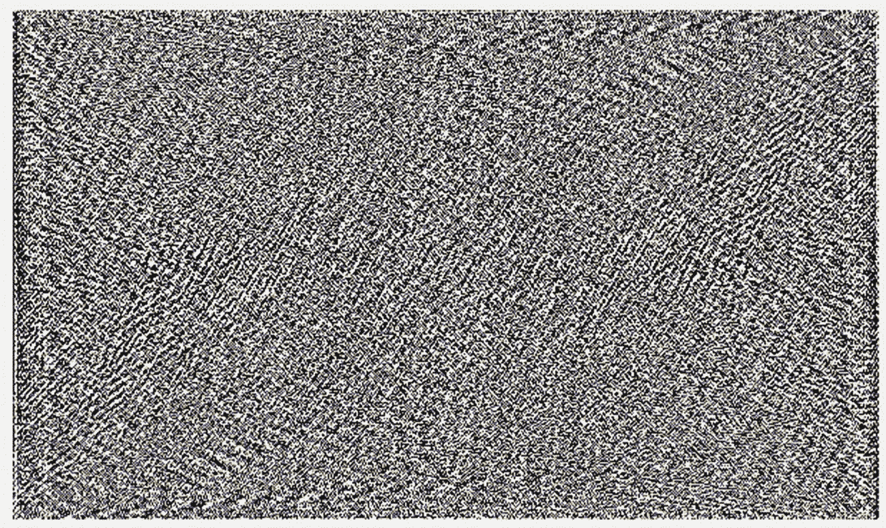

**图 9-15** 应用 `fft2` 函数后的图像

## 习题

- **9.1.** 对于给定的离散信号函数 *y* = *f*[*t*] = sin(2*t*)，其中 *t* 定义为 −2*π* ≤ *t* ≤ 2*π*，创建 20 个等间距的离散 *t* 值。代码应计算相应的 *y* 值并将其打印在屏幕上。

- **9.2.** 一个连续时间信号定义为 *y*(*t*) = 2*sinc*(2*t* + 1)。求该信号的周期。然后编写代码绘制该信号在 −*π* ≤ *t* ≤ *π* 范围内的图形。

- **9.3.** 一个连续时间信号定义为 *y*(*t*) = sin(3*t*) + cos(4*t*)。求该信号的周期。然后编写代码绘制该信号在 −2*π* ≤ *t* ≤ 2*π* 范围内的图形。

- **9.4.** 对于给定的连续时间信号 *y*(*t*) = cos(2*t*) + 10，编写代码从图形上判断该信号是偶信号还是奇信号。*y*(*t*) 和 *y*(−*t*) 的图形应显示在同一张图上。

- **9.5.** 如公式 18、19 和 20 所定义的信号 *f*(*x*) 的系数给定为 *L* = 3, *a*[0] = 0, *a*[*n*] = 0, 且 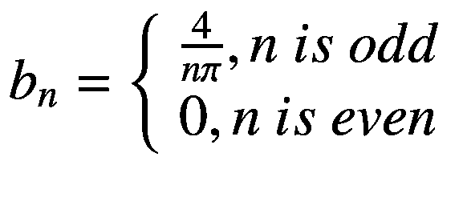。按照公式 18 计算 *n* = 19 时的信号 *f*(*x*)。然后绘制信号 *f*(*x*) 在 −*π* ≤ *x* ≤ *π* 范围内的图形。

- **9.6.** 编写代码，对函数 *x* 应用 `fft`，其中 *x* = sin(2*πt*), 0 ≤ *t* ≤ 1。代码应为 *t* 生成 200 个样本，向量 *x* 的长度应为 1,024。代码应在屏幕上绘制 *x* 的图形和功率谱。

```
imshow(YY/256);%original image is shown
```

该代码使用`imread`命令读取图像`peppers.png`。然后，在图形的第一行显示原始图像。之后，对每种颜色（R、G 和 B）进行转置，并赋值给一个名为`New_RGB`的新变量。最后，在图形的第二行，使用`imshow`函数显示修改后的图像。

代码执行后，将显示如图 10-5 所示的图像。


图 10-5
Example10p1 的输出

从图 10-5 可以看出，颜色得以保留，但图像的方向发生了改变。

## 转换图像类型与格式

有时我们可能需要将图像从一种类型转换为另一种类型。不过，在此转换过程中，我们可能会损失原始图像的质量。

有多种函数可用于类类型之间的转换，表 10-1 列出了其中一部分。

**表 10-1**
用于转换类类型的有用函数

| 函数 | 说明 |
| --- | --- |
| `im2double` | 将图像转换为双精度 |
| `im2int16` | 将图像转换为 16 位有符号整数 |
| `im2single` | 将图像转换为单精度 |
| `im2uint16` | 将图像转换为 16 位无符号整数 |
| `im2uint8` | 将图像转换为 8 位无符号整数 |

表 10-2 提供了一些用于转换图像类型的有用函数列表。

**表 10-2**
用于转换图像类型的有用函数

| 函数 | 说明 |
| --- | --- |
| `im2bw` | 将图像转换为二值图像 |
| `ind2gray` | 将索引图像转换为灰度图像 |
| `gray2ind` | 将灰度图像或二值图像转换为索引图像 |
| `rgb2gray` | 将 RGB 图像或颜色映射转换为灰度图像 |
| `ind2rgb` | 将索引图像转换为 RGB 图像 |

还有一些用于读取、写入和执行与图像相关的其他操作的函数，其中一部分列在表 10-3 中。

**表 10-3**
与图像相关的有用函数

| 函数 | 说明 |
| --- | --- |
| `imread` | 从图形文件读取图像 |
| `imwrite` | 将图像写入图形文件 |
| `imfinfo` | 提供有关图形文件的信息 |
| `frame2im` | 返回与电影帧关联的图像数据 |
| `im2frame` | 将图像转换为电影帧 |

可以使用`imwrite`函数将图像保存为不同的格式。

**示例 10-2.** 编写一个程序，从文件`moon.tif`中读取图像。然后，将该图像转换为`.jpg`格式。

**解决方案 10-2.** 首先，以下代码读取图像。然后，以目标文件格式写入图像。

*Example10p2.m*

```
%Example10p2

%This code converts jpg to png format

Cowboy = imread('Cowboys2.jpg');

imwrite(Cowboy,'Cowboys2.png');

Cowboy_png = imread('Cowboys2.png');

imshow(Cowboy_png)
```

代码执行后，结果如图 10-6 所示。


图 10-6
从`.jpg`转换为`.png`的图像

## 图像操作

有一些函数可以简化用户处理图像的工作。其中一些函数见表 10-4。

**表 10-4** 用于图像操作的有用函数

| 函数 | 说明 | 示例格式 |
| --- | --- | --- |
| `imadd` | 两幅图像相加，或为图像加上一个常数 | `Z = imadd(X,Y)` |
| `imrotate` | 将图像 A 按逆时针方向旋转指定角度 | `B = imrotate(A,angle)` |
| `imadjust` | 调整图像的强度值 | `J = imadjust(I)` |
| `imresize` | 将图像 A 调整为指定的行数和列数 | `B = imresize(A, [#行数 #列数])` |

**示例 10-3.** 编写一个程序，从文件`football.jpg`中读取图像。然后将图像分别旋转 30 度、90 度和 180 度。

**解答 10-3.** 可以使用以下代码来完成给定的任务。

*Example10p3.m*

```
%Example10p3

%This code rotates images

F = imread('football.jpg');

F30  = imrotate(F,30);

F90  = imrotate(F,90);

F180 = imrotate(F,180);

subplot(2,2,1),imshow(F)

title('Original Image')

subplot(2,2,2),imshow(F30)

title('Rotation with 30')

subplot(2,2,3),imshow(F90)

title('Rotation with 90')

subplot(2,2,4),imshow(F180)

title('Rotation with 180')
```

MATLAB 中已经存在一些图像。无需将这些图像存放在目录中即可直接读取。`Football.jpg`就是这些图像文件之一。

在上述代码中，`imrotate`函数将图像逆时针旋转。运行代码后，将得到如图 10-7 所示的输出。

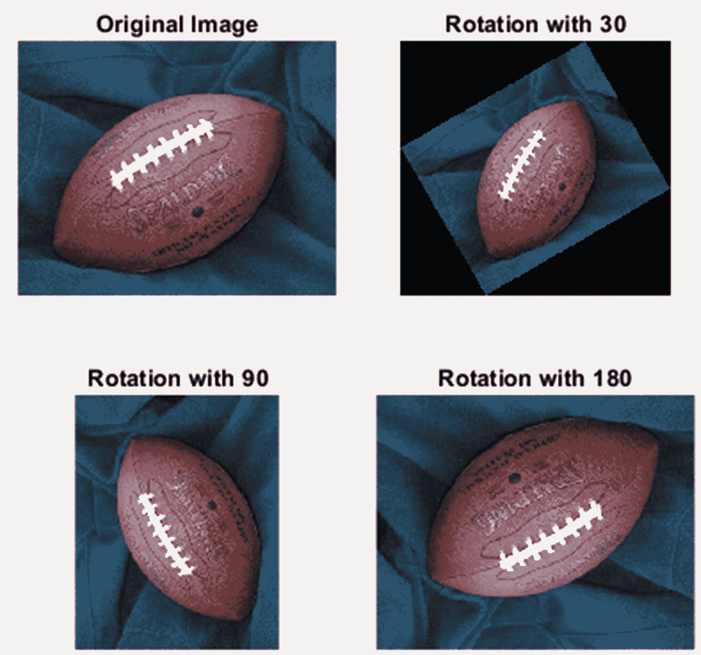

**图 10-7** 旋转图像

**示例 10-4.** 编写一个程序，分别从文件`rice.png`和`cowboys.png`中读取图像。然后，合并这些图像，并为`rice.png`图像加上 100。合并图像时，图片的尺寸应该匹配。如果尺寸不匹配，则代码应选取各图片维度中最小的行数和列数。代码应在一个图中分别显示所有这些图像。

**解答 10-4.** 在一个图中分别显示`cowboys.png`和`rice.png`图像。然后，可以在同一个图中显示合并后的图像以及将`rice.png`加上 100 后得到的图像。代码可以编写如下。

*Example10p4.m*

```
%Example10p4

%This code combines images

I = imread('rice.png');

J = imread('cowboys.png');

[rr,cr]=size(I);[rj,cj]=size(J);

Row=min(rr,rj);Col=min(cr,cj);

K = imadd(I(1:Row,1:Col),J(1:Row,1:Col));

JJ = imadd(I,100);subplot(2,2,1)

imshow(I);title('Only Rice')

subplot(2,2,2),imshow(J)

title('Only cowboy');subplot(2,2,3)

imshow(JJ);title('100 added to Rice')

subplot(2,2,4),imshow(K)

title('Combined Picture')
```

执行代码后，图像显示如图 10-8 所示。

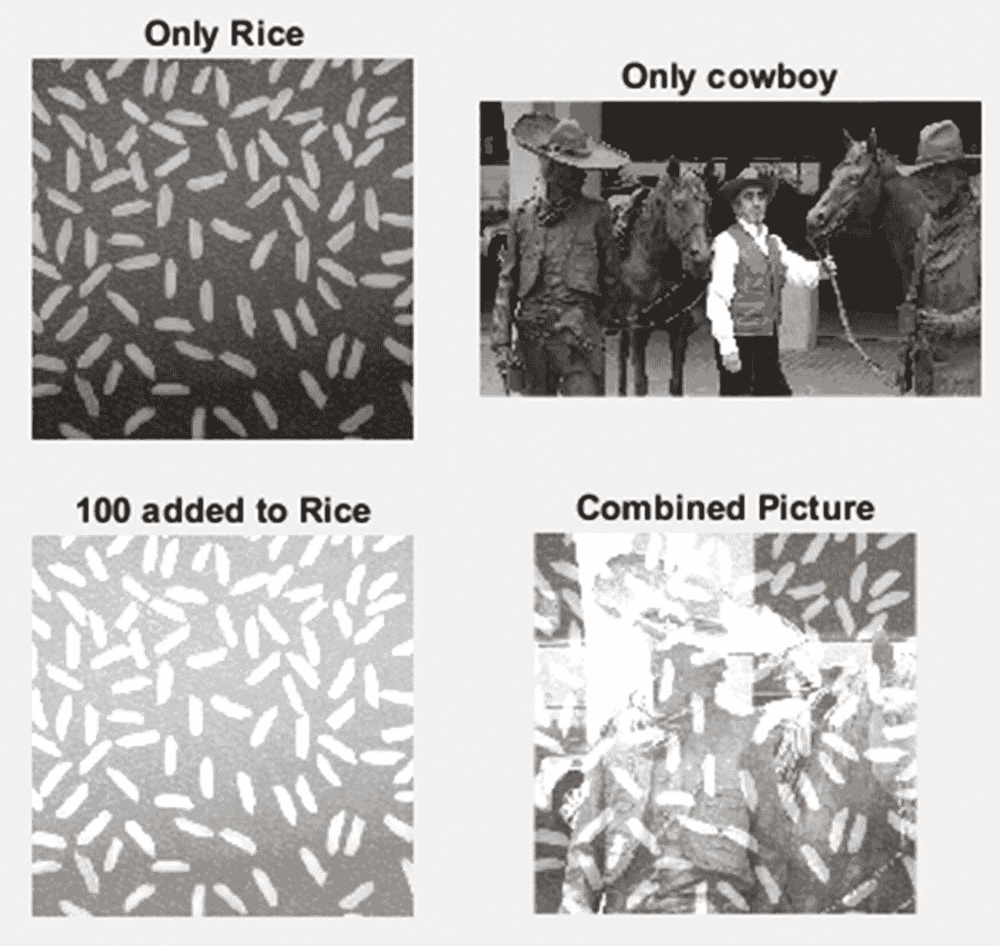

**图 10-8** 合并后的图像

如图 10-8 所示，相加后，合并的图像变得更亮。这是因为矩阵中的数值越大，图像就越亮。

## 图像增强

图像增强的目的是修改给定的图像，使修改后的图像得到改善。这可以通过操作图像的像素值来实现，称为点处理。使用的方法可以是空间域增强或频率域增强。

### 点处理

点处理操作可以简单地表示为以下形式：

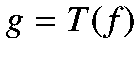

(1)

在公式 (1) 中，`g`表示处理后图像像素值的输出，`f`表示图像的像素值，`T`表示点处理操作。

**示例 10-5.** 编写一个程序，将名为`Cowboys.png`的图像读取到工作区。然后，代码应使用读取图像的像素值生成四幅不同的图像。输出图像应通过计算图像像素值的 1/5、1/2、2 和 4 次幂来获得。

**解答 10-5.** 可以使用以下代码来完成给定的任务。

*Example10p5.m*

```
%Example10p5
```

好的，我已仔细阅读了您的注意事项和示例。作为一名高级文档工程师，我将严格遵循所有规则对给定的文本进行排版和格式优化。

处理后的内容如下：


## 图像像素值操作

以下代码操作像素值。

```matlab
%This code manipulates pixel values
im=imread('Cowboys.png');
im1=double(im).^(1/5);im2=double(im).^(1/2);
im3=double(im).²;im4=double(im).⁴;
im1=mat2gray(im1);im2=mat2gray(im2);
im3=mat2gray(im3);im4=mat2gray(im4);
subplot(221),imshow(im1);title('\^(1/5)');
subplot(222),imshow(im2);title('\^(1/2)');
subplot(223),imshow(im3);title('\²');
subplot(224),imshow(im4);title('\⁴');
```

在代码中不难看出，如果幂次越小，则得到的结果也越小。如果幂次增大，计算结果也会增大。在进行计算之前，使用 `double` 命令将图像的像素值转换为 `double` 类型。计算完幂次后，使用 `mat2gray` 函数将它们转换回强度图像值。

运行代码后，将显示如图 10-9 所示的输出。

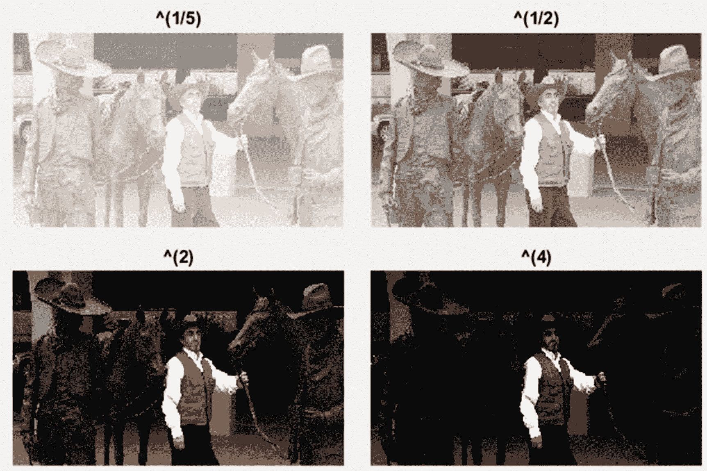

图 10-9 使用新像素值更新后的图像

也可以更改图像中的特定像素值，如示例 10-6 所示。

### 示例 10-6. 编写程序修改特定像素值

编写一个程序，将名为 `Cowboys.png` 的图像（尺寸为 356 × 605 × 3 的数组矩阵）读取到工作区。然后，对于数组中值在 30 到 150 之间的每个元素，将这些值更改为 1。

**解答 10-6.** 可以使用以下代码来完成给定的任务。

*Example10p6.m*

```matlab
%Example10p6
%This code changes pixel values in RGB
[RGB]=imread('Cowboys.png');
[Row,Col,ind]=size(RGB);
for i=1:ind
    for k=1:Row
        for m=1:Col
            if RGB(k,m,i)>=30 && RGB(k,m,i)<=150
                RGB(k,m,i)=1;
            end
        end
    end
end
imshow(RGB)
```

执行代码后，输出如图 10-10 所示。


图 10-10 使用新像素值更新后的图像

上述代码检查了 `R`、`G` 和 `B` 单元格的每个单元格值。然后，将值在 30 到 150 之间的元素赋值为 `1`。

使用直方图有助于我们理解灰度图像中的灰度级是如何分布的。因此，可以从直方图的形态中得出重要的推论。要获取图像的直方图，可使用 `imhist` 函数。

### 示例 10-7. 显示图像的直方图

在示例 10-5 中，绘制了四个图像。编写代码以显示这四个图像的直方图。

**解答 10-7.** 可以使用以下代码来完成给定的任务。

*Example10p7.m*

```matlab
%Example10p7
%This code uses imhist function
im=imread('Cowboys.png');
im1=mat2gray(double(im).^(1/5));
im2=mat2gray(double(im).^(1/2));
im3=mat2gray(double(im).²);
im4=mat2gray(double(im).⁴);
subplot(221),imhist(im1);title('\^(1/5)');
subplot(222),imhist(im2);title('\^(1/2)');
subplot(223),imhist(im3);title('\²');
subplot(224),imhist(im4);title('\⁴');
```

运行代码后，将得到如图 10-11 所示的直方图。

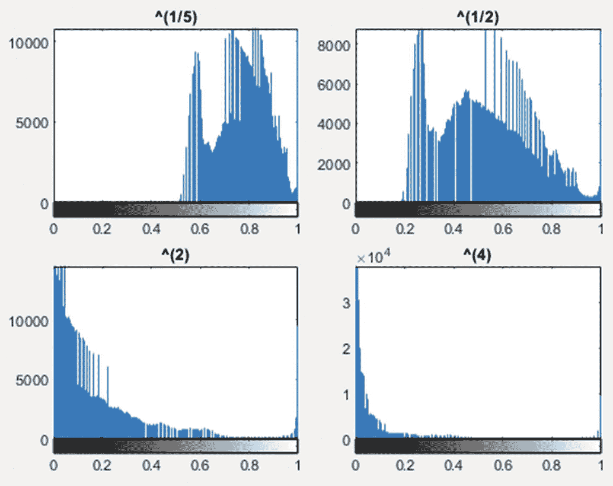

图 10-11 示例 10-7 中的直方图

如图 10-11 所示，颜色较浅的区域值接近 1，颜色较深的区域值接近零。*x*轴上的柱形数量称为*bin*（柱）。当使用`imhist`函数处理灰度图像时，默认有 256 个柱。如果图像是二值图像，则使用 2 个柱。

## 图像对比度调整

对比度拉伸是图像增强中使用的另一种技术。要执行此技术，需要将`stretchlim`函数与`imadjust`函数一起使用。`stretchlim`函数计算用于对比度拉伸的图像的下限和上限。然后，使用`imadjust`函数调整图像的强度值。

### 示例 10-8. 使用对比度拉伸调整图像

编写代码来调整 `Cowboys.png` 图像的像素值。代码应使像素值最高的 8%和最低的 8%达到饱和。原始图像和调整后的图像应绘制在一张图上，包括它们的直方图。

**解答 10-8.** 以下代码可用于完成给定的任务。

*Example10p8.m*

```matlab
%Example10p8
%This code uses imadjust and
%stretchlim functions
im=imread('Cowboys.png');fontSize=10;
Stretched_Image = imadjust(im, ...
    stretchlim(im, [0.08, 0.92]),[]);
subplot(221), imshow(im);
title('Original Image','FontSize',...
    fontSize);
subplot(222),imshow(Stretched_Image),
title('Stretched Image','FontSize',...
    fontSize);
subplot(223), imhist(im),
title('Original Image',...
    'FontSize',fontSize);
subplot(224), imhist(Stretched_Image),
title('Stretched Image',...
    'FontSize',fontSize);
```

运行代码后，结果如图 10-12 所示。

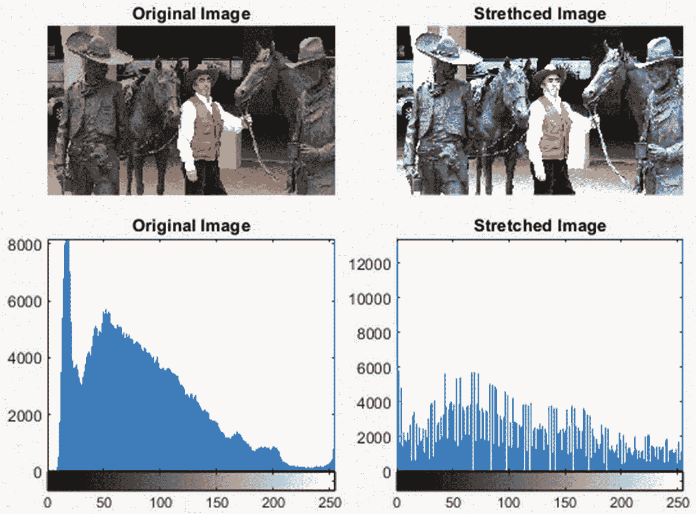

图 10-12 示例 10-8 的输出

你也可以使用直方图均衡化来增强对比度。

### 示例 10-9. 使用直方图均衡化增强对比度

编写代码，使用直方图均衡化来增强 `Cowboys.png` 图像的对比度。代码应在同一张图上显示原始图像、增强后的图像、原始与增强图像的差异，以及增强后图像的直方图。

**解答 10-9.** 以下代码可用于完成给定的任务。

*Example10p9.m*

```matlab
%Example10p9
%This code uses histeq and imshowpair func
im=imread('Cowboys.png');fontSize=10;
J = histeq(im);
imshowpair(im,J,'diff');
%Other Options of imshowpair-->'checkerboard'
%'blend','falsecolor','montage'
subplot(221),imshow(im)
title('Original Image');
subplot(222),imshow(J)
title('Histogram Equalization');
subplot(223),imshowpair(im,J,'diff')
title('Difference');
subplot(224),imhist(J)
title('Histogram of Hist. Equalization');
```


在上述代码中，`histeq` 函数用于通过直方图均衡化增强对比度。同时，`imshowpair` 函数用于显示原始图像和增强后图像之间的差异。代码中包含此命令的其他可用选项。

运行代码后，结果如图 10-13 所示。

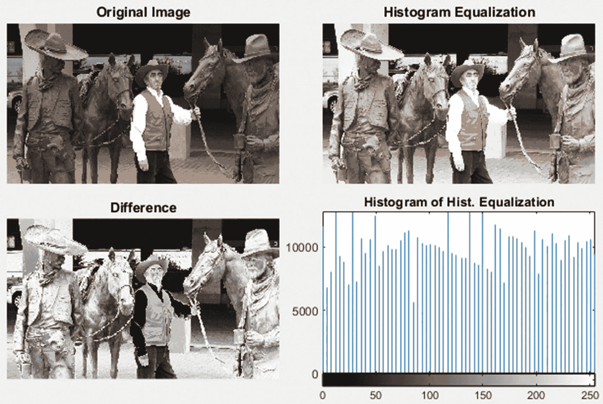

**图 10-13** 示例 10-9 的输出

### 空间域增强

空间域处理的是图像平面本身。在此类增强中，操作直接应用于图像像素。增强图像最常用的技术是滤波，这是一种对像素值进行处理的邻域操作。

对于二维图像，滤波操作可以表述如下：

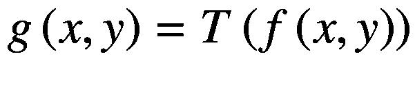

其中，`g` 表示处理后输出的值，`f` 表示图像的像素值，`T` 表示滤波器。如果对像素进行的操作是线性的，则该滤波器称为线性空间滤波器。否则，该滤波器称为非线性滤波器。表 10-5 描述了一些在空间域中常用的滤波函数。

**表 10-5** 一些用于空间域的基本滤波函数

| 函数 | 说明 |
| --- | --- |
| `imfilter` | 使用给定的滤波器对给定的数组进行滤波 |
| `fspecial` | 为 `average`、`disk`、`gaussian`、`laplacian`、`log`、`motion`、`prewitt` 和 `sobel` 类型创建二维滤波器 |
| `imgaussfilt` | 使用二维高斯掩膜对给定图像进行滤波 |
| `medfilt2` | 在二维上进行中值滤波 |
| `medfilt3` | 在三维上进行中值滤波 |
| `ordfilt2` | 在二维上进行顺序统计滤波 |
| `stdfilt` | 进行标准差滤波 |
| `imboxfilt` | 对图像应用 3x3 的盒式滤波器 |
| `conv2` | 对二维图像应用卷积 |

**示例 10-10.** 编写代码，将三个不同的滤波器应用于图像 `coins.png`。这三个滤波器分别是 `[1,1,1;1,1,1;1,1,1]∗1/9`，`[1,1,1,1,1;1,1,1,1,1;1,1,1,1,1;1,1,1,1,1;1,1,1,1,1]∗1/25` 和 `[0,1,0;1,-4,1;0,1,0]`。滤波后的图像和原始图像应显示在同一张图上。

**解答 10-10.** 所有给定的滤波器都可以使用 `imfilter` 函数应用。以下代码可用于完成给定的任务。

`Example10p10.m`
```matlab
%Example10p10

%This code works with imfilter

H2=ones(3)/9;H3=ones(5)/25;

H4=[0, 1,0;1,-4,1;0, 1, 0];

I = imread('coins.png');

I2 = imfilter(I,H2);

I3 = imfilter(I,H3);

I4 = imfilter(I,H4);

subplot(2,2,1),imshow(I),title('Original Image');

subplot(222),imshow(I2),title('Filtering by H2');

subplot(223),imshow(I3),title('Filtering by H3');

subplot(224),imshow(I4),title('Filtering by H4');
```

运行代码后，生成的图形如图 10-14 所示。

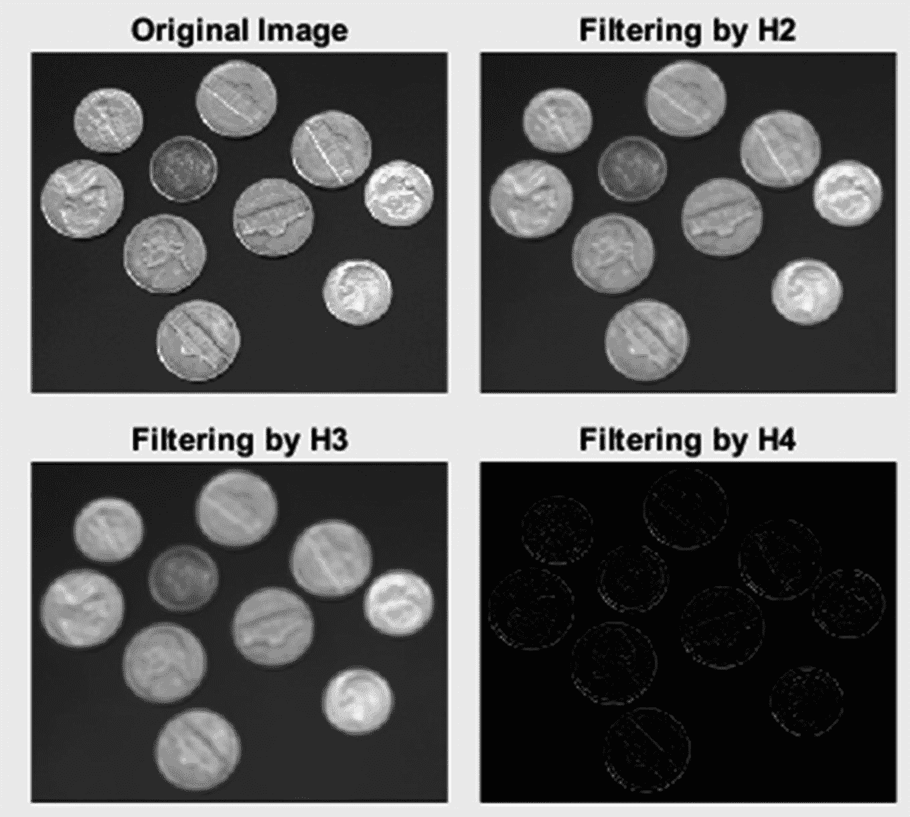

**图 10-14** 各滤波器的输出

**示例 10-11.** 编写代码，将 `'gaussian'`、`'average'` 和 `'motion'` 滤波器应用于 MATLAB 自带的 `peppers.png` 图像。滤波后的图像和原始图像应显示在同一张图上。

**解答 10-11.** 要应用给定的特殊滤波器，首先需要使用 `fspecial` 函数创建它们。然后，我们可以使用 `imfilter` 函数将它们应用到图像上。以下代码可用于完成给定的任务。

`Example10p11.m`
```matlab
%Example10p11

%This code works with imfilter and fspecial

H2 = fspecial('gaussian');

H3 = fspecial('average');

H4 = fspecial('motion');

I = imread('peppers.png');

I2 = imfilter(I,H2);

I3 = imfilter(I,H3);

I4 = imfilter(I,H4);

subplot(221),imshow(I),title('Original Image');

subplot(222),imshow(I2),title('By gaussian');

subplot(223),imshow(I3),title('By average');

subplot(224),imshow(I4),title('By motion');
```

运行代码后，将得到如图 10-15 所示的结果。

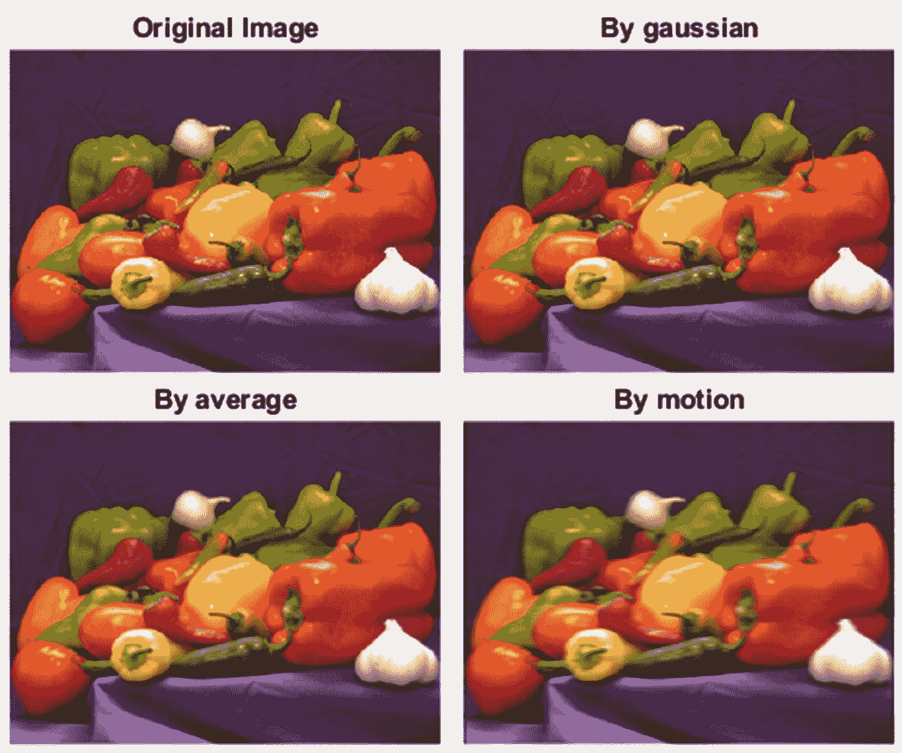

#### 图 10-15
三个特殊滤波器的输出

### 频域增强

频域处理的是像素变化率。这类增强基于对傅里叶变换的修改。表 10-6 列出了一些用于此目的的滤波函数。

**表 10-6** 频域滤波函数

| 函数 | 说明 |
| --- | --- |
| `freqspace` | 用于创建频率响应 |
| `freqz2` | 为二维 FIR 滤波器创建频率响应 |
| `fsamp2` | 为输入的频率响应创建二维 FIR 滤波器 |

频域增强的过程可总结如下：
1.  对图像进行傅里叶变换。
2.  将得到的输出与滤波器传递函数相乘。
3.  对图像进行傅里叶逆变换。

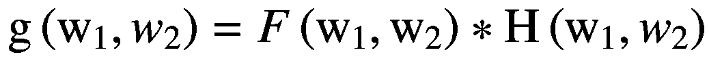 (3)

这些步骤在图 10-16 中进行了简单说明。

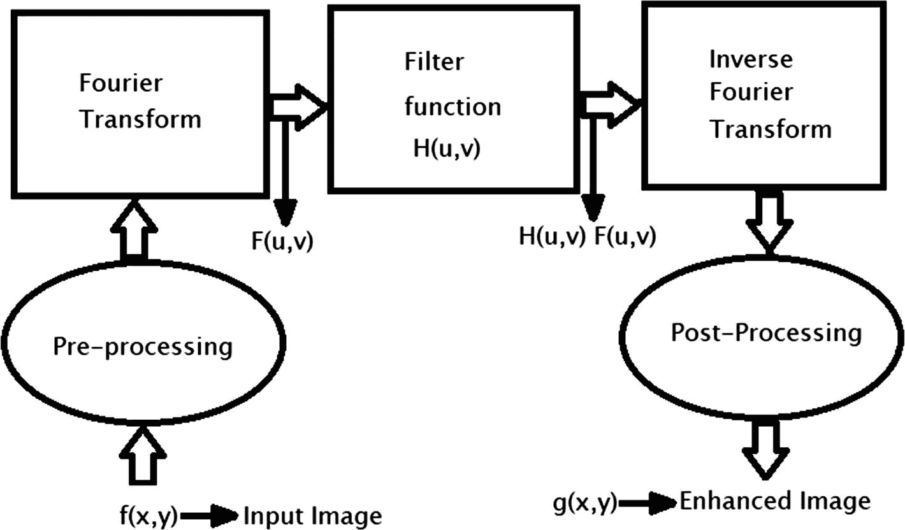

**图 10-16** 频域滤波示意图

可以选择不同的滤波器函数作为 `H(u, v)`。对于低通滤波器，在二维应用中通常使用理想低通滤波器（ILPF）。

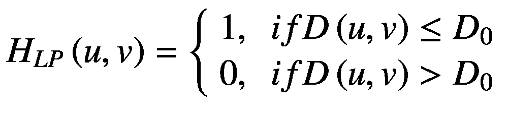 (4)

在公式 4 中，`D[0]` 是从原点开始的圆半径。该滤波器通过 `D[0]` 内的所有频率，并截止其余频率。最简单的高通滤波器是 ILPF 的补集，定义如下。

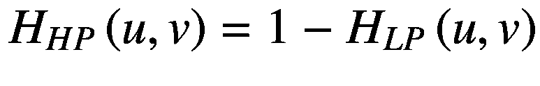 (5)

在二维应用中通常使用理想高通滤波器（IHPF）。

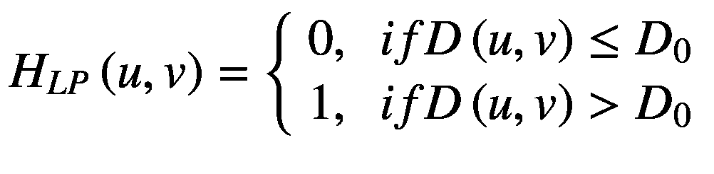 (6)

**示例 10-12.** 编写代码，将前面定义的 ILPF 应用于 `Cowboys.png` 图像。滤波器应写成一个单独的函数。`D[0]` 的值应为 50。最终图像应显示原始图像、变换后的图像、滤波器以及最终增强后的图像。

**解答 10-12.** 代码主体和分离的滤波函数可按下述代码编写。

`Example10p12.m`
```
%Example10p12

%This code works in frequency domain

im =imread('cowboys.png');

P_grayscale = rgb2gray(im);close all;

P_grayscale=double(P_grayscale);

subplot(221),imshow(mat2gray(P_grayscale));

title('Original Image');

%image i frequency domain

freq_rec=fft2(P_grayscale);

freq_rec=fftshift(freq_rec);

freq_rec_disp=log(1+abs(freq_rec));

%image shown in frequency domain.

subplot(222),imshow(mat2gray(freq_rec_disp));

title('Fourier transform is applied');

[Row,Col]=size(P_grayscale);

Filter =My_filter(Row,Col);

% Applying filtering

Filtering = freq_rec.*Filter;

Filtering_disp=log(1+abs(Filtering));

subplot(223),imshow(mat2gray(Filtering_disp));

title('Applied Filter');

%%% converting back to image

FilteredIm=real(ifft2(ifftshift(Filtering)));

subplot(224),imshow(mat2gray(abs(FilteredIm)));

title('Enhanced Image');
```

`My_filter.m`
```
function Filter =My_filter(Roww,Coll)

Row=ceil(Roww/2);Col=ceil(Coll/2);

D_0=50;

Filter=zeros(Roww,Coll);

for m=1:Roww

for n=1:Coll

if((m-Row)²+(n-Col)²)⁰.5<=D_0

Filter(m,n)=255;

end

end

end%Filter = 255-Filter; can be tried

end
```

运行代码后，结果如图 10-17 所示。

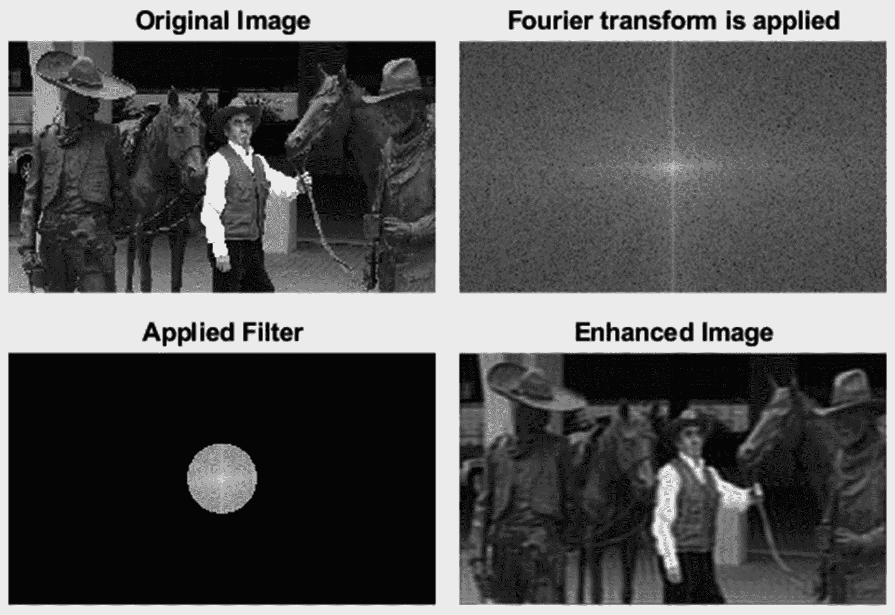

**图 10-17** 示例 10-12 的输出

### 使用其他函数增强

也可以使用积分图像域滤波、纹理滤波和边缘保持滤波函数进行增强，其中一些函数列于表 10-7 和表 10-8。

**表 10-8** 用于边缘保持的滤波函数

| 函数 | 说明 |
| --- | --- |
| `imbilatfilt` | 对输入图像执行高斯双边滤波 |
| `imguidedfilter` | 使用导向滤波应用滤波器 |
| `imnlmfilt` | 对彩色或灰度图像执行基于非局部均值滤波 |

**表 10-7** 用于积分图像域的滤波函数

| 函数 | 说明 |
| --- | --- |
| `integralImage` | 计算积分图像 |
| `integralImage3` | 计算三维积分图像 |
| `integralBoxFilter` | 使用 3x3 盒式滤波器过滤输入的积分图像 |

除了表 10-7 和表 10-8 列出的函数外，`gabor` 和 `imgabor` 函数也用于纹理滤波。

**示例 10-13.** 编写代码，向 `peppers.png` 图像添加均值为 0、方差为 0.0005 的高斯白噪声。然后使用 `imnlmfilt` 非局部均值滤波器去除噪声。

**解答 10-13.** 以下代码可用于完成指定任务。

`Example10p13.m`
```
%Example10p13

%This code works with imnlmfilt function

I = rgb2gray(imread('peppers.png'));

noisyImage = imnoise(I,'gaussian',0,0.0005);

filteredImage = imnlmfilt(noisyImage);

subplot(211),imshow(noisyImage);

title('Image with noisy');

subplot(212),imshow(filteredImage);

title ('Filtered Image');
```

# 图像复原

从图像信号中去除退化并恢复原始信号的过程称为图像复原。在本节中，我们将了解图像信号如何因椒盐噪声、高斯噪声和周期性噪声而丧失其原始状态。然后介绍消除这些噪声的方法。

## 添加与去除噪声

图像可能因外部因素（如图像信号传输或通过卫星发送图像信号）而产生误差或噪声。

**示例 10-14.** 编写代码，向`peppers.png`图像中添加椒盐噪声。然后使用`medfilt2`滤波器，在噪声密度为 0.2 的情况下去除噪声。

**方案 10-14.** 以下代码可用于完成给定任务。

*Example10p14.m*

```
%Example10p14

%This code applies salt & pepper noise

I1 = rgb2gray(imread('peppers.png'));

WithNois=imnoise(I1,'salt & pepper',0.2);

I2=medfilt2(I1);

subplot(121),imshow(WithNois);

title('Salt & Pepper Noise');

subplot(122),imshow(I2);

title ('Cleaning Noise');
```

运行代码后，将得到图 10-19 所示的图像。

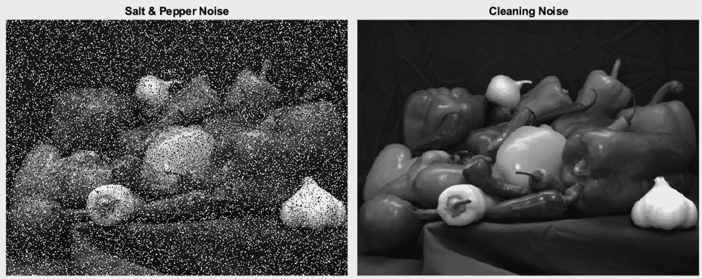

图 10-19 添加与去除椒盐噪声

**示例 10-15.** 编写代码，向`peppers.png`图像中添加噪声密度为 0.05 的散斑乘性噪声。然后使用 FIR 滤波器和自适应滤波器去除图像中的噪声。代码应在同一图中生成原始图像、噪声图像、FIR 滤波后图像和自适应滤波后图像。

**方案 10-15.** 以下代码可用于完成给定任务。

*Example10p15.m*

```
%Example10p15

%This code applies and cleans noise

im = rgb2gray(imread('peppers.png'));

no1=imnoise(im,'speckle',0.05);

subplot(221),imshow(im),title('Original Image')

subplot(222),imshow(no1),title('Noisy Image')

no2=mat2gray(filter2(fspecial('average',3),no1));

subplot(223),imshow(no2)

title('FIR filtered Image')

no3= wiener2(no1,[5 5]);%neighborhoods of 5-by-5

subplot(224), imshow(no3)

title('Adaptive Filtered Image')
```

运行代码后，将生成图 10-20 所示的图像。

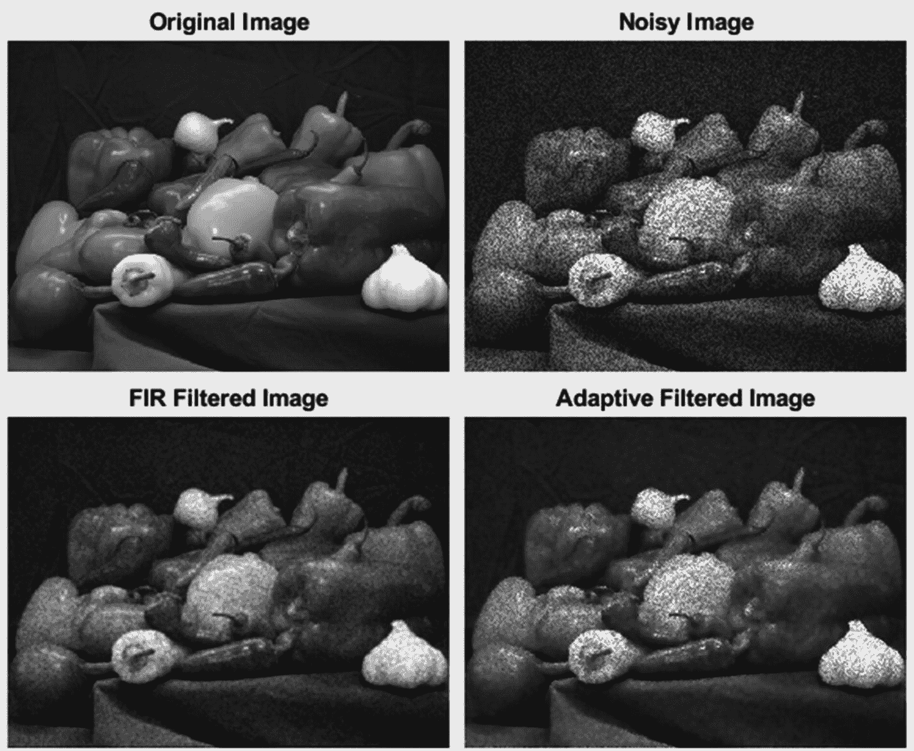

图 10-20 示例 10-15 的输出结果

## 颜色处理

颜色是一种物理特征，由人眼看到的、不同频率的光线组合而成。不同科学家提出了多种定义，但为简洁起见，此处不赘述。

在 MATLAB 中，有 HSV、RGB、YIQ（由美国国家电视系统委员会即 NTSC 定义）、YCbCr 和 L*a*b* 等颜色空间。不过，操作主要是在 RGB 空间中进行的。对于其他颜色空间，存在 RGB 与其他空间之间的转换函数，例如`rgb2hsv`、`rgb2ntsc`、`rgb2ycbcr`和`lab2rgb`。你可以在 MATLAB 命令窗口中输入`help`并加上这些函数名之一，以获取该函数的更多信息。

在本节中，我们将使用 RGB 颜色。

**示例 10-16.** 编写代码，读取`peppers.png`图像，并将 RGB 图像拆分为红色、绿色和蓝色通道。代码应在屏幕上显示图像的大小以及每个通道的前五个元素。

**方案 10-16.** 使用`imsplit`函数，可以将图像分离为红色、绿色和蓝色通道。以下代码可用于完成给定任务。

*Example10p16.m*

```
%Example10p16

%This code separates RGB colors

RGB = imread('peppers.png');

[R,G,B]=imsplit(RGB);

disp(size(RGB));

disp(RGB(1:5,1:5,:));

subplot(221),imshow(RGB)

title('Original Image');

subplot(222),imshow(R),title('R Channel');

subplot(223),imshow(G),title('G Channel');

subplot(224),imshow(B),title('B Channel');
```

运行代码后，在命令窗口中得到以下输出。

```
> Example10p16

384   512     3

(:,:,1) =

62   63   63   65   66

63   61   59   64   63

65   63   63   66   66

63   67   67   63   64

63   62   64   65   66

(:,:,2) =

29   31   34   30   27

31   31   32   30   28

29   30   31   30   31

29   29   31   31   31

31   32   33   30   31

(:,:,3) =

64   64   64   60   59

62   64   64   60   59

60   62   63   61   61

62   63   63   60   62

62   63   62   61   61

>
```

如输出所示，图像大小为 384 × 512 × 3，RGB 图像的对应数组是一个三维矩阵。每个维度对应 R、G、B 通道，每个通道有一个 384 × 512 的矩阵。

图 10-21 是运行结果。原图是其他三幅图像的组合。

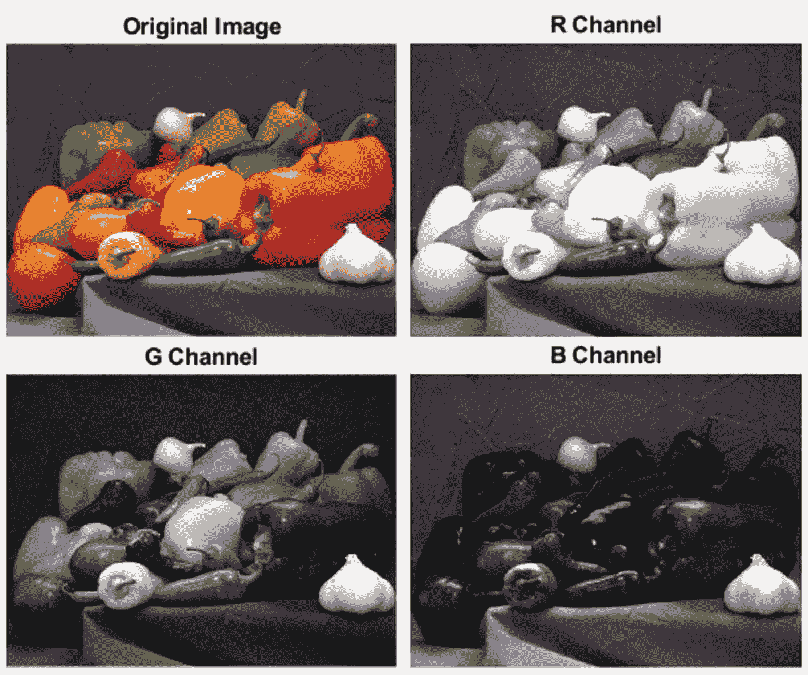

图 10-21 示例 10-16 的输出结果

示例 10-6 中展示了操作像素值的示例。如示例 10-17 所示，更改 RGB 图像中每个通道的系数是另一种选择。

**示例 10-17.** 编写代码，将`peppers.png`图像的每个通道乘以不同的系数。红色、绿色和蓝色通道的第一组系数分别为 1/3、2/3 和 3/3；第二组系数分别为 2/3、3/3 和 1/3；最后一组系数分别为 3/3、1/3 和 2/3。用给定的系数计算每个通道后，应将通道组合起来以表示 RGB 图像。因此，应从不同的系数得到三幅彩色图像。代码应在同一图中显示所有这些图像以及原始图像。

**方案 10-17.** 为了保存每个通道的计算结果，我们可以创建一个四维数组。在此数组中，前两个维度属于每个通道的像素值。第三个维度可以保存 R、G、B 的值。最后一个维度可以保存使用给定系数后的值。以下代码可用于完成给定任务。

*Example10p17.m*

```
%Example10p17

%In code, channels different coefficients

RGB=imread('peppers.png');

New(:,:,1,1)=RGB(:,:,1)*(1/3);

New(:,:,2,1)=RGB(:,:,2)*(2/3);

New(:,:,3,1)=RGB(:,:,3)*(3/3);

New(:,:,1,2)=RGB(:,:,1)*(2/3);

New(:,:,2,2)=RGB(:,:,2)*(3/3);

New(:,:,3,2)=RGB(:,:,3)*(1/3);

New(:,:,1,3)=RGB(:,:,1)*(3/3);

New(:,:,2,3)=RGB(:,:,2)*(1/3);

New(:,:,3,3)=RGB(:,:,3)*(2/3);

subplot(221),imshow(RGB);

title('Original Image');
```

运行代码后，在命令窗口中获得图 10-22 所示的图像。

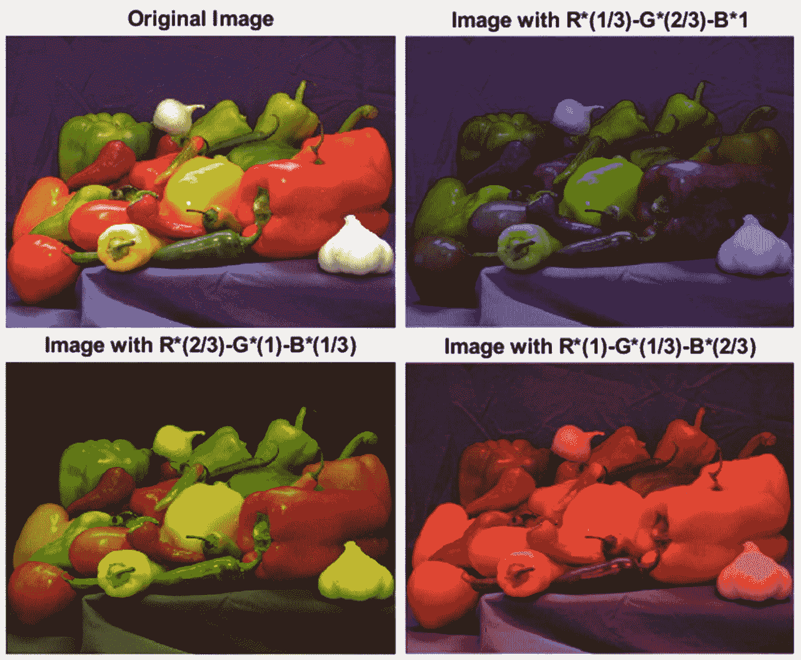

图 10-22

示例 10-17 的输出结果

## 图像分割

图像分割是将图像划分为其组成部分，或将图像分割成不同区域的过程。通常，属于同一分割区域的像素预期具有相似的像素值，因此应形成一个连通区域。常见的分割技术包括阈值分割、边缘检测和基于区域的方法。

### 阈值分割

将灰度图像的每个像素赋值为 0 或 1（考虑精确的一个或多个点）称为阈值分割。阈值分割有两种类型：单阈值分割和双阈值分割。

#### 单阈值分割

在单阈值分割中，只考虑一个点。假设阈值定义为`T`。点`(x,y)`处的像素值可定义如下：


(7)

因此，在公式 7 中，为灰度图像内`P(x, y)`的每个像素值定义了白色或黑色着色。

**例 10-18.** 编写代码，以`T = 0.61`为阈值检测`coin.png`文件的边界。

**解 10-18.** 以下代码可用于完成给定任务。

*Example10p18.m*

```
%Example10p18
%This code uses thresholding
T=0.61;
im=mat2gray(imread('coins.png'));
[Row,Col]=size(im);
NewIm=zeros(Row,Col);
for i=1:Row
    for k=1:Col
        if im(i,k)>T
            NewIm(i,k)=1;
        else
            NewIm(i,k)=0;
        end
    end
end
figure,imshowpair(im,mat2gray(NewIm),'montage');
title ('Original Image and Thresholding');
```

代码运行后，将得到图 10-23 所示的输出结果。

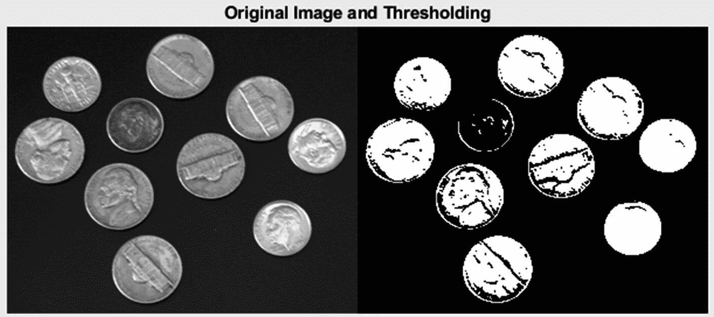

图 10-23：例 10-18 的输出结果

类似的阈值分割也可以使用 MATLAB 内置函数实现。

**例 10-19.** 编写代码，使用`graythresh`函数检测`coins.png`图像的边界，该函数采用 Otsu 方法计算全局阈值。为将图像二值化，请使用内置函数`imbinarize`。

**解 10-19.** 以下代码可用于完成给定任务。

*Example10p19.m*

```
%Example10p19
%This code uses graythresh and imbinarize functions
im = imread('coins.png');
Level = graythresh(im);%using Otsu's method
BinaryIm = imbinarize(im,Level);%binarize the image
imshowpair(im,BinaryIm,'montage');
title ('Original Image and Thresholding');
```

代码运行后，将得到图 10-24 所示的结果。

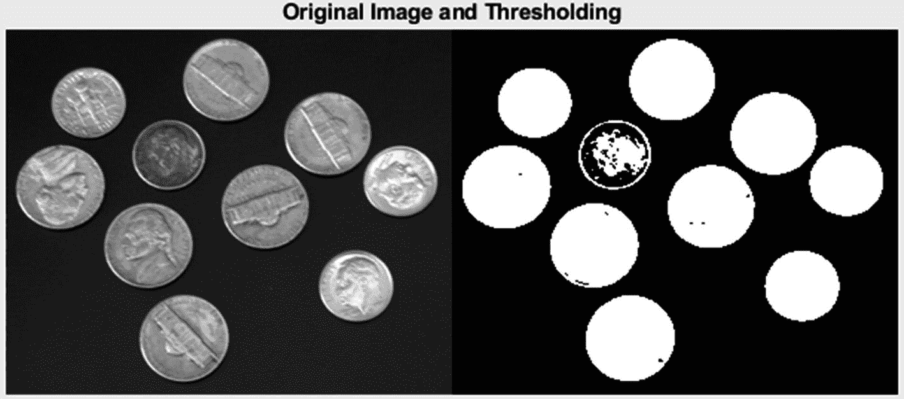

图 10-24：例 10-19 的输出结果

#### 双阈值分割

在双阈值分割中，考虑两个点。假设阈值定义为`T[1]`和`T[2]`。点`(x,y)`处的像素值可定义如下：


(8)

**例 10-20.** 编写代码，以`T[1] = 0.618`和`T[2] = 0.382`为阈值检测`coin.png`文件的边界。

**解 10-20.** 以下代码可用于完成给定任务。

*Example10p20.m*

```
%Example10p20
%This code uses double thresholding
T1=0.618;T2=0.382;
im=mat2gray(imread('coins.png'));
[Row,Col]=size(im);
NewIm=zeros(Row,Col);
for i=1:Row
    for k=1:Col
        if (im(i,k)>T2) && (im(i,k)<T1)
            NewIm(i,k)=1;
        else
            NewIm(i,k)=0;
        end
    end
end
figure,imshowpair(im,mat2gray(NewIm),'montage');
title ('Original Image and Thresholding');
```

代码运行后，图 10-25 显示了输出结果。

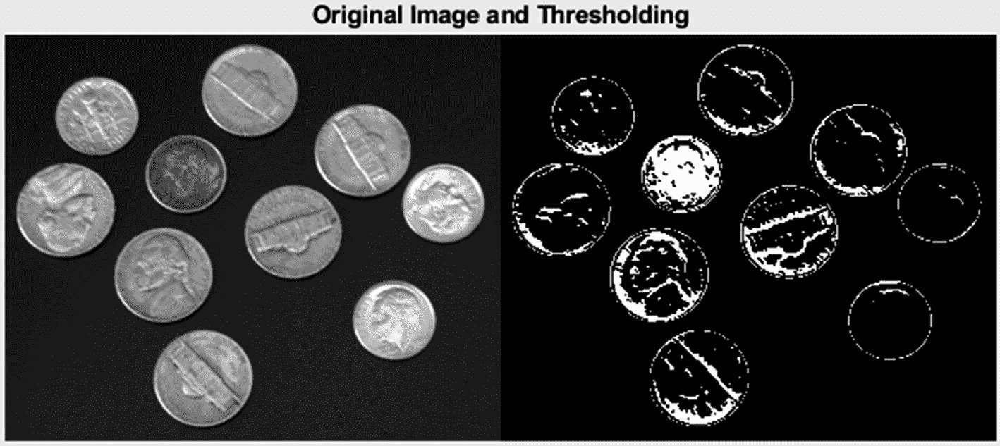

图 10-25：例 10-20 的输出结果

## 边缘检测

边缘检测定义为检测图像内对象的边界。它是用于图像分割和数据提取的主要图像处理技术之一。在 MATLAB 中，有多种不同的算法和方法用于此目的。要查找图像中的边缘，需使用`edge`函数。用于此目的的方法包括`sobel`、`prewitt`、`roberts`、`log`、`zerocross`、`canny`和`approxcanny`。如果未选择这些方法中的任何一个，则默认使用`sobel`方法。

许多边缘检测算子都是基于微分构建的。

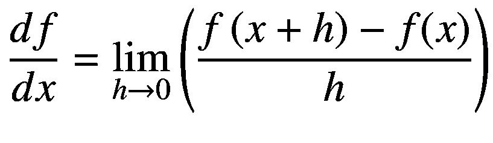

(9)

导数的定义如公式 9 所示。该表达式可以重写为

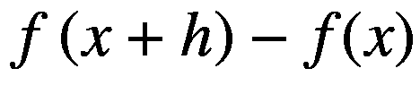

(10)

当`h = 1`时。实际上，如果考虑水平方向上相邻像素值之间的差值，`h`的最小值为 1。

基于表达式`f(x+1) - f(x-1)`，可以将水平和垂直滤波器定义为`[-1, 0, 1]`和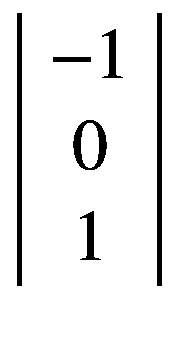。梯度幅值在边缘检测方法中起着重要作用。对于图像`f(x, y)`，其梯度和梯度幅值定义为

![$$ \left[\frac{\partial f}{\partial x}\ \frac{\partial f}{\partial y}\right] $$](images/483991_1_En_10_Chapter/483991_1_En_10_Chapter_TeX_IEq2.png)，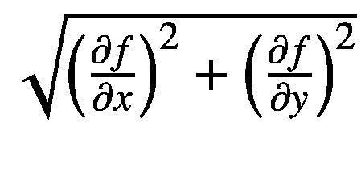。(11)

### 例 10-21

编写一个程序，从文件`cowboys.png`中读取图像。然后，使用`canny`和`prewitt`方法查找图像中的边缘。

**解 10-21.** 以下代码可用于完成给定任务。

*Example10p21.m*

```matlab
%Example10p21
%This code finds edges
Im = imread('cowboys.png');
Im2 = rgb2gray(Im);
CannyM = edge(Im2,'canny');
PrewittM = edge(Im2,'prewitt');
figure, imshow(CannyM);
title('Canny method');
figure, imshow(PrewittM);
title('Prewitt method');
```

代码运行后，获得的输出结果显示在图 10-26 和 10-27 中。

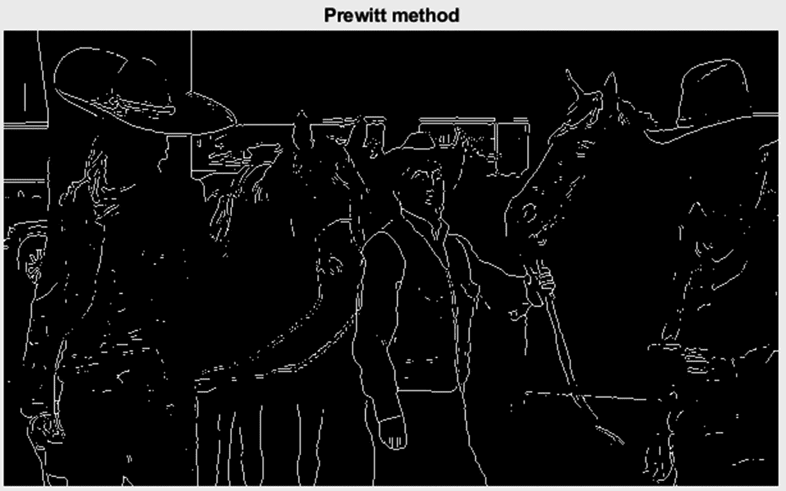

图 10-27：例 10-21 的第二个输出结果

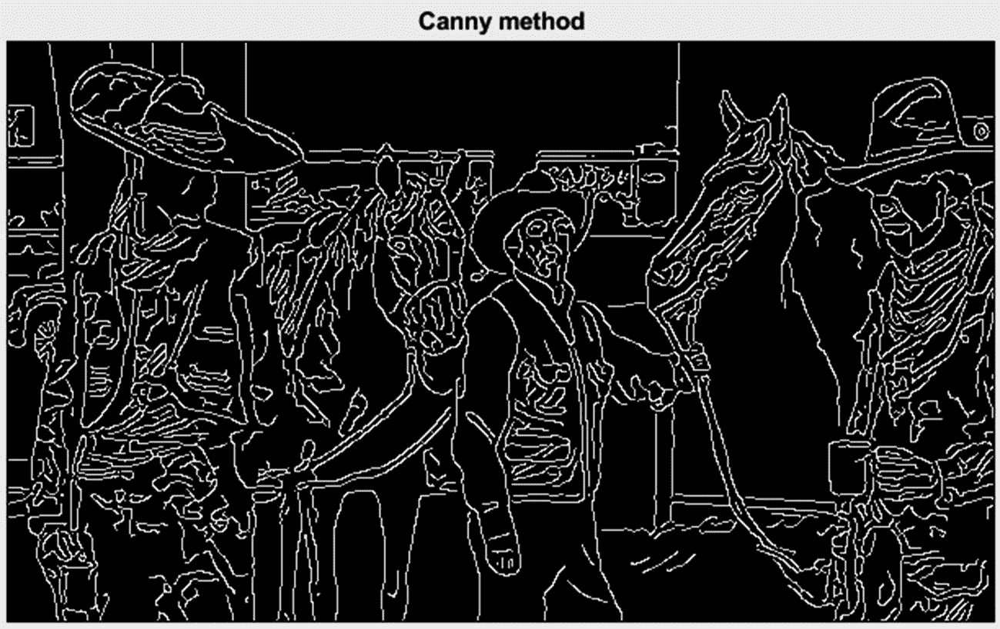

图 10-26：例 10-21 的第一个输出结果

### 例 10-22

定义两个滤波器为![$$ {P}_x=\left[\begin{array}{cc}-1&amp; 0\kern0.5em 1\\ {}\begin{array}{c}-1\\ {}-1\end{array}&amp; \begin{array}{c}0\kern0.5em 1\\ {}\begin{array}{cc}0&amp; 1\end{array}\end{array}\end{array}\right] $$](images/483991_1_En_10_Chapter/483991_1_En_10_Chapter_TeX_IEq4.png)和![$$ {P}_y=\left[\begin{array}{cc}-1&amp; -1\kern0.5em -1\\ {}\begin{array}{c}0\\ {}1\end{array}&amp; \begin{array}{c}\begin{array}{cc}0&amp; 0\end{array}\\ {}\begin{array}{cc}1&amp; 1\end{array}\end{array}\end{array}\right] $$](images/483991_1_En_10_Chapter/483991_1_En_10_Chapter_TeX_IEq5.png)。使用这两个滤波器，查找`cowboys.png`图像的边缘。

**解 10-22.** 以下代码可用于完成给定任务。

*Example10p22.m*

```matlab
%Example10p22
%This code finds edges
I = imread('cowboys.png');
s = rgb2gray(I);
px=[-1,0,1;-1,0,1;-1,0,1];
py=px';
Sx=imfilter(s,px);
Sy=imfilter(s,py);
imshow(Sx),title('Applying Px');
figure,imshow(Sy),title('Applying Py');
```

一旦代码运行，将获得如图 10-28 和图 10-29 所示的输出。

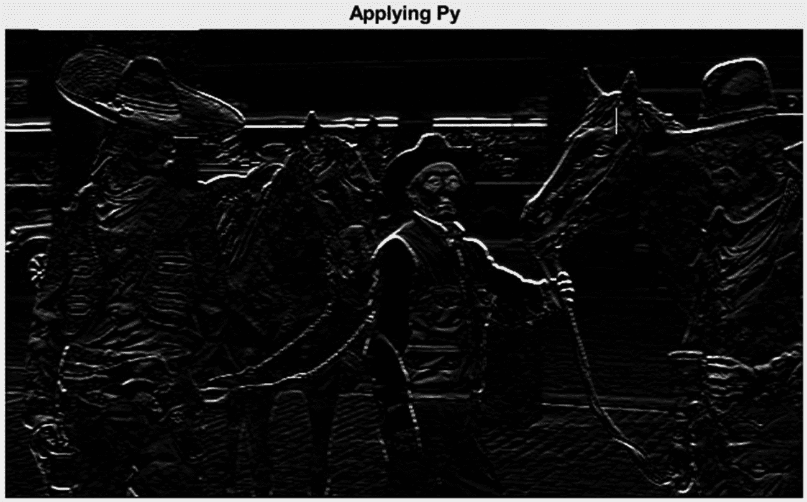

图 10-29：示例 10-22 的第二个输出

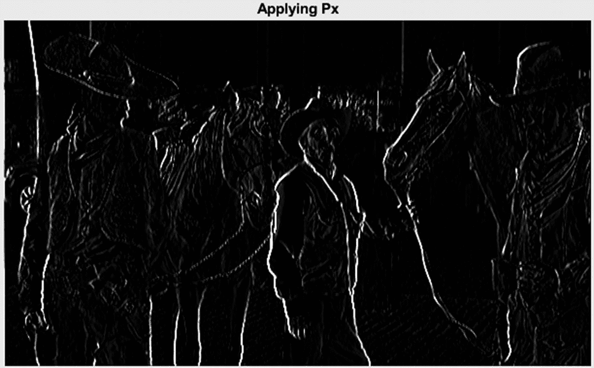

图 10-28：示例 10-22 的第一个输出

### 示例 10-23

编写代码，使用滤波器`px=[0,-1,-1;1,0,-1;1,1,0]`，在不使用 MATLAB 内置函数的情况下查找`cowboys.png`图像的边缘。

**解法 10-23.** 以下代码可用于完成给定任务。

*Example10p23.m*

```matlab
%Example10p23
%This code finds edges without built-in functions
Im=double(rgb2gray(imread('cowboys.png')));
[Row,Col]=size(Im);
Im2=zeros(Row-1,Col-1);
Im2(1,1)=Im(1,1);
Filt=[0,-1,-1;1,0,-1;1,1,0];
Filt=flipud(Filt);
Filt=fliplr(Filt);
for i=2:size(Im, 1)-1
    for j=2:size(Im, 2)-1
        nghb_mtrx=Filt.*Im(i-1:i+1, j-1:j+1);
        avg_val=sum(nghb_mtrx(:));
        Im2(i, j)=avg_val;
    end
end
imshow(uint8(Im2));
title('Edge Detection');
```

在上述代码中，使用了卷积算子。一旦代码运行，将获得如图 10-30 所示的输出。

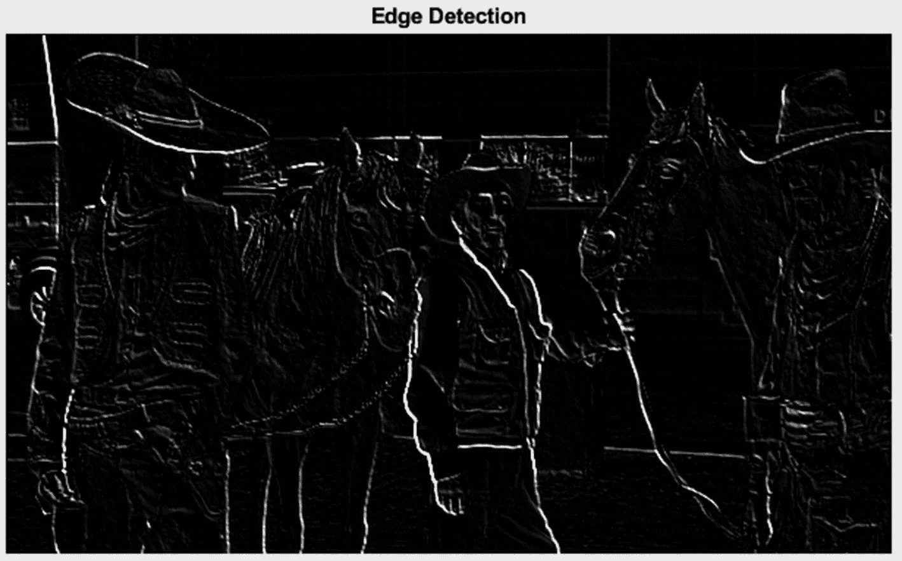

图 10-30：示例 10-23 的输出

## 示例 10-24

编写代码，使用滤波器`px=[0,1,0;1,-4,1;0,1,0]`（即离散拉普拉斯算子），在不使用内置函数的情况下查找`cowboys.png`图像的边缘。

## 解法 10-24

以下代码可用于完成给定任务。

*Example10p24.m*

```matlab
%Example10p24

%This code applies discrete Laplacian

Im=double(rgb2gray(imread('cowboys.png')));

[Row,Col]=size(Im);

Im2=zeros(Row-1,Col-1);

Im2(1,1)=Im(1,1);

Filt=[0,1,0;1,-4,1;0,1,0];

Filt=flipud(Filt);

Filt=fliplr(Filt);

for i=2:Row-1

    for j=2:Col-1

        nhbr_mtrx=Filt.*Im(i-1:i+1, j-1:j+1);

        avg_val=sum(nhbr_mtrx(:));

        Im2(i, j)=avg_val;

    end

end

imshow(uint8(Im2)); title('Discrete Laplacian');
```

在此代码中，使用卷积来获得输出。一旦代码运行，输出如图 10-31 所示。

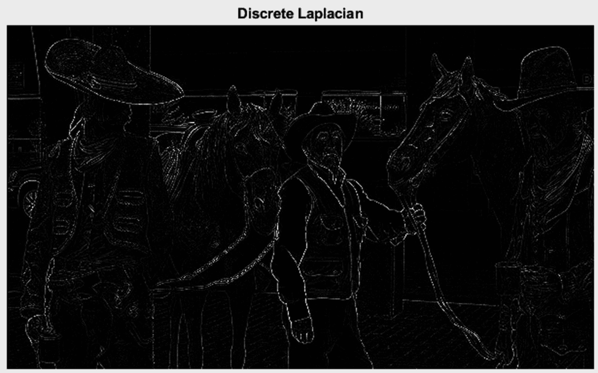

图 10-31：示例 10-24 的输出

## 基于区域的方法

通常，数据聚类、区域生长、区域合并与分裂以及均值漂移是用于应用基于区域的图像分割的不同方法。这些方法试图在图像上的一个区域内找到像素值之间的共同特征。最简单的方法之一是区域生长。在这种方法中，先选取一个初始种子点，然后检查种子点与相邻像素之间的差异。如果差值在某个可容忍的点或阈值范围内，则将这些像素添加到种子像素中，区域将随之增长。在这种方法中，阈值或标准将成为算法的重要组成部分。

## 数学形态学

数学形态学是图像处理的一个分支，用于分析和处理几何结构，例如提取图像分量。其运算用于噪声滤波、分割、形状简化和增强对象结构。膨胀和腐蚀是数学形态学中的两个重要概念。膨胀会向对象边界添加像素，而腐蚀则会移除边界上的像素。

假设 *A* 和 *B* 是两个具有像素值的集合。则 *A* 被 *B* 膨胀定义为

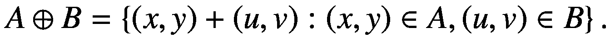

(12)

*A* 被 *B* 腐蚀定义为

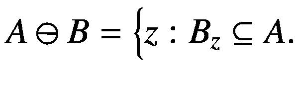

(13)

所有其他操作均由膨胀和腐蚀的组合定义。表 10-9 列出了形态学中一些最常用的函数。

**表 10-9：形态学中使用的函数**

| 函数 | 说明 |
| --- | --- |
| `bwpack` | 将输入的二进制图像打包为 `uint32` |
| `bwunpack` | 将 `uint32` 二进制图像解包为二进制图像 |
| `imdilate` | 膨胀灰度、二进制或打包图像 |
| `imerode` | 腐蚀灰度、二进制或打包图像 |
| `imclose` | 对灰度或二进制图像执行形态学闭运算 |
| `imopen` | 对灰度或二进制图像执行形态学开运算 |
| `imbothat` | 对灰度或二进制图像应用形态学底帽滤波 |
| `translate` | 平移一个多边形 |

## 示例 10-25

编写代码，将`cowboys.png`图像的大小调整为 300×400。然后代码应使用`strel`函数创建一个宽度为 3 像素的立方体结构元素。接着分别对该调整大小后的图像应用腐蚀和膨胀。代码应在两个不同的图形中分别显示原始图像与膨胀后图像，以及原始图像与腐蚀后图像。

## 解法 10-25

以下代码可用于完成给定任务。

*Example10p25.m*

```matlab
%Example10p25

%This code applies erosion and dilation

I= rgb2gray(imread('cowboys.png'));

BW=imresize(I,[300 400]);

se = strel('square',3);

BW1=imerode(BW,se);

BW2 = imdilate(BW,se);

figure,imshowpair(BW,BW1,'montage');

title('Original  with Erosion');

figure,imshowpair(BW,BW2,'montage');

title('Original  with Dilation');
```

## 问题

10.1. 编写一个程序，读取文件名为 `peppers.png` 的真彩色图像的像素值。然后，将图像格式转换为 `.jpg`，并将其保存为 `New.jpg`。

10.2. 编写一个程序，从文件 `peppers.png` 中读取图像。然后，将图像分别旋转 50 度和 12 度。

10.3. 编写一个程序，从文件 `rice.png` 和 `cowboys.png` 中读取图像。然后，将这两幅图像相减，并对结果取绝对值。最后，在屏幕上将这些值显示为一幅图像。

10.4. 编写一个程序，读取名为 `rice.png` 的图像。然后，代码应使用所读取图像的像素值生成两幅不同的图像。第一幅图像的像素值应为所用图像像素值的二次幂，第二幅图像的像素值必须通过将所读取图像的像素值除以三来获得。

10.5. 编写一个程序，读取名为 `peppers.png` 的图像。然后，将 R、G、B 的频率改为 B、R、G，并且代码应显示最终的图像。

10.6. 编写代码以调整图像 `peppers.png` 的像素值。代码应将最高的 10%和最低的 10%像素值进行饱和处理。原始图像和调整后的图像应显示在一张图上，并包括它们的直方图。

10.7. 编写代码，使用直方图均衡化增强图像 `peppers.png` 的对比度。代码应在不同的图中显示增强后的图像，以及原始图像与增强后图像的差值图像。

10.8. 编写代码，对图像 `coins.png` 应用两个不同的滤波器。这两个滤波器分别是 `[1,1;1,1]*1/4` 和 `[1,1,1,1,1;1,1,1,1,1;1,1,1,1,1;1,1,1,1,1;1,1,1,1,1]*1/25`。滤波后的图像和原始图像应分别显示在不同的图中。

10.9. 编写代码，将 MATLAB 中的 `gaussian`、`average` 和 `motion` 滤波器应用于 `rice.png`。滤波后的图像应显示在同一个图中。

10.10. 编写代码，向 `peppers.png` 图像添加均值为零、方差为 0.01 的高斯白噪声。然后使用一个 4×4 的滤波器去除噪声。

10.11. 编写代码，向 `peppers.png` 图像添加噪声密度为 0.02 的斑点乘性噪声。然后使用自适应滤波器去除图像中的噪声。代码应在不同的图中显示原始图像和滤波后的图像。

10.12. 编写代码，读取 `peppers.png` 图像，并将 RGB 图像分离为红、绿、蓝三个通道。代码应在屏幕上显示图像的尺寸以及每个通道的前 10 个元素。

10.13. 编写代码，用不同的系数乘以 `peppers.png` 图像的每个通道。红、绿、蓝通道的系数分别为 1/4、3/4 和 1/2。在计算完每个通道与给定系数的乘积后，应将通道合并以表示一幅 RGB 图像。代码应在同一个图中显示所有更新后的图像以及原始图像。

10.14. 编写代码，以 `T = 0.5` 为阈值检测 `peppers.png` 的边界。

10.15. 编写一个程序，从文件 `peppers.png` 中读取图像。然后，使用高斯滤波器来查找图像的边缘。


