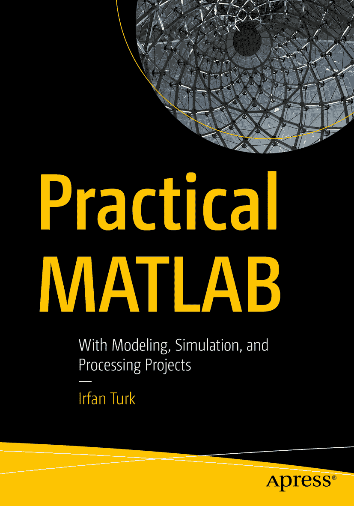

# 版权信息

ISBN 978-1-4842-5280-2

电子版 ISBN 978-1-4842-5281-9

[`doi.org/10.1007/978-1-4842-5281-9`](https://doi.org/10.1007/978-1-4842-5281-9)

© 2019 伊尔凡·图尔克

本作品受版权保护。出版商保留所有权利，涉及材料的全部或部分内容，具体包括翻译、重印、重用插图、朗诵、广播、以微缩胶片或任何其他物理形式复制，以及以电子方式改编、计算机软件或任何当前已知或未来开发的类似或不同方法进行传输或信息存储与检索。书中可能出现的商标名称、标识和图像。对于每个出现的商标名称、标识或图像，我们仅在编辑风格中使用，且为商标所有者的利益，无意侵犯商标。

`MATLAB`® 是 The MathWorks, Inc. 的注册商标。本出版物中使用的商品名称、商标、服务标志及类似术语（即使未被明确标识）不应被视为对其是否受专有权利保护的表达。

尽管本书中的建议和信息在出版时被认为是真实和准确的，但作者、编辑和出版商均不对可能存在的任何错误或遗漏承担法律责任。出版商不对本书所含内容作任何明示或暗示的保证。

本书由 Springer Science+Business Media New York 在全球图书贸易中发行，地址：233 Spring Street, 6th Floor, New York, NY 10013。电话：1-800-SPRINGER，传真：(201) 348-4505，电子邮件：orders-ny@springer-sbm.com，或访问 www.springeronline.com。Apress Media, LLC 是一家加利福尼亚有限责任公司，其唯一成员（所有者）是 Springer Science + Business Media Finance Inc (SSBM Finance Inc)。SSBM Finance Inc 是一家特拉华州公司。

# 献词

*本书献给所有 MATLAB 爱好者。*