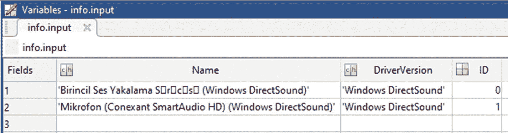
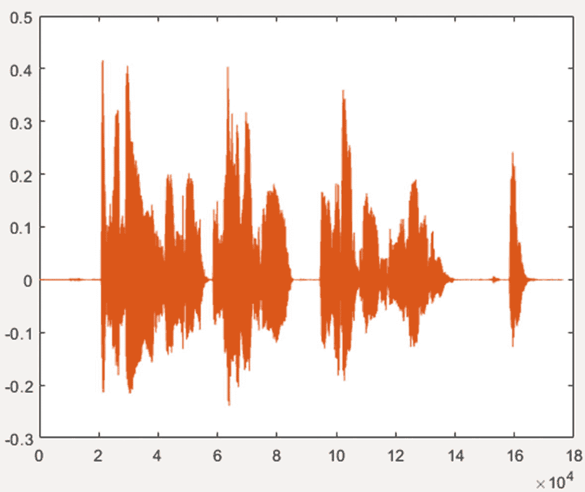
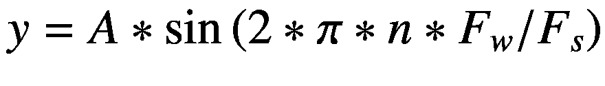
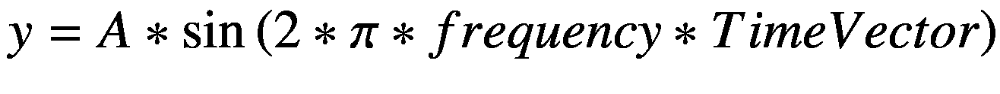
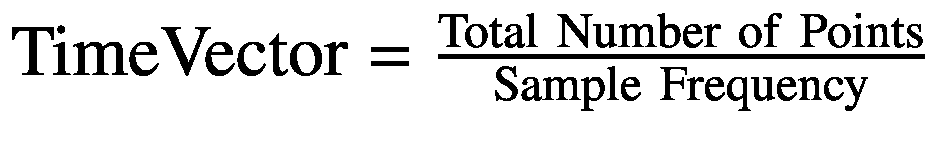

# 11. 声音处理导论

在 MATLAB 中，可以录制、收听或处理声音或音频文件。本章介绍一些用于音频文件的基本功能，包括使用正弦函数作为声音。利用音频工具箱和其他工具箱，可以实现复杂的演示。不过，本章中的示例考虑到了读者可能没有在 MATLAB 中安装这些工具箱。

声音以波的形式在空气中传播。声音是一种连续信号，可以数字化为离散信号。声波以一定的频率被录制，该频率通常指每秒采集的样本数，单位为赫兹（Hz）。频率在 20 到 20,000 赫兹之间的声音构成了人类的听觉范围。

要录制和收听声音文件，系统上应安装了麦克风和扬声器。要确定你是否拥有这些设备，请在提示符下输入命令 `audiodevinfo`。

```matlab
> info = audiodevinfo

info =

input: [1x2 struct]

output: [1x2 struct]

>
```

在上述代码中，变量 `info` 是一个包含两个字段的结构。若要查看 `info` 中第一个数据的内容，你可以在提示符下输入以下命令。

```matlab
> openvar info.input
```

然后，将打开如图 11-1 所示的窗口。



图 11-1 麦克风信息

如果你的操作系统语言不是英语，你可能会看到与图 11-1 类似的输出。该显示表明我们有一个可用于在 MATLAB 中录制声音的麦克风。为此，我们使用 `audiorecorder` 函数。使用 `audiorecorder`，我们可以创建一个 8000 Hz、8 位、单声道的音频录制器文件。也可以更改这些默认值。可能的位数包括 8、16 和 24。声道数应为 1（单声道）或 2（立体声）。

**示例 11-1.** 编写一个程序，将音频文件 `handel` 加载到工作区。然后，程序应播放该声音。

**解法 11-1.** 以下代码可用于完成给定的任务。

*Example11p1.m*

```matlab
%Example11p1
%此代码播放哈利路亚
load handel;
p = audioplayer(y, Fs);
play(p)
```

如图所示，一旦加载了 `handel` 文件，变量 `y` 和 `Fs` 就会被加载到工作区。变量 `y` 是播放的信号，而 `Fs` 是采样率。`audioplayer` 函数为信号 `y` 创建一个 `audioplayer` 对象，并将该对象赋值给变量 `p`。然后在最后一行，使用命令 `play` 播放包含声音的变量 `p`。

要查找声音文件的信息，例如样本数量、声道数等，你可以使用如下所示的 `audioinfo` 函数。

```matlab
> info = audioinfo('Adele.mp3')

info =

struct with fields:

Filename: 'C:\...\Adele.mp3'

CompressionMethod: 'MP3'

NumChannels: 2

SampleRate: 44100

TotalSamples: 12569472

Duration: 285.0220

Title: 'Someone Like You'

Comment: []

Artist: 'Adele'

BitRate: 192

>
```

**示例 11-2.** 编写一个程序，以 22050 Hz 的采样率、16 位、2 声道录制你的声音 8 秒钟。然后，程序应播放录制的声音并绘制录制文件的图表。

**解法 11-2.** 可以编写以下代码来完成这些任务。

*Example11p2.m*

```matlab
%Example11p2
% 此程序录制你的声音 8 秒钟。
RecorderVar = audiorecorder(22050, 16, 2);
disp('现在开始说话')
recordblocking(RecorderVar, 8);
disp('录制结束');
play(RecorderVar); % 播放
% 将数据存储为双精度数组。
RecordData = getaudiodata(RecorderVar);
plot(RecordData); % 绘制声音图形
```

## 如代码所示，录制的声音被赋值给变量`RecorderVar`。第五行中，`recordblocking`函数对对象变量进行了 8 秒的录制，并在录制完成后才返回。`play`函数用于播放录制的声音。`getaudiodata`函数将录制的音频数据作为双精度数组返回。当通过`plot`函数绘制这些数据后，我们便得到了图 11-2 所示的图形，该图形代表了录制的声音。



**图 11-2**
录制的声音

请记住，当不同的人运行同样的代码并对麦克风说话时，输出的结果会因每个人的声音不同而与图 11-2 有所差异。绘图结果也与之前使用`plot`函数得到的结果不同，这是因为图 11-2 中使用了原始的音频数据。

**示例 11-3.** 编写一个程序，将`handel`音频文件加载到工作区。然后，程序应将文件以`handel.flac`的名称保存到目录中。代码应向文件中添加一些信息。在注释字段中，声音文件应显示“This is my first audio”，在标题字段中显示“Hallelujah”，在艺术家字段中显示“San Antonio”。每样本位数应为 24。代码应播放该声音并显示已保存文件的信息。

**解 11-3.** 可以编写以下代码来完成这些任务。

*Example11p3.m*
```
%Example11p3

% This code saves an audio file with info

load handel

filename = 'handel.flac';

audiowrite(filename,y,Fs,'BitsPerSample',24,...

'Comment','This is my first audio',...

'Title','Hallelujah','Artist','San Antonio');

sound(y,Fs);

clear y Fs

info = audioinfo(filename);

disp(info);
```

在所示的代码中，`sound`函数将向量`y`作为声音播放。`audiowrite`函数将具有定义特征的声音写入目录。运行程序后，命令窗口中将出现以下输出。

```
>Example11p3

Filename: 'C:\...\handel.flac'

CompressionMethod: 'FLAC'

NumChannels: 1

SampleRate: 8192

TotalSamples: 73113

Duration: 8.9249

Title: 'Hallelujah'

Comment: 'This is my first audio'

Artist: 'San Antonio'

BitsPerSample: 24

>
```

播放的向量可以取 -1 到 +1 之间的值。对于其他数据类型，其范围如表 11-1 所示，最大通道数列于表 11-2 中。

**表 11-2**
依赖于数据的最大通道数

| 文件格式 | 最大通道数 |
| --- | --- |
| WAVE (`.wav`) | 1,024 |
| OGG (`.ogg`) | 255 |
| FLAC (`.flac`) | 8 |
| MPEG-4 AAC (`.m4a`, `.mp4`) | 2 |

**表 11-1**
y 的取值范围（取决于其数据类型）

| y 的数据类型 | y 的取值范围 |
| --- | --- |
| uint8 | 0 ≤ `y` ≤ 255 |
| int16 | -32768 ≤ `y` ≤ +32767 |
| int32 | -2³¹ ≤ `y` ≤ 2³¹–1 |
| single | -1.0 ≤ `y` ≤ +1.0 |
| double | -1.0 ≤ `y` ≤ +1.0 |

**示例 11-4.** 编写代码，加载`handel`文件进行播放。播放 3 秒后，文件应停止播放，然后继续播放。接着再播放 3 秒，然后停止。

**解 11-4.** 可以编写以下代码来完成这些任务。

*Example11p4.m*
```
%Example11p4

% This code pauses and resumes playing

load handel;

player = audioplayer(y, Fs);

play(player);disp('playing is on');

pause(3);

pause(player);disp('playing is paused');

pause(3);

resume(player),disp('playing is resumed');

pause(3);

stop(player),disp('playing is off');
```

在这段代码中，`play`函数从头开始启动对象`player`。然后，`pause`函数在播放 3 秒后暂停音频。同样的`pause`函数再保持 3 秒。`resume`函数恢复播放，程序再保持 3 秒。最后，`stop`函数停止播放该对象。运行代码后，命令窗口中将出现以下输出。

```
> Example11p4

playing is on

playing is paused

playing is resumed

playing is off

>
```

**示例 11-5.** 编写代码，将`handel`文件加载到工作区。然后，代码应反转音频并以反转后的顺序播放。代码还应打印原始音频的前五个数据以及反转后音频的最后五个数据，以检查其准确性。

**解 11-5.** 可以编写以下代码来完成这些任务。

*Example11p5.m*
```
%Example11p5

% This code reverses the hallelujah

load handel;

L=length(y);

y2=zeros(L,1);

for i=1:L

y2(L-i+1)=y(i);

end

sound(y2,Fs);

disp('First 5 Data of Original Handel');

disp(y(1:5));

disp('Last 5 Data of Reversed Handel');

disp(y2(end-4:end));
```

在这段代码中，加载`handel`后，`y`数据的长度被存储到变量`L`中。然后，一个新变量`y2`被初始化为所有元素为零。接着，`y`的值以反转顺序存储到`y2`变量中。代码随后播放新数据，并在屏幕上显示所需数据。运行代码后，命令窗口中将出现以下输出。

```
> Example11p5

First 5 Data of Original Handel

-0.0062

-0.0750

-0.0312

0.0062

Last 5 Data of Reversed Handel

0.0062

-0.0312

-0.0750

-0.0062

>
```

## 正弦波作为声音

通过使用如下定义的正弦波，可以产生一个声音：



(1)

其中，`A`是波的振幅，`Fw`是波的频率，`Fs`是采样频率，`n`是采样点的索引。在某些资源中，相同的公式也被表示为：



(2)

其中`frequency` = 正弦波频率，而 。

**示例 11-6.** 编写一个程序，绘制正弦波信号。变量设置为`amplitude = 32`、`total number of points = 1,000`、`sampling frequency = 1,000`以及`frequency of sine wave = 20`。代码应根据公式 1 或 2 播放`y`的声音，并绘制信号图。

**解答 11-6.** 可以编写以下代码来完成这些任务。

`Example11p6.m`
```
%Example11p6

% This code plays sine wave

A=32;N=1000;%Total number of points

Fs=1000;% Sampling frequency
```

```
frequency=20;%Frequency of sine wave

TimeVector=(0:N-1)/Fs;

y=A*sin(2*pi* frequency.*TimeVector);

sound(y);plot(TimeVector,y);

title('Sine Wave');ylabel('Amplitude');

xlabel('Time');
```

一旦运行该代码，就会听到信号`y`的声音，并得到如图 11-3 所示的信号图。


图 11-3

正弦波图

示例 11-7. 编写一个程序，绘制由`ysin = A * (sin(2 * π * freq * TimeVector)) + A * (sin(4 * π * freq * TimeVector))`给出的信号。变量设置为`amplitude = 1.5`、`total number of points = 1,500`、`sampling frequency = 1,000`以及`frequency of sine wave = 50`。代码应对信号`ysin`进行快速傅里叶变换(`fft`)，并播放和绘制该信号。

解答 11-7. 可以编写以下代码来完成这些任务。

`Example11p7.m`

```
%Example11p7

% This plays sound

A=1.5;% Amplitude

N=1500;%Total number of points

Fs=1000;% Sampling frequency

freq=50;%Frequency of sine wave

TV=(0:N-1)/Fs;%time vector

ysin=A*sin(2*pi* freq.*TV)+...

A*sin(4*pi* freq.*TV);

Y = fft(ysin);y = abs(Y/N);

P1=y(1:N/2+1);P1(2:end-1)=2*P1(2:end-1);

t=Fs*(0:(N/2))/N;sound(ysin);plot(t,P1,'r');
```

一旦运行该代码，就会听到信号`ysin`的声音，并得到如图 11-4 所示的输出图。


图 11-4

示例 11-7 的输出

图 11-4 中显示了两条柱。如果调整信号中正弦函数的系数或振幅，并改变其中一个，例如，使第一项的振幅是第二项振幅的两倍，那么图形中柱的值将会不同。

## 习题

* 11.1. 编写一个程序，将音频文件`chirp`和`handel`加载到工作区。然后，程序应依次播放这两个声音。

* 11.2. 编写一个程序，以 30,000 Hz 的采样率、16 位精度和 2 个通道录制你的声音，持续 5 秒。然后，程序应回放录制的声音并绘制录制文件的图形。

* 11.3. 编写一个程序，将音频文件`chirp`加载到工作区。然后，程序应将该文件保存为当前目录下的`chirp.flac`文件。代码应向该文件添加一些信息。在注释字段中，声音文件应包含值`Nice Voice`，在标题字段中包含值`Bird`。代码应播放该声音并显示已保存文件的信息。

* 11.4. 编写代码，将音频文件`chirp`加载到工作区。然后，代码应将声音分成两个相等的部分。该代码还应先播放后半部分，再播放前半部分。

* 11.5. 编写一个程序，绘制正弦波信号。变量设置为`amplitude = 10`、`total number of points = 5,000`、`sampling frequency = 8,000`以及`frequency of sine wave = 20`。代码应播放声音并绘制信号图。


