# 12. 图形用户界面应用

图形用户界面（GUI）可以通过三种不同的方式创建。第一种方法是通过编程方式创建 GUI。在这种情况下，命令通常直接在编辑器中编写。第二种方法是使用图形用户界面开发环境（GUIDE）。第三种方法是通过 App Designer 创建 GUI。本章将介绍如何在所有这三种情况下创建 GUI，并说明如何使用它们来编程应用程序。

## GUI 元素

尽管在 App Designer 中有更多可用的选项，但图 12-1 中所示的元素同样可以用于 GUIDE 和编程方式。


图 12-1

GUIDE 的 GUI 元素

可供使用的按钮如下：

* 推送按钮
* 滑块
* 单选按钮
* 复选框
* 编辑文本
* 静态文本
* 弹出式菜单
* 列表框
* 切换按钮
* 表格
* 坐标轴
* 面板
* 按钮组
* ActiveX 控件

使用这些按钮，可以在 MATLAB 中创建漂亮且实用的 GUI。

## 以编程方式创建 GUI

使用此方法，可以直接在编辑器中定义和使用按钮或元素。

示例 12-1：编写创建 GUI 的代码。该 GUI 需包含两个用于输入长度和高度值的区域。然后，应有一个按钮用于计算这两个输入数值的乘积，并在一个不可编辑且带有红色背景的文本输出框中显示结果。

解决方案 12-1. 以下代码可用于完成给定任务。

`Example12p1.m`

```
%Example12p1

% 此代码以编程方式创建 GUI

close all;clear all; %[xpost,ypost,lngth,hght]

hFig=figure('NumberTitle','off','Menubar',...

'none','ToolBar','none','Position',...

[320 180 400 400],'NumberTitle','off',...

'Name','My First GUI Programmatically');

uicontrol(hFig,'Style', 'text',...

'String', 'Enter Width: W','tag','htextW',...

'Position', [2 200 150 50],'FontSize',15);

uicontrol(hFig,'Style', 'text',...

'String', 'Enter Length: L',...

'Position', [2 300 150 50],'FontSize',15);

uicontrol(hFig,'Style','edit','String','0',...

'position', [170 310 100 50],...

'FontSize',15,'tag','editL');

uicontrol(hFig,'Style','edit','String',...

'0','position', [170 210 100 50],...

'FontSize',15,'tag','editW');

uicontrol(hFig,'Style', 'text',...

'String', ' 0 ','BackgroundColor','Red',...

'Position', [200 100 100 40],...

'FontSize',20,'tag','textResult');

uicontrol(hFig,'Style', 'pushbutton',...

'String', 'MULTIPLY L BY W',...

'Position', [20 100 150 50], 'Callback',...

{@Calculate},'FontSize',12);

function Calculate(hObject,event)

LL=findobj(0,'tag','editL');

L=str2double(get(LL,'String'));

WW=findobj(0,'tag','editW');

W=str2double(get(WW,'String'));

Result=findobj(0,'tag','textResult');

set(Result,'String',num2str(L*W));

end
```

# MATLAB GUI 编程指南

尽管这段代码看起来非常复杂，但如果逐一查看每个对象，它还是相当容易理解的。在第四行中，`figure` 是我们界面的主框架，它保存了 GUI 的位置信息，包括 GUI 的名称。表达式 `[320 180 400 400]` 将 GUI 的位置设置为 `[x-位置, y-位置, 长度, 高度]`。随后，每一组以 `uicontrol` 函数开头的行都在 GUI 中创建一个对象。这里有两个用于显示文本的文本对象，两个用于输入数值的可编辑对象，一个用于点击的按钮对象，以及另一个用于显示结果的文本对象。因此，共有六行以 `uicontrol` 函数开头的代码来创建这些对象。其中，按钮对象有一个回调函数。当在 GUI 上点击该按钮时，它会调用一个名为 `Calculate` 的函数。因此，在代码末尾附近，创建了 `Calculate` 函数来执行编码的核心部分。如果我们运行代码并输入 GUI 上显示的数值，将得到如图 12-2 所示的对话框。

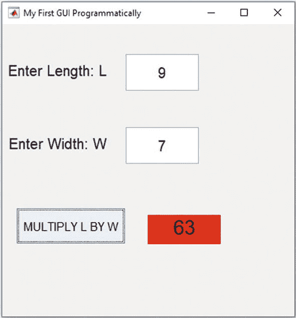
*图 12-2*

以编程方式创建 GUI

一旦我们点击“乘法”按钮，它将调用 `Calculate` 函数并执行函数内部的所有代码。该代码应能从文本框中获取输入的数值。这是在 `Calculate` 函数内部完成的。这些对象通过其标签名 (`tag`) 来查找。因此，在 GUI 编程中，为对象分配标签名极其重要。使用 `findobj` 函数可以找到这些对象，然后通过 `get` 函数获取它们的值。使用 `str2double` 将这些值转换为 `double` 类型。乘法运算后，结果通过 `set` 函数赋值给标签名为 `textResult` 的文本对象。

## 使用 GUIDE 创建 GUI

可以在提示符下键入 `>guide` 来查看 GUIDE。打开后，它会询问用户是想要打开一个新的 GUI 还是现有的 GUI。在此场景下，您应该打开一个新 GUI，并通过将以下对象拖放到画布上来创建它们。

**示例 12-2.** 编写一个程序，以实现如图 12-3 所示的 GUI。

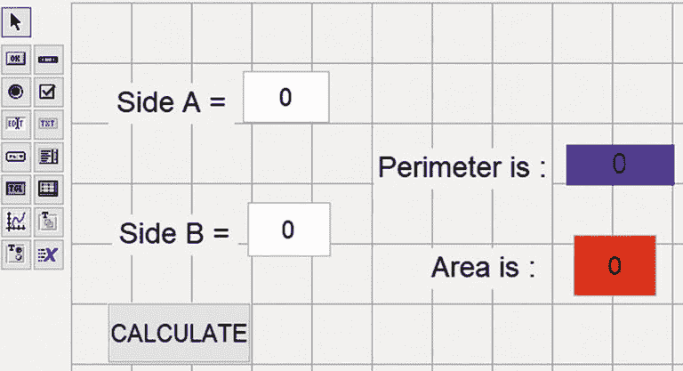
*图 12-3*

使用 GUIDE 创建 GUI

**解决方案 12-2.** 我们需要将组件从左侧拖放到右侧，如图 12-3 所示。然后，双击这些图标，或者右键单击图标并选择“属性检查器”，您就可以通过选择检查器中可用的选项来更改字符串的字体大小、数值、字符串名称、标签以及其他一些特性。标签名称在 GUI 编程中非常重要，因为如前所述，每当与组件交互时都会引用这些标签。边 A 文本框的标签名是 `editA`，边 B 文本框的标签名是 `editB`，周长文本框的标签名是 `textshow`，面积文本框的标签名是 `editson`。

在图 12-3 中创建 GUI 并将其保存为 `Example12p2.fig` 后，MATLAB 会自动生成一个名为 `Example12p2.m` 的函数。

如果您在命令窗口中运行函数 `Example12p2`，或者点击图 12-3 中的绿色按钮，那么生成的函数就会开始工作。但是，如果您只是点击 GUI 上的“计算”按钮，什么也不会发生。我们至少需要一个函数来获取 `A` 和 `B` 的值，然后在点击“计算”按钮后显示面积和周长。

“计算”按钮在检查器中被标记为 `pushbutton1`（图 12-4）。

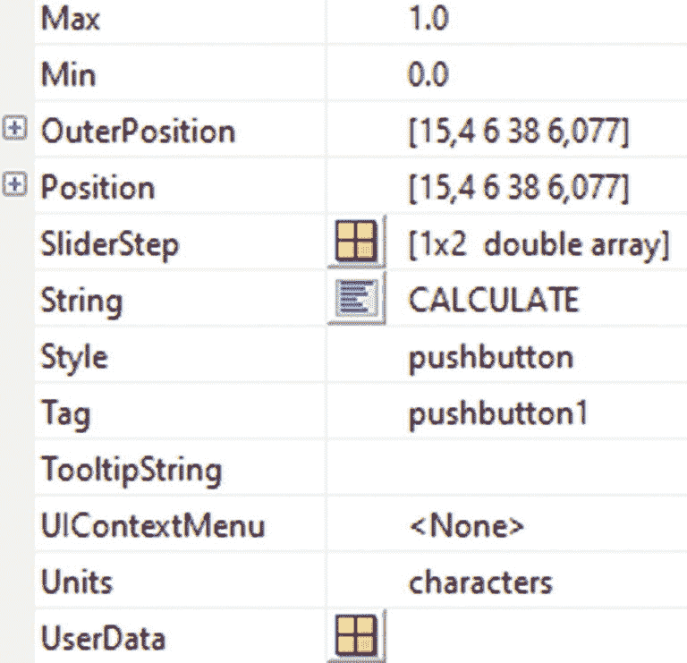
*图 12-4*

“计算”按钮的检查器

在本例中，我们只需要在自动生成的代码中的 `pushbutton1_Callback` 函数下编写以下代码即可。函数名称可能会因您分配给元素的标签名不同而异。

```matlab
AA=get(handles.editA,'String');
A=str2double(AA);
BB=get(handles.editB,'String');
B=str2double(BB);
Area = A * B;
Perimeter= 2*(A+B);
set(handles.textshow,'String',Perimeter);
set(handles.editson,'String',num2str(Area));
```

在上述代码的第一行中，获取了字符串值。在第二行中，该值被转换为长度 `A` 的 `double` 类型。第三行和第四行对长度 `B` 重复了相同的步骤。第五行和第六行使用公式计算了面积和周长值。最后，这些值被赋值给标签为 `textshow` 和 `editson` 的位置。

`pushbutton1_Callback` 函数应如图 12-5 所示。

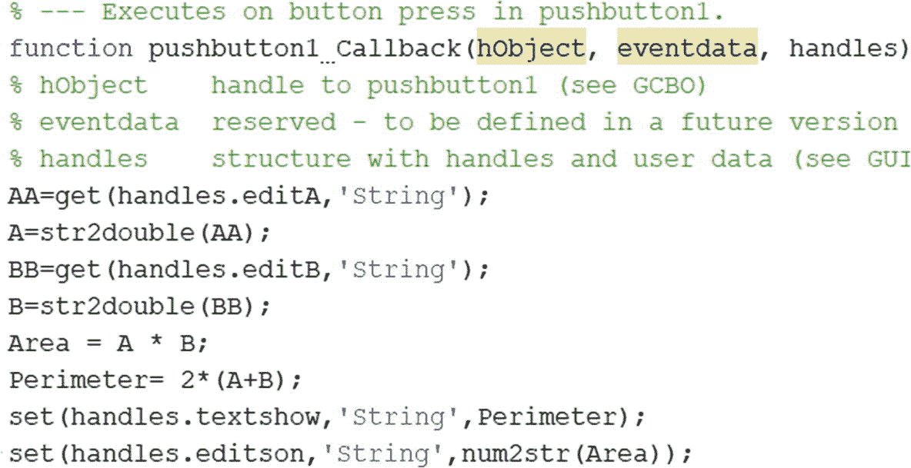
*图 12-5*

在生成的代码内部编写的附加函数

代码执行后，结果就是图 12-6 所示的 GUI。如果我们试用 GUI，输入 `A = 10` 和 `B = 61`，然后点击“计算”，就会得到如图所示的结果。

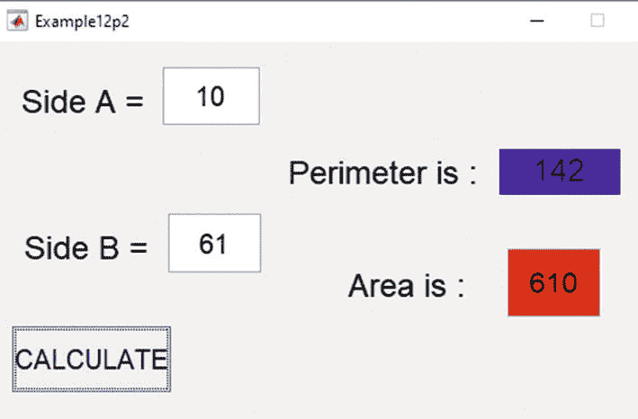
*图 12-6*

针对给定值的 GUI 输出

## 使用 App Designer 创建 GUI

要创建任何应用程序，首先需要打开 App Designer。在 MATLAB 工具栏中，可以点击 `New` 按钮，然后选择 `App` 选项。选择 `App` 后，应用界面将会出现。

在左侧，可以选择 GUI 元素。可以将对象拖拽到画布中央进行创建。创建对象是最简单的部分，而编写回调函数才是关键。在 App Designer 中，MATLAB 允许你在编码部分的白色区域编写代码。例如，可以在图 12-7 所示的白色空间内编写代码。其余代码将根据对象的设计自动生成。

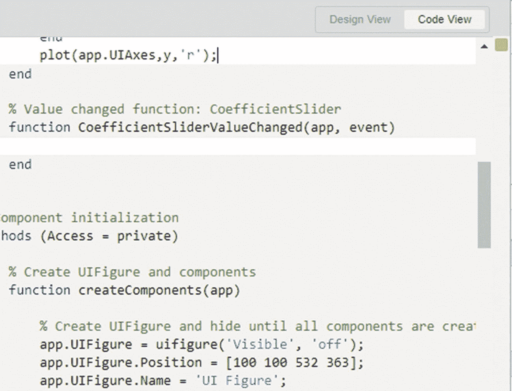
*图 12-7*

代码视图的外观

**示例 12-3.** 使用 App Designer 编写一个程序，绘制从 –`π` 到 `π` 之间的正弦、余弦和正切三角函数的图形。这些函数应从 `listbox` 中选择。还应有一个滑块来乘以所选函数。当点击 `Plot` 按钮时，代码应绘制出三角函数图形，该函数需乘以滑块所选值的系数。

**解决方案 12-3.** 设计 GUI 后，需要创建一个回调函数。图 12-8 展示了用作回调函数的代码。

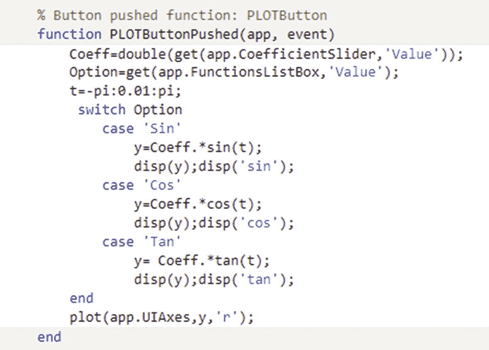
*图 12-8*

来自 `Myapp1.mlapp` 的代码

图 12-9 显示了代码运行后的输出。

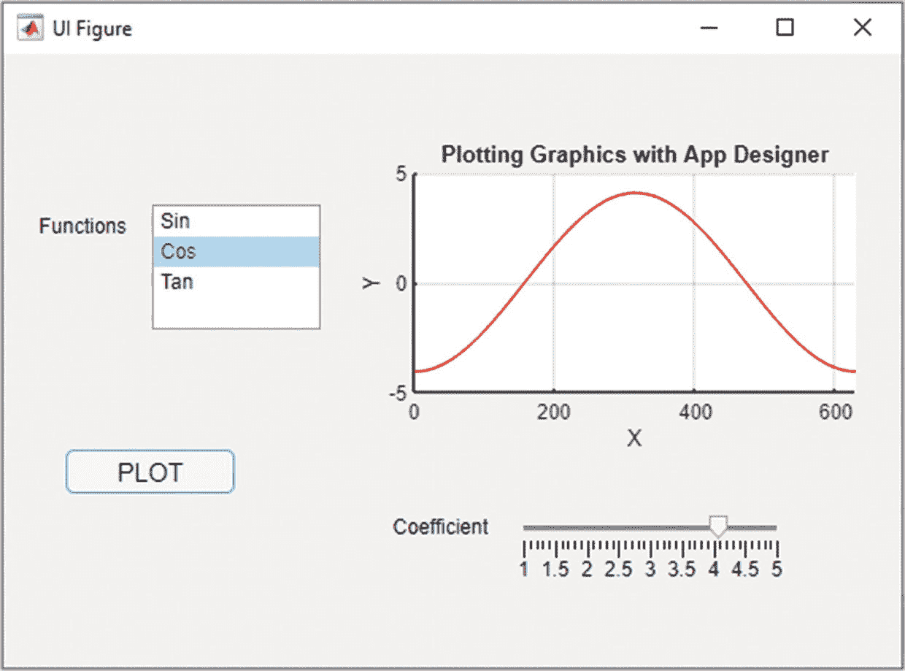
*图 12-9*

获得的输出

与 GUIDE 的不同之处在于，每个标签前需要添加 `app.` 作为前缀，文件名的后缀是 `.mlapp` 而非 `.m`。其余编码方式与 GUIDE 几乎相同，不过根据组件库的不同，App Designer 提供了更多可用选项。

### 创建应用程序

使用 MATLAB 的 GUI 可以创建许多应用程序。本节通过示例展示了其中几个。这些应用程序均使用 GUIDE 创建。

**示例 12-4.** 创建一个 GUI，提供四个选项用于绘制 `x`（范围 0 到 2π）的三角函数图形，如正弦、余弦、正切和余切。该函数应乘以一个介于 0 到 100 之间的常数。常数的值应通过滑块控制。

**解决方案 12-4.** 图 12-10 展示了 GUI 的轮廓。

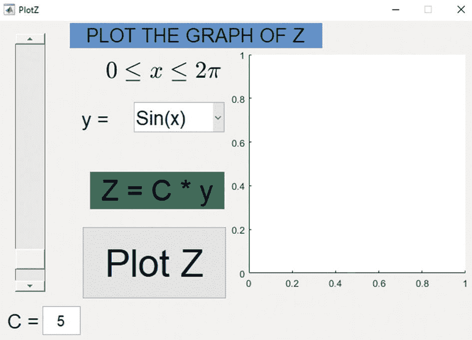
*图 12-10*

名为 `PlotZ` 的 GUI 输出

在图 12-10 中，我们看到 GUI 上有 10 个组件。元素的名称和标签已更改。

在 `PlotZ_OpeningFcn` 函数下，编写以下代码。

```matlab
axis(handles.axesSymbol,'off');
```

# 示例 12-5
## 解决方案 12-5

在 `sliderC_Callback` 函数下，编写以下代码。

```
Slide    = get(handles.sliderC, 'Value');
Slider = num2str(Slide);
set(handles.editC, 'String',Slider);
```

在 `editC_Callback` 函数下，编写以下代码。

```
Slide    = get(handles.editC, 'String');
Slider = str2double(Slide);
set(handles.sliderC, 'Value',Slider);
```

最后，在 `pushbuttonZ_Callback` 函数下，编写以下代码。

```
ChoicE = get(handles.popupmenuY,'Value');
CC=get(handles.editC,'String');
C=str2double(CC);
x=0:0.1:2*pi;
switch ChoicE
    case 1 % sin(x)
        z=C*sin(x);
        plot(z);
    case 2 %cos(x)
        z=C*cos(x);
        plot(z);
    case 3 %tan(x)
        z=C*tan(x);
        plot(z);
    case 4 %cot(x)
        z=C*cot(x);
        plot(z);
end
grid on
```

运行代码后，我们将得到如图 12-10 所示的 GUI。

**示例 12-5.** 为一家餐厅创建一个 GUI 来计算顾客的账单。GUI 上应显示餐厅的标识和名称。GUI 中应有汤品、甜点和其他可选餐食的面板。顾客只能选择一种汤，但其他餐食可以选择任意数量。

**解决方案 12-5.** 图 12-11 展示了 GUI 的轮廓。

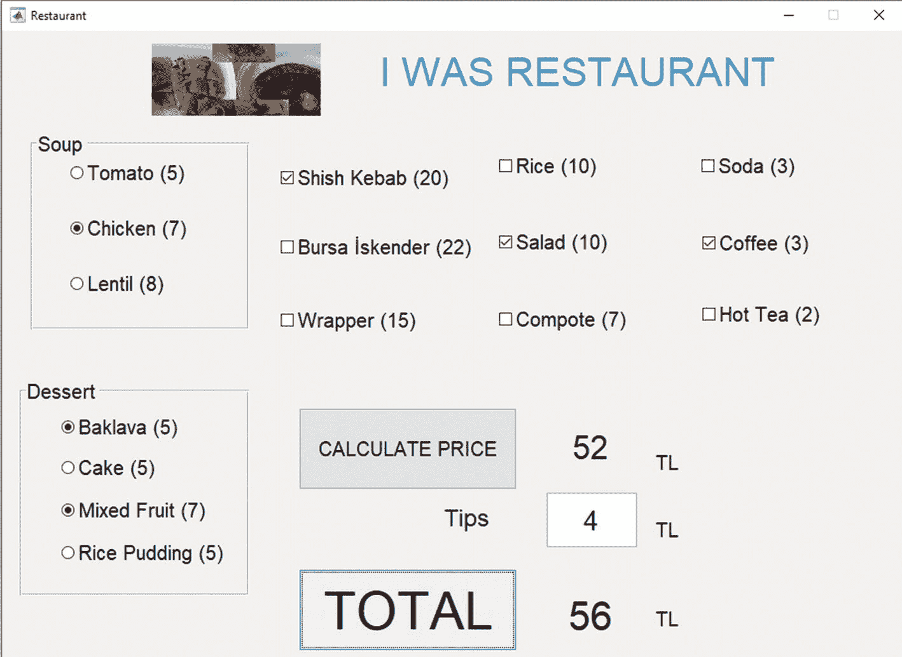

图 12-11

名为 `Restaurant.m` 的 GUI 输出

如图所示设计 GUI 后，将其保存为 `Restaurant.fig`，文件 `Restaurant.m` 会自动生成。然后，在相应函数中输入以下代码。

首先，应将餐厅标识上传到 GUI。因此，在 `Restaurant_OpeningFcn` 函数下，编写以下代码。

```
axis(handles.axes1,'off');
myImage = imread('Restaurant.jpg');
axes(handles.axes1);
imshow(myImage);
```

在上述代码中，标识保存为 `Restaurant.jpg`，并与文件 `Restaurant.m` 和 `Restaurant.fig` 位于同一目录。

接下来，我们需要编写代码来计算所选餐食的账单。在 `pushbuttonprice_Callback` 函数下，编写以下代码。

```
global Amount
Soup = get(handles.uibuttongroupsoup,'SelectedObject');
PickedSoup = get(Soup,'Tag');
switch PickedSoup
    case 'radiobuttontomato'
        Soupprice = 5;
    case 'radiobuttonchicken'
        Soupprice = 7;
    case 'radiobuttonlentil'
        Soupprice = 8;
    otherwise
        msgbox('您未选择任何汤品');
end
Baklava = get(handles.radiobuttonbaklava,'Value');
Cake    = get(handles.radiobuttoncake,'Value');
RicePudding= get(handles.radiobuttonricepudding,'Value');
MixedFruit=get(handles.radiobuttonmixedfruit,'Value');
Shish       = get(handles.checkboxshishkebab,'Value');
Bursa    = get(handles.checkboxbursaiskender,'Value');
Wrapper    = get(handles.checkboxwrapper,'Value');
Rice       = get(handles.checkboxrice,'Value');
Salad      = get(handles.checkboxsalad,'Value');
Compote    = get(handles.checkboxcompote,'Value');
Soda       = get(handles.checkboxsoda,'Value');
Coffee     = get(handles.checkboxcoffee,'Value');
HotTea     = get(handles.checkboxhottee,'Value');
Amount = Soupprice+Baklava*5+Cake*5+RicePudding*5+...
    MixedFruit*7+Shish*20+Bursa*22+Wrapper*15+...
    Rice*10+Salad*10+Compote*7+Soda*3+Coffee*3+HotTea*2;
set(handles.textsonuc,'String',Amount);
```

在 `pushbuttontotal_Callback` 函数下，写入以下代码。

```
global Amount
if Amount<1
    msgbox('您未选择任何菜品');
else
    Tipp    = get(handles.edittip, 'String');
    Tippp = str2double(Tipp);
    TotalPrice = Amount + Tippp;
    set(handles.texttotal,'String',TotalPrice);
end
```

运行程序后，GUI 即可正常工作。

# 示例 12-6
## 解决方案 12-6

图 12-12 展示了代码的输出效果。

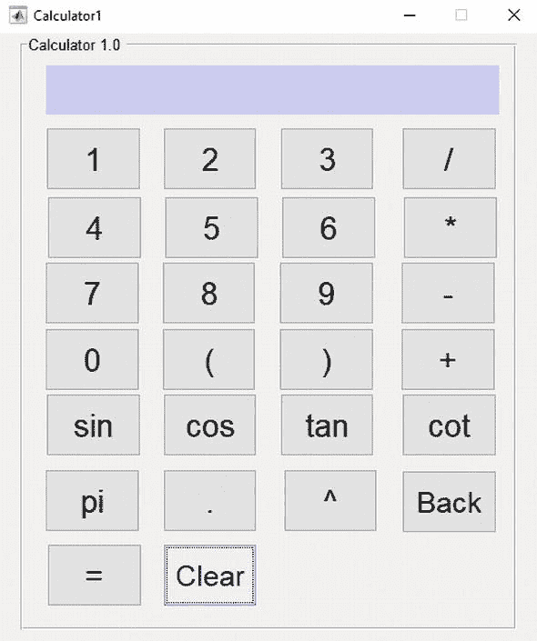

图 12-12

名为 `Calculator1.m` 的 GUI 概览

需要为 GUI 上的每个按钮编写回调函数。每个按钮都以其名称作为标签。例如，`2` 的标签为 `Two`，`+` 的标签为 `Add`，以此类推。

在 `One_Callback` 函数下，写入以下代码。

```
OldVal=get(handles.textresult,'String');
NewVal='1';
TextString = strcat(OldVal,NewVal);
set(handles.textresult,'String',TextString);
```

在 `Two_Callback` 函数下，写入以下代码。

```
OldVal=get(handles.textresult,'String');
NewVal='2';
TextString = strcat(OldVal,NewVal);
set(handles.textresult,'String',TextString);
```

我们对按钮 `2`、`3`、`4`、`5`、`6`、`7`、`8`、`9` 和 `0` 重复相同的操作。对于除法，在本例中，在 `Divide_Callback` 函数下输入以下代码。

```
OldVal=get(handles.textresult,'String');
NewVal='/';
TextString = strcat(OldVal,NewVal);
set(handles.textresult,'String',TextString);
```

类似地，对运算符 `*`、`-`、`+`、符号 `.`、`,` 以及 `π` 对应的按钮重复此步骤。对于 `sin` 按钮，在 `Sine_Callback` 函数下输入以下代码。

```
OldVal=get(handles.textresult,'String');
NewVal='sin((pi/180)*';
TextString = strcat(OldVal,NewVal);
set(handles.textresult,'String',TextString);
```

在此代码中，角度以弧度制转换为度数。这就是为什么我们需要在代码第二行写入`(pi/180)*`。必须为`cos`、`tan`和`cot`按钮编写类似的代码。对于`Clear`按钮，在`Equal_Callback`函数下输入以下代码。

```
EvValue   = get(handles.textresult,'String');
EvalValue = eval(EvValue);
set(handles.textresult,'String',EvalValue);
```

在该代码中，函数`eval`计算表达式`EvValue`。在`Back_Callback`函数下，输入以下代码。

```
textString = get(handles.textresult,'String');
if(strcmp(textString,'0')==1)
set(handles.textresult,'String','0') ;
else
Val=char(textString);
L=length(textString);
textString=Val(1:L-1);
set(handles.textresult,'String',textString)
end
```

运行代码后，GUI 即可正常工作。

### 示例 12-7

为猜数字游戏构建一个 GUI。

#### 解决方案 12-7

图 12-13 展示了代码的输出效果。

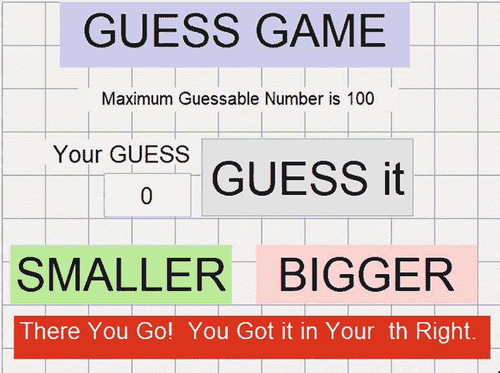

图 12-13

GUI 总体视图

程序要求每次启动时猜测一个数字。因此，我们需要在 GUI 的打开函数下编写代码，该函数将命名为`GuessGame_OpeningFcn`，如下所示。

```
global Picked_Number Counter
Picked_Number=randi(100,1);
Counter=1; % 初始化计数器
```

包含全局变量的第一行应紧跟在函数行之后。接下来的两行可以在函数末尾输入。

在本例中，在`pushbuttonGuess_Callback`函数下输入以下代码。

```
global Picked_Number Counter
GuessVal=get(handles.editWriteGuess,'String');
Guess=str2double(GuessVal);
if Guess==Picked_Number
fprintf('你在第 %d 次猜对了！\n',Counter);
set(handles.textBigger,'visible','off');
set(handles.textSmaller,'visible','off');
Message1 = '猜对了！你在第 ';
Message2 = ' 次猜中！';
FinalMes = [Message1, num2str(Counter), Message2];
set(handles.textYouGot,'String',FinalMes);
set(handles.textYouGot,'visible','on');
return;
elseif Guess>Picked_Number
set(handles.textYouGot,'visible','off');
set(handles.textBigger,'visible','off');
set(handles.textSmaller,'visible','on');
elseif Guess<Picked_Number
set(handles.textYouGot,'visible','off');
set(handles.textSmaller,'visible','off');
set(handles.textBigger,'visible','on');
end
Counter=Counter+1;
```

运行代码后，GUI 即可正常工作。

### 示例 12-8

创建一个音乐播放器 GUI。音乐应通过工作区上的按钮加载。

#### 解决方案 12-8

图 12-14 显示了代码的输出效果。

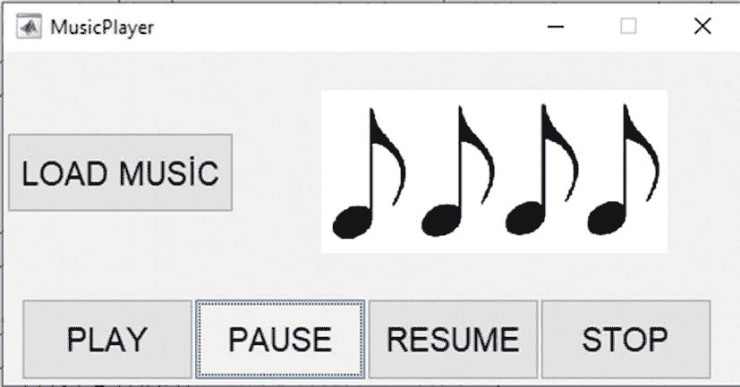

图 12-14

所创建音乐播放器的总体视图

图片应加载到 GUI 中。因此，如下所示，应将以下代码放在`MusicPlayer_OpeningFcn`函数的末尾。

```
axis(handles.axes1,'off');
myImage = imread('Figure_12_14.png');
axes(handles.axes1);
imshow(myImage);
```

类似地，应将以下代码放在`Play_Callback`函数的末尾，如下所示。

```
global filename player
[y,Fs] = audioread(filename);
player = audioplayer(y,Fs);
play(player);disp('正在播放');
```

类似地，应将以下代码放在`Pause_Callback`函数的末尾。

```
global player
pause(player);
```

应将以下代码放在`Resume_Callback`函数的末尾。

```
global player
resume(player);
```

应将以下代码放在`Stop_Callback`函数的末尾。

```
global player
stop(player);
```

应将以下代码放在`Load_Callback`函数的末尾。

```
global filename  pathname
[filename, pathname] = ...
uigetfile({'*.mp3';'*.wav'});
```

运行代码后，GUI 即可正常工作。

### 示例 12-9

编写从一副牌中发一张牌的代码。

#### 解决方案 12-9

图 12-15 展示了代码的输出效果。

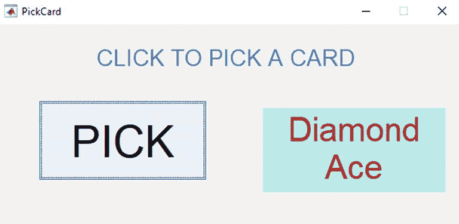

图 12-15

GUI 总体视图

创建 GUI 组件后，代码保存为`PickCard`。`pick_callback`函数将类似如下。

```matlab
% --- 执行按钮“抽取”的响应函数。
function pick_Callback(hObject, eventdata, handles)
% hObject    指向“抽取”按钮的句柄（参见 GCBO）
% eventdata  保留 - 将在未来的 MATLAB 版本中定义
% handles    包含句柄和用户数据的结构体（参见 GUIDATA）
花色 = {'梅花', '黑桃', '红心', '方块'};
数字 = {'A','2','3','4','5','6','7','8',...
       '9','10','J','Q','K'};
Su = randi(4,1); Nu = randi(13,1);
牌 = [cellstr(花色(Su)), cellstr(数字(Nu))];
% 提示 = get(handles.edittip, 'String');
set(handles.textR, 'String', 牌);
```

运行代码后，GUI 即可正常工作。

使用 GUI 可以创建许多应用程序。大多数时候，人们使用`GUIDE`来创建这些应用程序，但近年来`App Designer`的使用更为频繁，并且画布上也添加了更多组件。还有一个`Migrate`工具，可以将`GUIDE`中创建的应用程序转换为`App Designer`文件。该工具可以轻松从`Mathworks`网站下载。

## 习题

- `12.1.` 创建一个用于计算圆的面积和周长的 GUI。圆的半径应通过 GUI 手动输入。
- `12.2.` 创建一个包含两个选项（例如正弦和余弦）的 GUI，用于绘制`x`在`0`到`π`之间的三角函数图像。当用户点击`绘图`按钮后，GUI 应绘制出相应图像。
- `12.3.` 创建一个能够执行四种基本数学运算（加法、减法、乘法和除法）的简易计算器 GUI。
- `12.4.` 创建一个 GUI，用于向玩家发放`13`张牌。代码应在 GUI 上显示所有这些牌。
- `12.5.` 为一家餐厅创建一个显示五种不同餐品的 GUI。顾客可以对同一餐品多次下单。该 GUI 应计算顾客的总花费。
- `12.6.` 创建一个用于播放 MP4 视频的 GUI。GUI 上还应包含`停止`和`暂停`按钮。

# 索引

## A
算法, 美国信息交换标准码(ASCII), 模拟信号, 动画 (`hgtransform`函数, 创建电影 `*.avi`文件, `getframe`函数, `movie`函数, 更新输出坐标), 非周期信号, 数组

## B
二值图像, 生物信息学 (基因组测序, 氨基酸, DNA, 点阵图, 遗传密码表, `MyCodons.m`, `seq`), 二分法, 自底向上处理, 内置函数 (数学函数, 三角函数)

## C
冒号运算符 (矩阵, 向量), 计算生物学 (细菌生长, 微分方程, 逻辑斯蒂增长或方程, 数值解定义), 连续时间(CT)信号, 成本, 曲线拟合

## D
数据处理 (图形结果, Microsoft Excel, 打印数据), 数据可视化 (`meshgrid(x,y)`函数, 输出 `peaks(x,y)`函数, 绘制不同函数, 三维绘图), 数字信号, 膨胀, 离散傅里叶变换(DFT), 离散拉普拉斯算子, 离散时间(DT)信号, `disp`函数, `drawnow`函数

## E
经济建模 (复利, 成本, `diff(f,x)`函数, 百分比变化, 利润, 收入, 单利), 电路网络元件, 基尔霍夫定律, RL 网络 (电流值), 流行病模型 (HIV 的细胞动力学, SEIR, SI, SIR, SIS), 腐蚀, 欧拉方法, 偶/奇信号

## F
快速傅里叶变换(FFT) (`fft`函数, 幅度, 频谱, 相位谱, 功率谱, 正弦波信号, 正弦波), 不动点迭代法, 流程图/伪代码, `for`循环, `fprintf`函数, `fspecial`函数, `fzero`函数

## G
`getframe`函数, 图形用户界面开发环境(GUIDE), 图形用户界面(GUI)应用 (创建, `Back_Callback`函数, 计算顾客账单, 计算器, 一副牌, `Divide_Callback`函数, `Equal_Callback`函数, 猜数字游戏, `GuessGame_OpeningFcn`, 音乐播放器 GUI (`MusicPlayer_OpeningFcn`), `One_Callback`函数, `pick_callback`函数, `PlotZ_OpeningFcn`函数, `pushbuttonGuess_Callback`函数, `pushbuttontotal_Callback`函数, `pushbuttonZ_Callback`函数, `Restaurant_OpeningFcn`函数, `Sine_Callback`函数, 三角函数计算函数创建 (`App Designer`, `GUIDE`, 编程方式), 元素), 灰度图像

## H
谐波分析, 异构数据类型 (元胞数组, 结构体, 表格), `hgtransform`函数, 同构数据类型 (字符/字符串, 逻辑数据, 数值数据 (浮点数, 整数类型), 符号数据)

## I, J, K
理想高通滤波器(IHPF), 图像增强 (边缘保持, 频域 (滤波图示, 滤波函数, 过程, 积分), 图像域滤波 (点处理操作, 直方图, `mat2gray`函数, 像素值表示), 空间域滤波操作, 特殊滤波器), 图像文件 (二值, 彩色, 处理, 组合, 转换, 增强 (参见图像增强), 函数, 灰度, 索引图, `.jpg`转`.png`, 操纵, 复原 (错误/噪声, FIR, 滤波, 旋转), 分割 (参见图像分割), 三维矩阵, 真彩色, 二维矩阵), 图像复原, `imagesc`函数, 图像分割 (双阈值化, 边缘检测函数, 基于区域, 单阈值化), `imfilter`函数, `imread`命令, `imshow`函数, `imsplit`函数, `imwrite`函数, 索引图像, 插值/外推

## L
行间距格式, `Load_Callback`函数, 逻辑函数/选择结构 (`if-else`语句, `menu`函数, 关系运算符, 单`if`语句, `switch-case`命令)

## M
数学形态学, MATLAB (计算器环境, 基本命令, 改变属性, `disp()`函数, 界面, 格式, 脚本/M 文件, 变量/表达式), 矩阵函数

## N
国家电视系统委员会(NTSC), 牛顿-拉夫森法, Nicholson-Bailey 模型, 数值格式, 数值积分

## O
常微分方程(ODE) (欧拉方法, 龙格-库塔方法, 求解函数)

## P, Q
周期信号, 点处理, `Pause_Callback`函数, `Play_Callback`函数, 绘制图形 (多重绘图, 单一绘图), 捕食者-猎物模型 (三个物种 (Lotka-Volterra 模型, 种群大小), 种群随时间变化, 两个物种 (Lotka-Volterra 方程, 种群大小), `semilog`函数), 利润, 编程控制 (`break`/`continue`, `for`循环, `try-catch`块, `while`循环)

## R
`rand`命令, `randi`命令, `randperm`函数, 红绿蓝(RGB)图像, `Resume_Callback`函数, 收入, `rng`函数, 求根 (二分法函数, 不动点迭代函数, 牛顿法函数, 割线法函数, `fzero`函数), 龙格-库塔方法

## S
搜索任务 (数据集, `find`命令, 字符串搜索, 向量或矩阵搜索), 割线法, SEIR 流行病模型, SI 流行病模型, 信号处理, 单利, 仿真应用 (抛硬币, 随机数生成, 随机游走, 掷一对骰子, 交通流), SIR 流行病模型, SIS 流行病模型, 矩阵排序 (按列和行排序, `sort`函数), 声音处理 (`audiodevinfo`, `audioplayer`函数, 声道, `getaudiodata`函数, 麦克风信息, `play`函数, `recordblocking`函数, 录制的声音, 正弦波, `stop`函数, 零元素), 统计函数, `Stop_Callback`函数, `stretchlim`函数

## T
阈值化, 三角函数, 真彩色图像, `try-catch`块

## U
用户自定义函数 (匿名函数, 创建函数, 对话框, 局部/全局变量, 子函数)

## V
向量 (`linspace`命令)

## W, X, Y, Z
`while`循环