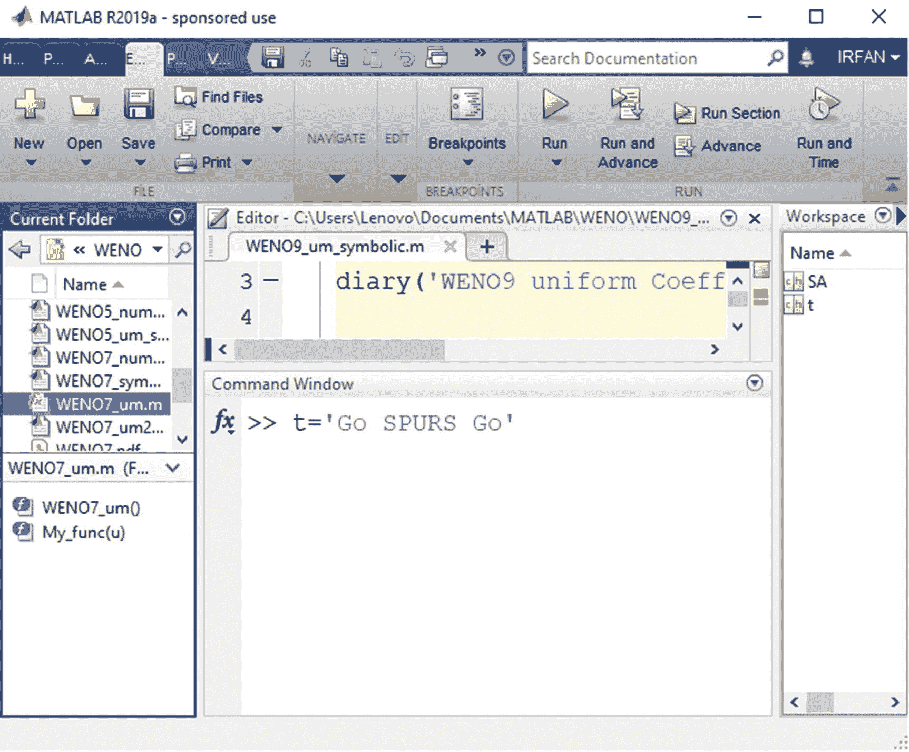
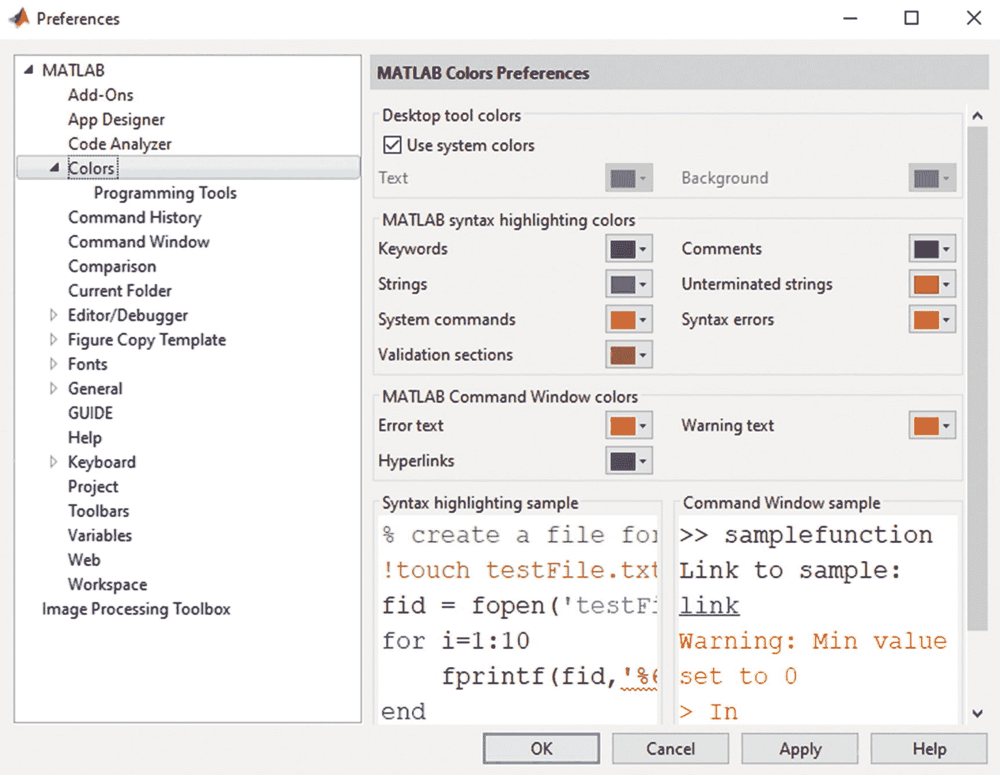
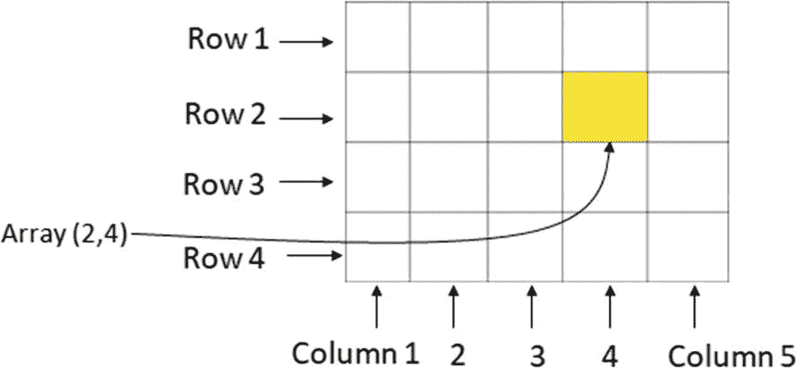
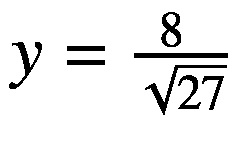
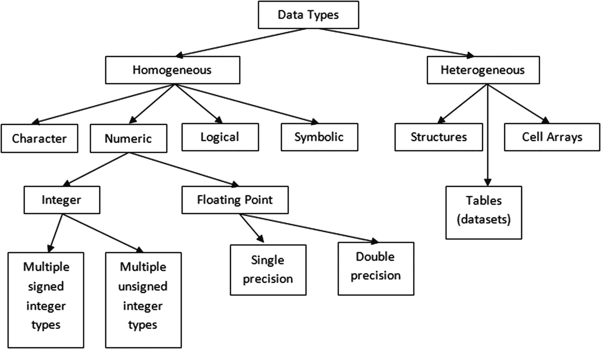
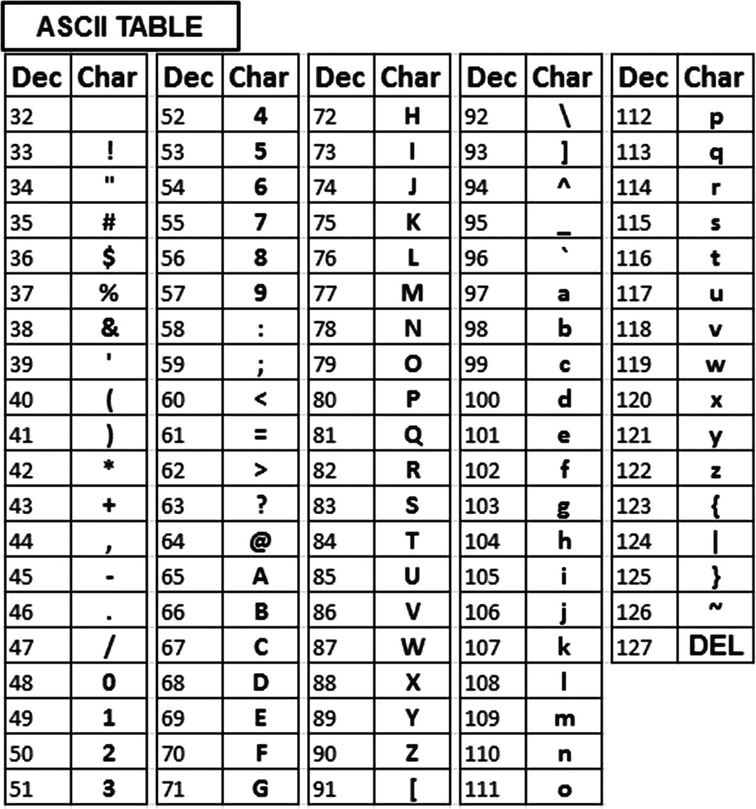
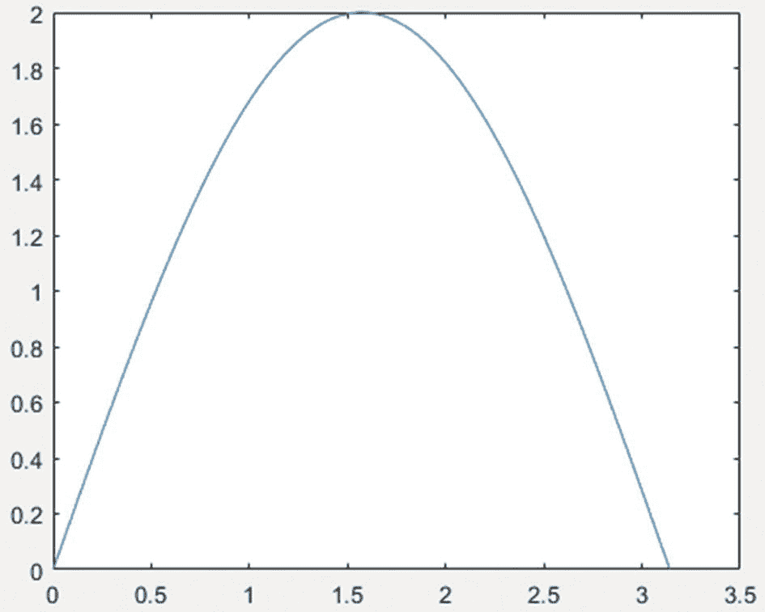
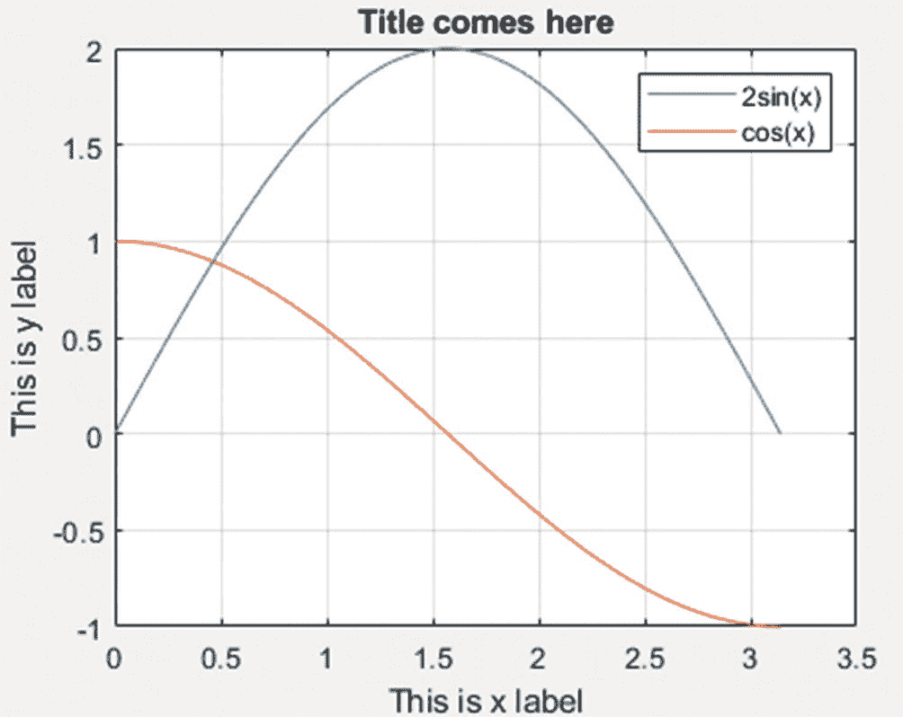
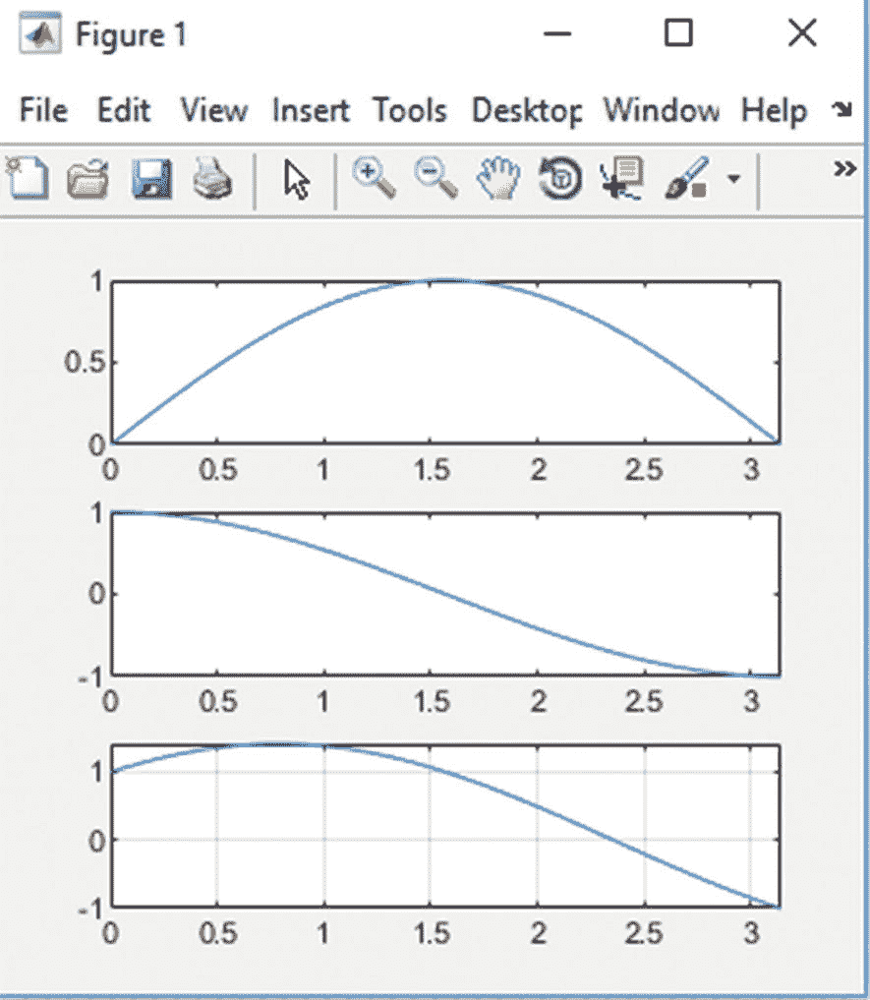
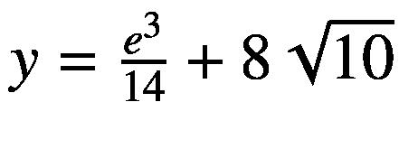

# 1. MATLAB 简介

`MATLAB` 是矩阵实验室（Matrix Laboratory）的缩写。它已被广泛应用于多种类型的应用和研究领域。`MATLAB` 是一种高级语言，其声誉与日俱增。自 1970 年著名数学家、MathWorks, Inc.（`MATLAB` 的所有者）联合创始人克利夫·莫勒首次使用以来，它已取得了巨大的进步，并且每年发布两次的新版本中添加了新的工具。

由于拥有数量可观的工具箱，`MATLAB` 吸引了来自工程到应用科学等不同领域的众多用户。`MATLAB` 拥有大量内置函数，使得程序员在解决问题时更加轻松。尽管它主要用于技术计算并处理面向工具箱的任务，`MATLAB` 同时也具备非常实用且易学的编程语言特性。本书的一个重要目标就是强调这款强大软件的编程语言特性。

`MATLAB` 拥有满足程序员在许多应用中需求的各种工具。如今，特定任务通常需要特定软件。然而，在大多数情况下，`MATLAB` 可以满足程序员的需求。

`MATLAB` 提示符在命令窗口中显示为双大于号（`>>`）。根据 MathWorks, Inc. 的商标和标识使用指南，本书中将始终使用 `∎>` 符号来表示 `MATLAB` 提示符。

在本章中，你将学习在解决现实生活应用时所需的语言编码必要概念。

## MATLAB 环境

当您运行 MATLAB 时，编程框架会被打开。光标会停留在命令窗口中，前面带有提示符 `>`。如果您运行的是学生版，提示符则为 `EDU>`。

让我们来探索一下 MATLAB 的控制台，它的外观非常简洁。默认窗口如图 1-1 所示。



图 1-1 MATLAB 环境

当您打开 MATLAB 时，其界面包含以下窗口：

*   命令窗口：这是我们输入命令的窗口。
*   当前文件夹：此窗口显示 MATLAB 运行的目录。
*   工作区：我们可以在该窗口中查看程序变量。
*   命令历史记录：在这里可以监控之前在命令窗口中输入过的命令。
*   编辑器：我们可以在此窗口中编写希望以 m 文件形式运行的代码。

用户可能需要关闭其中任何一个窗口来重新组织界面。您也可以自定义外观界面，例如颜色、字体等方面的样式。点击 `ENVIRONMENT`，然后选择 `Preferences`，即可打开图 1-2 所示的菜单。



图 1-2 更改属性

只需点击图 1-2 所示左侧框架中的项目，您就可以根据自己的偏好自定义这些设置。

在使用 MATLAB 时，最有用的命令之一是 `help` 命令，它说明了某个命令的工作原理以及在 MATLAB 中的使用方法。一旦您输入 `help` 并按 `Enter` 键，就可以点击结果屏幕中任何带下划线的主题进行详细查看。

如果您是 MATLAB 新手，可以通过演示观看一些教程。如果在命令窗口中输入 `demo`，您可以从任何可用主题中进行选择并探索：

```
>demo
>
```

点击任何主题，您都可以观看相关教程，或通过示例来查看命令的解释。表 1-1 列出了一些用于执行基本操作的入门命令，例如关闭 MATLAB 或从命令窗口记录会话。

表 1-1 MATLAB 中使用的部分基本命令

| 函数 | 说明 | 示例 |
| --- | --- | --- |
| `help` | 返回有关指定命令的信息 | `>>help clc` |
| `demo` | 显示 MATLAB 中任何主题的解释 | `>>demo` |
| `save` | 将工作区变量保存到指定文件 | `>>save my_var` |
| `diary on` | 开始记录会话 | `>>diary on` |
| `diary off` | 停止记录会话并保存到日记文件 | `>>diary off` |
| `exit` | 终止 MATLAB | `>>exit` |
| `quit` | 终止 MATLAB | `>>quit` |
| `clc` | 清除屏幕 | `>>clc` |
| `clear` | 清除工作区中的所有变量或任何指定变量 | `>>clear all` |
| `who` | 显示工作区中的所有变量 | `>>who` |
| `whos` | 显示工作区中所有变量及其大小和类型 | `>>whos` |

在本书中，示例将演示 MATLAB 的用法。每个示例都说明了相关章节中某个主题特性的重要方面。

在 MATLAB 中，您可以通过使用 `save` 函数来保存整个会话，从开始到结束。我们可以看看下面的示例。

**示例 1-1.** 在提示符下输入 `disp('Hello World')`。将会话保存到名为 `my_session` 的文件中。

**解法 1-1.** 可以在提示符下输入以下代码。

```
> diary my_session
> disp('Hello World')
Hello World
> diary off
```

MATLAB 会在您的当前目录中创建一个名为 `my_session` 的文件。如果点击该文件，它将在编辑器中显示如下。

```
disp('Hello World')
Hello World
diary off
```

在这段代码中，命令 `disp()` 会显示紧随其后的单引号内的任何内容。如果要显示的表达式是一个数字，则无需加引号。如果表达式是字符串或字母，则需要在文本前后加引号，并与 `disp()` 函数一起使用。

### 将 MATLAB 用作计算器

MATLAB 也可以用作计算器。您可以找到任何复杂计算的解。在下面的示例中，我们可以看到这一功能的说明。

**示例 1-2.** 求 `5 - 8/3 + cos(pi) - 10/exp(2) + sqrt(7)` 的结果。

**解法 1-2.** 以下代码将求出解。

```
> 5-8/3+cos(pi)-10/exp(2)+sqrt(7)
ans =
2.6257
>
```

如上代码所示，*π* 在 MATLAB 中用单词 `pi` 表示。对于欧拉数 ***e***，我们需要输入 `exp(2)`，而求 7 的平方根则应使用 `sqrt(7)`。因为我们没有将结果赋值给变量，所以结果显示为 `ans` 并打印在屏幕上，它代表答案。

## 变量与表达式

在 C、C++ 和 Java 等编程语言中，变量在使用之前需要指定其类型。然而，在 MATLAB 中情况并非如此，变量只需赋值即可使用。这使得 MATLAB 在快速编写更简短、更简单的代码时更加实用。

某些表达式，例如 `if`、`for` 或 `end`，是该语言的脚本保留字。这些单词被称为*关键字*。要查看 MATLAB 中使用的关键字列表，只需在提示符后输入 `iskeyword`。

与示例 1-2 不同，我们可以为解（解决方案）分配变量名，以便后续使用。这被称为*赋值*。通过在提示符后输入以下命令：

```
> my_var = 3
my_var =

>
```

我们将 3 赋值给名为 `my_var` 的变量。在 MATLAB 中，任何已定义的变量默认都以双精度类型存储，除非另有指定。这里，变量 `my_var` 是一个类型为 double 的 1x1 矩阵。我们将在本章后面介绍数据类型。

要显示工作区中已定义的变量及其携带的信息，可以使用 `whos` 函数。

```
> whos
名称        大小            字节数      类别      属性
my_var      1x1             8          double
>
```

为变量命名有一些特定规则。变量名不能随意选择，它们必须满足以下要求：

*   必须以字母开头。
*   可以包含数字和下划线。
*   最大长度可达 63 个字符（可使用 `namelengthmax` 命令进行检查）。
*   不能是 MATLAB 语言中采用的关键字。

为避免混淆，可以使用 `isvarname` 命令在提示符处检查要赋值的变量名是否可用。

程序员应牢记的另一个重要点是，MATLAB 是一种区分大小写的语言。换句话说，在工作区中定义 `a=5` 和 `A=5` 是不同的。

**示例 1-3.** 检查以下名称是否可以用作 MATLAB 中的变量名：`Howareyou`、`hi!`、`Hola+`、`Heidi`、`for`、`name1`、`Okay_5`

**解答 1-3.** 我们可以使用 `isvarname` 命令来检查每个名称。如果结果为 `1`，则表示该名称可用；如果结果为 `0`，则该名称不能赋给变量。这里以前两个名称为例进行检查：

# MATLAB

## 格式

在MATLAB中，有行间距格式和各种数值格式。行间距格式控制结果显示在命令窗口中的行间间距。数值格式则影响输出的表示形式。

行间距格式有两个选项：紧凑和松散。紧凑选项使行更紧密，而松散选项则在命令窗口的行之间引入额外的间距。

**示例 1-5.** 设 `A=22/7`。在命令窗口中分别以紧凑格式和松散格式显示 `A`。

**解答 1-5.** 如果在命令窗口中输入以下内容，您将看到两种格式下的变量 `A`：

```
> A=22/7;
> format compact
> A
A =
    3.1429
> format loose
> A
A =

    3.1429
>
```

为了节省篇幅，本书通篇使用紧凑格式。

至于数值格式，则有更多选项可用。如果未更改格式，则使用默认的 `format short`。这种格式默认将计算结果保留四位小数。不同的替代格式如表 1-2 所示。

**表 1-2** 数值格式类型

| 格式         | 显示方式                     | 示例                 |
| :----------- | :--------------------------- | :------------------- |
| `format short` | 显示 4 位小数（默认）         | 0.3333              |
| `format long`  | 显示 15 位小数               | 0.333333333333333   |
| `format shortE` | 科学计数法显示 4 位小数       | 3.3333e-01          |
| `format longE`  | 科学计数法显示 15 位小数      | 3.333333333333333e-01 |
| `format shortG` | `format short` 或 `format shortE` 中更紧凑者 | 0.33333             |
| `format longG`  | `format long` 或 `format longE` 中更紧凑者  | 0.333333333333333   |
| `format shortEng` | 工程计数法显示 4 位小数      | 333.3333e-003       |
| `format longEng`  | 工程计数法显示 12 位小数     | 333.333333333333e-003 |
| `format +`      | 正数/负数/空白               | +                   |
| `format bank`  | 以货币格式显示，小数点后 2 位   | 0.33                |
| `format hex`    | 显示十六进制表示             | 3fd5555555555555    |
| `format rat`    | 将小数转换为分数             | 1/3                 |

**示例 1-6.** 设 `A=22/7`。以长科学计数法、短工程计数法、十六进制格式和分数格式显示 `A`。

**解答 1-6.** 求解中使用的命令及相应输出如下所示：

```
> format longE
> A
A =
     3.142857142857143e+00
> format shortEng
> A
A =
     3.1429e+000
> format hex
> A
A =
     400921fb54442d18
> format rat
> A
A =
     22/7
>
```

这里，0 或 1 的值被赋给 `ans` 变量，其类别类型为 `logical`。

如您所见，每当在提示符处输入新信息时，它都会被回显。如果您不希望计算机回显您在提示符处输入的内容，可以在按 Enter 键之前，在行末插入一个分号。

**示例 1-4.** 在方程 `P*V = n*R*T` 中，变量给定为 `P=10`、`n=2`、`R=7` 和 `T=½`。根据给定公式求出 `V`。

**解答 1-4.** 我们可以在MATLAB中输入以下内容进行求解：

```
> P=10;
> n=2;
> R=7;
> T=1/2;
> V=(n*R*T)/P
V =
    0.7000
>
```

如我们所见，除了最后一行外，每行后面都带有分号。因为最后一行右侧没有分号，所以在按 Enter 键后，我们可以看到该行的结果。

```
> isvarname Howareyou
ans =
  logical

> isvarname Hi!
ans =
  logical

>
```

## 向量与矩阵

MATLAB 的基础建立在矩阵之上。换句话说，MATLAB 的基本数据类型是矩阵。数组、向量和矩阵之间存在紧密的关系。在本节中，我们将探讨数组、向量、矩阵以及 MATLAB 中使用的冒号运算符。

### 数组

*数组* 是一组具有相同类型、大小和属性的对象。只包含一个元素的数组称为*标量*。数组可以指定为向量或矩阵。按列或按行排列的数组列表是一维矩阵。我们可以思考一个 4×5 的矩阵，它有两个维度，如图 1-3 所示。



**图 1-3** 一个数组

在图 1-3 中，黄色填充的单元格代表构成矩阵第二行第四列的数组。因此，我们可以将数组视为矩阵的元素。

#### 向量

表示行矩阵或列矩阵的一维数组称为*向量*。在此示例中，`A` 是一个包含四个元素的行向量，`B` 是一个包含三个元素的列向量。

![$$ {\displaystyle \begin{array}{l}\mathrm{A}=\left[\begin{array}{cc}1&amp; 2\end{array}\kern0.5em 3\kern0.5em 4\right]\to 1\;\mathrm{x}\;4\;\mathrm{array}\ 4\ \mathrm{elements},\mathbf{row}\ \mathbf{vector}\\ {}\mathrm{B}=\left[\begin{array}{c}1\\ {}3\\ {}5\end{array}\right]\kern2.759999em \to 3\;\mathrm{x}\;1\;\mathrm{array}\ 3\ \mathrm{elements},\mathbf{column}\ \mathbf{vector}\\ {}\kern2.52em \mathrm{B}\;(3)=5;\kern0.36em \mathrm{A}(2)=2\;\end{array}} $$](images/483991_1_En_1_Chapter/483991_1_En_1_Chapter_TeX_Equa.png)

要构成行向量，只需在单元格之间留一个空格。此外，也可以在数字之间放置逗号，如下方提示所示。

```
> A=[1,2,3,4]
A =
1     2     3     4
> A=[1 2 3 4]
A =
1     2     3     4
>
```

要创建列向量，需要在提示符下的数字之间插入分号，如下所示。

```
> B=[1;2;3]
B =

>
```

使用 `size` 和 `length` 命令，可以检查刚刚指定的向量 `A` 和 `B` 的尺寸和长度。

```
> size(A)
ans =
1     3
> size(B)
ans =
3     1
> length(A)
ans =

> length(B)
ans =

>
```

##### linspace 命令

`linspace` 命令提供了一种非常方便的向量构造方式。当需要使用等间距元素时，可以使用此命令创建任何向量。

例如，只需在提示符下键入以下命令，就可以创建一个介于 1 和 10 之间、包含 10 个元素的向量：

```
> Vec=linspace(1,10,10)
Vec =
1     2     3     4     5     6     7     8     9    10
>
```

相同的向量也可以通过另一种方式获得，如下所示：

```
>Vec=1:1:10
Vec =
1     2     3     4     5     6     7     8     9    10
>
```

在此示例中，向量从 1 开始，以 1 为增量逼近 10。这是在许多问题中创建向量的一种非常高效的方法。

#### 矩阵

具有多个维度的数组称为*矩阵*。如下所示，`A` 是一个二维的 3 × 2 矩阵。

![$$ \mathrm{A}=\left[\begin{array}{cc}1& 2\\ {}\begin{array}{l}3\\ {}5\end{array}& \begin{array}{l}4\\ {}6\end{array}\end{array}\right]\kern2.759999em \to 3\;\mathrm{x}\;2\;\mathrm{matrix}\ 6\ \mathrm{elements} $$](images/483991_1_En_1_Chapter/483991_1_En_1_Chapter_TeX_Equb.png)

```
A(3,2) =6
Row #     Column #
```

在 MATLAB 中创建矩阵时，需要在行之间插入分号，如下所示。

```
> A=[1 2;3 4;5 6]
A =
1     2
3     4
5     6
>
```

### 特殊矩阵

MATLAB 中有许多常用的特殊矩阵，它们可以简化程序员的工作。可以使用这些矩阵，而无需从头创建，从而节省编程时间。表 1-3 列出了最常用的一些特殊矩阵。

表 1-3 MATLAB 中的特殊矩阵函数

| 函数 | 说明 | 示例 |
| --- | --- | --- |
| `eye` | 创建单位矩阵 | `eye(5)` |
| `ones` | 创建所有元素均为 1 的矩阵 | `ones(5)` |
| `zeros` | 创建所有元素均为 0 的矩阵 | `zeros(5)` |
| `diag` | 提取或显示矩阵的对角线部分 | `diag(A)` |
| `sparse` | 创建所有元素均为 0 的稀疏矩阵 | `sparse(5,5)` |
| `spdiags` | 从矩阵中提取所有对角线 | `sparse(A)` |
| `speye` | 创建单位稀疏矩阵 | `speye(5,5)` |
| `rand` | 创建值在 0 和 1 之间随机生成的矩阵 | `rand(5)` |
| `magic` | 创建幻方矩阵 | `magic(3)` |

表 1-3 中的一个特殊矩阵示例如下。

```
> magic(3)
ans =
8     1     6
3     5     7
4     9     2
>
```

### 冒号运算符

冒号运算符是一个非常重要的特性，它允许用户操作矩阵和向量。对于向量，我们将其用法总结在表 1-4 中。

表 1-4 向量的冒号运算符用法

| 表示形式 | 描述 | 示例 |
| --- | --- | --- |
| `y=a:b` | 从 `a` 开始，以步长 1 递增，直到 `b` | `> y=1:5`<br>`y =`<br>`1   2   3   4   5`<br>`>>` |
| `y=a:step:b` | 从 `a` 开始，以 `step` 指定的步长递增，直到 `b` | `> y=-10:2:3`<br>`y =`<br>`-10   -8   -6   -4   -2    0    2`<br>`>` |

对于矩阵，我们在表 1-5 中展示其与行和列相关的用法。

表 1-5 矩阵的冒号运算符用法

| 表示形式 | 描述 | 示例 |
| --- | --- | --- |
| `A( :,k)` | 是 `A` 的第 `k` 列 | `> A=[1 2 3;4 5 6;7 8 9];`<br>`> y=A(:,2)`<br>`y =`<br>`2`<br>`5`<br>`8`<br>`>` |
| `A( n, :)` | 是 `A` 的第 `n` 行 | `> y2=A(1,:)`<br>`y2 =`<br>`1     2     3`<br>`>` |

**示例 1-7。** 对于函数 `y` = 3^(`x`)，获取向量 `x` = [0, 0.5, 1, 1.5, 2] 对应的值。编写 MATLAB 代码以获得结果。

**解 1-7。** 我们可以创建向量 `x`，并如下所示计算函数的值。

```
> x=0:0.5:2
x =
0    0.5000    1.0000    1.5000    2.0000
> y=3.^x
y =
1.0000    1.7321    3.0000    5.1962    9.0000
>
```

**示例 1-8。** 对于矩阵 `A` = [0 − 1 2 4 2 3 9 8 5 ]，定义两个向量 `B` 和 `C`，`B` 是矩阵 `A` 的第二列，`C` 是矩阵 `A` 的第三行的第二和第三个元素。编写代码获取向量 `B` 和 `C`。

**解 1-8。** 使用冒号运算符，我们可以轻松地获得 `B` 和 `C`，如下方提示所示。

```
> A=[0 -1 2;4 2 3;9 8 5];
> B=A(:,2)
B =

> C=A(3,2:3)
C =
8     5
>
```

## 内置函数

MATLAB 拥有大量内置的、可直接使用的函数，极大地简化了程序员的工作。虽然很难对这些函数进行精确分类，但我们可以将最常用的函数分组为初等数学函数、三角函数、复数、随机数和基本绘图函数等类别，尽管其数量远不止此处列出的这些。使用 `help` 命令，您可以轻松查看函数的描述及其用法示例。要获取所有初等数学函数的列表，只需在 MATLAB 提示符下键入 `help elfun`。大多数其他内置 MATLAB 函数将在后续章节中介绍和解释。

### 部分初等数学函数

在本节中，我介绍指数函数以及一些用于舍入和求除法余数的其他重要函数。

表 1-6 一些数学函数

| 函数 | 说明 |
| --- | --- |
| `exp` | 指数函数 |
| `log` | 自然对数函数 |
| `log10` | 以 10 为底的常用对数函数 |
| `reallog` | 实数的自然对数 |
| `sqrt` | 数的平方根 |
| `nthroot` | 实数的实数 n 次方根 |

**示例 1-9。** 在 MATLAB 中计算 。

**解 1-9。** 如果在提示符下键入以下代码，将得到如下答案。

```
> y=log2(8)/sqrt(27)
y =
0.5774
>
```

**示例 1-10。** 求 `x` 和 `y` 的值，其中 `y` = ⌈2.9⌉ + ⌊12.8⌋，`x` = `mod` (157, 5)。

**解 1-10。** 对于第一个变量 `y`，我们需要求 2.9 的上取整整数与 12.8 的下取整整数之和。对于第二个变量 `x`，需要求 157 除以 5 的余数。求解的代码如下所示。

```
> y=ceil(2.9)+floor(12.8)
y =

> x=mod(157,5)
x =

>
```

### 三角函数

MATLAB 中三角函数的命令非常直观。这些函数列于表 1-17 中。

表 1-17 一个包含 12 个单元格的元胞数组

| 你的 | 朋友 | 是 | 伊赫萨恩 |
| --- | --- | --- | --- |
| 34 | 56 | 52 | 55 |
| 32 | 20 | 56 | 61 |

表 1-16 `plot` 函数的特性

| 索引 | 颜色 | 索引 | 点类型 | 索引 | 线型 |
| --- | --- | --- | --- | --- | --- |
| b | 蓝色 | . | 点 | - | 实线 |
| g | 绿色 | o | 圆圈 | : | 点线 |
| r | 红色 | x | 叉号 | -. | 点划线 |
| c | 青色 | + | 加号 | -- | 虚线 |
| m | 品红色 | ∗ | 星号 |   |   |
| y | 黄色 | s | 正方形 |   |   |
| k | 黑色 | d | 菱形 |   |   |
| w | 白色 | v | 下三角 |   |   |
|   |   | ^ | 上三角 |   |   |
|   |   | < | 左三角 |   |   |
|   |   | > | 右三角 |   |   |
|   |   | p | 五角星 |   |   |
|   |   | h | 六角星 |   |   |

表 1-15 与图形相关的函数

| 函数 | 说明 |
| --- | --- |
| `title(‘标题’)` | 为图形添加标题 |
| `text(x,y,’字符串’)` | 在点 (`x`,`y`) 处写入字符串 |
| `gtext(‘文本’)` | 在图形中手动插入文本 |
| `xlabel(‘x’)` | 在图形上水平打印 `x` |
| `ylabel(‘y’)` | 在图形上垂直打印 `y` |
| `legend(‘st1’,..,’stN’)` | 将每个数据集标记为 `st1`, … `stN` 字符串 |
| `grid` | 在图形上显示网格 |
| `hold` | 保持当前图形，以便在其上继续绘图 |
| `clf` | 清除图形 |
| `cla` | 清除坐标轴 |

# 文档排版

## 表 1-14
与表格一起使用的一些基本函数

| 函数 | 说明 | 示例 |
| --- | --- | --- |
| `table` | 从工作区变量创建表格 | `table(Gender,Smoker)` |
| `readtable` | 从文件创建表格 | `readtable(filename)` |
| `writetable` | 将表格写入文件 | `writetable(Table, filename)` |
| `table2cell` | 将表格转换为元胞数组 | `table2cell(Table)` |
| `struct2table` | 将结构体转换为表格 | `struct2table(struct)` |

## 表 1-13
员工数据

| 员工编号 | 5001 |
| --- | --- |
| 员工姓名 | Robert |
| 员工地址 | San Antonio, TX |
| 员工薪资 | 39,900 |

## 表 1-12
一个包含六个单元格的元胞数组

| 1 | 0 | 0 | ‘How are you?’ | 2015 |
| --- | --- | --- | --- | --- |
| 0 | 1 | 0 |  |  |
| 0 | 0 | 1 |  |  |
| ‘Hola’ | 72 | ‘Alexander’ |  |  |

## 表 1-11
整数类型

| 类别 | 命令 |
| --- | --- |
| 有符号 8 位整数 | `int8` |
| 有符号 16 位整数 | `int16` |
| 有符号 32 位整数 | `int32` |
| 有符号 64 位整数 | `int64` |
| 无符号 8 位整数 | `uint8` |
| 无符号 16 位整数 | `uint16` |
| 无符号 32 位整数 | `uint32` |
| 无符号 64 位整数 | `uint64` |

## 表 1-10
MATLAB 中可用的一些内置函数

| 函数 | 说明 | 示例 |
| --- | --- | --- |
| `fliplr()` | 从左到右翻转数组 | `fliplr('How 5')` |
| `isletter()` | 判断元素是否为字母，并返回 0 或 1 | `isletter('trabson61of')` |
| `isspace()` | 判断该位置是否为空格，并返回 0 或 1 | `isspace('Now 12 ')` |
| `lower()` | 将字符串转换为小写 | `lower('Hola MY friend')` |
| `num2str()` | 将数值类型转换为字符串 | `num2str('61')` |
| `sort()` | 对数组元素排序，先排大写字母，再排小写字母 | `sort('HOW are you Jack')` |
| `str2num()` | 将字符串转换为数值类型 | `str2num('23')` |
| `strcat()` | 水平拼接字符串 | `strcat('How','Are','You?34')` |
| `strcmp()` | 比较字符串；如果字符串相同则返回 1，否则返回 0 | `strcmp('Hola','hola')` |
| `strcmpi()` | 不区分大小写地比较字符串；如果字符串相同则返回 1，否则返回 0 | `strcmpi('Hola','hola')` |
| `strfind()` | 在一个字符串中查找另一个字符串 | `strfind('You are','are')` |
| `strncmp()` | 比较前 n 个字符串并返回 0 或 1 | `strncmp('ill6','ill7',4)` |
| `strncmpi()` | 不区分大小写地比较前 n 个字符串，并返回 0 或 1 | `strncmpi('ill6','ilL6',4)` |
| `strvcat()` | 垂直拼接字符串 | `strvcat('How','Are','You?34')` |
| `upper()` | 将字符串转换为大写 | `upper('Holla My Friend')` |

## 表 1-9
以度数为单位的三角函数

| 命令 | 定义 |
| --- | --- |
| `sind` | 正弦（角度制） |
| `cosd` | 余弦（角度制） |
| `tand` | 正切（角度制） |
| `cotd` | 余切（角度制） |
| `secd` | 正割（角度制） |
| `cscd` | 余割（角度制） |

## 表 1-8
以弧度为单位的三角函数

| 命令 | 定义 |
| --- | --- |
| `sin` | 正弦 |
| `cos` | 余弦 |
| `tan` | 正切 |
| `cot` | 余切 |
| `sec` | 正割 |
| `csc` | 余割 |

## 表 1-7
其他数学函数

| 函数 | 说明 |
| --- | --- |
| `fix` | 向零方向舍入 |
| `floor` | 向负无穷方向舍入 |
| `ceil` | 向正无穷方向舍入 |
| `round` | 向最接近的整数舍入 |
| `mod` | 显示除法后的余数 |
| `rem` | 显示除法的余数 |
| `sign` | 返回 -1、0 或 1（符号函数） |

## 数据类型
在 MATLAB 中，默认数据类型是双精度浮点型。这意味着，除非另有指定，在提示符下输入的任何内容都将保存为双精度浮点型。

我们可以将 MATLAB 中的数据类型分为两大类：同质数据类型和异质数据类型（图 1-4）。同质数据类型包含相同类型的数据，而异质数据类型包含混合或复杂的数据类型。



图 1-4 数据类型

### 同质数据类型
同质数据类型具有相同的特性。这些类型可以是字符、字符串、整数、浮点数或逻辑数据。

#### 字符与字符串
字符构成字符串。在 MATLAB 中，字母、数字或符号均可定义为字符。将内容输入到单引号之间即可定义字符。

```matlab
> Let="34"

Let =
    34

> class(Let)

ans =
char
>
```

在此示例中，尽管我们将变量 `Let` 定义为全由数字组成的 `34`，但由于这些数字被输入在单引号之间，MATLAB 会将其识别为字符。如果使用 `class` 命令显示其类别，我们会看到它是字符类型。

```matlab
> H='How are you?'

H =
How are you?

> length(H)

ans =
    12

> class(H)

ans =
char
>
```

在上述示例中，变量 `H` 被定义为长度为 12 的字符。通过将名称置于单引号之间，变量即被定义为字符。

**示例 1-11.** 分别为 A、B、C 定义了三个变量：‘How are you?’、‘the weather’ 和 ‘is it correct?’。我们希望仅使用这三个变量创建一个新的字符 ‘How is the weather’。编写实现此任务的代码。

**解法 1-11.** 至此，我们一直在命令窗口中输入命令。现在可以在编辑器中编写代码，并将其保存到 MATLAB 的工作目录中。然后只需输入保存文件的名称即可运行代码。此代码在编辑器中编写并保存为 `CharEx.m`。以下程序可用于此任务。

`CharEx.m`

```matlab
% 此文件名是 CharEx.m
% 此为示例 1-11
% 此代码获取一些字符串并将它们组合成另一个字符串

A = 'How are you?';
B = 'the weather';
C = 'is it correct?';

NewOne = [A(1:4) C(1:3) B]
```

如图所示，我们提取了 A 的前四个字符、C 的前三个字符以及 B 的全部字符串，并将它们赋值给一个新变量 `NewOne`。如果在某一行放置百分号（`%`），MATLAB 会忽略该 `%` 符号之后的所有内容，因此这用于添加注释。

在提示符下运行代码后，将获得以下输出。

```matlab
> CharEx

NewOne =
How is the weather
>
```

在 MATLAB 中，有一个非常有用的命令叫做 `char`。使用此命令，我们可以打印美国信息交换标准码（ASCII）定义的所有字符，如图 1-5 所示。



图 1-5 ASCII 表

从 32 到 127，这些字符可以像示例 1-12 的解法中所示的那样查看。

### 示例 1-12

编写一个程序，打印 ASCII 表中的小写和大写字母。

### 解法 1-12

以下代码可用于完成给定任务。

`Letters.m`

```matlab
% 此文件名是 Letters.m
% 此为示例 1-12
% 此代码打印字母表中的字母
Small   = char(97:122);
Capital = char(65:90);
fprintf('小写字母为 : %s\n',Small);
fprintf('大写字母为 : %s\n',Capital);
```

然后在命令窗口中，在提示符下运行代码后，我们将获得以下输出：

```
> Letters
小写字母为 : abcdefghijklmnopqrstuvwxyz
大写字母为 : ABCDEFGHIJKLMNOPQRSTUVWXYZ
>
```

在 `Letters.m` 代码中，`fprintf` 函数会打印直到 `%` 符号的紫色字符。之后，字母 `s` 告知 MATLAB 接下来将打印名为 `Small` 和 `Capital` 的字符串。`\n` 部分用于在打印时换行。

### 示例 1-13

Bob 想要以加密消息的保密方式向 Alice 发送消息 “Start sending messages at 8:30”。编写一个程序，对 Bob 的消息进行加密和解密。（提示：使用 ASCII 表）

### 解法 1-13

加密和解密部分如下所示。

`HidingMessage.m`

```matlab
% 此文件名是 HidingMessage.m
% 此为示例 1-13
% 此代码对消息进行加密和解密
%加密部分开始
Message = 'Start sending message at 8:30';
Encryp = double(Message)+3;
fprintf('加密消息 : %s\n',char(Encryp))
%解密部分开始
Decryp = Encryp-3;
fprintf('解密消息 : %s\n',char(Decryp))
```

在此解法中，使用 `double` 命令将消息转换为 ASCII 表中对应的数字。然后，为了加密，我们在每个字母对应的数字上加 3。这会将每个字母在 ASCII 表中向右移动 3 位。消息加密后，通过从加密值中减去 3，将其解密回原始版本。在提示符下运行代码后，我们将获得以下输出：

```
> HidingMessage
加密消息 : Vwduw#vhqglqj#phvvdjh#dw#;=63
解密消息 : Start sending message at 8:30
>
```

MATLAB 提供了非常有用的函数来处理字符串或字符。一些最常用的函数列在表 1-10 中。

### 数值数据

MATLAB 中存在两种不同类型的数值数据类型：整数和浮点数。整数包括有符号和无符号类型。总共有八种整数类型，如表 1-11 所示。这些类型之间的区别在于它们在内存中占用的存储空间不同。如果可能使用低位整数进行计算，则可以节省内存空间。当选择使用高位整数时，将需要更多内存。

要查找计算机内整数的最大值或最小值，只需输入 `intmax('类名')`。例如，如果我们输入以下内容

```
> intmax('int8')
ans =

> intmin('int64')
ans =

>
```

我们会看到最高 8 位整数和最低 64 位整数的值。此外，

```
> intmin('uint64')
ans =

> intmax('uint64')
ans =

>
```

使用 `intmin` 和 `intmax` 命令，在上面的代码中显示了最低和最高的无符号 64 位整数。

浮点数有两种类型：即双精度数和单精度数。双精度浮点数是所有输入变量的默认类型。单精度浮点数在内存中占用 32 位，而双精度浮点数占用 64 位。我们可以使用之前用于整数的相同命令来检查最高值和最低值。

```
> realmax('double')
ans =
1.7977e+308
> realmin('single')
ans =
1.1755e-38
>
```

### 逻辑数据

在 MATLAB 以及许多其他编程语言中，1 表示逻辑真，0 表示逻辑假。

### 示例 1-14

编写一个包含两个逻辑值变量的程序。一个应为真，另一个应为假。使用“逻辑与”和“逻辑或”运算符比较这些值。

### 解法 1-14

以下代码可用于完成给定任务。

`LogicalEx.m`

```matlab
% 此文件名是 LogicalEx.m
% 此为示例 1-14
% 此代码处理逻辑值
Logical1 = 3>2 % 如果为真，则为 1
Logical2 = 5<4 % 如果为假，则为 0
CombineWithAnd = Logical1 && Logical2 % 与
CombineWithOr = Logical1 || Logical2  % 或
```

如果运行此代码，我们将获得以下结果。

```
> LogicalEx
Logical1 =

Logical2 =

CombineWithAnd =

CombineWithOr =

> class(CombineWithOr)
ans =
logical

>
```

运行代码后，检查变量 `CombineWithOr` 的类别，如上所示，它是逻辑数据。因此，逻辑数据值只能是 0 或 1。

### 符号数据

符号数据用于使用 MATLAB 的符号数学工具箱执行代数计算。有两种定义符号变量的方法。一种是输入 `syms`，另一种是输入 `sym`，如下所示。

```
> syms x
> class(x)
ans =
'sym'
> y=sym('y')
y =

y

> class(y)
ans =
'sym'

>
```

使用任一方法，我们都可以创建符号数据类型，然后应用一些代数运算，例如求积分或求导。

### 异构数据类型

在某些情况下，由于手头任务的性质，我们需要使用由多种数据类型组合而成的更复杂的数据类型。这些混合数据类型通常被称为异构数据类型。在 MATLAB 中，异构数据类型以元胞数组、结构体数组和数据集数组（表格）的形式出现。

### 元胞数组

一个元胞可以被视为一个数据盒子，而元胞数组则是元胞的数组。使用 `cell` 函数可以预分配空的元胞数组。可以通过元胞数组对元素进行索引。例如，如果在提示符下输入 `cell(3,2)`，就会创建一个如下所示的元胞类变量。

```
> CellAr1=cell(3,2)
CellAr1 =
[]    []
[]    []
[]    []
>
```

要确定其类别，只需针对该情况输入 `class(CellAr1)` 即可。

```
> class(CellAr1)
ans =
cell
>
```

创建元胞数组的方法有多种。你可以在给数组赋值之前预分配元胞数组（如前所述），也可以直接定义数组并使用它，而不进行预分配。

### 示例 1-15

定义一个元胞数组，用于存储表 1-12 中的数据。

### 解法 1-15

定义这个元胞数组有两种不同的方法。在第一种方法中，所有元素可以赋值给一个变量；而在第二种方法中，元素需要逐个定义。我们将这个元胞数组命名为 `My_cell_array`。然后，在提示符下输入以下内容；

```
> My_cell_array={eye(3),'How are you?',2015;'Hola',72,'Alexander'}
My_cell_array =
[3x3 double]    'How are you?'    [     2015]
'Hola'          [          72]    'Alexander'

>
```

如上所示，元胞数组的索引是在花括号内定义的。

### 结构体

结构体与元胞数组之间最显著的区别在于索引方式。虽然元胞数组可以根据其包含的元素进行索引，但无法遍历结构体的元素。换句话说，数据存储在结构体的字段中。

可以采用两种方法之一来创建结构体。一种是使用 `struct` 函数，另一种是使用点运算符。

### 示例 1-16

一家公司想要保存如表 1-13 所示的一名员工的信息。编写一个程序来存储表 1-13 中给出的信息。

### 解法 1-16

实现此目的的一种方法是使用 `struct` 函数创建一个结构体数组，如下所示。

`StructArrayEx.m`

# 结构体数组示例

```
% Name of this file is StructArrayEx.m
% This is Example 1-16
% This code creates a structure
employer=struct('id',5001,'name','Robert','address',...
'San Antonio, TX','salary',39900)
```

正如上述代码所示，数据在 `struct` 函数中依次输入，并用逗号分隔。一旦程序从命令窗口执行，将显示以下输出。

```
> StructArrayEx
employer =
struct with fields:
id: 5001
name: 'Robert'
address: 'San Antonio, TX'
salary: 39900
>
```

## 表格

第三类异构数据类型称为表格。表格特别适合存储面向列的数据。可以对表格执行有用的操作，例如创建表格、从表格读取数据、更改表格内容等。表 1-14 中展示了一些基本的表格函数。

**示例 1-17.** 在工作区中有三个变量：

`Name = ['Alex'; 'Slim'; 'Bill']`, `Age = [35; 40; 45]`, 以及 `Height = [160; 165; 170]`。

使用这些数据，编写一个程序来创建一个表格。然后，该表格应保存到一个 `MyTable.xlsx` 文件中。

**解法 1-17.** 可以使用以下代码来完成此任务。

`CreateTables.m`

```
% Name of this file is CreateTables.m
% This is Example 1-17
% This code creates a table and
% saves it as an .xlsx file
Name = ['Alex';'Slim';'Bill'];
Age = [35; 40; 45];
Height = [160; 165; 170];
T = table(Name,Age,Height)
writetable(T,'MyTable.xlsx')
```

代码执行后，我们会得到以下输出。

```
> CreateTables
T =
3×3 table
Name    Age    Height
____    ___    ______
Alex    35      160
Slim    40      165
Bill    45      170
>
```

电子表格文件也已保存在目录中的 `MyTable.xlsx` 文件中。

表格还有更复杂的应用。这里我们只展示了一个简单的例子，以便让您对基本概念有所了解。

# 绘图

MATLAB 是一个在图形和绘图方面非常强大的工具。有大量的绘图工具可用于诸如极坐标绘图、对数图形、动画三维图、体可视化图等任务。本节介绍基本的二维函数绘图，以及在单个坐标系或单个图形上绘制多个函数。

## 单一绘图

在 MATLAB 中绘制函数的基本命令是 `plot` 函数。`plot` 命令最简单的形式是 `plot(y)`，其中 `y` 依赖于其索引。`plot` 函数最常用的形式是 `plot(x,y)`，即一个 `(x,y)` 对的笛卡尔图。

**示例 1-18.** 绘制区间 0 ≤ *x* ≤ *π* 内的函数 *y* = 2 * sin(*x*)。

**解法 1-18.** 如果使用 `linspace` 命令将 `x` 定义为从 0 到 pi 的向量，那么我们就能绘制出 `y` 相对于 `x` 的对应值。在以下代码中，从 0 到 pi 的距离被划分为 100 个点。如果我们选择大量的点，例如 1,000 个，图形将变得更加精确。

```
> x=linspace(0,pi,100);
> y=2.*sin(x);
> plot(x,y)
>
```

上述代码产生的输出如图 1-6 所示。



图 1-6

`y=2sin(x)` 的笛卡尔图，其中 0 ≤ *x* ≤ *π*

MATLAB 提供了各种图形功能，例如标题、x 轴标签、y 轴标签和网格线。这些功能如表 1-15 所示。

还有一些其他可用功能，允许程序员处理线型、颜色和大小，如表 1-16 所示。

要使用 `plot` 函数创建常规图形，可以在绘图中包含不同的选项。

在 MATLAB 中，有大量可用的特殊函数用于创建二维和三维图形。在命令窗口中，如果您输入 `>help specgraph` 并按回车键，您将看到您的版本中有哪些可用的特殊函数。

## 多重绘图

可以在同一张图上绘制多个图形。这可以通过两种方式实现。

除了在一张图上绘制彼此分离的图形外，我们还可以在同一坐标系中绘制多个图形。如果你想在同一坐标轴上绘制不同的函数，可以通过使用单个 `plot` 函数，或者使用 `hold` 命令和多个 `plot` 命令来实现。

**示例 1-19.**  绘制带网格的 *y* = 2 * sinx* 函数。然后，保留第一个图形，在同一区间内绘制第二个函数 *y* = *coscos*(*x*)。同时为每个数据集添加标签。

**解答 1-19.**  可以通过以下程序获得所需的图形，结果如图 1-7 所示。



图 1-7  

函数 y=2sin(x) 和 y2=cos(x) 的图形

```
> x=linspace(0,pi,100);
> y=2.*sin(x);
> plot(x,y)
> hold
Current plot held
> y2=cos(x);
> plot(x,y2)
> title('Title comes here')
> xlabel('This is x label')
> ylabel('This is y label')
> legend('2sin(x)','cos(x)')
> grid on
>
```

也可以通过 `subplot` 命令在同一张图上使用不同的坐标轴来绘制多个图形。

**示例 1-20.**  使用 `subplot` 命令，在示例 4-5 中给出的三个函数绘制在同一张图的不同坐标轴上。

**解答 1-20.**  可以在命令提示符下输入以下程序来完成给定任务。

```
> x=linspace(0,pi,200);
> subplot(3,1,1)
> plot(x,sin(x))
> subplot(312)
> plot(x,cos(x))
> subplot(3,1,3)
> plot(x,sin(x)+cos(x))
> grid on
>
```

如图所示，这里使用了 `subplot(312)` 代替 `subplot(3,1,2)`。两者将产生相同的结果。程序执行后，将得到如图 1-8 所示的输出。



图 1-8  

使用 `subplot` 在同一张图上绘制三个函数

# 习题

* **1.1.**  计算由  给出的变量的结果。

* **1.2.**  如果在提示符下输入 `>>3+6-9` 并按回车键，结果将被赋值给哪个变量？

* **1.3.**  以下哪些表达式可以用作变量名？使用 `isvarname` 命令进行检查。

    * `Alexander`，`2Hola`，`+Number`，`Good Job`，`How are`，`Bg_3`，`Exam6`，`Add*Or`

* **1.4.**  在命令窗口中使用 `help` 命令，了解 `iskeyword` 函数的详细信息。然后，写出 `isvarname` 和 `iskeyword` 命令之间的区别。

* **1.5.**  在命令窗口中输入的表达式 `>> disp(4)` 和 `>> disp('4')` 有什么区别？

* **1.6.**  考虑公式 F=m*a。当指定 F=45, m=10 时，求 a 的值。

* **1.7.**  如果在提示符下输入以下内容

    * 你对变量 `Logica` 有何评价？

* **1.8.**  考虑变量 `Numb = 3/8`。以 `longE`、`shortG`、`hex` 和 `rat` 格式写出此变量。

* **1.9.**  考虑函数 *y* = *cos*(2*x*)，其中 x =0:pi/12:pi，并获取向量 y。

* **1.10.** 令`A` = [2 1 − 3 − 3 0 5 8 4 50 ]。如果`B`由`A`的第二行给出，`C`由`A`的第三列与前两行的交集给出，求`B`和`C`的值。

* **1.11.** 使用习题 2-2 中的矩阵`A`，需要获得一个新矩阵。删除`A`的第一行，然后交换所得矩阵的第一行和第三行。新矩阵是什么？

* **1.12.** 对于`y` = ⌈−12.9⌉ + ⌊10.8⌋ 和 `x` = `mod(15, 9)`，求`y`和`x`的值。

* **1.13.** 对于`f(x)=\frac{2\ast \left({\mathit{\sin}}²x+{\mathit{\cos}}²x\right)}{tanx}`，以弧度和度为单位计算`f\left(\frac{\pi }{3}\right)` 的值。

* **1.14.** 在区间 0 ≤ `x` ≤ 2 `*` `π` 内，在同一坐标系上绘制函数`f1` = `sinsin(2 * x)`、`f2` = `coscos(2 * x)` 和`f3` = `sinsin(2 * x) + coscos(2 * x)`。

* **1.15.** 三个变量分别定义为“冠军 巴塞罗那”、“是 好”和“去玩的地方”，对应于`A`、`B`和`C`。你想使用给定的变量创建一个新语句“巴塞罗那是去玩的好地方”。编写代码来执行此任务。

* **1.16.** 编写一个程序，用于存储表 1-17 中的数据。

```
> Logica=islogical(51)
```

编写一个程序来列出数组的元素，然后以图形方式显示单元格的内容。