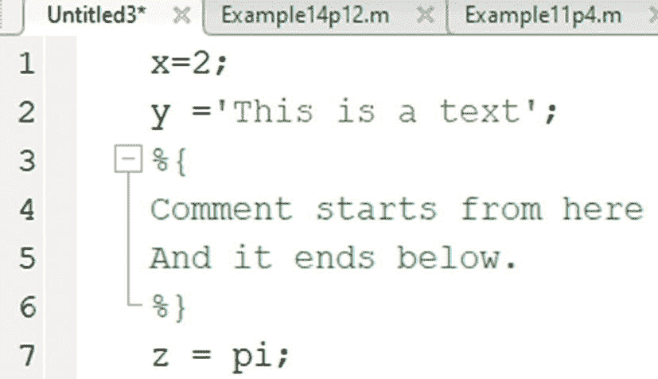
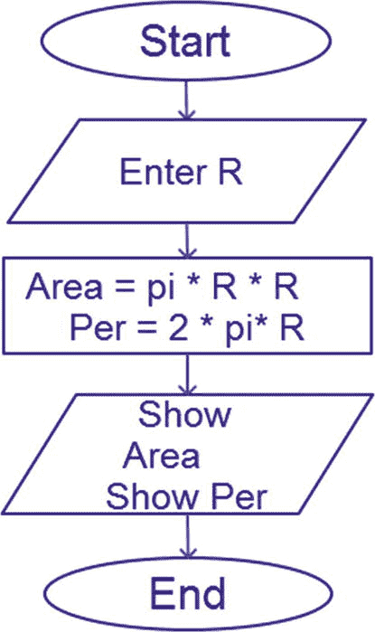
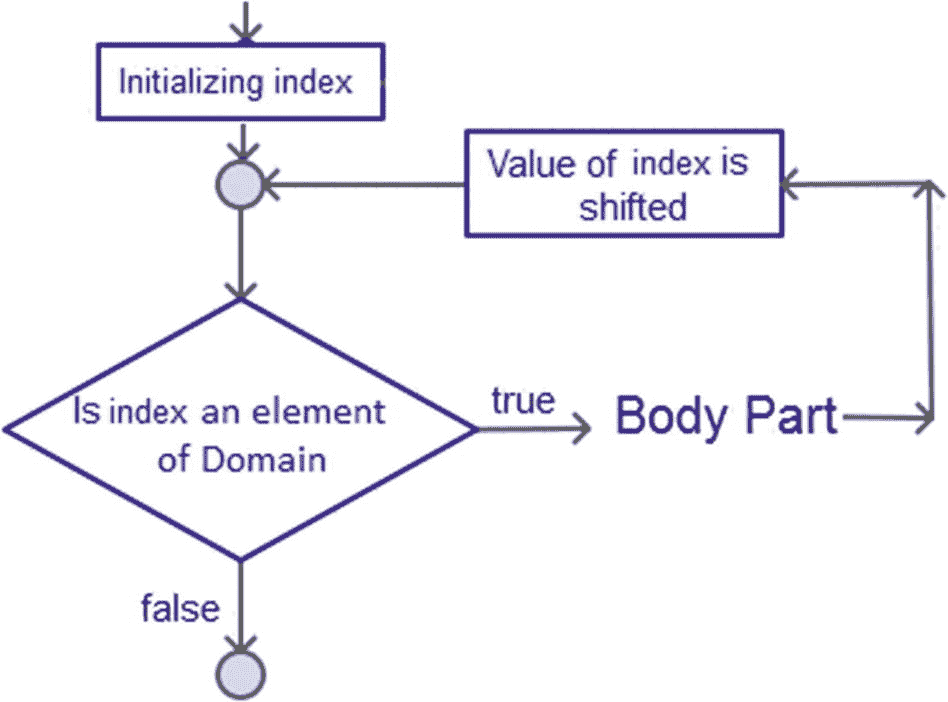
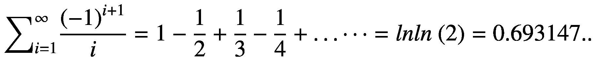
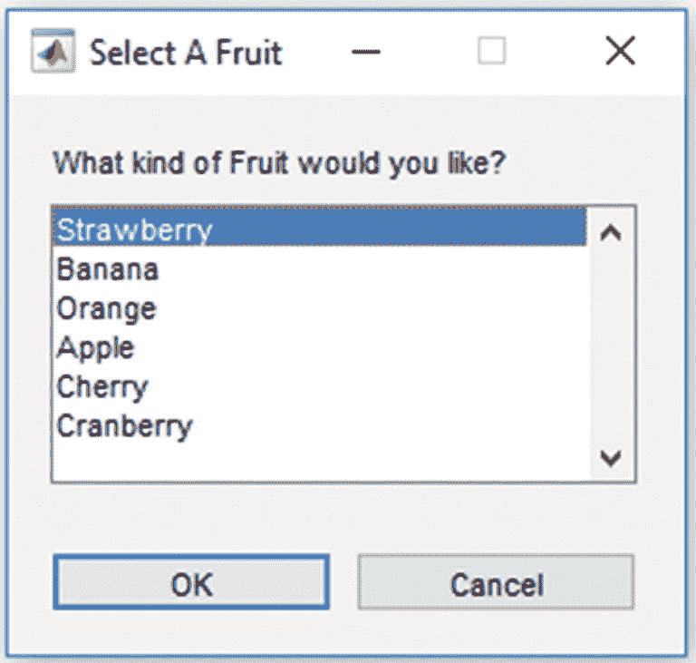
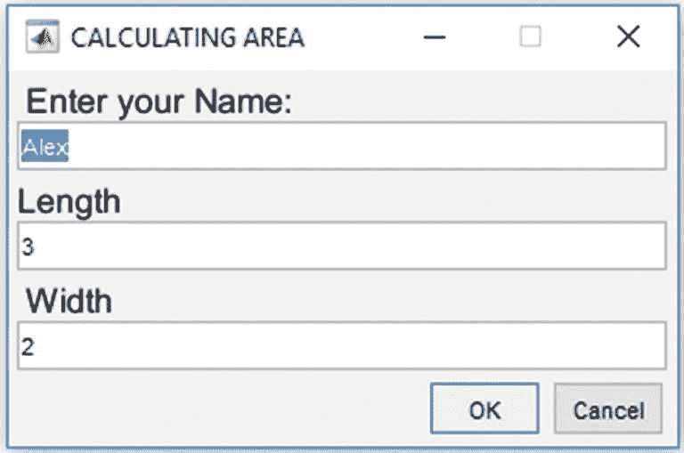
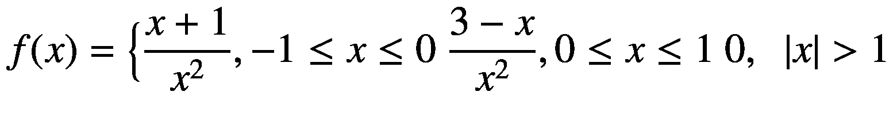
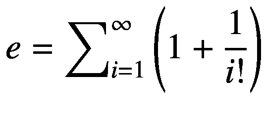

# 2. MATLAB 语言基础

在本章中，你将学习算法、M 文件、选择结构、MATLAB 语言的控制机制以及用户自定义函数的基本概念。

计算机程序本质上是一组告诉计算机做什么的指令。在 MATLAB 中，对于较大的程序（有时称为*脚本*），更倾向于使用编辑器，而不是在提示符下键入整个代码序列。到目前为止，我们处理的问题都易于执行和完成。仅使用提示符来解决至此遇到的问题就足够了。不过，我们也可以使用 MATLAB 编辑器来解决这些问题。然而，对于更大、更复杂的问题，建议你将代码在编辑器中整合并组织好。因此，在本书的其余部分，我们会尽可能多地使用编辑器来编写代码解决问题。

编写复杂、不清晰的代码并不难。但是，过一段时间后，如果你出于某些原因（例如升级或编辑）回顾代码，可能很难理解你当时的意思。因此，编写代码时的首要关注点之一就是编写清晰易懂的代码。为此，我们可以在代码中 `%` 符号后加入注释作为提醒。MATLAB 会忽略 `%` 符号后的所有内容。这些注释可以放在一行代码之后，也可以作为注释块，即 `%{` 和 `%}` 之间的较长信息性表达式。

要生成较长的注释，`%{` 符号应单独占一行。同样，用于关闭注释块的 `%}` 符号也应在最后一行单独占一行，如图 2-1 所示。



图 2-1  
注释块的示例

获得更有组织代码的另一个重要规则是为变量和结构使用有意义的名称。这有助于用户日后更容易地回忆起脚本。其他一些与编写更好代码相关的小技巧超出了本书的范围。不过，为了对主题有基本的理解，我们在此简单介绍。


## 算法

算法是一种计算过程，展示了解决问题所涉及的所有步骤。通常，它会接收一个（或一组）输入，并产生一个（或一组）输出。在解决问题时，会将问题拆分为多个部分，分别分析和解决这些组成要素。这样，就可以更详细地对问题进行分析。这种方法通常称为*自顶向下*方法。有时，将这些组成部分组合起来，可以获取整个系统的信息，从而产生更复杂的系统。通过分析和组合我们已经收集到信息的各个部分，可以构建出系统。这种方法称为*自下而上*处理。

无论采用哪种方法，算法的目的都是以某种方式定义问题的解决方案，例如通过简单表达式编写解决方案，或使用流程图展示解决方案。

## 流程图与伪代码

伪代码和流程图都用于构建计算机程序的算法。伪代码通常由单词和表达式组成，而流程图则由一组简单的图形表示。

伪代码提供了一种非正式的手段来描述待编写程序的步骤。它有助于程序员规划和开发计算机程序的最终算法。

流程图是编写程序步骤的图形化表示。它使用简单的形状和图表（表 2-1）来描述计算机程序的算法。

**表 2-1** 最常用的流程图符号

| 符号 | 说明 |
| --- | --- |
| `[椭圆形]` | 用于程序的开始和结束 |
| `[矩形]` | 用于表示计算或赋值 |
| `[菱形]` | 用于表示判断过程 |
| `[平行四边形]` | 用于表示输入或输出过程 |

**例 2-1.** 为计算正方形面积的算法绘制伪代码和流程图。正方形的边长需要由用户从外部输入。

**解 2-1.** 对于伪代码，算法的步骤可以编写如下：

1. 输入正方形的边长，记为 `B`。
2. 计算正方形的面积，`Area = B²`。
3. 输出结果 `Area`。

## 脚本与 M 文件

在决定好求解问题的算法后，将生成代码来完成给定的任务。代码可以在 MATLAB 编辑器中编写，并保存为名为 `*.m` 的文件，其中 `*` 是你为程序指定的名称。因此，在 MATLAB 中编写的代码称为 m 文件，而这些代码也被称为脚本或程序。

**例 2-2.** 构建一个算法的流程图并生成计算圆的面积和周长的代码，其中半径由用户输入。

**解 2-2.** 该算法的流程图可以绘制如图 2-2 所示。



**图 2-2** 例 2-2 的流程图

`Example2p2.m`

```
%Example2p2
%此代码计算圆的面积和周长
Radius = input('请输入半径\n');
AreA = pi*(Radius²);
Per= 2*pi*Radius;
disp(['圆的面积是= ',num2str(AreA)]);
fprintf('圆的周长是 = % d\n',Per);
```

运行代码后，得到以下输出结果。

```
>  Example2p2
请输入半径

圆的面积是= 314.1593
圆的周长是 =  6.283185e+01
>
```

在此解决方案中，使用了四个重要的函数。`input` 命令用于从外部输入数据。在上述代码中，期望输入一个数值。该代码被赋给名为 `Radius` 的变量。`disp` 和 `fprintf` 函数都用于显示数据。不过，从代码中可以看出，它们的用法不同。`disp` 函数显示括号内的数据。在显示单引号之间的字符串后，通过 `num2str` 命令将变量 `AreA` 的数值转换为字符串，然后使用 `disp` 函数进行显示。使用 `fprintf` 函数时，同样会显示引号内的数据。但在这里，`%` 符号告诉 MATLAB 将要打印数据。`%` 符号后面的字母是数据的说明符，它告诉 MATLAB 将要打印哪种数据类型。在本例中，`d` 用于显示十进制数（表 2-2）。一旦使用了 `'\n'`，光标将移至下一行。因此，变量 `Per` 的值将在文本 `圆的周长是 =` 之后以十进制数的形式打印出来。

**表 2-2** 使用转换函数格式化文本

| 说明符 | 说明 |
| --- | --- |
| `c` | 显示单个字符 |
| `d` | 以有符号十进制记数法格式显示 |
| `e` | 以指数记数法格式显示 |
| `f` | 以定点记数法格式显示 |
| `s` | 显示字符向量或字符串数组 |

当使用诸如 `num2str`、`sprint` 或 `fprintf` 等转换函数时，用户可以自定义对齐方式或精确到指定位数。为了说明，请查看以下示例。

**例 2-3.** 编写一个程序，以三种不同方式显示 π。第一种方式，代码应显示 π 的值。第二种方式，代码应显示小数点后三位数字。第三种方式，代码应将 π 的值打印为 15 位数字，并向右侧对齐。

**解 2-3.** 可以使用以下代码完成给定任务。

`Example2p3.m`

```
%Example2p3
%此代码以三种方式显示 pi
fprintf('pi :\n %f\n %.3f\n %15f\n',pi,pi,pi)
```

运行代码后，得到以下输出结果。

```
> Example2p3
pi :
3.141593
3.142
3.141593
>
```

在上述代码中，当光标执行到 `%f\n` 时，代码打印 π 的值并换行。执行到 `%.3f\n` 时，打印小数点后三位数字并换行。最后，执行到 `%15f\n` 时，π 以 15 位数字显示，并向右侧对齐，必要时用空格填充。之后光标会移至下一行。

## 逻辑函数与选择结构

在某些情况下，我们可能需要从一组可能的候选项中选出一个选项。这种选择可以通过在 MATLAB 中使用 `if`、`switch` 或 `menu` 命令来实现。在本节中，我们将分别讨论每种情况。

### `if` 与 `if-else` 命令

有些情况下，单独使用一个 `if` 语句就足够了，而 `if-else` 结构则主要用于更复杂的情况。


#### 单一 if 结构

在使用单个 `if` 语句时，如果 `if` 后面的比较语句为真，则执行 `if` 和 `end` 之间的命令。此处给出该结构的一个使用示例：

```
if 比较条件
语句
end
```

**示例 2-4.** 编写一个投掷一对骰子的代码。如果两个骰子顶面数字之和为 10，则计算机应打印“You are LUCKY”。计算机还应在屏幕上打印出这两个数字。

**解法 2-4.** 为完成此任务，可使用以下保存为 `Example2p4.m` 的代码。

*Example2p4.m*

```
%Example2p4
% 此程序投掷一对骰子
Die=randi(6,1,2);
if Die(1)+Die(2)==10
fprintf('You are LUCKY \n')
end
fprintf('第一个数字是 %d 第二个数字是 % d\n',...
Die(1),Die(2))
```

在这段代码中，`randi(6,1,2)` 随机创建一个 1 × 2 的矩阵，其中最大数字为 6。与 `rand` 命令不同，此函数中的元素均为正整数。变量 `Die` 有两个元素。如果这两个元素之和为 10，则屏幕上会打印出消息“You are LUCKY”。在代码的第七行，使用了三个点（`...`）来告诉 MATLAB 代码将在下一行继续。最后，在屏幕上打印出数字。

运行代码后，会得到以下输出。

```
> Example2p4
第一个数字是 1 第二个数字是  6
>
```

#### if-else 结构

如果使用单个 `if-else` 结构，则可以在程序中检查多种情况。此处给出该结构的一个使用示例。

```
if 比较条件
语句
elseif 比较条件
语句
else
语句
end
```

**示例 2-5.** 编写一个询问您年龄的程序。如果输入的年龄小于 6，MATLAB 应在屏幕上打印“Maybe NO School”。如果年龄在 6 到 12 之间，应打印“Middle School”。如果年龄在 13 到 17 之间，应打印“High School”，如果年龄在 18 到 25 之间，应打印“Maybe University”。否则，程序应在屏幕上显示“Professional”。

**解法 2-5.** 可使用以下代码完成给定任务。

*Example2p5.m*

```
%Example2p5
% 此程序询问您的年龄
Age = input('请输入您的年龄\n');
if Age < 6
fprintf('Maybe NO School \n');
elseif Age <13
fprintf('Middle School \n');
elseif Age <18
fprintf('High School \n');
elseif Age <26
fprintf('Maybe University \n');
else % 其他可能性
fprintf('Professional \n')
end
```

代码执行后，将显示以下输出。

```
> Example2p5
请输入您的年龄

Maybe University
>
```

#### 关系运算符与 if 和 if-else 结构

关系运算符也可以与 `if` 和 `if-else` 结构一起使用。这些运算符列于表 2-3 中。

**表 2-3** 关系运算符

| 运算符 | 描述 | 示例 |
| --- | --- | --- |
| `>` | 大于 | `3 > 2` |
| `>=` | 大于或等于 | `4 >= 3` |
| `<` | 小于 | `2 < 3` |
| `<=` | 小于或等于 | `2 <= 3` |
| `==` | 等于 | `4 == 4` |
| `~=` | 不等于 | `2 ~= 3` |

为了说明，让我们看下面的示例。

**示例 2-6.** 表 2-4 中给出了区分您获取驾驶执照资格的年龄段区间。

**表 2-4** 获取驾驶执照的年龄

| 区间 | 驾照条件 | 备注 |
| --- | --- | --- |
| `Age<16` | 无驾照 | 无驾照 |
| `16<=Age<18` | 青少年驾照 | 可以获得青少年驾照 |
| `18<=Age<70` | 标准驾照 | 可以拥有标准驾照 |
| `70<Age` | 许可驾照 | 应获得许可驾照 |

编写一个计算机程序，该程序要求输入您的年龄，并根据表 2-4 中给出的备注打印相应信息。

**解法 2-6.** 可使用以下代码完成给定任务。

*Example2p6.m*

```
%Example2p6
%此程序使用关系运算符
Age=input('请输入您的年龄 \n');
if Age=16
fprintf('可以获得青少年驾照  \n');
elseif Age=18
fprintf('可以拥有标准驾照 \n');
else % 其他可能性
fprintf('应获得许可驾照\n');
end
```

如果在提示符下运行该代码，将得到如下所示的输出。

```
> Example2p6
请输入您的年龄

可以拥有标准驾照
>
```

### Switch-Case 命令

`Switch-case` 命令与 `if-else` 结构非常相似。任何使用 `if-else` 命令编程的内容，也可以使用 `switch-case` 结构来编程。`switch-case` 和 `if-else` 结构之间存在细微差别。与 `if-else` 类型相比，阅读 `switch-case` 类型中的条件可能更容易。然而，`switch-case` 结构的灵活性低于 `if-else` 结构，这主要是由于其本身的特性。

`switch-case` 阶梯结构的使用方法如下所示。

```
switch 变量
case 选项 1
如果是选项 1，则执行这些操作
case 选项 2
如果是选项 2，则执行这些操作
otherwise
如果没有任何情况匹配，则执行此操作
end
```

**示例 2-7.** 编写一个程序，对于用户输入的金额，例如 20 美元、30 美元、40 美元或 50 美元，程序分别告知您可以从包含鸡肉、龙虾、牛肉和鱼的菜单中选择吃什么。

**解法 2-7.** 可使用以下代码完成给定任务。

*Example2p7.m*

```
%Example2p7
%此程序演示 switch-case 的用法
Money=input('您有多少钱？ \n');
switch Money
case 20
fprintf('您可以吃鸡肉 \n');
case 30
fprintf('您可以吃龙虾 \n');
case 40
fprintf('您可以吃牛肉 \n');
case 50
fprintf('您可以吃鱼 \n');
otherwise % 其他可能性
fprintf('与菜单不匹配 \n');
end
```

在这段代码中，输入的数字必须与 `case` 语句中使用的某个数字完全匹配。否则，将执行 `otherwise` 部分下的脚本并打印到屏幕上。代码运行后，会得到以下输出。

```
> Example2p7
您有多少钱？

您可以吃牛肉
>
```

### 菜单函数

`menu` 函数在列出项目时非常有用。它可以与 `switch-case` 命令或 `if-else` 命令一起使用，使界面更美观。`menu` 函数的用法如下所示。

```
名称 = menu('菜单标题','选项 1','选项 2',...,'选项 n')
```

**示例 2-8.** 使用 `menu` 编写一个程序，提供四个不同的度假地点。根据您的选择，程序应告知您度假费用。地点包括休斯顿、圣安东尼奥、达拉斯和奥斯汀，价格分别为 450 美元、550 美元、650 美元和 750 美元。

**解法 2-8:** 为此问题生成的代码如下所示。

*Example2p8.m*

```
%Example2p8
%此代码使用 menu 函数
city=menu('从菜单中选择一个城市',...
'休斯顿','圣安东尼奥','达拉斯','奥斯汀');
switch city
case 1
fprintf('$450 \n');
case 2
fprintf('$550 \n');
case 3
fprintf('$650 \n');
case 4
fprintf('$750 \n');
end
```

如第一行所示，三个连续的点（`...`）用于断开该行，并将命令延续到下一行。程序执行后，将得到图 2-3 所示的界面。


**图 2-3** 为目的地创建的菜单

如果选择了第三个选项，即达拉斯，将得到以下输出。

```
> Example2p8
$650
>
```

## 编程控制

在达到给定条件之前，通常使用循环控制语句来执行代码的特定部分。这些循环有时也被称为重复结构。与大多数编程语言类似，MATLAB 具有 `for` 循环和 `while` 循环结构。在这些循环中，可以根据情况使用 `break` 和 `continue` 语句来检查条件。另一个重要的控制机制是使用 `try-catch` 块来处理 MATLAB 中的意外情况。


### `for` 循环

如果已知迭代次数，优先使用 `for` 循环而非 `while` 循环。这种结构的配置易于理解。

```
for starting_variable = Domain
codes to be executed
end
```

在上述配置中，`Domain` 通常指定两个或三个数字。如果指定两个数字，例如 `index=1:5`，则循环重复五次，每次索引值从 1 到 5 递增 1。一旦索引值等于 6，计算机将退出循环，继续执行脚本的其余部分。如果 `Domain` 指定了三个数字，例如 `index =1:3:10`，则循环重复四次，对应的索引值为 `index =1`、`index =4`、`index =7` 和 `index =10`，索引值从 1 到 10 递增 3。在值达到 10 之后，程序将退出循环并继续执行下一行代码。如果所有索引操作尚未完成，则循环将继续重复。MATLAB 中索引的另一个重要特点是索引从 1 开始，不能从 0 开始。

如果为索引变量输入一个较大的最终值，循环内代码的运行过程可能会花费更长时间。根据计算机硬件规格，这可能导致计算机死机。

`for` 循环的流程图如图 2-4 所示。



图 2-4

`for` 循环的流程图

**示例 2-9.** 编写一个程序，计算以下级数，该级数可得出 ln2 的值。



**解法 2-9.** 在编程中，循环通常不能无限重复，否则会一直运行而不会停止。因此，我们需要为循环设定一个限制来计算该级数。限制值越高，得到的结果越好。另一方面，我们还受到另一个因素的限制，即代码的运行速度。因此，选择的限制值越高，代码运行就越慢。以下代码可用于完成该任务。

*Example2p9.m*

```
%Example2p9
%This code calculates ln2
Total=0;
for i=1:1e+6 %1e+6=1000000
Number=(-1)^(i+1)/i;
Total = Total + Number;
end
fprintf('ln2= %d\n',Total);
```

程序开始时，我们在循环外定义总和为零。然后，每次迭代的结果累加到该总和中。索引变量 `i` 从 1 开始，一直持续到 10⁶。在命令提示符下执行程序后，将得到以下输出。

```
> Example2p9
ln2= 6.931467e-01
>
```

如所示，输出以科学记数法形式显示。换句话说，该输出可以表示为 `6.931467.10^(−1)`。

**示例 2-10.** 编写一个程序，使用星号（`*`）打印一个三角形。高度由用户输入。例如，如果输入的数字是 3，则代码应打印如下内容。

```
>> 三角形的高度？ 3
输出：
*
**
***
```

**解法 2-10.** 我们可以编写以下代码。

```
%Example2p10
%This code draws a triangle
x=input('三角形的高度？\n');
for i=1:x
for k=1:i
fprintf('*');
end
fprintf('\n');
end
```

该程序的输出如下所示。

```
> Example2p10
三角形的高度？

*
**
***
****
*****
>
```

### `while` 循环

在某些情况下，我们可能不知道循环内的迭代次数。在这种情况下，最好使用 `while` 循环。其用法可总结为以下形式。

```
while condition
execute
end
```

在此结构中，如果条件为真，程序将停留在 `while` 循环中。与 `for` 循环不同，在 `while` 循环中，我们需要添加额外的机制来控制条件，以便能够退出循环。通常，有两种常用选项可以退出 `while` 循环。第一种选项是，当达到预设场景时，使用 `break` 命令中断循环。第二种选项是在循环内部定义索引变量的增量。这是 `for` 循环和 `while` 循环之间最显著的区别。

`while` 循环的流程图与 `for` 循环的流程图几乎相同。

**示例 2-11.** 编写一个程序，计算欧拉数（Euler number），要求容差至少为 `tol=0.001`，其中


**解法 2-11.** 以下代码可用于完成此任务。

*WhileLo.m*

```
%Example2p11
%This code calculates e
Total=1;
Eu=2.718281;
indeks=1;
tol=1; % 随意定义，远离欧拉数
while tol>1e-3
Number=(1/(factorial(indeks)));
Total = Total + Number;
tol=abs(Eu- Total);
indeks = indeks +1;
end
fprintf('Tolerance: %d e= %d\n',tol,Total);
```

在这个程序中，一旦容差不大于 `10^(−3)`，程序就终止。输出如下。

```
> Example2p11
Tolerance: 2.254444e-04 e= 2.718056e+00
>
```


### break 和 continue

在某些情况下，一旦条件得到测试，可能需要终止循环。此时，可以使用 `break` 命令，该命令会终止最近的循环并退出。

**示例 2-12.** 编写一个程序，实现“猜数字”游戏。用户需要猜出程序随机选取的 1 到 100 之间的数字。计算机会引导用户猜测更大或更小的数字。最后，程序应打印出猜对的数字。

**解法 2-12.** 可以使用以下代码。

`Example2p12.m`

```
%Example2p12
%A Guessing game with break command
Limit=100;%Can be changed
Picked_Number=randi(Limit,1);
Counter=1; %initializing counter
Gues=input('Enter your guess\n');
while true
if Gues==Picked_Number
fprintf('Got it in your %d th try\n',Counter);
break;
elseif Gues>Picked_Number
Gues=input('Enter a SMALLER number\n');
elseif Gues<Picked_Number
Gues=input('Enter a BIGGER number\n');
end
Counter=Counter+1;
end
```

在给出的代码中，`while` 命令后面写了一个 `true` 语句。在 MATLAB 中，`true` 是一个逻辑变量，其值始终为 1。通过在程序第七行写入 `while true`，我们希望程序持续运行，直到用户猜中选定的数字。如果猜到的数字等于计算机选取的数字，则打印尝试次数，并通过 `break` 命令终止循环。

运行代码后，将显示以下输出。

```
> Example2p12
Enter your guess

Enter a SMALLER number

Enter a SMALLER number

Enter a SMALLER number

Enter a SMALLER number

Enter a BIGGER number

Got it in your 6 th try
>
```

`continue` 命令用于重定向代码。与 `break` 命令不同，程序会继续运行，而不会终止最近的循环。

**示例 2-13.** 编写一个程序，要求用户输入三个正数来计算其平方根。如果输入的数字为负数，则显示一条消息，提示该数字应为正数。

**解法 2-13.** 可以使用以下代码解决此问题。

`Example2p13.m`

```
%Example2p13
%This code uses continue command
Counter = 3;
while Counter>0
Number = input('Enter a number\n');
if Number<0
fprintf('The number should be positive\n');
continue;
end
fprintf('Square root of %d is =%d\n',...
Number,sqrt(Number));
Counter = Counter-1;
end
```

执行此代码后，将得到以下输出。

```
> Example2p13
Enter a number

The number should be positive
Enter a number

Square root of 3 is =1.732051e+00
Enter a number

Square root of 9 is =3
Enter a number

Square root of 4 is =2
>
```

如输出所示，如果输入负数，`Counter` 不会减少，程序会继续要求输入新数字。输入三个数字后，程序停止。

### try-catch 块

在运行代码时，可能会发生意外情况或错误。为了克服这一障碍并采取必要措施，可以使用 `try-catch` 块。该块由两部分组成。第一部分跟在 `try` 后面，第二部分跟在 `catch` 语句后面。

```
try
statement
catch
statement
end
```

`try` 语句中编写的任何内容都被视为在编辑器或命令提示符下编写的常规代码。当此部分发生错误时，`try` 部分中的其余代码将终止，MATLAB 会跳转到 `catch` 部分。第二部分是用户计划在第一部分出现错误时编写替代方案或解释的地方。

**示例 2-14.** 编写一个尝试将两个数字相乘的程序。该程序应调用一个未定义的乘法函数。如果出现问题，代码应给出警告。

**解法 2-14.** 可以使用以下代码完成给定任务。

`Example2p14.m`

```
%Example2p14
%This code uses try-catch block
try
M1=10;
M2=20;
Multp = CallFunctionToMultiply(M1,M2);
fprintf("Multiplication is %f\n",Multp);
disp("Everything was smooth")
catch
warning('Something is wrong');
end
```

显然，程序会调用 `CallFunctionToMultiply(M1,M2)` 函数进行计算。用户自定义函数将在下一节中介绍。不过，这里因为函数未定义，程序会给出 `warning` 函数中写入的警告。执行上述代码后，将得到以下输出。

```
> Example2p14
Warning: Something is wrong
> In Example2p14 (line 10)
>
```

## 用户自定义函数

允许用户为特定目的定义函数。要在 MATLAB 中定义函数，必须在 m 文件中创建程序。通常，用户自定义函数会保存为单个 m 文件，以便日后使用。

在用户自定义函数中，第一行应以命令 `function` 开头，通常后面跟着包含一个或多个输出变量的方括号、函数名以及包含一个或多个输入变量的圆括号。用户自定义函数的结构可总结如下：在用户自定义函数中，命令 `function` 和要分配的名称足以创建一个函数。函数通常以 `end` 语句作为最后一行结束，或者以另一个子函数的定义结束。虽然用户自定义函数有时没有 `end` 语句也能工作，但为了更好的可读性，建议将其用作代码的最后一行。

```
function [ output_variables ] = function_name( input_variables )
code to be executed
end
```

如前所述，输出变量应放在方括号内，输入变量应放在圆括号内。函数名应与保存的文件的名称相同。

从 2016 年下半年开始，随着 R2016b 版本的发布，MATLAB 中引入了一个重要特性，允许在同一文件中的代码末尾添加用户自定义函数。这种新结构可以总结如下。

```
a piece of code
function function1
code to be executed
end
function function2
code to be executed
end
```


### 创建函数

在编写复杂程序时，您可能需要创建自己的函数。实际上，没有任何编程语言能提供一套完备的内置函数库以解决所有类型的问题。因此，为了简化程序员的工作，通常需要为特定目的创建特定函数。

某些用户定义的函数会返回单个值，而另一些则会返回多个值。甚至有些函数可能不返回任何值。本章将介绍这些类型的函数。

**例 2-15.** 编写一个函数，该函数打印用户输入数字的平方。程序还应检查是否有数字被传递给函数。

**解 2-15.** 要创建一个函数，首先需在编辑器中编写函数的必要部分以满足要求。我们可以使用 `nargin` 函数检查输入参数的数量，以确保用户输入的是一个数字。下面的代码可以实现此功能。

*Example2p15.m*

```
function [ Result ] = Example2p15( Number )
%Example2p15
%此代码接受任意输入
Checking_if_numeric = isnumeric (Number );
if Checking_if_numeric == 0 || nargin ~=1
error('Just A NUMBER');
end
Result = Number²;
end
```

函数名与文件名相同，即 `Example2p15`。该函数只接受单个数值。该函数定义了一个输出 `Result` 和一个输入 `Number`。

程序执行后，逻辑变量 `Checking_if_numeric` 会得到 0 或 1。如果数字是数值类型，则逻辑变量 `Checking_if_numeric` 被赋值为 1，否则为 0。在代码的第五行，该行检查变量是否为零，即如果它不是数字，或者输入参数的数量不等于 1，则计算机会在 `error` 函数内打印错误消息。在 MATLAB 中，`||` 符号是逻辑“或”运算符。

我们将在命令窗口中测试错误情况和计算情况。如果从命令窗口调用保存的函数，并输入一个数字（例如 5），我们将得到以下输出。

```
> My_udf(5)
ans =

>
```

如果再次运行程序，并向函数传递一个字符串（例如 `G`），我们将得到以下输出。

```
> Example2p15(8,4)
Error using Example2p15
输入参数过多。
>
```

在某些情况下，我们可能需要从函数中获得多个输出，如下例所示。

**例 2-16.** 编写一个程序，根据用户输入的半径计算周长、面积和体积。

**解 2-16.** 输出应为三个。程序如下所示。

*Example2p16.m*

```
function [Perimeter,Area,Volume] = Example2p16(radius)
%Example2p16
%此函数可打印 3 个输出
Perimeter = 2*pi*radius;
Area = pi*(radius²);
Volume = (4/3)*pi*(radius³);
```

如果从命令窗口运行该代码，我们将得到以下结果。

```
> [perimeter,area,volume]=Example2p16(10)
perimeter =
62.8319
area =
314.1593
volume =
4.1888e+03
>
```

可以看到，这里指定了三个输出。如果未指定输出，则只显示第一个输出。

### 局部变量与全局变量

定义在函数内部的变量称为*局部变量*。局部变量仅在函数内部有效，意味着它们不会被保存到工作区。为了使这些变量在函数外部也可用，我们需要在变量左侧添加 `global` 将它们定义为全局变量。如果在一个函数内部定义了另一个函数，并且在这两个函数中都使用了同一个变量，那么该变量也需要在两个函数中都定义为全局变量。然而，许多专业程序员建议避免使用全局变量，而推荐使用传递值给函数的方式。

**例 2-17.** 编写一个程序，演示在函数内部和外部使用全局变量的区别。

**解 2-17.** 以下代码可用于完成此任务。

*Example2p17.m*

```
%Example2p17
%此代码使用了局部变量和全局变量。
Numb1 = 61; %这是全局变量
fprintf("函数外部的变量 :%i\n", Numb1)
MyFunction();%调用函数
fprintf("函数外部的变量 :%i \n", Numb1)
function MyFunction
Numb1 = 55; %这是局部变量
fprintf("函数内部的变量 :%i\n", Numb1)
end
```

一旦执行代码，将得到以下输出结果。

```
> Example2p17
函数外部的变量 :61
函数内部的变量 :55
函数外部的变量 :61
>
```

如代码所示，全局变量 `Numb1` 在函数外部定义并打印为 61。一旦被 `MyFunction` 函数调用，相同的变量又在函数内部定义为 55 并打印。退出函数后，其值保持不变，仍为 61。

### 创建子函数

可以创建一个包含所有用户自定义函数的文件。第一个函数被定义为主函数或主要函数。可以从主函数调用其余的函数来执行相应的任务。包含在主函数中的其他函数称为子函数。为避免混淆，主函数的名称与保存代码的文件名应保持一致。

**例 2-18.** 编写一个函数，使用子函数计算圆柱体的体积。圆柱体的半径和高度应由用户传递给该函数。

**解 2-18.** 代码如下面的 m 文件所示。

*Example2p18.m*

```
function Example2p18(Radius,height)
%Example2p18
% 此主函数计算
% 圆柱体的体积
radius_sq = R_square(Radius);
Result = pi*height*radius_sq;
fprintf('体积为 %f\n',Result);
end
function [r_sq]=R_square(Radius)
r_sq= Radius²; %子函数
end
```

如图所示，主函数没有定义输出。取而代之，结果由主函数的主体部分打印到屏幕上。

程序中使用的第二个函数是一个子函数的例子。一旦程序执行，将显示以下输出。

```
> Example2p18(4,10)
体积为 502.654825
>
```

### 匿名函数

匿名函数是不存储在单独文件中的函数。这些函数是程序的一部分，与文件中的一个或多个变量相关联。在 MATLAB 中，匿名函数拥有 `function_handle` 数据类型。

这些函数在定义中包含 `@` 符号。`Sqr` 函数，由 `Sqr = @(x) sqrt(x)` 给出，是匿名函数的一个例子。`@` 符号告诉 MATLAB `Sqr` 是一个函数。

**例 2-19.** 编写一个函数，接收由两个数字组成的输入，并使用匿名函数计算它们的乘积。两个数字的乘积应打印在屏幕上。

**解 2-19.** 以下代码可用于此目的。

*Example2p19.m*

```
function [Output] = Example2p19(x,y)
%这是 Example2p19
%此函数包含一个匿名函数。
Multip = @(x,y) x*y;
Output =Multip(x,y);
```

运行代码后，将得到以下输出。

```
> Example2p19(5,6)
ans =

>
```


#### 与计算机的交互

在本节中，我们将讨论程序员与计算机之间的交互，换句话说，就是对话框。MATLAB 中有许多对话框，如 `errordlg`、`warndlg`、`msgbox`、`questdlg` 等，可在代码中使用。表 2-5 中给出了其中一些对话框的示例及其说明。

**表 2-5** MATLAB 中的对话框示例

| 函数 | 说明 |
| --- | --- |
| `inputdlg` | 创建输入对话框 |
| `errordlg` | 创建错误对话框 |
| `warndlg` | 创建警告对话框 |
| `msgbox` | 创建消息对话框 |
| `helpdlg` | 创建帮助对话框 |
| `waitbar` | 打开或更新等待条对话框 |
| `questdlg` | 创建问题对话框 |
| `listdlg` | 创建列表选择对话框 |

为了说明问题对话框的用法，我们可以在提示符处编写以下代码。

```
>> Picking = questdlg('What kind of Fruit would you like?',...
'Fruit Selection','Apple','Orange','Banana','Orange')
>
```

一旦我们按下回车键，便会得到如图 2-5 所示的输出。


**图 2-5** 问题对话框的输出

提示符处会出现以下语法。

```
>> Picking = questdlg('What kind of Fruit would you like?',...
'Fruit Selection','Apple','Orange','Banana','Orange')
Picking =
'Banana'
>
```

为了说明列表对话框的用法，可以使用以下代码。

```
>> d= listdlg('PromptString','What kind of Fruit would you like?',...
'SelectionMode','single', 'ListString',{'Strawberry',...
'Banana','Orange','Apple','Cherry','Cranberry'},...
'Name','Select A Fruit','ListSize',[210 100])
d =

>
```

在这里，因为选中了第一个选项，如图 2-6 所示，所以将 `1` 赋给 `d`。



**图 2-6** 列表对话框的输出

**例 2-20.** 编写一个函数来计算矩形的面积。矩形的长和宽应通过输入对话框输入。用户名也应输入到对话框中。

**解 2-20.** 以下代码可用于完成给定任务。

`Example2p20.m`

```
%Example2p20
% 此示例使用 inputdlg 框
prompt = {'\fontsize{12} Enter your Name:',...
'\fontsize{12}Length', '\fontsize{12} Width'};
title = 'CALCULATING AREA';
Defining = {'Alex','3','2'};%默认值
NumLines=[1 50]; % 尺寸
opts.Interpreter = 'tex';
options.Resize='on';
options.WindowStyle='normal';
Vals=inputdlg(prompt,title,NumLines,Defining,opts);
Name=num2str(Vals{1});%将值转换为字符串
LS=str2double(Vals{2});%将值转换为双精度浮点数
SS=str2double(Vals{3});%将值转换为双精度浮点数
Area = LS * SS; %执行计算
fprintf(" Hello %s\n The Area is :%i\n",Name,Area)
```

命令提示符是一个字符串元胞数组，每个输入对应一个值。如上述代码所示，可以使用 `\fontsize{ }` 结构来调整字号。变量 `NumLines` 设置输入的尺寸。它既可以是一个标量值，也可以是一个矩阵。在上述代码中，`str2double` 将字符串转换为双精度浮点数。也可以使用 `str2num` 命令。

程序执行后，得到如图 2-7 所示的输出。



**图 2-7** 例 2-20 的输出

在未更改默认值的情况下单击“确定”后，会得到以下输出。

```
>> Example2p20
Hello Alex
The Area is :6
>
```

## 习题

- **2.1.** 构建一个程序的代码和流程图，该程序将矩形的长和宽作为两个输入，并计算矩形的面积。
- **2.2.** 构建一个算法的流程图和伪代码，对于输入的大于 18 的数字，程序将打印“是的，你可以考取驾照”，否则打印“不能考取驾照”。
- **2.3.** 编写一个程序，使用 `menu` 函数提供三个度假地点。根据您的选择，程序应告知您的度假费用。地点包括圣安东尼奥、奥斯汀和达拉斯，价格分别为 500 美元、400 美元和 300 美元。
- **2.4.** 编写一个程序，使用 `menu` 函数请求用户从“蓝色”、“红色”和“绿色”三种颜色中选择一种。程序需要将用户的选择打印在屏幕上。
- **2.5.** 在区间 -4≤*x*≤4 内绘制以下分段函数的图形。



- **2.6.** 使用星号（*）符号，编写代码在屏幕上打印一个矩形。矩形的宽度和长度应通过 `input` 函数以正整数形式输入。
- **2.7.** 编写一个程序，在容差为 0.0000001 的范围内计算欧拉数。计算公式如下。



- **2.8.** 查找斐波那契数的公式是 `f[n]=f[n-1] + f[n-2]`，其中 `f(0)=1` 且 `f(1)=1`。编写代码计算 `f(80)`。
- **2.9.** 编写一个接受三个输入的函数。如果输入数量不足，程序应给出错误消息。
- **2.10.** 编写一个包含函数的程序。该程序应计算矩形的面积。矩形的长和宽在程序执行后输入。提供输入后，这些值应传递给程序中的函数。该函数应计算矩形的面积并将该值打印在屏幕上。
- **2.11.** 编写一个显示四个项目列表的程序。程序应将从列表中选择的项目的名称打印在屏幕上。

