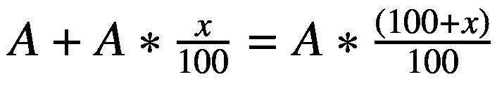
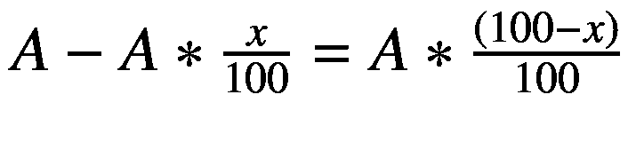
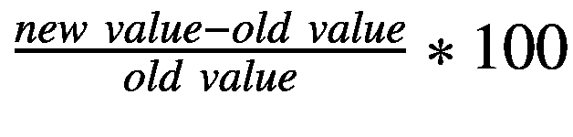
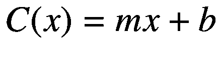
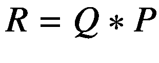
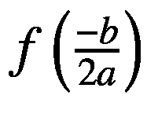
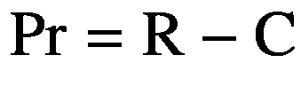

# 3. 经济建模

在本章中，首先定义了示例中使用的新函数。随后，在不同章节中探讨了单利和复利、百分比变化以及成本、收入和利润等主题。在给出示例之前，每个章节都解释了求解中使用的必要公式。

## 预备知识

本节将介绍本章中使用的新术语。MATLAB 拥有用于代数方程计算的符号数据类型，如第 1 章所示。`diff(f,x)` 函数用于计算符号表达式 `f` 对变量 `x` 的导数。作为演示，我们可以看一下在命令提示符下输入的以下内容。

```
> syms x
> f=x³-7*x²+6*x-61;
> y=diff(f,x)
y =
3*x² - 14*x + 6
> t=diff(f,x,2)
t =
6*x - 14
>
```

将 `x` 定义为符号变量并定义 `f` 后，使用 `diff(f,x)` 计算 `f` 对 `x` 的导数，并将计算结果赋值给变量 `y`。接着，使用 `diff(f,x,2)` 计算 `f` 函数的二阶导数，并将结果赋值给变量 `t`。

```
> syms x
> y=x²+2*x-8;
> w=8*x+16;
> solve(y,x)
ans =

> solve(w,x)
ans =

>
```

在上述代码中，使用 `solve` 函数找到了使方程等于零的 `y` 的根和 `w` 的解。

```
> syms x
> y=3*x²-2*x-6;
> MyFunc = matlabFunction(y);
> MyFunc(2)
ans =

> MyFunc(3)
ans =

>
```

此处，使用 `matlabFunction(y)` 将 `y` 的方程转换为 MATLAB 函数。随后，通过 `MyFunc` 函数计算了 `y(2)` 和 `y(3)` 的值。

## 单利与复利

利息是为借用资金而支付的费用。大多数情况下，根据合同约定，当人们将钱存入银行账户（例如，储蓄账户）时，会获得利息。通常，计算两种类型的利息：单利和复利。

### 单利

`单利`通过本金金额、年利率以及以年为单位的时间相乘来计算。对于单利，每年赚取的利息不会被计入本金中。换句话说，单利仅在本金上产生。如果时间单位不是年，则需要将其转换为年。例如，如果给定时间为六个月，则时间计算为 `T = (1/12) * 6 = 0.5`。如果给定时间为 30 天，则时间计算为 `T = (1/365) * 30`（假设一年按 365 天计算）。计算单利时，使用以下公式。

`I = P * R * T`

其中 `I` 是利息，`P` 是本金，`R` 是年利率，`T` 是以年为单位的时间。

**示例 3-1.** 编写代码，为银行计算特定本金贷款、年利率和以月为单位的时间的还款金额。代码应要求用户输入这些值，并在屏幕上打印总还款额和已付利息。

**解答 3-1.** 以下代码可用于完成给定任务。

*Example3p1.m*

```
%Example3p1
%此代码计算单利
P = input('请输入本金金额: ');
R = input('请输入年利率: ');
T = input('请输入时间（月）: ');
Interest=P*R*(1/12)*T;
Total = P + Interest;
fprintf('已付利息金额为: %.2f\n',Interest)
fprintf('总还款额为: %.2f\n',Total)
```

在代码中，`input` 函数用于在屏幕上输入一个值。输入值后，它会按照前面的说明分别赋值给 `P`、`R` 和 `T`。运行代码后，将得到以下输出。

```
> Example3p1
请输入本金金额: 2000
请输入年利率: 0.20
请输入时间（月）: 24
已付利息金额为: 800.00
总还款额为: 2800.00
>
```

**示例 3-2.** Omar 将 80,000 美元存入一家年利率为 35% 的银行。他计划在存款 19 个月后取出他的钱。银行也允许客户每月提取资金。编写代码计算他在 19 个月后能获得的金额。

**解答 3-2.** 以下代码可用于完成给定任务。

*Example3p2.m*

```
%Example3p2
%此代码计算利息
P = 8e+4;
R=35/100;
T=(1/12)*18;
I=P*R*T;
Balance = P + I;
fprintf('余额为 %.2f\n',Balance);
```

运行代码后，将得到以下输出。

```
> Example3p2
余额为 122000.00
>
```

### 复利

`复利`与单利不同。对于复利，利息也会在累积的利息上产生。计算出本金的利息后，将该值加入本金，新的金额成为新的本金。重复此过程直至当前时刻或每个计息周期。为了仅计算赚取的利息，需从总收益中减去本金金额。计算复利时，使用以下公式。

`I = P * (1 + R')^C - P`

其中 `I` 是利息，`P` 是本金，`R'` 是周期利率，`C` 是复利期数。周期利率 `R'` 是应用于每个周期本金金额及已赚利息的利率。复利期数 `C` 是应用利息的总周期数。周期利率通过将年利率除以每年的复利期数来计算。

`R' = (年利率) / (每年期数)`

作为演示，对于 `P` = 100 美元，年利率 = 15%，每年期数 = 3（`R'` = 5%），`C` = 4，16 个月的总赚取金额（余额）可如表 3-1 所示计算。

表 3-1

演示示例

| 周期 | 利息 | 余额 |
| --- | --- | --- |
| 初始 |   | 100.00 美元 |
| 4 个月 | 100.00 美元 * 5% = 5.00 美元 | 105.00 美元 |
| 8 个月 | 105.00 美元 * 5% = 5.25 美元 | 110.25 美元 |
| 12 个月 | 110.25 美元 * 5% = 5.51 美元 | 115.76 美元 |
| 16 个月 | 115.76 美元 * 5% = 5.79 美元 | 121.55 美元 |

**示例 3-3.** 编写代码，根据表 3-1 中给出的信息，以复利利率计算总余额。

**解答 3-3.** 以下代码可用于完成给定任务。

*Example3p3.m*

```
%Example3p3
%此代码计算复利
format short
P = 100;
Rprime=0.05;
C=4;
Balance = P*((1+Rprime)^C);
disp(Balance)
```

运行代码后，将得到以下输出。

```
> Example3p3
121.5506
>
```

**示例 3-4.** Jennifer 将 150,000 美元存入一个年复利率为 12% 的银行账户。如果她在 5 年后从银行取钱，她能获得多少利息？

**解答 3-4.** 以下代码可用于完成给定任务。

*Example3p4.m*

```
%Example3p4
%此代码计算复利
format short
P = 15e+4;
Rprime=0.12;
C=5;
Balance = P*((1+Rprime)^C);
Interest = Balance - P;
fprintf('获得的利息: %.20f\n',Interest)
```

运行代码后，将得到以下输出。

```
> Example3p4
获得的利息: 114351.25248000008286908269
>
```

## 百分比变化

在现实生活中，我们经常遇到百分比变化的问题。要解决这类问题，需要理解三个重要概念。

- 比 `A` 多 x% = 

- 比 `A` 少 x% = 

- 百分比变化 = %

**例 3-5.** 马丁今年的年薪是 5 万美元。明年他将获得 20%的加薪。马丁明年的年薪是多少？

**解 3-5.** 以下代码可用于计算薪资。

*Example3p5.m*

```
%Example3p5
%此代码计算百分比增量
Salary = 5e+4; %5e+4 = 50000
NextY = Salary*(120/100);
fprintf('马丁明年薪资是: %.2f\n',NextY)
```

运行代码后，输出如下。

```
> Example3p5
马丁明年薪资是: 60000.00
>
```

**例 3-6.** 马丁的商店以每公斤 28 美元的价格销售加价 40%的甜瓜。如果他希望以原始成本的 20%折扣出售，那么马丁购买甜瓜的每公斤成本是多少？编写代码显示成本和折扣后的价格。

**解 3-6.** 以下代码可用于计算成本和折扣价格。

### Example3p6.m
```matlab
%Example3p6
%此代码计算百分比
Melon = 28;
CostAmount = Melon*(100/140);
NewPrc = CostAmount*(80/100);
fprintf('甜瓜成本: %.2f 每公斤\n',CostAmount);
fprintf('折扣后价格: %.2f 每公斤\n',...
NewPrc);
```

运行代码后，输出如下。
```
> Example3p6
甜瓜成本: 20.00 每公斤
折扣后价格: 16.00 每公斤
>
```

**例 3-7.** 一家书店以 50 美元出售一本书，然后价格降至 35 美元。这本书的价格百分比变化是多少？

**解 3-7.** 以下代码可用于计算百分比变化。

### Example3p7.m
```matlab
%Example3p7
%此代码计算百分比变化
OldPrice = 50;
NewPrice = 35;
PercChange = ((NewPrice-OldPrice)/OldPrice)*100;
fprintf('百分比变化= %.2f\n',PercChange);
```

运行代码后，输出如下。
```
> Example3p7
百分比变化= -30.00
>
```

如输出所示，在 30.00 前面有一个负号（`-`）。这表明价格下降了。如果是正号（+），则表示价格上涨。

## 成本、收入和利润

在所有企业中，保持清晰且恰当的财务记录极其重要。成本、收入和利润的计算在这方面扮演着重要角色。在本节中，我们将讨论这三个重要概念。

### 成本

成本，也称为总成本，是为生产或获取某件物品所花费的货币价值。通常，某物的成本可以通过线性函数计算：



其中，`m` 代表边际成本，`b` 代表固定成本。

**例 3-8.** 亚历山大的自行车公司生产自行车进行销售。每生产一辆自行车，公司花费 50 美元，其他固定成本为 35 美元。编写代码计算生产自行车的总成本。代码应询问生产自行车的数量以完成计算。

**解 3-8.** 以下代码可用于完成给定任务。

### Example3p8.m
```matlab
%Example3p8
%此代码计算成本（总成本）
Number = input('生产自行车数量\n');
Cost = @(x) 50*x+35;
CostCalculation = Cost(Number);
disp(['成本为 ', num2str(CostCalculation)])
```

运行代码，并输入自行车数量为 10 后，输出如下。
```
> Example3p8
生产自行车数量

成本为 535
>
```

### 收入

收入是以价格 `P` 销售 `Q` 件物品所获得的总金额。



在该公式中，`R` 代表收入，`Q` 代表售出的物品数量，`P` 代表每件物品的售价。使用给定公式计算总收入并不困难。有些问题需要用户在不同情况下找出最大收入。下一个例子就是这类问题。

**例 3-9.** 亚历山大的影院公司销售电影放映的门票。影院有 1000 个座位。目前每张票售价 8 美元。亚历山大想提高票价。根据以往经验，他认为如果每张票涨价 0.50 美元，那么来看电影的观众会减少 50 人。找出使收入最大的票价。

**解 3-9.** 设 `x` 为涨价 0.50 美元的次数。因此，$8.00 + $0.50`x` 代表一张票的价格，1000 - 50`x` 代表售出的票数。那么收入可以计算为 `R` = (1000 − 50`x`) ∗ (8.00 + 0.50`x`)。由此，我们可以写出 `R` = −25`x`² + 100`x` + 8000。以下代码可用于完成给定任务。然后我们需要找出一个使 `R` 值最大的 `x` 值。这部分需要我们进入代码并求解 `x` 以使 `R` 达到最大值。以下代码可用于实现此目的。

### Example3p9.m
```matlab
%Example3p9
%此代码寻找最大值
syms x
R = -25*x²+100*x+8000;
Derivat = diff(R,x);
Number = solve(Derivat,x);
EvalFunc = matlabFunction(R);
MaxVal = EvalFunc(double(Number));
disp(['最大收入为 ',...
num2str(MaxVal)])
```

在此代码中，`R` 函数以符号函数形式输入。然后使用 `diff` 函数求其导数。得到的线性方程通过 `solve` 函数求解。得到的 `Number` 值显示为符号数据值。为了将其转换为浮点数，使用了 `double` 函数。同时，`R` 符号函数被转换为 MATLAB 函数，以在 `x=Number` 值处评估 `R`。最后，使用 `disp` 函数显示最大值。

运行代码后，输出如下。
```
> Example3p9
最大收入为 8100
>
```

**注 3-1.** 对于二次方程（即 `f(x)` = `ax`² + `bx` + `c`，`a` ≠ 0 且 `a`, `b`, `c` ∈ `R`），最大值或最小值取决于 `a` 的符号。如果符号为负（-），则可以从方程导出最大值。如果符号为正（+），则可以找到方程的最小值。这可以通过两种方式实现。第一种方式中， 给出最大值或最小值。第二种方式中，计算 `f(x)` 的导数，并求解 `f^′(x)` = 0 方程。`f(x)` 的根也取决于 `a` 的符号，给出最大值或最小值。

在前面的问题中，采用了第二种方法来寻找最大值。

### 利润

利润可以定义为收入（总收入）与成本（总成本）之差。



其中 `Pr` 代表利润，`R` 代表收入，`C` 代表成本。

**示例 3-10.** 某公司销售 T 恤，其成本函数为 `C(x)` = 3 + 2`x`，收入函数为 `R(x)` = −`x`² + 4`x` + 12，其中 `x` 表示 T 恤的数量。要求取最大收入值 `R` 所对应的 `x`。然后，利用相同的 `x` 值，计算成本 (`C`) 和利润 (`Pr`)。

**解 3-10.** 以下代码可用于求解。

### Example3p10.m
```matlab
%Example3p10
%This code profit
syms x
R = -x²+4*x+12;
Derivat = diff(R,x);
Number = double(solve(Derivat,x));
C = @(x) 3+2*x;
Rev = @(x) -x²+4*x+12;
disp(['For maximum R, x =',...
num2str(Number)])
Profit=Rev(Number)-C(Number);
disp(['Profit, Pr=',...
num2str(Profit)])
```

此处，第四行定义了代表收入的 `R`。通过对其求导并令导数为零，可计算出使收入最大的 `x` 变量，然后利用 `solve` 函数求解。接着，将相同的收入和成本函数定义为匿名函数。这些函数在 `x=Number` 处求值，并通过 `disp` 函数显示结果。运行代码后，将得到以下输出。
```
> Example3p10
For maximum R, x =2
Profit, Pr=9
>
```

## 习题

- **3.1.** Bushra 将她的 180,000 美元存入银行，年利率为 25%（单利）。她计划在存款 34 个月后取出所有资金。银行也允许客户按月取款。编写代码计算 Bushra 在 34 个月末能取出的金额。
- **3.2.** Alexander 将 240,000 美元存入一个年复利率为 20% 的银行账户。如果他在 8 年后从银行取出资金，他获得的利息是多少？
- **3.3.** David 的市场以每公斤 39 美元的价格出售西瓜，加价率为 30%。如果他希望在原成本基础上打 10% 的折扣出售，那么 David 购买西瓜的每公斤成本是多少？编写代码显示成本价和折扣后的价格。
- **3.4.** 一家咖啡店起初以 20 美元的价格出售一个杯子，随后将价格调整为 25 美元。价格变动的百分比是多少？
- **3.5.** Benjamin 的自行车公司生产自行车进行销售。每生产一辆自行车，公司需花费 40 美元，另外还有 25 美元的固定成本。编写代码计算生产自行车的总成本。该代码还应计算生产七辆自行车的成本。

## 3.6.
Lily 的电影院公司为一场电影放映出售门票。该电影院有 1,200 个座位。目前每张票售价 10 美元。Lily 想提高票价。根据以往经验，Lily 认为如果每张票提价 0.50 美元，那么观影人数将减少 20 人。求能使收入最大化的票价。

## 3.7.
对于给定的函数`R(x) = 2x^2 − 4x + 2`，求`R(x)`的最小值。并说明求出`R(x)`最大值的可能性。