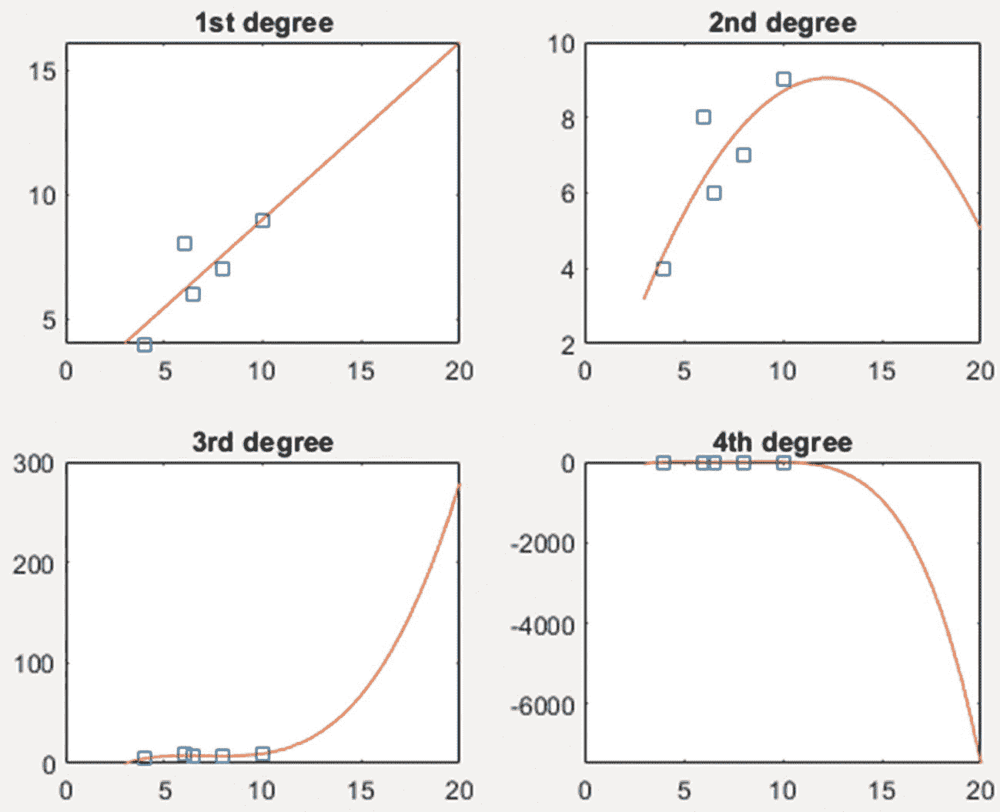
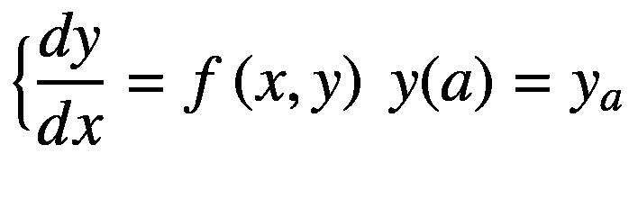
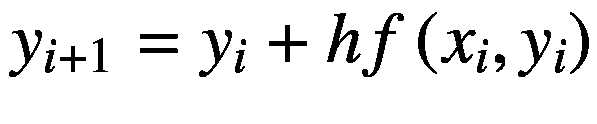
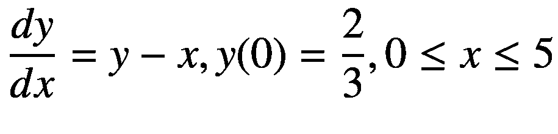
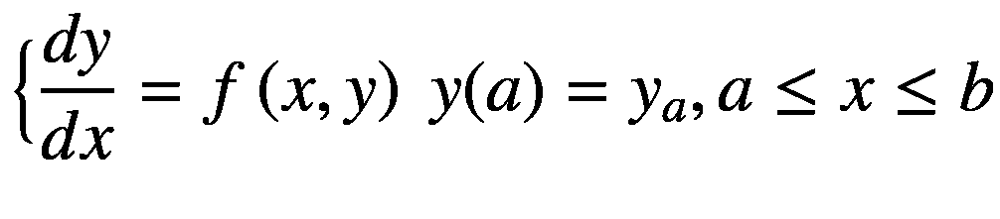
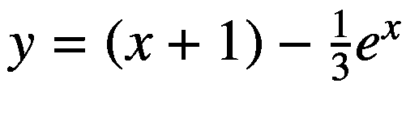
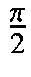
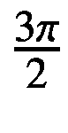
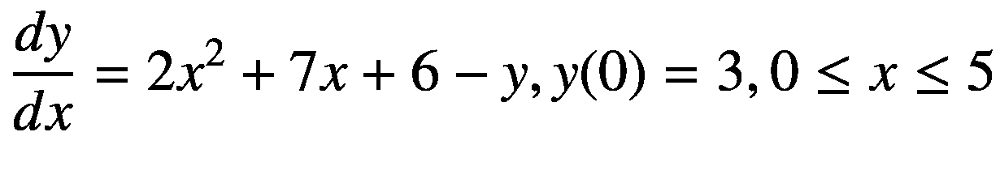

# 4. 数值方法

在本章中，我将介绍如何使用数值技术解决问题。首先介绍插值法和外推法。然后解释曲线拟合和求根。最后涵盖数值积分和数值微分。

## 插值与外推

在一维应用中进行插值时，可以使用函数 `interp1` 找到给定域内某个点的对应值。同样地，通过同一函数也能找到给定域外的值。这种方法称为外推。`interp1` 函数提供了多种方法，如 `linear` 或 `spline`（表 4-1）。某些可用于插值的方法在 `interp1` 函数中不适用于外推。如果使用一个不支持外推的方法选取外部点进行外推，MATLAB 会返回 `NaN`，代表“非数值”。因此，选择合适的方法对于执行插值或外推至关重要。

**表 4-1** `interp1` 使用的方法

| 选项       | 说明                                       |
|------------|--------------------------------------------|
| linear     | 使用线性插值（默认值）                     |
| nearest    | 使用最近邻插值                             |
| next       | 使用下一邻点插值                           |
| previous   | 使用前一邻点插值                           |
| spline     | 使用分段三次样条插值及外推                 |

**示例 4-1.** 对于给定的 *x* = [1, 2, 5, 8] 和 *y* = [20, 30, 50, 80]，使用 `interp1` 函数的默认方法计算 7 处的值，并使用 `linear` 和 `spline` 方法计算 10 处的值。

**解 4-1.** 以下代码可用于完成给定任务。

*Example4p1.m*

```
%Example4p1
%This code uses interp1 function
x=[1, 2, 5, 8];
y=[20, 30, 50, 80];
ValX1 = interp1(x,y,7);
ValX2 = interp1(x,y,10,"linear");
ValX3 = interp1(x,y,10,"spline");
fprintf("1st value is %f\n",ValX1)
fprintf("2nd value is %f\n",ValX2)
fprintf("3rd value is %f\n",ValX3)
```

代码执行后，将得到以下输出。

```
> Example4p1
1st value is 70.000000
2nd value is NaN
3rd value is 121.428571
>
```

如上述输出所示，计算机为 `2nd value` 打印了 `NaN`。这表明在 `interp1` 函数中，`linear` 方法不支持外推。

## 曲线拟合

利用数据集，可以通过函数 `polyfit` 获得一个多项式函数。

**示例 4-2.** 对于给定的 *x* = [4, 6, 6.5, 8, 10] 和 *y* = [4, 8, 6, 7, 9]，获得从一次到四次的四条不同曲线。然后，利用这四个多项式，在 *x* = 3:0.5:20 范围内求值。该代码应将所有曲线绘制在同一张图中。

**解 4-2.** 以下代码可用于完成给定任务。

*Example4p2.m*

```
%Example4p2
%This code uses polyfit function
x=[4, 6, 6.5, 8, 10];y=[4, 8, 6, 7, 9];
P1 = polyfit(x,y,1)%1st degree
P2 = polyfit(x,y,2)%2nd degree
P3 = polyfit(x,y,3)%3rd degree
P4 = polyfit(x,y,4)%4th degree
%Using obtained curves
xx = 3:0.5:20;
y1 = polyval(P1,xx);
y2 = polyval(P2,xx);
y3 = polyval(P3,xx);
y4 = polyval(P4,xx);
subplot(221)
plot(x,y,'s',xx,y1);title('1st degree')
subplot(222)
plot(x,y,'s',xx,y2);title('2nd degree')
subplot(223)
plot(x,y,'s',xx,y3);title('3rd degree')
subplot(224)
plot(x,y,'s',xx,y4);title('4th degree')
```

代码执行后，屏幕上将打印以下输出。

```
> Example4p2
P1 =
0.7129    1.8812
P2 =
-0.0678    1.6691   -1.2124
P3 =
0.1291   -2.7559   19.2697  -37.1885
P4 =
-0.2905    8.3000  -86.1202  383.4500 -608.7143
>
```

如该输出所示，每个多项式的系数都被计算出来并赋值给相应的变量。此外，输出结果还会显示图 4-1。



**图 4-1** Example4p2 的输出结果

## 求根

可以使用 MATLAB 求解非线性方程的根。为此，可以使用内置函数 `fzero`。本节概述的其他常用方法包括二分法、牛顿法、割线法和不动点迭代法。


### `fzero` 函数

`fzero` 是 MATLAB 中的一个内置函数，用于求解非线性方程的根。该函数使用起来非常简便，有两种不同的用法。第一种用法是计算给定函数在某点附近的根。

```
> fzero(Myfunction,x0)
```

在此用法中，函数是 `Myfunction`，点由 `x0` 定义。

第二种用法是在给定的区间内求根。

```
> fzero(Myfunction, [x0, x1])
```

在此用法中，给定函数为 `Myfunction`，并在点 `x0` 和 `x1` 之间搜索根。函数可以通过匿名函数来定义，如下例所示。

**示例 4-3。** 编写代码，求 `2 * cos(x)` 的根。代码应分别求出 `π/4` 附近的根以及 `π` 到 `2π` 区间内的根，并将计算结果以度（°）的形式打印在屏幕上。

**解 4-3。** 以下代码可用于求根。

*Example4p3.m*

```
%Example4p3
%This code uses fzero function
Myfunc = @(x) 2*cos(x); % function
x0 = pi/4; % around this point
FirstKind = fzero(Myfunc,x0); % the usage
CorrespondingDegree1 = (FirstKind)*(180/pi);
fprintf("1st root is %d degree\n",CorrespondingDegree1)
interval = [pi, 2*pi];% interval for 2nd usage
SecondKind = fzero(Myfunc,interval);
CorrespondingDegree2 = (SecondKind)*(180/pi);
fprintf("2nd root is %d degree\n",CorrespondingDegree2)
```

如代码所示，通过将弧度值乘以 `180/π`，即可将对应根的值从弧度转换为角度值。

代码执行后，屏幕上将输出以下结果。

```
> Example4p3
1st root is 90 degree
2nd root is 270 degree
>
```

### 二分法

二分法可以通过创建用户自定义函数来实现。MATLAB 中没有像 `fzero` 那样的内置函数来直接实现二分法。可以使用以下示例中的算法来实现该方法。在二分法中，应小心选择边界点。由于该方法的特性，所定义的函数在边界处（即代码中的 `a` 和 `b`）必须具有异号。

**示例 4-4。** 编写代码，在区间 0 到 1 内求 `f(x) = x³ - 3x + 1` 的根。代码应使用二分法，将容差设为 `10⁻¹⁰`，并计算满足该容差的值。

**解 4-4。** 以下代码可用于求此根。

*Example4p4.m*

```
%Example4p4
%This code uses bisection algorithm
format long
tolerance=1e-10;
a = 0.0; b = 1.0;
f=@(x) x³-3*x+1;% function is defined here
Result = MyBisect (f,a,b,tolerance);
fprintf('Root is = f ( %d ) = %d \n',Result,f(Result));
function [c] = MyBisect (f,a,b,tolerance)
c = (a + b)/2;
while (abs(f(c)) > tolerance)
c = (a + b)/2;
if ( f(a)*f(c) < 0 )
b = c;
else
a = c;
end
end
end
```

代码执行后，屏幕上将输出以下结果。

```
> Example4p4
Root is = f ( 3.472964e-01 ) = -4.365619e-11
>
```

### 牛顿法

在某些教科书中，牛顿法也被称为牛顿-拉夫逊法。MATLAB 中没有用于通过该方法计算根的内置函数，但其算法很容易实现。

`xₙ₊₁ = xₙ - f(xₙ) / f'(xₙ)`

用户必须自行定义函数，才能使用此算法计算根。

**示例 4-5。** 编写代码，在初始值为 0.5 的情况下，求 `f(x) = x³ - 3x + 1` 的根。代码应使用牛顿法，将容差设为 `10⁻¹⁰`，并计算满足该容差的值。

**解 4-5。** 以下代码可用于演示牛顿法。

*Example4p5.m*

```
%Example4p5
%This code uses Newton's algorithm
format long
tolerans=1e-10;
x0 = 0.5;
F = @(x) x³-3*x+1; %Function written here
Derivat = @(x) 3*x²-3; % Its derivative should be here
%Make sure Derivat(x0) is NOT equal to zero
x0 = MyNewton (F,Derivat ,x0 ,tolerans);
fprintf('Root = f ( %d ) = %d \n',x0,F(x0));
function x0 = MyNewton (F,Derivat,x0,tolerans)
while (abs(F(x0)) > tolerans)
Result = x0 - (F(x0) / Derivat (x0));
x0=Result;
end
end
```

运行代码后，屏幕上将显示以下结果。

```
> Example4p5
Root = f ( 3.472964e-01 ) = -2.220446e-16
>
```

请注意，初始值对于更快速地找到根起着重要作用。

### 弦截法

弦截法是另一种求方程根的方法。该方法的算法如下：

`xₙ₊₁ = xₙ - ((xₙ - xₙ₋₁) / (f(xₙ) - f(xₙ₋₁))) * f(xₙ)`

用户必须自行定义函数，才能使用此算法计算根。以下示例可用于演示弦截法。

**示例 4-6。** 编写代码，在初始值分别为 0 和 1 的情况下，求 `f(x) = x³ - 3x + 1` 的根。代码应使用弦截法，将容差设为 `10⁻¹⁰`，并计算满足该容差的值。

**解 4-6。** 以下代码可用于通过弦截法求根。

*Example4p6.m*

```
%Example4p6
%This code uses the secant method
format long
tolerance=1e-10;
x0 = 0.0;
x1 = 1.0;
f = @(x) x³-3*x+1; % function comes here
x1 = MySecant (f,x0,x1,tolerance);
fprintf('Root = f ( %d ) = %d \n',x1,f(x1));
function x1 = MySecant (f,x0,x1,tolerance)
while (abs(f(x1)) > tolerance)
Result = x1 - ( (x1 - x0) / (f(x1)-f(x0)) ) * f(x1);
x0 = x1;
x1 = Result;
end
end
```

代码执行后，屏幕上将显示以下结果。

```
> Example4p6
Root = f ( 3.472964e-01 ) = -4.440892e-16
>
```


### 不动点迭代法

不动点迭代法通常用于求解形如 `f(x) = 0` 的方程的根。需要从给定方程推导出迭代函数。在这种方法中，给定方程被重写为 `x = g(x)` 的形式，其中 `g(x)` 就是迭代函数。在算法中，首先选取一个初始点 `x[0]`。然后，通过 `x[n + 1] = g(x[n])` 对迭代函数进行递归处理。如果函数 `f` 是连续的，并且 `x[n]` 收敛于某个数，例如 `M`，那么 `M` 就是迭代函数的一个不动点。

对于某个特定的函数，可以选择多个方程作为迭代函数。是否收敛于某个数在选择迭代函数时起着重要作用。为了理解如何选择迭代函数，请看下面的示例。

**示例 4-7.** 对于由 `f(x) = x² − x − 4` 给出的函数，找出可能的迭代函数 `g(x)` 来求 `f(x)` 的根。

**解法 4-7.** 迭代函数 `g(x)` 可以选择如下。

1.  `g(x) = x² − 4`
2.  `g(x) = 1 + 4 / x`
3.  `g(x) = sqrt(x + 4)`

**示例 4-8.** 编写代码，使用不动点迭代法求 `f(x) = x³ − 3*x + 1` 的根，初始值为 0.5。代码应将值计算到给定容差 `10^(−10)` 以内。

**解法 4-8.** 以下代码可用于通过此方法求根。

*Example4p8.m*

```matlab
%Example4p8
%此代码使用不动点迭代法
format long
tolerans=1e-10;
x0 = 0.5;
f = @(x) x³-3*x+1;% 函数在此
while (abs(f(x0)) > tolerans)
Result =  (x0 ^ 3 + 1) / 3; % 不动点函数
x0 = Result;
end
fprintf('根 = f ( %d ) = %d \n',x0,f(x0));
```

一旦代码执行，以下输出将显示在屏幕上。

```
> Example4p8
根 = f ( 3.472964e-01 ) = -5.213918e-11
>
```

如果我们比较不同方法给出的结果，牛顿法得到的结果略优于其他方法。

## 数值积分

MATLAB 提供了多种内置函数来进行数值积分计算，如表 4-2 所示。

**表 4-2** 数值积分中使用的函数

| 函数 | 说明 |
| --- | --- |
| `integral` | 使用全局自适应求积法执行积分 |
| `integral2` | 数值计算二重积分 |
| `integral3` | 数值计算三重积分 |
| `cumtrapz` | 使用梯形法计算累积积分 |
| `trapz` | 使用梯形法计算积分 |

**示例 4-9.** 编写代码，使用 `integral` 函数数值计算 `2x * e^(x²)` 从 0 到 1 的积分。然后，将数值解与解析解进行比较。代码应在屏幕上显示数值结果、解析结果和误差。

**解法 4-9.** 以下代码可用于完成给定的任务。

*Example4p9.m*

```matlab
%Example4p9
%此代码使用 integral 函数
format long
Myfun = @(x) 2*exp(x.²).*x;
NumericSol = integral(Myfun,0,1);
AnalyticSol = exp(1)-1;
Error = abs(NumericSol - AnalyticSol);
fprintf('数值解            :%e\n',NumericSol)
fprintf('解析解            :%e\n',AnalyticSol)
fprintf('误差              :%e\n',Error)
```

一旦代码执行，以下输出将打印在屏幕上。

```
> Example4p9
数值解            :1.718282e+00
解析解            :1.718282e+00
误差              :4.440892e-16
>
```

## 数值微分

本节讨论求解常微分方程的数值方法。

### 常微分方程

常微分方程的数值解在工程和应用科学的众多领域中具有重要应用。MATLAB 提供了大量内置函数，用于求解具有初始条件的常微分方程。

具有初值的常微分方程 (ODE) 也可以使用欧拉法和龙格-库塔法求解。本节介绍如何使用 ODE 求解器、欧拉法和四阶龙格-库塔法来求解 ODE 的初值问题。

#### ODE 求解器函数

MATLAB 有大量用于求解 ODE 的函数。虽然 `ode45` 是最先想到的求解器，但在选择求解器时，用户应考虑问题的类型（刚性或非刚性）。

**表 4-3** MATLAB 中常用的 ODE 求解器

| 求解器 | 精度 | 说明 |
| --- | --- | --- |
| `ode45` | 中等 | 大多数情况下，应首先尝试此求解器；用于非刚性问题 |
| `ode113` | 低到高 | 用于非刚性问题，以及 ODE 评估成本高昂的情况 |
| `ode15s` | 低到中等 | 当 `ode45` 失败时推荐使用，以及用于求解刚性问题的微分代数方程 |
| `ode15i` | 低 | 求解刚性问题的完全隐式微分方程 |

**示例 4-10.** 编写代码，使用 `ode45` 求解器求解以下由

`dy/dx = y - x`, `y(0) = 2/3`, `0 ≤ x ≤ 5`

给出的初值问题，其精确解为 `y = (x + 1) - (1/3) * e^x`。代码应将 `x = 5` 处（即 `y(5)`）的解打印到屏幕上。

**解法 4-10.** 以下代码可用于完成给定的任务。

*Example4p10.m*

```matlab
%Example4p10
%此代码使用 ode45 函数
format long
y = 2.0/3.0; % 初始条件
x0=0; xF =5;
f = @MyFunc;
xval = [0,5];% 0<=x<=5
[t,Result]=ode45(f,xval,y);
Lengt = length(Result);
fprintf("ode45 求得的 y(5)解: %.10f\n", Result(Lengt));
y_exact = 5.0 + 1.0 - (1.0/3.0)*exp(5.0);
fprintf("y(5)的精确解     : %.10f\n",y_exact);
function Res = MyFunc(x,y)
Res = y-x; % 定义的函数
end
```

在代码中，精度设置为显示 10 位小数，并通过匿名函数调用 `ode45` 函数。一旦我们运行代码，以下输出将显示在屏幕上。

```
> Example4p10
ode45 求得的 y(5)解: -43.4717851406
y(5)的精确解     : -43.4710530342
>
```


### 欧拉法

欧拉法是另一种为以下类型的常微分方程初值问题寻找近似解的方法：





其中 `h` 是区间 `[a, b]` 上的网格尺寸（均匀网格）。

**示例 4-11.** 编写代码，使用欧拉法求解以下微分方程的初值问题：



其精确解为 。代码应在屏幕上输出 `y(5)` 的精确解和数值解。网格尺寸 (`h`) 应设置为 `h = 0.0005`。

**解法 4-11.** 以下代码可实现给定任务。

`Example4p11.m`

```
%Example4p11
%This code uses Euler's method
format long
f = @(x,y) y-x; %defined function
y = 2.0/3.0; %initial condition
xval = linspace(0,5,10001);% 0<=x<=5
h = xval(2)-xval(1); %h is mesh size and it is uniform
for i=1:length(xval)
y = y + f(xval(i),y)*h; %Euler formula
end
fprintf("Numerical Solution of y(5): %.10f\n", y)
y_exact = 5.0 + 1.0 - (1.0/3.0)*exp(5.0);
fprintf("Exact Solution of y(5)    : %.10f\n",y_exact)
```

在代码中，精度设置为显示 10 位小数。代码执行后，屏幕将显示以下输出。

```
> Example4p11
Numerical Solution of y(5): -43.4334780673
Exact Solution of y(5)    : -43.4710530342
>
```

### 四阶龙格-库塔法

龙格-库塔法是另一类求解常微分方程初值问题的方法。本节我们考虑四阶 (`RK4`) 公式，其形式如下：




**示例 4-12.** 编写代码，使用 `RK4` 求解以下微分方程的初值问题：


其精确解为 。代码应在屏幕上输出 `y(5)` 的精确解和数值解。网格尺寸 (`h`) 应设置为 `h = 0.0005`。

**解法 4-12.** 我们可以编写以下代码来完成给定任务。

`Example14p12.m`

```
%Example 4p12
%This example solves a first-order ODE
%by using Runge-Kutta Method of fourth order
format long
f = @(x,y) y-x; %defined function
y = 2.0/3.0; %initial condition
xval = linspace(0,5,10001);% 0<=x<=5
h = xval(2)-xval(1); %h is mesh size and it is uniform
for i=1:length(xval)
K1 = h*f(xval(i),y);
K2 = h*f(xval(i) + 0.5*h, y + 0.5*K1*h);
K3 = h*f(xval(i) + 0.5*h, y + 0.5*K2*h);
K4 = h*f(xval(i) + h, y + K3*h);
y = y + (1.0/6.0)*(K1 + 2.0*K2 + 2.0*K3 + K4);%RK4
end
fprintf("Numerical Solution of y(5): %.10f\n", y)
y_exact = 5.0 + 1.0 - (1.0/3.0)*exp(5.0);
fprintf("Exact Solution of y(5)    : %.10f\n",y_exact)
```

在此代码中，精度设置为显示 10 位小数。代码执行后，屏幕将显示以下输出。

```
> Example4p12
Numerical Solution of y(5): -43.4703160436
Exact Solution of y(5)    : -43.4710530342
>
```

## 习题

- **4.1.** 给定值 `x = [1, 4, 8, 9]` 和 `y = [15, 30, 50, 60]`，使用 `interp1` 函数的默认方法计算 6 处的值。

- **4.2.** 编写代码求 `3 * sin(x)` 的根。代码应在区间  和  内求根。获得的值应以度为单位显示在屏幕上。

- **4.3.** 编写代码，使用二分法在 -1 和 1 之间求 `f(x) = x⁴ + 4*x + 2` 的根。代码应在容差 `10^(-6)` 内计算该值。

- **4.4.** 编写代码，使用牛顿法，以 -1 为初始值求 `f(x) = x⁴ + 4*x + 2` 的根。代码应在容差 `10^(-6)` 内计算该值。

- **4.5.** 编写代码，使用不动点迭代法，以 -0.5 为初始值求 `f(x) = x⁴ + 4*x + 2` 的根。代码应在容差 `10^(-6)` 内计算该值。

- **4.6.** 编写代码，使用 `integral` 函数数值计算 `sin(2*x)` 从 0 到 π 的积分。然后，将数值解与解析解进行比较。代码应在屏幕上输出数值结果、解析结果以及两者之间的差异。

- **4.7.** 编写代码，使用欧拉法求解以下微分方程的初值问题：



代码应在屏幕上输出 `y(5)` 的数值解。网格尺寸 (`h`) 应设置为 `h = 0.0005`。

