# 5. 仿真应用

在本章中，我们首先介绍如何生成随机数。然后，涵盖掷硬币、掷一对骰子、随机行走和交通流等主题。在每一节中，我都提供了相关编程思路的说明，并在必要时进行解释。


```markdown
## 随机数生成

在 MATLAB 中创建伪随机数序列时，可以使用 `rand`、`randn` 或 `randi` 命令之一（见表 5-1）。我们还可以利用 `rng` 函数来控制这些数字的可重复性。

**表 5-1** 随机生成函数

| 函数 | 说明 | 示例 |
| --- | --- | --- |
| `rand(n)`<br>`rand(n,m)` | 生成介于 0 和 1 之间的均匀分布伪随机数 | `> rand(2)`<br>`ans =`<br>`0.8147    0.1270`<br>`0.9058    0.9134` |
| `randn(n)`<br>`randn(n,m)` | 生成正态分布伪随机数 | `> randn(2)`<br>`ans =`<br>`0.3188   -0.4336`<br>`-1.3077    0.3426` |
| `randi(imax)`<br>`randi(imax,x,y)` | 生成上限为 `imax` 的均匀分布伪随机整数 | `> randi(5,2,3)`<br>`ans =`<br>`5     5     3`<br>`1     5     5` |
| `rng` | 控制随机数生成 | `> rng('shuffle')` |
| `randperm(n)`<br>`randperm(n,k)` | 创建包含从 1 到 n 的 *k* 个不重复整数排列的行向量 | `> randi(5,2,3)`<br>`ans =`<br>`2    4    3    1` |

在同一个会话中，每次运行 `rand`、`randn` 或 `randi` 函数时，都会得到不同的数值。但是，如果关闭当前会话并打开一个新会话，那么对同一函数执行时，会出现相同的值。这是由于 `rng` 函数使用了相同的默认种子。这个默认种子是种子值为 0 的梅森旋转算法。如果将种子类型更改为 `shuffle`，那么每次调用 `rng` 时都会得到不同的数值。`randperm(n,k)` 函数会创建从 1 到 n 的整数的 *k* 个随机排列。

**示例 5-1.** 使用 `rand` 命令创建 2 到 8 之间的七个数字。

**解法 5-1.** 要得到七个数字，我们可以使用一个行向量。如果使用 `rand` 命令，我们会得到 0 到 1 之间的数字。将这些数字乘以 10 然后四舍五入，得到的数字将介于 0 和 10 之间。如果我们使用 `mod` 7，那么所有数字将介于 0 和 6 之间。通过加 2 进行移位后，我们就可以得到所需的数字。为了展示所有步骤，可以使用以下代码。不过，只需输入一行代码（如代码底部的代码所示）即可完成全部任务。

*Example5p1.m*
```
%Example5p1
%This code produces 7 numbers
MyNumbers = rand(1,7);
MyBigNumb = MyNumbers*10;
MyIntegers = round(MyBigNumb);
MyMod = mod(MyIntegers,7);
MyFinal = MyMod + 2;
disp(['The numbers are: ',int2str(MyFinal)])
%MyFinal=2+mod(round(10*rand(1,7)),7)
```

代码执行后，屏幕上将显示以下输出。
```
> Example5p1
The numbers are: 3  3  4  7  6  8  2
>
```

**示例 5-2.** 使用 `randperm` 函数，创建介于 1 到 20 之间的五个整数。然后，使用 `randperm` 函数随机选择的数字，创建另一个包含 10 个数字的序列。该序列的前两个元素应该是 `randperm` 创建的第一个数字。该序列的第三和第四个元素应该是 `randperm` 创建的第二个数字。序列其余元素也应采用相同的模式。

**解法 5-2.** 以下代码可用于完成给定的任务。

*Example5p2.m*
```
%Example5p2
%This code uses randperm function
Numbers = randperm(20,5);
Seq= Numbers([1,1,2,2,3,3,4,4,5,5]);
disp('Randomly Selected Numbers:');
disp(Numbers);
disp('Numbers of Sequence:');
disp(Seq);
```

代码执行后，屏幕上将显示以下输出。
```
> Example5p2
Randomly Selected Numbers:
3     9    19     5     1
Numbers of Sequence:
3     3     9     9    19    19     5     5     1     1
>
```

### 抛硬币

涉及抛硬币的实验可以使用上一节中的技术进行，或者简单地使用 `randi(2,1)` 命令来实现，如示例 5-3 所示。

**示例 5-3.** 编写代码，询问用户抛硬币的次数。然后代码应调用一个函数来确定序列中正面和反面的数量。代码应在屏幕上输出正面和反面的数量以及抛掷序列。

**解法 5-3.** 以下代码可用于完成给定的任务。

*Example5p3.m*
```
%Example5p3
%This code spins coin
Times=input('Number of times to flip the coin?\n');
[H,T,Sequence]=FlipCoin(Times)
function [H,T,Sequence]=FlipCoin(Times)
rng('shuffle')
n=1; H=0; T=0;
Sequence = zeros(1,n);
while n <= Times
Result = randi(2,1);
if Result == 1
H=H+1;
Cond = 'H';
else
T=T+1;
Cond = 'T';
end
Sequence(n) = Cond;
n=n+1;
end
Sequence = char(Sequence);
end
```

该代码调用 `FlipCoin` 函数，通过 `randi(2,1)` 命令获取随机整数。此命令告诉 MATLAB 将选择一个整数：1 或 2。因此，每次都会选择一个数字。如果数字是 1，则视为正面（`H`），否则结果保存为 `T`，表示反面。所有这些结果都作为 ASCII 表中对应于 `H` 和 `T` 的数字保存到 `Sequence` 变量中。计数完成后，使用 `char` 函数将 `Sequence` 变量转换为 `H` 和 `T`。

代码执行后，屏幕上将显示以下输出。
```
> Example5p3
Number of times to flip the coin?

H =

T =

Sequence =
'TTHTTHTTTT'
>
```


## 掷一对骰子

编程模拟掷一对骰子或单个骰子有多种方法。最简单的方法之一是使用 `randi(6,1,2)` 命令（单个骰子则用 `randi(6,1)`）。通过此方式，可以在 1 到 6 之间选取两个整数。为了说明这一点，我们可以参考示例 5-4。

**示例 5-4。** 编写代码，使用 `randi` 命令模拟掷一对骰子。代码应询问用户掷骰子的次数。然后，所有结果（包括每次掷骰的总和）都应显示在屏幕上。

**解法 5-4。** 要获取代表骰子的两个数字，可以使用 `randi(6,1,2)` 命令。为实现该任务，可以使用以下代码。

*Example5p4.m*

```
%Example5p4
%This code rolls die and prints the sum
N=input('Enter the number of times to roll\n');
[Results,Sums] = RollDie(N);
disp('The Rolled Die');
disp(Results);
disp('The Sums For Each Rolling');
disp(Sums);
function [Results,Sums] = RollDie(Number)
Results = zeros(Number,2);
Sums = zeros(Number,1);
for i=1:Number
Die=randi(6,1,2);
Sum=Die(1)+Die(2);
Results(i,1:2)=Die;
Sums(i)=Sum;
end
end
```

运行代码后，将得到以下输出。

```
> Example5p4
Enter the number of times to roll

The Rolled Die
6     1
2     6
5     1
2     4
4     5
The Sums For Each Rolling

>
```

**示例 5-5。** 编写代码模拟掷一对骰子。代码应询问用户是否想要玩。如果用户想玩，则代码掷一对骰子。如果数字之和为 7，计算机应输出“你赢了 100 美元”以及所获得的数字，并继续掷骰。如果数字之和为 10，计算机应输出“你赢了 50000 美元”以及所获得的数字，并继续掷骰。对于其余的和的可能性，程序应停止运行。

**解法 5-5。** 以下代码可用于完成给定任务。

*Example5p5.m*

```
%Example5p5
%This code simulates a pair of dice
N=input('Enter 1 to roll a pair of dice\n');
while (N==1)
Die=randi(6,1,2);
switch sum(Die)
case 7
disp('You WON $100');
fprintf('Numbers: %i and %i\n',...
Die(1),Die(2));
case 10
disp('You WON $50000');
fprintf('Numbers: %i and %i\n',...
Die(1),Die(2));
otherwise
N=2;
fprintf('Numbers: %i and %i\n',...
Die(1),Die(2));
end
end
```

运行代码后，屏幕上将打印以下输出。

```
> Example5p5
Enter 1 to roll a pair of dice

You WON $100
Numbers: 2 and 5
Numbers: 2 and 1
>
```

如输出所示，运行程序并输入 1 后，程序开始运行。然后，计算机掷出 2 和 5，其和为 7，并打印“你赢了 100 美元”且继续运行。在第二次尝试中，掷出的数字是 2 和 1，其和为 3。由于 3 不属于已识别的特殊情况，代码更改了变量 `N` 的值，并结束运行。

## 随机漫步

也可以使用 `rand` 命令模拟随机漫步。本节将分别说明一维和二维的情况。

**示例 5-6。** 编写代码模拟一维漫步，方向随机从 1 或 -1 中选取，以向右或向左移动 20 步。

**解法 5-6。** 虽然问题是一维的，但为了清晰地看到向左和向右的步骤，路径将在每一步沿 `y` 方向向上绘制一步。向右的步骤将以红色表示，向左的步骤以蓝色表示。以下代码可用于完成给定任务。

*Example5p6.m*

```
%Example5p6
%The code simulates random walk in 1-d
close all; Y=1; P = 0;%position
Steps = 20; Step = 1;
for i=1:Steps
W = rand;
if W>0.5
P = P + Step;
St = linspace(P-1,P,21);
plot(St,Y,'r*')
hold on
else
St = linspace(P,P-1,21);
P = P - Step;
plot(St,Y,'b+')
hold on
end
Y = Y + 1;
pause(0.5)
end
grid on
xlabel('Red-->right | Blue-->left')
ylabel('Direction in each step')
title('Random Walk in Each Step')
disp(['Final Place :',num2str(P)])
```

运行代码后，将得到如图 5-1 所示的输出。

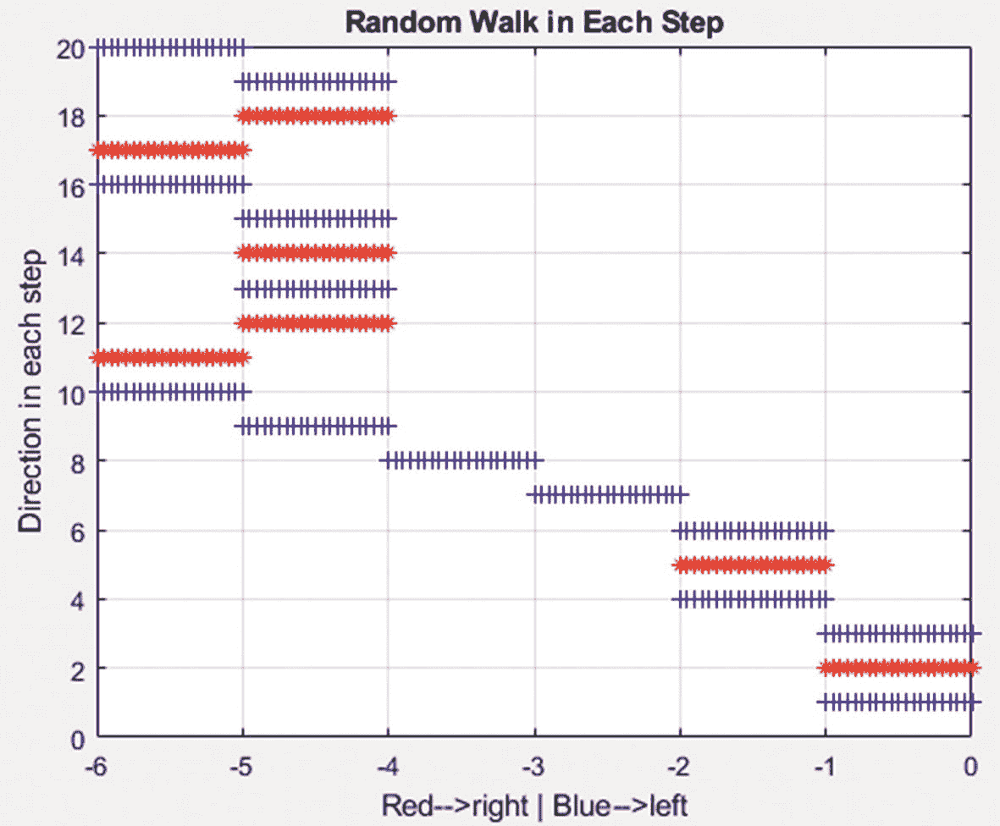

图 5-1

示例 5p6 的输出

随机漫步从向左移动开始，然后向右移动，再向左移动，以此类推。最终，位置从起点向左移动了六步。在命令提示符中，我们还会得到以下结果。

```
> Example5p6
Final Place :-6
>
```

**示例 5-7。** 编写代码模拟二维随机漫步。在每一步中，计算机可以在 `x` 方向向右移动一步，或者在 `y` 方向向上移动一步，共 15 步。

**解法 5-7。** 以下代码可用于完成给定任务。

*Example5p7.m*

```
%Example5p7
%The code simulates random walk in 2-d
close all;clear all;P = 0;%position
Steps = 15;X=0;Y=0;Step = 1;
plot(X,Y,'co');hold on
format short
for i=1:Steps
W = rand;
if W<0.5
X = X + Step;
St = linspace(X-1,X,21);
plot(St,Y,'r*')
hold on
else
Y = Y + Step;
St = linspace(Y-1,Y,21);
plot(X,St,'b+')
hold on
end
end
grid on
xlabel('Red-->Right | Blue-->Up')
ylabel('Direction in each step')
title('Random Walk in Each Step')
```

运行代码后，将得到如图 5-2 所示的图形。

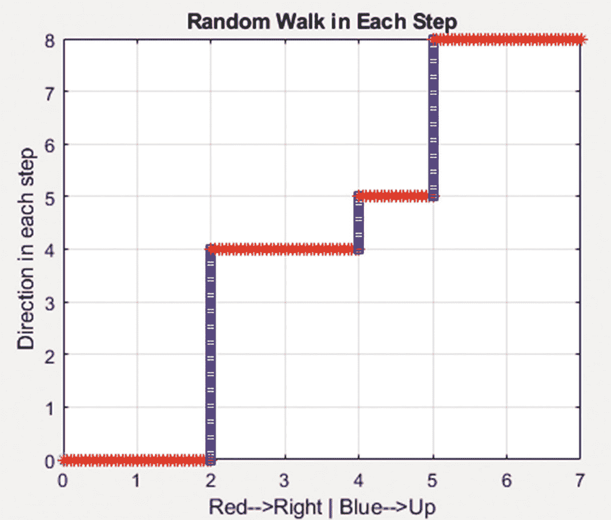

图 5-2

示例 5p7 的输出

如图 5-2 所示，漫步向右移动了七次，向上移动了八次。这个总数对应于代码中的总步数。

在命令提示符中，运行代码后还会得到以下结果。

```
> Example5p7
1     0
2     0
2     1
2     2
2     3
2     4
3     4
4     4
4     5
5     5
5     6
5     7
5     8
6     8
7     8
>
```


## 交通流

本节中，我们将使用图像函数 `imagesc`，用颜色来表示车辆交通流。换句话说，我们对道路的不同路段进行着色，以表示交通流。

**例 5-8.** 编写代码，显示一条宽度为 5 个单位、长度为 20 个单位的道路上的车辆流动。

**解 5-8.** 以下代码可用于完成给定任务。

*Example5p8.m*

```
%Example5p8
%This code shows traffic flow
rw=5;%road width
rl=25;%road length
road = zeros(rw,rl);
xpos=2;ypos=4;
road(ypos,xpos)=1;
imagesc(road)
axis equal
for t=0:20
%clear previous vehicle
road(ypos,xpos)=0;
%update new position
xpos=xpos +1;
road(ypos,xpos)=1;
%plot new position
imagesc(road)
Time=sprintf('Time: %i',t);
title(Time)
axis equal;
pause(0.4);
end
```

如代码所示，在每次迭代中向右移动后，车辆道路的颜色被赋值为 0。为了向前移动，道路的颜色被赋值为 1。每次，颜色都通过 `imagesc` 函数显示。这样做是为了以图形形式展示交通流。每一帧之间，计算机会等待 0.4 秒，以便慢速观察模拟过程。

图 5-3 显示了通过该代码进行模拟的最终帧。

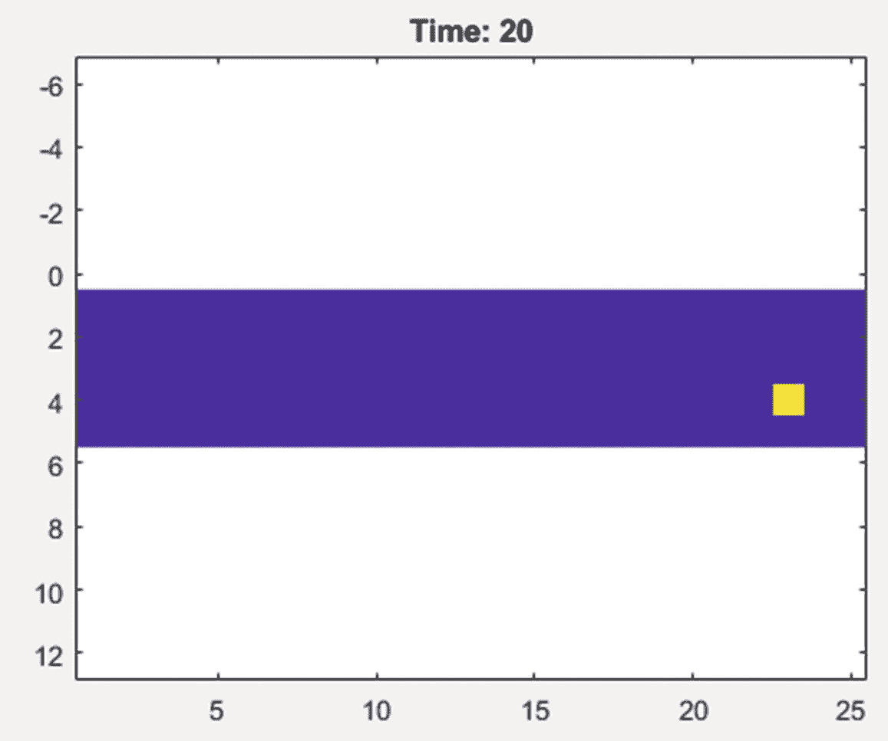

图 5-3

Example5p8 的输出

**例 5-9.** 编写代码，显示具有两个相反方向（去程和返程）的交通流。每条道路上应有一辆车行驶。

**解 5-9.** 以下代码可用于完成给定任务。

*Example5p9.m*

```
%Example5p9
%This code shows traffic flow
rw=11;rl=25;
road = zeros(rw,rl);
road(6,:)=1;
x1pos=2;y1pos=9;
x2pos=19;y2pos=3;
road(y1pos,x1pos)=1;
road(y2pos,x2pos)=1;
imagesc(road);axis equal
for t=0:15
%clear previous vehicle
road(y1pos,x1pos)=0;
road(y2pos,x2pos)=0;
%update new position
x1pos=x1pos +1;
x2pos=x2pos -1;
road(y1pos,x1pos)=1;
road(y2pos,x2pos)=1;
%plot new position
imagesc(road)
Time=sprintf('Time: %i',t);
title(Time);axis equal;
pause(0.4);
end
```

代码执行后，屏幕上将显示如图 5-4 所示的输出。

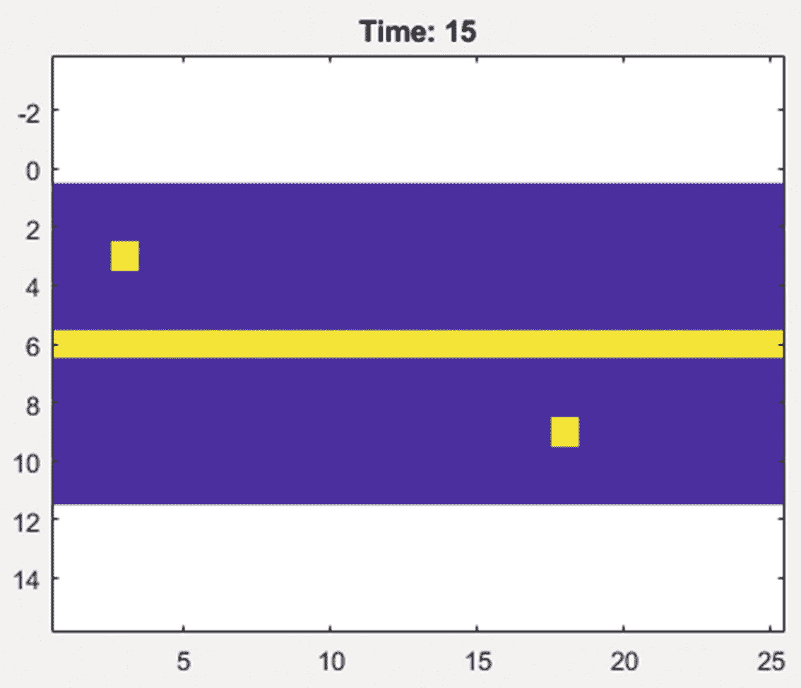

图 5-4

Example5p9 的输出

## 习题

- **5.1.** 使用 `randi` 命令生成 3 到 7 之间的 10 个数字。
- **5.2.** 使用 `randperm` 函数，创建 1 到 15 之间的七个整数。然后，通过 `randperm` 函数随机选择的数字，创建另一个包含 20 个数字的序列。该序列的前三个元素应为 `randperm` 创建的第一个数字。该序列的第四、五、六个元素应为 `randperm` 创建的第二个数字。其余元素依此类推。
- **5.3.** 编写代码，抛一枚硬币 20 次。代码应在屏幕上打印出正面和反面的次数以及抛掷序列。
- **5.4.** 编写代码，使用 `rand` 命令模拟一对骰子掷 10 次。所有结果，包括每次掷骰的点数和，都应显示在屏幕上。
- **5.5.** 编写代码模拟一对骰子。如果点数之和为 5，程序应输出“你获得了 $200”并继续投掷。如果点数之和为 12，程序应输出“你赢得了大奖！！”并继续投掷。如果点数之和为 8，程序应停止；否则应继续运行。
- **5.6.** 编写代码模拟二维随机游走。每一步，计算机可以在 *x* 方向向左走一步，或者在 *y* 方向向下走一步，总共走 20 步。
- **5.7.** 编写代码，显示两条车辆在宽度为 6 个单位、长度为 24 个单位的道路上的流动。

# 6. 基本统计与数据分析

本章首先简要讨论 MATLAB 中使用的基本统计函数。之后，介绍排序、搜索以及使用 Microsoft Excel 文件处理数据的内容。

## 基本统计

MATLAB 在统计领域提供了大量特性和即用型内置函数。在本书中，我只介绍该主题的概要及一些基本统计函数（表 6-1）。

表 6-1

MATLAB 中与统计相关的一些基本函数

| 函数 | 说明 | 示例 |
| --- | --- | --- |
| `max()` | 返回最大值 | `max([1,34,21,5])` |
| `mean()` | 返回平均值或均值 | `mean([1,34,21,5])` |
| `median()` | 返回中位数 | `median([1,34,21,5])` |
| `min()` | 返回最小值 | `min([1,34,21,5])` |
| `mode()` | 返回出现频率最高的值 | `mode([1,34,5,21,5])` |
| `std()` | 返回标准差 | `std([1,34,5,21,5])` |
| `var()` | 返回方差 | `var([1,34,5,21,5])` |

**例 6-1.** 使用函数 `randi()` 随机生成一个 3 × 4 的矩阵。然后，计算该矩阵每列的最大值、平均值和标准差。

**解 6-1.** 以下代码可用于创建矩阵并查找矩阵每列的所需值。

*Example6p1.m*

```
%Example6p1
%This code finds statistical values
A=randi(100,3,4);
%Maximum number is set as 100
Maximum = max(A);
MeanVal = mean(A);
StanDev = std(A);
disp(['The maximum numbers are ',...
num2str(Maximum)])
disp(['The mean numbers are ',...
num2str(MeanVal)])
disp(['The standard deviations are ',...
num2str(StanDev)])
```

代码执行后，屏幕上将显示以下输出。

```
> Example6p1
The maximum numbers are 84  92  97  98
The mean numbers are 37.6667           57      60.3333      56.3333
The standard deviations are 40.2782       44.441      32.5167      36.8556
>
```

## 数据分析

本节介绍各种排序和搜索函数，以及数据处理示例。


### 排序与搜索

通过 `sort` 函数可以轻松实现数据的升序或降序排列。

**示例 6-2.**  现有数据：23, 70, 86, 5, 120, 50, -9, 61, 100。编写代码，将这些数据分别按升序和降序排列。

**解法 6-2.**  可以将这些数据定义为一个向量，然后在命令提示符下按如下方式进行排序。

*Example6p2.m*

```
%Example6p2
%此代码对数据进行排序
A=[23,70,86,5,120,50,-9,61,100];
DescendSort = sort(A,'descend');
AscendSort = sort(A,'ascend');
disp('降序排列:');
disp(DescendSort);
disp('升序排列:');
disp(AscendSort);
```

运行上述代码后，将得到如下输出结果。

```
> Example6p2
降序排列:
120   100    86    70    61    50    23     5    -9
升序排列:
-9     5    23    50    61    70    86   100   120
>
```

在某些情况下，需要对多组数据（如矩阵中的行或列）进行排序。这种情况在示例 6-3 中说明。

**示例 6-3.**  使用 `randi()` 函数随机生成一个 3 × 5 的矩阵。然后，对该矩阵的每一列和每一行按降序排列。

**解法 6-3.**  以下代码可用于对矩阵的列和行进行排序。

*Example6p3.m*

```
%Example6p3
%此代码对行和列进行排序
A=randi(100,3,5);
SortColumn=sort(A,1);
SortRow=sort(A,2);
disp('原始矩阵');
disp(A);
disp('按列排序');
disp(SortColumn)
disp('按行排序');
disp(SortRow)
```

运行上述代码后，将得到如下输出结果。

```
> Example6p3
原始矩阵
94    29    87   100    58
46     1    40    54    65
32    61    26    96    27
按列排序
32     1    26    54    27
46    29    40    96    58
94    61    87   100    65
按行排序
29    58    87    94   100
1    40    46    54    65
26    27    32    61    96
>
```

如输出结果所示，如果以 `sort(Matrix,1)` 的形式使用 `sort` 命令，则是对列进行排序；如果使用 `sort(Matrix,2)`，则是对行进行排序。

搜索在 MATLAB 中同样非常简单。通常，有三种不同的搜索方式可供使用。可以在向量或矩阵中搜索某个数值。可以在字符串组中搜索一组字母或一个字符串。最后，我们还可以在数据集中搜索某些信息。我们将通过示例逐一讲解这些情况。

**示例 6-4.**  考虑矩阵 `Mat = [32,98,17,71,67; 39,71,65,28,17; 77,49,71,68,71]`。编写代码在该矩阵中搜索数值 71。

**解法 6-4.**  可以编写以下代码来执行搜索。

*Example6p4.m*

```
%Example6p4
%此代码在矩阵中查找索引
Matrx =[32,98,17,71,67;...
39,71,65,28,17;...
77,49,71,68,71];
Key = 71;
Indexing = find(Matrx==Key);
disp('其索引为: ')
disp(Indexing);
```

运行上述代码后，将得到如下输出结果。

```
> Example6p4
其索引为:

>
```

如图所示，MATLAB 返回了数值 71 所在位置的索引值。该矩阵的第五、第九、第十和第十五个元素值为 71。由此示例可以看出，索引的顺序是逐列进行的。

**示例 6-5.**  考虑字符串 `12345 ABcde Antonio`。编写代码，不区分大小写地搜索字符串 `antonio`。

**解法 6-5.**  MATLAB 是一种区分大小写的语言。因此，字符串 `Antonio` 和 `antonio` 是两个不同的字符串。可以使用以下代码来搜索所需的字符串。

*Example6p5.m*

```
%Example6p5
%此代码查找字符串
Text = '12345 ABcde Antonio';
Scr = 'antonio';
NewText = upper(Text);
NewScr= upper(Scr);
Findit = strfind(NewText,NewScr);
disp('字符串位置: ');
disp(Findit);
```

如上所示，字符串可以在 MATLAB 中定义为包含这些字符串的向量。运行上述代码后，将得到如下输出结果。

```
> Example6p5
字符串为

>
```

该输出表明，搜索的字符串嵌套在更长的字符串中，并且从向量的第十三个元素开始。如果字符串不存在，则会得到一个空集 `[]`，这意味着未找到搜索的单词。

**示例 6-6.**  MATLAB 中有一个可供使用的数据集，名为 `hospital`。这些数据的部分内容如图 6-1 所示。

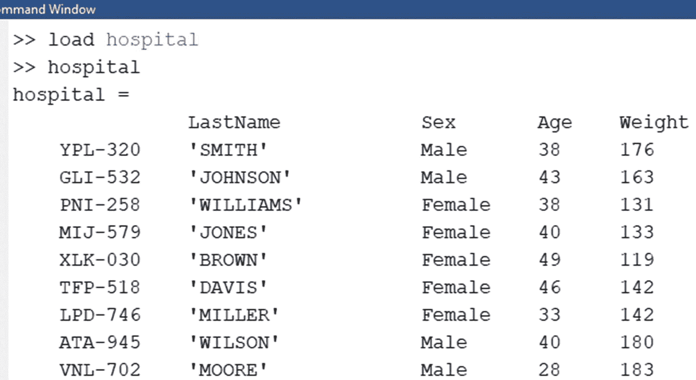

图 6-1

hospital 数据集截图

让我们将这些数据加载到工作区中。然后，在数据集中搜索姓氏为 DIAZ 的人以及其他相关信息。之后，找出所有 50 岁的人。

**解法 6-6.**  要查找 DIAZ，我们需要搜索包含字符串的 `LastName` 列。要搜索数字 50，我们需要处理 `Age` 列。以下代码可用于执行给定的任务。

*Example6p6.m*

```
%Example6p6
%此代码查找数据
load hospital
IsThere=ismember(hospital.LastName,'DIAZ');
index = find(IsThere);
fprintf('姓氏为 DIAZ 的人是:\n')
hospital(index,:)
fprintf('年龄为 50 的信息:\n')
hospital(find(hospital.Age==50),:)
```

在这段代码中，命令 `ismember` 用于判断 DIAZ 是否是元胞数组 `hospital.LastName` 的一个成员。如果是，则返回 1，否则返回 0。通过使用 `find` 命令，可以找出所需信息的索引。

执行上述代码后，我们将得到如下输出结果。

```
> Example6p6
姓氏为 DIAZ 的人是:
ans =
LastName    Sex    Age   Weight    Smoker    BloodPressure
BEZ-311  'DIAZ'      Male   45    172       true      136          93
Trials
BEZ-311    [1×0 double]
年龄为 50 的信息:
ans =
LastName          Sex     Age    Weight    Smoker
XBA-581    'ROBINSON'        Male    50     172       false
DAU-529    'REED'            Male    50     186       true
BloodPressure      Trials
XBA-581    125          76    [1×3 double]
DAU-529    129          89    [        22]
>
```


### 数据处理

本节通过一个示例，介绍如何从 Microsoft Excel 数据文件中提取和处理信息。

**示例 6-7.** 编写代码，从 Excel 文件 `DataProcessing1.xlsx`（图 6-2）中获取信息。

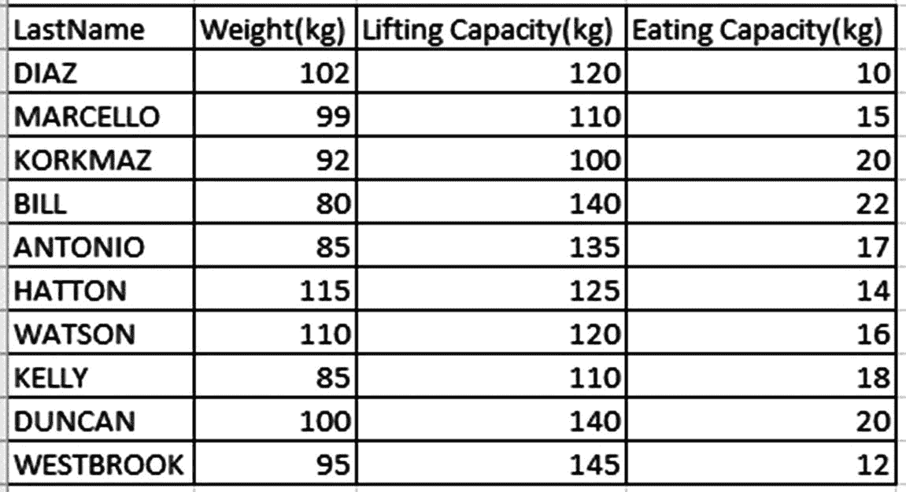

图 6-2
文件 `DataProcessing1.xlsx` 的内容

获取第二列、第三列和第四列的数据，包括它们对应的标题。将这些数据绘制成条形图。

**解答 6-7.** 以下代码可用于完成指定任务。

`Example6p7.m`

```
%Example6p7
%This code plots graphics from an Excel file
DataFile = importdata('DataProces.xlsx');
NewVar1=(DataFile.textdata.Sheet1{1,2});
NewVar2=(DataFile.textdata.Sheet1{1,3});
NewVar3=(DataFile.textdata.Sheet1{1,4});
bar(DataFile.data.Sheet1)
grid on
title('Sample Data')
xlabel('Number of Persons');
ylabel('kg');
legend(NewVar1,NewVar2,NewVar3);
```

这里，我们可以从变量 `NewVar1`、`NewVar2` 和 `NewVar3` 中获取列标题。

代码执行后，我们将看到如图 6-3 所示的图形结果。

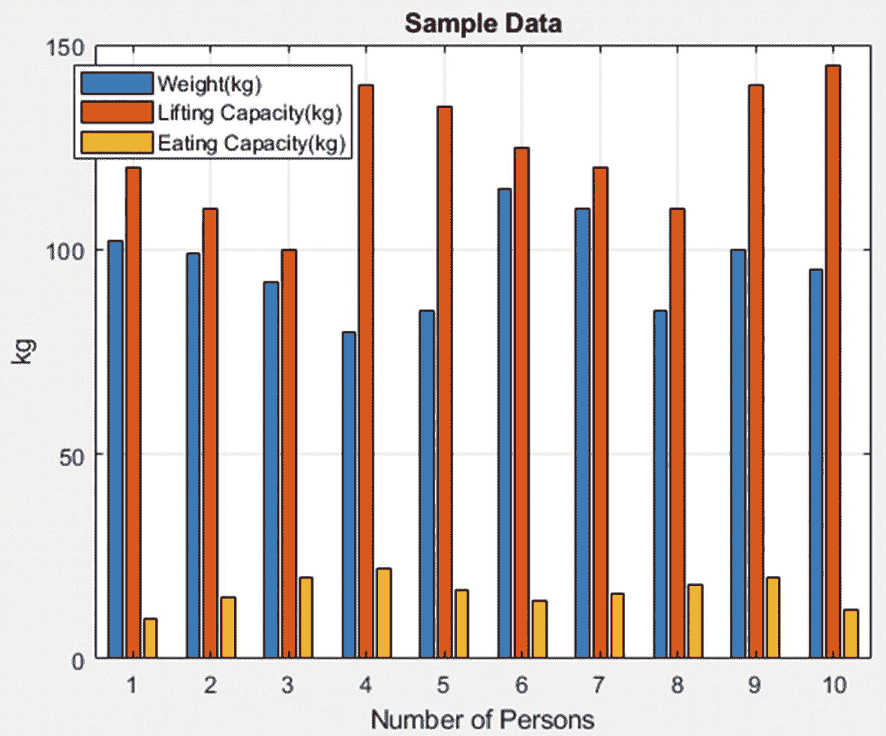

图 6-3
由 `Example6p7` 得到的输出

在 MATLAB 中，你也可以处理逗号分隔值（`.csv`）文件。

**示例 6-8.** 编写代码，打印 MATLAB 中 `outages.csv` 文件数据的前五行。

**解答 6-8.** 以下代码可用于完成给定任务。

`Example6p8.m`

```
%Example6p8
%This code works with csv data
T = readtable('outages.csv');
Y=head(T,4); % show first 4 rows of table
disp(Y)
```

代码运行后，将得到以下输出。

```
> Example6p8
Region       OutageTime        Loss    Customers   RestorationTime   Cause
_______     ________________  ______  __________  _______________   _________
'SouthWest'  2002-02-01 12:18  458.98  1.8202e+06  2002-02-07 16:50  'winter storm'
'SouthEast'  2003-01-23 00:49  530.14  2.1204e+05   NaT              'winter storm'
'SouthEast'  2003-02-07 21:15  289.4   1.4294e+05  2003-02-17 08:14  'winter storm'
'West'      2004-04-06 05:44  434.81  3.4037e+05  2004-04-06 06:10  'equipment fault'
>
```

## 习题

- **6.1.** 使用 `rand()` 函数随机创建一个 4 × 5 的矩阵。然后，计算该矩阵每一列的最大值、平均值和标准差。
- **6.2.** 给定数据 30, 45, 100, 65, 98, 45, 61, 和 10。编写代码，将给定数据分别按升序和降序排序。
- **6.3.** 使用 `randi()` 函数随机创建一个 2 × 6 的矩阵。然后，将该矩阵的每一列和每一行按降序排序。
- **6.4.** 给定矩阵 `Mat = [41, 45, 100, 65, 41, 45, 61, 10]`。编写代码，在该矩阵中搜索 `41`。
- **6.5.** 给定字符串 `5361 Sen Antonio Ben Banderas`。编写代码，搜索字符串 `anderas`，不区分大小写。

# 7. 数据可视化与动画

MATLAB 提供了非常强大的数据可视化技术。在本章中，我们将探讨如何可视化数据以及创建动画。数据可视化在第 1 章中已经有所涉及。因此，本章将重点介绍动画技术。在 MATLAB 中，可以使用三种基本技术创建动画。这些方法可以概括为：更新坐标、对对象应用变换以及创建影片。

## 数据可视化

我们已经在第 1 章中学习了如何在单个图形中可视化二维数据（包括单图和多图）。在本节中，我们将学习如何可视化三维数据（表 7-1）。

表 7-1
与三维绘图相关的一些函数

| 函数 | 描述 |
| --- | --- |
| `plot3(x,y,z)` | 创建三维线图 |
| `bar3` | 绘制三维条形图 |
| `comet3(x,y,z)` | 绘制动画三维图形 |
| `ezmesh` | 以三维形式可视化函数 |
| `ezplot3` | 三维参数曲线绘图器 |
| `mesh(x,y,z)` | 创建网格曲面图 |
| `pie3` | 绘制三维饼图 |
| `scatter3` | 三维散点图函数 |
| `stem3` | 创建三维茎秆图 |
| `surf` | 绘制三维着色曲面图 |
| `waterfall` | 创建瀑布图 |

**示例 7-1.** 考虑给定的三维函数。
0 ≤ *t* ≤ 4*π*，*x* = sin (t)，*y* = cos (t)，*z* = t。

在单个图形中绘制 *x*、*y* 和 *z* 的图。

**解答 7-1.** 以下代码可用于完成给定任务。

`Example7p1.m`

```
%Example7p1
%This code plots 3-D
close all;
t = linspace(0,8*pi,1000);
x=sin(3*t);y=cos(2*t)-5;z=3*t;
plot3(x,y,z)
xlabel('sin(t)');
ylabel('cos(t)');
zlabel('t');
grid on
title('3-D Plot')
```

在这段代码中，`close all` 命令会关闭调用它时所有活动的图形窗口。代码运行后，将显示如图 7-1 所示的输出。

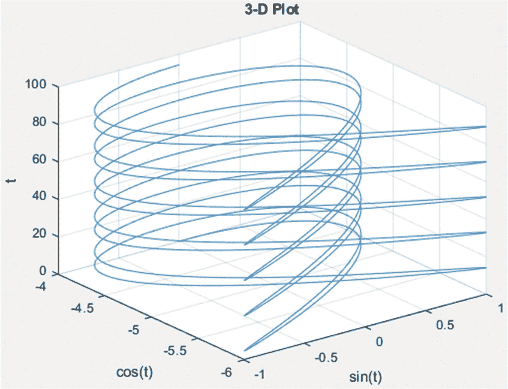

图 7-1
`Example7p1` 的输出

在 MATLAB 中，有两个重要的函数可以生成包含两个变量的值，即 `peaks` 和 `meshgrid`。

函数 `peaks(x,y)` 默认通过高斯分布产生一个 49 × 49 的矩阵。函数 `meshgrid(x,y)` 复制网格向量 *x* 和 *y* 以生成完整的网格。

使用函数 `[X,Y,Z] = peaks(x,y,z)` 和 `[X,Y,Z] = meshgrid(x,y,z)`，也可以创建三个变量。

**示例 7-2.** 编写代码，在两个不同的图形窗口上绘制两个不同的函数。第一个图属于以下函数（绘制墨西哥草帽）：

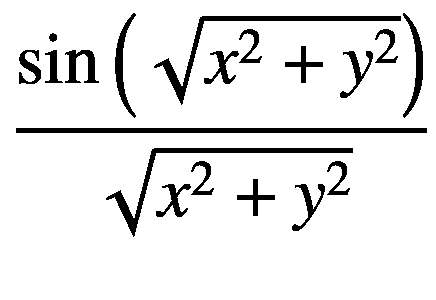

其中 *x* 和 *y* 在 -8 到 8 之间。第二个函数（绘制牛仔帽）为

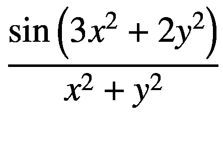

其中 *x* 和 *y* 在 -1.5 到 1.5 之间。

**解答 7-2.** 以下代码可用于完成给定任务。

`Example7p2.m`

```
%Example7p2
%This code uses meshgrid and surf
close all;
[x,y] = meshgrid(linspace(-8,8,30));
[xx,yy]=meshgrid(linspace(-1.5,1.5,30),...
linspace(-1.5,1.5,30));
z1 = sin (sqrt(x.²+y.²))./sqrt(x.²+y.²);
z2 = sin(3*xx.²+2*yy.²)./(xx.²+yy.²);
figure(1)
surf(z1), shading flat
title('Mexican Hat');
figure(2)
surf(z2), shading faceted
title('Cowboy Hat');
% other possible shadings: flat, faceted, interp
```

代码运行后，结果输出如图 7-2 和 7-3 所示。

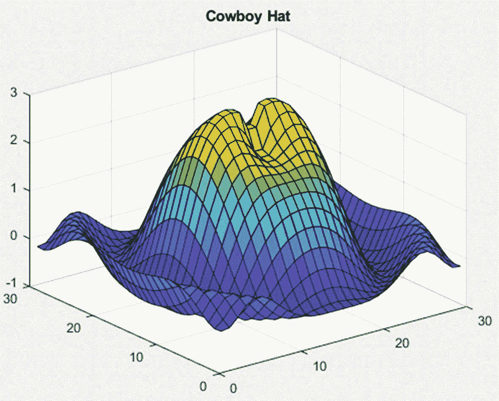

图 7-3
`Example7p2` 的第二个输出

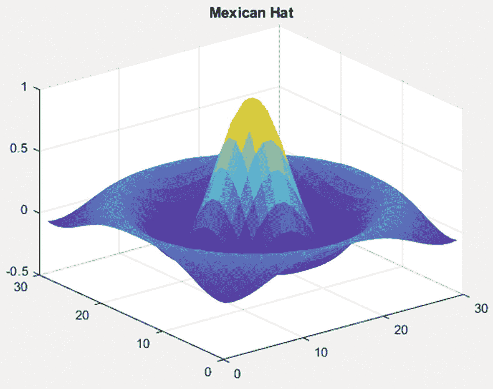

图 7-2
`Example7p2` 的第一个输出

## 动画

有三种技术可用于使用数据创建动画：更新坐标、应用变换和创建影片。


### 更新坐标

在此类动画中，对象属性会在循环中被更新和调用。这些属性大多是 `x` 和 `y` 坐标的数据，如示例 7-3 所示。

**示例 7-3.** 考虑以下函数。

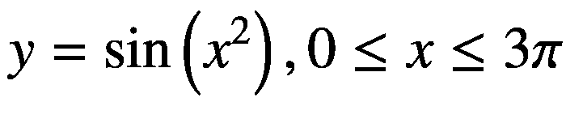

编写代码，通过改变其系数来制作函数 `y` 的动画。

**解答 7-3.** 以下代码可用于完成给定任务。

*Example7p3.m*

```
%Example7p3
%This code animates 2-D
x = 0:0.05:3*pi;
y = sin(x.²);
N = length(x);
for i=1:N
y_plot = (i/N)*y;
plot(x,y_plot)
axis([0,3*pi,-1,1]);
xlabel('x values')
ylabel('y values')
title('Animating 2-D')
pause(0.02)
end
grid on
```

在上述代码中，函数 `y` 的系数从 `1/189` 到 1 被绘制出来。在循环中的每次绘图之后，`pause(0.02)` 命令会让计算机暂停 0.02 秒，以便在视觉上观察每一帧的变化。

代码运行后，绘图将呈现动画效果。图 7-4 所示的图形是动画的最后一帧。

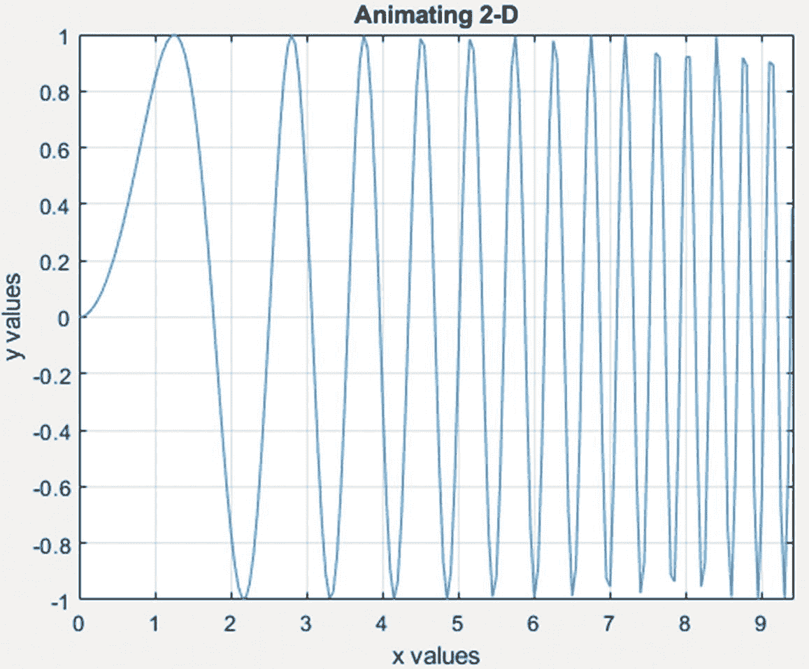

图 7-4

Example7p3 的运行结果快照

**示例 7-4.** 编写使用 `drawnow` 函数来展示动画的代码。代码应在一个圆上绘制线条。

**解答 7-4.** 以下代码可用于完成给定任务。

*Example7p4.m*

```
%Example7p4
%This code animates 2-D
N=100;
Angle = linspace(-pi,pi,N);
xc = sin(Angle);yc = cos(Angle);
plot(xc,yc);axis equal
xt = [1 1 1 1];yt = [0 0 0 0];
hold on
t = area(xt,yt); % initialize flat triangle
for j = 1:N
xt(j) = xc(j); % determine new vertex value
yt(j) = yc(j);
t.XData = xt; % update data
t.YData = yt; % update data
drawnow % display updates
end
title('Final Frame of Animation')
```

在上述代码中，`area` 函数用于绘制 `yt` 值相对于 `xt` 值的图形，并填充 0 与 `yt` 之间的区域。在 `for` 循环内部，绘制的数据被更新，并通过 `drawnow` 函数进行显示。代码运行后，将得到图 7-5 所示的输出，这是该代码动画的最后一帧。

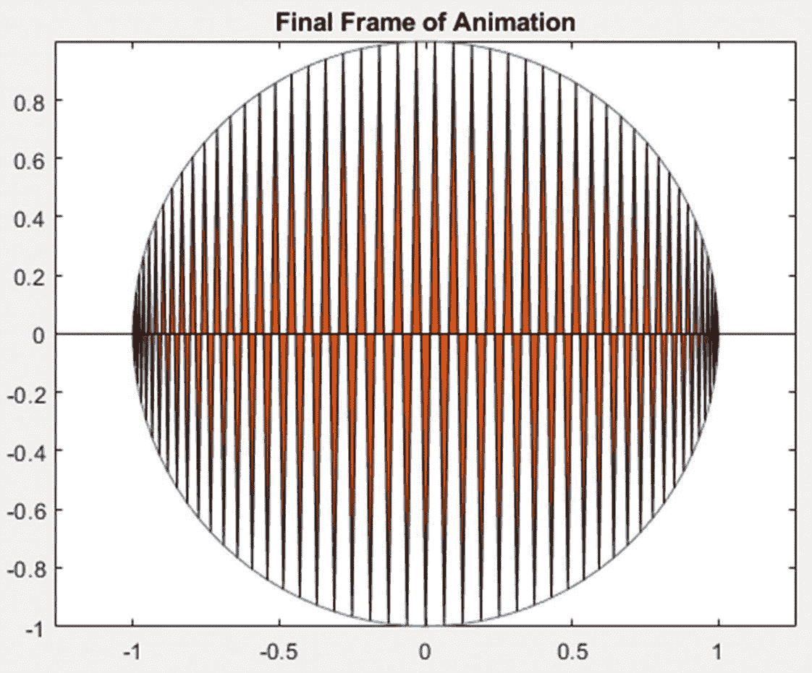

图 7-5

Example7p4 的运行结果快照

### 应用变换

在此技术中，对对象应用变换。函数 `hgtransform` 用于创建变换对象。

**示例 7-5.** 编写代码，使用 `hgtransform` 创建一个 3D 星形围绕 `z` 轴旋转，同时星形从大尺寸缩放到小尺寸的动画。

**解答 7-5.** 以下代码可用于完成给定任务。

*Example7p5.m*

```
%Example7p5
%This code uses hgtransform function
ax = axes('XLim',[-1.5,1.5],...
'YLim',[-1.5,1.5],'ZLim',[-1.5,1.5]);
view(3) %sets for 3-d view
grid on
[x,y,z] = cylinder([.1 0]);
h(1) = surface(x,y,z,'FaceColor','yellow');
h(2) = surface(x,y,-z,'FaceColor','cyan');
h(3) = surface(z,x,y,'FaceColor','magenta');
h(4) = surface(-z,x,y,'FaceColor','green');
h(5) = surface(y,z,x,'FaceColor','blue');
h(6) = surface(y,-z,x,'FaceColor','red');
t = hgtransform('Parent',ax);
set(h,'Parent',t)
Rz = eye(4);Sxy = Rz;
for r = 1:.1:2*pi
Rz = makehgtform('zrotate',r);
% Scaling matrix
Sxy = makehgtform('scale',r/5);
set(t,'Matrix',Rz/Sxy)
drawnow
pause(0.02)
if r == 3.6
f = getframe;
end
end
imshow(f.cdata)
title('Frame at r=3.6')
```

代码运行后，将得到图 7-6 所示的输出。

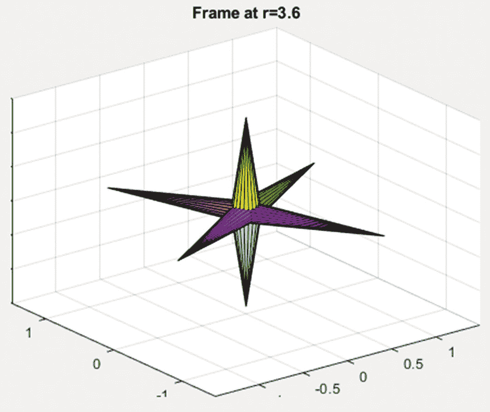

图 7-6

示例 7-5 的输出

### 创建视频

创建视频是另一种对数据进行动画处理的方法。在此方法中，使用 `getframe` 函数获取每次迭代中每幅绘图的图像。然后，使用 `movie` 函数创建动画。

**示例 7-6.** 对于以下给出的函数

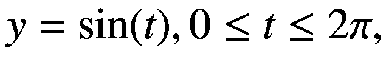

编写代码以视频形式制作函数 `y` 的动画。

**解答 7-6.** 以下代码可用于完成给定任务。

*Example7p6.m*

```
%Example7p6
%This code creates a movie
t=linspace(0,2*pi,1000);Count=1;
figure('Name',...%'NumberTitle','off')
'Original Draw','Menu','none')
for freq=0:0.1:2*pi
y=sin(freq*t);
plot(t,y);
xlabel('2 pi');ylabel('Results');
axis([0,2*pi,-1,1])
Script1=sprintf('y(t)=sin(%.1f t)',freq);
title('Sinusoidal Function');
text(1,0.5,Script1)
M(Count)=getframe;Count=Count+1;
end
figure('Name',...
'Playing Created Animation twice','Menu','none')
movie(M,2);
```

代码运行后，输出如图 7-7 所示。

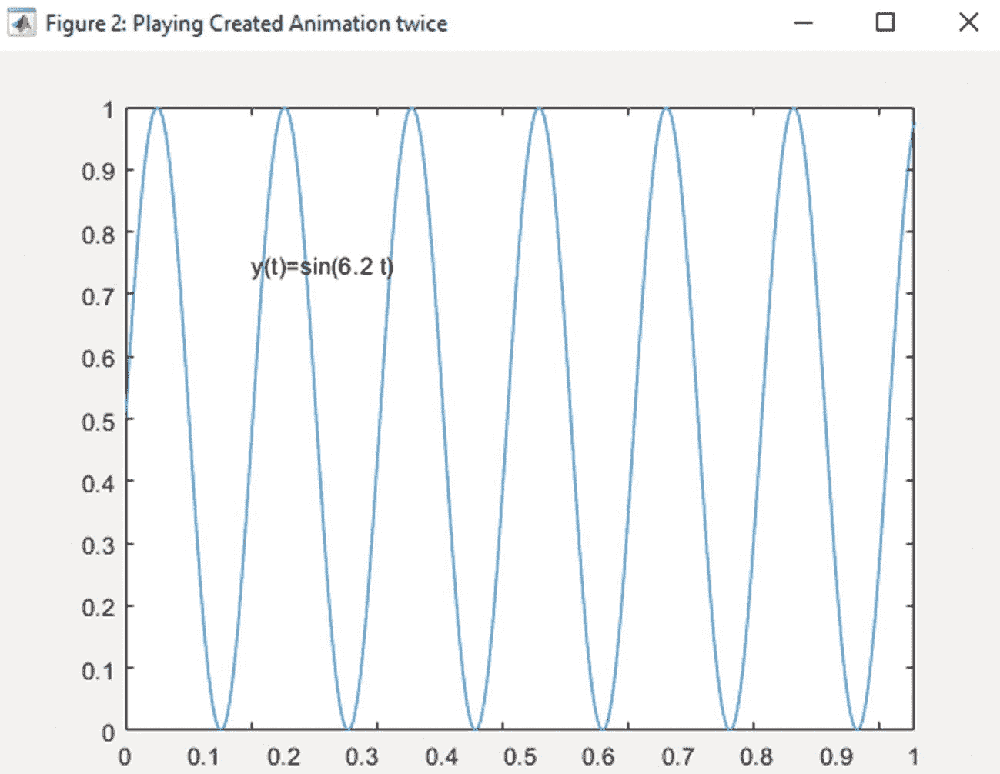

图 7-7

程序 Example7p6 的第二个输出

当您想要保存所创建的视频时，可以使用 `writeVideo` 和 `VideoWriter` 函数。

**示例 7-7.** 使用 `peaks` 和 `surf` 函数创建一个视频。然后，将该视频保存为 `*.avi` 文件。

**解答 7-7.** 以下代码可用于创建 `*.avi` 文件。

*Example7p7.m*

```
%Example7p7
%This code saves the movie as *.avi
myVideo = VideoWriter('myfile.avi');
uncompressedVideo = VideoWriter('myfile.avi',...
'Uncompressed AVI');
myVideo.FrameRate = 40;
myVideo.Quality = 100;
open(myVideo); % Open file to write
L = peaks;
surf(L);
axis tight manual
set(gca,'nextplot','replacechildren');
for m = 1:60
surf(sin(2*pi*m/20)*L,L)
frame = getframe;
writeVideo(myVideo, frame);
end
close(myVideo);%close file
```

在此代码中，函数 `VideoWriter` 创建一个视频写入对象。该对象的类与其名称相同，即 `VideoWriter`。使用函数 `writeVideo`，将帧写入该文件。代码执行后，会在当前目录下创建并保存一个名为 `myfile.avi` 的文件。

## 习题

- **7.1.** 考虑此处给出的三维函数。

`0 ≤ t ≤ 2π`, `x = sin(2t)`, `y = cos(3t)`, `z = 5t`

- 在单个图形中绘制 `x`、`y` 和 `z` 的图表。

- **7.2.** 考虑以下函数。

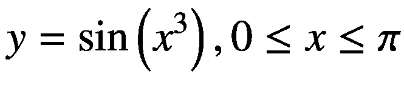

- 编写代码，通过改变其系数来制作函数 `y` 的动画。

- **7.3.** 编写使用 `drawnow` 函数来展示动画的代码。代码应在一个正方形上绘制线条。

- **7.4.** 编写代码，使用 `hgtransform` 函数创建一个 3D 星形围绕 `y` 轴旋转，同时星形从小尺寸缩放至大尺寸的动画。

- **7.5.** 对于以下给出的函数

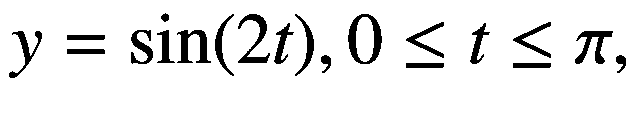

- 编写代码，以视频形式将函数 `y` 的动画播放两次，并保存所创建的动画。

# 8. 计算生物学

计算生物学是应用科学的一个分支，它结合了理论方法、数学建模和计算机科学的应用，以解决生物、生态、社会和行为的各种问题。在本章中，我们将看到一些使用 MATLAB 代码编写的应用实例。通过几个例子说明了细菌生长和种群模型。然后，介绍了包括寄主-寄生蜂模型、生物信息学、捕食者-猎物模型和流行病模型等主题。


## 细菌生长与种群模型

细菌生长或种群模拟可以使用微分方程建模。理想情况下，细菌生长可以表示为 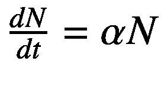，其中 *N* 是时间 *t* 时的细胞数量，***α*** 是生长速率常数。该模型是一个一阶微分方程模型，其解为 *N* = *N*[0] ∗ *e*^(*αt*)，其中 *N*[0] 是初始条件。对于数值解，可以使用 MATLAB 的 ODE 求解器。该方程也可用于种群建模。

**示例 8-1.** 对于 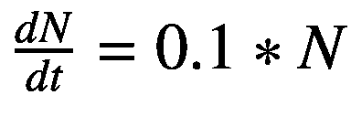，其中 *N* 代表细菌细胞数量，编写代码绘制细菌细胞数量增长的图形。初始细胞数量为 100，时间范围为 1 到 20。代码还应使用 `ode45` 求解器绘制数值解。精确解和数值解应显示在同一张图上。

**解法 8-1.** 以下代码可用于完成给定任务。

`Example8p1.m`

```
%Example8p1
%This code solves first-order ODE
%which models Bacterial Growth
clear all;close all;
time=0:0.1:20;
Alpha=0.1;% Grow Rate
N_0=100;%initial condition
N=N_0*exp(Alpha*time); %Exact Solution
[x,y]=ode45(@MyFunc,[0,20],100);
plot(time,N,x,y,'ro');
xlabel('time:t');title('Population Changes');
ylabel('Population');grid on;
function Out=MyFunc(x,y)
Alpha=0.1;
Out=Alpha*y;
end
```

执行代码后，将得到如图 8-1 所示的输出。

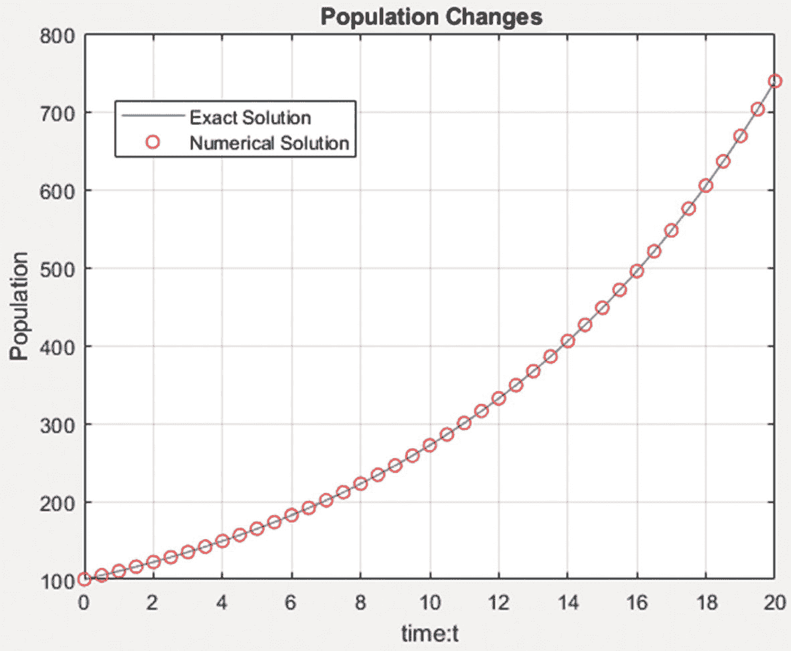

图 8-1

解析解与数值解

在图 8-1 中，红色圆圈表示数值解，蓝色线条表示精确解。它们彼此非常接近，这让我们对变化的产生方式有了一定了解。

读者可能会质疑如此求解数值解的原因。在某些情况下，你或许不知道问题的精确解或解析解，甚至可能根本不存在解。在这种情况下，你可能需要了解解的大致形态。对此，你可以使用数值方法或数值解，以特定精度找到问题的答案。由于解的不精确性，数值解有时也被称为近似解。

微分方程，

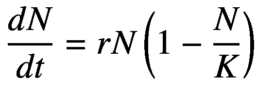

(1)

称为**逻辑增长**或**逻辑斯谛方程**，其中 *K* 是环境容量，*r* 是增长率。该模型可用于细菌生长或种群模型。该逻辑斯谛方程的解为 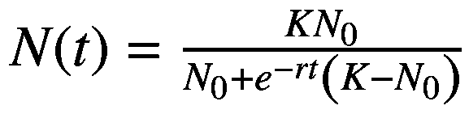。

**示例 8-2.** 编写代码求解逻辑斯谛方程，其中 *K* = 100, *r* = 0.1, *N*[0] = 2，时间范围为 1 到 100。代码应对解析解进行动态显示。然后，数值解和解析解应绘制在同一张图上。

**解法 8-2.** 以下代码可用于完成给定任务。

`Example8p2.m`

```
%Example8p2
%This code solves logistic equation
clear all;close all;
K=500;% environmental capacity
N0=2;% Initial population size
r=0.1;% growth rate
time=linspace(1,100,100);
%N=zeros(1,length(time));
% analytic (exact) solution
for i=1:length(time) % Animation part
N(i)=K/(1+(K/N0-1)*exp(-r*time(i)));
plot(N,'b');
drawnow
end
[Tode,Node]=ode45(@lge,[1 100],2);
plot(time,N,Tode,Node,'r');
xlabel('Time');title('Population Changes');
ylabel('Population');grid on;
legend('Analytical Solution',...
'Numerical Solution');
function dN=lge(T,N)
r=0.1;
K=500;
dN=r.*N.*(1-N/K);
end
```

执行代码后，我们将得到如图 8-2 所示的输出。

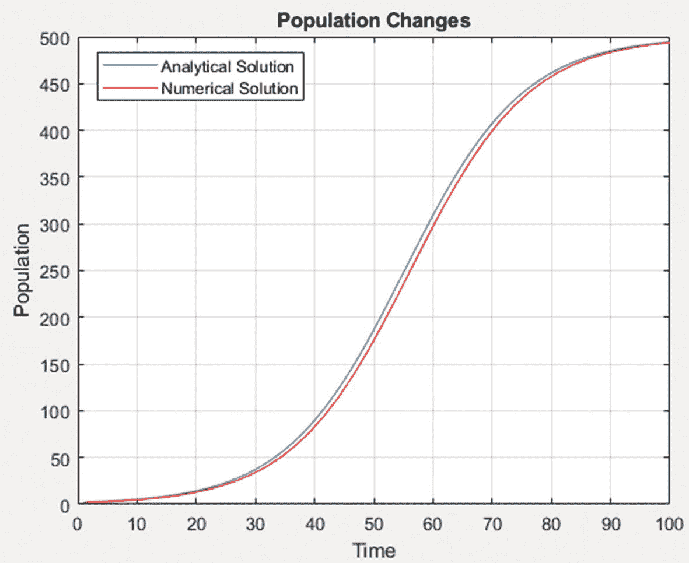

图 8-2

逻辑增长的图形

## 宿主-寄生蜂模型

寄生蜂是一种与宿主紧密共栖以从中获益的生物。寄生蜂及其宿主通常相互利用。*Nicholson-Bailey 模型*是一个用于模拟宿主-寄生蜂关系的离散时间模型。

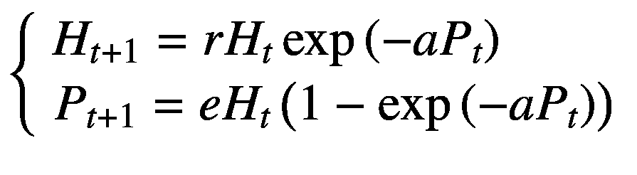

(2)

在方程 2 中，*H*[*t*] 表示第 *t* 代宿主物种的密度，*P*[*t*] 表示第 *t* 代寄生蜂生物的密度。此外，*r* 是宿主产卵数量，*e* 是寄生蜂产卵数量，*a* 是比例常数。

**示例 8-3.** 编写代码模拟 Nicholson-Bailey 模型。宿主和寄生蜂的初始种群分别为 22 和 10。世代数为 25。系数为 *e* = 1, *a* = 0.0069, *r* = 2。

**解法 8-3.** 以下代码可用于完成给定任务。

`Example8p3.m`

```
%Example8p3
%This code solves Nicholson-Bailey model
clear all;close all;
e=1; a=0.069; r=2;
Ngens=25;  %number of generations
time=1:1:Ngens;
H=zeros(1,Ngens); P=zeros(1,Ngens);
P(1)=10; H(1)=22;%initial conditions
for t=1:Ngens-1
H(t+1)=r*H(t)*exp(- a*P(t));
P(t+1)=e*H(t)*(1-exp(-a*P(t)));
end
plot(time,H,'r',time,P,'b');
legend('Host','Parasitoid');
xlabel('Generation t');ylabel('Population');
title('Nicholson-Bailey Model');grid on;
```

执行代码后，我们将得到如图 8-3 所示的输出。

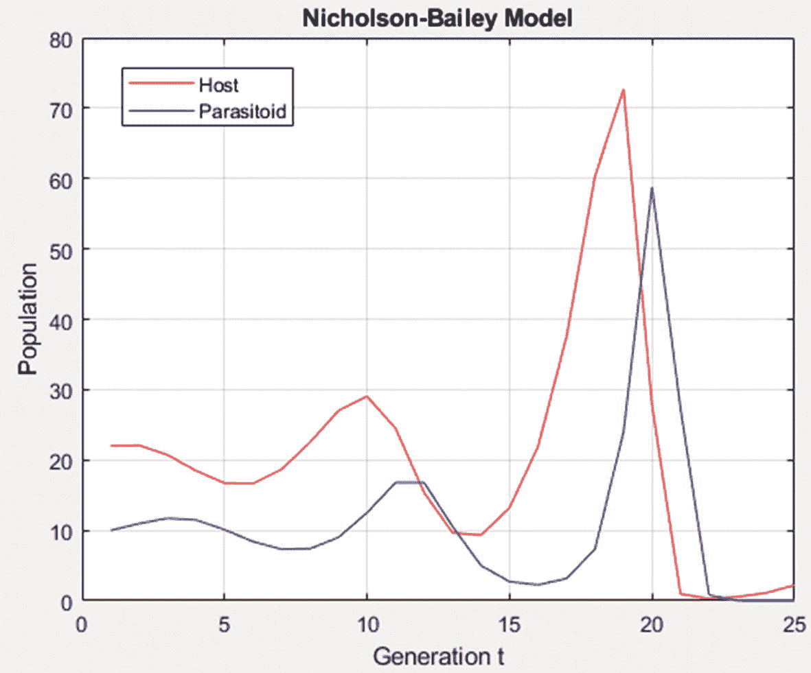

图 8-3

Nicholson-Bailey 模型的图形

## 生物信息学

生物信息学是一个广泛的交叉学科领域。它开发包括算法和软件在内的方法来理解生物学数据。全面涉及该主题的内容超出了本书的范围。本节介绍与分子生物学基因相关的几个应用。


### 基因组测序

基因由脱氧核糖核酸（DNA）构成。DNA 有四种不同的碱基（核苷酸）：腺嘌呤（A）、胸腺嘧啶（T）、鸟嘌呤（G）和胞嘧啶（C）。在 DNA 链上，A 与 T 配对，G 与 C 配对，反之亦然。基因组测序用于研究 DNA 中核苷酸的排列顺序。

**示例 8-4.** 给定一段 DNA 序列 `TCAGGGAATTCCTACTTTTGTATTCGCCAG`。编写代码将该序列转录为 RNA。

**解法 8-4.** 如果在 MATLAB 中安装了 Bioinformatics Toolbox，那么只需使用内置函数，就能轻松将代码转录为 `rna`。不过，在本解法中，我们将自行编写所有必需的代码。

*Example8p4.m*

```matlab
%Example8p4
%This code transcribes DNA code to RNA
Seq='TCAGGGAATTCCTACTTTTGTATTCGCCAG';
Result = MyDNA2RNA(Seq);
fprintf('DNA : %s\n',Seq')
fprintf('RNA : %s\n',Result')
```

此处，序列 `seq` 被传递给所定义的函数 `MyDNA2RNA`。该函数保存在另一个文件中，以便也可在其他示例中使用。该函数执行转录操作。得到结果后，代码会同时打印原始代码和转录后的代码。

*MyDNA2RNA.m*

```matlab
function [Result]=MyDNA2RNA(Seq)
L=length(Seq);
Result =";
for i=1:L
switch Seq(i)
case 'A'
Result(i) = 'U';
case 'T'
Result(i) = 'A';
case 'G'
Result(i) = 'C';
case 'C'
Result(i) = 'G';
otherwise
disp('Code has WRONG Letter');
end
end
end
```

代码执行后，我们得到以下输出。

```
>> Example8p4
DNA : TCAGGGAATT C CTA C TTT T GTATTCGCCAG
RNA : AGUCCCUUAAGGAUGAAAACAUAAGCGGUC
>>
```

**示例 8-5.** 给定一段 DNA 序列 `TCAACCGGTCGTAGCTAC`。编写代码将其转录为 RNA。然后，使用遗传密码表（图 8-4）将其翻译为氨基酸序列。最后，代码应在屏幕上显示最终的序列。

**解法 8-5.** 在遗传密码表中，核苷酸每三个一组被分隔开。每一组称为一个*密码子*。除了 `UAA`、`UAG` 和 `UGA` 之外，每个密码子都对应一个氨基酸。这三个密码子被称为*无义密码子*。

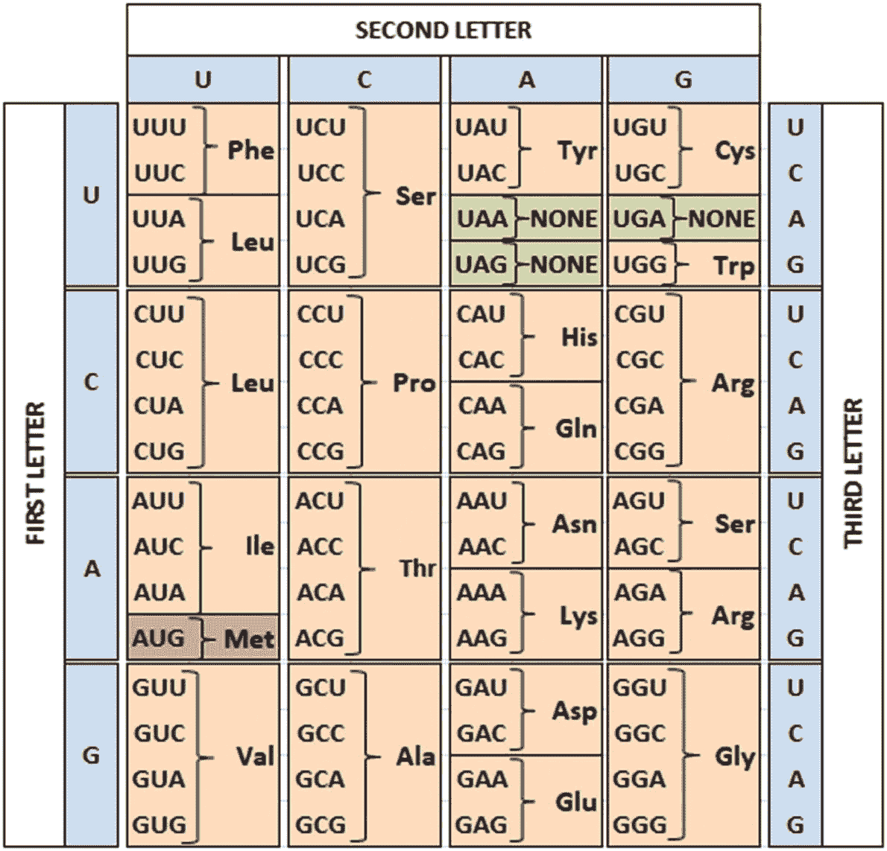

图 8-4: 遗传密码表

所有氨基酸均以三字母缩写形式列于图 8-4 中。例如，`AUU` 代表异亮氨酸，缩写为 `Ile`。也可以用其首字母 `I` 来表示。然而，有些氨基酸以相同的字母开头。这些氨基酸被分配了不同的单字母。这些单字母编码取自 MATLAB 官方网站。在本示例中，我们将用三字母和单字母两种形式来展示每个氨基酸。

*Example8p5.m*

```matlab
%Example8p5
%This code transcribes DNA code to RNA
Seq='TCAGGGAATTCCTACTTTTGTATTCGCCAG';
Convert = MyDNA2RNA(Seq);
fprintf('DNA : %s\n',Seq');
fprintf('RNA : %s\n',Convert);
Codons = MyCodons(Convert);
disp('Codons :');
disp(Codons);
[Codn3,Codn1]= GeneticCode(Codons);
disp('Amino Acids with 3 codes');
disp(Codn3);
disp('Amino Acids with 1 code');
disp(Codn1);
```

在上述代码中，定义了三个函数：`MyDNA2RNA`、`MyCodons` 和 `GeneticCode`。第一个函数与上一个问题中的函数相同。另外两个函数如下所示。

*MyCodons.m*

```matlab
function [Out] = MyCodons(Seq)
%This function takes the sequence
%and returns them as codons
L=length(Seq);
Subst=mod(L,3);
Seq2=cell(1,(L-Subst)/3);
for k=1:(L/3)
Seq2{k} = Seq(3*k-2:3*k);
end
Out = Seq2;
end
```

*GeneticCode.m*

```matlab
function [Out1,Out2] = GeneticCode(Seq)
L=length(Seq);%Below are 20 amino acids
Seq2=cell(1,L);Seq3=cell(1,L);
Phe=['UUU','UUC'];Ile=['AUU','AUC','AUA'];
Leu=['UUA','UUG','CUU','CUC','CUA','CUG'];
Met=['AUG'];NONE=['UAA','UAG','UGA'];
Val=['GUU','GUC','GUA','GUG'];
Ser=['UCU','UCC','UCA','UCG','AGU','AGC'];
Pro=['CCU','CCC','CCA','CCG'];
Thr=['ACU','ACC','ACA','ACG'];
Ala=['GCU','GCC','GCA','GCG'];
Tyr=['UAU','UAC'];His=['CAU','CAC'];
Gln=['CAA','CAG'];Asn=['AAU','AAC'];
Lys=['AAA','AAG'];Asp=['GAU','GAC'];
Glu=['GAA','GAG'];Cys=['UGU','UGC'];
Arg=['CGU','CGC','CGA','CGG','AGA','AGG'];
Gly=['GGU','GGC','GGA','GGG'];Trp=['UGG'];
for i=1:(L)
if contains(Seq(i),Phe)
AA='Phe';Aa='F';
elseif contains(Ile,Seq(i))
AA='Ile';Aa='I';
elseif contains(Leu,Seq(i))
AA='Leu';Aa='L';
elseif contains(Met,Seq(i))
AA='Met';Aa='M';
elseif contains(NONE,Seq(i))
AA='NON';Aa='-';
elseif contains(Val,Seq(i))
AA='Val';Aa='V';
elseif contains(Ser,Seq(i))
AA='Ser';Aa='S';
elseif contains(Pro,Seq(i))
AA='Pro';Aa='P';
elseif contains(Thr,Seq(i))
AA='Thr';Aa='T';
elseif contains(Ala,Seq(i))
AA='Ala';Aa='A';
elseif contains(Tyr,Seq(i))
AA='Tyr';Aa='Y';
elseif contains(Gln,Seq(i))
AA='Gln';Aa='Q';
elseif contains(Lys,Seq(i))
AA='Lys';Aa='K';
elseif contains(Glu,Seq(i))
AA='Glu';Aa='I';
elseif contains(Arg,Seq(i))
AA='Arg';Aa='R';
elseif contains(Gly,Seq(i))
AA='Gly';Aa='G';
else
AA='---';Aa='-';
end
Seq2{i}=AA;Seq3{i}=Aa;
end
Out1=Seq2;Out2=Seq3;
end
```

代码运行后，会显示以下输出。

```
> Example8p5
DNA : TCAGGGAATTCCTACTTTTGTATTCGCCAG
RNA : AGUCCCUUAAGGAUGAAAACAUAAGCGGUC
Codons :
Columns 1 through 8
'AGU'    'CCC'    'UUA'    'AGG'    'AUG'    'AAA'    'ACA'    'UAA'
Columns 9 through 10
'GCG'    'GUC'
Amino Acids with 3 codes
Columns 1 through 8
'NON'    'Pro'    'Ile'    'Arg'    'Met'    'Lys'    'Thr'    'NON'
Columns 9 through 10
'Ala'    'Val'
Amino Acids with 1 code
'-'    'P'    'I'    'R'    'M'    'K'    'T'    '-'    'A'    'V'
>
```

一个连字符或三个连字符代表无义密码子。

**示例 8-6.** 从前一个示例中，序列为 `TCAACCGGTCGTAGCTAC`，去掉第一个字母，然后再次转录新序列。将得到的氨基酸写成一个单词，其中每个字母代表一个氨基酸。解释所得结果。

**解法 8-6.** 可以使用以下代码来完成给定任务。

*Example8p6.m*

```matlab
%Example8p6
%This code transcribes DNA code to RNA
Seq='TCAGGGAATTCCTACTTTTGTATTCGCCAG';
Seq2=Seq(2:end);
Convert = MyDNA2RNA(Seq2);
Codons = MyCodons(Convert);
[Codn3,Codn1]= GeneticCode(Codons);
MySeq=";
for k=1:length(Codn1)
MySeq(k)=Codn1{k};
end
disp('Original Sequence:');disp(Seq);
disp('Updated Sequence');disp(Seq2);
disp('Obtained Amino Acids:');disp(MySeq);
```

此处的 `MyDNA2RNA`、`MyCodons` 和 `GeneticCode` 函数与之前使用的函数相同。代码运行后，得到以下输出。

```
> Example8p6
Original Sequence:
TCAGGGAATTCCTACTTTTGTATTCGCCAG
Updated Sequence
CAGGGAATTCCTACTTTTGTATTCGCCAG
Obtained Amino Acids:
VL-R-KIKR
>
```

如图所示，此处得到的氨基酸与上一个问题中得到的氨基酸不同。这表明，如果序列中缺失了任何一个碱基，转录后将得到完全不同的序列。


### 点阵图

点阵图用于展示给定两个序列的比较结果。为了绘制图形，通常会生成一个二维矩阵，因此得到的图形也是二维的。第一个给定序列放置在矩阵的行上，第二个给定序列放置在矩阵的列上。在矩阵中，`1` 表示匹配，`0` 表示不匹配。

**示例 8-7.** 对于给定的两个序列 `Seq1=AATGCAATT` 和 `Seq2=ATTGACT`，编写代码以打印出点矩阵并绘制点阵图。在图形中，匹配点应显示为红色，不匹配点应显示为蓝色。

**解法 8-7.** 以下代码可用于完成给定任务。

*Example8p7.m*

```
%Example8p7
%This code creates dot matrix and dot plot
Seq1='AATGCAATT';Seq2='ATTGACT';
X=length(Seq1);Y=length(Seq2);
DotMatrix=zeros(Y,X);
for i=1:Y
Places=strfind(Seq1,Seq2(i));
DotMatrix(i,Places)=1;
end
disp('The Dot Matrix:');
disp(DotMatrix);figure;hAxes=gca;
imagesc(hAxes,DotMatrix);
colormap(hAxes,[0,0,1;1,0,0]);
ylabel(fliplr(Seq2));title(Seq1);
```

在上述代码中，使用 `strfind` 命令找到了 `Seq2` 变量中每个元素的匹配位置。然后，在这些位置将 `DotMatrix` 中的值赋为 `1`。创建矩阵后，使用 `figure` 函数生成图形。`gca` 命令用于处理当前图形的坐标轴，并通过 `imagesc` 函数使用缩放颜色显示图形。使用 `colormap` 命令为当前图形分配匹配和不匹配的颜色。`Seq2` 变量的顺序使用 `fliplr` 命令反转，并将其放置在 *y* 轴上，同时 `Seq2` 变量作为标题显示。

执行代码后，我们将得到以下输出。

```
> Example8p7
The Dot Matrix:
1     1     0     0     0     1     1     0     0
0     0     1     0     0     0     0     1     1
0     0     1     0     0     0     0     1     1
0     0     0     1     0     0     0     0     0
1     1     0     0     0     1     1     0     0
0     0     0     0     1     0     0     0     0
0     0     1     0     0     0     0     1     1
>
```

然后会显示图 8-5 所示的图像。

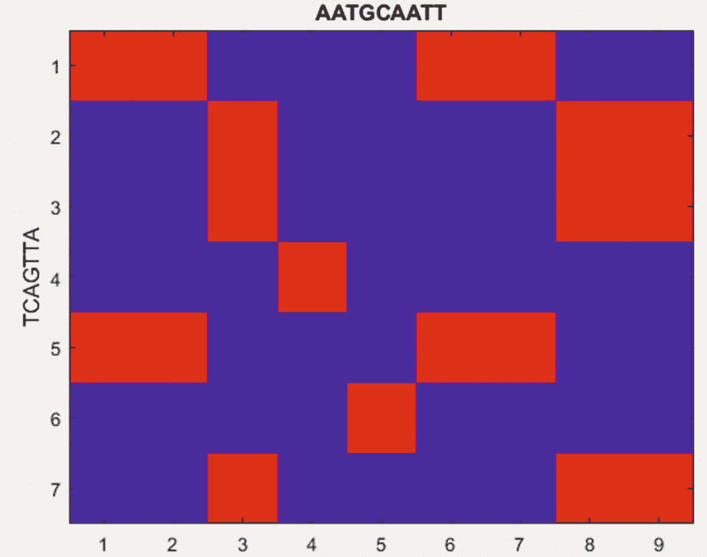

图 8-5

点矩阵的点阵图

## 捕食者–猎物模型

捕食者基本上是指为了生存而吃掉其他生物的有机体。猎物则是被捕食者吃掉的有机体。捕食者与猎物之间的一些例子可以是狮子与斑马、老虎与水牛、鲨鱼与鱼类。

### 两种群模型

用于描述捕食者与其猎物之间关系的最著名模型是*洛特卡-沃尔泰拉方程*。

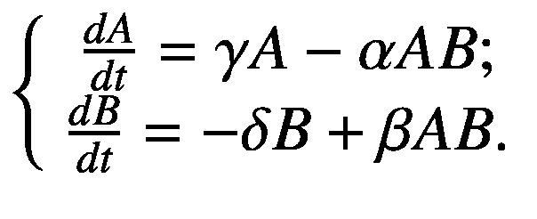

(3)

`A(t)` 表示时间 `t` 时猎物的种群规模，`B(t)` 表示时间 `t` 时捕食者的种群规模。在方程中，`γ` 是猎物种群的增长率，`α` 是捕食率，`δ` 是捕食者的死亡率，`β` 是捕食者的繁殖率。

如果对所示的洛特卡-沃尔泰拉方程进行解读，可以得出以下结论。

*   在方程 3 中，如果没有捕食者，假设 `B(t) = 0`，那么猎物种群呈指数增长。

*   在方程 3 中，如果没有猎物存在，即 `A(t) = 0`，那么捕食者种群呈指数下降。

洛特卡-沃尔泰拉方程是非线性一阶微分方程。对于此类非线性微分方程，由于非线性的性质，通常难以找到解析解。尽管有报道称在这些方程的一些假设下存在解析解，但在本节中，我们将借助 MATLAB 的数值求解器来求解洛特卡-沃尔泰拉方程。

**示例 8-8.** 对于给定的方程 3，编写代码以模拟捕食者和猎物种群规模随时间的变化。捕食者和猎物的初始种群规模分别为 10 和 100。时间跨度设为 0 到 50。其他系数给定为 `γ = 0.4`、`α = 0.4`、`δ = 2.0` 和 `β = 0.1`。对所得图形进行解释。图形标题应为“捕食者-猎物模型”，且图形上不应有菜单栏。

**解法 8-8.** 以下代码可用于完成给定任务。

*Example8p8.m*

```
%Example8p8
%This code solves Lotka-Volterra equations
y0 = [100;10];%initial populations
[t,x] = ode45(@LVfunc,[0 50],y0);
A = x(:,1);%Prey
B = x(:,2);%Predator
figure('Name','Predator-Prey Model',...
'NumberTitle','off','MenuBar', 'none');
plot(t,A,'-o',t,B,'r-');grid on;
legend('Preys','Predators');
title('Population Along With Time')
xlabel('Time');ylabel('Population');
function dxdt = LVfunc(t,x)
gama = 0.4; alpha = 0.4;
delta = 2.0; beta = 0.1;dxdt=[0;0];
dxdt(1)=gama*x(1)-alpha*x(1)*x(2);%prey
dxdt(2)=-delta*x(2)+beta*x(1)*x(2);%predators
end
```

运行代码后，将显示图 8-6 所示的输出结果。

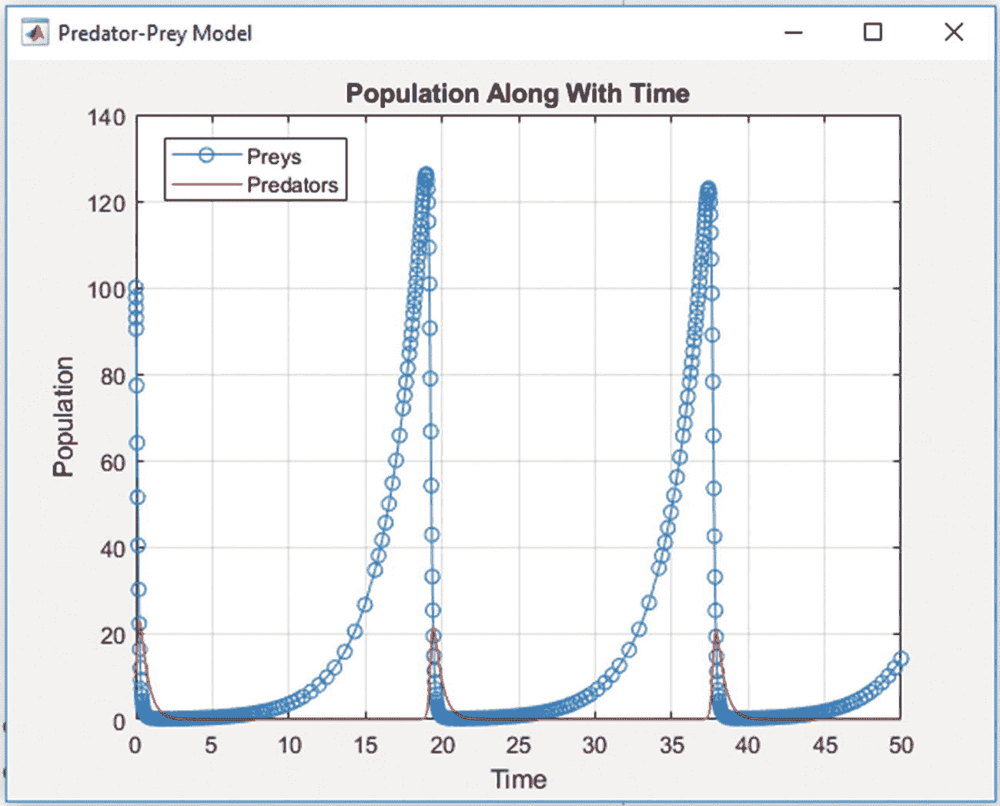

图 8-6

捕食者-猎物种群模型

在图 8-6 中，我们看到捕食者和猎物的初始种群规模分别为 100 和 10。为了更清晰地观察初始时刻水平方向的变化，在代码的第九行，我们可以使用 `semilog` 函数代替 `plot` 函数。仅更改这两个函数，即可得到图 8-7 所示的图形。

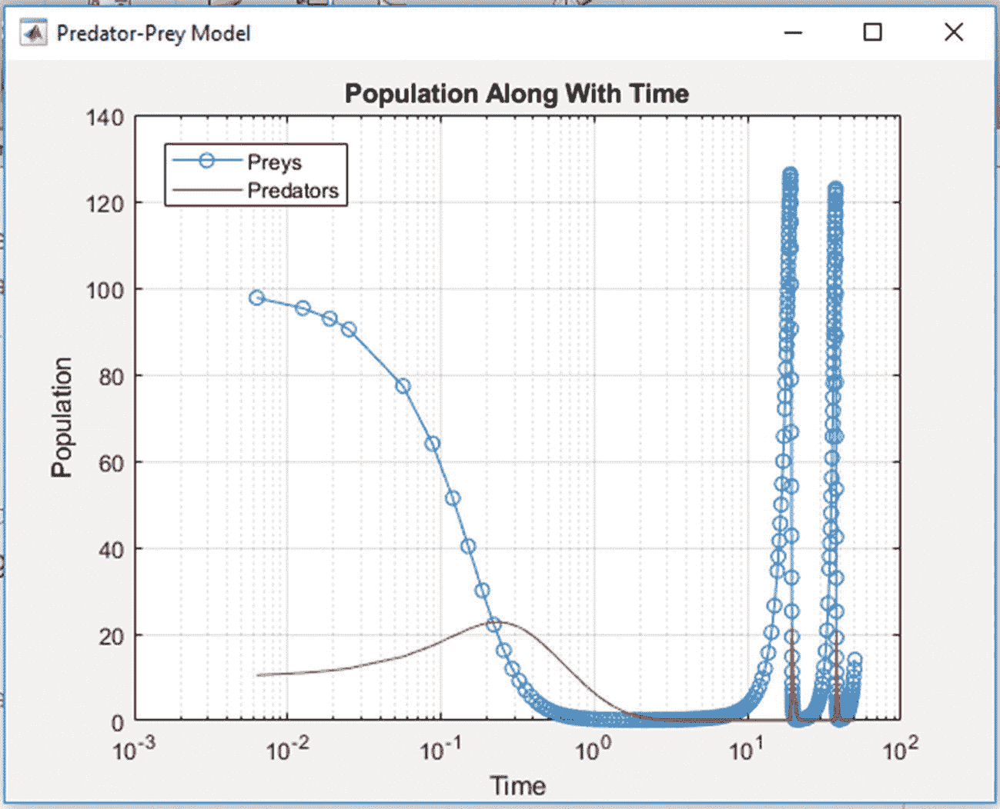

图 8-7

使用 `semilog` 绘制的捕食者-猎物种群图

图 8-6 和图 8-7 使用了相同的 `x` 和 `y` 值。在第二张图中，`x` 轴使用了以 10 为底的对数刻度值。

在图 8-7 中，我们清晰地看到，从初始时刻开始，猎物种群呈指数下降，而捕食者种群则相对于猎物下降的速度缓慢增长。在时间等于 1 之前，捕食者和猎物的种群规模变得相等。至于剩余时间或长期趋势，我们可以参考图 8-6。

随着猎物种群数量增加，经过一段时间后，捕食者的种群数量也随之增加。捕食者捕食猎物的速度超过了猎物繁殖的速度。结果，猎物种群开始下降。因此，捕食者的食物供应减少，它们的种群数量也开始下降。一段时间后，整个场景开始重复，种群数量随时间表现出可预测的行为。


### 三种生物模型

存在一个针对三种生物的修正 Lotka-Volterra 模型。该模型由三个方程组成。

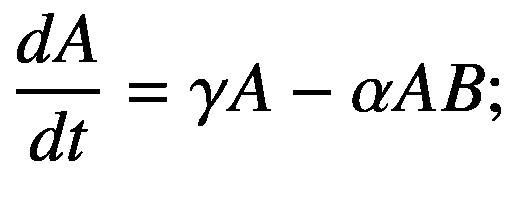

(4)

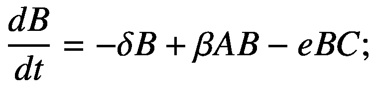

(5)

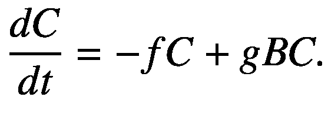

(6)

这里，`C` 是除前一节介绍的 `A` 和 `B` 之外的另一种生物体。当存在相互作用时，`C` 可以捕食捕食者 `B`。在没有捕食者的情况下，生物体 `C` 的数量可能会下降。根据方程 4、5 和 6，生物体 `A` 和 `C` 之间不存在相互作用。

**示例 8-9.** 对于给定的方程 4、5 和 6，编写代码以模拟捕食者、猎物和第三种生物体的种群数量随时间的变化情况。所有三种生物的初始种群数量均为 100。时间范围将从 0 到 60。其他系数给定为：`γ` = 0.4，`α` = 0.4，`δ` = 2.0，`β` = 0.2，`e` = 0.2，`f` = 0.1，`g` = 0.15。

**解答 8-9.** 以下代码可用于完成给定任务。

`Example8p9.m`

```
%Example8p9
%Lotka-Volterra eqns with 3 species
clear all;close all;
y0 = [100;100;100];%initial populations
[t,x] = ode45(@LVfunc2,[0 60],y0);
A = x(:,1);%Prey
B = x(:,2);%Predator
C = x(:,3);%3rd Organism
figure('Name','Predator-Prey Model',...
'NumberTitle','off','MenuBar', 'none');
plot(t,A,'-o',t,B,'r-',t,C,'gx');grid on;
legend('Preys','Predators','3rd organism');
title('Population Along With Time')
xlabel('Time');ylabel('Population');
```

`LVfunc2.m`

```
function dxdt = LVfunc2(t,x)
dxdt=[0;0;0]; gama = 0.4; alpha = 0.4;
delta = 2.0; beta = 0.2;
e=0.2;f=0.1;g=0.15;
dxdt(1)=gama*x(1)-alpha*x(1)*x(2);%prey
dxdt(2)=-delta*x(2)+beta*x(1)*x(2)-...
e*x(2)*x(3);%predators
dxdt(3)=f*x(2)*x(3)-g*x(3);%3rd organism
end
```

代码运行后，将显示图 8-8 中的输出结果。

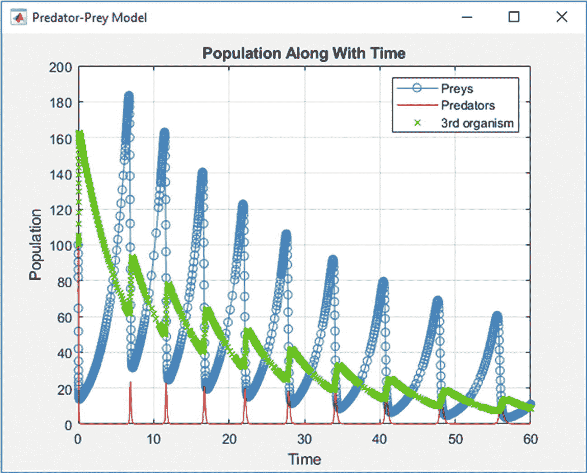

图 8-8

三种生物的种群数量

在图 8-8 中，我们可以看到种群数量的长期运行情况。仅通过观察此输出，我们可以说猎物和第三种生物的数量随时间推移而减少。然而，这张图具有误导性。如果我们把最终时间从 60 增加到 100，我们会看到每种生物的条形图趋于稳定，并且在一定时间后它们的行为变得可预测。我们可以在图 8-9 中看到这种情况，其中最终时间设置为 200。

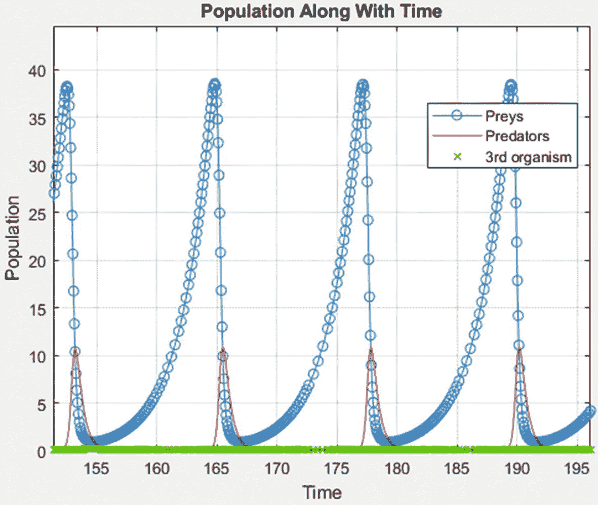

图 8-9

三种生物初始阶段的种群数量

对于动力学过程的初始阶段，我们可以查看图 8-10 中的输出。

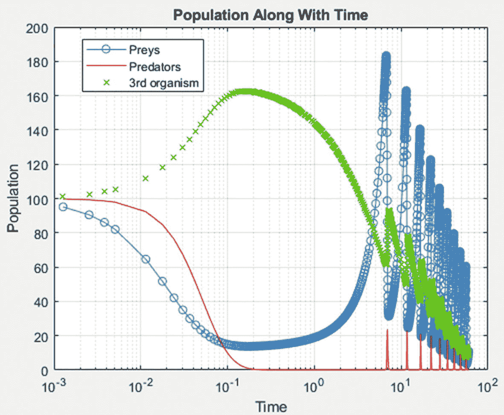

图 8-10

三种生物初始阶段的种群数量

## 流行病模型

本节介绍 SI、SIS、SIR、SIRS 以及 HIV 动态的流行病模型。

### SI 流行病模型

在此流行病模型中，存在两个不同的阶段：易感者（`S`）和感染者（`I`）。两种生物的总人数应等于总人口规模 `N`。换句话说，

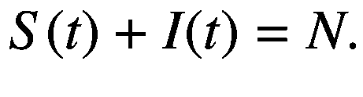

(7)

不考虑出生和死亡的 SI 模型具有以下形式：

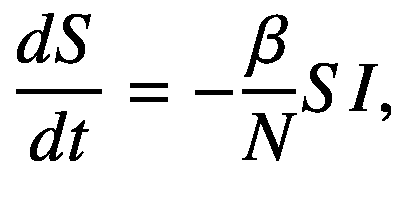

(8)

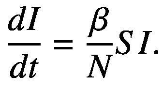

(9)

这里，`β/N SI` 表示在给定时间内因感染者导致的感染人数，`β` 是感染者在一定时间内的接触率。

**示例 8-10.** 对于给定的方程 7、8 和 9，编写代码以模拟 SI 阶段种群数量随时间的变化情况。易感者初始种群数量为 9，感染者初始种群数量为 1，总人口为 10。时间范围从 0 到 10，`β` = 0.9。

**解答 8-10.** 以下代码可用于完成给定任务。

`Example8p10.m`

```
%Example8p10
%This code solves SI model
[t,x]=ode45(@SI,[0,10],[9,1]);
plot(t,x);grid on;
xlabel('time');title('SI Model');
ylabel('population');
legend('Susceptible','Infected','Recovered');
function Si=SI(t,x)
beta=.9;N=10;
%x(1)=susceptible group
Si(1,:)=-(beta/N)*x(1)*x(2);
%x(2)=exposed by infection
Si(2,:)=(beta/N)*x(1)*x(2);
end
```

代码运行后，将显示图 8-11 中所示的输出结果。

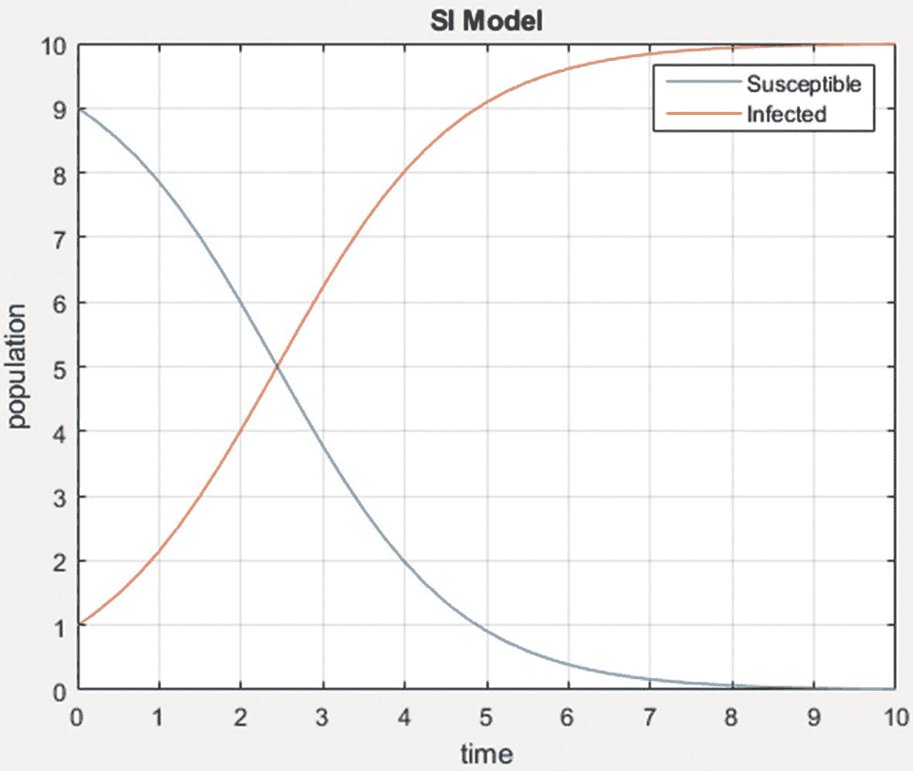

图 8-11

SI 模型的动态过程

如图 8-11 所示，感染者人数从 1 人开始，最终所有人群均被感染。相反，易感者人数从 9 人开始，到 10 天结束时减少到 0，因为每个人都从 `S` 阶段进入了 `I` 阶段。在此模型中，当时间趋于无穷大时，每个人都会被感染。因此，可以得出结论，该模型更适用于高度传染性疾病。


### SIS 流行病模型

在该流行病模型中，似乎存在三个阶段：易感（S）阶段、感染（I）阶段，然后再次进入易感（S）阶段。最后一个阶段实际上就是第一个阶段。因此，SIS 模型中实际上只存在两个阶段。所有被感染的生物体重新变得易感。这类模型更适用于通常在一个周期内会反复感染的疾病。

所有生物体的总数量应等于总人口规模 *N*。

不考虑出生和死亡的 SIS 模型形式如下：

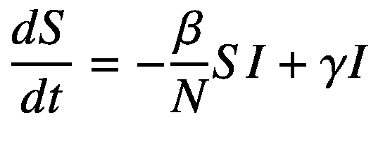

(10)

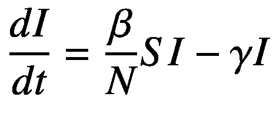

(11)

其中，*β* 是某一时刻由感染者造成的接触率，*γ* 是恢复率。

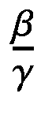 的比值称为*基本再生数 R*[0]。如果 *R*[0] > 1，疾病将流行；否则（*R*[0] ≤ 1），疾病将会消散。

**示例 8-11.** 针对给定的公式 10 和 11，编写代码来模拟 SIS 模型的人口规模。易感（S）和感染（I）状态的初始种群数分别为 9 和 1。时间跨度从 0 到 50。系数给定为 *γ* = 1.0 和 *β* = 0.9。

**解决方案 8-11.** 以下代码可用于完成给定任务。

`Example8p11.m`

```
%Example8p11
%This code solves SIS model
[t,x]=ode45(@SIS,[0,10],[9,1]);
plot(t,x);grid on;
xlabel('time');
title('SIS Model with ${R}_{0} \ge 1$',...
'FontAngle','italic','Interpreter',...
'Latex');
ylabel('population');
legend('Susceptible','Infected');
function Si=SIS(t,x)
beta=.9;N=10;
gamma=1.0;%Recovery rate
%x(1)=susceptible group
Si(1,:)=-(beta/N)*x(1)*x(2)+gamma*x(2);
%x(2)=exposed by infection
Si(2,:)=(beta/N)*x(1)*x(2)-gamma*x(2);
end
```

在上述代码中，为了打印标题 *R*[0] ≤ 1，使用了 LaTeX 解释器。运行代码后，得到的结果如图 8-12 所示。

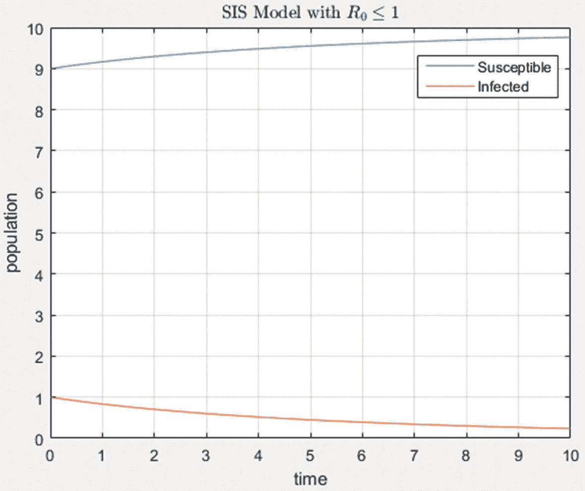

**图 8-12** 当 *R*[0] ≤ 1 时 SIS 模型的动态特征

很明显，随着时间的推移，疾病会逐渐消失。

**示例 8-12.** 使用示例 8-11 中相同的人口规模和时间跨度来模拟 SIS 动态。此示例的系数给定为 *γ* = 0.1 和 *β* = 0.9，以使 *R*[0] > 1。

**解决方案 8-12.** 以下代码可用于完成给定任务。

`Example8p12.m`

```
%Example8p12
%This code solves SIS model
[t,x]=ode45(@SIS,[0,10],[9,1]);
plot(t,x);grid on;xlabel('time');
title('SIS Model with ${R}_{0} \ge 1$',...
'Interpreter','Latex');
ylabel('population');
legend('Susceptible','Infected');
function Si=SIS(t,x)
beta=.9;N=10;
gamma=0.1;%Recovery rate
Si(1,:)=-(beta/N)*x(1)*x(2)+gamma*x(2);
Si(2,:)=(beta/N)*x(1)*x(2)-gamma*x(2);
end
```

运行代码后，得到的结果如图 8-13 所示。

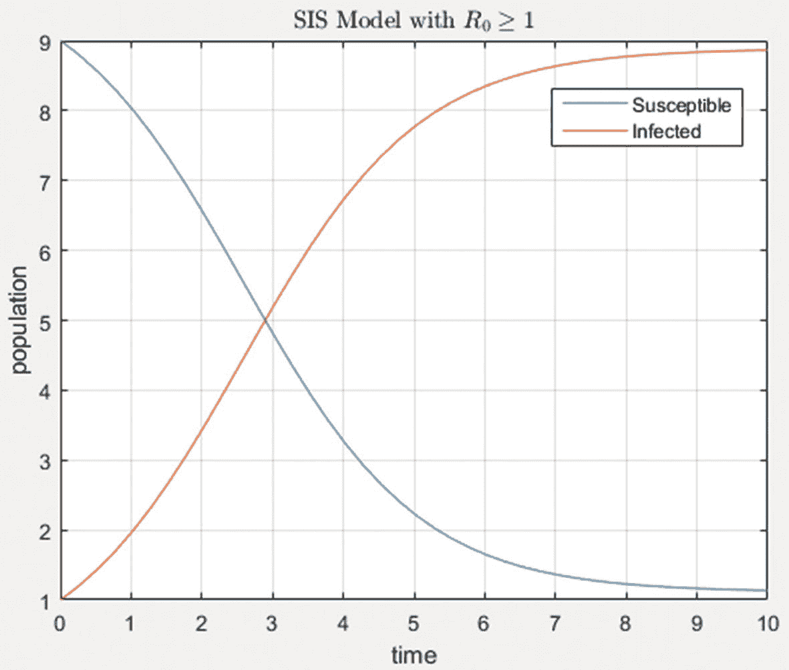

**图 8-13** 当 *R*[0] > 1 时 SIS 模型的动态特征

如图 8-13 所示，当 *R*[0] > 1 时，疾病会传播到整个群体。

### SIR 流行病模型

在该流行病模型中，存在三个不同的阶段：易感（S）、感染（I）和康复（R）。所有生物体的总数量应等于总人口规模 *N*。换句话说，

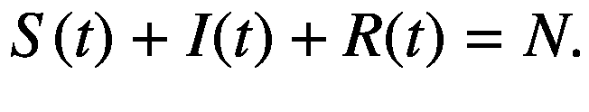

(12)

不考虑出生和死亡的 SIR 模型形式如下：

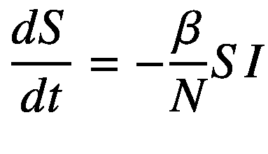

(13)


(14)


(15)

其中，*β* 是某一时刻由一名感染者造成的接触率，*γ* 是恢复率。 是基本再生数。

**示例 8-13.** 针对给定的公式 13、14 和 15，编写代码来模拟所有 S、I 和 R 状态随时间变化的人口规模。S、I 和 R 种群的初始数量分别为 9、1 和 0。时间跨度从 0 到 50。其他系数给定为 *γ* = 0.1 和 *β* = 0.9。

**解决方案 8-13.** 以下代码可用于完成给定任务。

`Example8p13.m`

```
%Example8p13
%This code solves SIR model
[t,x]=ode45(@SIR,[0,50],[9,1,0]);
%semilogx(t,x);
plot(t,x);
xlabel('time');ylabel('population');
title('SIR Model');grid on;
legend('Susceptible','Infected','Recovered');
function Sir=SIR(t,x)
beta=.9;%contact rate by people in population i
gamma=.1;%Recovery rate
N=10;%N=Total number of population
%dS/dt=Sir(1),x(1)=susceptible people
ds=-(beta/N)*x(1)*x(2);
%dI/dt=Sir(2),x(2)=exposed by infection
di=(beta/N)*x(1)*x(2)-gamma*x(2);
%dr/dt=sir(3),x(3)=Recovered from infection
dr=gamma*x(2);
Sir=[ds;di;dr];
end
```

运行代码后，得到的输出如图 8-14 所示。


**图 8-14** 当 *R*[0] > 1 时 SIR 模型的动态特征

在这个结果中，*R*[0] 大于 1。如果我们使用 *γ* = 1.0 并保持此示例中的其余参数不变，当再生数等于或小于 1 时，得到的图形如图 8-15 所示。


**图 8-15** 当 *R*[0] ≤ 1 时 SIR 模型的动态特征


## SEIR 传染病模型

在此传染病模型中，如图 8-16 所示，在已知的 `S`、`I` 和 `R` 阶段中增加了潜伏期阶段（`E`）。


图 8-16：SEIR 模型的阶段

所有有机体的总人口数应等于总人口规模 `N`。即，


(16)

不考虑出生和死亡的 SEIR 模型可写为以下方程组。


(17)


(18)


(19)


(20)

在公式 17、18、19 和 20 中，`β` 控制疾病在易感者和感染者之间随时间传播的速率，`α` 是潜伏期和感染者之间的接触率，`γ` 是恢复率。

**例 8-14.** 对于给定的公式 17、18、19 和 20，编写代码模拟所有种群数量随时间的变化。`S`、`E`、`I` 和 `R` 组的初始种群规模分别为 17、2、1 和 0。时间跨度从 0 到 50。其他系数为 `β = 0.8`，`α = 0.4`，`γ = 0.3`。

**解 8-14.** 以下代码可用于完成给定任务。

*Example8p14.m*

```
%Example8p14
%This code solves SEIR model
[t,x]=ode45(@Seir,[0,50],[17,2,1,0]);
plot(t,x);
xlabel('time');ylabel('population');
title('SEIR Model');grid on;
legend('Susceptible',...
'Exposed','Infected','Recovered');
function SEIR=Seir(t,x)
N=10;beta=.8;delta=0.4;gamma=1;
SEIR(1,:)=-(beta/N)*x(1)*x(3);
SEIR(2,:)=(beta/N)*x(1)*x(3)-delta*x(2);
SEIR(3,:)=delta*x(2)-gamma*x(3);
SEIR(4,:)=gamma*x(3);
end
```

运行代码后，将显示如图 8-17 所示的输出。


图 8-17：SEIR 模型

为了清晰地观察动态变化的初始阶段，我们可以用 `semilogx` 命令替换 `plot` 函数，得到如图 8-18 所示的结果。


图 8-18：SEIR 动态变化的初始阶段

如图 8-18 所示，各类型种群数量在时间等于 1 之前就开始发生变化。从长远来看，我们看到感染者和潜伏期人群几乎变为零，其余人口处于易感和恢复状态。参照图 8-17，可以得出结论：当时间趋于无穷时，这些状态保持稳定。

我们需要牢记的一个重要点是，只需更改动力学的系数，这些结果就可能改变。如果我们在方程中加入死亡率或出生率，我们可能会遇到与之前示例中完全不同的情况。

## HIV 的细胞动力学

人类免疫缺陷病毒（HIV）会攻击并改变免疫系统，最终导致通常致命的获得性免疫缺陷综合征（AIDS）。几十年来，研究人员和科学家一直试图找到保护人们免受 HIV 和 AIDS 侵害的解决方案。HIV 攻击体内一种特定类型的细胞，即 CD4 辅助细胞（或称 T 细胞）。关于 T 细胞和病毒动力学的基本模型包含一个由三个方程组成的方程组：


(21)


(22)


(23)

在此方程组中，`dx/dt` 表示未感染细胞数量随时间的变化，`dy/dt` 表示感染细胞数量随时间的变化，`dv/dt` 表示游离病毒颗粒数量随时间的变化，其中初始条件应满足 `x[0] > 0`，`v[0] > 0` 且 `y[0] = 0`。

对于公式 21、22 和 23 的模型，基本再生数 `R[0]` 为


(24)

其中 `γ` 是免疫系统产生未感染细胞的速率，`βxv` 是因游离病毒与未感染细胞接触而产生感染细胞的速率。`N` 是游离病毒颗粒的数量，应远大于 1。`d[x]`、`d[y]` 和 `d[v]` 分别是未感染细胞、感染细胞和病毒颗粒的死亡率。时间以天为单位预先测量。`k` 是感染细胞产生游离病毒颗粒的速率。

**例 8-15.** 对于公式 21、22 和 23，编写代码模拟未感染细胞、感染细胞和病毒颗粒数量随时间的变化。未感染细胞、感染细胞和病毒颗粒的初始种群规模分别为 10⁶、0 和 2。时间跨度将从 0 到 50。其他系数为 `γ = 10⁵`，`k = 200`，`β = 3 ∗ 10⁻⁷`，`d[x] = 0.12`，`d[y] = 0.5`，`d[v] = 4`。

**解 8-15.** 以下代码显示了主代码中使用的核心函数。

*Hiv.m*

```
function HIV=Hiv(t,x)
dx=0.12;dy=0.5;dv=4;
beta=3e-7;k=1e+2;gamma=1e+5;
HIV(1,:)=gamma -dx*x(1)-beta*x(1)*x(3);
HIV(2,:)=beta*x(1)*x(3) -dy*x(2);
HIV(3,:)=k*x(2)-dv*x(3)-beta*x(1)*x(3);
end
```

上述代码中大部分变量的值取自 Linda J. S. Allen 所著的《数学生物学导论》（Pearson Education，2007 年，第 278 页）。代码的主部分可以编写如下。

*Example8p15.m*

```
%Example8p15
%This code solves HIV model
clear all;close all;
[t,x]=ode45(@Hiv,[0,50],[1e+6,0,2]);
plot(t,x(:,1));
xlabel('Time in days');ylabel('Population');
title('Uninfected Cells');grid on;
figure;plot(t,x(:,2))
xlabel('Time in days');ylabel('Population');
title('Infected Cells');grid on;
figure;plot(t,x(:,3))
xlabel('Time in days');ylabel('Population');
title('Virus Particles');grid on;
```


好的，作为高级文档工程师和翻译员，我将严格遵循您的注意事项，将给定的英文文本翻译成中文。


# 9. 信号处理

信号处理是电气工程的子领域之一，它分析、修改并操作宇宙中所有数据源的信息。在信号处理中，一个*信号*是一种将数据从一个设备传输到另一个设备的电流或电磁流。宇宙中的一切，如声音、图像和视频，都可以被描述为一种波形的信号。在数学上，信号可以表示为一个或多个独立变量的函数。

信号处理有着非常广阔的应用领域，包括脑机接口、语音识别、体感游戏、三维电视、可穿戴技术、生物识别安全等等。全面覆盖这一主题超出了本章的范围。在这里，我们回顾一些入门主题以及使用 MATLAB 在该领域的几个应用，包括信号类型、电流、快速傅里叶变换和谐波分析。

## 信号类型

信号可以分类为几种类型，例如能量信号和功率信号，或者确定性信号和概率性信号。在本节中，我们将介绍连续信号和离散信号、模拟信号和数字信号、周期信号和非周期信号，以及偶信号和奇信号。

### 连续信号和离散信号

对于一个定义为函数的信号，如果对于独立变量（例如，*t*）的每一个值，都存在一个对应的值（例如，*y*），那么该函数被称为*连续时间* (CT) 信号。然而，如果一个表示为函数的信号只在独立变量*t*的某些离散值上被定义，那么它被称为*离散时间* (DT) 信号。在某些情况下，DT 可能没有一个时间函数。例如，在灰度图像中，表示图像颜色的图像矩阵中存在二维离散值。

在图 9-1 中，我们看到 *y*(*t*) 的图形，其中


(1)

是一个连续信号。


图 9-1

一个连续信号的示例

在图 9-2 中，虽然使用了相同的函数，但输出却不同。因为使用了*t*的离散值，所以得到的输出也是一个离散信号。

![$$
y\left[t\right]=\sin (t),t=0,\pm \frac{\pi }{6},\pm \frac{2\pi }{6},\pm \frac{3\pi }{6},\dots, \pm \frac{12\pi }{6}
$$](images/483991_1_En_9_Chapter/483991_1_En_9_Chapter_TeX_Equ2.png)

(2)


图 9-2

一个离散信号的示例

在等式 2 中，因为*t*具有离散值，所以函数*y*也具有离散值（对应于*t*值）。

通常，连续函数用圆括号表示，而方括号用于定义离散函数。

**示例 9-1.** 对于给定的离散信号函数 *y* = *f*[*t*] = cos(2*t*)，其中 *t* 定义为 −*π* ≤ *t* ≤ *π*，为*t*创建 10 个均匀分布的离散值。然后代码应计算对应的*y*值并将其打印在屏幕上。

**解答 9-1.** 以下代码可用于完成给定任务。

*Example9p1.m*

```
%Example9p1
%This code has a discrete signal
t = linspace(-2*pi,2*pi,10);
y=cos(2*pi*t);
disp('y Values:');
disp(y);
```

对于直流信号，`linspace`函数对于创建均匀分布的时间值非常有用。代码执行后，将获得以下输出。

```
> Example9p1
y Values:
Columns 1 through 9
-0.2070  0.7580  -0.9983  0.8292  -0.3202  -0.3202  0.8292  -0.9983  0.7580
Column 10
-0.2070
>
```

## 习题

*   **8.1.** 编写代码求解逻辑斯蒂方程，其中 *K* = 50, *r* = 0.2, *N*[0] = 4, 时间从 1 到 200。该代码应对解析解进行动画演示。然后，数值解和解析解应绘制在同一张图上。

*   **8.2.** 编写代码模拟 Nicholson-Bailey 模型。宿主和寄生蜂的初始种群数量分别为 10 和 5。世代数为 50。系数为 *e* = 2, *a* = 0.0069, 和 *r* = 3。

*   **8.3.** 给定一个 DNA 序列 TTCCTACTTTTGTATTCGCCAG。编写代码将其转录为 RNA。

*   **8.4.** 给定一个 DNA 序列 GGTCGTAGCTAC。编写代码将其转录为 RNA。然后，利用遗传密码表，将其翻译成一个氨基酸序列。最后，代码应在屏幕上打印出最终序列。

*   **8.5.** 对于两个序列 `Seq1=GTTAACAATT` 和 `Seq2=GTGAT`，编写代码打印出点矩阵并绘制点图。在图中，匹配点应以红色显示，不匹配点应以蓝色显示。

*   **8.6.** 对于等式 10 和 11，编写代码模拟 SIS 模型的种群大小。S 和 I 状态的初始种群分别为 20 和 2。时间跨度从 0 到 80。系数为 *γ* = 0.50 和 *β* = 0.8。

*   **8.7.** 对于等式 13、14 和 15，编写代码模拟所有 S、I 和 R 阶段种群大小随时间的变化。S、I 和 R 种群的初始数量分别为 20、1 和 0。时间跨度从 0 到 50。其他系数为 *γ* = 1.3 和 *β* = 0.7。

*   **8.8.** 对于等式 17、18、19 和 20，编写代码模拟所有种群数量随时间的变化。S、E、I 和 R 组的初始种群数量分别为 27、2、1 和 0。时间跨度从 0 到 50。其他系数为 *β* = 0.7, *α* = 0.3, 和 *γ* = 0.2。


## 模拟信号和数字信号

从信号的幅度来考虑，信号可分为模拟信号和数字信号。*模拟信号*是一种连续波，能够在一段时间内保持其变化。而*数字信号*的幅度值个数是有限的，这些值既非连续也无无限多。此外，模拟信号的波形类似正弦函数，而数字信号的波形则像方波。

模拟信号的例子有声音、音乐、温度以及空气中的 Wi-Fi 信号。数字信号的例子则包括录制在 CD 上的声音、数字温度计以及 MP3 播放器中的音乐。

## 周期信号和非周期信号

经过一段时间后能重复自身的信号称为*周期信号*。在一段时间内不重复自身的信号则称为非周期信号或*非周期信号*。

如果满足以下等式，则连续时间信号 `y(t)` 被称为周期信号。


(3)

对所有 `t` 和正常数 `T0` 成立。

类似地，如果满足以下等式，则离散时间信号 `y[t]` 被称为周期信号。

![$$ y\left[t\right]=y\left[t+{T}_0\right] $$](images/483991_1_En_9_Chapter/483991_1_En_9_Chapter_TeX_Equ4.png)

(4)

对所有 `t` 和正常数 `T0` 成立。

**注释 9-1.** 假设 `y(t)` 是代表连续信号的函数。那么如果


(5)

或者


(6)

那么，信号 `y(t)` 的周期 `T0` 为


(7)

在方程 (5) 和 (6) 中，常数 `k`、`a` 和 `b` 均为实数，且 `n` 应为整数。在方程 (7) 中，`|a|` 是 `a` 的绝对值。

**注释 9-2.** 假设 `y(t)` 是代表连续信号的函数。那么如果


(8)

或者


(9)

那么，信号 `y(t)` 的周期 `T0` 为


(10)

在方程 (8) 和 (9) 中，常数 `k`、`a` 和 `b` 均为实数，且 `n` 应为整数。

**示例 9-2.** 定义了一个连续时间信号 `y(t) = 5*sin³(4*t − 1)`。求该信号的周期。然后编写代码绘制该信号在 `−2*π ≤ t ≤ 2*π` 范围内的图形。

**解答 9-2.** 在该示例中，信号是连续信号。因此，我们可以使用注释 9-1 来求周期。我们看到 `n = 3`，是一个奇数，并且 `a = 4`。那么 `T0 = (2π) / |4| = π / 2`。

以下代码可用来完成给定任务。

*Example9p2.m*

```
%Example9p2
%This code has a periodic signal
t = -2*pi:0.001:2*pi;
y=5*(sin(4*t-1)).³;
plot(t,y);grid on;
xlabel('t');ylabel('y');
title('A Periodic Signal');
```

代码运行后，输出结果如图 9-3 所示。


**图 9-3** `y(t) = 5*sin³(4*t − 1)` 的图形

如图 9-3 所示，该信号每隔 `π/2` 重复自身。

**示例 9-3.** 定义了一个连续时间信号 `y(t) = 2*sin(4*t) + cos(6*t − 2)`。求该信号的周期。然后编写代码绘制该信号在 `−π ≤ t ≤ π` 范围内的图形。

**解答 9-3.** 在该示例中，信号是将正弦函数与余弦函数相加。我们将分别计算这两个函数的周期。然后求出这两个周期的最小公倍数。我们将正弦项的周期定义为 `T0`，余弦项的周期定义为 `T1`。然后根据注释 9-1，可得 `T0 = (2π) / |4| = π/2`，`T1 = (2π) / |6| = π/3`。那么 `最小公倍数(π/2, π/3) = π`。该信号的图形周期应为 `π`。

以下代码可用来完成给定任务。

*Example9p3.m*

```
%Example9p3
%This code has a periodic signal
t = -pi:0.001:pi;
y=2*sin(4*t)+cos(6*t-2);
plot(t,y);grid on;
xlabel('t');ylabel('y');
title('A Periodic Signal');
```

代码执行后，我们得到如图 9-4 所示的输出。


**图 9-4** `y(t) = 2*sin(4*t) + cos(6*t − 2)` 信号的图形

显然，如图 9-4 所示，该信号每隔 `π` 周期重复自身。

## 偶信号和奇信号

如果满足以下等式，则连续时间信号 `y(t)` 被称为*偶信号*。


(11)

如果满足以下等式，则被称为*奇信号*。


(12)

类似地，如果满足以下等式，则离散时间信号 `y[t]` 被称为偶信号。

![$$ y\left[-t\right]=y\left[t\right] $$](images/483991_1_En_9_Chapter/483991_1_En_9_Chapter_TeX_Equ13.png)

(13)

如果满足以下等式，则被称为奇信号。

![$$ y\left[-t\right]=-y\left[t\right] $$](images/483991_1_En_9_Chapter/483991_1_En_9_Chapter_TeX_Equ14.png)

(14)

**示例 9-4.** 对于给定的连续时间信号 `y(t) = sin²(t) + cos(t) + 1`，编写代码通过图形判断该信号是偶信号还是奇信号。`y(t)` 和 `y(−t)` 的图形应显示在同一张图中。

**解答 9-4.** 以下代码可用来完成给定任务。

*Example9p4.m*

```
%Example9p4
%This code plots an even signal
t = -pi:0.001:pi;
y=(sin(t)).²+cos(3*t)+1;
subplot(121);plot(t,y);grid on;
xlabel('t');ylabel('y');
title('Signal of y(t)');
t = -t;
y=(sin(t)).²+cos(3*t)+1;
subplot(122);plot(t,y);grid on;
xlabel('t');ylabel('y');
title('Signal of y(-t)');
```

代码执行后，我们得到如图 9-5 所示的输出。


**图 9-5** `y(t) = sin²(t) + cos(t) + 1` 信号的图形

图 9-5 显示两个图形完全相同，这表明该信号是偶信号。


## 电流

在本节中，我们将通过一个示例来学习如何计算电路中的电流。此外，我们还将研究如何根据基尔霍夫定律求解 RL 电路中的电流。

### 示例 9-5
考虑图 9-6 所示的一个包含八个电阻和两个电池的电路。求流过回路的电流`x`、`y`和`z`。


*图 9-6 一个电路网络*

#### 解 9-5
为了求出流过各回路的电流，我们为每个回路列出如下方程。

 (15)

以下代码可用于求解此方程组。

*Example9p5.m*
```
%Example9p5
%This code finds currents
%for an electrical network
A=[90 -20 -30;-20 65 -40;-30 -40 150];
B=[40;0;500];
Sol=(A)\B;
disp(['x=',num2str(Sol(1))]);
disp(['y=',num2str(Sol(2))]);
disp(['z=',num2str(Sol(3))]);
```

执行代码后，我们将得到以下输出。
```
> Example9p5
x=3
y=4
z=5
>
```

一个电路可以包含多种元件，包括开关、电压源 (V)、电阻 (R) 和电感 (L)，如图 9-7 所示。


*图 9-7 一个 RL 网络*

以下是图 9-7 所示网络的控制方程。

 (16)

方程 (16) 的解为

 (17)

### 示例 9-6
对于一个 RL 网络，给定系数为`V` = 2 伏特，`R` = 1 欧姆；`L` = 1/2 亨利，0 ≤ `time` ≤ 5。编写代码来模拟电流`i`随时间变化的值。

#### 解 9-6
以下代码可用于完成指定任务。

*Example9p6.m*
```
%Example9p6
%This code plots current values
t=0:0.05:5;
V=2;R=1;L=1/2;
i=(V/R)*(1-exp(-R.*t/L));
plot(t,i,'bo');grid on;
xlabel('t');ylabel('current');
title('Current with time');
```

执行代码后，将显示如图 9-8 所示的输出。


*图 9-8 示例 9-6 中电流的值*

## 谐波分析

周期信号可以用傅里叶级数表示为一系列正弦波和余弦波的和。计算此类信号的过程称为*谐波分析*。此时，我们需要回顾一下傅里叶级数的定义。

### 备注 9-3
假设对于所有`x`值，`f(x)` 的定义周期为 2L，即 `f(x) = f(x + 2L)`。那么 `f(x)` 的傅里叶级数为

 (18)

此处，`a[n]` 和 `b[n]` 被称为*傅里叶系数*，其中

 (19)

以及

 (20)

其中 `n` = 1, 2, 3, …

### 示例 9-7
如方程 (18)、(19) 和 (20) 所定义的信号 `f(x)` 的系数给定为 `L = 2`，`a[0] = 0`，`a[n] = 0`，以及 。计算当 `n` = 49 时，方程 (18) 中的信号 `f(x)`。然后绘制信号 `f(x)` 在 −2`π` ≤ `x` ≤ 2`π` 范围内的图形。

#### 解 9-7
如果将给定的 `a[0]`、`a[n]` 和 `b[n]` 代入方程 (18)，我们得到：

 (21)

因此，我们需要计算 `f(x)` 包含 49 项时的方程 (21)。 以下代码可用于获取`f(x)`的图形。

*Example9p7.m*
```
%Example9p7
%This code plots graph of a signal
n=49;Point=1000;
x=linspace(-2*pi,2*pi,Point);
bn=zeros(1,Point);a0=0*bn;an=0*bn;
for i=1:2:n
Calc=(1/i).*sin((i*pi.*x)/2);
bn = bn + Calc;
end
bn=(4/pi)*bn;fx=a0+an+bn;
plot(x,fx);grid on;axis('equal');
xlabel('x');ylabel('signal');
title('Square Wave Signal');
```

执行代码后，输出如图 9-9 所示。


*图 9-9 示例 9-7 的输出*

如图 9-9 所示，该信号为方波信号。信号的周期为 4（`L` = 2）。如果在代码中选择更大的`n`，图像将看起来更像一个精确的方波。


### 示例 9-8.
根据方程式 18、19 和 20 定义的信号 *f*(*x*) 的系数为 。按方程式 18 计算 *n* = 79 时信号 *f*(*x*) 的值。然后绘制信号 *f*(*x*) 在 −2*π* ≤ *x* ≤ 2*π* 范围内的图形。

### 解决方案 9-8.
将给定的 `a[0]`、`a[n]` 和 `b[n]` 代入方程式 18，得到以下结果：


(22)

因此，我们需要计算 *f*(*x*) 的方程式 22，其中包含 79 项。可以使用以下代码生成 *f*(*x*) 的图形。

*Example9p8.m*

```
%Example9p8
%This code plots graph of a signal
n=79;Point=1000;
x=linspace(-2*pi,2*pi,Point);
bn=zeros(1,Point);a0=0*bn;an=0*bn;
for i=1:2:n
Calc1=(1/i).*cos((i*pi.*x)/1.5);
Calc2=(1/i).*sin((i*pi.*x)/1.5);
an = an + Calc1;
bn = bn + Calc2;
end
fx=a0+(4/pi)*(an+bn);
plot(x,fx);grid on;axis('equal');
xlabel('x');ylabel('signal');
title('Signal in time');
```

执行代码后，我们会得到图 9-10 所示的输出。


**图 9-10** 示例 9-8 的输出

如图 9-10 所示，该信号的周期为 3（*L* = 1.5）。

## 快速傅里叶变换

我们已经在上一节关于周期函数的内容中学习了傅里叶级数。当处理非周期信号时，我们需要了解傅里叶变换方法。傅里叶变换将时间序列与频率序列配对。快速傅里叶变换 (FFT) 是处理离散傅里叶变换 (DFT) 的一种更好方法。然而，在理解 FFT 之前，我们将先了解傅里叶变换的定义。

### 备注 9-4.
函数 *f*(*t*) 的连续时间傅里叶变换定义为：


(23)


(24)

其中 `F(k)` 可以通过使用逆傅里叶变换得到。如果方程式 23 的结果收敛，则信号 *f*(*t*) 存在傅里叶变换。逆傅里叶变换将频率序列映射回相应的时间序列。

### 备注 9-5.
时间有限序列 `f[t]`（其中 0 ≤ *t* ≤ *N* − 1）的 DFT 定义为：

前向 DFT ![$$ F\left[r\right]=\sum \limits_{n=0}^{N-1}f\left[t\right]{e}^{\frac{-2\pi jnr}{N}},0\le r\le N-1 $$](images/483991_1_En_9_Chapter/483991_1_En_9_Chapter_TeX_IEq8.png) (25)

逆 DFT ![$$ f\left[t\right]=\frac{1}{N}\sum \limits_{n=0}^{N-1}F\left[r\right]{e}^{\frac{-2\pi jnr}{N}},0\le k\le N-1 $$](images/483991_1_En_9_Chapter/483991_1_En_9_Chapter_TeX_IEq9.png) (26)

尽管方程式 23 和 24 看起来很复杂，但只需代入欧拉方法，即 `e^(ix)` = `cos(x) + isin(x)`，我们就可以让它们变得简单得多，类似于傅里叶级数。

FFT 是一种能以更优方式求解序列的 DFT 的算法。该算法由 James W. Cooley 和 John W. Tukey 于 1965 年共同开发。Cooley 和 Tukey 利用了周期正弦波的特性。换句话说，部分计算会出现重复。通过节省这些计算成本，他们减少了所需时间，并获得了一种更好的算法。

对于长度为 *n* 的信号，使用 DFT 的时间复杂度（处理 *n* 个样本所需的时间）是 `O(n²)`。而 FFT 的复杂度优于 DFT，为 `O(nlog(n))`。

在 MATLAB 中，使用 `fft` 函数来计算 FFT。由于索引从 1 开始，而不是 0，因此方程式 25 和 26 中求和符号的边界是从 *n* = 1 到 *N*。

### 示例 9-9.
编写代码，将 `fft` 应用于函数 `x`，其中 `x = sin(2πt)`，0 ≤ *t* ≤ 1。该代码应为 `t` 生成 100 个样本，并且向量 `x` 的长度应为 512。该代码应在屏幕上绘制 `x` 的图形和功率谱。

### 解决方案 9-9.
以下代码可用于完成给定的任务。

*Example9p9.m*

```
%Example9p9
%This code works with fft
Fs = 100; % Sampling frequency
t=linspace(0,1,Fs);
x = sin(2*pi*t);
Nfft = 512; % Length of FFT
X = fft(x,Nfft);
% FFT is symmetric, take half
X = X(1:Nfft/2);
% Frequency vector
f = (0:Nfft/2-1)*Fs/Nfft;
figure(1);%for graph of sine
stem(t,x);grid on;
title('Signal of Sine Wave');
xlabel('Time');
ylabel('Amplitude');
figure(2); % for power spectum
plot(f,abs(X));grid on;
title('Power Spectrum');
ylabel('Power');
xlabel('Frequency');
```

运行代码后，得到的结果如图 9-11 所示。


**图 9-11** 正弦波信号

对于正弦波的功率谱，我们生成了如图 9-12 所示的输出。


**图 9-12** 正弦波的功率谱


### 示例 9-10
编写代码，对向量 *x* 应用 `fft`，其中 *x* 的前四个元素为 [1, 2, 0, 2]，其余 59 个元素为零。然后，代码应分别在不同图形上绘制频谱幅度的估计值和相位谱的估计值。

#### 解答 9-10
以下代码可用于完成给定任务。

`Example9p10.m`

```matlab
%Example9p10
%This code works with fft
x = [1 2 0 2 zeros(1,60)]; % zero-padded sequence
N = length(x);X = fft(x);
X = fftshift(X); % shift DFT coefficients
w=linspace(-pi,pi,N);%compute frequencies
stem(w,abs(X)); % plot magnitude spectrum
grid on;title('Magnitude of Spectrum');
xlabel('Frequency');ylabel('Amplitude');
figure; % new one is opened
stem(w,angle(X));% plot the phase spectrum
grid on;title('Phase Spectrum');
xlabel('Frequency');ylabel('Amplitude');
```

运行代码后，将生成如图 9-13 和图 9-14 所示的输出结果。


**图 9-14** 相位谱的估计


**图 9-13** 频谱幅度的估计

FFT 也可以应用于音频文件和图像文件进行分析。作为示例，我们将展示如何对图像应用 `fft2` 函数。这里，`fft2` 是 `fft` 的二维函数。在此示例中，`fft2` 函数被用作滤波器，而非用于分析。处理图像文件是一个广泛的课题，将在下一章进行探讨。

### 示例 9-11
编写代码，将 FFT 作为滤波器应用于彩色图像。图像名为 `covboys.png`，位于与代码相同的目录中。应用 FFT 后，应在屏幕上显示图像。然后，应将图像转换回原始图像，并在另一个不同的图形上显示原始图像。

#### 解答 9-11
以下代码可用于完成给定任务。

`Example9p11.m`

```matlab
%Example9p11
%This code apply fft to 2-dimensional picture.
P = imread('cowboys.png');%reads the image
Y=fft2(P); %apply the filter
imshow(Y) % filtered image is shown
figure;
YY=ifft2(Y);%image is converted back
imshow(YY/256);%original image is shown
```

运行代码后，输出结果如图 9-15 和图 9-16 所示。


**图 9-16** 应用 `ifft2` 后得到的原始图像


**图 9-15** 应用 `fft2` 函数后的图像

## 习题

- **9.1.** 对于给定的离散信号函数 *y* = *f*[*t*] = sin(2*t*)，其中 *t* 定义为 −2*π* ≤ *t* ≤ 2*π*，创建 20 个等间距的离散 *t* 值。代码应计算相应的 *y* 值并将其打印在屏幕上。

- **9.2.** 一个连续时间信号定义为 *y*(*t*) = 2*sinc*(2*t* + 1)。求该信号的周期。然后编写代码绘制该信号在 −*π* ≤ *t* ≤ *π* 范围内的图形。

- **9.3.** 一个连续时间信号定义为 *y*(*t*) = sin(3*t*) + cos(4*t*)。求该信号的周期。然后编写代码绘制该信号在 −2*π* ≤ *t* ≤ 2*π* 范围内的图形。

- **9.4.** 对于给定的连续时间信号 *y*(*t*) = cos(2*t*) + 10，编写代码从图形上判断该信号是偶信号还是奇信号。*y*(*t*) 和 *y*(−*t*) 的图形应显示在同一张图上。

- **9.5.** 如公式 18、19 和 20 所定义的信号 *f*(*x*) 的系数给定为 *L* = 3, *a*[0] = 0, *a*[*n*] = 0, 且 。按照公式 18 计算 *n* = 19 时的信号 *f*(*x*)。然后绘制信号 *f*(*x*) 在 −*π* ≤ *x* ≤ *π* 范围内的图形。

- **9.6.** 编写代码，对函数 *x* 应用 `fft`，其中 *x* = sin(2*πt*), 0 ≤ *t* ≤ 1。代码应为 *t* 生成 200 个样本，向量 *x* 的长度应为 1,024。代码应在屏幕上绘制 *x* 的图形和功率谱。

# 10. 图像处理

MATLAB 提供了非常强大的工具来处理图形和图像文件，以及操作声音、音频和视频文件。本章涉及与图像处理相关的不同主题。首先，我将介绍图像的类型。随后讨论图像类型和格式的转换、图像操作、图像增强、图像恢复、彩色处理、图像分割和数学形态学。

## 图像类型

在 MATLAB 中，大多数图像由二维矩阵表示。在矩阵中，每个元素对应一个像素。如果一幅图像由 *n* × *m* 个像素组成，其矩阵的大小也是 *n* × *m*。因此，图像中的每一个像素都对应其矩阵表示中的一个元素。

我们来考虑一个具有 *n* × *m* 二维的图像。其对应的矩阵将有 *n* 行和 *m* 列。如果我们将该矩阵称为 *M*，那么它的元素可以如图 10-1 所示进行表示。


**图 10-1** 二维图像的矩阵表示

MATLAB 支持数量可观的图像格式。这些格式包括 `.bmp`、`.gif`、`.jpg`、`.jpeg`、`.hdf`、`.pcx`、`.png`、`.tiff`、`.xwd` 等。

在 MATLAB® 的图像处理工具箱中，基本有四种不同类型的图像：二值图像、灰度图像、索引图像和真彩色 (RGB) 图像。

### 二值图像

二值图像在其对应的矩阵表示中由 0 和 1 组成。0 代表图像中的白色，1 代表图像中的黑色。二值图像在工作区中存储为逻辑数组。图 10-2 是一个二值图像的示例。


**图 10-2** 二值图像示例

### 灰度图像

灰度图像由数据矩阵表示，根据矩阵的类别具有不同的强度值。数据类型可能属于 `uint8`、`uint16`、`int16`、`single` 或 `double` 这些类别之一。`single` 或 `double` 数据类型的值范围为 0 到 1。对于 `uint8`，值范围为 0 到 255。对于 `uint16`，值范围是 0 到 65,535。最后，对于 `int16`，值范围为 -32,768 到 32,767。图 10-3 是图 10-2 中所示同一图像的灰度版本。


**图 10-3** 灰度图像示例


### 索引图像

索引图像由数组和颜色映射矩阵组成。颜色映射矩阵是一个 *m* × 3 的 `double` 类矩阵，其元素取值范围为 0 到 1。数组中的每个元素指向颜色映射矩阵中的某一行，用于设置图像的颜色。图 10-4 清晰地展示了颜色映射矩阵与数组矩阵之间的关系。


图 10-4  
带有像素值、索引编号和颜色映射的索引图像

### 真彩色 (RGB) 图像

真彩色图像有时也称为 RGB（红-绿-蓝）图像。它们由三个矩阵组成，每个矩阵的大小为 *n* × *m*。因此，对于真彩色图像，(`n, m, 1`) 显示红色值，(`n, m, 2`) 显示绿色值，`(n, m, 3)` 显示蓝色值。这三个矩阵的组合决定了真彩色 (RGB) 图像的颜色。表示真彩色图像的数组可以是 `uint8`、`uint16`、`single` 或 `double` 类，其中像素值指定强度值。

显然，RGB 图像直接表示颜色，而不是将像素值映射到颜色映射矩阵。

**示例 10-1.** 编写一个程序，读取名为 `peppers.png` 的文件中真彩色图像的像素值。然后，对红、绿、蓝三种颜色取转置。将修改后的数据显示为新图像。

**解决方案 10-1.** 以下代码可用于完成给定任务。

*Example10p1.m*

```
%Example10p1
%This code takes the transpose of RGB
RGB = imread('peppers.png');
subplot(211);imshow(RGB)
New_RGB(:,:,1) = RGB(:,:,1)';
New_RGB(:,:,2) = RGB(:,:,2)';
New_RGB(:,:,3) = RGB(:,:,3)';
subplot(212);imshow(New_RGB)
```

该代码使用 `imread` 命令读取图像 `peppers.png`。然后，在图形的第一行显示原始图像。之后，对每种颜色（R、G 和 B）进行转置，并赋值给一个名为 `New_RGB` 的新变量。最后，在图形的第二行，使用 `imshow` 函数显示修改后的图像。

代码执行后，将显示如图 10-5 所示的图像。


图 10-5  
Example10p1 的输出

从图 10-5 可以看出，颜色得以保留，但图像的方向发生了改变。

## 转换图像类型与格式

有时我们可能需要将图像从一种类型转换为另一种类型。不过，在此转换过程中，我们可能会损失原始图像的质量。

有多种函数可用于类类型之间的转换，表 10-1 列出了其中一部分。

表 10-1  
用于转换类类型的有用函数

| 函数 | 说明 |
| --- | --- |
| `im2double` | 将图像转换为双精度 |
| `im2int16` | 将图像转换为 16 位有符号整数 |
| `im2single` | 将图像转换为单精度 |
| `im2uint16` | 将图像转换为 16 位无符号整数 |
| `im2uint8` | 将图像转换为 8 位无符号整数 |

表 10-2 提供了一些用于转换图像类型的有用函数列表。

表 10-2  
用于转换图像类型的有用函数

| 函数 | 说明 |
| --- | --- |
| `im2bw` | 将图像转换为二值图像 |
| `ind2gray` | 将索引图像转换为灰度图像 |
| `gray2ind` | 将灰度图像或二值图像转换为索引图像 |
| `rgb2gray` | 将 RGB 图像或颜色映射转换为灰度图像 |
| `ind2rgb` | 将索引图像转换为 RGB 图像 |

还有一些用于读取、写入和执行与图像相关的其他操作的函数，其中一部分列在表 10-3 中。

表 10-3  
与图像相关的有用函数

| 函数 | 说明 |
| --- | --- |
| `imread` | 从图形文件读取图像 |
| `imwrite` | 将图像写入图形文件 |
| `imfinfo` | 提供有关图形文件的信息 |
| `frame2im` | 返回与电影帧关联的图像数据 |
| `im2frame` | 将图像转换为电影帧 |

可以使用 `imwrite` 函数将图像保存为不同的格式。

**示例 10-2.** 编写一个程序，从文件 `moon.tif` 中读取图像。然后，将该图像转换为 `.jpg` 格式。

**解决方案 10-2.** 首先，以下代码读取图像。然后，以目标文件格式写入图像。

*Example10p2.m*

```
%Example10p2
%This code converts jpg to png format
Cowboy = imread('Cowboys2.jpg');
imwrite(Cowboy,'Cowboys2.png');
Cowboy_png = imread('Cowboys2.png');
imshow(Cowboy_png)
```

代码执行后，结果如图 10-6 所示。


图 10-6  
从 `.jpg` 转换为 `.png` 的图像


## 图像操作

有一些函数可以简化用户处理图像的工作。其中一些函数见表 10-4。

**表 10-4** 用于图像操作的有用函数

| 函数 | 说明 | 示例格式 |
| --- | --- | --- |
| `imadd` | 两幅图像相加，或为图像加上一个常数 | `Z = imadd(X,Y)` |
| `imrotate` | 将图像 A 按逆时针方向旋转指定角度 | `B = imrotate(A,angle)` |
| `imadjust` | 调整图像的强度值 | `J = imadjust(I)` |
| `imresize` | 将图像 A 调整为指定的行数和列数 | `B = imresize(A, [#行数 #列数])` |

**示例 10-3.** 编写一个程序，从文件 `football.jpg` 中读取图像。然后将图像分别旋转 30 度、90 度和 180 度。

**解答 10-3.** 可以使用以下代码来完成给定的任务。

*Example10p3.m*

```
%Example10p3
%This code rotates images
F = imread('football.jpg');
F30  = imrotate(F,30);
F90  = imrotate(F,90);
F180 = imrotate(F,180);
subplot(2,2,1),imshow(F)
title('Original Image')
subplot(2,2,2),imshow(F30)
title('Rotation with 30')
subplot(2,2,3),imshow(F90)
title('Rotation with 90')
subplot(2,2,4),imshow(F180)
title('Rotation with 180')
```

MATLAB 中已经存在一些图像。无需将这些图像存放在目录中即可直接读取。`Football.jpg` 就是这些图像文件之一。

在上述代码中，`imrotate` 函数将图像逆时针旋转。运行代码后，将得到如图 10-7 所示的输出。


**图 10-7** 旋转图像

**示例 10-4.** 编写一个程序，分别从文件 `rice.png` 和 `cowboys.png` 中读取图像。然后，合并这些图像，并为 `rice.png` 图像加上 100。合并图像时，图片的尺寸应该匹配。如果尺寸不匹配，则代码应选取各图片维度中最小的行数和列数。代码应在一个图中分别显示所有这些图像。

**解答 10-4.** 在一个图中分别显示 `cowboys.png` 和 `rice.png` 图像。然后，可以在同一个图中显示合并后的图像以及将 `rice.png` 加上 100 后得到的图像。代码可以编写如下。

*Example10p4.m*

```
%Example10p4
%This code combines images
I = imread('rice.png');
J = imread('cowboys.png');
[rr,cr]=size(I);[rj,cj]=size(J);
Row=min(rr,rj);Col=min(cr,cj);
K = imadd(I(1:Row,1:Col),J(1:Row,1:Col));
JJ = imadd(I,100);subplot(2,2,1)
imshow(I);title('Only Rice')
subplot(2,2,2),imshow(J)
title('Only cowboy');subplot(2,2,3)
imshow(JJ);title('100 added to Rice')
subplot(2,2,4),imshow(K)
title('Combined Picture')
```

执行代码后，图像显示如图 10-8 所示。


**图 10-8** 合并后的图像

如图 10-8 所示，相加后，合并的图像变得更亮。这是因为矩阵中的数值越大，图像就越亮。

## 图像增强

图像增强的目的是修改给定的图像，使修改后的图像得到改善。这可以通过操作图像的像素值来实现，称为点处理。使用的方法可以是空间域增强或频率域增强。

### 点处理

点处理操作可以简单地表示为以下形式：


(1)

在公式 (1) 中，`g` 表示处理后图像像素值的输出，`f` 表示图像的像素值，`T` 表示点处理操作。

**示例 10-5.** 编写一个程序，将名为 `Cowboys.png` 的图像读取到工作区。然后，代码应使用读取图像的像素值生成四幅不同的图像。输出图像应通过计算图像像素值的 1/5、1/2、2 和 4 次幂来获得。

**解答 10-5.** 可以使用以下代码来完成给定的任务。

*Example10p5.m*

```
%Example10p5
%This code manipulates pixel values
im=imread('Cowboys.png');
im1=double(im).^(1/5);im2=double(im).^(1/2);
im3=double(im).²;im4=double(im).⁴;
im1=mat2gray(im1);im2=mat2gray(im2);
im3=mat2gray(im3);im4=mat2gray(im4);
subplot(221),imshow(im1);title('\^(1/5)');
subplot(222),imshow(im2);title('\^(1/2)');
subplot(223),imshow(im3);title('\²');
subplot(224),imshow(im4);title('\⁴');
```

在代码中不难看出，如果幂次越小，则得到的结果也越小。如果幂次增大，计算结果也会增大。在进行计算之前，使用 `double` 命令将图像的像素值转换为 `double` 类型。计算完幂次后，使用 `mat2gray` 函数将它们转换回强度图像值。

运行代码后，将显示如图 10-9 所示的输出。


**图 10-9** 使用新像素值更新后的图像

也可以更改图像中的特定像素值，如示例 10-6 所示。

**示例 10-6.** 编写一个程序，将名为 `Cowboys.png` 的图像（尺寸为 356 × 605 × 3 的数组矩阵）读取到工作区。然后，对于数组中值在 30 到 150 之间的每个元素，将这些值更改为 1。

**解答 10-6.** 可以使用以下代码来完成给定的任务。

*Example10p6.m*

```
%Example10p6
%This code changes pixel values in RGB
[RGB]=imread('Cowboys.png');
[Row,Col,ind]=size(RGB);
for i=1:ind
for k=1:Row
for m=1:Col
if RGB(k,m,i)>=30 && RGB(k,m,i)<=150
RGB(k,m,i)=1;
end
end
end
end
imshow(RGB)
```

执行代码后，输出如图 10-10 所示。


**图 10-10** 使用新像素值更新后的图像

上述代码检查了 `R`、`G` 和 `B` 单元格的每个单元格值。然后，将值在 30 到 150 之间的元素赋值为 `1`。

使用直方图有助于我们理解灰度图像中的灰度级是如何分布的。因此，可以从直方图的形态中得出重要的推论。要获取图像的直方图，可使用 `imhist` 函数。

**示例 10-7.** 在示例 10-5 中，绘制了四个图像。编写代码以显示这四个图像的直方图。

**解答 10-7.** 可以使用以下代码来完成给定的任务。

*Example10p7.m*

```
%Example10p7
%This code uses imhist function
im=imread('Cowboys.png');
im1=mat2gray(double(im).^(1/5));
im2=mat2gray(double(im).^(1/2));
im3=mat2gray(double(im).²);
im4=mat2gray(double(im).⁴);
subplot(221),imhist(im1);title('\^(1/5)');
subplot(222),imhist(im2);title('\^(1/2)');
subplot(223),imhist(im3);title('\²');
subplot(224),imhist(im4);title('\⁴');
```

运行代码后，将得到如图 10-11 所示的直方图。


好的，作为一名高级文档工程师和翻译员，我将严格遵循您的注意事项和示例格式，将给定的英文文本翻译成中文。

译文如下：


#### 图 10-11
示例 10-7 中的直方图

如图 10-11 所示，颜色较浅的区域值接近 1，颜色较深的区域值接近零。*x*轴上的柱形数量称为*bin*（柱）。当使用`imhist`函数处理灰度图像时，默认有 256 个柱。如果图像是二值图像，则使用 2 个柱。

对比度拉伸是图像增强中使用的另一种技术。要执行此技术，需要将`stretchlim`函数与`imadjust`函数一起使用。`stretchlim`函数计算用于对比度拉伸的图像的下限和上限。然后，使用`imadjust`函数调整图像的强度值。

**示例 10-8.** 编写代码来调整 `Cowboys.png` 图像的像素值。代码应使像素值最高的 8%和最低的 8%达到饱和。原始图像和调整后的图像应绘制在一张图上，包括它们的直方图。

**解答 10-8.** 以下代码可用于完成给定的任务。

`Example10p8.m`
```matlab
%Example10p8
%This code uses imadjust and
%stretchlim functions
im=imread('Cowboys.png');fontSize=10;
Stretched_Image = imadjust(im, ...
stretchlim(im, [0.08, 0.92]),[]);
subplot(221), imshow(im);
title('Original Image','FontSize',...
fontSize);
subplot(222),imshow(Stretched_Image),
title('Stretched Image','FontSize',...
fontSize);
subplot(223), imhist(im),
title('Original Image',...
'FontSize',fontSize);
subplot(224), imhist(Stretched_Image),
title('Stretched Image',...
'FontSize',fontSize);
```

运行代码后，结果如图 10-12 所示。


#### 图 10-12
示例 10-8 的输出

你也可以使用直方图均衡化来增强对比度。

**示例 10-9.** 编写代码，使用直方图均衡化来增强 `Cowboys.png` 图像的对比度。代码应在同一张图上显示原始图像、增强后的图像、原始与增强图像的差异，以及增强后图像的直方图。

**解答 10-9.** 以下代码可用于完成给定的任务。

`Example10p9.m`
```matlab
%Example10p9
%This code uses histeq and imshowpair func
im=imread('Cowboys.png');fontSize=10;
J = histeq(im);
imshowpair(im,J,'diff');
%Other Options of imshowpair-->'checkerboard'
%'blend','falsecolor','montage'
subplot(221),imshow(im)
title('Original Image');
subplot(222),imshow(J)
title('Histogram Equalization');
subplot(223),imshowpair(im,J,'diff')
title('Difference');
subplot(224),imhist(J)
title('Histogram of Hist. Equalization');
```

在上述代码中，`histeq`函数用于通过直方图均衡化增强对比度。同时，`imshowpair`函数用于显示原始图像和增强后图像之间的差异。代码中包含此命令的其他可用选项。

运行代码后，结果如图 10-13 所示。


#### 图 10-13
示例 10-9 的输出

### 空间域增强

空间域处理的是图像平面本身。在此类增强中，操作直接应用于图像像素。增强图像最常用的技术是滤波，这是一种对像素值进行处理的邻域操作。

对于二维图像，滤波操作可以表述如下：


(2)

其中，`g`表示处理后输出的值，`f`表示图像的像素值，`T`表示滤波器。如果对像素进行的操作是线性的，则该滤波器称为线性空间滤波器。否则，该滤波器称为非线性滤波器。表 10-5 描述了一些在空间域中常用的滤波函数。

#### 表 10-5
一些用于空间域的基本滤波函数

| 函数 | 说明 |
| --- | --- |
| `imfilter` | 使用给定的滤波器对给定的数组进行滤波 |
| `fspecial` | 为 `average`、`disk`、`gaussian`、`laplacian`、`log`、`motion`、`prewitt` 和 `sobel` 类型创建二维滤波器 |
| `imgaussfilt` | 使用二维高斯掩膜对给定图像进行滤波 |
| `medfilt2` | 在二维上进行中值滤波 |
| `medfilt3` | 在三维上进行中值滤波 |
| `ordfilt2` | 在二维上进行顺序统计滤波 |
| `stdfilt` | 进行标准差滤波 |
| `imboxfilt` | 对图像应用 3x3 的盒式滤波器 |
| `conv2` | 对二维图像应用卷积 |

**示例 10-10.** 编写代码，将三个不同的滤波器应用于图像 `coins.png`。这三个滤波器分别是 [1,1,1;1,1,1;1,1,1]∗1/9，[1,1,1,1,1;1,1,1,1,1;1,1,1,1,1;1,1,1,1,1;1,1,1,1,1]∗1/25 和 [0,1,0;1,-4,1;0,1,0]。滤波后的图像和原始图像应显示在同一张图上。

**解答 10-10.** 所有给定的滤波器都可以使用 `imfilter` 函数应用。以下代码可用于完成给定的任务。

`Example10p10.m`
```matlab
%Example10p10
%This code works with imfilter
H2=ones(3)/9;H3=ones(5)/25;
H4=[0, 1,0;1,-4,1;0, 1, 0];
I = imread('coins.png');
I2 = imfilter(I,H2);
I3 = imfilter(I,H3);
I4 = imfilter(I,H4);
subplot(2,2,1),imshow(I),title('Original Image');
subplot(222),imshow(I2),title('Filtering by H2');
subplot(223),imshow(I3),title('Filtering by H3');
subplot(224),imshow(I4),title('Filtering by H4');
```

运行代码后，生成的图形如图 10-14 所示。


#### 图 10-14
各滤波器的输出

**示例 10-11.** 编写代码，将 'gaussian'、'average' 和 'motion' 滤波器应用于 MATLAB 自带的 `peppers.png` 图像。滤波后的图像和原始图像应显示在同一张图上。

**解答 10-11.** 要应用给定的特殊滤波器，首先需要使用 `fspecial` 函数创建它们。然后，我们可以使用 `imfilter` 函数将它们应用到图像上。以下代码可用于完成给定的任务。

`Example10p11.m`
```matlab
%Example10p11
%This code works with imfilter and fspecial
H2 = fspecial('gaussian');
H3 = fspecial('average');
H4 = fspecial('motion');
I = imread('peppers.png');
I2 = imfilter(I,H2);
I3 = imfilter(I,H3);
I4 = imfilter(I,H4);
subplot(221),imshow(I),title('Original Image');
subplot(222),imshow(I2),title('By gaussian');
subplot(223),imshow(I3),title('By average');
subplot(224),imshow(I4),title('By motion');
```

运行代码后，将得到如图 10-15 所示的结果。


#### 图 10-15
三个特殊滤波器的输出


### 频域增强

频域处理的是像素变化率。这类增强基于对傅里叶变换的修改。表 10-6 列出了一些用于此目的的滤波函数。

**表 10-6** 频域滤波函数

| 函数 | 说明 |
| --- | --- |
| `freqspace` | 用于创建频率响应 |
| `freqz2` | 为二维 FIR 滤波器创建频率响应 |
| `fsamp2` | 为输入的频率响应创建二维 FIR 滤波器 |

频域增强的过程可总结如下：
1.  对图像进行傅里叶变换。
2.  将得到的输出与滤波器传递函数相乘。
3.  对图像进行傅里叶逆变换。

 (3)

这些步骤在图 10-16 中进行了简单说明。


**图 10-16** 频域滤波示意图

可以选择不同的滤波器函数作为 `H(u, v)`。对于低通滤波器，在二维应用中通常使用理想低通滤波器（ILPF）。

 (4)

在公式 4 中，`D[0]` 是从原点开始的圆半径。该滤波器通过 `D[0]` 内的所有频率，并截止其余频率。最简单的高通滤波器是 ILPF 的补集，定义如下。

 (5)

在二维应用中通常使用理想高通滤波器（IHPF）。

 (6)

**示例 10-12.** 编写代码，将前面定义的 ILPF 应用于 `Cowboys.png` 图像。滤波器应写成一个单独的函数。`D[0]` 的值应为 50。最终图像应显示原始图像、变换后的图像、滤波器以及最终增强后的图像。

**解答 10-12.** 代码主体和分离的滤波函数可按下述代码编写。

*Example10p12.m*
```
%Example10p12
%This code works in frequency domain
im =imread('cowboys.png');
P_grayscale = rgb2gray(im);close all;
P_grayscale=double(P_grayscale);
subplot(221),imshow(mat2gray(P_grayscale));
title('Original Image');
%image i frequency domain
freq_rec=fft2(P_grayscale);
freq_rec=fftshift(freq_rec);
freq_rec_disp=log(1+abs(freq_rec));
%image shown in frequency domain.
subplot(222),imshow(mat2gray(freq_rec_disp));
title('Fourier transform is applied');
[Row,Col]=size(P_grayscale);
Filter =My_filter(Row,Col);
% Applying filtering
Filtering = freq_rec.*Filter;
Filtering_disp=log(1+abs(Filtering));
subplot(223),imshow(mat2gray(Filtering_disp));
title('Applied Filter');
%%% converting back to image
FilteredIm=real(ifft2(ifftshift(Filtering)));
subplot(224),imshow(mat2gray(abs(FilteredIm)));
title('Enhanced Image');
```
*My_filter.m*
```
function Filter =My_filter(Roww,Coll)
Row=ceil(Roww/2);Col=ceil(Coll/2);
D_0=50;
Filter=zeros(Roww,Coll);
for m=1:Roww
for n=1:Coll
if((m-Row)²+(n-Col)²)⁰.5<=D_0
Filter(m,n)=255;
end
end
end%Filter = 255-Filter; can be tried
end
```
运行代码后，结果如图 10-17 所示。


**图 10-17** 示例 10-12 的输出

### 使用其他函数增强

也可以使用积分图像域滤波、纹理滤波和边缘保持滤波函数进行增强，其中一些函数列于表 10-7 和表 10-8。

**表 10-8** 用于边缘保持的滤波函数

| 函数 | 说明 |
| --- | --- |
| `imbilatfilt` | 对输入图像执行高斯双边滤波 |
| `imguidedfilter` | 使用导向滤波应用滤波器 |
| `imnlmfilt` | 对彩色或灰度图像执行基于非局部均值滤波 |

**表 10-7** 用于积分图像域的滤波函数

| 函数 | 说明 |
| --- | --- |
| `integralImage` | 计算积分图像 |
| `integralImage3` | 计算三维积分图像 |
| `integralBoxFilter` | 使用 3x3 盒式滤波器过滤输入的积分图像 |

除了表 10-7 和表 10-8 列出的函数外，`gabor` 和 `imgabor` 函数也用于纹理滤波。

**示例 10-13.** 编写代码，向 `peppers.png` 图像添加均值为 0、方差为 0.0005 的高斯白噪声。然后使用 `imnlmfilt` 非局部均值滤波器去除噪声。

**解答 10-13.** 以下代码可用于完成指定任务。

*Example10p13.m*
```
%Example10p13
%This code works with imnlmfilt function
I = rgb2gray(imread('peppers.png'));
noisyImage = imnoise(I,'gaussian',0,0.0005);
filteredImage = imnlmfilt(noisyImage);
subplot(211),imshow(noisyImage);
title('Image with noisy');
subplot(212),imshow(filteredImage);
title ('Filtered Image');
```
运行代码后，得到图 10-17 所示的图像。


**图 10-18** 示例 10-13 的输出

## 图像复原

从图像信号中去除退化并恢复原始信号的过程称为*图像复原*。在本节中，我们将了解图像信号如何因椒盐噪声、高斯噪声和周期性噪声而丧失其原始状态。然后介绍消除这些噪声的方法。


### 添加与去除噪声

图像可能因外部因素（如图像信号传输或通过卫星发送图像信号）而产生误差或噪声。

**示例 10-14.** 编写代码，向 `peppers.png` 图像中添加椒盐噪声。然后使用 `medfilt2` 滤波器，在噪声密度为 0.2 的情况下去除噪声。

**方案 10-14.** 以下代码可用于完成给定任务。

*Example10p14.m*

```
%Example10p14
%This code applies salt & pepper noise
I1 = rgb2gray(imread('peppers.png'));
WithNois=imnoise(I1,'salt & pepper',0.2);
I2=medfilt2(I1);
subplot(121),imshow(WithNois);
title('Salt & Pepper Noise');
subplot(122),imshow(I2);
title ('Cleaning Noise');
```

运行代码后，将得到图 10-19 所示的图像。


图 10-19

添加与去除椒盐噪声

**示例 10-15.** 编写代码，向 `peppers.png` 图像中添加噪声密度为 0.05 的散斑乘性噪声。然后使用 FIR 滤波器和自适应滤波器去除图像中的噪声。代码应在同一图中生成原始图像、噪声图像、FIR 滤波后图像和自适应滤波后图像。

**方案 10-15.** 以下代码可用于完成给定任务。

*Example10p15.m*

```
%Example10p15
%This code applies and cleans noise
im = rgb2gray(imread('peppers.png'));
no1=imnoise(im,'speckle',0.05);
subplot(221),imshow(im),title('Original Image')
subplot(222),imshow(no1),title('Noisy Image')
no2=mat2gray(filter2(fspecial('average',3),no1));
subplot(223),imshow(no2)
title('FIR filtered Image')
no3= wiener2(no1,[5 5]);%neighborhoods of 5-by-5
subplot(224), imshow(no3)
title('Adaptive Filtered Image')
```

运行代码后，将生成图 10-20 所示的图像。


图 10-20

示例 10-15 的输出结果

## 颜色处理

颜色是一种物理特征，由人眼看到的、不同频率的光线组合而成。不同科学家提出了多种定义，但为简洁起见，此处不赘述。

在 MATLAB 中，有 HSV、RGB、YIQ（由美国国家电视系统委员会即 NTSC 定义）、YCbCr 和 L*a*b* 等颜色空间。不过，操作主要是在 RGB 空间中进行的。对于其他颜色空间，存在 RGB 与其他空间之间的转换函数，例如 `rgb2hsv`、`rgb2ntsc`、`rgb2ycbcr` 和 `lab2rgb`。你可以在 MATLAB 命令窗口中输入 `help` 并加上这些函数名之一，以获取该函数的更多信息。

在本节中，我们将使用 RGB 颜色。

**示例 10-16.** 编写代码，读取 `peppers.png` 图像，并将 RGB 图像拆分为红色、绿色和蓝色通道。代码应在屏幕上显示图像的大小以及每个通道的前五个元素。

**方案 10-16.** 使用 `imsplit` 函数，可以将图像分离为红色、绿色和蓝色通道。以下代码可用于完成给定任务。

*Example10p16.m*

```
%Example10p16
%This code separates RGB colors
RGB = imread('peppers.png');
[R,G,B]=imsplit(RGB);
disp(size(RGB));
disp(RGB(1:5,1:5,:));
subplot(221),imshow(RGB)
title('Original Image');
subplot(222),imshow(R),title('R Channel');
subplot(223),imshow(G),title('G Channel');
subplot(224),imshow(B),title('B Channel');
```

运行代码后，在命令窗口中得到以下输出。

```
> Example10p16
384   512     3
(:,:,1) =
62   63   63   65   66
63   61   59   64   63
65   63   63   66   66
63   67   67   63   64
63   62   64   65   66
(:,:,2) =
29   31   34   30   27
31   31   32   30   28
29   30   31   30   31
29   29   31   31   31
31   32   33   30   31
(:,:,3) =
64   64   64   60   59
62   64   64   60   59
60   62   63   61   61
62   63   63   60   62
62   63   62   61   61
>
```

如输出所示，图像大小为 384 × 512 × 3，RGB 图像的对应数组是一个三维矩阵。每个维度对应 R、G、B 通道，每个通道有一个 384 × 512 的矩阵。

图 10-21 是运行结果。原图是其他三幅图像的组合。


图 10-21

示例 10-16 的输出结果

示例 10-6 中展示了操作像素值的示例。如示例 10-17 所示，更改 RGB 图像中每个通道的系数是另一种选择。

**示例 10-17.** 编写代码，将 `peppers.png` 图像的每个通道乘以不同的系数。红色、绿色和蓝色通道的第一组系数分别为 1/3、2/3 和 3/3；第二组系数分别为 2/3、3/3 和 1/3；最后一组系数分别为 3/3、1/3 和 2/3。用给定的系数计算每个通道后，应将通道组合起来以表示 RGB 图像。因此，应从不同的系数得到三幅彩色图像。代码应在同一图中显示所有这些图像以及原始图像。

**方案 10-17.** 为了保存每个通道的计算结果，我们可以创建一个四维数组。在此数组中，前两个维度属于每个通道的像素值。第三个维度可以保存 R、G、B 的值。最后一个维度可以保存使用给定系数后的值。以下代码可用于完成给定任务。

*Example10p17.m*

```
%Example10p17
%In code, channels different coefficients
RGB=imread('peppers.png');
New(:,:,1,1)=RGB(:,:,1)*(1/3);
New(:,:,2,1)=RGB(:,:,2)*(2/3);
New(:,:,3,1)=RGB(:,:,3)*(3/3);
New(:,:,1,2)=RGB(:,:,1)*(2/3);
New(:,:,2,2)=RGB(:,:,2)*(3/3);
New(:,:,3,2)=RGB(:,:,3)*(1/3);
New(:,:,1,3)=RGB(:,:,1)*(3/3);
New(:,:,2,3)=RGB(:,:,2)*(1/3);
New(:,:,3,3)=RGB(:,:,3)*(2/3);
subplot(221),imshow(RGB);
title('Original Image');
subplot(222),imshow(mat2gray(New(:,:,:,1)));
title('Image with R*(1/3)-G*(2/3)-B*1');
subplot(223),imshow(mat2gray(New(:,:,:,2)));
title('Image with R*(2/3)-G*(1)-B*(1/3)');
subplot(224),imshow(mat2gray(New(:,:,:,3)));
title('Image with R*(1)-G*(1/3)-B*(2/3)');
```

运行代码后，在命令窗口中获得图 10-22 所示的图像。


图 10-22

示例 10-17 的输出结果

## 图像分割

图像分割是将图像划分为其组成部分，或将图像分割成不同区域的过程。通常，属于同一分割区域的像素预期具有相似的像素值，因此应形成一个连通区域。常见的分割技术包括阈值分割、边缘检测和基于区域的方法。

### 阈值分割

将灰度图像的每个像素赋值为 0 或 1（考虑精确的一个或多个点）称为阈值分割。阈值分割有两种类型：单阈值分割和双阈值分割。


#### 单阈值分割

在单阈值分割中，只考虑一个点。假设阈值定义为`T`。点`(x,y)`处的像素值可定义如下：


(7)

因此，在公式 7 中，为灰度图像内`P(x, y)`的每个像素值定义了白色或黑色着色。

**例 10-18.** 编写代码，以`T = 0.61`为阈值检测`coin.png`文件的边界。

**解 10-18.** 以下代码可用于完成给定任务。

*Example10p18.m*

```
%Example10p18
%This code uses thresholding
T=0.61;
im=mat2gray(imread('coins.png'));
[Row,Col]=size(im);
NewIm=zeros(Row,Col);
for i=1:Row
for k=1:Col
if im(i,k)>T
NewIm(i,k)=1;
else
NewIm(i,k)=0;
end
end
end
figure,imshowpair(im,mat2gray(NewIm),'montage');
title ('Original Image and Thresholding');
```

代码运行后，将得到图 10-23 所示的输出结果。


图 10-23：例 10-18 的输出结果

类似的阈值分割也可以使用 MATLAB 内置函数实现。

**例 10-19.** 编写代码，使用`graythresh`函数检测`coins.png`图像的边界，该函数采用 Otsu 方法计算全局阈值。为将图像二值化，请使用内置函数`imbinarize`。

**解 10-19.** 以下代码可用于完成给定任务。

*Example10p19.m*

```
%Example10p19
%This code uses graythresh and imbinarize functions
im = imread('coins.png');
Level = graythresh(im);%using Otsu's method
BinaryIm = imbinarize(im,Level);%binarize the image
imshowpair(im,BinaryIm,'montage');
title ('Original Image and Thresholding');
```

代码运行后，将得到图 10-24 所示的结果。


图 10-24：例 10-19 的输出结果

#### 双阈值分割

在双阈值分割中，考虑两个点。假设阈值定义为`T[1]`和`T[2]`。点`(x,y)`处的像素值可定义如下：


(8)

**例 10-20.** 编写代码，以`T[1] = 0.618`和`T[2] = 0.382`为阈值检测`coin.png`文件的边界。

**解 10-20.** 以下代码可用于完成给定任务。

*Example10p20.m*

```
%Example10p20
%This code uses double thresholding
T1=0.618;T2=0.382;
im=mat2gray(imread('coins.png'));
[Row,Col]=size(im);
NewIm=zeros(Row,Col);
for i=1:Row
for k=1:Col
if (im(i,k)>T2) && (im(i,k)<T1)
NewIm(i,k)=1;
else
NewIm(i,k)=0;
end
end
end
figure,imshowpair(im,mat2gray(NewIm),'montage');
title ('Original Image and Thresholding');
```

代码运行后，图 10-25 显示了输出结果。


图 10-25：例 10-20 的输出结果

## 边缘检测

边缘检测定义为检测图像内对象的边界。它是用于图像分割和数据提取的主要图像处理技术之一。在 MATLAB 中，有多种不同的算法和方法用于此目的。要查找图像中的边缘，需使用`edge`函数。用于此目的的方法包括`sobel`、`prewitt`、`roberts`、`log`、`zerocross`、`canny`和`approxcanny`。如果未选择这些方法中的任何一个，则默认使用`sobel`方法。

许多边缘检测算子都是基于微分构建的。


(9)

导数的定义如公式 9 所示。该表达式可以重写为


(10)

当`h = 1`时。实际上，如果考虑水平方向上相邻像素值之间的差值，`h`的最小值为 1。

基于表达式`f(x+1) - f(x-1)`，可以将水平和垂直滤波器定义为`[-1, 0, 1]`和。梯度幅值在边缘检测方法中起着重要作用。对于图像`f(x, y)`，其梯度和梯度幅值定义为

![$$ \left[\frac{\partial f}{\partial x}\ \frac{\partial f}{\partial y}\right] $$](images/483991_1_En_10_Chapter/483991_1_En_10_Chapter_TeX_IEq2.png)，。(11)

**例 10-21.** 编写一个程序，从文件`cowboys.png`中读取图像。然后，使用`canny`和`prewitt`方法查找图像中的边缘。

**解 10-21.** 以下代码可用于完成给定任务。

*Example10p21.m*

```
%Example10p21
%This code finds edges
Im = imread('cowboys.png');
Im2 = rgb2gray(Im);
CannyM = edge(Im2,'canny');
PrewittM = edge(Im2,'prewitt');
figure, imshow(CannyM);
title('Canny method');
figure, imshow(PrewittM);
title('Prewitt method');
```

代码运行后，获得的输出结果显示在图 10-26 和 10-27 中。


图 10-27：例 10-21 的第二个输出结果


图 10-26：例 10-21 的第一个输出结果

**例 10-22:** 定义两个滤波器为![$$ {P}_x=\left[\begin{array}{cc}-1&amp; 0\kern0.5em 1\\ {}\begin{array}{c}-1\\ {}-1\end{array}&amp; \begin{array}{c}0\kern0.5em 1\\ {}\begin{array}{cc}0&amp; 1\end{array}\end{array}\end{array}\right] $$](images/483991_1_En_10_Chapter/483991_1_En_10_Chapter_TeX_IEq4.png)和![$$ {P}_y=\left[\begin{array}{cc}-1&amp; -1\kern0.5em -1\\ {}\begin{array}{c}0\\ {}1\end{array}&amp; \begin{array}{c}\begin{array}{cc}0&amp; 0\end{array}\\ {}\begin{array}{cc}1&amp; 1\end{array}\end{array}\end{array}\right] $$](images/483991_1_En_10_Chapter/483991_1_En_10_Chapter_TeX_IEq5.png)。使用这两个滤波器，查找`cowboys.png`图像的边缘。

**解 10-22.** 以下代码可用于完成给定任务。

*Example10p22.m*

```
%Example10p22
%This code finds edges
I = imread('cowboys.png');
s = rgb2gray(I);
px=[-1,0,1;-1,0,1;-1,0,1];
py=px';
Sx=imfilter(s,px);
Sy=imfilter(s,py);
imshow(Sx),title('Applying Px');
figure,imshow(Sy),title('Applying Py');
```


一旦代码运行，将获得如图 10-28 和图 10-29 所示的输出。


图 10-29：示例 10-22 的第二个输出


图 10-28：示例 10-22 的第一个输出

**示例 10-23.** 编写代码，使用滤波器 `px=[0,-1,-1;1,0,-1;1,1,0]`，在不使用 MATLAB 内置函数的情况下查找 `cowboys.png` 图像的边缘。

**解法 10-23.** 以下代码可用于完成给定任务。

*Example10p23.m*
```
%Example10p23
%This code finds edges without built-in functions
Im=double(rgb2gray(imread('cowboys.png')));
[Row,Col]=size(Im);
Im2=zeros(Row-1,Col-1);
Im2(1,1)=Im(1,1);
Filt=[0,-1,-1;1,0,-1;1,1,0];
Filt=flipud(Filt);
Filt=fliplr(Filt);
for i=2:size(Im, 1)-1
    for j=2:size(Im, 2)-1
        nghb_mtrx=Filt.*Im(i-1:i+1, j-1:j+1);
        avg_val=sum(nghb_mtrx(:));
        Im2(i, j)=avg_val;
    end
end
imshow(uint8(Im2));
title('Edge Detection');
```

在上述代码中，使用了卷积算子。一旦代码运行，将获得如图 10-30 所示的输出。


图 10-30：示例 10-23 的输出

**示例 10-24.** 编写代码，使用滤波器 `px=[0,1,0;1,-4,1;0,1,0]`（即离散拉普拉斯算子），在不使用内置函数的情况下查找 `cowboys.png` 图像的边缘。

**解法 10-24.** 以下代码可用于完成给定任务。

*Example10p24.m*
```
%Example10p24
%This code applies discrete Laplacian
Im=double(rgb2gray(imread('cowboys.png')));
[Row,Col]=size(Im);
Im2=zeros(Row-1,Col-1);
Im2(1,1)=Im(1,1);
Filt=[0,1,0;1,-4,1;0,1,0];
Filt=flipud(Filt);
Filt=fliplr(Filt);
for i=2:Row-1
    for j=2:Col-1
        nhbr_mtrx=Filt.*Im(i-1:i+1, j-1:j+1);
        avg_val=sum(nhbr_mtrx(:));
        Im2(i, j)=avg_val;
    end
end
imshow(uint8(Im2)); title('Discrete Laplacian');
```

在此代码中，使用卷积来获得输出。一旦代码运行，输出如图 10-31 所示。


图 10-31：示例 10-24 的输出

### 基于区域的方法

通常，数据聚类、区域生长、区域合并与分裂以及均值漂移是用于应用基于区域的图像分割的不同方法。这些方法试图在图像上的一个区域内找到像素值之间的共同特征。最简单的方法之一是区域生长。在这种方法中，先选取一个初始种子点，然后检查种子点与相邻像素之间的差异。如果差值在某个可容忍的点或阈值范围内，则将这些像素添加到种子像素中，区域将随之增长。在这种方法中，阈值或标准将成为算法的重要组成部分。

## 数学形态学

数学形态学是图像处理的一个分支，用于分析和处理几何结构，例如提取图像分量。其运算用于噪声滤波、分割、形状简化和增强对象结构。膨胀和腐蚀是数学形态学中的两个重要概念。膨胀会向对象边界添加像素，而腐蚀则会移除边界上的像素。

假设 *A* 和 *B* 是两个具有像素值的集合。则 *A* 被 *B* 膨胀定义为


(12)

*A* 被 *B* 腐蚀定义为


(13)

所有其他操作均由膨胀和腐蚀的组合定义。表 10-9 列出了形态学中一些最常用的函数。

**表 10-9：形态学中使用的函数**

| 函数 | 说明 |
| --- | --- |
| `bwpack` | 将输入的二进制图像打包为 `uint32` |
| `bwunpack` | 将 `uint32` 二进制图像解包为二进制图像 |
| `imdilate` | 膨胀灰度、二进制或打包图像 |
| `imerode` | 腐蚀灰度、二进制或打包图像 |
| `imclose` | 对灰度或二进制图像执行形态学闭运算 |
| `imopen` | 对灰度或二进制图像执行形态学开运算 |
| `imbothat` | 对灰度或二进制图像应用形态学底帽滤波 |
| `translate` | 平移一个多边形 |

**示例 10-25.** 编写代码，将 `cowboys.png` 图像的大小调整为 300×400。然后代码应使用 `strel` 函数创建一个宽度为 3 像素的立方体结构元素。接着分别对该调整大小后的图像应用腐蚀和膨胀。代码应在两个不同的图形中分别显示原始图像与膨胀后图像，以及原始图像与腐蚀后图像。

**解法 10-25.** 以下代码可用于完成给定任务。

*Example10p25.m*
```
%Example10p25
%This code applies erosion and dilation
I= rgb2gray(imread('cowboys.png'));
BW=imresize(I,[300 400]);
se = strel('square',3);
BW1=imerode(BW,se);
BW2 = imdilate(BW,se);
figure,imshowpair(BW,BW1,'montage');
title('Original  with Erosion');
figure,imshowpair(BW,BW2,'montage');
title('Original  with Dilation');
```

一旦代码运行，图 10-32 和图 10-33 所示的输出即为结果。


图 10-33：示例 10-25 的第二个输出


图 10-32：示例 10-25 的第一个输出


## 问题

-   **10.1.** 编写一个程序，读取文件名为`peppers.png`的真彩色图像的像素值。然后，将图像格式转换为`.jpg`，并将其保存为`New.jpg`。

-   **10.2.** 编写一个程序，从文件`peppers.png`中读取图像。然后，将图像分别旋转 50 度和 12 度。

-   **10.3.** 编写一个程序，从文件`rice.png`和`cowboys.png`中读取图像。然后，将这两幅图像相减，并对结果取绝对值。最后，在屏幕上将这些值显示为一幅图像。

-   **10.4.** 编写一个程序，读取名为`rice.png`的图像。然后，代码应使用所读取图像的像素值生成两幅不同的图像。第一幅图像的像素值应为所用图像像素值的二次幂，第二幅图像的像素值必须通过将所读取图像的像素值除以三来获得。

-   **10.5.** 编写一个程序，读取名为`peppers.png`的图像。然后，将 R、G、B 的频率改为 B、R、G，并且代码应显示最终的图像。

-   **10.6.** 编写代码以调整图像`peppers.png`的像素值。代码应将最高的 10%和最低的 10%像素值进行饱和处理。原始图像和调整后的图像应显示在一张图上，并包括它们的直方图。

-   **10.7.** 编写代码，使用直方图均衡化增强图像`peppers.png`的对比度。代码应在不同的图中显示增强后的图像，以及原始图像与增强后图像的差值图像。

-   **10.8.** 编写代码，对图像`coins.png`应用两个不同的滤波器。这两个滤波器分别是 `[1,1;1,1]*1/4` 和 `[1,1,1,1,1;1,1,1,1,1;1,1,1,1,1;1,1,1,1,1;1,1,1,1,1]*1/25`。滤波后的图像和原始图像应分别显示在不同的图中。

-   **10.9.** 编写代码，将 MATLAB 中的`gaussian`、`average`和`motion`滤波器应用于`rice.png`。滤波后的图像应显示在同一个图中。

-   **10.10.** 编写代码，向`peppers.png`图像添加均值为零、方差为 0.01 的高斯白噪声。然后使用一个 4×4 的滤波器去除噪声。

-   **10.11.** 编写代码，向`peppers.png`图像添加噪声密度为 0.02 的斑点乘性噪声。然后使用自适应滤波器去除图像中的噪声。代码应在不同的图中显示原始图像和滤波后的图像。

-   **10.12.** 编写代码，读取`peppers.png`图像，并将 RGB 图像分离为红、绿、蓝三个通道。代码应在屏幕上显示图像的尺寸以及每个通道的前 10 个元素。

-   **10.13.** 编写代码，用不同的系数乘以`peppers.png`图像的每个通道。红、绿、蓝通道的系数分别为 1/4、3/4 和 1/2。在计算完每个通道与给定系数的乘积后，应将通道合并以表示一幅 RGB 图像。代码应在同一个图中显示所有更新后的图像以及原始图像。

-   **10.14.** 编写代码，以`T = 0.5`为阈值检测`peppers.png`的边界。

-   **10.15.** 编写一个程序，从文件`peppers.png`中读取图像。然后，使用高斯滤波器来查找图像的边缘。

# 11. 声音处理导论

在 MATLAB 中，可以录制、收听或处理声音或音频文件。本章介绍一些用于音频文件的基本功能，包括使用正弦函数作为声音。利用音频工具箱和其他工具箱，可以实现复杂的演示。不过，本章中的示例考虑到了读者可能没有在 MATLAB 中安装这些工具箱。

声音以波的形式在空气中传播。声音是一种连续信号，可以数字化为离散信号。声波以一定的频率被录制，该频率通常指每秒采集的样本数，单位为赫兹（Hz）。频率在 20 到 20,000 赫兹之间的声音构成了人类的听觉范围。

要录制和收听声音文件，系统上应安装了麦克风和扬声器。要确定你是否拥有这些设备，请在提示符下输入命令`audiodevinfo`。

```
> info = audiodevinfo
info =
input: [1x2 struct]
output: [1x2 struct]
>
```

在上述代码中，变量`info`是一个包含两个字段的结构。若要查看`info`中第一个数据的内容，你可以在提示符下输入以下命令。

```
> openvar info.input
```

然后，将打开如图 11-1 所示的窗口。


图 11-1 麦克风信息

如果你的操作系统语言不是英语，你可能会看到与图 11-1 类似的输出。该显示表明我们有一个可用于在 MATLAB 中录制声音的麦克风。为此，我们使用`audiorecorder`函数。使用`audiorecorder`，我们可以创建一个 8000 Hz、8 位、单声道的音频录制器文件。也可以更改这些默认值。可能的位数包括 8、16 和 24。声道数应为 1（单声道）或 2（立体声）。

**示例 11-1.** 编写一个程序，将音频文件`handel`加载到工作区。然后，程序应播放该声音。

**解法 11-1.** 以下代码可用于完成给定的任务。

*Example11p1.m*

```
%Example11p1
%此代码播放哈利路亚
load handel;
p = audioplayer(y, Fs);
play(p)
```

如图所示，一旦加载了`handel`文件，变量`y`和`Fs`就会被加载到工作区。变量`y`是播放的信号，而`Fs`是采样率。`audioplayer`函数为信号`y`创建一个`audioplayer`对象，并将该对象赋值给变量`p`。然后在最后一行，使用命令`play`播放包含声音的变量`p`。

要查找声音文件的信息，例如样本数量、声道数等，你可以使用如下所示的`audioinfo`函数。

```
> info = audioinfo('Adele.mp3')
info =
struct with fields:
Filename: 'C:\...\Adele.mp3'
CompressionMethod: 'MP3'
NumChannels: 2
SampleRate: 44100
TotalSamples: 12569472
Duration: 285.0220
Title: 'Someone Like You'
Comment: []
Artist: 'Adele'
BitRate: 192
>
```

**示例 11-2.** 编写一个程序，以 22050 Hz 的采样率、16 位、2 声道录制你的声音 8 秒钟。然后，程序应播放录制的声音并绘制录制文件的图表。

**解法 11-2.** 可以编写以下代码来完成这些任务。

*Example11p2.m*

```
%Example11p2
% 此程序录制你的声音 8 秒钟。
RecorderVar = audiorecorder(22050, 16, 2);
disp('现在开始说话')
recordblocking(RecorderVar, 8);
disp('录制结束');
play(RecorderVar); % 播放
% 将数据存储为双精度数组。
RecordData = getaudiodata(RecorderVar);
plot(RecordData); % 绘制声音图形
```


如代码所示，录制的声音被赋值给变量 `RecorderVar`。第五行中，`recordblocking` 函数对对象变量进行了 8 秒的录制，并在录制完成后才返回。`play` 函数用于播放录制的声音。`getaudiodata` 函数将录制的音频数据作为双精度数组返回。当通过 `plot` 函数绘制这些数据后，我们便得到了图 11-2 所示的图形，该图形代表了录制的声音。


图 11-2

录制的声音

请记住，当不同的人运行同样的代码并对麦克风说话时，输出的结果会因每个人的声音不同而与图 11-2 有所差异。绘图结果也与之前使用 `plot` 函数得到的结果不同，这是因为图 11-2 中使用了原始的音频数据。

**示例 11-3.** 编写一个程序，将 `handel` 音频文件加载到工作区。然后，程序应将文件以 `handel.flac` 的名称保存到目录中。代码应向文件中添加一些信息。在注释字段中，声音文件应显示“This is my first audio”，在标题字段中显示“Hallelujah”，在艺术家字段中显示“San Antonio”。每样本位数应为 24。代码应播放该声音并显示已保存文件的信息。

**解 11-3.** 可以编写以下代码来完成这些任务。

*Example11p3.m*

```
%Example11p3
% This code saves an audio file with info
load handel
filename = 'handel.flac';
audiowrite(filename,y,Fs,'BitsPerSample',24,...
'Comment','This is my first audio',...
'Title','Hallelujah','Artist','San Antonio');
sound(y,Fs);
clear y Fs
info = audioinfo(filename);
disp(info);
```

在所示的代码中，`sound` 函数将向量 `y` 作为声音播放。`audiowrite` 函数将具有定义特征的声音写入目录。运行程序后，命令窗口中将出现以下输出。

```
>Example11p3
Filename: 'C:\...\handel.flac'
CompressionMethod: 'FLAC'
NumChannels: 1
SampleRate: 8192
TotalSamples: 73113
Duration: 8.9249
Title: 'Hallelujah'
Comment: 'This is my first audio'
Artist: 'San Antonio'
BitsPerSample: 24
>
```

播放的向量可以取 -1 到 +1 之间的值。对于其他数据类型，其范围如表 11-1 所示，最大通道数列于表 11-2 中。

表 11-2

依赖于数据的最大通道数

| 文件格式 | 最大通道数 |
| --- | --- |
| WAVE (`.wav`) | 1,024 |
| OGG (`.ogg`) | 255 |
| FLAC (`.flac`) | 8 |
| MPEG-4 AAC (`.m4a`, `.mp4`) | 2 |

表 11-1

y 的取值范围（取决于其数据类型）

| y 的数据类型 | y 的取值范围 |
| --- | --- |
| uint8 | 0 ≤ `y` ≤ 255 |
| int16 | -32768 ≤ `y` ≤ +32767 |
| int32 | -2³¹ ≤ `y` ≤ 2³¹–1 |
| single | -1.0 ≤ `y` ≤ +1.0 |
| double | -1.0 ≤ `y` ≤ +1.0 |

**示例 11-4.** 编写代码，加载 `handel` 文件进行播放。播放 3 秒后，文件应停止播放，然后继续播放。接着再播放 3 秒，然后停止。

**解 11-4.** 可以编写以下代码来完成这些任务。

*Example11p4.m*

```
%Example11p4
% This code pauses and resumes playing
load handel;
player = audioplayer(y, Fs);
play(player);disp('playing is on');
pause(3);
pause(player);disp('playing is paused');
pause(3);
resume(player),disp('playing is resumed');
pause(3);
stop(player),disp('playing is off');
```

在这段代码中，`play` 函数从头开始启动对象 `player`。然后，`pause` 函数在播放 3 秒后暂停音频。同样的 `pause` 函数再保持 3 秒。`resume` 函数恢复播放，程序再保持 3 秒。最后，`stop` 函数停止播放该对象。运行代码后，命令窗口中将出现以下输出。

```
> Example11p4
playing is on
playing is paused
playing is resumed
playing is off
>
```

**示例 11-5.** 编写代码，将 `handel` 文件加载到工作区。然后，代码应反转音频并以反转后的顺序播放。代码还应打印原始音频的前五个数据以及反转后音频的最后五个数据，以检查其准确性。

**解 11-5.** 可以编写以下代码来完成这些任务。

*Example11p5.m*

```
%Example11p5
% This code reverses the hallelujah
load handel;
L=length(y);
y2=zeros(L,1);
for i=1:L
y2(L-i+1)=y(i);
end
sound(y2,Fs);
disp('First 5 Data of Original Handel');
disp(y(1:5));
disp('Last 5 Data of Reversed Handel');
disp(y2(end-4:end));
```

在这段代码中，加载 `handel` 后，`y` 数据的长度被存储到变量 `L` 中。然后，一个新变量 `y2` 被初始化为所有元素为零。接着，`y` 的值以反转顺序存储到 `y2` 变量中。代码随后播放新数据，并在屏幕上显示所需数据。运行代码后，命令窗口中将出现以下输出。

```
> Example11p5
First 5 Data of Original Handel

-0.0062
-0.0750
-0.0312
0.0062
Last 5 Data of Reversed Handel
0.0062
-0.0312
-0.0750
-0.0062

>
```


## 正弦波作为声音

通过使用如下定义的正弦波，可以产生一个声音：


(1)

其中，`A` 是波的振幅，`Fw` 是波的频率，`Fs` 是采样频率，`n` 是采样点的索引。在某些资源中，相同的公式也被表示为：


(2)

其中 `frequency` = 正弦波频率，而 。

**示例 11-6.** 编写一个程序，绘制正弦波信号。变量设置为 `amplitude = 32`、`total number of points = 1,000`、`sampling frequency = 1,000` 以及 `frequency of sine wave = 20`。代码应根据公式 1 或 2 播放 `y` 的声音，并绘制信号图。

**解答 11-6.** 可以编写以下代码来完成这些任务。

`Example11p6.m`

```
%Example11p6
% This code plays sine wave
A=32;N=1000;%Total number of points
Fs=1000;% Sampling frequency
frequency=20;%Frequency of sine wave
TimeVector=(0:N-1)/Fs;
y=A*sin(2*pi* frequency.*TimeVector);
sound(y);plot(TimeVector,y);
title('Sine Wave');ylabel('Amplitude');
xlabel('Time');
```

一旦运行该代码，就会听到信号 `y` 的声音，并得到如图 11-3 所示的信号图。


图 11-3

正弦波图

**示例 11-7.** 编写一个程序，绘制由 `ysin = A * (sin(2 * π * freq * TimeVector)) + A * (sin(4 * π * freq * TimeVector))` 给出的信号。变量设置为 `amplitude = 1.5`、`total number of points = 1,500`、`sampling frequency = 1,000` 以及 `frequency of sine wave = 50`。代码应对信号 `ysin` 进行快速傅里叶变换 (`fft`)，并播放和绘制该信号。

**解答 11-7.** 可以编写以下代码来完成这些任务。

`Example11p7.m`

```
%Example11p7
% This plays sound
A=1.5;% Amplitude
N=1500;%Total number of points
Fs=1000;% Sampling frequency
freq=50;%Frequency of sine wave
TV=(0:N-1)/Fs;%time vector
ysin=A*sin(2*pi* freq.*TV)+...
A*sin(4*pi* freq.*TV);
Y = fft(ysin);y = abs(Y/N);
P1=y(1:N/2+1);P1(2:end-1)=2*P1(2:end-1);
t=Fs*(0:(N/2))/N;sound(ysin);plot(t,P1,'r');
```

一旦运行该代码，就会听到信号 `ysin` 的声音，并得到如图 11-4 所示的输出图。


图 11-4

示例 11-7 的输出

图 11-4 中显示了两条柱。如果调整信号中正弦函数的系数或振幅，并改变其中一个，例如，使第一项的振幅是第二项振幅的两倍，那么图形中柱的值将会不同。

## 习题

* **11.1.** 编写一个程序，将音频文件 `chirp` 和 `handel` 加载到工作区。然后，程序应依次播放这两个声音。

* **11.2.** 编写一个程序，以 30,000 Hz 的采样率、16 位精度和 2 个通道录制你的声音，持续 5 秒。然后，程序应回放录制的声音并绘制录制文件的图形。

* **11.3.** 编写一个程序，将音频文件 `chirp` 加载到工作区。然后，程序应将该文件保存为当前目录下的 `chirp.flac` 文件。代码应向该文件添加一些信息。在注释字段中，声音文件应包含值 `Nice Voice`，在标题字段中包含值 `Bird`。代码应播放该声音并显示已保存文件的信息。

* **11.4.** 编写代码，将音频文件 `chirp` 加载到工作区。然后，代码应将声音分成两个相等的部分。该代码还应先播放后半部分，再播放前半部分。

* **11.5.** 编写一个程序，绘制正弦波信号。变量设置为 `amplitude = 10`、`total number of points = 5,000`、`sampling frequency = 8,000` 以及 `frequency of sine wave = 20`。代码应播放声音并绘制信号图。

# 12. 图形用户界面应用

图形用户界面（GUI）可以通过三种不同的方式创建。第一种方法是通过编程方式创建 GUI。在这种情况下，命令通常直接在编辑器中编写。第二种方法是使用图形用户界面开发环境（GUIDE）。第三种方法是通过 App Designer 创建 GUI。本章将介绍如何在所有这三种情况下创建 GUI，并说明如何使用它们来编程应用程序。

## GUI 元素

尽管在 App Designer 中有更多可用的选项，但图 12-1 中所示的元素同样可以用于 GUIDE 和编程方式。


图 12-1

GUIDE 的 GUI 元素

可供使用的按钮如下：

* 推送按钮
* 滑块
* 单选按钮
* 复选框
* 编辑文本
* 静态文本
* 弹出式菜单
* 列表框
* 切换按钮
* 表格
* 坐标轴
* 面板
* 按钮组
* ActiveX 控件

使用这些按钮，可以在 MATLAB 中创建漂亮且实用的 GUI。


## 以编程方式创建 GUI

使用此方法，可以直接在编辑器中定义和使用按钮或元素。

**示例 12-1：** 编写创建 GUI 的代码。该 GUI 需包含两个用于输入长度和高度值的区域。然后，应有一个按钮用于计算这两个输入数值的乘积，并在一个不可编辑且带有红色背景的文本输出框中显示结果。

**解决方案 12-1.** 以下代码可用于完成给定任务。

*Example12p1.m*

```
%Example12p1
% 此代码以编程方式创建 GUI
close all;clear all; %[xpost,ypost,lngth,hght]
hFig=figure('NumberTitle','off','Menubar',...
'none','ToolBar','none','Position',...
[320 180 400 400],'NumberTitle','off',...
'Name','My First GUI Programmatically');
uicontrol(hFig,'Style', 'text',...
'String', 'Enter Width: W','tag','htextW',...
'Position', [2 200 150 50],'FontSize',15);
uicontrol(hFig,'Style', 'text',...
'String', 'Enter Length: L',...
'Position', [2 300 150 50],'FontSize',15);
uicontrol(hFig,'Style','edit','String','0',...
'position', [170 310 100 50],...
'FontSize',15,'tag','editL');
uicontrol(hFig,'Style','edit','String',...
'0','position', [170 210 100 50],...
'FontSize',15,'tag','editW');
uicontrol(hFig,'Style', 'text',...
'String', ' 0 ','BackgroundColor','Red',...
'Position', [200 100 100 40],...
'FontSize',20,'tag','textResult');
uicontrol(hFig,'Style', 'pushbutton',...
'String', 'MULTIPLY L BY W',...
'Position', [20 100 150 50], 'Callback',...
{@Calculate},'FontSize',12);
function Calculate(hObject,event)
LL=findobj(0,'tag','editL');
L=str2double(get(LL,'String'));
WW=findobj(0,'tag','editW');
W=str2double(get(WW,'String'));
Result=findobj(0,'tag','textResult');
set(Result,'String',num2str(L*W));
end
```

尽管这段代码看起来非常复杂，但如果逐一查看每个对象，它还是相当容易理解的。在第四行中，`figure` 是我们界面的主框架，它保存了 GUI 的位置信息，包括 GUI 的名称。表达式 `[320 180 400 400]` 将 GUI 的位置设置为 `[x-位置, y-位置, 长度, 高度]`。随后，每一组以 `uicontrol` 函数开头的行都在 GUI 中创建一个对象。这里有两个用于显示文本的文本对象，两个用于输入数值的可编辑对象，一个用于点击的按钮对象，以及另一个用于显示结果的文本对象。因此，共有六行以 `uicontrol` 函数开头的代码来创建这些对象。其中，按钮对象有一个回调函数。当在 GUI 上点击该按钮时，它会调用一个名为 `Calculate` 的函数。因此，在代码末尾附近，创建了 `Calculate` 函数来执行编码的核心部分。如果我们运行代码并输入 GUI 上显示的数值，将得到如图 12-2 所示的对话框。


图 12-2

以编程方式创建 GUI

一旦我们点击“乘法”按钮，它将调用 `Calculate` 函数并执行函数内部的所有代码。该代码应能从文本框中获取输入的数值。这是在 `Calculate` 函数内部完成的。这些对象通过其标签名 (tag) 来查找。因此，在 GUI 编程中，为对象分配标签名极其重要。使用 `findobj` 函数可以找到这些对象，然后通过 `get` 函数获取它们的值。使用 `str2double` 将这些值转换为 `double` 类型。乘法运算后，结果通过 `set` 函数赋值给标签名为 `textResult` 的文本对象。

## 使用 GUIDE 创建 GUI

可以在提示符下键入 `>guide` 来查看 GUIDE。打开后，它会询问用户是想要打开一个新的 GUI 还是现有的 GUI。在此场景下，您应该打开一个新 GUI，并通过将以下对象拖放到画布上来创建它们。

**示例 12-2.** 编写一个程序，以实现如图 12-3 所示的 GUI。


图 12-3

使用 GUIDE 创建 GUI

**解决方案 12-2.** 我们需要将组件从左侧拖放到右侧，如图 12-3 所示。然后，双击这些图标，或者右键单击图标并选择“属性检查器”，您就可以通过选择检查器中可用的选项来更改字符串的字体大小、数值、字符串名称、标签以及其他一些特性。标签名称在 GUI 编程中非常重要，因为如前所述，每当与组件交互时都会引用这些标签。边 A 文本框的标签名是 `editA`，边 B 文本框的标签名是 `editB`，周长文本框的标签名是 `textshow`，面积文本框的标签名是 `editson`。

在图 12-3 中创建 GUI 并将其保存为 `Example12p2.fig` 后，MATLAB 会自动生成一个名为 `Example12p2.m` 的函数。

如果您在命令窗口中运行函数 `Example12p2`，或者点击图 12-3 中的绿色按钮，那么生成的函数就会开始工作。但是，如果您只是点击 GUI 上的“计算”按钮，什么也不会发生。我们至少需要一个函数来获取 A 和 B 的值，然后在点击“计算”按钮后显示面积和周长。

“计算”按钮在检查器中被标记为 `pushbutton1`（图 12-4）。


图 12-4

“计算”按钮的检查器

在本例中，我们只需要在自动生成的代码中的 `pushbutton1_Callback` 函数下编写以下代码即可。函数名称可能会因您分配给元素的标签名不同而异。

```
AA=get(handles.editA,'String');
A=str2double(AA);
BB=get(handles.editB,'String');
B=str2double(BB);
Area = A * B;
Perimeter= 2*(A+B);
set(handles.textshow,'String',Perimeter);
set(handles.editson,'String',num2str(Area));
```

在上述代码的第一行中，获取了字符串值。在第二行中，该值被转换为长度 `A` 的 `double` 类型。第三行和第四行对长度 `B` 重复了相同的步骤。第五行和第六行使用公式计算了面积和周长值。最后，这些值被赋值给标签为 `textshow` 和 `editson` 的位置。

`pushbutton1_Callback` 函数应如图 12-5 所示。


图 12-5

在生成的代码内部编写的附加函数

代码执行后，结果就是图 12-6 所示的 GUI。如果我们试用 GUI，输入 A = 10 和 B = 61，然后点击“计算”，就会得到如图所示的结果。


图 12-6

针对给定值的 GUI 输出


## 使用 App Designer 创建 GUI

要创建任何应用程序，首先需要打开 App Designer。在 MATLAB 工具栏中，可以点击 `New` 按钮，然后选择 `App` 选项。选择 `App` 后，应用界面将会出现。

在左侧，可以选择 GUI 元素。可以将对象拖拽到画布中央进行创建。创建对象是最简单的部分，而编写回调函数才是关键。在 App Designer 中，MATLAB 允许你在编码部分的白色区域编写代码。例如，可以在图 12-7 所示的白色空间内编写代码。其余代码将根据对象的设计自动生成。


图 12-7

代码视图的外观

**示例 12-3.** 使用 App Designer 编写一个程序，绘制从 –*π* 到 *π* 之间的正弦、余弦和正切三角函数的图形。这些函数应从 `listbox` 中选择。还应有一个滑块来乘以所选函数。当点击 `Plot` 按钮时，代码应绘制出三角函数图形，该函数需乘以滑块所选值的系数。

**解决方案 12-3.** 设计 GUI 后，需要创建一个回调函数。图 12-8 展示了用作回调函数的代码。


图 12-8

来自 `Myapp1.mlapp` 的代码

图 12-9 显示了代码运行后的输出。


图 12-9

获得的输出

与 GUIDE 的不同之处在于，每个标签前需要添加 `app.` 作为前缀，文件名的后缀是 `.mlapp` 而非 `.m`。其余编码方式与 GUIDE 几乎相同，不过根据组件库的不同，App Designer 提供了更多可用选项。

### 创建应用程序

使用 MATLAB 的 GUI 可以创建许多应用程序。本节通过示例展示了其中几个。这些应用程序均使用 GUIDE 创建。

**示例 12-4.** 创建一个 GUI，提供四个选项用于绘制 *x*（范围 0 到 2π）的三角函数图形，如正弦、余弦、正切和余切。该函数应乘以一个介于 0 到 100 之间的常数。常数的值应通过滑块控制。

**解决方案 12-4.** 图 12-10 展示了 GUI 的轮廓。


图 12-10

名为 `PlotZ` 的 GUI 输出

在图 12-10 中，我们看到 GUI 上有 10 个组件。元素的名称和标签已更改。

在 `PlotZ_OpeningFcn` 函数下，编写以下代码。

```
axis(handles.axesSymbol,'off');
ht = text(1,0.5,'$0\leq x\leq 2\pi$',...
'HorizontalAlignment','Right',...
'Interpreter','latex','FontSize',25);
set(ht,'Parent',handles.axesSymbol);
Slide    = get(handles.sliderC, 'Value');
Slider = num2str(Slide);
set(handles.editC, 'String',Slider);
```

在 `sliderC_Callback` 函数下，编写以下代码。

```
Slide    = get(handles.sliderC, 'Value');
Slider = num2str(Slide);
set(handles.editC, 'String',Slider);
```

在 `editC_Callback` 函数下，编写以下代码。

```
Slide    = get(handles.editC, 'String');
Slider = str2double(Slide);
set(handles.sliderC, 'Value',Slider);
```

最后，在 `pushbuttonZ_Callback` 函数下，编写以下代码。

```
ChoicE = get(handles.popupmenuY,'Value');
CC=get(handles.editC,'String');
C=str2double(CC);
x=0:0.1:2*pi;
switch ChoicE
case 1 % sin(x)
z=C*sin(x);
plot(z);
case 2 %cos(x)
z=C*cos(x);
plot(z);
case 3 %tan(x)
z=C*tan(x);
plot(z);
case 4 %cot(x)
z=C*cot(x);
plot(z);
end
grid on
```

运行代码后，我们将得到如图 12-10 所示的 GUI。

**示例 12-5.** 为一家餐厅创建一个 GUI 来计算顾客的账单。GUI 上应显示餐厅的标识和名称。GUI 中应有汤品、甜点和其他可选餐食的面板。顾客只能选择一种汤，但其他餐食可以选择任意数量。

**解决方案 12-5.** 图 12-11 展示了 GUI 的轮廓。


图 12-11

名为 `Restaurant.m` 的 GUI 输出

如图所示设计 GUI 后，将其保存为 `Restaurant.fig`，文件 `Restaurant.m` 会自动生成。然后，在相应函数中输入以下代码。

首先，应将餐厅标识上传到 GUI。因此，在 `Restaurant_OpeningFcn` 函数下，编写以下代码。

```
axis(handles.axes1,'off');
myImage = imread('Restaurant.jpg');
axes(handles.axes1);
imshow(myImage);
```

在上述代码中，标识保存为 `Restaurant.jpg`，并与文件 `Restaurant.m` 和 `Restaurant.fig` 位于同一目录。

接下来，我们需要编写代码来计算所选餐食的账单。在 `pushbuttonprice_Callback` 函数下，编写以下代码。


```markdown

```
global Amount
Soup = get(handles.uibuttongroupsoup,'SelectedObject');
PickedSoup = get(Soup,'Tag');
switch PickedSoup
case 'radiobuttontomato'
Soupprice = 5;
case 'radiobuttonchicken'
Soupprice = 7;
case 'radiobuttonlentil'
Soupprice = 8;
otherwise
msgbox('您未选择任何汤品');
end
Baklava = get(handles.radiobuttonbaklava,'Value');
Cake    = get(handles.radiobuttoncake,'Value');
RicePudding= get(handles.radiobuttonricepudding,'Value');
MixedFruit=get(handles.radiobuttonmixedfruit,'Value');
Shish       = get(handles.checkboxshishkebab,'Value');
Bursa    = get(handles.checkboxbursaiskender,'Value');
Wrapper    = get(handles.checkboxwrapper,'Value');
Rice       = get(handles.checkboxrice,'Value');
Salad      = get(handles.checkboxsalad,'Value');
Compote    = get(handles.checkboxcompote,'Value');
Soda       = get(handles.checkboxsoda,'Value');
Coffee     = get(handles.checkboxcoffee,'Value');
HotTea     = get(handles.checkboxhottee,'Value');
Amount = Soupprice+Baklava*5+Cake*5+RicePudding*5+...
MixedFruit*7+Shish*20+Bursa*22+Wrapper*15+...
Rice*10+Salad*10+Compote*7+Soda*3+Coffee*3+HotTea*2;
set(handles.textsonuc,'String',Amount);
```

在 `pushbuttontotal_Callback` 函数下，写入以下代码。

```
global Amount
if Amount<1
msgbox('您未选择任何菜品');
else
Tipp    = get(handles.edittip, 'String');
Tippp = str2double(Tipp);
TotalPrice = Amount + Tippp;
set(handles.texttotal,'String',TotalPrice);
end
```

运行程序后，GUI 即可正常工作。

### 示例 12-6

构建一个模拟计算器的 GUI。

#### 解决方案 12-6

图 12-12 展示了代码的输出效果。


图 12-12

名为 `Calculator1.m` 的 GUI 概览

需要为 GUI 上的每个按钮编写回调函数。每个按钮都以其名称作为标签。例如，`2` 的标签为 `Two`，`+` 的标签为 `Add`，以此类推。

在 `One_Callback` 函数下，写入以下代码。

```
OldVal=get(handles.textresult,'String');
NewVal='1';
TextString = strcat(OldVal,NewVal);
set(handles.textresult,'String',TextString);
```

在 `Two_Callback` 函数下，写入以下代码。

```
OldVal=get(handles.textresult,'String');
NewVal='2';
TextString = strcat(OldVal,NewVal);
set(handles.textresult,'String',TextString);
```

我们对按钮 `2`、`3`、`4`、`5`、`6`、`7`、`8`、`9` 和 `0` 重复相同的操作。对于除法，在本例中，在 `Divide_Callback` 函数下输入以下代码。

```
OldVal=get(handles.textresult,'String');
NewVal='/';
TextString = strcat(OldVal,NewVal);
set(handles.textresult,'String',TextString);
```

类似地，对运算符 `*`、`-`、`+`、符号 `.`、`,` 以及 `π` 对应的按钮重复此步骤。对于 `sin` 按钮，在 `Sine_Callback` 函数下输入以下代码。

```
OldVal=get(handles.textresult,'String');
NewVal='sin((pi/180)*';
TextString = strcat(OldVal,NewVal);
set(handles.textresult,'String',TextString);
```

在此代码中，角度以弧度制转换为度数。这就是为什么我们需要在代码第二行写入 `(pi/180)*`。必须为 `cos`、`tan` 和 `cot` 按钮编写类似的代码。对于 `Clear` 按钮，在 `Equal_Callback` 函数下输入以下代码。

```
EvValue   = get(handles.textresult,'String');
EvalValue = eval(EvValue);
set(handles.textresult,'String',EvalValue);
```

在该代码中，函数 `eval` 计算表达式 `EvValue`。在 `Back_Callback` 函数下，输入以下代码。

```
textString = get(handles.textresult,'String');
if(strcmp(textString,'0')==1)
set(handles.textresult,'String','0') ;
else
Val=char(textString);
L=length(textString);
textString=Val(1:L-1);
set(handles.textresult,'String',textString)
end
```

运行代码后，GUI 即可正常工作。

### 示例 12-7

为猜数字游戏构建一个 GUI。

#### 解决方案 12-7

图 12-13 展示了代码的输出效果。


图 12-13

GUI 总体视图

程序要求每次启动时猜测一个数字。因此，我们需要在 GUI 的打开函数下编写代码，该函数将命名为 `GuessGame_OpeningFcn`，如下所示。

```
global Picked_Number Counter
Picked_Number=randi(100,1);
Counter=1; % 初始化计数器
```

包含全局变量的第一行应紧跟在函数行之后。接下来的两行可以在函数末尾输入。

在本例中，在 `pushbuttonGuess_Callback` 函数下输入以下代码。

```
global Picked_Number Counter
GuessVal=get(handles.editWriteGuess,'String');
Guess=str2double(GuessVal);
if Guess==Picked_Number
fprintf('你在第 %d 次猜对了！\n',Counter);
set(handles.textBigger,'visible','off');
set(handles.textSmaller,'visible','off');
Message1 = '猜对了！你在第 ';
Message2 = ' 次猜中！';
FinalMes = [Message1, num2str(Counter), Message2];
set(handles.textYouGot,'String',FinalMes);
set(handles.textYouGot,'visible','on');
return;
elseif Guess>Picked_Number
set(handles.textYouGot,'visible','off');
set(handles.textBigger,'visible','off');
set(handles.textSmaller,'visible','on');
elseif Guess<Picked_Number
set(handles.textYouGot,'visible','off');
set(handles.textSmaller,'visible','off');
set(handles.textBigger,'visible','on');
end
Counter=Counter+1;
```

运行代码后，GUI 即可正常工作。

### 示例 12-8

创建一个音乐播放器 GUI。音乐应通过工作区上的按钮加载。

#### 解决方案 12-8

图 12-14 显示了代码的输出效果。


图 12-14

所创建音乐播放器的总体视图

图片应加载到 GUI 中。因此，如下所示，应将以下代码放在 `MusicPlayer_OpeningFcn` 函数的末尾。

```
axis(handles.axes1,'off');
myImage = imread('Figure_12_14.png');
axes(handles.axes1);
imshow(myImage);
```

类似地，应将以下代码放在 `Play_Callback` 函数的末尾，如下所示。

```
global filename player
[y,Fs] = audioread(filename);
player = audioplayer(y,Fs);
play(player);disp('正在播放');
```

类似地，应将以下代码放在 `Pause_Callback` 函数的末尾。

```
global player
pause(player);
```

应将以下代码放在 `Resume_Callback` 函数的末尾。

```
global player
resume(player);
```

应将以下代码放在 `Stop_Callback` 函数的末尾。

```
global player
stop(player);
```

应将以下代码放在 `Load_Callback` 函数的末尾。

```
global filename  pathname
[filename, pathname] = ...
uigetfile({'*.mp3';'*.wav'});
```

运行代码后，GUI 即可正常工作。

### 示例 12-9

编写从一副牌中发一张牌的代码。

#### 解决方案 12-9

图 12-15 展示了代码的输出效果。


图 12-15

GUI 总体视图

创建 GUI 组件后，代码保存为 `PickCard`。`pick_callback` 函数将类似如下。

```


```matlab
% --- 执行按钮“抽取”的响应函数。
function pick_Callback(hObject, eventdata, handles)
% hObject    指向“抽取”按钮的句柄（参见 GCBO）
% eventdata  保留 - 将在未来的 MATLAB 版本中定义
% handles    包含句柄和用户数据的结构体（参见 GUIDATA）
花色 = {'梅花', '黑桃', '红心', '方块'};
数字 = {'A','2','3','4','5','6','7','8',...
       '9','10','J','Q','K'};
Su = randi(4,1); Nu = randi(13,1);
牌 = [cellstr(花色(Su)), cellstr(数字(Nu))];
% 提示 = get(handles.edittip, 'String');
set(handles.textR, 'String', 牌);
```

运行代码后，GUI 即可正常工作。

使用 GUI 可以创建许多应用程序。大多数时候，人们使用`GUIDE`来创建这些应用程序，但近年来`App Designer`的使用更为频繁，并且画布上也添加了更多组件。还有一个`Migrate`工具，可以将`GUIDE`中创建的应用程序转换为`App Designer`文件。该工具可以轻松从`Mathworks`网站下载。

## 习题

-   **12.1.** 创建一个用于计算圆的面积和周长的 GUI。圆的半径应通过 GUI 手动输入。
-   **12.2.** 创建一个包含两个选项（例如正弦和余弦）的 GUI，用于绘制`x`在`0`到`π`之间的三角函数图像。当用户点击`绘图`按钮后，GUI 应绘制出相应图像。
-   **12.3.** 创建一个能够执行四种基本数学运算（加法、减法、乘法和除法）的简易计算器 GUI。
-   **12.4.** 创建一个 GUI，用于向玩家发放`13`张牌。代码应在 GUI 上显示所有这些牌。
-   **12.5.** 为一家餐厅创建一个显示五种不同餐品的 GUI。顾客可以对同一餐品多次下单。该 GUI 应计算顾客的总花费。
-   **12.6.** 创建一个用于播放 MP4 视频的 GUI。GUI 上还应包含`停止`和`暂停`按钮。

# 索引

### A

算法, 美国信息交换标准码(ASCII), 模拟信号, 动画 (`hgtransform`函数, 创建电影 `*.avi`文件, `getframe`函数, `movie`函数, 更新输出坐标), 非周期信号, 数组

### B

二值图像, 生物信息学 (基因组测序, 氨基酸, DNA, 点阵图, 遗传密码表, `MyCodons.m`, `seq`), 二分法, 自底向上处理, 内置函数 (数学函数, 三角函数)

### C

冒号运算符 (矩阵, 向量), 计算生物学 (细菌生长, 微分方程, 逻辑斯蒂增长或方程, 数值解定义), 连续时间(CT)信号, 成本, 曲线拟合

### D

数据处理 (图形结果, Microsoft Excel, 打印数据), 数据可视化 (`meshgrid(x,y)`函数, 输出 `peaks(x,y)`函数, 绘制不同函数, 三维绘图), 数字信号, 膨胀, 离散傅里叶变换(DFT), 离散拉普拉斯算子, 离散时间(DT)信号, `disp`函数, `drawnow`函数

### E

经济建模 (复利, 成本, `diff(f,x)`函数, 百分比变化, 利润, 收入, 单利), 电路网络元件, 基尔霍夫定律, RL 网络 (电流值), 流行病模型 (HIV 的细胞动力学, SEIR, SI, SIR, SIS), 腐蚀, 欧拉方法, 偶/奇信号

### F

快速傅里叶变换(FFT) (`fft`函数, 幅度, 频谱, 相位谱, 功率谱, 正弦波信号, 正弦波), 不动点迭代法, 流程图/伪代码, `for`循环, `fprintf`函数, `fspecial`函数, `fzero`函数

### G

`getframe`函数, 图形用户界面开发环境(GUIDE), 图形用户界面(GUI)应用 (创建, `Back_Callback`函数, 计算顾客账单, 计算器, 一副牌, `Divide_Callback`函数, `Equal_Callback`函数, 猜数字游戏, `GuessGame_OpeningFcn`, 音乐播放器 GUI (`MusicPlayer_OpeningFcn`), `One_Callback`函数, `pick_callback`函数, `PlotZ_OpeningFcn`函数, `pushbuttonGuess_Callback`函数, `pushbuttontotal_Callback`函数, `pushbuttonZ_Callback`函数, `Restaurant_OpeningFcn`函数, `Sine_Callback`函数, 三角函数计算函数创建 (`App Designer`, `GUIDE`, 编程方式), 元素), 灰度图像

### H

谐波分析, 异构数据类型 (元胞数组, 结构体, 表格), `hgtransform`函数, 同构数据类型 (字符/字符串, 逻辑数据, 数值数据 (浮点数, 整数类型), 符号数据)

### I, J, K

理想高通滤波器(IHPF), 图像增强 (边缘保持, 频域 (滤波图示, 滤波函数, 过程, 积分), 图像域滤波 (点处理操作, 直方图, `mat2gray`函数, 像素值表示), 空间域滤波操作, 特殊滤波器), 图像文件 (二值, 彩色, 处理, 组合, 转换, 增强 (参见图像增强), 函数, 灰度, 索引图, `.jpg`转`.png`, 操纵, 复原 (错误/噪声, FIR, 滤波, 旋转), 分割 (参见图像分割), 三维矩阵, 真彩色, 二维矩阵), 图像复原, `imagesc`函数, 图像分割 (双阈值化, 边缘检测函数, 基于区域, 单阈值化), `imfilter`函数, `imread`命令, `imshow`函数, `imsplit`函数, `imwrite`函数, 索引图像, 插值/外推

### L

行间距格式, `Load_Callback`函数, 逻辑函数/选择结构 (`if-else`语句, `menu`函数, 关系运算符, 单`if`语句, `switch-case`命令)

### M

数学形态学, MATLAB (计算器环境, 基本命令, 改变属性, `disp()`函数, 界面, 格式, 脚本/M 文件, 变量/表达式), 矩阵函数

### N

国家电视系统委员会(NTSC), 牛顿-拉夫森法, Nicholson-Bailey 模型, 数值格式, 数值积分

### O

常微分方程(ODE) (欧拉方法, 龙格-库塔方法, 求解函数)

### P, Q

周期信号, 点处理, `Pause_Callback`函数, `Play_Callback`函数, 绘制图形 (多重绘图, 单一绘图), 捕食者-猎物模型 (三个物种 (Lotka-Volterra 模型, 种群大小), 种群随时间变化, 两个物种 (Lotka-Volterra 方程, 种群大小), `semilog`函数), 利润, 编程控制 (`break`/`continue`, `for`循环, `try-catch`块, `while`循环)

### R

`rand`命令, `randi`命令, `randperm`函数, 红绿蓝(RGB)图像, `Resume_Callback`函数, 收入, `rng`函数, 求根 (二分法函数, 不动点迭代函数, 牛顿法函数, 割线法函数, `fzero`函数), 龙格-库塔方法

### S

搜索任务 (数据集, `find`命令, 字符串搜索, 向量或矩阵搜索), 割线法, SEIR 流行病模型, SI 流行病模型, 信号处理, 单利, 仿真应用 (抛硬币, 随机数生成, 随机游走, 掷一对骰子, 交通流), SIR 流行病模型, SIS 流行病模型, 矩阵排序 (按列和行排序, `sort`函数), 声音处理 (`audiodevinfo`, `audioplayer`函数, 声道, `getaudiodata`函数, 麦克风信息, `play`函数, `recordblocking`函数, 录制的声音, 正弦波, `stop`函数, 零元素), 统计函数, `Stop_Callback`函数, `stretchlim`函数

### T

阈值化, 三角函数, 真彩色图像, `try-catch`块

### U

用户自定义函数 (匿名函数, 创建函数, 对话框, 局部/全局变量, 子函数)

### V

向量 (`linspace`命令)

### W, X, Y, Z

`while`循环
