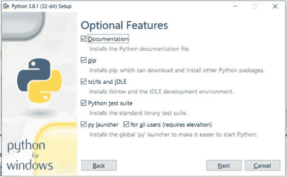
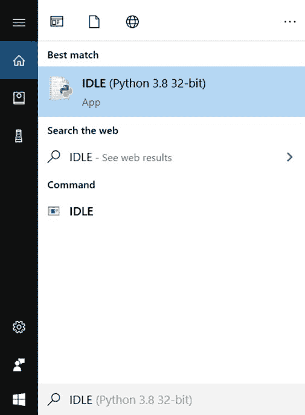
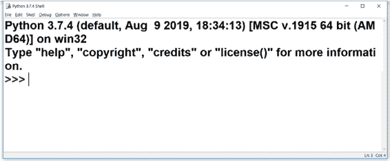
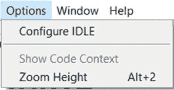
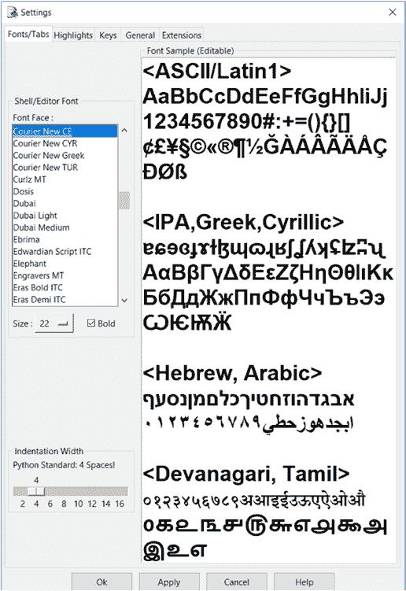
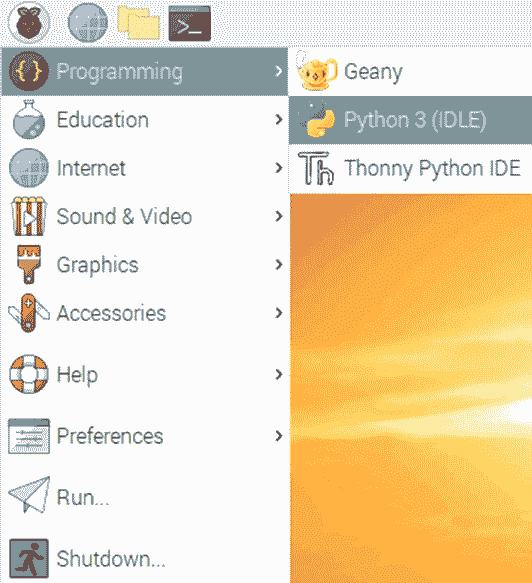
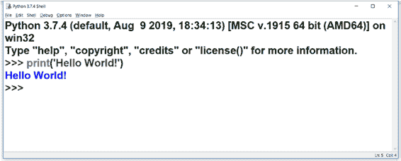
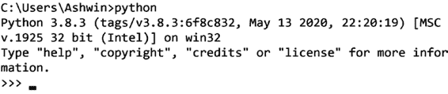
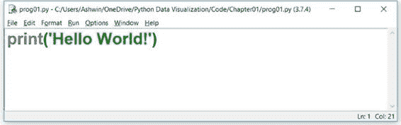
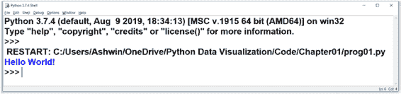

# 第 1 章：Python 入门

欢迎大家开启使用 Python 3 学习数据可视化的激动之旅。本章将详细介绍如何入门`Python`编程语言，包括其历史、特性及应用场景。

本章重点介绍`Python` 3 的通用信息，以及如何在各种主流操作系统平台上进行安装，例如 Microsoft Windows、Ubuntu 和 Raspberry Pi Raspbian。我们将编写几个基本的 Python 程序，并学习如何在不同的平台上执行它们。以下是本章将要涵盖的主题列表。

- Python 编程语言
- 在不同平台上安装 Python
- Python 模式

完成本章学习后，你将能够熟练地在各种模式下安装和使用`Python` 3 编程语言。

## Python 编程语言

`Python` 3 是一种高级、解释型、通用编程语言。本节将围绕`Python`编程语言及其设计理念展开一般性讨论。

> © Ashwin Pajankar 2021  
> A. Pajankar 著，《实用 Python 数据可视化》，  
> [`doi.org/10.1007/978-1-4842-6455-3_1`](https://doi.org/10.1007/978-1-4842-6455-3_1#DOI)

### Python 历史

`Python`是`ABC`编程语言的继任者，而`ABC`本身又受到`ALGOL 68`和`SETL`编程语言的启发。`Python`由**吉多·范罗苏姆**在 1980 年代末期休假期间作为个人副业项目创建，当时他就职于荷兰的 CWI 数学与信息学中心。从`Python`首次发布至 2018 年 7 月，范罗苏姆一直是该项目的主要开发者及终身仁慈独裁者。此后，他进入了永久休假状态，目前担任`Python`指导委员会的成员。以下时间线详细列出了`Python`发布过程中的重要里程碑。

- 1991 年 2 月：范罗苏姆将代码（标记为 0.9.0 版本）发布到`alt.sources`。
- 1994 年 1 月：1.0 版本发布。
- 2000 年 10 月：Python 2.0 发布。
- 2006 年 12 月：Python 3.0 发布。
- 2019 年 12 月：Python 2.x 正式退役，Python 软件基金会不再对其提供支持。

# Python 版本与本书约定

Python 2.x 版本已退役，不再受支持。此外，`Python 3` 与 `Python 2` 不向后兼容。`Python 3` 是语言的最新且当前受支持的版本。因此，我们在本书中全程使用 `Python 3` 来演示数据可视化的程序。

除非特别说明，本书中提到的 `Python` 均指代 `Python 3`。


### Python 增强提案

为了引导 `Python` 的开发、维护和支持，`Python` 领导团队提出了 `Python` 增强提案（`PEP`）的概念。这是为 `Python` 项目建议新特性和修复问题的主要机制。您可以在以下 `URL` 中阅读更多关于 `PEP` 的信息：

- [`www.python.org/dev/peps/`](https://www.python.org/dev/peps/)

- [`www.python.org/dev/peps/pep-0001/`](https://www.python.org/dev/peps/pep-0001/)

### Python 的哲学

`Python` 的哲学在 `PEP20` 中进行了详细阐述，被称为“Python 之禅”，可在 [`www.python.org/dev/peps/pep-0020/`](https://www.python.org/dev/peps/pep-0020/) 获取。以下是该 `PEP` 中的一些要点：

1.  优美胜于丑陋。
2.  显式胜于隐式。
3.  简单胜于复杂。
4.  复杂胜于凌乱。
5.  扁平胜于嵌套。
6.  稀疏胜于密集。
7.  可读性至关重要。
8.  特殊情况不应特殊到足以违反规则。
9.  尽管实用性胜过纯粹性。
10. 错误不应默默无声地传递。
11. 除非明确需要静默。
12. 面对歧义，拒绝猜测的诱惑。
13. 应该有一种——并且最好只有一种——显而易见的方式来做这件事。
14. 尽管那种方式一开始可能并不明显，除非你是荷兰人。
15. 现在做总比永远不做好。
16. 虽然“永远不做”通常比“*现在*就做”要好。
17. 如果实现难以解释，那可能是个坏主意。
18. 如果实现易于解释，那可能是个好主意。
19. 命名空间是个绝妙的主意——让我们更多地使用它们！

这些是影响 `Python` 编程语言发展并持续发挥作用的一般性哲学指南。

### Python 的应用

由于 `Python` 是一种通用编程语言，它在以下领域有众多应用：

1.  网页开发。
2.  图形用户界面（`GUI`）开发。
3.  科学与数值计算。
4.  软件开发。
5.  系统管理。

有关 `Python` 在各种项目中的案例研究，可在 [`www.python.org/success-stories/`](https://www.python.org/success-stories/) 获取。


### 在各种平台上安装 Python

`Python` 实现是一个支持执行用 `Python` 编写的程序的程序或环境。由 Van Rossum 创建的原始实现被称为 `CPython`，并作为参考实现。本书中我们全程使用 `CPython`。它可以在 `Python` 官方网站上获得，我们将在本节学习如何安装它。

我倾向于在 `Windows` 电脑或运行 `Raspberry Pi OS` 的 `Raspberry Pi` 电脑上编写 `Python` 程序。让我们学习如何在这两个平台上安装 `Python`。

#### 在 Windows 电脑上安装

访问位于 [`www.python.org/downloads/`](https://www.python.org/downloads/) 的 `Python 3` 下载页面，下载适用于您电脑的 `Python 3` 安装文件。它会自动检测您电脑上的操作系统并显示合适的可下载文件，如图 [1-1] (#index_split_000.html#p17) 所示。

**图 1-1.** 带有下载选项的 Python 项目主页


运行安装文件以安装 `Python 3`。在安装过程中，选中与将 `Python 3` 添加到 `PATH` 变量（图 1-2）相关的复选框。

**图 1-2.** Python 安装向导

点击“自定义安装”，该选项可提供如图 1-3 所示的定制选项。



**图 1-3.** Python 安装选项

选中所有复选框，然后点击“下一步”继续安装。

完成安装。Python 二进制可执行程序在 Windows 操作系统上的名称是 `python`。安装完成后，在 Windows 命令提示符 `cmd` 中运行以下命令：

```
python -V
```

该命令将返回 Python 3 的版本，如下所示：

```
Python 3.8.1
```

我们也可以按如下方式检查 `pip3` 的版本：

```
pip3 -V
```

`pip` 代表 Pip installs Python 或 Pip installs Packages；其名称是一个递归缩写。它是 Python 编程语言的包管理器。我们可以使用 `pip` 工具为我们的演示安装其他所需的 Python 库。

要确定 Python 的确切位置，可以按如下方式运行 `where` 命令：

```
where python
```

它将返回以下结果：

```
C:\Users\Ashwin\AppData\Local\Programs\Python\Python38-32\
python.exe
```

类似地，我们可以通过运行以下命令来了解 `pip3` 工具的位置：

```
where pip3
```

#### 在 Ubuntu 和 Debian 衍生版上安装

Debian 是一个流行的发行版。Ubuntu Linux 和 Raspberry Pi OS 是其他基于 Debian 的流行发行版。Python 3 和 `pip3` 已预装在所有的 Debian 发行版及其衍生版（如 Ubuntu 或 Raspberry Pi OS）中，因此我们无需单独安装它们。我在一台 4 GB RAM 的 Raspberry Pi 4B 上使用 Raspberry Pi OS。Python 的两个主要版本，Python 2 和 Python 3，都已预装在 Debian 衍生版中。它们的可执行文件分别命名为 `python`（对应 Python 2）和 `python3`（对应 Python 3）。在我们的演示中必须使用 `python3`。

要确定所需二进制可执行文件的版本和位置，请逐一运行以下命令：

```
python3 -V
pip3 -V
which python3
which pip3
```

几乎所有其他流行的 Linux 发行版也预装了 Python。



### Python 模式

Python 有多种模式，我们将逐一讨论。但首先，我们需要了解集成开发与学习环境（IDLE）。这是 Python 软件基金会为 Python 编程开发的一个集成开发环境（IDE）。当我们在 Windows 上安装 Python 3 的 `CPython` 实现时，`IDLE` 也会被安装。

我们可以通过多种方式在 Windows 操作系统上启动它。第一种方式是在 Windows 搜索栏中键入 `IDLE` 进行搜索，如图 1-4 所示。

**图 1-4.** Windows 上的 Python IDLE





另一种方式是通过在命令提示符（`cmd`）中运行以下命令来启动它：

```
idle
```

这将启动如图 1-5 所示的窗口。

**图 1-5.** Python IDLE

在我们继续之前，需要对其进行配置以便于阅读。我们可以通过选择 `选项` > `配置 IDLE` 来更改字体，如图 1-6 所示。

**图 1-6.** 配置 IDLE

这时会打开如图 1-7 所示的窗口。你可以在其中更改 `IDLE` 中字符的字体和大小。



**图 1-7.** IDLE 配置



根据你的个人偏好调整字体设置。

并非所有 Linux 发行版都预装了 `IDLE`。我们可以通过依次运行以下命令在 Debian 及其衍生版（Ubuntu 和 Raspberry Pi OS）上安装它。

```
sudo apt-get update
sudo apt-get install idle3
```

安装完成后，我们可以在菜单中找到 IDLE（此处为 Raspberry Pi OS 菜单），如图 1-8 所示。



# 第 1 章 Python 简介

我们也可以在 Linux 上通过运行以下命令来启动 `IDLE`：`idle`

现在让我们来讨论 Python 的各种模式。

## 交互模式

Python 的交互模式是一种命令行式的 shell，它能执行当前语句并在控制台中立即给出反馈。它会将之前输入的语句保存在活动内存中运行。当新语句被输入并由解释器执行时，代码会被求值。当我们打开 `IDLE` 时，会看到一个命令行提示符，这就是 Python 的交互模式。

让我们看一个简单的例子。在交互式提示符中输入常规的 Hello World 程序，如下所示：

```
print('Hello World!')
```

按下回车键，将这一行输入到解释器中并执行它。图 1-9 展示了输出的截图。

**图 1-9.** `IDLE` 中的 Python 交互模式



我们也可以从命令提示符启动 Python 交互模式。在 Linux 命令提示符（例如 `lxterminal`）下，必须运行命令 `python3`；而在 Windows 命令提示符 `cmd` 下，则需运行命令 `python` 来启动它。图 1-10 是 Windows 命令提示符下交互模式的截图。

**图 1-10.** Windows 命令提示符下的 Python 交互模式

## 脚本模式

我们可以编写一个 Python 程序并将其保存到磁盘。然后可以通过多种方式启动它。这被称为脚本模式。让我们在 `IDLE` 中演示一下。我们可以使用任何文本编辑器来编写 Python 程序，但由于 `IDLE` 是一个 IDE，使用 `IDLE` 编写和运行 Python 程序非常方便。我们先来看这个。在 `IDLE` 中，选择 File ➤ New File 来创建一个新的空白文件。在其中添加以下代码：

```
print('Hello World!')
```

将其保存为 `prog01.py` 文件到磁盘上（图 1-11）。





**图 1-11.** `IDLE` 代码编辑器中的 Python 程序

在菜单中，点击 Run ➤ Run Module。这会在 `IDLE` 的提示符下执行该程序，如图 1-12 所示。

**图 1-12.** 在 `IDLE` 提示符下执行的 Python 程序

我们甚至可以在操作系统的命令提示符下，使用 Python 解释器来启动该程序。打开操作系统的命令提示符，并导航到程序存储的目录。在 Windows 命令提示符下，运行以下命令：

```
python prog01.py
```

在 Linux 终端上，必须运行以下命令提示符：`python3 prog01.py`

然后解释器会在命令提示符下运行该程序，输出（如果有）会出现在那里。

在 Linux 中，还有一种无需显式使用解释器即可运行程序的方法。我们必须在代码文件的开头添加一个 shebang 行。例如，我们的代码文件如下所示：

```
#!/usr/bin/python3

print('Hello World!')
```

这段代码的第一行被称为 shebang 行。它告诉 shell 要使用哪个解释器及其位置。运行以下命令来更改文件权限，使其对所有者可执行：`chmod 755 prog01.py`

然后，我们可以像运行其他可执行文件一样，使用 `./` 直接启动我们的 Python 程序文件，如下所示：

```
./prog01.py
```

shell 将执行该程序并将输出打印到终端。

请注意，这仅适用于类 Unix 系统（Linux 和 macOS），因为它们支持以这种方式执行程序。从下一章开始，我们将根据需要逐步学习更多关于 Python 编程的知识。

## 总结

本章从 Python 编程语言的基础知识开始。

你学习了如何编写基本的 Python 程序并以多种方式执行它们。你学习了如何在包括 Windows 和 Linux 在内的各种操作系统上使用 Python。你还了解了 Python 的各种模式，以及如何从不同操作系统的命令提示符中启动它们。

