# 第 3 章：使用 Leather 进行数据可视化

在第 2 章中，我们使用`Jupyter Notebook`熟悉了`Python`编程。现在，你应该能熟练地使用`Jupyter Notebook`编写交互式`Python`程序了。

在本章中，我们将使用`Jupyter Notebook`和`Python`，并结合数据可视化库`leather`来生成基本的可视化图表。以下是本章将涵盖的主题列表：

- `leather`简介

- 更多可视化类型

- 比例

- 样式设置

## 在 Jupyter Notebook 中运行操作系统命令

你已经了解了如何使用`Jupyter Notebook`进行`Python`编程。现在我们将探讨如何在笔记本中执行操作系统命令。这很有用，因为我们需要使用`pip`来安装许多实用程序，我们可以在笔记本中直接运行它。

© Ashwin Pajankar 2021  

A. Pajankar, *实用 Python 数据可视化*,  

[`doi.org/10.1007/978-1-4842-6455-3_3`](https://doi.org/10.1007/978-1-4842-6455-3_3#DOI)

---

第 3 章：使用 Leather 进行数据可视化

为本章所有代码创建一个新的`Jupyter`笔记本。我们将在所有章节中遵循此流程，因此到本书结束时，我们将按章节将所有程序都保存在笔记本中。

要在笔记本单元格中执行操作系统命令，我们必须使用`!`符号作为前缀，如下所示：

```
!dir
```

该命令的输出如图 3-1 所示。

**图 3-1.** `Jupyter Notebook`中操作系统命令的输出

你可以通过运行以下语句来升级`pip`工具：

```
!pip3 install --upgrade pip
```

使用以下语句安装用于数据可视化演示的`leather`库：

```
!pip3 install leather
```

这将在计算机上安装`leather`数据可视化库。在下一节中，我们将开始使用笔记本进行`Python`和`leather`的可视化操作。

---

第 3 章：使用 Leather 进行数据可视化

## Leather 简介

`leather`是一个易于使用、广受欢迎的`Python`数据可视化库。你可以在`Python`包索引 (PyPI) 上找到它，网址为 [`pypi.org/project/leather/`](https://pypi.org/project/leather/)。

# 第 3 章 使用 leather 进行数据可视化

[org/project/leather/](https://pypi.org/project/leather/)。`PyPI`是一个第三方软件包仓库，可以使用`pip3`工具进行下载。我们也可以在 PyPI 上搜索某个包是否可用。在笔记本中运行以下命令：

```
!pip3 search leather
```

输出结果如图 3-2 所示。

***图 3-2.** 使用 pip3 搜索软件包*

在继续之前，我们需要事先了解一些关于 Python 编程语言的知识。在 Python 中，缩进用于表示代码块。在 C、C++和 Java 等几种流行的编程语言中，多行代码块用花括号`{}`括起来。Python 则强制程序员缩进代码块，没有其他表示方法。以下面的代码为例。

```
a = 3

if a%2 == 0:

print('Even')

else:

print('Odd')
```

在笔记本中运行该代码并查看结果。还有一件有趣的事情可以尝试。我们已经了解了《Python 之禅》（PEP 20）。Python 的创建者将其作为彩蛋添加在解释器中，你可以通过以下语句调用它：

```
import this
```

如果在笔记本中运行这行语句，它会在输出中打印《Python 之禅》的所有箴言。

请注意，我们使用 Jupyter Notebook 演示的所有程序，稍加修改后也可以在 IDLE 中运行。我们之所以使用 Jupyter Notebook，是因为它具有即时反馈和交互式功能。现在，让我们使用`import`语句将 leather 库添加到笔记本中。

每个会话只需导入一次，它在整个会话期间都可使用。使用以下语句：

```
import leather
```

运行后，它会将该库导入到当前的笔记本会话中。最好为每个新主题添加一个标题，但这由你自己决定。你会发现，我在本书配套代码的笔记本中经常使用标题，以便为演示的内容提供上下文和参考。这是一个好习惯，你可能也想效仿。

让我们编写简单的代码来可视化一些数据点。我们可以在 X-Y 坐标系中定义这些点。我们可以使用元组列表来定义点，如下所示：

```
data1 = [(1.5, 2), (2, 3), (4.5, 6), (7.5, 4)]
```

我们也可以将它们定义为列表的列表：

```
data1 = [[1.5, 2], [2, 3], [4.5, 6], [7.5, 4]]
```

我们还可以将它们定义为元组的元组：

```
data1 = ((1.5, 2), (2, 3), (4.5, 6), (7.5, 4))
```

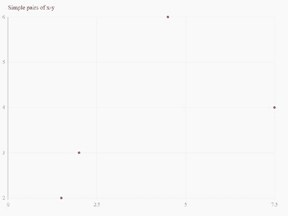

我们也可以将它们定义为列表的元组：

```
data1 = ([1.5, 2], [2, 3], [4.5, 6], [7.5, 4])
```

正如你所看到的，`leather`库在数据定义方式上并不苛刻，非常灵活。

让我们按如下方式定义一个图表对象：

```
chart = leather.Chart('简单的 x-y 坐标对')
```

接下来，创建一个散点图：

```
chart.add_dots(data1)
```

然后，按如下方式可视化图表：

```
chart.to_svg()
```

它会在同一个笔记本中显示输出结果，如图 3-3 所示。

***图 3-3.** 绘制数据点*

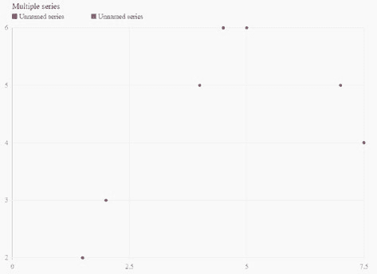

我们可以使用以下语句将图像保存到磁盘：

```
chart.to_svg('image1.svg')
```

然后，我们可以如下方式自定义散点：

```
chart = leather.Chart('自定义散点')
chart.add_dots(data1, fill_color='#00ff00', radius=10)
chart.to_svg()
```

让我们定义更多的数据点：

```
data2 = [(2, 3), (4, 5), (5, 6), (7, 5)]
```

我们还可以按如下方式可视化多个序列：

```
chart = leather.Chart('可视化多个序列')
chart.add_dots(data1)
chart.add_dots(data2)
chart.to_svg()
```

输出结果如图 3-4 所示。

***图 3-4.** 绘制多个序列*

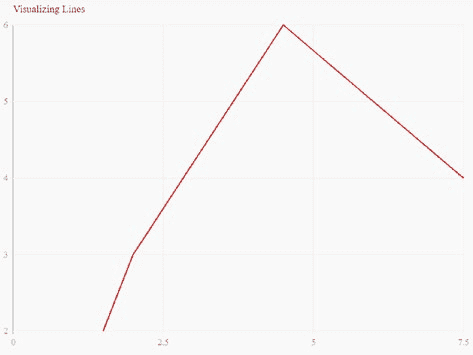

如图 3-4 所示，`leather`会根据数据点所属的序列自动为它们分配不同的颜色。

## 更多可视化类型

我们可以使用连接各点的线段来可视化数据，如下所示：

```
chart = leather.Chart('Visualizing Lines')
chart.add_line(data1)
chart.to_svg()
```

输出结果如图 3-5 所示。

***图 3-5.** 线段可视化*

我们可以按如下方式自定义线段可视化：

```
chart = leather.Chart('Customized Line')
chart.add_line(data1, stroke_color='#0000ff', width=3)
chart.to_svg()
```

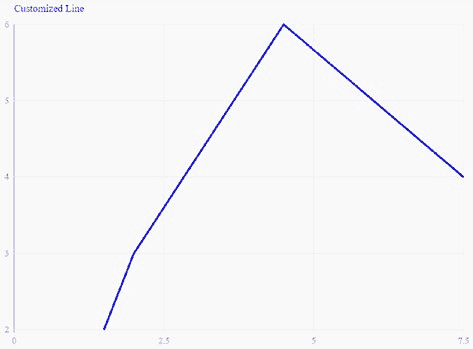

图 3-6 显示了输出结果。

***图 3-6.** 自定义线段*

我们可以按如下方式可视化多条线段：

```
chart = leather.Chart('Visualizing Multiple Lines')
chart.add_line(data1)
chart.add_line(data2)
chart.to_svg()
```

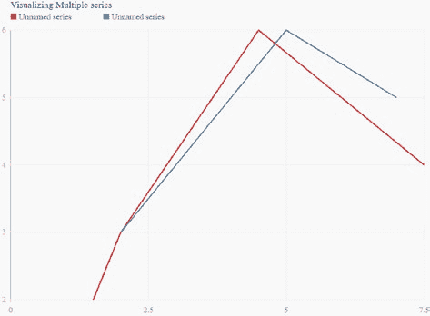

图 3-7 显示了输出结果。

***图 3-7.** 多条线段可视化*

我们可以在单个可视化中展示多种类型，如下所示：

```
chart = leather.Chart('Visualizing Multiple Types')
chart.add_line(data1)
chart.add_dots(data2)
chart.to_svg()
```

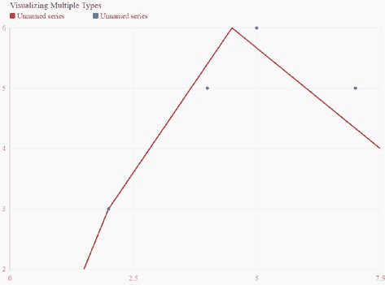

图 3-8 显示了输出结果。

***图 3-8.** 多种类型可视化*

我们可以使用条形图进行可视化，如下所示：

```
data = [[1, 'A'], [2, 'B'], [3, 'C'], [4, 'D']]
chart = leather.Chart('Visualizing Bars')
chart.add_bars(data)
chart.to_svg()
```

在我们的数据集中，其中一个维度是文本数据。可视化结果如图 3-9 所示。

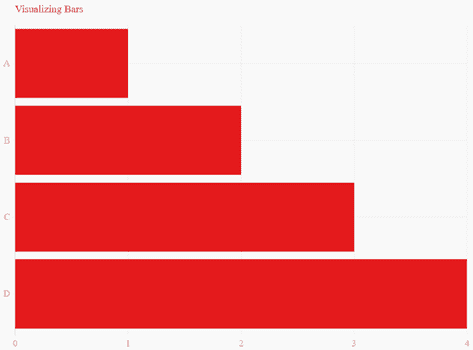
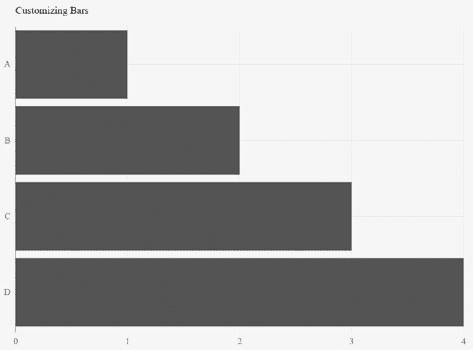

***图 3-9.** 条形图可视化*

我们可以按如下方式自定义条形图：

```
chart = leather.Chart('Customizing Bars')
chart.add_bars(data, fill_color='#777777')
chart.to_svg()
```

输出结果如图 3-10 所示。

***图 3-10.** 自定义条形图*

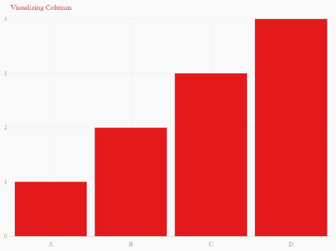

我们可以使用垂直柱状图进行可视化，如下所示：

```
data = [('A', 1), ('B', 2), ('C', 3), ('D', 4)]
chart = leather.Chart('Visualizing Columns')
chart.add_columns(data)
chart.to_svg()
```

输出结果如图 3-11 所示。

***图 3-11.** 垂直柱状图*

我们可以按如下方式自定义柱状图：

```
chart = leather.Chart('Customizing Columns')
chart.add_columns(data, fill_color='#77ff77')
chart.to_svg()
```

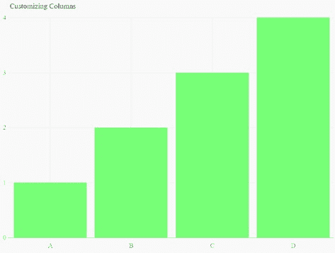

输出结果如图 3-12 所示。

***图 3-12.** 自定义垂直柱状图*

## 刻度

`leather`库可以自动或通过编程创建多种类型的刻度。序数刻度是为文本数据自动创建的。示例与我们之前看到的相同：

```
chart = leather.Chart('The Ordinal Scale')
chart.add_columns(data)
chart.to_svg()
```

当数据是数值型时，会自动创建线性刻度。我们可以按如下方式设置刻度的范围：

# 第 3 章 使用 leather 进行数据可视化

```python
chart = leather.Chart('Linear Scale')
chart.add_x_scale(1, 8)
chart.add_y_scale(1, 7)
chart.add_line(data1)
chart.to_svg()
```

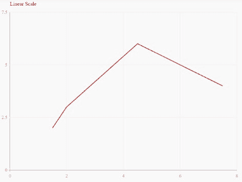

图 3-13 显示了输出结果。

***图 3-13.** 自定义范围的线性刻度*

时间刻度是为时间（与时间相关）数据自动创建的：

```python
from datetime import date

data = [
    (date(2020, 1, 1), 4),
    (date(2020, 3, 1), 6),
    (date(2020, 6, 1), 2),
    (date(2020, 9, 1), 1)
]

chart = leather.Chart('Temporal Scale')
chart.add_x_scale(date(2019, 9, 1), date(2020, 12, 1))
chart.add_line(data)
chart.to_svg()
```

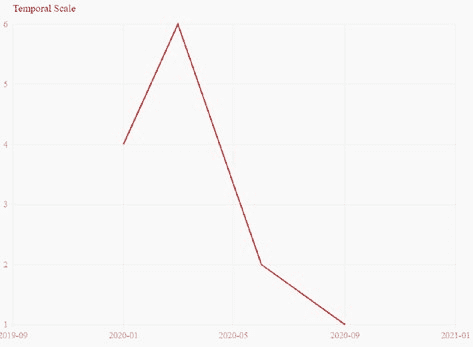

输出结果如图 3-14 所示。

***图 3-14.** 自定义范围的时间刻度*

## 样式

Leather 提供了许多样式选项。我们可以根据需求设置坐标轴上的刻度值，如下所示：

```python
chart = leather.Chart('Ticks Demo')
chart.add_x_scale(1, 8)
chart.add_x_axis(ticks=[1, 2, 3, 4, 5, 6, 7, 8])
chart.add_y_scale(1, 7)
```

`chart.add_y_axis(ticks=[1, 2, 3, 4, 5, 6, 7])`

`chart.add_line(data1)`

`chart.to_svg()`

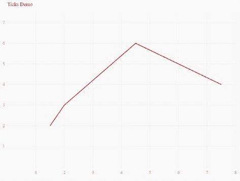

输出结果如图 3-15 所示。

***图 3-15.** 自定义刻度值*

我们还可以自定义用于显示数值与序列的字体和颜色。以下是一个简单示例。

`leather.theme.title_font_family = 'Times New Roman'`

`leather.theme.legend_font_family = 'Times New Roman'`

`leather.theme.tick_font_family = 'Times New Roman'`

`leather.theme.default_series_colors = ['#ff0000', '#00ff00']`

`chart = leather.Chart('自定义字体')`

`chart.add_line(data1)`

`chart.add_line(data2)`

`chart.to_svg()`

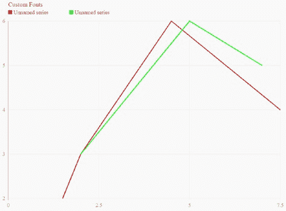

图 3-16 展示了此示例的输出结果。

***图 3-16.** 自定义字体与颜色*

我们还可以通过以下代码根据数据点的位置为其着色。首先在笔记本中导入随机库：`import random`

我们将使用它生成如下数据点：

```python
data = [(random.randint(0, 250),
         random.randint(0, 250)) for i in range(100)]
```

这会创建 100 个数据点。这 100 个点的 x 轴和 y 轴值均从 0 到 250 的区间中随机选取。我们可以编写一个颜色函数，根据点的位置返回 RGB 格式的颜色值。

```python
def colorizer(location):
    return 'rgb(%i, %i, %i)' % (location.x, location.y, 150)
```

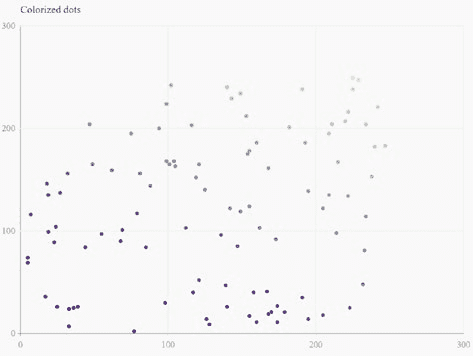

调用此函数来定义点的填充颜色，具体如下：

```python
chart = leather.Chart('着色点')
chart.add_dots(data, fill_color=colorizer)
chart.to_svg()
```

输出结果如图 3-17 所示。

***图 3-17.** 数据点的自定义颜色*

## 本章小结

本章通过使用流行的数据可视化库 leather 演示了如何用 Python 进行数据可视化。我们介绍了不同类型的可视化图表、样式和刻度。Leather 是一个非常简单的数据可视化库，仅能可视化简单的图形。

你的业务需求或科学可视化可能需要更复杂精细的图表。为此，你需要熟悉科学 Python 生态系统。下一章将详细探讨科学 Python 生态系统。我们还将学习 NumPy N 维数组（也称为 `ndarray`）的基础知识。

