# 第 5 章 数据可视化

## 使用 NumPy 和 Matplotlib

第 4 章介绍了 `NumPy` 的基础知识。您学习了如何安装它以及如何创建 `ndarray`。在本章中，我们将继续使用 `NumPy`，了解一些 `ndarray` 创建例程。我们还将开始使用科学计算生态系统中的数据可视化库 `Matplotlib`。我们将使用 `NumPy` 的 `ndarray` 创建例程来演示如何使用 `Matplotlib` 进行可视化。本章内容详尽，重点是代码和可视化。本章涵盖以下主题：

• `Matplotlib`

• 使用 `NumPy` 和 `Matplotlib` 进行可视化

• 单线图

• 多线图

• 网格、坐标轴和标签

• 颜色、样式和标记

© Ashwin Pajankar 2021

A. Pajankar，*实用 Python 数据可视化*，

[`doi.org/10.1007/978-1-4842-6455-3_5`](https://doi.org/10.1007/978-1-4842-6455-3_5#DOI)

在本书的后续章节中，我们将使用 `Matplotlib` 和 `NumPy` 来演示数据可视化。

## Matplotlib

`Matplotlib` 是 `SciPy` 的重要组成部分，用于数据可视化。它是 `NumPy` 的扩展，提供了类似 `MATLAB` 的绘图和可视化接口。它最初由 John D Hunter 开发，作为 Python 可用的开源替代方案。

我们可以通过 Jupyter Notebook 按如下方式安装它：

```
!pip3 install matplotlib
```

要在 notebook 中使用它进行基本绘图，我们必须按如下方式导入其 `pyplot` 模块：

```
import matplotlib.pyplot as plt
```

此外，要在 notebook 中显示 `Matplotlib` 的可视化结果，我们必须运行以下命令：

```
%matplotlib inline
```

这强制 `Matplotlib` 将输出内联显示，直接位于生成该可视化的代码单元格下方。当我们需要使用 `Matplotlib` 时，总会使用此命令。

我们也来导入 `NumPy`，如下所示：

```
import numpy as np
```

你可以在 `https://matplotlib.org/` 上阅读关于 `Matplotlib` 的更多信息。

### 使用 NumPy 和 Matplotlib 进行可视化

现在我们将学习如何使用 `ndarray` 创建例程来创建 `NumPy` `ndarray`，然后使用 `Matplotlib` 对其进行可视化。让我们从创建 `ndarray` 的例程开始。

第一个例程是 `arange()`。它使用给定的步长创建均匀间隔的值。必须提供一个终止值参数。起始值和步长参数分别有默认参数 0 和 1。

让我们看一个例子。

```
x = np.arange(5)
```

在此示例中，终止值为 5，因此它会创建一个从 0 开始到 4 结束的 `ndarray`。该函数返回一个具有半开区间的序列，这意味着终止值不包含在输出中。因为我们没有指定步长，它默认为 1。我们可以查看输出及其数据类型，如下所示：

```
print(x)
type(x)
```

输出如下：

```
[0 1 2 3 4]
numpy.ndarray
```

让我们继续绘制这些数字。对于二维绘图，我们需要 X-Y 对。

# 第 5 章 使用 NumPy 和 Matplotlib 进行数据可视化

我们保持简单，通过运行以下语句设置`y = f(x) = x`：`y=x`

现在，使用函数`plot()`来可视化它。它需要 X、Y 的值以及绘图选项。我们将在本章后面学习更多关于绘图选项的内容。

```
plt.plot(x, y, 'o--')
plt.show()
```

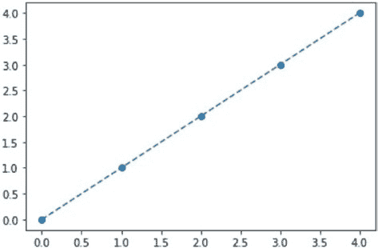

函数`show()`用于显示图形。如上所示，我们使用绘图选项`o--`进行可视化。这意味着点用实心圆表示，线为虚线，如图 5-1 所示。

**图 5-1.** 可视化`y=f(x)=x`

让我们看一个带有起始值和终止值参数的函数`arange()`调用示例：

```
np.arange(2, 6)
```

它返回以下输出（直接打印，我们未将其存储在变量中）：

```
array([2, 3, 4, 5])
```

我们甚至可以为步长添加一个参数，如下所示：

```
np.arange(2, 6, 2)
```

输出如下：

```
array([2, 4])
```

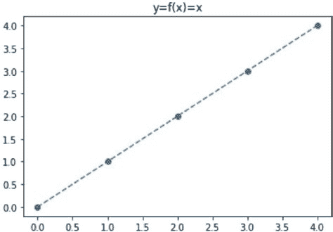

输出显示在图 5-2 中。

**图 5-2.** 带标题的输出

函数`linspace(start, stop, number)`在指定的区间内返回均匀间隔的数字。我们必须向其传递起始值、终止值和值的数量，如下所示：

```
N = 11
x = np.linspace(0, 10, N)
print(x)
```

这段代码创建了 11 个数字（包含 0 到 10），如下所示：

```
[ 0.  1.  2.  3.  4.  5.  6.  7.  8.  9. 10.]
```

我们可以通过以下方式可视化它：

```
y = x
plt.plot(x, y, 'o--')
plt.axis('off')
plt.show()
```

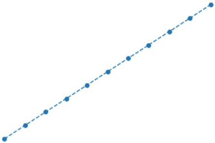

输出显示在图 5-3 中。

**图 5-3.** 使用`linspace()`的`y = x`输出

如你所见，我们通过`plt.axis('off')`这一行代码来关闭坐标轴。

类似地，我们可以按如下方式计算并可视化对数空间中的数值：

```
y = np.logspace(0.1, 1, N)
print(y)
plt.plot(x, y, 'o--')
plt.show()
```

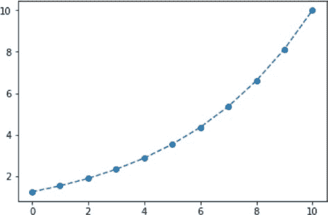
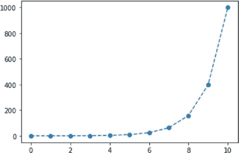

输出结果如图 5-4 所示。

**图 5-4.** `logspace()`的输出

我们甚至可以按如下方式计算等比数列：

```
y = np.geomspace(0.1, 1000, N)
print(y)
plt.plot(x, y, 'o--')
plt.show()
```

输出结果显示在图 5-5 中。

**图 5-5.** `geomspace()`的输出

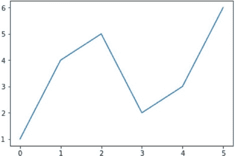

## 单线图

在本节中，我们将探讨绘制单线图的几种方法。我们之前已使用`plot()`函数来绘制图形。当一张图中只使用`plot()`函数绘制了一个可视化图形时，这被称为单线图。让我们通过几个示例进一步了解。

我们也可以使用 Python 列表来可视化图形，如下所示：

```
x = [1, 4, 5, 2, 3, 6]
plt.plot(x)
plt.show()
```

输出结果如图 5-6 所示。

**图 5-6.** 简单的单线图

在此例中，y 轴的值是自动假定的。这是另一个示例：

```
x = np.arange(10)
plt.plot(x)
plt.show()
```

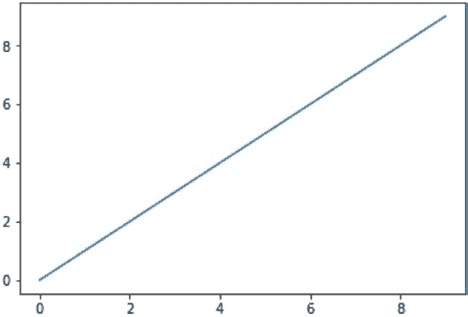
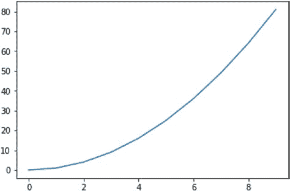

输出结果显示在图 5-7 中。

**图 5-7.** 使用`arange()`绘制的简单单线图

接下来，让我们可视化一个二次函数图形`y = f(x) = x2`。代码如下：

```
plt.plot(x, [y**2 for y in x])
plt.show()
```

输出结果如图 5-8 所示。

**图 5-8.** `y = f(x) = x2`

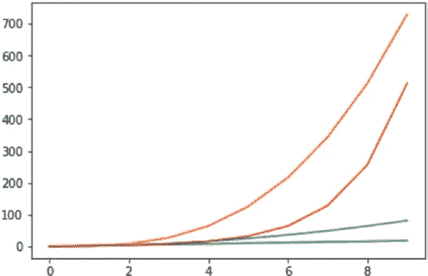

我们可以用更简洁的方式编写相同的代码：

```
plt.plot(x, x**2)
plt.show()
```

## 多线图

在同一张可视化图形中显示多个图形是可行的。让我们通过一个简单示例来看看如何在同一张图中显示多条曲线：

```
x = np.arange(10)
plt.plot(x, x**2)
plt.plot(x, x**3)
plt.plot(x, x*2)
plt.plot(x, 2**x)
plt.show()
```

输出结果如图 5-9 所示。

**图 5-9.** 多线图

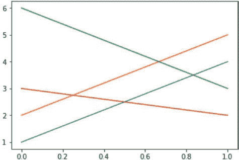

正如我们所看到的，Matplotlib 会自动为每条曲线分配不同的颜色。

我们可以用更简洁的方式编写相同的代码：

```
plt.plot(x, x**2, x, x**3, x, x*2, x, 2**x)
plt.show()
```

输出结果将与图 5-9 相同。

这是另一个示例：

```
x = np.array([[1, 2, 6, 3], [4, 5, 3, 2]])
plt.plot(x)
plt.show()
```

输出结果显示在图 5-10 中。

**图 5-10.** 多线图的另一个示例

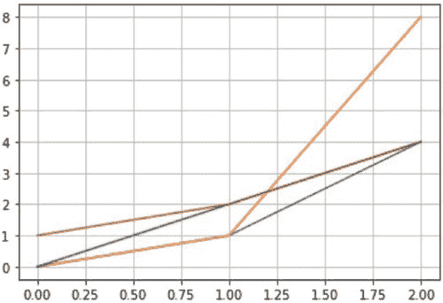

## 网格、坐标轴和标签

之前，我们了解了如何在可视化图形中启用网格。这可以通过语句`plt.grid(True)`实现。现在，我们将学习如何操作坐标轴的界限。不过在此之前，我们先快速学习如何将可视化图形保存为图片。请看以下代码：

```
x = np.arange(3)
plt.plot(x, x**2, x, x**3, x, 2*x, x, 2**x)
plt.grid(True)
plt.savefig('test.png')
plt.show()
```

语句`plt.savefig('test.png')`将图片保存在 Jupyter Notebook 文件的当前目录中。输出结果如图 5-11 所示。

**图 5-11.** 多线图

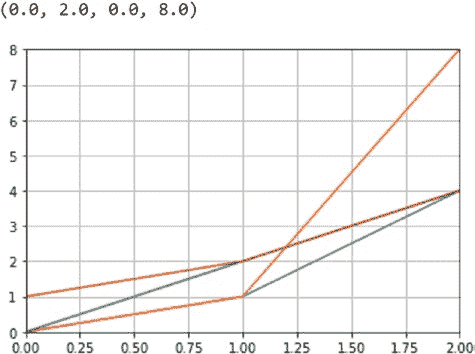

我们可以看到，坐标轴的界限是默认设置的。我们可以将它们设置为特定值，如下所示：

```
x = np.arange(3)
plt.plot(x, x**2, x, x**3, x, 2*x, x, 2**x)
plt.grid(True)
plt.axis([0, 2, 0, 8])
print(plt.axis())
plt.show()
```

输出结果显示在图 5-12 中。

**图 5-12.** 设置坐标轴

语句`plt.axis([0, 2, 0, 8])`用于设置坐标轴的值。

# 第 5 章 使用 numpy 和 matplotlib 进行数据可视化

第一对 `(0, 2)` 指的是 x 轴的界限，第二对 `(0, 8)` 指的是 y 轴的界限。我们可以使用 `xlim()` 和 `ylim()` 函数以不同的语法编写这段代码，如下所示：

```python
x = np.arange(3)

plt.plot(x, x**2, x, x**3, x, 2*x, x, 2**x)

plt.grid(True)
```

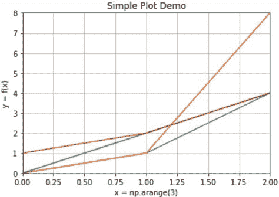

```python
plt.xlim([0, 2])

plt.ylim([0, 8])

plt.show()
```

这段代码生成的输出与图 5-12 完全相同。你可以添加标题和轴标签，如下所示：

```python
x = np.arange(3)

plt.plot(x, x**2, x, x**3, x, 2*x, x, 2**x)

plt.grid(True)

plt.xlabel('x = np.arange(3)')

plt.xlim([0, 2])

plt.ylabel('y = f(x)')

plt.ylim([0, 8])

plt.title('Simple Plot Demo')

plt.show()
```

这将生成包含标签和标题的输出，如图 5-13 所示。

**图 5-13.** 轴的标题和标签

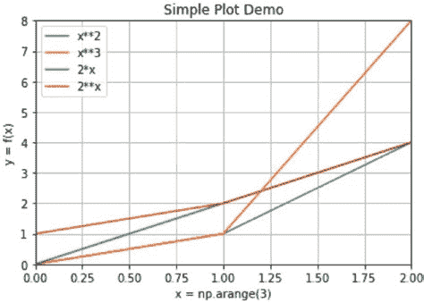

我们可以在 `plot()` 函数中为 `label` 参数传递一个实参，然后调用 `legend()` 函数来创建图例，如下所示：

```python
x = np.arange(3)

plt.plot(x, x**2, label='x**2')

plt.plot(x, x**3, label='x**3')

plt.plot(x, 2*x, label='2*x')

plt.plot(x, 2**x, label='2**x')

plt.legend()

plt.grid(True)

plt.xlabel('x = np.arange(3)')

plt.xlim([0, 2])

plt.ylabel('y = f(x)')

plt.ylim([0, 8])

plt.title('Simple Plot Demo')

plt.show()
```

这将生成带有曲线图例的输出，如图 5-14 所示。

**图 5-14.** 带有图例的输出

除了将图例字符串作为实参传递给 `plot()` 函数外，我们还可以将字符串列表作为实参传递给 `legend()` 函数，如下所示：

```python
x = np.arange(3)

plt.plot(x, x**2, x, x**3, x, 2*x, x, 2**x)

plt.legend(['x**2', 'x**3', '2*x', '2**x'])

plt.grid(True)

plt.xlabel('x = np.arange(3)')

plt.xlim([0, 2])

plt.ylabel('y = f(x)')

plt.ylim([0, 8])

plt.title('Simple Plot Demo')

plt.show()
```

它生成的输出与图 5-14 完全相同。

我们还可以通过修改上述代码来更改图例框的位置，如下所示：

```python
plt.legend(['x**2', 'x**3', '2*x', '2**x'], loc='upper center')
```

输出如图 5-15 所示。

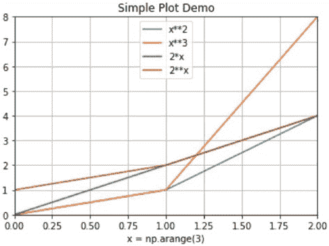

**图 5-15.** 图例位于中上位置的输出

## 颜色、样式和标记

到目前为止，在多线图的情况下，我们已经看到 Matplotlib 会自动分配颜色、样式和标记。我们也看到了一些自定义它们的例子。在本节中，我们将详细探讨如何自定义它们。

我们从颜色开始。下面的代码列出了 Matplotlib 支持的所有基本颜色（在本例中，我们没有自定义样式和标记）。

```python
x = np.arange(5)

y = x

plt.plot(x, y+1, 'g')

plt.plot(x, y+0.5, 'y')

plt.plot(x, y, 'r')

plt.plot(x, y-0.2, 'c')

plt.plot(x, y-0.4, 'k')

plt.plot(x, y-0.6, 'm')

plt.plot(x, y-0.8, 'w')

plt.plot(x, y-1, 'b')

plt.show()
```

输出如图 5-16 所示。

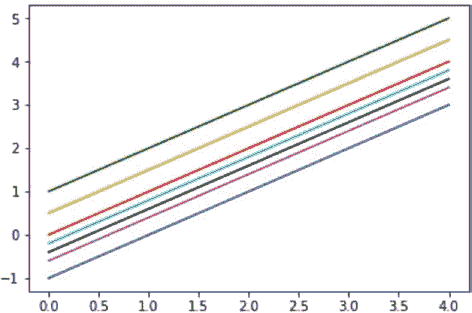

我们也可以将上述代码编写如下：

```python
plt.plot(x, y+1, 'g', x, y+0.5, 'y', x, y, 'r', x, y-0.2, 'c', x, y-0.4, 'k', x, y-0.6, 'm', x, y-0.8, 'w', x, y-1, 'b')

plt.show()
```

输出将与图 5-16 完全相同。

**图 5-16.** 颜色演示

我们可以如下自定义线条样式：

```python
plt.plot(x, y, '-', x, y+1, '--', x, y+2, '-.', x, y+3, ':')

plt.show()
```

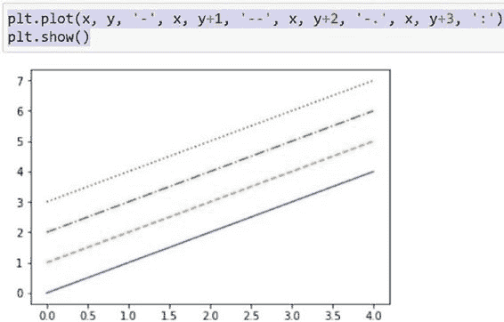

**图 5-17.** 线条样式

你甚至可以像这样更改标记：

```python
plt.plot(x, y, '.')

plt.plot(x, y+0.5, ',')

plt.plot(x, y+1, 'o')

plt.plot(x, y+2, '<')

plt.plot(x, y+3, '>')

plt.plot(x, y+4, 'v')

plt.plot(x, y+5, '^')
```

```python
plt.plot(x, y+6, '1')
plt.plot(x, y+7, '2')
plt.plot(x, y+8, '3')
plt.plot(x, y+9, '4')
plt.plot(x, y+10, 's')
plt.plot(x, y+11, 'p')
plt.plot(x, y+12, '*')
```

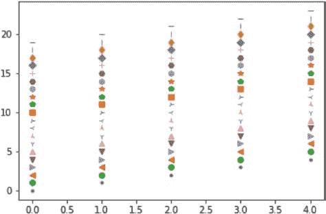

```python
plt.plot(x, y+13, 'h')
plt.plot(x, y+14, 'H')
plt.plot(x, y+15, '+')
plt.plot(x, y+16, 'D')
plt.plot(x, y+17, 'd')
plt.plot(x, y+18, '|')
plt.plot(x, y+19, '_')
plt.show()
```

输出结果如图 5-18 所示。

**图 5-18.** 标记样式

所有三个特性（颜色、标记和线条样式）可以组合起来自定义可视化效果，如下所示：

```python
plt.plot(x, y, 'mo--')
plt.plot(x, y+1 , 'g*-.')
plt.show()
```

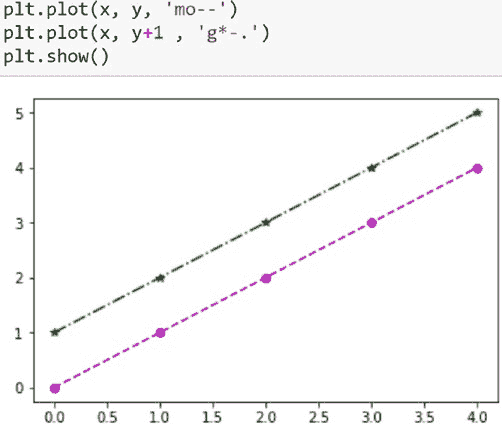

输出结果如图 5-19 所示。

**图 5-19.** 自定义所有元素

这些是基本自定义，但你可以更详细地自定义所有内容。例如，使用以下代码自定义其他细节：

```python
plt.plot(x, y, color='g', linestyle='--', linewidth=1.5,
         marker='^', markerfacecolor='b', markeredgecolor='k',
         markeredgewidth=1.5, markersize=5)
plt.grid(True)
plt.show()
```

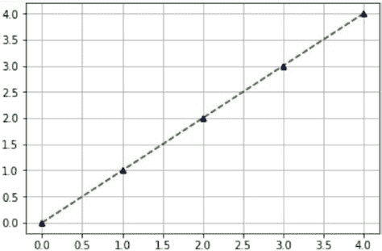

输出结果如图 5-20 所示。

**图 5-20.** 自定义更多细节

你甚至可以按如下方式自定义 `x` 和 `y` 轴上的刻度值：

```python
x = y = np.arange(10)
plt.plot(x, y, 'o--')
plt.xticks(range(len(x)), ['a', 'b', 'c', 'd', 'e', 'f', 'g',
                             'h', 'i', 'j'])
plt.yticks(range(0, 10, 1))
plt.show()
```

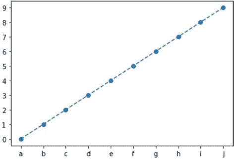

输出结果如图 5-21 所示。

**图 5-21.** 自定义坐标轴刻度

## 小结

本章重点介绍了可视化可用的各种自定义方法。我们学到了大量关于数据可视化的知识。本章涵盖的概念将在本书中持续用于数据可视化。在下一章中，我们将进一步探索数据可视化。我们将学习可视化图像和 3D 形状，并了解图像操作的基础知识。

