## 第 7 章 可视化图与网络

在第 6 章中，我们演示了如何使用 Python 3 和 Matplotlib 可视化图像和三维对象。我们还学习了一些图像处理知识。

本章重点介绍一种称为图或网络的数据结构的可视化。让我们通过以下主题继续我们的数据可视化之旅：

- 图与网络
- 在 Python 3 中可视化图
- 更多类型的图
- 为节点分配自定义标签

完成本章后，你将能够使用 Python 3 可视化图与网络。

### 图与网络

图是一种抽象数据类型，也称为网络。它由一个有限的顶点（也称为节点）集合和一个有限的边（也称为链接）集合组成。当我们指代图时，使用术语“顶点”和“边”；当我们指代相同结构为网络时，则使用“节点”和“链接”。为了保持一致性，本章我将使用术语“图”、“节点”和“边”来指代此数据结构。

在图中，顶点通过边相互连接。树是图的一个子类型。图中可以存在环，而树中则不能。

我们也可以有有向图和无向图。可以为图中的边赋值，这样的图称为加权图。在本章中，我们将讨论无向且无加权图的可视化。

### Python 3 中的图

要处理并可视化图，Python 3 有一个名为 `networkx` 的易用库。你可以通过在 Jupyter Notebook 单元格中运行以下命令来安装它：

```
!pip3 install network
```

现在，导入它和其他库 `matplotlib`。我们还会在笔记本中启用绘图功能：

```
%matplotlib inline
import networkx as nx
import matplotlib.pyplot as plt
```

你可以按如下方式创建一个新的空图：

```
G = nx.Graph()
```

让我们按如下方式确定其类型：

```
type(G)
```

输出如下：

```
networkx.classes.graph.Graph
```

你可以查看节点和边的列表，还可以按如下方式查看它们的数据类型：

```
print(G.nodes())
print(G.edges())
print(type(G.nodes()))
print(type(G.edges()))
```

这将产生以下输出：

```
[]
[]
<class 'networkx.classes.reportviews.NodeView'>
<class 'networkx.classes.reportviews.EdgeView'>
```

你可以按如下方式添加一个节点：

```
G.add_node('a')
```

或者，你也可以添加列表中指定的多个节点：

```
G.add_nodes_from(['b', 'c'])
```

我们将再次打印节点列表和边列表（由于我们尚未添加任何边，边列表应为空）：

```
print('Nodes of the graph G: ')
print(G.nodes())
print('Edges of the graph G: ')
print(G.edges())
```

输出看起来像这样：

```
Nodes of the graph G:
['a', 'b', 'c']
Edges of the graph G:
[]
```

请看以下语句：

```
G.add_edge(1, 2)
```

它添加了两个节点和一条相应的边。如果函数调用中的参数已经是图节点列表的一部分，则不会重复添加。以下是另一种添加方式：

```
edge = ('d', 'e')
G.add_edge(*edge)
edge = ('a', 'b')
G.add_edge(*edge)
```

让我们再次打印节点和边的列表，如下所示：

```
print('Nodes of the graph G: ')
print(G.nodes())
print('Edges of the graph G: ')
print(G.edges())
```

[[-3.  -2.91 -2.82 ... 2.76 2.85 2.94]
 [-3.  -2.91 -2.82 ... 2.76 2.85 2.94]
 [-3.  -2.91 -2.82 ... 2.76 2.85 2.94]
 ...
 [-3.  -2.91 -2.82 ... 2.76 2.85 2.94]
 [-3.  -2.91 -2.82 ... 2.76 2.85 2.94]
 [-3.  -2.91 -2.82 ... 2.76 2.85 2.94]]

[[-3.  -3.  -3.  ... -3.  -3.  -3. ]
 [-2.91 -2.91 -2.91 ... -2.91 -2.91 -2.91]
 [-2.82 -2.82 -2.82 ... -2.82 -2.82 -2.82]
 ...
 [ 2.76 2.76 2.76 ... 2.76 2.76 2.76]
 [ 2.85 2.85 2.85 ... 2.85 2.85 2.85]
 [ 2.94 2.94 2.94 ... 2.94 2.94 2.94]]

接下来，按如下方式计算 `z` 坐标：

```
R = np.sqrt(X**2 + Y**2)
Z = np.cos(R)
print(Z)
```

最后，创建图形和坐标轴，并可视化 3D 曲面：

```
fig = plt.figure()
ax = fig.gca(projection='3d')
surf = ax.plot_surface(X, Y, Z,
                       cmap=plt.cm.cool,
                       linewidth=0,
                       antialiased=False)
plt.show()
```

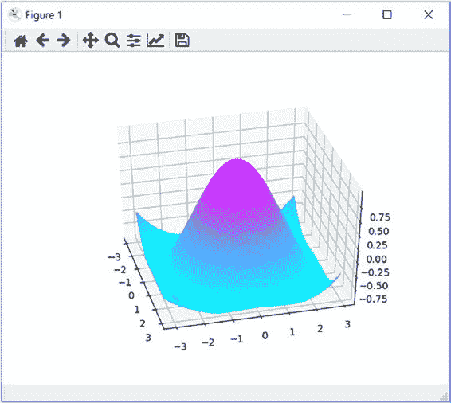

这将生成如图 6-13 所示的输出。

**图 6-13.** 可视化三维曲面


# 排版后的文档

我们可以通过指定边的列表来将其添加到图中：`G.add_edges_from([('a', 'c'), ('c', 'd'), ('a', 1), (1, 'd'), ('a', 2)])`

现在，让我们再次打印所有内容：

```
print('Nodes of the graph G: ')
print(G.nodes())
print('Edges of the graph G: ')
print(G.edges())
```

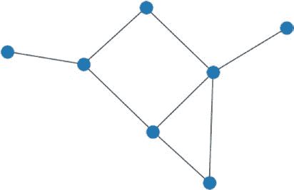

# 第 7 章 可视化图与网络

输出如下：

```
Nodes of the graph G:
['a', 'b', 'c', 1, 2, 'd', 'e']
Edges of the graph G:
[('a', 'b'), ('a', 'c'), ('a', 1), ('a', 2), ('c', 'd'), (1, 2), (1, 'd'), ('d', 'e')]
```

## 在 Python 3 中可视化图

本节重点介绍如何使用`networkx`库对图进行可视化。

你已在前一节中准备了一个图。现在你可以按如下方式对其进行可视化：

```
nx.draw(G)
plt.show()
```

输出如图 7-1 所示。

图 7-1. 图的视觉表示

请注意，这些可视化是随机生成的，每次运行该语句时，都会为视觉表示生成不同的图像。

然而，这些可视化所表示的图是同构的。

图 7-2 显示了再次执行相同单元格时的输出。

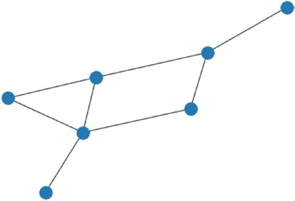

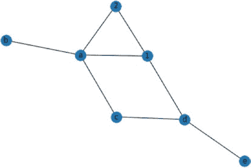

# 第 7 章 可视化图与网络

***图 7-2.** 同一张图的另一种视觉表示*

你可以看到这两个可视化是**同构**的，因为它们由同一张图生成。你可能还注意到节点没有显示任何名称。你可以使用以下代码显示节点名称：

```
nx.draw(G, with_labels=True)
plt.show()
```

图 7-3 显示了结果。

***图 7-3.** 带标签的节点*

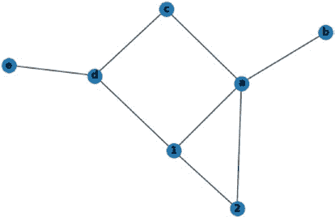

# 第 7 章 可视化图与网络

要以粗体显示节点标签，请使用以下代码：

```
nx.draw(G, with_labels=True, font_weight='bold')
plt.show()
```

可视化如图 7-4 所示。

***图 7-4.** 带粗体标签的节点*

## 更多类型的图

接下来，我们可以看看更多类型的图及其可视化。

第一种是**线性图或路径图**。图中连接到某个节点的节点数称为该节点的**度**。我们可以说路径图是一种有两个节点度为 1、其余节点度为 2 的图。如果我们在视觉上排列一个路径图，它看起来像一条分段线。要创建路径图，请运行以下代码：

`G = nx.path_graph(4)`

要显示节点和边，请使用以下代码：

```
print('Nodes of the graph G: ')
print(G.nodes())
print('Edges of the graph G: ')
print(G.edges())
```


# 第 7 章 可视化图与网络

输出如下：
```
Nodes of the graph G:
[0, 1, 2, 3]
Edges of the graph G:
[(0, 1), (1, 2), (2, 3)]
```

接下来，让我们创建它的可视化：
```
nx.draw(G, with_labels=True)
plt.show()
```
结果如图 7-5 所示。

**图 7-5.** 四个节点的路径图

## Petersen 图

下一种类型的图是`Petersen`图，一个具有 10 个顶点和 15 条边的无向图。我们可以使用以下代码创建它并查看边和节点的值：
```
G = nx.petersen_graph()
print('Nodes of the graph G: ')
print(G.nodes())
print('Edges of the graph G: ')
print(G.edges())
```

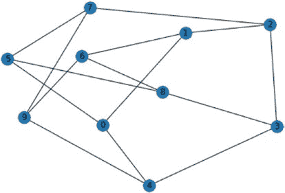

# 第 7 章 可视化图与网络

## 我们可以按如下方式对其进行可视化：

```python
nx.draw(G, with_labels=True)
plt.show()
```

输出如图 7-6 所示。

`图 7-6. Petersen 图`

现在，有很多方法可以更好地描绘它。我们可以将其描绘成一个内部带有五角星、带有五个辐条的五边形。以下代码实现了这一点。

```python
nx.draw_shell(G, nlist=[range(5, 10), range(5)],
              with_labels=True,
              font_weight='bold')
plt.show()
```

这段代码以壳形展示图形。我们在参数`nlist`中指定了按层排列的节点列表。输出如图 7-7 所示，它与前面的输出是同构的。

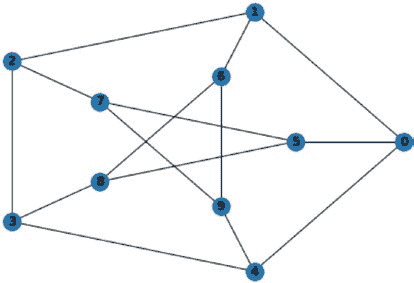

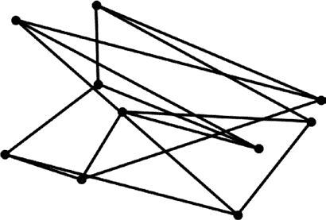

# 第 7 章 可视化图与网络

# 图形可视化与网络分析

**图 7-7.** 可视化彼得森图为壳形布局

我们可以自定义图形的展现方式。使用以下代码自定义节点大小和线条宽度：

```python
options = {'node_color': 'black', 'node_size': 100, 'width': 3}
```

现在让我们用这些选项可视化彼得森图：

```python
nx.draw_random(G, **options)
plt.show()
```

图 7-8 展示了输出结果。

**图 7-8.** 自定义节点与边的彼得森图

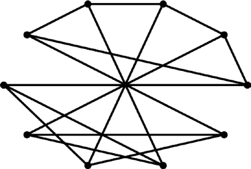

接下来，我们可以在圆形布局中对其进行可视化：

```python
nx.draw_circular(G, **options)
plt.show()
```

输出结果如图 7-9 所示。

**图 7-9.** 圆形布局中的彼得森图

我们也可以使用谱布局来描绘彼得森图：

```python
nx.draw_spectral(G, **options)
plt.show()
```

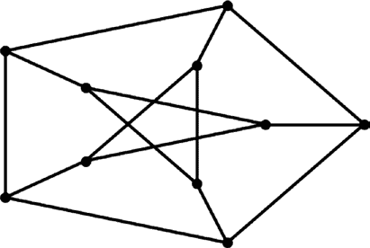

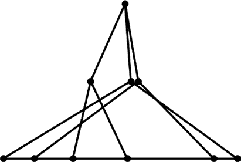

图 7-10 展示了输出结果。

**图 7-10.** 谱布局中的彼得森图

我们可以使用自定义选项在壳形布局中描绘彼得森图：

```python
nx.draw_shell(G, nlist=[range(5, 10), range(5)], **options)
plt.show()
```

输出结果如图 7-11 所示。

**图 7-11.** 壳形布局中自定义节点与边的彼得森图

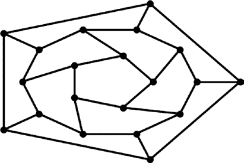

我们还可以创建一个十二面体图：

```python
G = nx.dodecahedral_graph()
```

它可以在壳形布局中可视化如下：

```python
shells = [[2, 3, 4, 5, 6],
          [8, 1, 0, 19, 18, 17, 16, 15, 14, 7],
          [9, 10, 11, 12, 13]]
nx.draw_shell(G, nlist=shells, **options)
plt.show()
```

图 7-12 展示了输出结果。

**图 7-12.** 壳形布局中自定义节点与边的十二面体图

您可以使用以下命令将任何图形文件保存到磁盘：

```python
plt.savefig('graph.png')
```

这条语句会将文件保存到程序所在位置（与 notebook 相同的目录）的磁盘上。

## 图形与网络可视化——为节点分配自定义标签

您可以使用以下代码为节点分配自定义标签：

```python
G = nx.path_graph(4)
cities = {0: 'Mumbai', 1: 'Hyderabad',
          2: 'Banglore', 3: 'New York'}
H = nx.relabel_nodes(G, cities)
print('Nodes of the graph H: ')
print(H.nodes())
print('Edges of the graph H: ')
print(H.edges())
```

以下是输出结果：

```
Nodes of the graph H:
['Mumbai', 'Hyderabad', 'Banglore', 'New York']
Edges of the graph H:
[('Mumbai', 'Hyderabad'), ('Hyderabad', 'Banglore'),
 ('Banglore', 'New York')]
```

使用以下代码创建可视化：

```python
nx.draw(H, with_labels=True)
plt.show()
```

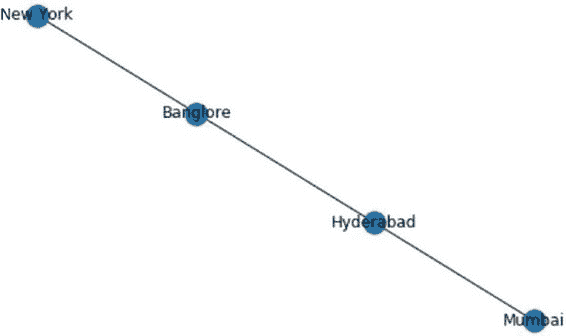

图 7-13 展示了输出结果。

**图 7-13.** 在线性或路径图中重新标记的节点

## 总结

本章探讨了图的概念，介绍了不同类型的图。您学会了以不同方式将它们可视化。现在您应该能够熟练地使用 Python 3 对图数据结构进行可视化。

下一章将介绍 SciPy 的数据科学库——pandas。我们将介绍 pandas 库中多功能的数据结构——Series 和 DataFrame，并附带几个数据可视化的示例。

