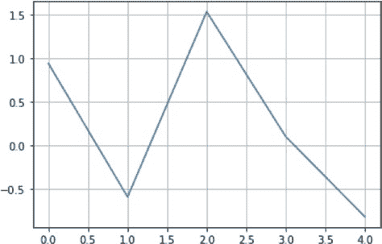
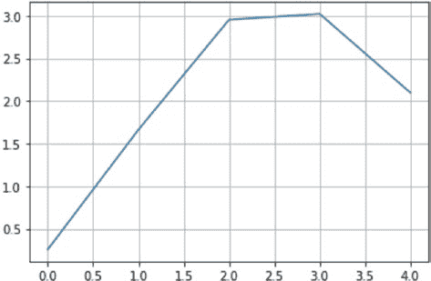
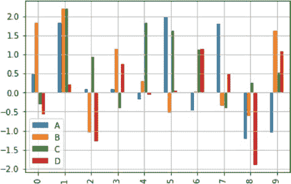
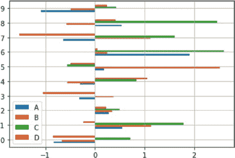
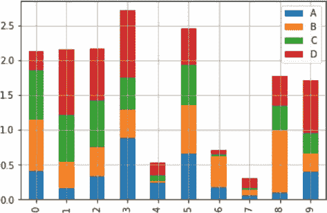
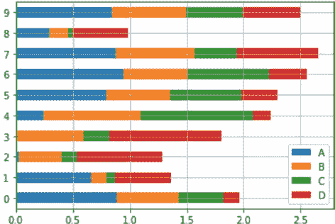
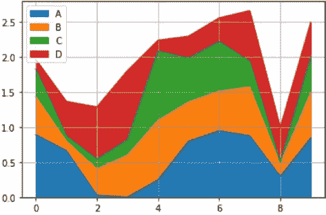
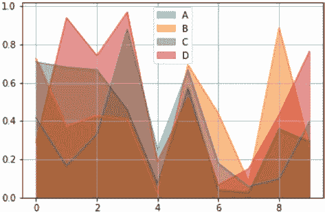
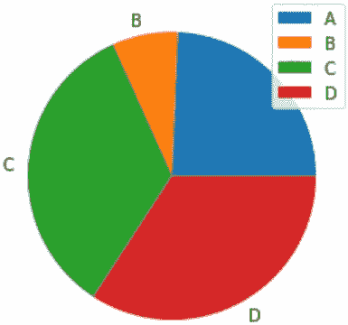

# 第 8 章 Pandas 入门

第 7 章介绍了使用 Python 的 `networkx` 库进行图形可视化。本章将聚焦于 SciPy 数据科学与分析库——pandas 的基础知识。首先，我们将探索该库中的数据结构。您还将学习如何从 `.csv` 数据集读取数据。最后，您将学习如何创建简单的可视化演示。以下是本章涵盖的主题：

- pandas 简介
- pandas 中的 `DataFrame`
- 使用 pandas 进行可视化

完成本章后，您应能熟练使用 pandas 进行基本可视化。

# Pandas 简介

`Pandas` 是数据分析组件，也是 `SciPy` 生态系统中不可或缺的一部分。它包含了功能非常丰富的数据结构及其管理例程。此外，它还具备以科学数据格式对数据进行可视化的能力。

© Ashwin Pajankar 2021

A. Pajankar，《实用 Python 数据可视化》,

[`doi.org/10.1007/978-1-4842-6455-3_8`](https://doi.org/10.1007/978-1-4842-6455-3_8#DOI)

# 第 8 章 Pandas 入门

第一步，通过在 Jupyter Notebook 中运行以下命令来将其安装在计算机上：

```
!pip3 install pandas
```

你可以通过运行以下命令将其导入当前会话：

```
import pandas as pd
```

你可以在 [`pandas.pydata.org/`](https://pandas.pydata.org/) 上阅读更多关于 pandas 的信息。

## Pandas 中的 Series（序列）

序列是一种带标签的一维数组。它可以保存任何类型的数据。这些标签统称为索引。

我们可以按如下方式创建一个序列：

```
s1 = pd.Series([1, 2, 3, 5, -3])
```

要确定其数据类型，请使用以下命令：

```
type(s1)
```

你可以使用以下语句查看与其关联的值和索引：

```
print(s1)
```

你可以按如下方式显式指定数据类型：

```
s2 = pd.Series([1, 2, 3, 5, -3], dtype=np.int32)
print(s2)
```

要将列表作为参数传递给构造函数以创建序列，请使用以下代码：

```
x = [1, 2, 3, 5, -3]
s3 = pd.Series(x)
```

我们甚至可以将 NumPy 的 `ndarray` 作为参数传递给构造函数来创建序列，如下所示：

```
import numpy as np
y = np.array(x)
s4 = pd.Series(y)
```

要显示值，请使用以下代码：

```
print(s4.values)
```

这将提供以下输出：

```
[ 1 2 3 5 -3]
```

你可以按如下方式检索索引：

```
print(s4.index)
```

这将产生以下输出：

```
RangeIndex(start=0, stop=5, step=1)
```

要分配自定义索引，请使用以下代码：

```
s5 = pd.Series(x, index=['a', 'b', 'c', 'd', 'e'])
print(s5)
```

这将提供以下输出：

```
a    1
b    2
c    3
d    5
e   -3
dtype: int64
```

## Series 上的基本操作

我们可以对序列执行一些基本操作。例如，我们可以按如下方式显示负数：

```
print(s5[s5 < 0])
```

这将产生以下输出：

```
e   -3
dtype: int64
```

我们也可以按如下方式检索正数：

```
print(s5[s5 > 0])
```

输出如下所示：

```
a    1
b    2
c    3
d    5
dtype: int64
```

这些是比较操作的示例。要执行乘法运算，请使用以下语法：

```
c = 3
print(s5 * c)
```

输出如下：

```
a     3
b     6
c     9
d    15
e    -9
dtype: int64
```

## Pandas 中的 DataFrame（数据框）

数据框是一种带有标签的二维数据结构，其列可以是不同的数据类型。我们可以从序列、`ndarrays`、列表和字典创建数据框。数据框具有标签，这些标签统称为索引。我们可以轻松地查看和操作数据框中的数据。数据以矩形网格格式存储在数据框中。

我们可以按如下方式从字典数据列表创建数据框：

```
data = {'city': ['Mumbai', 'Mumbai', 'Mumbai',
                 'Hyderabad', 'Hyderabad', 'Hyderabad'],
        'year': [2010, 2011, 2012, 2010, 2011, 2012],
        'population': [10.0, 10.1, 10.2, 5.2, 5.3, 5.5]}
```

要由此创建数据框，请使用以下代码：

```
df1 = pd.DataFrame(data)
print(df1)
```

输出如下：

```
        city  year  population
0     Mumbai  2010        10.0
1     Mumbai  2011        10.1
2     Mumbai  2012        10.2
3  Hyderabad  2010         5.2
4  Hyderabad  2011         5.3
5  Hyderabad  2012         5.5
```

使用以下代码行显示前五条记录：

```
df1.head()
```

输出如下：

```
        city  year  population
0     Mumbai  2010        10.0
1     Mumbai  2011        10.1
2     Mumbai  2012        10.2
3  Hyderabad  2010         5.2
4  Hyderabad  2011         5.3
```

你也可以将其他数字作为参数传递给函数 `head()`，它将显示数据框中相应数量的顶部记录。

类似地，你可以使用 `df1.tail()` 来显示末尾的记录。它的默认参数是 5，但你可以自定义传递给它的参数。

你可以按如下方式创建一个具有特定列顺序的数据框：

```
df2 = pd.DataFrame(data, columns=['year', 'city', 'population'])
print(df2)
```

这将产生以下输出：

```
year city population
0 2010 Mumbai 10.0
1 2011 Mumbai 10.1
2 2012 Mumbai 10.2
3 2010 Hyderabad 5.2
4 2011 Hyderabad 5.3
5 2012 Hyderabad 5.5
```

接下来，让我们创建一个带有额外列和自定义索引的数据框：

```
df3 = pd.DataFrame(data, columns=['year', 'city', 'population', 'GDP'],
                   index = ['one', 'two', 'three', 'four', 'five', 'six'])
print(df3)
```

以下是新的数据框：

```
          year       city  population  GDP
one       2010    Mumbai        10.0  NaN
two       2011    Mumbai        10.1  NaN
three     2012    Mumbai        10.2  NaN
four      2010  Hyderabad        5.2  NaN
five      2011  Hyderabad        5.3  NaN
six       2012  Hyderabad        5.5  NaN
```

使用以下命令打印列的列表：

```
print(df3.columns)
```

输出结果如下：

```
Index(['year', 'city', 'population', 'GDP'], dtype='object')
```

我们可以按如下方式打印索引的列表：

```
print(df3.index)
```

这将输出：

```
Index(['one', 'two', 'three', 'four', 'five', 'six'], dtype='object')
```

你可以使用以下语句显示某一列的数据：`print(df3.year)`。另外，你也可以使用以下语句：

```
print(df3['year'])
```

输出如下：

```
one      2010
two      2011
three    2012
four     2010
five     2011
six      2012
Name: year, dtype: int64
```

你可以使用以下语句显示某一列的数据类型：`print(df3['year'].dtype)`。你也可以使用这段代码：

```
print(df3.year.dtype)
```

将输出：

```
int64
```

要显示所有列的数据类型，请使用此语句：`print(df3.dtypes)`。输出如下：

```
year           int64
city          object
population   float64
GDP           object
dtype: object
```

我们可以按如下方式使用索引检索任何记录：

```
df3.loc['one']
```

输出结果如下：

# 为列分配值

你可以按如下方式为某一列的所有成员分配相同的值：

```python
df3.GDP = 10
print(df3)
```

输出如下所示：

```
          year       city  population  GDP
one       2010    Mumbai        10.0   10
two       2011    Mumbai        10.1   10
three     2012    Mumbai        10.2   10
four      2010  Hyderabad        5.2   10
five      2011  Hyderabad        5.3   10
six       2012  Hyderabad        5.5   10
```

## 分配 `ndarray`

我们可以按如下方式将一个 `ndarray` 分配给 `GDP` 列：

```python
import numpy as np
df3.GDP = np.arange(6)
print(df3)
```

这将输出：

```
          year       city  population  GDP
one       2010    Mumbai        10.0    0
two       2011    Mumbai        10.1    1
three     2012    Mumbai        10.2    2
four      2010  Hyderabad        5.2    3
five      2011  Hyderabad        5.3    4
six       2012  Hyderabad        5.5    5
```

## 分配列表

你也可以按如下方式为其分配一个列表：

```python
df3.GDP = [3, 2, 0, 9, -0.4, 7]
print(df3)
```

输出如下：

```
          year       city  population  GDP
one       2010    Mumbai        10.0  3.0
two       2011    Mumbai        10.1  2.0
three     2012    Mumbai        10.2  0.0
four      2010  Hyderabad        5.2  9.0
five      2011  Hyderabad        5.3 -0.4
six       2012  Hyderabad        5.5  7.0
```

## 分配序列

让我们按如下所示为其分配一个序列：

```python
val = pd.Series([-1.4, 1.5, -1.3], index=['two', 'four', 'five'])
df3.GDP = val
print(df3)
```

以下是输出结果：

```
          year       city  population  GDP
one       2010    Mumbai        10.0  NaN
two       2011    Mumbai        10.1 -1.4
three     2012    Mumbai        10.2  NaN
four      2010  Hyderabad        5.2  1.5
five      2011  Hyderabad        5.3 -1.3
six       2012  Hyderabad        5.5  NaN
```

# 读取以 CSV 格式存储的数据

我们可以使用 `read_csv()` 方法读取以逗号分隔值（CSV）格式存储的数据。CSV 文件可以存储在远程 URL 或磁盘上的某个位置。以下是一个读取托管在互联网 URL 上的 CSV 文件的示例：

```python
df = pd.read_csv('https://raw.githubusercontent.com/cs109/2014_data/master/countries.csv')
df.head(5)
```

输出如下：

```
      Country    Region
0     Algeria    AFRICA
1      Angola    AFRICA
2       Benin    AFRICA
3    Botswana    AFRICA
4     Burkina    AFRICA
```

我们可以用同样的方式将存储在磁盘上某个文件中的数据读取到数据框中。

# 使用 Pandas 进行可视化

Pandas 数据框具有类似 Matplotlib 的可视化方法。基本上，这些方法是对 `Matplotlib` 中方法的包装。

让我们看看如何使用这些方法来可视化存储在 `pandas` 数据帧中的数据。

首先导入 `Matplotlib` 的 `pyplot` 模块，并使用魔法命令在笔记本中启用 `Matplotlib` 可视化，如下所示：

```python
%matplotlib inline
import matplotlib.pyplot as plt
```

`NumPy` 函数 `randn()` 生成一个具有标准正态随机分布的 `NumPy` 数组。我们将用它来创建一个序列并绘制它，如下所示：

```python
ts = pd.Series(np.random.randn(5))
ts
```

输出如下（每次执行代码时都会不同，因为它在执行时是随机生成的）：

```
0    0.257543
1    1.405170
2    1.290728
3    0.068451
4   -0.923677
dtype: float64
```



**第 8 章 开始使用 pandas**

## 简单线图

可以将其可视化为：

```python
ts.plot()
plt.grid(True)
plt.show()
```

它产生如图 8-1 所示的输出。

***图 8-1.** 简单线图*

## 累积和线图

我们可以使用函数 `cumsum()` 计算累积和，并将其可视化如下：

```python
ts.cumsum().plot()
plt.grid(True)
plt.show()
```



**第 8 章 开始使用 pandas**

输出如图 8-2 所示。

***图 8-2.** 累积和的简单线图*

## 柱状图

现在，像这样创建一个数据帧：

```python
df1 = pd.DataFrame(np.random.randn(10, 4),
                   columns=['A', 'B', 'C', 'D'])
print(df1)
```

以下输出是结果：

```
          A         B         C         D
0  0.474219  1.821673 -0.296638 -0.566934
1  1.820044  2.199264  2.196097  0.203744
2  0.086325 -1.056730  0.937690 -1.283733
3  0.087798  1.145512 -0.407545  0.747684
4 -0.179241  0.290476  1.823487 -0.059593
5  1.964211 -0.525957  1.615896  0.046840
6 -0.463331  0.032999  1.130027  1.151667
7  1.805051 -0.338121 -0.397105  0.487373
8 -1.212102 -0.610992  0.258653 -1.885551
9 -1.052613  1.624191  0.529037  1.081536
```



**第 8 章 开始使用 pandas**

### 垂直条形图

我们可以用垂直条形图将其可视化，如下所示：

```python
df1.plot.bar()
plt.grid(True)
plt.show()
```

输出如图 8-3 所示。

***图 8-3.** 垂直条形图*

### 水平条形图

你甚至可以使用水平条形图，如下所示：

```python
df1.plot.barh()
plt.grid(True)
plt.show()
```



**第 8 章 开始使用 pandas**

图 8-4 显示了输出。

***图 8-4.** 水平条形图*

让我们创建另一个具有相似维度的数据帧。我们将使用 `rand()` 函数，该函数使用均匀正态分布生成一个 `NumPy` `ndarray`。示例如下：

# 第 8 章 开始使用 pandas

```
df2 = pd.DataFrame(np.random.rand(10, 4), columns=['A', 'B', 'C', 'D'])
print(df2)
```

输出如下所示：

```
          A         B         C         D
0  0.416596  0.725513  0.707631  0.286249
1  0.166804  0.370956  0.680678  0.938911
2  0.330940  0.426264  0.667221  0.741184
3  0.879112  0.409153  0.460051  0.968562
4  0.248149  0.021732  0.072309  0.186000
5  0.666609  0.692510  0.574111  0.519540
6  0.178994  0.437883  0.036931  0.063519
7  0.057269  0.079832  0.025361  0.150671
8  0.099039  0.886589  0.358671  0.431321
9  0.395520  0.262707  0.291207  0.763712
```



我们可以创建堆叠的垂直条形图，如下所示：

```
df2.plot.bar(stacked=True)
plt.grid(True)
plt.show()
```

这会产生如图 8-5 所示的输出。


类似地，我们可以生成水平堆叠条形图，如下所示：

```
df2.plot.barh(stacked=True)
plt.grid(True)
plt.show()
```





要创建面积图，请使用以下代码：

```
df2.plot.area()
plt.grid(True)
plt.show()
```

默认情况下，面积图是堆叠的，如图 8-7 所示。



你可以创建一个非堆叠的重叠面积图，如下所示：

```
df2.plot.area(stacked=False)
plt.grid(True)
plt.show()
```

上述代码将生成图 8-8 所示的输出。


接下来，我们演示饼图。首先按如下方式创建一个简单的数据框：

```
df3 = pd.DataFrame(np.random.rand(4), index=['A', 'B', 'C', 'D'])
print(df3)
```

输出结果如下：

```
A 0.292772
B 0.569819
C 0.835805
D 0.479885
```

使用以下代码创建饼图：

```
df3.plot.pie(subplots=True)
plt.show()
```

结果如图 8-9 所示。



## 总结

本章探讨了 SciPy 的数据科学库 pandas 的基础知识。你学习了基本 pandas 数据结构（`Series` 和数据框）的创建与操作基础，还掌握了数据框数据可视化的基本方法，以及如何从 CSV 文件读取数据。

所有这些概念对于完成下一章的练习将非常有用。下一章将通过处理与当前 COVID-19 疫情相关的数据，为我们数据可视化的学习之旅画上句点，并提供一个有趣的现实案例研究。


