# 第 9 章：处理 COVID-19 数据

第 8 章介绍了 SciPy 数据科学库 pandas 的基础知识。你学习了 `Series` 和数据框数据结构的基础，以及如何对数据框和 `Series` 中的数据进行可视化。

本章是你在前几章所学知识的集大成者。在本章中，我们将检索真实世界的数据并对其进行可视化。学完本章后，你应该能够熟练地对真实数据集进行可视化。

## COVID-19 疫情与数据集

在本书撰写之际，世界正面临一场前所未有的自然灾害——一场由严重急性呼吸综合征冠状病毒 2 型（SARS-CoV-2）及其引发的疾病 COVID-19 所造成的疫情（一种跨越各大洲传播的传染病）。这种病毒与导致普通感冒等非致命疾病以及非典和中东呼吸综合征等更致命疾病的病毒同属一个病毒家族（冠状病毒）。这些病毒会感染哺乳动物和人类的呼吸道，若未及时治疗，可能致命。

© Ashwin Pajankar 2021
A. Pajankar，《实用 Python 数据可视化》，
[`doi.org/10.1007/978-1-4842-6455-3_9`](https://doi.org/10.1007/978-1-4842-6455-3_9#DOI)

## COVID-19 数据源

许多组织都在追踪全球 COVID-19 病例，并定期在其网站和网络服务上更新数据。其中最著名的是约翰霍普金斯大学（[`coronavirus.jhu.edu/map.html`](https://coronavirus.jhu.edu/map.html)）和 World-O-Meter（[`www.worldometers.info/coronavirus/`](https://www.worldometers.info/coronavirus/)）。这些是非常可靠的 COVID-19 数据来源，并且它们会非常频繁地（至少每 24 小时一次）更新统计数据，以便下游系统获取最新数据。

我们可以使用 Python 中的自定义库来检索这些数据。其中一个库可以在 [`ahmednafies.github.io/covid/`](https://ahmednafies.github.io/covid/) 找到。它可以从约翰霍普金斯大学和 World-O-Meter 两者中检索数据。

要安装它，请为本章创建一个新笔记本，并在代码单元格中运行以下命令：

```
!pip3 install covid
```

接着，按如下方式导入库：

```
from covid import Covid
```

你可以使用以下代码获取数据：

```
covid = Covid()
```

默认情况下，它会从约翰霍普金斯大学获取数据。你也可以显式指定数据源：

```
covid = Covid(source="john_hopkins")
```

要获取 World-O-Meter 的数据，请更改源值：`covid = Covid(source="worldometers")`。

你可以使用以下命令显示所有数据：

```
covid.get_data()
```

这将返回一个字典列表，如图 9-1 所示。

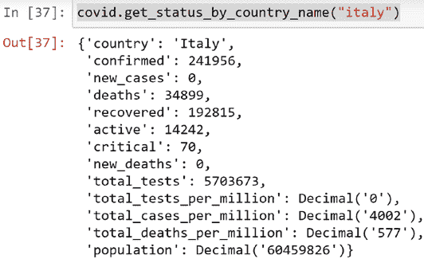

我们可以通过以下方式确定数据来源：

`covid.source`

此情况下的输出如下所示：

`'worldometers'`

你也可以通过国家名称检索状态，操作如下：`covid.get_status_by_country_name("italy")`。结果如图 9-2 所示。


你也可以通过国家 ID 检索数据（此功能仅对 Johns Hopkins 数据源有效），代码如下：

`covid.get_status_by_country_id(115)`

要检索受 COVID-19 大流行影响的国家列表，请使用以下语法：

`covid.list_countries()`

它返回如图 9-3 所示的列表。

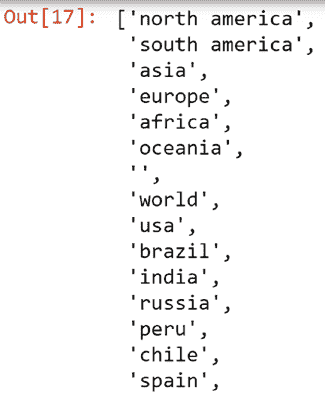

现存的病例总数可以通过以下方式获取：`covid.get_total_active_cases()`。

确诊病例总数可以通过以下方式获取：`covid.get_total_confirmed_cases()`。

康复病例总数可以通过以下方式获取：`covid.get_total_recovered()`。

死亡病例总数可以通过以下方式获取：`covid.get_total_deaths()`。

运行这些语句并检查输出。

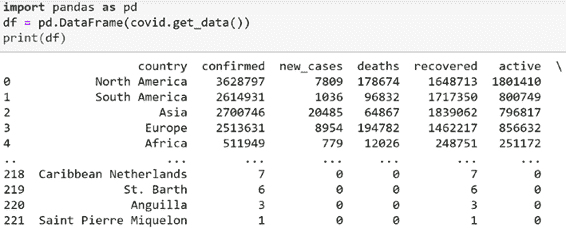

## 可视化 COVID-19 数据

现在，您可以按如下方式将所有数据转换为 pandas 数据帧：

# 第 9 章 处理 COVID-19 数据

```python
import pandas as pd

df = pd.DataFrame(covid.get_data())

print(df)
```

输出如图 9-4 所示。

***图 9-4.** 转换为数据帧的 COVID-19 数据*

使用以下代码对数据进行排序：

```python
sorted = df.sort_values(by=['confirmed'], ascending=False)
```

该数据也包含各大洲和全球的累积数据。我们可以按如下方式排除全球和各大洲的数据：

```python
excluded = sorted[~sorted.country.isin(['Europe', 'South America', 'Asia', 'World', 'North America', 'Africa'])]
```

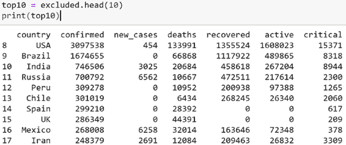

排名前 10 的国家可以通过以下方式获取：

```python
top10 = excluded.head(10)

print(top10)
```

输出如图 9-5 所示。

***图 9-5.** 受 COVID-19 影响最严重的 10 个国家*

现在我们可以将数据提取到变量中，操作如下：

```python
x = top10.country

y1 = top10.confirmed

y2 = top10.active

y3 = top10.deaths

y4 = top10.recovered
```

现在，我们可以使用结果进行可视化。使用以下命令导入 `Matplotlib` 并在笔记本中启用绘图功能：

```python
%matplotlib inline

import matplotlib.pyplot as plt
```

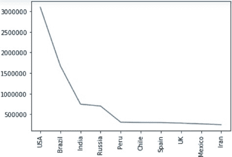

创建一个简单的折线图，操作如下：

```python
plt.plot(x, y1)

plt.xticks(rotation=90)

plt.show()
```

结果如图 9-6 所示。

***图 9-6.** 受 COVID-19 影响最严重的 10 个国家（折线图）*

我们可以按如下方式显示条形图：

```python
plt.bar(x, y1)

plt.xticks(rotation=90)

plt.show()
```

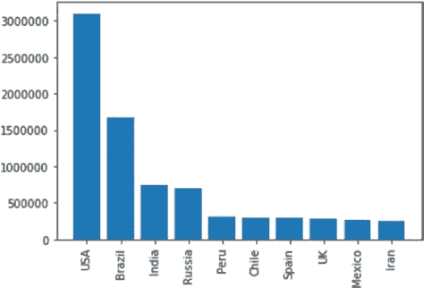

图 9-7 显示了结果。

***图 9-7.** 受 COVID-19 影响最严重的 10 个国家（条形图）*

使用以下代码创建多线图：

```python
plt.plot(x, y1, label='Confirmed')

plt.plot(x, y2, label='Active')

plt.plot(x, y3, label='Deaths')

plt.plot(x, y4, label='Recovered')

plt.legend(loc='upper right')

plt.xticks(rotation=90)

plt.show()
```

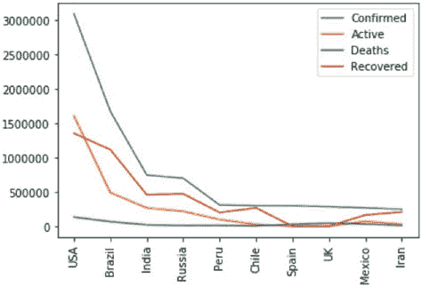

输出如图 9-8 所示。

***图 9-8.** 受 COVID-19 影响最严重的 10 个国家（多线图）*

我们可以用更紧凑的代码和更好的格式重写前面的示例，如下所示：

```python
labels = ['Confirmed', 'Active', 'Deaths', 'Recovered']

plt.plot(x, y1, x, y2, x, y3, x, y4)

plt.legend(labels, loc='upper right')

plt.xticks(rotation=90)

plt.grid()

plt.show()
```

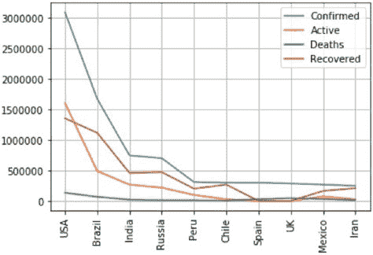

结果如图 9-9 所示。

### 图 9-9：受 COVID-19 影响最大的 10 个国家（带网格的多线图）

我们可以通过如下方式在垂直多柱状图中展示数据：`df2 = pd.DataFrame([y1, y2, y3, y4])`

```python
df2.plot.bar();
plt.legend(x, loc='upper center')
plt.xticks(rotation=90)
plt.grid()
plt.show()
```

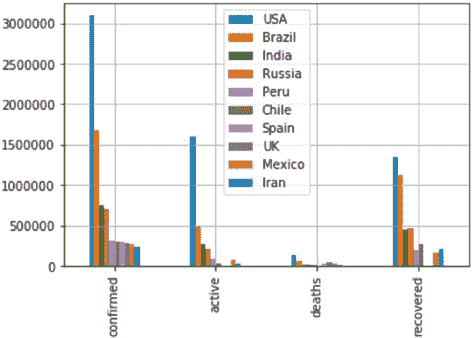

图 9-10 显示了输出结果。

### 图 9-10：排名前 10 的国家的 COVID-19 统计数据（带网格的多柱状图）

我们可以通过以下代码绘制垂直堆叠柱状图来呈现数据：

```python
df2.plot.bar(stacked=True);
plt.legend(x, loc='upper center')
plt.xticks(rotation=90)
plt.grid()
plt.show()
```

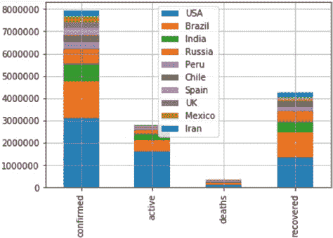

这会产生如图 9-11 所示的输出。

### 图 9-11：排名前 10 的国家的 COVID-19 统计数据（带网格的垂直堆叠柱状图）

我们可以像这样创建水平柱状图：

```python
df2.plot.barh();
plt.legend(x, loc='upper right')
plt.xticks(rotation=90)
plt.grid()
plt.show()
```

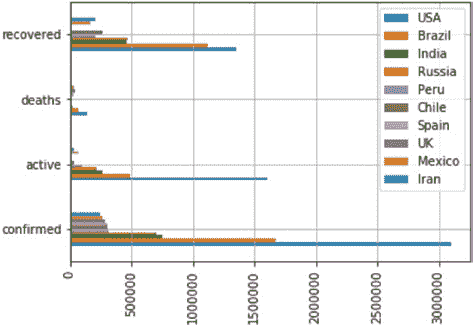

这会产生如图 9-12 所示的输出。

### 图 9-12：排名前 10 的国家的 COVID-19 统计数据（带网格的水平柱状图）

接下来，使用以下代码创建一个堆叠的水平柱状图：`df2.plot.barh(stacked=True);`

```python
plt.legend(x, loc='upper right')
plt.xticks(rotation=90)
plt.grid()
plt.show()
```

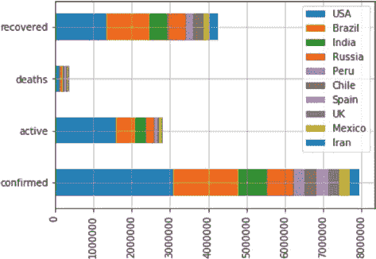

输出如图 9-13 所示。

### 图 9-13：排名前 10 的国家的 COVID-19 统计数据（带网格的水平堆叠柱状图）

我们甚至可以使用面积图来可视化这些数据。默认情况下，面积图是堆叠的，正如我们所知。我们可以这样创建它：`df2.plot.area();`

```python
plt.legend(x, loc='upper right')
plt.xticks(rotation=90)
plt.grid()
plt.show()
```

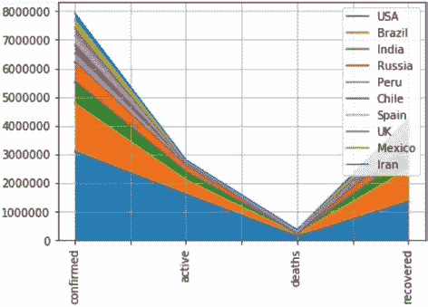

输出如图 9-14 所示。

### 图 9-14：排名前 10 的国家的 COVID-19 统计数据（堆叠面积图）

你甚至可以通过以下方式创建一个重叠的面积图：

```python
df2.plot.area(stacked=False);
plt.legend(x, loc='upper right')
plt.xticks(rotation=90)
plt.grid()
plt.show()
```

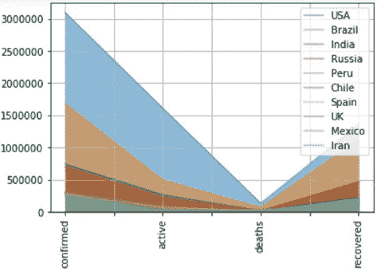

图 9-15 展示了结果。

### 图 9-15：排名前 10 的国家的 COVID-19 统计数据（重叠面积图）

要创建一个漂亮的散点图，其中点的大小与数据大小成比例，请使用以下代码：

```python
factor=0.0001
plt.scatter(x, y1, s=y1*factor);
plt.scatter(x, y2, s=y2*factor);
plt.scatter(x, y3, s=y3*factor);
plt.scatter(x, y4, s=y4*factor);
plt.legend(labels, loc='upper right')
plt.xticks(rotation=90)
plt.grid()
plt.show()
```

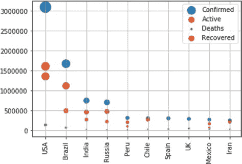

输出如图 9-16 所示。

### 图 9-16：排名前 10 的国家的 COVID-19 统计数据（散点图）

最后，你可以使用以下代码创建一个漂亮的饼图：`plt.pie(y1, labels=x)`

```python
plt.title('Confirmed Cases')
plt.show()
```

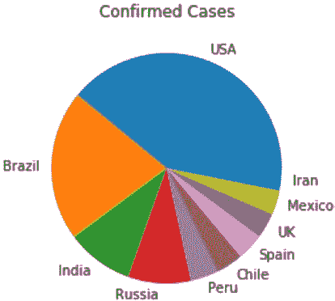

输出如图 9-17 所示。

### 图 9-17：排名前 10 的国家的 COVID-19 统计数据（饼图）

## 总结

在本章中，你学习了如何从各种在线来源检索 COVID-19 数据，并将数据转换为一个 `Pandas DataFrame`。你还了解了如何准备各种类型的可视化图表，以图形化的方式呈现这些 COVID-19 数据。

至此，我们使用真实数据进行的可视化之旅就结束了。希望你能像我喜欢编写本书中的示例一样，享受阅读和跟随练习的过程。数据可视化是一个广阔的领域。还有许多其他的 Python 数据可视化库供你探索，例如 `ggplot`、`plotly` 和 `seaborn`。

这些库提供了高级数据可视化能力，可以满足您的业务和科学可视化需求。

# 索引

## A, B

`重叠区域图`, 153

`饼图`, 155

`加法运算`, 87

`散点图`, 154

`arange()`函数, 60

`堆叠区域图`, 152

`算术运算`, 85, 100

`统计`, 148

`分配自定义标签`, 114

`垂直堆叠条形图`, 149

`可视化数据`, 142

## C

`cumsum()`函数, 129

`颜色通道`, 89, 91, 92

`逗号分隔值（CSV）`

## D, E, F

格式, 127

`比较运算`, 120

`数据框`, `Pandas`, 121–127

`构造函数`, 119

`数据可视化库`

`容器`, 51

`颜色`/`样式`/`标记`, 73–79

`COVID-19`, 137

`网格`/`坐标轴`/`标签`, 68–73

`受影响国家`, 141

`Matplotlib`, 58–63

`各国数据`, 140

`多线图`, 66, 67

`数据框`, 142

`Numpy`, 59–63

`数据源`, 138–142

`单线图`, 64, 66

`前 10 个国家`,

类型

`受影响`, 143

`条形图`, 41

`柱状图`, 145

`自定义线条`, 38

`网格`, 147

`线段`, 37

`水平图`, 150

`多线`, 39, 40

`水平堆叠条形`

`垂直柱状`, 42, 43

`图`, 151

`Debian`, 8

`折线图`, 144

`df1.tail()`函数, 122

`多线图`, 146

`十二面体图`, 113

© Ashwin Pajankar 2021

A. Pajankar, *Python 数据可视化实战*,

[`doi.org/10.1007/978-1-4842-6455-3`](https://doi.org/10.1007/978-1-4842-6455-3#DOI)

索引

## G

`图`, 101

`皮革`

`节点和边`, 107

`代码`, 33, 34

`路径`, 108

`定义`, 33

`绘制点`, 35, 36

## L

`缩放`, 43, 45

`样式设置`, 45–48

## H

`head()`函数, 122

`元组`, 34

`水平条形图`, 132

`legend()`函数, 71, 72

`水平堆叠`

`条形图`, 133, 134

## M

## I

`Matplotlib`, 50, 56, 58

`图像运算`, 86

`meshgrid()`函数, 95

`加法`, 87

`颜色通道`, 91, 92

# 索引

## A

- 减法, 88, 89

## N

- `Ndarray`
  - 定义, 51, 52
  - 一维, 53, 54
  - 属性, 54, 55

- `Network`, 101

- `Networkx`, 102, 103, 105, 117
  - 节点, 101, 102

- `NumPy`
  - 常量, 55, 56
  - 定义, 51
  - 库, 51, 52

## I

- 集成开发与学习环境（`IDLE`）, 9

## J, K

- `Jupyter Notebook`
  - 定义, 18
  - 纯文本格式, 18
  - Python 语句, 18
  - 运行代码, 25–27, 29
  - 运行操作系统命令, 31, 32
  - 搭建环境, 19–23, 25

## O

- 重叠面积图, 135, 152

## P, Q

- Pandas, 117
  - 基本操作, 120
  - 数据框, 121, 124
  - GDP 列, 126
  - 序列, 118
  - 可视化, 128

- 彼得森图, 109
  - 圆形配置, 111
  - 边与节点, 108
  - 节点与边, 110
  - 外壳布局, 110, 112
  - 谱配置, 112

- 饼图, 135, 136, 154, 155

- `plot()` 函数, 59, 64, 72

- Python 3
  - 应用领域, 4
  - 图, 102
  - 历史, 2
  - 安装
    - Debian/Ubuntu, 8
    - `IDLE`, 9, 10, 12
    - 交互模式, 13, 14
    - 脚本模式, 14–16
    - Windows 计算机, 5–8
  - 节点, 106
  - 操作系统平台, 1
  - 哲学理念, 3, 4
  - 编程语言, 2

- Python 增强提案（PEPs）, 3

- Python 包索引（`PyPI`）, 33

## R

- `randn()` 函数, 128

- `ravel()` 函数, 96

## S

- 科学 Python 生态系统（`SciPy`）, 48–50

- 严重急性呼吸综合征冠状病毒 2（SARS-CoV-2）, 137

- `show()` 函数, 60, 82

- 堆叠面积图, 134

- 减法运算, 87, 88

## T

- 3D 可视化
  - 柱状图, 95, 97
  - 数据点, 94
  - 参数曲线, 95
  - `Qt` 窗口, 93
  - 线框, 98

## U

- Ubuntu Linux 与树莓派操作系统, 8

## V, W, X, Y, Z

- 垂直柱状图, 131

- 垂直堆叠柱状图, 133, 148, 149

- 可视化图像
  - `Matplotlib` 的 `Pyplot` 模块, 82
  - 颜色, 83
  - 显示, 82
  - 存储, 82
  - 灰度, 84, 85
  - 隐藏坐标轴, 83

- 可视化图, 105, 106

# 目录

## 第 1 章：Python 简介
- Python 编程语言
  - Python 的历史
  - Python 增强提案
    - Python 的设计哲学
  - Python 的应用
- 在不同平台上安装 Python
  - 在 Windows 电脑上安装
  - 在 Ubuntu 及 Debian 衍生版上安装
- Python 模式
  - 交互模式
  - 脚本模式
- 本章小结

## 第 2 章：探索 Jupyter Notebook
- Jupyter Notebook 概述
- 搭建 Jupyter Notebook 环境
- 在 Jupyter Notebook 中运行代码
- 本章小结

## 第 3 章：使用 Leather 进行数据可视化
- 在 Jupyter Notebook 中运行操作系统命令
- Leather 简介
- 更多可视化类型
- 坐标轴刻度
- 样式设置
- 本章小结

## 第 4 章：科学计算 Python 生态系统与 NumPy
- 科学计算 Python 生态系统
- NumPy 与 Ndarray
  - 多维数组
- Ndarray 属性
- NumPy 常量
- 本章小结

## 第 5 章：使用 NumPy 和 Matplotlib 进行数据可视化
- Matplotlib
- 使用 NumPy 和 Matplotlib 进行可视化
- 单线图
- 多线图
- 网格、坐标轴与标签
- 颜色、样式与标记点
- 本章小结

## 第 6 章：图像与 3D 形状可视化
- 图像可视化
- 图像操作
- 3D 可视化
- 本章小结

## 第 7 章：图形与网络可视化
- 图形与网络
  - Python 3 中的图形
- 在 Python 3 中可视化图形
- 更多图形类型
- 为节点分配自定义标签
- 本章小结

## 第 8 章：Pandas 入门
- Pandas 简介
  - Pandas 中的 Series
  - Series 基本操作
- Pandas 中的 DataFrame
  - 读取 CSV 格式存储的数据
- 使用 Pandas 进行可视化
- 本章小结

## 第 9 章：处理 COVID-19 数据
- COVID-19 疫情与数据集
  - COVID-19 数据来源
- 可视化 COVID-19 数据
- 本章小结

- 索引