# 第 3 章 使用 leather 进行数据可视化

[org/project/leather/](https://pypi.org/project/leather/)。`PyPI`是一个第三方软件包仓库，可以使用`pip3`工具进行下载。我们也可以在 PyPI 上搜索某个包是否可用。在笔记本中运行以下命令：

```
!pip3 search leather
```

输出结果如图 3-2 所示。

***图 3-2.** 使用 pip3 搜索软件包*

在继续之前，我们需要事先了解一些关于 Python 编程语言的知识。在 Python 中，缩进用于表示代码块。在 C、C++和 Java 等几种流行的编程语言中，多行代码块用花括号`{}`括起来。Python 则强制程序员缩进代码块，没有其他表示方法。以下面的代码为例。

```
a = 3

if a%2 == 0:

print('Even')

else:

print('Odd')
```

在笔记本中运行该代码并查看结果。还有一件有趣的事情可以尝试。我们已经了解了《Python 之禅》（PEP 20）。Python 的创建者将其作为彩蛋添加在解释器中，你可以通过以下语句调用它：

```
import this
```

如果在笔记本中运行这行语句，它会在输出中打印《Python 之禅》的所有箴言。

请注意，我们使用 Jupyter Notebook 演示的所有程序，稍加修改后也可以在 IDLE 中运行。我们之所以使用 Jupyter Notebook，是因为它具有即时反馈和交互式功能。现在，让我们使用`import`语句将 leather 库添加到笔记本中。

每个会话只需导入一次，它在整个会话期间都可使用。使用以下语句：

```
import leather
```

运行后，它会将该库导入到当前的笔记本会话中。最好为每个新主题添加一个标题，但这由你自己决定。你会发现，我在本书配套代码的笔记本中经常使用标题，以便为演示的内容提供上下文和参考。这是一个好习惯，你可能也想效仿。

让我们编写简单的代码来可视化一些数据点。我们可以在 X-Y 坐标系中定义这些点。我们可以使用元组列表来定义点，如下所示：

```
data1 = [(1.5, 2), (2, 3), (4.5, 6), (7.5, 4)]
```

我们也可以将它们定义为列表的列表：

```
data1 = [[1.5, 2], [2, 3], [4.5, 6], [7.5, 4]]
```

我们还可以将它们定义为元组的元组：

```
data1 = ((1.5, 2), (2, 3), (4.5, 6), (7.5, 4))
```

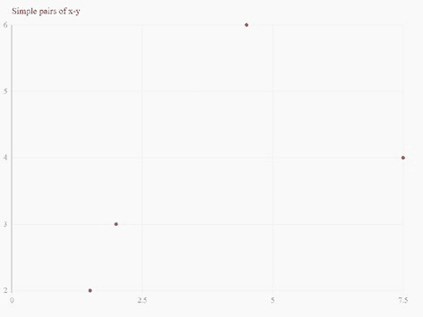

我们也可以将它们定义为列表的元组：

```
data1 = ([1.5, 2], [2, 3], [4.5, 6], [7.5, 4])
```

正如你所看到的，leather 库在数据定义方式上并不苛刻，非常灵活。

让我们按如下方式定义一个图表对象：

```
chart = leather.Chart('简单的 x-y 坐标对')
```

接下来，创建一个散点图：

```
chart.add_dots(data1)
```

然后，按如下方式可视化图表：

```
chart.to_svg()
```

它会在同一个笔记本中显示输出结果，如图 3-3 所示。

***图 3-3.** 绘制数据点*

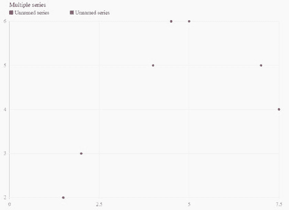

我们可以使用以下语句将图像保存到磁盘：

```
chart.to_svg('image1.svg')
```

然后，我们可以如下方式自定义散点：

```
chart = leather.Chart('自定义散点')
chart.add_dots(data1, fill_color='#00ff00', radius=10)
chart.to_svg()
```

让我们定义更多的数据点：

```
data2 = [(2, 3), (4, 5), (5, 6), (7, 5)]
```

我们还可以按如下方式可视化多个序列：

```
chart = leather.Chart('可视化多个序列')
chart.add_dots(data1)
chart.add_dots(data2)
chart.to_svg()
```

输出结果如图 3-4 所示。

***图 3-4.** 绘制多个序列*

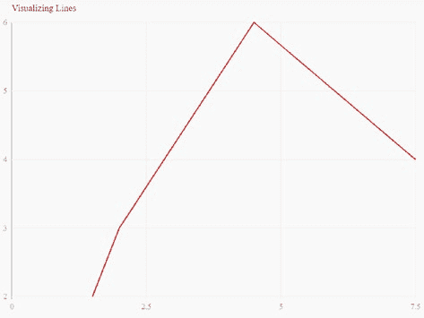

如图 3-4 所示，leather 会根据数据点所属的序列自动为它们分配不同的颜色。

## 更多可视化类型


我们可以使用连接各点的线段来可视化数据，如下所示：`chart = leather.Chart('Visualizing Lines')`

`chart.add_line(data1)`

`chart.to_svg()`

输出结果如图 3-5 所示。

***图 3-5.** 线段可视化*

我们可以按如下方式自定义线段可视化：

`chart = leather.Chart('Customized Line')`

`chart.add_line(data1, stroke_color='#0000ff', width=3)`

`chart.to_svg()`

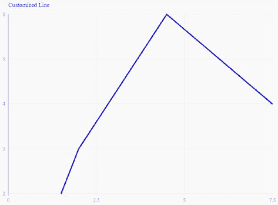

第 3 章 使用 leather 进行数据可视化

图 3-6 显示了输出结果。

***图 3-6.** 自定义线段*

我们可以按如下方式可视化多条线段：

`chart = leather.Chart('Visualizing Multiple Lines')`

`chart.add_line(data1)`

`chart.add_line(data2)`

`chart.to_svg()`

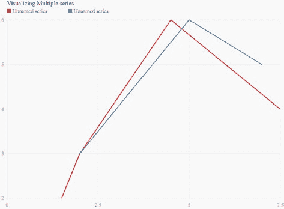

第 3 章 使用 leather 进行数据可视化

图 3-7 显示了输出结果。

***图 3-7.** 多条线段可视化*

我们可以在单个可视化中展示多种类型，如下所示：`chart = leather.Chart('Visualizing Multiple Types')`

`chart.add_line(data1)`

`chart.add_dots(data2)`

`chart.to_svg()`

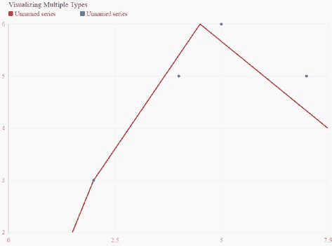

第 3 章 使用 leather 进行数据可视化

图 3-8 显示了输出结果。

***图 3-8.** 多种类型可视化*

我们可以使用条形图进行可视化，如下所示：

```
data = [[1, 'A'], [2, 'B'], [3, 'C'], [4, 'D']]
chart = leather.Chart('Visualizing Bars')
chart.add_bars(data)
chart.to_svg()
```

在我们的数据集中，其中一个维度是文本数据。可视化结果如图 3-9 所示。

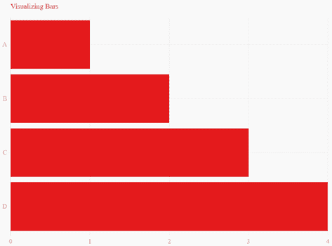
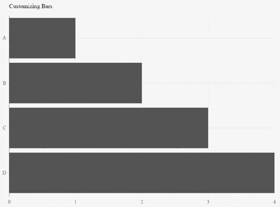

第 3 章 使用 leather 进行数据可视化

***图 3-9.** 条形图可视化*

我们可以按如下方式自定义条形图：

`chart = leather.Chart('Customizing Bars')`

`chart.add_bars(data, fill_color='#777777')`

`chart.to_svg()`

输出结果如图 3-10 所示。

***图 3-10.** 自定义条形图*

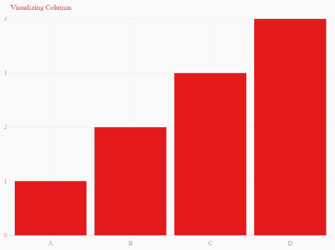

第 3 章 使用 leather 进行数据可视化

我们可以使用垂直柱状图进行可视化，如下所示：

```
data = [('A', 1), ('B', 2), ('C', 3), ('D', 4)]
chart = leather.Chart('Visualizing Columns')
chart.add_columns(data)
chart.to_svg()
```

输出结果如图 3-11 所示。

***图 3-11.** 垂直柱状图*

我们可以按如下方式自定义柱状图：

`chart = leather.Chart('Customizing Columns')`

`chart.add_columns(data, fill_color='#77ff77')`

`chart.to_svg()`

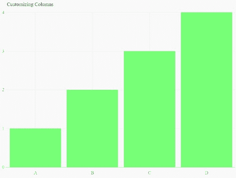

第 3 章 使用 leather 进行数据可视化

输出结果如图 3-12 所示。

***图 3-12.** 自定义垂直柱状图*

## 刻度

`leather` 库可以自动或通过编程创建多种类型的刻度。序数刻度是为文本数据自动创建的。示例与我们之前看到的相同：`chart = leather.Chart('The Ordinal Scale')`

`chart.add_columns(data)`

`chart.to_svg()`

当数据是数值型时，会自动创建线性刻度。我们可以按如下方式设置刻度的范围：

```
chart = leather.Chart('Linear Scale')
chart.add_x_scale(1, 8)
chart.add_y_scale(1, 7)
chart.add_line(data1)
chart.to_svg()
```

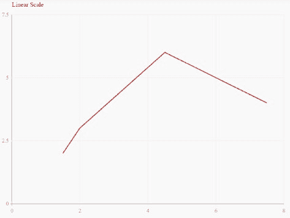

第 3 章 使用 leather 进行数据可视化

图 3-13 显示了输出结果。

***图 3-13.** 自定义范围的线性刻度*

时间刻度是为时间（与时间相关）数据自动创建的：

```
from datetime import date

data = [
    (date(2020, 1, 1), 4),
    (date(2020, 3, 1), 6),
    (date(2020, 6, 1), 2),
    (date(2020, 9, 1), 1)
]

chart = leather.Chart('Temporal Scale')
chart.add_x_scale(date(2019, 9, 1), date(2020, 12, 1))
chart.add_line(data)
chart.to_svg()
```

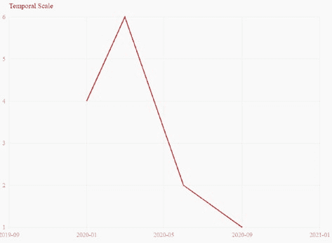

第 3 章 使用 leather 进行数据可视化

输出结果如图 3-14 所示。

***图 3-14.** 自定义范围的时间刻度*

## 样式

Leather 提供了许多样式选项。我们可以根据需求设置坐标轴上的刻度值，如下所示：

```
chart = leather.Chart('Ticks Demo')
chart.add_x_scale(1, 8)
chart.add_x_axis(ticks=[1, 2, 3, 4, 5, 6, 7, 8])
chart.add_y_scale(1, 7)
```


`chart.add_y_axis(ticks=[1, 2, 3, 4, 5, 6, 7])`

`chart.add_line(data1)`

`chart.to_svg()`

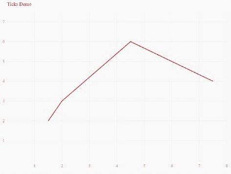

## 第 3 章 使用 leather 进行数据可视化

输出结果如图 3-15 所示。

***图 3-15.** 自定义刻度值*

我们还可以自定义用于显示数值与序列的字体和颜色。以下是一个简单示例。

`leather.theme.title_font_family = 'Times New Roman'`

`leather.theme.legend_font_family = 'Times New Roman'`

`leather.theme.tick_font_family = 'Times New Roman'`

`leather.theme.default_series_colors = ['#ff0000', '#00ff00']`

`chart = leather.Chart('自定义字体')`

`chart.add_line(data1)`

`chart.add_line(data2)`

`chart.to_svg()`

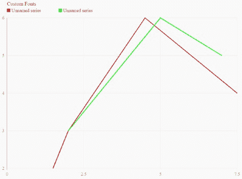

## 第 3 章 使用 leather 进行数据可视化

图 3-16 展示了此示例的输出结果。

***图 3-16.** 自定义字体与颜色*

我们还可以通过以下代码根据数据点的位置为其着色。首先在笔记本中导入随机库：`import random`

我们将使用它生成如下数据点：

```python
data = [(random.randint(0, 250),
         random.randint(0, 250)) for i in range(100)]
```

这会创建 100 个数据点。这 100 个点的 x 轴和 y 轴值均从 0 到 250 的区间中随机选取。我们可以编写一个颜色函数，根据点的位置返回 RGB 格式的颜色值。

```python
def colorizer(location):
    return 'rgb(%i, %i, %i)' % (location.x, location.y, 150)
```

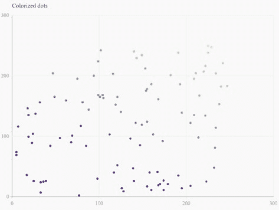

## 第 3 章 使用 leather 进行数据可视化

调用此函数来定义点的填充颜色，具体如下：

```python
chart = leather.Chart('着色点')
chart.add_dots(data, fill_color=colorizer)
chart.to_svg()
```

输出结果如图 3-17 所示。

***图 3-17.** 数据点的自定义颜色*

## 本章小结

本章通过使用流行的数据可视化库 leather 演示了如何用 Python 进行数据可视化。我们介绍了不同类型的可视化图表、样式和刻度。Leather 是一个非常简单的数据可视化库，仅能可视化简单的图形。

你的业务需求或科学可视化可能需要更复杂精细的图表。为此，你需要熟悉科学 Python 生态系统。下一章将详细探讨科学 Python 生态系统。我们还将学习 NumPy N 维数组（也称为 ndarray）的基础知识。

## 第 4 章

## 科学 Python 生态系统与 NumPy

在第 3 章中，你学习了如何使用 Python 3 和 leather 数据可视化库创建简单的可视化图表。你还了解到，使用 leather 数据可视化库只能准备基本的可视化图表。对于更复杂精细的可视化，我们需要使用具有高级数据处理和可视化功能的库。

本章将探讨科学 Python 生态系统及其组成部分。它还将通过几个代码演示简要介绍 NumPy 库。本章探讨以下主题：

- 科学 Python 生态系统
- NumPy 与 ndarray
- Ndarray 属性
- NumPy 常量

在本书的剩余章节中，我们将逐一探讨科学 Python 生态系统的许多组成部分。在整本书中，我们将使用属于这个科学 Python 生态系统的不同库。本章获得的有价值知识将为后续章节奠定基础。由于本章是为一个广泛的生态系统编写的入门章节，我将其保持得简短而实用。

© Ashwin Pajankar 2021  
A. Pajankar 著，《实用 Python 数据可视化》，  
<https://doi.org/10.1007/978-1-4842-6455-3_4>

## 科学 Python 生态系统

科学 Python 生态系统（SciPy）是一个用于数学、科学和工程的 Python 库集合。SciPy 拥有以下核心组件：

1.  *Python 编程语言：* 我们在第 1 章中探讨了 Python 3 编程语言的安装和一些基础知识。
2.  *NumPy：* 这是数值 Python 库，是 Python 中进行数值计算的基础包。它定义了一种 *N* 维数据类型，可用于对多维数据进行数值计算。
3.  *SciPy 库：* 它包含许多用于数学和科学计算的例程，可用于科学应用。
4.  *Matplotlib：* 这是一个受 MATLAB 启发的 Python 3 数据可视化库。

该生态系统中还有几个额外的重要成员库。

1.  *Pandas：* 代表 Python 数据分析。它提供了灵活的数据结构，如序列和数据帧。
2.  *SymPy：* 代表符号 Python。它用于符号数学和代数。
3.  *scikit-image：* 该库包含用于图像处理的例程。
4.  *scikit-learn：* 该库包含用于机器学习的例程。

通常与 SciPy 一起使用的交互环境是 IPython 或 Jupyter Notebook。我们在第 2 章中详细了解了 Jupyter Notebook，并在第 3 章中也使用了它。在本书的其余部分我们将继续使用它。

下一节将更详细地介绍 NumPy 库。

## NumPy 与 Ndarrays

如前所述，NumPy 是 Python 中进行数值计算的基础包。NumPy 库最有用的特性是称为 ndarray 的多维容器数据结构。

ndarray 是一个多维数组（也称为容器），其中包含具有相同数据类型和大小的元素。我们可以在创建 ndarray 时定义元素的大小和数据类型。就像列表等其他数据结构一样，我们可以通过索引访问 ndarray 的内容。ndarray 中的索引范围从 0 开始（类似于 C 语言中的数组或 Python 中的列表）。我们可以将 ndarray 用于各种计算。

SciPy 中的所有其他库以及其他库也能识别并使用 NumPy ndarray 及相关例程来表示其自身的数据结构并对其进行操作。

让我们从一个动手示例开始。为此章创建一个新的 Jupyter 笔记本，然后运行以下命令安装 NumPy 库：

`!pip3 install numpy`

通过运行以下命令将其导入当前笔记本：

```python
import numpy as np
```

你可以创建一个列表，然后像这样用它来创建一个简单的 ndarray：

```python
l1 = [1, 2, 3]
x = np.array(l1, dtype=np.int16)
```

这里我们从一个列表创建一个 ndarray。成员的数据类型是 16 位整数。你可以在 <https://numpy.org/devdocs/user/basics.types.html> 找到所支持数据类型的详细列表。

我们可以将前面的代码写成单行，如下所示：

```python
x = np.array(l1, dtype=np.int16)
```

让我们打印 ndarray 的值及其类型（我们知道，类型是 ndarray）。

```python
print(x)
print(type(x))
```

输出如下：

```
[1 2 3]
<class 'numpy.ndarray'>
```

正如我们在输出中观察到的，它属于类 `numpy.ndarray`。正如我们之前所学，索引从 0 开始。让我们通过如下方式访问 ndarray 的元素来演示这一点：

```python
print(x[0]); print(x[1]); print(x[2])
```

输出如下：

```
1
2
3
```

我们甚至可以使用负索引：-1 返回最后一个元素，-2 返回倒数第二个元素，依此类推。示例如下：

```python
print(x[-1])
```

如果我们提供任何无效的索引值，它会抛出一个错误。

```python
print(x[3])
```


在这个语句中，我们试图访问 `ndarray` 的第四个元素，但它并不存在。因此返回以下错误：`IndexError Traceback (most recent call last)`

```
<ipython-input-4-d3c02b9c2b5d> in <module>
----> 1 print(x[3])
IndexError: index 3 is out of bounds for axis 0 with size 3
```

## 多维

数组也可以拥有多个维度，如下所示：`x1 = np.array([[1, 2, 3], [4, 5, 6]], np.int16)`

这表示一个两行三列的二维矩阵。我们可以按如下方式访问单个元素：

`print(x1[0, 0]); print(x1[0, 1]); print(x1[0, 2]);`

我们甚至可以访问整行：

`print(x1[0, :])`
`print(x1[1, :])`

输出如下：

```
[1 2 3]
[4 5 6]
```

我们可以使用以下语法访问整列：

`print(x[:, 0])`

输出如下：

```
[1 4]
```

我们甚至可以拥有超过两个维度的 `ndarray`。以下是创建三维 (3D) 数组的语法：

`x2 = np.array([[[1, 2, 3], [4, 5, 6]],[[0, -1, -2], [-3, -4, -5]]], np.int16)`

科学和商业应用经常使用多维数据。Ndarrays 对于存储数值数据非常有用。尝试运行以下命令并检索前面 3D 矩阵中的元素。

`print(x2 [0, 0, 0])`
`print(x2 [1, 1, 2])`
`print(x2[:, 1, 1])`

## Ndarray 属性

我们可以通过 ndarray 的属性来了解更多信息。

首先，我们通过演示来看看所有属性。此示例使用我们之前用过的同一个 3D 矩阵。

`x2 = np.array([[[1, 2, 3], [4, 5, 6]],[[0, -1, -2], [-3, -4, -5]]], np.int16)`

我们可以通过以下语句获取维度数量：`print(x2.ndim)`

输出返回维度数量。然后，我们可以按如下方式了解 `ndarray` 的形状：

`print(x2.shape)`

形状表示各个维度的大小，如下所示：`(2, 2, 3)`

我们可以按如下方式确定成员的数据类型：

`print(x2.dtype)`

输出如下：

```
int16
```

我们还可以了解大小（元素数量）以及存储所需的内存字节数，如下所示：

`print(x2.size)`
`print(x2.nbytes)`

输出如下：

我们可以使用以下代码计算转置：

`print(x2.T)`

## NumPy 常量

NumPy 库包含许多有用的数学和科学常量，您可以在程序中使用它们。以下代码片段打印了所有重要的常量：

`print(np.inf)`
`print(np.NAN)`
`print(np.NINF)`
`print(np.NZERO)`
`print(np.PZERO)`
`print(np.e)`
`print(np.euler_gamma)`
`print(np.pi)`

输出如下：

```
inf
nan
-inf
-0.0
0.0
2.718281828459045
0.5772156649015329
3.141592653589793
```

## 总结

本章介绍了 NumPy 和 ndarray 的基础知识。NumPy 库非常庞大，包含许多例程。甚至有专门介绍 NumPy 的书籍。就我们的目的而言，我们将在后续章节中根据可视化演示的需要，探索 NumPy 库中更多的例程。

下一章将介绍一些 ndarray 创建例程以及使用 Matplotlib 进行数据可视化的基础知识。

## 第 5 章

## 数据可视化

## 使用 NumPy

## 和 Matplotlib

第 4 章介绍了 NumPy 的基础知识。您学习了如何安装它以及如何创建 ndarray。在本章中，我们将继续使用 NumPy，了解一些 ndarray 创建例程。我们还将开始使用科学计算生态系统中的数据可视化库 Matplotlib。我们将使用 NumPy 的 ndarray 创建例程来演示如何使用 Matplotlib 进行可视化。本章内容详尽，重点是代码和可视化。本章涵盖以下主题：

• Matplotlib

• 使用 NumPy 和 Matplotlib 进行可视化

• 单线图

• 多线图

• 网格、坐标轴和标签

• 颜色、样式和标记

© Ashwin Pajankar 2021
A. Pajankar，*实用 Python 数据可视化*，


[`doi.org/10.1007/978-1-4842-6455-3_5`](https://doi.org/10.1007/978-1-4842-6455-3_5#DOI)

## 第 5 章 使用 `numpy` 和 `matplotlib` 进行数据可视化

在本书的后续章节中，我们将使用 Matplotlib 和 NumPy 来演示数据可视化。

## Matplotlib

Matplotlib 是 SciPy 的重要组成部分，用于数据可视化。它是 NumPy 的扩展，提供了类似 MATLAB 的绘图和可视化接口。它最初由 John D Hunter 开发，作为 Python 可用的开源替代方案。

我们可以通过 Jupyter Notebook 按如下方式安装它：

```
!pip3 install matplotlib
```

要在 notebook 中使用它进行基本绘图，我们必须按如下方式导入其 `pyplot` 模块：

```
import matplotlib.pyplot as plt
```

此外，要在 notebook 中显示 Matplotlib 的可视化结果，我们必须运行以下命令：

```
%matplotlib inline
```

这强制 Matplotlib 将输出内联显示，直接位于生成该可视化的代码单元格下方。当我们需要使用 Matplotlib 时，总会使用此命令。

我们也来导入 NumPy，如下所示：

```
import numpy as np
```

你可以在 [`matplotlib.org/`](https://matplotlib.org/) 上阅读关于 Matplotlib 的更多信息。

### 使用 NumPy 和 Matplotlib 进行可视化

现在我们将学习如何使用 `ndarray` 创建例程来创建 NumPy ndarray，然后使用 Matplotlib 对其进行可视化。让我们从创建 `ndarray` 的例程开始。

第一个例程是 `arange()`。它使用给定的步长创建均匀间隔的值。必须提供一个终止值参数。起始值和步长参数分别有默认参数 0 和 1。

让我们看一个例子。

```
x = np.arange(5)
```

在此示例中，终止值为 5，因此它会创建一个从 0 开始到 4 结束的 `ndarray`。该函数返回一个具有半开区间的序列，这意味着终止值不包含在输出中。因为我们没有指定步长，它默认为 1。我们可以查看输出及其数据类型，如下所示：

```
print(x)
type(x)
```

输出如下：

```
[0 1 2 3 4]
numpy.ndarray
```

让我们继续绘制这些数字。对于二维绘图，我们需要 X-Y 对。

我们保持简单，通过运行以下语句设置 `y = f(x) = x`：`y=x`

现在，使用函数 `plot()` 来可视化它。它需要 X、Y 的值以及绘图选项。我们将在本章后面学习更多关于绘图选项的内容。

```
plt.plot(x, y, 'o--')
plt.show()
```

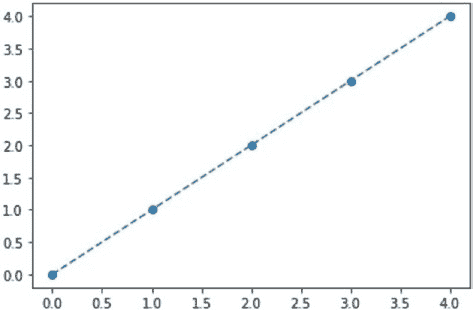

函数 `show()` 用于显示图形。如上所示，我们使用绘图选项 `o--` 进行可视化。这意味着点用实心圆表示，线为虚线，如图 5-1 所示。

***图 5-1.** 可视化 `y=f(x)=x`*

让我们看一个带有起始值和终止值参数的函数 `arange()` 调用示例：

```
np.arange(2, 6)
```

它返回以下输出（直接打印，我们未将其存储在变量中）：

```
array([2, 3, 4, 5])
```

我们甚至可以为步长添加一个参数，如下所示：

```
np.arange(2, 6, 2)
```

输出如下：

```
array([2, 4])
```

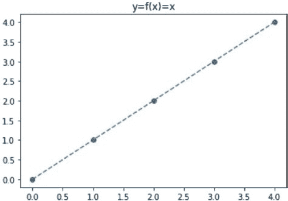

输出显示在图 5-2 中。

***图 5-2.** 带标题的输出*

函数 `linspace(start, stop, number)` 在指定的区间内返回均匀间隔的数字。我们必须向其传递起始值、终止值和值的数量，如下所示：

```
N = 11
x = np.linspace(0, 10, N)
print(x)
```

这段代码创建了 11 个数字（包含 0 到 10），如下所示：

```
[ 0.  1.  2.  3.  4.  5.  6.  7.  8.  9. 10.]
```

我们可以通过以下方式可视化它：

```
y = x
plt.plot(x, y, 'o--')
plt.axis('off')
plt.show()
```

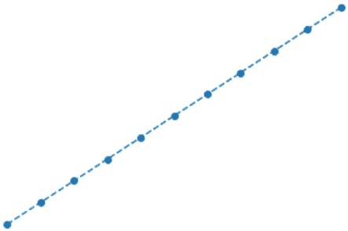

输出显示在图 5-3 中。

***图 5-3.** 使用 `linspace()` 的 `y = x` 输出*


如你所见，我们通过 `plt.axis('off')` 这一行代码来关闭坐标轴。

类似地，我们可以按如下方式计算并可视化对数空间中的数值：

```
y = np.logspace(0.1, 1, N)
print(y)
plt.plot(x, y, 'o--')
plt.show()
```

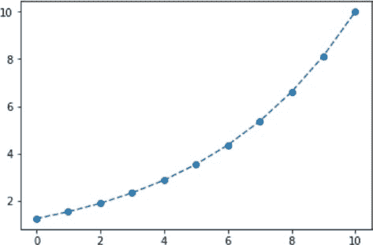
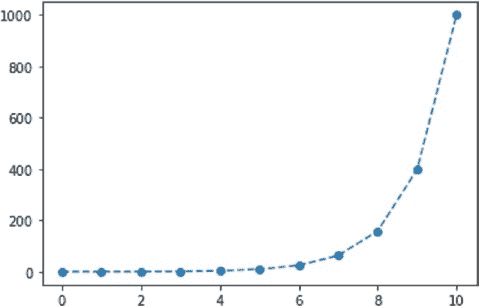

## 第 5 章 使用 NumPy 和 Matplotlib 进行数据可视化

输出结果如图 5-4 所示。

***图 5-4.** `logspace()` 的输出*

我们甚至可以按如下方式计算等比数列：
```
y = np.geomspace(0.1, 1000, N)
print(y)
plt.plot(x, y, 'o--')
plt.show()
```
输出结果显示在图 5-5 中。

***图 5-5.** `geomspace()` 的输出*

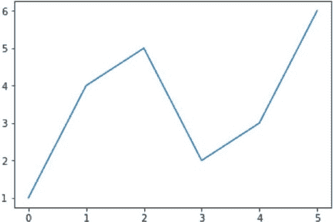

## 第 5 章 使用 NumPy 和 Matplotlib 进行数据可视化

## 单线图

在本节中，我们将探讨绘制单线图的几种方法。我们之前已使用 `plot()` 函数来绘制图形。当一张图中只使用 `plot()` 函数绘制了一个可视化图形时，这被称为单线图。让我们通过几个示例进一步了解。

我们也可以使用 Python 列表来可视化图形，如下所示：
```
x = [1, 4, 5, 2, 3, 6]
plt.plot(x)
plt.show()
```
输出结果如图 5-6 所示。

***图 5-6.** 简单的单线图*

在此例中，y 轴的值是自动假定的。这是另一个示例：
```
x = np.arange(10)
plt.plot(x)
plt.show()
```
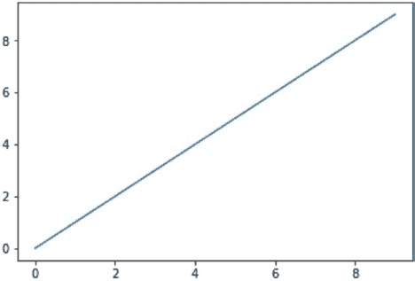
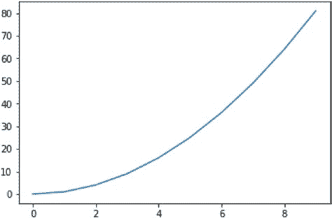

## 第 5 章 使用 NumPy 和 Matplotlib 进行数据可视化

输出结果显示在图 5-7 中。

***图 5-7.** 使用 `arange()` 绘制的简单单线图*

接下来，让我们可视化一个二次函数图形 `y = f(x) = x2`。代码如下：
```
plt.plot(x, [y**2 for y in x])
plt.show()
```
输出结果如图 5-8 所示。

***图 5-8.** `y = f(x) = x2`*

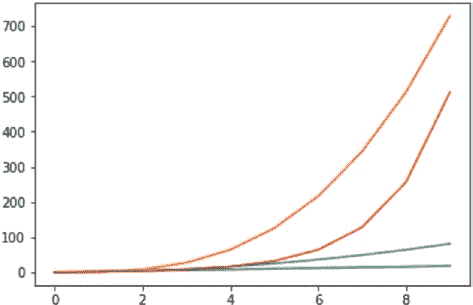

## 第 5 章 使用 NumPy 和 Matplotlib 进行数据可视化

我们可以用更简洁的方式编写相同的代码：
```
plt.plot(x, x**2)
plt.show()
```
## 多线图

在同一张可视化图形中显示多个图形是可行的。让我们通过一个简单示例来看看如何在同一张图中显示多条曲线：
```
x = np.arange(10)
plt.plot(x, x**2)
plt.plot(x, x**3)
plt.plot(x, x*2)
plt.plot(x, 2**x)
plt.show()
```
输出结果如图 5-9 所示。

***图 5-9.** 多线图*

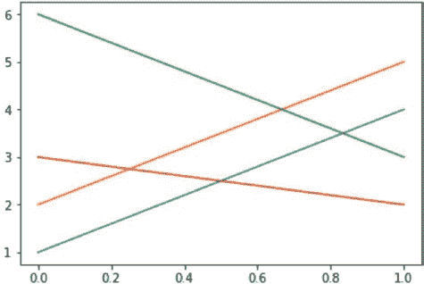

## 第 5 章 使用 NumPy 和 Matplotlib 进行数据可视化

正如我们所看到的，Matplotlib 会自动为每条曲线分配不同的颜色。

我们可以用更简洁的方式编写相同的代码：
```
plt.plot(x, x**2, x, x**3, x, x*2, x, 2**x)
plt.show()
```
输出结果将与图 5-9 相同。

这是另一个示例：
```
x = np.array([[1, 2, 6, 3], [4, 5, 3, 2]])
plt.plot(x)
plt.show()
```
输出结果显示在图 5-10 中。

***图 5-10.** 多线图的另一个示例*

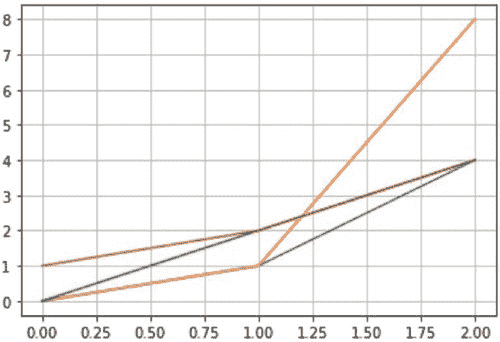

## 第 5 章 使用 NumPy 和 Matplotlib 进行数据可视化

## 网格、坐标轴和标签

之前，我们了解了如何在可视化图形中启用网格。这可以通过语句 `plt.grid(True)` 实现。现在，我们将学习如何操作坐标轴的界限。不过在此之前，我们先快速学习如何将可视化图形保存为图片。请看以下代码：
```
x = np.arange(3)
plt.plot(x, x**2, x, x**3, x, 2*x, x, 2**x)
plt.grid(True)
plt.savefig('test.png')
plt.show()
```
语句 `plt.savefig('test.png')` 将图片保存在 Jupyter Notebook 文件的当前目录中。输出结果如图 5-11 所示。

***图 5-11.** 多线图*

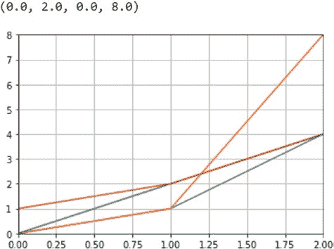

## 第 5 章 使用 NumPy 和 Matplotlib 进行数据可视化

我们可以看到，坐标轴的界限是默认设置的。我们可以将它们设置为特定值，如下所示：
```
x = np.arange(3)
plt.plot(x, x**2, x, x**3, x, 2*x, x, 2**x)
plt.grid(True)
plt.axis([0, 2, 0, 8])
print(plt.axis())
plt.show()
```
输出结果显示在图 5-12 中。

***图 5-12.** 设置坐标轴*

语句 `plt.axis([0, 2, 0, 8])` 用于设置坐标轴的值。


